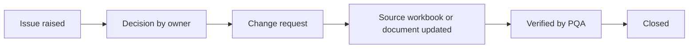

<picture>
  <source media="(prefers-color-scheme: dark)" srcset="../requirements/assets/MultipliersKraftLogoDark.png">
  
</picture>

# KI-00 — Known Issues Index

| Attribute | Value |
| :--- | :--- |
| Register | KI-00 |
| Product | Nucleus Suite (Nucleus HRMS Suite) |
| Version | 1.0.0 |
| Author | Dhanraj Dadhich |
| Date | 2026-11-05 |
| Scope | All open issues for Nucleus Suite requirements release 1.0.0. This folder is kept separate from the requirements package. |

**43 issues** plus a register of **158 legal validation statements**. Status: Open 42, Resolved in documentation 1.

| Register | Contents | Issues |
| :--- | :--- | ---: |
| [KI-01](KI-01_Source_Data_Conflicts.md) | Contradictions between source sheets | 12 |
| [KI-02](KI-02_Source_Data_Quality.md) | Gaps and defects in the source workbooks | 9 |
| [KI-03](KI-03_Decisions_Required.md) | Product, engineering, client and commercial decisions | 16 |
| [KI-04](KI-04_Legal_Validation_Register.md) | Legal and statutory statements to confirm | 158 statements |
| [KI-05](KI-05_Governance_Reviews_and_Approvals.md) | People, reviews and approvals | 3 |
| [KI-06](KI-06_Authored_Scope_Pending_Approval.md) | Authored scope awaiting decisions | 3 |

## All issues

| ID | Issue | Owner (role) | Needed by | Status | Register |
| :--- | :--- | :--- | :--- | :--- | :--- |
| KI-001 | Loan ceiling boundary differs between rules | Compensation Product Owner with client HR Head | P1 G1 | Open — client decision | [KI-01](KI-01_Source_Data_Conflicts.md) |
| KI-002 | Year-end leave expected result contradicts the rule | Leave Product Owner with client | P1 G1 | Open — client decision | [KI-01](KI-01_Source_Data_Conflicts.md) |
| KI-003 | Early-return example differs from its golden record | QA / Test Lead | P1 G1 | Open | [KI-01](KI-01_Source_Data_Conflicts.md) |
| KI-004 | Recompute reason count differs | Time & Attendance Product Owner | P1 G1 | Open | [KI-01](KI-01_Source_Data_Conflicts.md) |
| KI-005 | Actor who closed the early return differs | QA / Test Lead | P1 G1 | Open | [KI-01](KI-01_Source_Data_Conflicts.md) |
| KI-006 | Employee E1066 location differs | QA / Test Lead | P0 G1 | Open | [KI-01](KI-01_Source_Data_Conflicts.md) |
| KI-007 | Contractor invoice passes despite a missing challan | Contingent Workforce Product Owner | P2 G1 | Open | [KI-01](KI-01_Source_Data_Conflicts.md) |
| KI-008 | Unmatched ERP employee picklist allows creation | Integration Architect with Finance & ERP Product Owner | P1 G2 | Open | [KI-01](KI-01_Source_Data_Conflicts.md) |
| KI-009 | Same-day full-and-final has no escalation | Lifecycle Product Owner with client | P1 G1 | Open — client decision | [KI-01](KI-01_Source_Data_Conflicts.md) |
| KI-010 | Statutory form titles differ across sources | Compliance Product Owner with Legal | P1 G1 | Open — Legal | [KI-01](KI-01_Source_Data_Conflicts.md) |
| KI-011 | Peenya Works has no location holiday list | Leave Product Owner with client | P0 G1 | Open | [KI-01](KI-01_Source_Data_Conflicts.md) |
| KI-012 | Kannada absent from base interface languages | Product Owner | P2 | Resolved in documentation — pending approval of PLT-CG-017 | [KI-01](KI-01_Source_Data_Conflicts.md) |
| KI-101 | Processes specified only at inventory level | Domain Product Owners | Each domain's G1 | Open | [KI-02](KI-02_Source_Data_Quality.md) |
| KI-102 | Domains with no source test cases | QA / Test Lead | Each domain's G1 | Open | [KI-02](KI-02_Source_Data_Quality.md) |
| KI-103 | Forms workbook read-me lists a sheet that does not exist | Business Analyst Lead | P0 G1 | Open | [KI-02](KI-02_Source_Data_Quality.md) |
| KI-104 | Third-party product names inside source workbooks | Business Analyst Lead | P0 G1 | Open | [KI-02](KI-02_Source_Data_Quality.md) |
| KI-105 | Client rule IDs collide with product rule IDs | Business Analyst Lead | P0 G1 | Open | [KI-02](KI-02_Source_Data_Quality.md) |
| KI-106 | Loan rules incomplete | Compensation Product Owner | P1 G1 | Open | [KI-02](KI-02_Source_Data_Quality.md) |
| KI-107 | Phase mismatches between processes and capability gaps | Head of Product | Scope triage | Open | [KI-02](KI-02_Source_Data_Quality.md) |
| KI-108 | Lanes that are not personas | Security Architect | P1 G2 | Open | [KI-02](KI-02_Source_Data_Quality.md) |
| KI-109 | Rule ranges and stray references | Business Analyst Lead | P1 G1 | Open | [KI-02](KI-02_Source_Data_Quality.md) |
| KI-201 | Runtime framework, hosting model and mobile app count | Engineering lead | P0 | Open | [KI-03](KI-03_Decisions_Required.md) |
| KI-202 | Master-data direction per tenant | Product with Engineering | P0 hard gate | Open | [KI-03](KI-03_Decisions_Required.md) |
| KI-203 | Pilot client's legacy systems and extract formats unknown | Migration Lead with client IT Head | Before Mock 1 (P1) | Open | [KI-03](KI-03_Decisions_Required.md) |
| KI-204 | Programme calendar anchor for week 1 | Programme Manager | G0 | Open | [KI-03](KI-03_Decisions_Required.md) |
| KI-205 | Production data in migration rehearsals | Data Protection Officer | Before Mock 1 | Open | [KI-03](KI-03_Decisions_Required.md) |
| KI-206 | First bank for host-to-host disbursement | Client Finance Controller with Integration Architect | P1 G2 | Open | [KI-03](KI-03_Decisions_Required.md) |
| KI-207 | Contractor invoice posting to ERP payables | Contingent Workforce Product Owner | P3 planning | Open | [KI-03](KI-03_Decisions_Required.md) |
| KI-208 | Kiosk second factor | Integration Lead | P1 design review | Open | [KI-03](KI-03_Decisions_Required.md) |
| KI-209 | Approvals allowed in the business messaging channel | Security Lead with Product Council | P1 G2 | Open | [KI-03](KI-03_Decisions_Required.md) |
| KI-210 | Quiet hours and shift-derived quiet hours | OCM Lead | P2 pilot | Open | [KI-03](KI-03_Decisions_Required.md) |
| KI-211 | Reporting thresholds | DPO and Chief Architect | P1 G2 | Open | [KI-03](KI-03_Decisions_Required.md) |
| KI-212 | Individual-level predictive attrition scores | Data & AI Ethics Board | P3 entry | Open | [KI-03](KI-03_Decisions_Required.md) |
| KI-213 | Contractual service credits | Executive Sponsor | Before first pilot contract | Open | [KI-03](KI-03_Decisions_Required.md) |
| KI-214 | Statutory file layouts | Payroll SME with Legal | P1 G3 | Open | [KI-03](KI-03_Decisions_Required.md) |
| KI-215 | Statutory parameter values | Payroll SME | Before P2 parallel run | Open | [KI-03](KI-03_Decisions_Required.md) |
| KI-216 | SMS sender and template registration | Platform Lead with Legal | P2 entry | Open | [KI-03](KI-03_Decisions_Required.md) |
| KI-301 | Governance roles not yet assigned to named people | Executive Sponsor | G0 | Open | [KI-05](KI-05_Governance_Reviews_and_Approvals.md) |
| KI-302 | Peer reviews, approvals and measurement data pending | PQA Lead with Programme Manager | G0 then G1 | Open | [KI-05](KI-05_Governance_Reviews_and_Approvals.md) |
| KI-303 | Legal validation outstanding | Legal with DPO | G1 | Open | [KI-05](KI-05_Governance_Reviews_and_Approvals.md) |
| KI-401 | Authored capability gaps awaiting approval | Head of Product | Before each phase G1 | Open | [KI-06](KI-06_Authored_Scope_Pending_Approval.md) |
| KI-402 | Frontier features awaiting decision | Head of Product with DAEB | Phase planning | Open | [KI-06](KI-06_Authored_Scope_Pending_Approval.md) |
| KI-403 | Authored use cases, user stories and test cases need product confirmation | Domain Product Owners | Each domain's G1 | Open | [KI-06](KI-06_Authored_Scope_Pending_Approval.md) |

## How issues are closed

