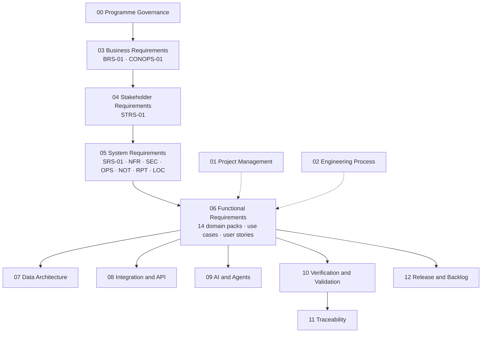
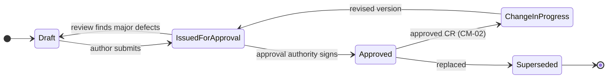

<picture>
  <source media="(prefers-color-scheme: dark)" srcset="../../assets/MultipliersKraftLogoDark.png">
  
</picture>

# DOC-01 — Document Control Standard and Shared Conventions

| Attribute | Value |
| :--- | :--- |
| Document ID | DOC-01 |
| Title | Document Control Standard and Shared Conventions |
| Product | Nucleus Suite (Nucleus HRMS Suite) |
| Version | 1.0.0 |
| Status | Issued for approval |
| Owner (role) | Engineering Process Group (EPG) Lead |
| Author | Dhanraj Dadhich |
| Reviewed by | *pending* |
| Approved by | Steering Committee — *pending* |
| Date | 2026-11-05 |
| Classification | Internal |
| CMMI practice areas | CM, PAD, PQA, RDM, MPM |
| Related documents | DOC-02, CM-01, CM-02, REQ-01, QA-02, MPM-01, SRC-01 |
| Quality & process-performance objectives | QPPO-05 (effective requirements reviews), QPPO-01 (escaped defects) |
| Process performance baseline used | PPB-01 (review defect density), PPB-02 (review rate) |
| Peer review record | *pending* (PR-xxxx, QA-02) |
| Tailoring record | none |
| Traceability anchor | BG-09 |

---

## 1. Purpose

This standard defines how every requirements, governance and process document of Nucleus Suite is identified, structured, written, versioned, reviewed, approved, measured and baselined. It fixes the shared vocabulary — product identity, goals, phases, domain codes, identifier schemes, governance bodies and gates — so that the whole set stays consistent, traceable and appraisable at **CMMI Maturity Level 5**. Every document in this repository complies with it; a departure is recorded as a process non-conformance (QA-04).

## 2. Product Identity

| Item | Value |
| :--- | :--- |
| Product name | **Nucleus Suite** (full name **Nucleus HRMS Suite**) |
| Organisation | MultipliersKraft — logo shown at the top of every document |
| Positioning | An AI-native, enterprise-grade Human Capital Management suite built on our own platform: India-first, global-ready, designed for frontline plants and head offices alike, with governed AI agents, continuous payroll and privacy by design |
| Voice and conversational assistant | **Nucleus Talk** |
| Pilot client used in examples and golden data | Vindhya Precision Industries Pvt Ltd (fictional; 2 legal entities, 5 sites, 4 states) |
| Author of record for release 1.0.0 | Dhanraj Dadhich |

## 3. Repository Structure

The requirements hierarchy follows ISO/IEC/IEEE 29148: business requirements refine into stakeholder requirements, then system requirements, then functional requirements per domain, with data, integration, AI, verification and traceability alongside.

| Folder | Contents |
| :--- | :--- |
| `00_Programme_Governance/` | DOC-01..02 document control · GOV-01..02 vision, capability coverage · GOV-03..04 charter, governance model · GOV-07..09 stakeholders, personas, communication · GOV-10..11 data and AI governance · SRC-01 source workbooks |
| `01_Project_Management/` | PLN-01..03 · RSK-01..03 · MPM-01 · MC-01 · DAR-01..02 · SAM-01 · OCM-01..02 |
| `02_Engineering_Process/` | REQ-01, REQ-03 · CM-01..03 · QA-01, QA-02, QA-04 · PCM-01 · CAR-01 · OT-01 |
| `03_Business_Requirements/` | BRS-01 · CONOPS-01 · GOV-05 capability model · GOV-06 glossary · BA-01..06 process architecture artefacts |
| `04_Stakeholder_Requirements/` | STRS-01 |
| `05_System_Requirements/` | SRS-01 · NFR-01 · SEC-01 · OPS-01 · NOT-01 · RPT-01 · LOC-01 |
| `06_Functional_Requirements/` | FRS-00 index · UCC-01 use case catalogue · USC-01 user story catalogue · 14 domain packs `<NN>_<DOM>_<Name>/` with FRS-<DOM>-00..13 |
| `07_Data_Architecture/` | DA-01..05 · MIG-01 |
| `08_Integration_and_API/` | IA-01..03 · ICD-01 |
| `09_AI_and_Agents/` | AI-01 |
| `10_Verification_and_Validation/` | QA-03 · MTP-01 · UAT-01 · VV-01..03 |
| `11_Traceability/` | REQ-02 · TR-01..04 |
| `12_Release_and_Backlog/` | RB-01..03 |
| `assets/` | Logos |

**Naming.** Files: `<DOC-ID>_<Title_With_Underscores>.md`. Folders: `<NN>_<Name_With_Underscores>`; domain packs `<NN>_<DOM>_<Domain_Name>`. Every folder has a `README.md` index.

**Domain pack contents.** `README.md` (FRS-<DOM>-00 overview) · 01 Process Specifications · 02 Business Rules · 03 Forms and Fields · 04 Screens, Reports and UX · 05 Data Model · 06 State Machines and Events · 07 APIs, Integrations and Agents · 08 Test Cases and Acceptance · 09 Backlog and Open Decisions · 10 Capability Coverage and Frontier Features · 11 Reference Configuration and Golden Data · 12 Use Case Specifications · 13 User Stories.

## 4. Mandatory Document Blocks

Every controlled document carries, in order:

1. **Logo** — MultipliersKraft, light and dark variants, top right.
2. **Header table** — Document ID, Title, Product, Version, Status, Owner (role), Author, Reviewed by, Approved by, Date, Classification, CMMI practice areas, Related documents, Quality & process-performance objectives, Process performance baseline used, Peer review record, Tailoring record, Traceability anchor; documents built from the source workbooks also state their **Source of record**.
3. **Body** — numbered sections; diagrams in Mermaid.
4. **Approval & Sign-off** — author, peer review moderator, PQA and the approval authority of §8.
5. **Measurement Data Captured** — size, authoring effort, review effort, review rate, volatility and defects by detection phase; these data feed the process performance baselines of MPM-01, and every escaped major defect opens a causal analysis record (CAR-01).
6. **Revision History** — Version, Date, Author, Change summary, CR reference, Approved by.

## 5. Document ID Prefixes

| Prefix | Meaning | Folder |
| :--- | :--- | :--- |
| DOC · GOV · SRC | Document control · governance · source register | 00 (GOV-05/06 in 03) |
| PLN · RSK · MPM · MC · DAR · SAM · OCM | Project management | 01 |
| REQ · CM · QA · PCM · CAR · OT | Engineering process | 02 (REQ-02 in 11, QA-03 in 10) |
| BRS · CONOPS · BA | Business requirements and process architecture | 03 |
| STRS | Stakeholder requirements | 04 |
| SRS · NFR · SEC · OPS · NOT · RPT · LOC | System requirements | 05 |
| FRS · UCC · USC | Functional requirements, use case and user story catalogues | 06 |
| DA · MIG | Data architecture and migration | 07 |
| IA · ICD | Integration catalogue and interface control | 08 |
| AI | AI and agents | 09 |
| MTP · UAT · VV | Verification and validation | 10 |
| TR | Traceability | 11 |
| RB | Release and backlog | 12 |

Domain documents use `FRS-<DOM>-nn` because `<DOM>-nn` is the process identifier scheme of the source workbooks (for example `TIM-01` is punch ingestion).

## 6. Domain Codes

| # | Code | Domain | # | Code | Domain |
| ---: | :--- | :--- | ---: | :--- | :--- |
| 01 | PLT | Platform & Foundations | 08 | SSV | Self-service & Helpdesk |
| 02 | PPL | People Core | 09 | CMB | Compensation, Loans & Benefits |
| 03 | TIM | Time & Attendance | 10 | TAL | Talent |
| 04 | LVE | Leave | 11 | CTG | Contingent Workforce |
| 05 | PAY | Payroll | 12 | EXP | Experience |
| 06 | CMP | Compliance | 13 | FIN | Finance & ERP |
| 07 | LCY | Lifecycle | 14 | INT | Intelligence & Agents |

Value chain (level 0): HIRE · ONBOARD · WORK · PAY · COMPLY · GROW · EXIT · GOVERN.

## 7. Identifier Schemes

**Source-workbook identifiers are kept exactly as issued and never renumbered.**

| ID | Meaning | Example |
| :--- | :--- | :--- |
| `<DOM>-nn` (`CMP-nnp` for compliance) | Process | `TIM-02`, `CMP-01p` |
| `<DOM>-nn.s` | Process step | `TIM-02.4` |
| `RL-nnn` | Business rule | `RL-080` |
| `BS:RL-nn` | Client calculation rule (qualified to avoid collision with `RL-nnn`) | `BS:RL-01` |
| `SCR-nnn` · `FRM-<MOD>-nn` · `F-<MOD>-nn` | Screen · form · client form delta | `SCR-021`, `FRM-LVE-02`, `F-LVE-03` |
| `TC-xxx` · `T-nn` | Test case · client acceptance test | `TC-T80`, `T-01` |
| `CMP-nn` | Shared reusable component | `CMP-01` |
| `BL-nnn` · `OD-nn` · `Q-nn` | Backlog story · open decision · open question | `BL-001` |
| `R-nn` | Client requirement (from 26 client demo points) | `R-12` |
| `W-nn` · `RP-nn` · `SM-n` · `S-nn` · `L0-n` | Workflow · report · swimlane map · seam · value-chain stage | `W-01` |
| `PL_*` · `EN_*` | Picklist · enumeration | `PL_ENTITY_TYPE` |
| `INV-xxx-nn` | System invariant | `INV-LEV-01` |

**Authored identifiers:**

| Scheme | Meaning | Example |
| :--- | :--- | :--- |
| `BRQ-nnn` | Business requirement (BRS-01) | `BRQ-014` |
| `STR-nnn` | Stakeholder requirement (STRS-01) | `STR-031` |
| `SYS-nnn` | System requirement (SRS-01) | `SYS-022` |
| `<DOM>-UC-nnn` · `<DOM>-US-nnn` | Use case · user story | `TIM-UC-004`, `TIM-US-011` |
| `<DOM>-CG-nnn` | Capability gap — new capability not specified in the sources | `CMB-CG-004` |
| `<DOM>-FX-nnn` | Frontier feature | `PAY-FX-002` |
| `<DOM>-<TYPE>-nnn` with TYPE ∈ FR, NFR, BR, SEC, OPS, NOT, RPT, LOC, MIG, INT, AI | Other authored requirements | `PLT-SEC-012` |

Programme identifiers: `BG-nn`, `BO-nn.n`, `QPPO-nn`, `PPB-nn`, `PPM-nn`, `MET-nn`, `STK-nn`, `PER-nn`, `RSK-R/I/A/D/AC-nnn`, `CR-nnnn`, `DEC-nnnn`, `NC-nnnn`, `PR-nnnn`, `CAR-nnnn`, `IMP-nnn`.

## 8. Status Lifecycle and Approval Authority

| Document class | Minimum reviewers | Approval authority |
| :--- | :--- | :--- |
| Vision, charter, governance model, business requirements | Product Council, PQA | Steering Committee |
| Plans (PLN, RSK-01, QA-01, MPM-01, CM-01, REQ-01, MTP-01) | Programme Manager, PQA | Steering Committee |
| Stakeholder, system and functional requirements (STRS, SRS, FRS, UCC, USC, NOT, RPT, LOC, BA, DA) | Domain expert, architect, QA lead, peer reviewer (QA-02) | Product Council |
| Architecture, integration, non-functional, operational (IA, ICD, NFR, OPS, MIG, BA-01, BA-06) | Architecture Review Board members | Architecture Review Board |
| Security, data and AI governance (SEC-01, GOV-10, GOV-11, AI-01) | Data Protection Officer, Security Lead, Legal | Data & AI Ethics Board |
| Procedures (PCM, CAR, QA-02, QA-04, OT) | EPG, PQA | EPG Lead |
| Living registers (DOC-02, RSK-02/03, CM-03, DAR-02, REQ-02) | Owner | Snapshot at each gate |

**Requirement status.** Delivery statuses recorded in client trackers ("Implemented", "WIP", "Done") are not requirement statuses. Every requirement enters the REQ-01 lifecycle as *Proposed*.

## 9. Versioning

- Semantic versions `MAJOR.MINOR.PATCH`. **1.0.0** is the first consolidated release issued for approval; on approval it becomes the baseline.
- After baseline: PATCH for editorial corrections, MINOR for approved clarifications that do not change scope, MAJOR for approved changes to scope, architecture or compliance obligations. Every version above 1.0.0 cites its change request (CM-02).
- Documents built from the source workbooks change only when the source workbook changes under CM-02; their identifiers stay those of the source.

## 10. Writing Rules

1. Requirements use MUST, SHOULD and MAY with their RFC 2119 meanings; one requirement per statement.
2. Every requirement carries an ID, statement, rationale, source and trace links, priority (MoSCoW), verification method (inspection, analysis, demonstration or test), acceptance criterion, owner, status and phase.
3. Documents describe Nucleus Suite's own capabilities and platform only; they name no third-party products and make no comparisons with them. Open standards (for example OIDC, SCIM, OpenAPI, WCAG, ISO/IEC 25010) and Indian statutes and bodies may be named.
4. Quantitative targets state their measurement conditions (load, volume, environment, percentile).
5. No secrets, credentials or environment values; examples use synthetic data from the golden dataset.
6. Dates use ISO 8601; money uses Indian digit grouping (`₹ 1,00,000`) or an ISO 4217 code.
7. Every diagram is authored in Mermaid and kept legible: one idea per diagram, symmetric layout, short labels.
8. Controlled documents contain no placeholders. A value that is not yet known is stated as the accountable role and the gate at which it is fixed, and is logged as a RAID action (RSK-03).
9. Text is drafted originally for Nucleus Suite.

## 11. CMMI Practice Areas Used

| Abbr. | Practice area | Abbr. | Practice area |
| :--- | :--- | :--- | :--- |
| CAR | Causal Analysis and Resolution | OT | Organizational Training |
| CM | Configuration Management | PAD | Process Asset Development |
| CONT | Continuity | PCM | Process Management |
| DAR | Decision Analysis and Resolution | PI | Product Integration |
| EST | Estimating | PLAN | Planning |
| GOV | Governance | PQA | Process Quality Assurance |
| II | Implementation Infrastructure | PR | Peer Reviews |
| MC | Monitor and Control | RDM | Requirements Development and Management |
| MPM | Managing Performance and Measurement | RSK | Risk and Opportunity Management |
| SAM | Supplier Agreement Management | TS | Technical Solution |
| VV | Verification and Validation | | |

## 12. Governance Bodies and Gates

| Body | Abbr. | Defined in |
| :--- | :--- | :--- |
| Steering Committee | SteerCo | GOV-04 |
| Product Council | PC | GOV-04 |
| Architecture Review Board | ARB | GOV-04 |
| Change Control Board | CCB | CM-02 |
| Data & AI Ethics Board | DAEB | GOV-11 |
| Process-Performance Review | PPR | GOV-04 |
| Engineering Process Group | EPG | PCM-01 |
| Process Quality Assurance | PQA | QA-01 |

| Gate | Exit evidence |
| :--- | :--- |
| G0 | Approved charter (GOV-03), vision (GOV-01), this standard |
| G1 | BRS-01, STRS-01, SRS-01 and domain packs approved; traceability complete from goal to test |
| G2 | Architecture, data model and interface control approved by the ARB |
| G3 | Build complete, unit and integration tests green, test plan approved |
| G4 | Verification exit criteria met, UAT sign-off, adoption readiness, cut-over plan approved |
| G5 | Benefits tracked, lessons learned, causal analyses and improvement proposals recorded |

## 13. Programme Goals and Phases

| ID | Business goal |
| :--- | :--- |
| BG-01 | Complete hire-to-retire core HCM on one effective-dated (bi-temporal) worker object model |
| BG-02 | AI-native, agentic experience — Nucleus Talk and governed AI agents with human-in-the-loop |
| BG-03 | Frontline and plant workforce excellence — Factories Act compliance, geofenced and biometric attendance, offline-first, 11 languages |
| BG-04 | Continuous, compliant payroll — India statutory first, global engine, real-time gross-to-net and earned wage access |
| BG-05 | Skills-based talent ecosystem — skills ontology, internal talent marketplace, bias-checked calibration |
| BG-06 | Trust by design — DPDP Act 2023 and GDPR privacy, zero-trust security, explainable AI, immutable audit |
| BG-07 | Composable open platform — API-first, event-driven, ERP outbox, no-code workflow and extensibility |
| BG-08 | Decision intelligence — people analytics, natural-language query, predictive workforce planning, organisation digital twin |
| BG-09 | Delivery maturity — process capability evidenced at CMMI Maturity Level 5 |
| BG-10 | Scalable multi-tenant SaaS economics |

| Phase | Name | Window | Notes |
| :--- | :--- | :--- | :--- |
| R0 | UI-validation prototype on local JSON | Current | No live backend, database or external API until an explicit programme decision (DEC-0002) |
| P0 | Foundations | Weeks 1–8 | Exit: a tenant can be provisioned |
| P1 | Core HRMS | Weeks 9–24 | |
| P2 | Pilot & Intelligence | Weeks 25–40 | |
| P3 | Depth & Differentiation | Weeks 41–64 | |
| P4 | Scale | Weeks 65–96 | |
| P5 | Frontier | After week 96 | Frontier features (FX), each subject to DAR-01 and GOV-11 |

## Approval & Sign-off

| Role | Name | Date | Decision | Conditions / comments |
| :--- | :--- | :--- | :--- | :--- |
| Author | Dhanraj Dadhich | 2026-11-05 | Submitted | |
| Peer review moderator | *pending* | | | PR-xxxx |
| PQA (process compliance) | *pending* | | | |
| Steering Committee | *pending* | | | |

## Measurement Data Captured

| Measure | Value | Unit | Notes |
| :--- | :--- | :--- | :--- |
| Size | 13 | sections | |
| Authoring effort | *to be recorded* | person-hours | |
| Review effort (preparation + meeting) | *pending review* | person-hours | From PR-xxxx |
| Review rate | *pending review* | pages / hour | Compare with PPB-02 control limits |
| Requirement volatility | 0 | CRs since baseline | |

## Revision History

| Version | Date | Author | Change summary | CR ref | Approved by |
| :--- | :--- | :--- | :--- | :--- | :--- |
| 1.0.0 | 2026-11-05 | Dhanraj Dadhich | Consolidated release | CR-0001 | *pending* |
