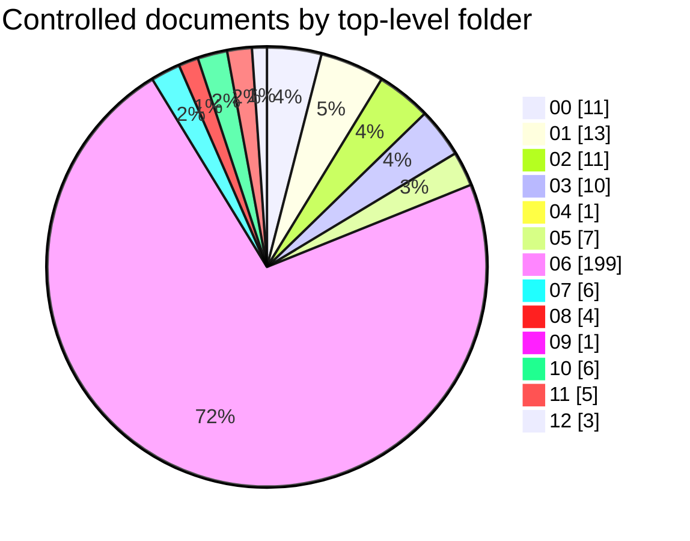

<picture>
  <source media="(prefers-color-scheme: dark)" srcset="../../assets/MultipliersKraftLogoDark.png">
  
</picture>

# DOC-02 — Master Document Register

| Attribute | Value |
| :--- | :--- |
| Document ID | DOC-02 |
| Title | Master Document Register |
| Product | Nucleus Suite (Nucleus HRMS Suite) |
| Version | 1.0.0 |
| Status | Issued for approval |
| Owner (role) | Configuration Manager |
| Author | Dhanraj Dadhich |
| Reviewed by | *pending* |
| Approved by | Steering Committee — *pending* |
| Date | 2026-11-05 |
| Classification | Internal |
| CMMI practice areas | CM, PAD |
| Related documents | DOC-01, CM-01, SRC-01, TR-04 |
| Quality & process-performance objectives | QPPO-06 (fast, controlled change) |
| Process performance baseline used | PPB-07 (CR cycle time) |
| Peer review record | *pending* (PR-xxxx, QA-02) |
| Tailoring record | none |
| Traceability anchor | BG-09 |

---

## 1. Purpose

Lists every controlled document of Nucleus Suite release 1.0.0 with its owner, approval authority, CMMI coverage, version and status. The Configuration Manager keeps it in step with the repository at every change (CM-01) and snapshots it at each gate. Controlled documents: **277**.

## 2. Documents by folder

## 3. Register

| Doc ID | Title | Folder | Owner (role) | Approval authority | CMMI | Version | Status |
| :--- | :--- | :--- | :--- | :--- | :--- | :--- | :--- |
| [DOC-01](DOC-01_Document_Control_Standard.md) | Document Control Standard and Shared Conventions | `00_Programme_Governance/01_Document_Control` | Engineering Process Group (EPG) Lead | Steering Committee | CM, PAD, PQA, RDM, MPM | 1.0.0 | Issued for approval |
| [GOV-01](../02_Vision_and_Scope/GOV-01_Vision_and_Scope.md) | Vision and Scope | `00_Programme_Governance/02_Vision_and_Scope` | Product Owner | Steering Committee | GOV, RDM, PLAN | 1.0.0 | Issued for approval |
| [GOV-02](../02_Vision_and_Scope/GOV-02_Capability_Coverage_and_Differentiation.md) | Capability Coverage and Differentiation | `00_Programme_Governance/02_Vision_and_Scope` | Product Owner | Steering Committee | GOV, RDM, PLAN | 1.0.0 | Issued for approval |
| [GOV-03](../03_Charter_and_Governance_Model/GOV-03_Project_Charter.md) | Project Charter | `00_Programme_Governance/03_Charter_and_Governance_Model` | Executive Sponsor | Steering Committee | GOV, PLAN | 1.0.0 | Issued for approval |
| [GOV-04](../03_Charter_and_Governance_Model/GOV-04_Governance_Model_and_Decision_Rights.md) | Governance Model and Decision Rights | `00_Programme_Governance/03_Charter_and_Governance_Model` | Programme Manager | Steering Committee | GOV, MC, DAR, MPM, CAR | 1.0.0 | Issued for approval |
| [GOV-07](../04_Stakeholders_and_Personas/GOV-07_Stakeholder_Register_and_RACI.md) | Stakeholder Register and RACI | `00_Programme_Governance/04_Stakeholders_and_Personas` | Programme Manager | Steering Committee | PLAN, GOV, MC | 1.0.0 | Issued for approval |
| [GOV-08](../04_Stakeholders_and_Personas/GOV-08_User_Personas_and_Role_Consoles.md) | User Personas and Role Consoles | `00_Programme_Governance/04_Stakeholders_and_Personas` | UX Research Lead | Product Council | RDM | 1.0.0 | Issued for approval |
| [GOV-09](../04_Stakeholders_and_Personas/GOV-09_Stakeholder_Communication_Plan.md) | Stakeholder Communication Plan | `00_Programme_Governance/04_Stakeholders_and_Personas` | Programme Manager | Steering Committee | PLAN, MC, GOV | 1.0.0 | Issued for approval |
| [GOV-10](../05_Data_and_AI_Governance/GOV-10_Data_Governance_and_Privacy_Framework.md) | Data Governance and Privacy Framework | `00_Programme_Governance/05_Data_and_AI_Governance` | Data Protection Officer (DPO) | Data & AI Ethics Board (DAEB) | GOV, RDM, TS, VV | 1.0.0 | Issued for approval |
| [GOV-11](../05_Data_and_AI_Governance/GOV-11_Responsible_AI_Governance_Framework.md) | Responsible AI Governance Framework | `00_Programme_Governance/05_Data_and_AI_Governance` | Head of AI | Data & AI Ethics Board (DAEB) | GOV, RDM, VV, RSK, MPM, CAR | 1.0.0 | Issued for approval |
| [SRC-01](../06_Source_Workbooks/SRC-01_Source_Workbook_Register.md) | Source Workbook Register | `00_Programme_Governance/06_Source_Workbooks` | Configuration Manager | Steering Committee | CM, RDM | 1.0.0 | Issued for approval |
| [PLN-01](../../01_Project_Management/01_Planning_and_Estimation/PLN-01_Project_Management_Plan.md) | Project Management Plan | `01_Project_Management/01_Planning_and_Estimation` | Programme Manager | Steering Committee | PLAN, MC, II, EST, RSK, MPM, CAR | 1.0.0 | Issued for approval |
| [PLN-02](../../01_Project_Management/01_Planning_and_Estimation/PLN-02_WBS_Roadmap_and_Release_Plan.md) | WBS, Product Roadmap and Phase Plan | `01_Project_Management/01_Planning_and_Estimation` | Programme Manager | Steering Committee | PLAN, EST, MC | 1.0.0 | Issued for approval |
| [PLN-03](../../01_Project_Management/01_Planning_and_Estimation/PLN-03_Estimation_Method_and_Basis_of_Estimate.md) | Estimation Method and Basis of Estimate | `01_Project_Management/01_Planning_and_Estimation` | Delivery Lead | Steering Committee | EST, PLAN, MPM, CAR | 1.0.0 | Issued for approval |
| [RSK-01](../../01_Project_Management/02_Risk_Issue_and_Dependency/RSK-01_Risk_and_Opportunity_Management_Plan.md) | Risk and Opportunity Management Plan | `01_Project_Management/02_Risk_Issue_and_Dependency` | Programme Manager | Steering Committee | RSK, MC, GOV | 1.0.0 | Issued for approval |
| [RSK-02](../../01_Project_Management/02_Risk_Issue_and_Dependency/RSK-02_Risk_Register.md) | Risk Register | `01_Project_Management/02_Risk_Issue_and_Dependency` | Programme Manager | Not baselined (living register) | RSK, MC | 1.0.0 | Issued for approval |
| [RSK-03](../../01_Project_Management/02_Risk_Issue_and_Dependency/RSK-03_RAID_Log.md) | RAID Log — Issues, Actions, Assumptions, Dependencies | `01_Project_Management/02_Risk_Issue_and_Dependency` | Programme Manager | Not baselined (living register) | MC, RSK, PLAN | 1.0.0 | Issued for approval |
| [MC-01](../../01_Project_Management/03_Measurement_and_Control/MC-01_Monitoring_and_Control_Procedure.md) | Monitoring and Control Procedure (including Quantitative Management of Sub-Processes) | `01_Project_Management/03_Measurement_and_Control` | Programme Manager | Steering Committee | MC, MPM (levels 4–5), PLAN, RSK, CAR | 1.0.0 | Issued for approval |
| [MPM-01](../../01_Project_Management/03_Measurement_and_Control/MPM-01_Measurement_and_Analysis_Plan.md) | Measurement, Analysis and Statistical Management Plan | `01_Project_Management/03_Measurement_and_Control` | Measurement Analyst (PMO) with EPG Lead | Steering Committee | MPM (levels 2–5), MC, PQA, CAR, PCM | 1.0.0 | Issued for approval |
| [DAR-01](../../01_Project_Management/04_Decision_Management/DAR-01_Decision_Analysis_and_Resolution_Procedure.md) | Decision Analysis and Resolution Procedure | `01_Project_Management/04_Decision_Management` | EPG Lead | Steering Committee | DAR, CAR, PCM, MPM | 1.0.0 | Issued for approval |
| [DAR-02](../../01_Project_Management/04_Decision_Management/DAR-02_Decision_Log.md) | Decision Log | `01_Project_Management/04_Decision_Management` | Programme Manager | Not baselined (living) | DAR, CM, MC | 1.0.0 | Issued for approval |
| [SAM-01](../../01_Project_Management/05_Supplier_Management/SAM-01_Supplier_Agreement_Management_Plan.md) | Supplier Agreement Management Plan | `01_Project_Management/05_Supplier_Management` | Vendor Manager (Procurement) | Steering Committee | SAM, DAR, RSK, VV | 1.0.0 | Issued for approval |
| [OCM-01](../../01_Project_Management/06_Organizational_Change_Management/OCM-01_Organizational_Change_Management_Strategy.md) | Organisational Change Management Strategy | `01_Project_Management/06_Organizational_Change_Management` | OCM Lead | Steering Committee | PLAN, OT, MC, MPM, CAR | 1.0.0 | Issued for approval |
| [OCM-02](../../01_Project_Management/06_Organizational_Change_Management/OCM-02_End_User_Training_and_Enablement_Plan.md) | End-User Training and Enablement Plan | `01_Project_Management/06_Organizational_Change_Management` | OCM Lead | Product Council | OT, PLAN, MPM, CAR | 1.0.0 | Issued for approval |
| [REQ-01](../../02_Engineering_Process/01_Requirements_Management/REQ-01_Requirements_Management_Plan.md) | Requirements Management Plan | `02_Engineering_Process/01_Requirements_Management` | BA Lead | Product Council | RDM, VV, CM, PR, MPM, CAR | 1.0.0 | Issued for approval |
| [REQ-03](../../02_Engineering_Process/01_Requirements_Management/REQ-03_Requirements_Quality_Checklist.md) | Requirements Quality Checklist | `02_Engineering_Process/01_Requirements_Management` | PQA Lead | EPG Lead | RDM, PR, PQA, MPM | 1.0.0 | Issued for approval |
| [CM-01](../../02_Engineering_Process/02_Configuration_and_Change_Control/CM-01_Configuration_Management_Plan.md) | Configuration Management Plan | `02_Engineering_Process/02_Configuration_and_Change_Control` | Configuration Manager | Steering Committee | CM, PQA, RDM, MPM | 1.0.0 | Issued for approval |
| [CM-02](../../02_Engineering_Process/02_Configuration_and_Change_Control/CM-02_Change_Control_Procedure_and_CCB_Charter.md) | Change Control Procedure and CCB Charter | `02_Engineering_Process/02_Configuration_and_Change_Control` | Configuration Manager | Steering Committee | CM, RDM, MC, MPM | 1.0.0 | Issued for approval |
| [CM-03](../../02_Engineering_Process/02_Configuration_and_Change_Control/CM-03_Change_Request_Log.md) | Change Request Log | `02_Engineering_Process/02_Configuration_and_Change_Control` | Configuration Manager | Not baselined (living) | CM, MC, MPM | 1.0.0 | Issued for approval |
| [QA-01](../../02_Engineering_Process/03_Quality_Assurance/QA-01_Quality_Management_Plan.md) | Quality Management Plan | `02_Engineering_Process/03_Quality_Assurance` | PQA Lead | Steering Committee | PQA, VV, PR, GOV, MPM, CAR | 1.0.0 | Issued for approval |
| [QA-02](../../02_Engineering_Process/03_Quality_Assurance/QA-02_Peer_Review_Procedure.md) | Peer Review Procedure | `02_Engineering_Process/03_Quality_Assurance` | PQA Lead | EPG Lead | PR, VV, RDM, TS, MPM (base measures for PPBs) | 1.0.0 | Issued for approval |
| [QA-04](../../02_Engineering_Process/03_Quality_Assurance/QA-04_Process_Compliance_Audit_Checklist.md) | Process Compliance Audit Checklist (CMMI ML2–ML5) | `02_Engineering_Process/03_Quality_Assurance` | PQA Lead | EPG Lead | PQA (and evaluation of all practice areas listed) | 1.0.0 | Issued for approval |
| [CAR-01](../../02_Engineering_Process/04_Process_Improvement_and_Training/CAR-01_Causal_Analysis_and_Resolution_Procedure.md) | Causal Analysis and Resolution Procedure | `02_Engineering_Process/04_Process_Improvement_and_Training` | EPG Lead | Steering Committee | CAR, MPM, PCM, PAD | 1.0.0 | Issued for approval |
| [OT-01](../../02_Engineering_Process/04_Process_Improvement_and_Training/OT-01_Organizational_Training_Plan.md) | Organisational Training Plan (Delivery Team) | `02_Engineering_Process/04_Process_Improvement_and_Training` | EPG Lead | Steering Committee | OT, PCM, II | 1.0.0 | Issued for approval |
| [PCM-01](../../02_Engineering_Process/04_Process_Improvement_and_Training/PCM-01_Process_Definition_and_Tailoring_Guide.md) | Process Definition, Tailoring and Organisational Improvement Guide | `02_Engineering_Process/04_Process_Improvement_and_Training` | EPG Lead | Steering Committee | PCM (incl. high maturity), PAD, MPM, CAR, OT, II | 1.0.0 | Issued for approval |
| [BA-01](../../03_Business_Requirements/BA-01_Process_Architecture_and_Value_Chain.md) | Process Architecture and Value Chain | `03_Business_Requirements` | Enterprise Architect | Architecture Review Board | RDM, TS | 1.0.0 | Issued for approval |
| [BA-02](../../03_Business_Requirements/BA-02_Process_Inventory.md) | Process Inventory | `03_Business_Requirements` | Enterprise Architect | Product Council | RDM | 1.0.0 | Issued for approval |
| [BA-03](../../03_Business_Requirements/BA-03_Swimlane_Process_Maps.md) | Swimlane Process Maps | `03_Business_Requirements` | Business Analyst Lead | Product Council | RDM, TS | 1.0.0 | Issued for approval |
| [BA-04](../../03_Business_Requirements/BA-04_Roles_Personas_and_Data_Scope.md) | Roles, Personas and Data Scope | `03_Business_Requirements` | Security Architect | Product Council | RDM, TS | 1.0.0 | Issued for approval |
| [BA-05](../../03_Business_Requirements/BA-05_Approval_Workflow_Catalogue.md) | Approval Workflow Catalogue | `03_Business_Requirements` | Business Analyst Lead | Product Council | RDM, TS | 1.0.0 | Issued for approval |
| [BA-06](../../03_Business_Requirements/BA-06_Shared_Component_Reuse_Register.md) | Shared Component Reuse Register | `03_Business_Requirements` | Chief Architect | Architecture Review Board | TS, PAD | 1.0.0 | Issued for approval |
| [BRS-01](../../03_Business_Requirements/BRS-01_Business_Requirements_Specification.md) | Business Requirements Specification | `03_Business_Requirements` | Business Analyst Lead (with the Product Owner as business authority) | Product Council | RDM, VV, GOV | 1.0.0 | Issued for approval |
| [CONOPS-01](../../03_Business_Requirements/CONOPS-01_Concept_of_Operations_and_System_Context.md) | Concept of Operations and System Context | `03_Business_Requirements` | Enterprise Architect (with the Product Owner) | Product Council | RDM, TS, VV | 1.0.0 | Issued for approval |
| [GOV-05](../../03_Business_Requirements/GOV-05_Business_Capability_Model.md) | Business Capability Model and Value Streams | `03_Business_Requirements` | Enterprise Architect | Architecture Review Board | RDM, TS | 1.0.0 | Issued for approval |
| [GOV-06](../../03_Business_Requirements/GOV-06_Glossary_and_Acronyms.md) | Glossary and Acronyms | `03_Business_Requirements` | Business Analyst Lead | Product Council | RDM | 1.0.0 | Issued for approval |
| [STRS-01](../../04_Stakeholder_Requirements/STRS-01_Stakeholder_Requirements_Specification.md) | Stakeholder Requirements Specification | `04_Stakeholder_Requirements` | Business Analyst Lead (with the UX Research Lead) | Product Council | RDM, VV, PLAN | 1.0.0 | Issued for approval |
| [LOC-01](../../05_System_Requirements/LOC-01_Localisation_and_Statutory_Requirements.md) | Localisation and Statutory Requirements | `05_System_Requirements` | Head of Compliance Product (Statutory and Localisation) | Product Council | RDM, TS, VV | 1.0.0 | Issued for approval |
| [NFR-01](../../05_System_Requirements/NFR-01_Non_Functional_Requirements_and_Definition_of_Done.md) | Non-Functional Requirements and Definition of Done | `05_System_Requirements` | Chief Architect | Architecture Review Board | RDM, VV, MPM | 1.0.0 | Issued for approval |
| [NOT-01](../../05_System_Requirements/NOT-01_Notification_and_Communication_Requirements.md) | Notification and Communication Requirements | `05_System_Requirements` | Platform Product Owner (Notifications and Communications) | Architecture Review Board | RDM, TS, PI, VV | 1.0.0 | Issued for approval |
| [OPS-01](../../05_System_Requirements/OPS-01_Operational_and_Support_Requirements.md) | Operational and Support Requirements | `05_System_Requirements` | Head of Platform Operations (site reliability) | Architecture Review Board | RDM, TS, CONT, MC | 1.0.0 | Issued for approval |
| [RPT-01](../../05_System_Requirements/RPT-01_Reporting_and_Analytics_Requirements.md) | Reporting and Analytics Requirements | `05_System_Requirements` | Head of People Analytics (Product) | Architecture Review Board | RDM, TS, VV | 1.0.0 | Issued for approval |
| [SEC-01](../../05_System_Requirements/SEC-01_Security_Privacy_and_Access_Requirements.md) | Security, Privacy and Access Requirements | `05_System_Requirements` | Chief Information Security Officer (CISO), with the Data Protection Officer for privacy sections | Architecture Review Board and Data & AI Ethics Board | RDM, TS, VV | 1.0.0 | Issued for approval |
| [SRS-01](../../05_System_Requirements/SRS-01_Software_Requirements_Specification.md) | Software Requirements Specification | `05_System_Requirements` | Chief Architect | Architecture Review Board | RDM, TS, PI, VV | 1.0.0 | Issued for approval |
| [FRS-00](../../06_Functional_Requirements/README.md) | Functional Requirements — Domain Index | `06_Functional_Requirements` | Head of Product | Product Council | RDM | 1.0.0 | Issued for approval |
| [UCC-01](../../06_Functional_Requirements/UCC-01_Use_Case_Catalogue.md) | Use Case Catalogue | `06_Functional_Requirements` | Business Analyst Lead | Product Council | RDM, VV | 1.0.0 | Issued for approval |
| [USC-01](../../06_Functional_Requirements/USC-01_User_Story_Catalogue.md) | User Story Catalogue | `06_Functional_Requirements` | Business Analyst Lead | Product Council | RDM, VV | 1.0.0 | Issued for approval |
| [FRS-PLT-01](../../06_Functional_Requirements/01_PLT_Platform_and_Foundations/FRS-PLT-01_Process_Specifications.md) | Platform & Foundations — Process Specifications | `06_Functional_Requirements/01_PLT_Platform_and_Foundations` | Domain Product Owner — Platform & Foundations | Product Council | RDM, TS | 1.0.0 | Issued for approval |
| [FRS-PLT-02](../../06_Functional_Requirements/01_PLT_Platform_and_Foundations/FRS-PLT-02_Business_Rules.md) | Platform & Foundations — Business Rules | `06_Functional_Requirements/01_PLT_Platform_and_Foundations` | Domain Product Owner — Platform & Foundations | Product Council | RDM, TS, VV | 1.0.0 | Issued for approval |
| [FRS-PLT-03](../../06_Functional_Requirements/01_PLT_Platform_and_Foundations/FRS-PLT-03_Forms_and_Fields.md) | Platform & Foundations — Forms and Fields | `06_Functional_Requirements/01_PLT_Platform_and_Foundations` | Domain Product Owner — Platform & Foundations | Product Council | RDM, TS | 1.0.0 | Issued for approval |
| [FRS-PLT-04](../../06_Functional_Requirements/01_PLT_Platform_and_Foundations/FRS-PLT-04_Screens_Reports_and_UX.md) | Platform & Foundations — Screens, Reports and UX | `06_Functional_Requirements/01_PLT_Platform_and_Foundations` | Domain Product Owner — Platform & Foundations | Product Council | RDM, TS | 1.0.0 | Issued for approval |
| [FRS-PLT-05](../../06_Functional_Requirements/01_PLT_Platform_and_Foundations/FRS-PLT-05_Data_Model.md) | Platform & Foundations — Data Model | `06_Functional_Requirements/01_PLT_Platform_and_Foundations` | Domain Product Owner — Platform & Foundations | Product Council | TS, RDM | 1.0.0 | Issued for approval |
| [FRS-PLT-06](../../06_Functional_Requirements/01_PLT_Platform_and_Foundations/FRS-PLT-06_State_Machines_and_Events.md) | Platform & Foundations — State Machines and Events | `06_Functional_Requirements/01_PLT_Platform_and_Foundations` | Domain Product Owner — Platform & Foundations | Product Council | TS, VV | 1.0.0 | Issued for approval |
| [FRS-PLT-07](../../06_Functional_Requirements/01_PLT_Platform_and_Foundations/FRS-PLT-07_APIs_Integrations_and_Agents.md) | Platform & Foundations — APIs, Integrations and Agents | `06_Functional_Requirements/01_PLT_Platform_and_Foundations` | Domain Product Owner — Platform & Foundations | Product Council | TS, PI | 1.0.0 | Issued for approval |
| [FRS-PLT-08](../../06_Functional_Requirements/01_PLT_Platform_and_Foundations/FRS-PLT-08_Test_Cases_and_Acceptance.md) | Platform & Foundations — Test Cases and Acceptance | `06_Functional_Requirements/01_PLT_Platform_and_Foundations` | QA / Test Lead | Product Council | VV, PR | 1.0.0 | Issued for approval |
| [FRS-PLT-09](../../06_Functional_Requirements/01_PLT_Platform_and_Foundations/FRS-PLT-09_Backlog_and_Open_Decisions.md) | Platform & Foundations — Backlog and Open Decisions | `06_Functional_Requirements/01_PLT_Platform_and_Foundations` | Delivery Lead | Product Council | PLAN, EST, DAR | 1.0.0 | Issued for approval |
| [FRS-PLT-10](../../06_Functional_Requirements/01_PLT_Platform_and_Foundations/FRS-PLT-10_Capability_Coverage_and_Frontier_Features.md) | Platform & Foundations — Capability Coverage and Frontier Features | `06_Functional_Requirements/01_PLT_Platform_and_Foundations` | Domain Product Owner — Platform & Foundations | Product Council | RDM, DAR | 1.0.0 | Issued for approval |
| [FRS-PLT-11](../../06_Functional_Requirements/01_PLT_Platform_and_Foundations/FRS-PLT-11_Reference_Configuration_and_Golden_Data.md) | Platform & Foundations — Reference Configuration and Golden Data | `06_Functional_Requirements/01_PLT_Platform_and_Foundations` | Domain Product Owner — Platform & Foundations | Product Council | TS, VV | 1.0.0 | Issued for approval |
| [FRS-PLT-12](../../06_Functional_Requirements/01_PLT_Platform_and_Foundations/FRS-PLT-12_Use_Case_Specifications.md) | Platform & Foundations — Use Case Specifications | `06_Functional_Requirements/01_PLT_Platform_and_Foundations` | Domain Product Owner — Platform & Foundations | Product Council | RDM, VV | 1.0.0 | Issued for approval |
| [FRS-PLT-13](../../06_Functional_Requirements/01_PLT_Platform_and_Foundations/FRS-PLT-13_User_Stories.md) | Platform & Foundations — User Stories and Acceptance Criteria | `06_Functional_Requirements/01_PLT_Platform_and_Foundations` | Domain Product Owner — Platform & Foundations | Product Council | RDM, VV | 1.0.0 | Issued for approval |
| [FRS-PLT-00](../../06_Functional_Requirements/01_PLT_Platform_and_Foundations/README.md) | Platform & Foundations — Domain Overview | `06_Functional_Requirements/01_PLT_Platform_and_Foundations` | Domain Product Owner — Platform & Foundations | Product Council | RDM, TS, PLAN | 1.0.0 | Issued for approval |
| [FRS-PPL-01](../../06_Functional_Requirements/02_PPL_People_Core/FRS-PPL-01_Process_Specifications.md) | People Core — Process Specifications | `06_Functional_Requirements/02_PPL_People_Core` | Domain Product Owner — People Core | Product Council | RDM, TS | 1.0.0 | Issued for approval |
| [FRS-PPL-02](../../06_Functional_Requirements/02_PPL_People_Core/FRS-PPL-02_Business_Rules.md) | People Core — Business Rules | `06_Functional_Requirements/02_PPL_People_Core` | Domain Product Owner — People Core | Product Council | RDM, TS, VV | 1.0.0 | Issued for approval |
| [FRS-PPL-03](../../06_Functional_Requirements/02_PPL_People_Core/FRS-PPL-03_Forms_and_Fields.md) | People Core — Forms and Fields | `06_Functional_Requirements/02_PPL_People_Core` | Domain Product Owner — People Core | Product Council | RDM, TS | 1.0.0 | Issued for approval |
| [FRS-PPL-04](../../06_Functional_Requirements/02_PPL_People_Core/FRS-PPL-04_Screens_Reports_and_UX.md) | People Core — Screens, Reports and UX | `06_Functional_Requirements/02_PPL_People_Core` | Domain Product Owner — People Core | Product Council | RDM, TS | 1.0.0 | Issued for approval |
| [FRS-PPL-05](../../06_Functional_Requirements/02_PPL_People_Core/FRS-PPL-05_Data_Model.md) | People Core — Data Model | `06_Functional_Requirements/02_PPL_People_Core` | Domain Product Owner — People Core | Product Council | TS, RDM | 1.0.0 | Issued for approval |
| [FRS-PPL-06](../../06_Functional_Requirements/02_PPL_People_Core/FRS-PPL-06_State_Machines_and_Events.md) | People Core — State Machines and Events | `06_Functional_Requirements/02_PPL_People_Core` | Domain Product Owner — People Core | Product Council | TS, VV | 1.0.0 | Issued for approval |
| [FRS-PPL-07](../../06_Functional_Requirements/02_PPL_People_Core/FRS-PPL-07_APIs_Integrations_and_Agents.md) | People Core — APIs, Integrations and Agents | `06_Functional_Requirements/02_PPL_People_Core` | Domain Product Owner — People Core | Product Council | TS, PI | 1.0.0 | Issued for approval |
| [FRS-PPL-08](../../06_Functional_Requirements/02_PPL_People_Core/FRS-PPL-08_Test_Cases_and_Acceptance.md) | People Core — Test Cases and Acceptance | `06_Functional_Requirements/02_PPL_People_Core` | QA / Test Lead | Product Council | VV, PR | 1.0.0 | Issued for approval |
| [FRS-PPL-09](../../06_Functional_Requirements/02_PPL_People_Core/FRS-PPL-09_Backlog_and_Open_Decisions.md) | People Core — Backlog and Open Decisions | `06_Functional_Requirements/02_PPL_People_Core` | Delivery Lead | Product Council | PLAN, EST, DAR | 1.0.0 | Issued for approval |
| [FRS-PPL-10](../../06_Functional_Requirements/02_PPL_People_Core/FRS-PPL-10_Capability_Coverage_and_Frontier_Features.md) | People Core — Capability Coverage and Frontier Features | `06_Functional_Requirements/02_PPL_People_Core` | Domain Product Owner — People Core | Product Council | RDM, DAR | 1.0.0 | Issued for approval |
| [FRS-PPL-11](../../06_Functional_Requirements/02_PPL_People_Core/FRS-PPL-11_Reference_Configuration_and_Golden_Data.md) | People Core — Reference Configuration and Golden Data | `06_Functional_Requirements/02_PPL_People_Core` | Domain Product Owner — People Core | Product Council | TS, VV | 1.0.0 | Issued for approval |
| [FRS-PPL-12](../../06_Functional_Requirements/02_PPL_People_Core/FRS-PPL-12_Use_Case_Specifications.md) | People Core — Use Case Specifications | `06_Functional_Requirements/02_PPL_People_Core` | Domain Product Owner — People Core | Product Council | RDM, VV | 1.0.0 | Issued for approval |
| [FRS-PPL-13](../../06_Functional_Requirements/02_PPL_People_Core/FRS-PPL-13_User_Stories.md) | People Core — User Stories and Acceptance Criteria | `06_Functional_Requirements/02_PPL_People_Core` | Domain Product Owner — People Core | Product Council | RDM, VV | 1.0.0 | Issued for approval |
| [FRS-PPL-00](../../06_Functional_Requirements/02_PPL_People_Core/README.md) | People Core — Domain Overview | `06_Functional_Requirements/02_PPL_People_Core` | Domain Product Owner — People Core | Product Council | RDM, TS, PLAN | 1.0.0 | Issued for approval |
| [FRS-TIM-01](../../06_Functional_Requirements/03_TIM_Time_and_Attendance/FRS-TIM-01_Process_Specifications.md) | Time & Attendance — Process Specifications | `06_Functional_Requirements/03_TIM_Time_and_Attendance` | Domain Product Owner — Time & Attendance | Product Council | RDM, TS | 1.0.0 | Issued for approval |
| [FRS-TIM-02](../../06_Functional_Requirements/03_TIM_Time_and_Attendance/FRS-TIM-02_Business_Rules.md) | Time & Attendance — Business Rules | `06_Functional_Requirements/03_TIM_Time_and_Attendance` | Domain Product Owner — Time & Attendance | Product Council | RDM, TS, VV | 1.0.0 | Issued for approval |
| [FRS-TIM-03](../../06_Functional_Requirements/03_TIM_Time_and_Attendance/FRS-TIM-03_Forms_and_Fields.md) | Time & Attendance — Forms and Fields | `06_Functional_Requirements/03_TIM_Time_and_Attendance` | Domain Product Owner — Time & Attendance | Product Council | RDM, TS | 1.0.0 | Issued for approval |
| [FRS-TIM-04](../../06_Functional_Requirements/03_TIM_Time_and_Attendance/FRS-TIM-04_Screens_Reports_and_UX.md) | Time & Attendance — Screens, Reports and UX | `06_Functional_Requirements/03_TIM_Time_and_Attendance` | Domain Product Owner — Time & Attendance | Product Council | RDM, TS | 1.0.0 | Issued for approval |
| [FRS-TIM-05](../../06_Functional_Requirements/03_TIM_Time_and_Attendance/FRS-TIM-05_Data_Model.md) | Time & Attendance — Data Model | `06_Functional_Requirements/03_TIM_Time_and_Attendance` | Domain Product Owner — Time & Attendance | Product Council | TS, RDM | 1.0.0 | Issued for approval |
| [FRS-TIM-06](../../06_Functional_Requirements/03_TIM_Time_and_Attendance/FRS-TIM-06_State_Machines_and_Events.md) | Time & Attendance — State Machines and Events | `06_Functional_Requirements/03_TIM_Time_and_Attendance` | Domain Product Owner — Time & Attendance | Product Council | TS, VV | 1.0.0 | Issued for approval |
| [FRS-TIM-07](../../06_Functional_Requirements/03_TIM_Time_and_Attendance/FRS-TIM-07_APIs_Integrations_and_Agents.md) | Time & Attendance — APIs, Integrations and Agents | `06_Functional_Requirements/03_TIM_Time_and_Attendance` | Domain Product Owner — Time & Attendance | Product Council | TS, PI | 1.0.0 | Issued for approval |
| [FRS-TIM-08](../../06_Functional_Requirements/03_TIM_Time_and_Attendance/FRS-TIM-08_Test_Cases_and_Acceptance.md) | Time & Attendance — Test Cases and Acceptance | `06_Functional_Requirements/03_TIM_Time_and_Attendance` | QA / Test Lead | Product Council | VV, PR | 1.0.0 | Issued for approval |
| [FRS-TIM-09](../../06_Functional_Requirements/03_TIM_Time_and_Attendance/FRS-TIM-09_Backlog_and_Open_Decisions.md) | Time & Attendance — Backlog and Open Decisions | `06_Functional_Requirements/03_TIM_Time_and_Attendance` | Delivery Lead | Product Council | PLAN, EST, DAR | 1.0.0 | Issued for approval |
| [FRS-TIM-10](../../06_Functional_Requirements/03_TIM_Time_and_Attendance/FRS-TIM-10_Capability_Coverage_and_Frontier_Features.md) | Time & Attendance — Capability Coverage and Frontier Features | `06_Functional_Requirements/03_TIM_Time_and_Attendance` | Domain Product Owner — Time & Attendance | Product Council | RDM, DAR | 1.0.0 | Issued for approval |
| [FRS-TIM-11](../../06_Functional_Requirements/03_TIM_Time_and_Attendance/FRS-TIM-11_Reference_Configuration_and_Golden_Data.md) | Time & Attendance — Reference Configuration and Golden Data | `06_Functional_Requirements/03_TIM_Time_and_Attendance` | Domain Product Owner — Time & Attendance | Product Council | TS, VV | 1.0.0 | Issued for approval |
| [FRS-TIM-12](../../06_Functional_Requirements/03_TIM_Time_and_Attendance/FRS-TIM-12_Use_Case_Specifications.md) | Time & Attendance — Use Case Specifications | `06_Functional_Requirements/03_TIM_Time_and_Attendance` | Domain Product Owner — Time & Attendance | Product Council | RDM, VV | 1.0.0 | Issued for approval |
| [FRS-TIM-13](../../06_Functional_Requirements/03_TIM_Time_and_Attendance/FRS-TIM-13_User_Stories.md) | Time & Attendance — User Stories and Acceptance Criteria | `06_Functional_Requirements/03_TIM_Time_and_Attendance` | Domain Product Owner — Time & Attendance | Product Council | RDM, VV | 1.0.0 | Issued for approval |
| [FRS-TIM-00](../../06_Functional_Requirements/03_TIM_Time_and_Attendance/README.md) | Time & Attendance — Domain Overview | `06_Functional_Requirements/03_TIM_Time_and_Attendance` | Domain Product Owner — Time & Attendance | Product Council | RDM, TS, PLAN | 1.0.0 | Issued for approval |
| [FRS-LVE-01](../../06_Functional_Requirements/04_LVE_Leave/FRS-LVE-01_Process_Specifications.md) | Leave — Process Specifications | `06_Functional_Requirements/04_LVE_Leave` | Domain Product Owner — Leave | Product Council | RDM, TS | 1.0.0 | Issued for approval |
| [FRS-LVE-02](../../06_Functional_Requirements/04_LVE_Leave/FRS-LVE-02_Business_Rules.md) | Leave — Business Rules | `06_Functional_Requirements/04_LVE_Leave` | Domain Product Owner — Leave | Product Council | RDM, TS, VV | 1.0.0 | Issued for approval |
| [FRS-LVE-03](../../06_Functional_Requirements/04_LVE_Leave/FRS-LVE-03_Forms_and_Fields.md) | Leave — Forms and Fields | `06_Functional_Requirements/04_LVE_Leave` | Domain Product Owner — Leave | Product Council | RDM, TS | 1.0.0 | Issued for approval |
| [FRS-LVE-04](../../06_Functional_Requirements/04_LVE_Leave/FRS-LVE-04_Screens_Reports_and_UX.md) | Leave — Screens, Reports and UX | `06_Functional_Requirements/04_LVE_Leave` | Domain Product Owner — Leave | Product Council | RDM, TS | 1.0.0 | Issued for approval |
| [FRS-LVE-05](../../06_Functional_Requirements/04_LVE_Leave/FRS-LVE-05_Data_Model.md) | Leave — Data Model | `06_Functional_Requirements/04_LVE_Leave` | Domain Product Owner — Leave | Product Council | TS, RDM | 1.0.0 | Issued for approval |
| [FRS-LVE-06](../../06_Functional_Requirements/04_LVE_Leave/FRS-LVE-06_State_Machines_and_Events.md) | Leave — State Machines and Events | `06_Functional_Requirements/04_LVE_Leave` | Domain Product Owner — Leave | Product Council | TS, VV | 1.0.0 | Issued for approval |
| [FRS-LVE-07](../../06_Functional_Requirements/04_LVE_Leave/FRS-LVE-07_APIs_Integrations_and_Agents.md) | Leave — APIs, Integrations and Agents | `06_Functional_Requirements/04_LVE_Leave` | Domain Product Owner — Leave | Product Council | TS, PI | 1.0.0 | Issued for approval |
| [FRS-LVE-08](../../06_Functional_Requirements/04_LVE_Leave/FRS-LVE-08_Test_Cases_and_Acceptance.md) | Leave — Test Cases and Acceptance | `06_Functional_Requirements/04_LVE_Leave` | QA / Test Lead | Product Council | VV, PR | 1.0.0 | Issued for approval |
| [FRS-LVE-09](../../06_Functional_Requirements/04_LVE_Leave/FRS-LVE-09_Backlog_and_Open_Decisions.md) | Leave — Backlog and Open Decisions | `06_Functional_Requirements/04_LVE_Leave` | Delivery Lead | Product Council | PLAN, EST, DAR | 1.0.0 | Issued for approval |
| [FRS-LVE-10](../../06_Functional_Requirements/04_LVE_Leave/FRS-LVE-10_Capability_Coverage_and_Frontier_Features.md) | Leave — Capability Coverage and Frontier Features | `06_Functional_Requirements/04_LVE_Leave` | Domain Product Owner — Leave | Product Council | RDM, DAR | 1.0.0 | Issued for approval |
| [FRS-LVE-11](../../06_Functional_Requirements/04_LVE_Leave/FRS-LVE-11_Reference_Configuration_and_Golden_Data.md) | Leave — Reference Configuration and Golden Data | `06_Functional_Requirements/04_LVE_Leave` | Domain Product Owner — Leave | Product Council | TS, VV | 1.0.0 | Issued for approval |
| [FRS-LVE-12](../../06_Functional_Requirements/04_LVE_Leave/FRS-LVE-12_Use_Case_Specifications.md) | Leave — Use Case Specifications | `06_Functional_Requirements/04_LVE_Leave` | Domain Product Owner — Leave | Product Council | RDM, VV | 1.0.0 | Issued for approval |
| [FRS-LVE-13](../../06_Functional_Requirements/04_LVE_Leave/FRS-LVE-13_User_Stories.md) | Leave — User Stories and Acceptance Criteria | `06_Functional_Requirements/04_LVE_Leave` | Domain Product Owner — Leave | Product Council | RDM, VV | 1.0.0 | Issued for approval |
| [FRS-LVE-00](../../06_Functional_Requirements/04_LVE_Leave/README.md) | Leave — Domain Overview | `06_Functional_Requirements/04_LVE_Leave` | Domain Product Owner — Leave | Product Council | RDM, TS, PLAN | 1.0.0 | Issued for approval |
| [FRS-PAY-01](../../06_Functional_Requirements/05_PAY_Payroll/FRS-PAY-01_Process_Specifications.md) | Payroll — Process Specifications | `06_Functional_Requirements/05_PAY_Payroll` | Domain Product Owner — Payroll | Product Council | RDM, TS | 1.0.0 | Issued for approval |
| [FRS-PAY-02](../../06_Functional_Requirements/05_PAY_Payroll/FRS-PAY-02_Business_Rules.md) | Payroll — Business Rules | `06_Functional_Requirements/05_PAY_Payroll` | Domain Product Owner — Payroll | Product Council | RDM, TS, VV | 1.0.0 | Issued for approval |
| [FRS-PAY-03](../../06_Functional_Requirements/05_PAY_Payroll/FRS-PAY-03_Forms_and_Fields.md) | Payroll — Forms and Fields | `06_Functional_Requirements/05_PAY_Payroll` | Domain Product Owner — Payroll | Product Council | RDM, TS | 1.0.0 | Issued for approval |
| [FRS-PAY-04](../../06_Functional_Requirements/05_PAY_Payroll/FRS-PAY-04_Screens_Reports_and_UX.md) | Payroll — Screens, Reports and UX | `06_Functional_Requirements/05_PAY_Payroll` | Domain Product Owner — Payroll | Product Council | RDM, TS | 1.0.0 | Issued for approval |
| [FRS-PAY-05](../../06_Functional_Requirements/05_PAY_Payroll/FRS-PAY-05_Data_Model.md) | Payroll — Data Model | `06_Functional_Requirements/05_PAY_Payroll` | Domain Product Owner — Payroll | Product Council | TS, RDM | 1.0.0 | Issued for approval |
| [FRS-PAY-06](../../06_Functional_Requirements/05_PAY_Payroll/FRS-PAY-06_State_Machines_and_Events.md) | Payroll — State Machines and Events | `06_Functional_Requirements/05_PAY_Payroll` | Domain Product Owner — Payroll | Product Council | TS, VV | 1.0.0 | Issued for approval |
| [FRS-PAY-07](../../06_Functional_Requirements/05_PAY_Payroll/FRS-PAY-07_APIs_Integrations_and_Agents.md) | Payroll — APIs, Integrations and Agents | `06_Functional_Requirements/05_PAY_Payroll` | Domain Product Owner — Payroll | Product Council | TS, PI | 1.0.0 | Issued for approval |
| [FRS-PAY-08](../../06_Functional_Requirements/05_PAY_Payroll/FRS-PAY-08_Test_Cases_and_Acceptance.md) | Payroll — Test Cases and Acceptance | `06_Functional_Requirements/05_PAY_Payroll` | QA / Test Lead | Product Council | VV, PR | 1.0.0 | Issued for approval |
| [FRS-PAY-09](../../06_Functional_Requirements/05_PAY_Payroll/FRS-PAY-09_Backlog_and_Open_Decisions.md) | Payroll — Backlog and Open Decisions | `06_Functional_Requirements/05_PAY_Payroll` | Delivery Lead | Product Council | PLAN, EST, DAR | 1.0.0 | Issued for approval |
| [FRS-PAY-10](../../06_Functional_Requirements/05_PAY_Payroll/FRS-PAY-10_Capability_Coverage_and_Frontier_Features.md) | Payroll — Capability Coverage and Frontier Features | `06_Functional_Requirements/05_PAY_Payroll` | Domain Product Owner — Payroll | Product Council | RDM, DAR | 1.0.0 | Issued for approval |
| [FRS-PAY-11](../../06_Functional_Requirements/05_PAY_Payroll/FRS-PAY-11_Reference_Configuration_and_Golden_Data.md) | Payroll — Reference Configuration and Golden Data | `06_Functional_Requirements/05_PAY_Payroll` | Domain Product Owner — Payroll | Product Council | TS, VV | 1.0.0 | Issued for approval |
| [FRS-PAY-12](../../06_Functional_Requirements/05_PAY_Payroll/FRS-PAY-12_Use_Case_Specifications.md) | Payroll — Use Case Specifications | `06_Functional_Requirements/05_PAY_Payroll` | Domain Product Owner — Payroll | Product Council | RDM, VV | 1.0.0 | Issued for approval |
| [FRS-PAY-13](../../06_Functional_Requirements/05_PAY_Payroll/FRS-PAY-13_User_Stories.md) | Payroll — User Stories and Acceptance Criteria | `06_Functional_Requirements/05_PAY_Payroll` | Domain Product Owner — Payroll | Product Council | RDM, VV | 1.0.0 | Issued for approval |
| [FRS-PAY-00](../../06_Functional_Requirements/05_PAY_Payroll/README.md) | Payroll — Domain Overview | `06_Functional_Requirements/05_PAY_Payroll` | Domain Product Owner — Payroll | Product Council | RDM, TS, PLAN | 1.0.0 | Issued for approval |
| [FRS-CMP-01](../../06_Functional_Requirements/06_CMP_Compliance/FRS-CMP-01_Process_Specifications.md) | Compliance — Process Specifications | `06_Functional_Requirements/06_CMP_Compliance` | Domain Product Owner — Compliance | Product Council | RDM, TS | 1.0.0 | Issued for approval |
| [FRS-CMP-02](../../06_Functional_Requirements/06_CMP_Compliance/FRS-CMP-02_Business_Rules.md) | Compliance — Business Rules | `06_Functional_Requirements/06_CMP_Compliance` | Domain Product Owner — Compliance | Product Council | RDM, TS, VV | 1.0.0 | Issued for approval |
| [FRS-CMP-03](../../06_Functional_Requirements/06_CMP_Compliance/FRS-CMP-03_Forms_and_Fields.md) | Compliance — Forms and Fields | `06_Functional_Requirements/06_CMP_Compliance` | Domain Product Owner — Compliance | Product Council | RDM, TS | 1.0.0 | Issued for approval |
| [FRS-CMP-04](../../06_Functional_Requirements/06_CMP_Compliance/FRS-CMP-04_Screens_Reports_and_UX.md) | Compliance — Screens, Reports and UX | `06_Functional_Requirements/06_CMP_Compliance` | Domain Product Owner — Compliance | Product Council | RDM, TS | 1.0.0 | Issued for approval |
| [FRS-CMP-05](../../06_Functional_Requirements/06_CMP_Compliance/FRS-CMP-05_Data_Model.md) | Compliance — Data Model | `06_Functional_Requirements/06_CMP_Compliance` | Domain Product Owner — Compliance | Product Council | TS, RDM | 1.0.0 | Issued for approval |
| [FRS-CMP-06](../../06_Functional_Requirements/06_CMP_Compliance/FRS-CMP-06_State_Machines_and_Events.md) | Compliance — State Machines and Events | `06_Functional_Requirements/06_CMP_Compliance` | Domain Product Owner — Compliance | Product Council | TS, VV | 1.0.0 | Issued for approval |
| [FRS-CMP-07](../../06_Functional_Requirements/06_CMP_Compliance/FRS-CMP-07_APIs_Integrations_and_Agents.md) | Compliance — APIs, Integrations and Agents | `06_Functional_Requirements/06_CMP_Compliance` | Domain Product Owner — Compliance | Product Council | TS, PI | 1.0.0 | Issued for approval |
| [FRS-CMP-08](../../06_Functional_Requirements/06_CMP_Compliance/FRS-CMP-08_Test_Cases_and_Acceptance.md) | Compliance — Test Cases and Acceptance | `06_Functional_Requirements/06_CMP_Compliance` | QA / Test Lead | Product Council | VV, PR | 1.0.0 | Issued for approval |
| [FRS-CMP-09](../../06_Functional_Requirements/06_CMP_Compliance/FRS-CMP-09_Backlog_and_Open_Decisions.md) | Compliance — Backlog and Open Decisions | `06_Functional_Requirements/06_CMP_Compliance` | Delivery Lead | Product Council | PLAN, EST, DAR | 1.0.0 | Issued for approval |
| [FRS-CMP-10](../../06_Functional_Requirements/06_CMP_Compliance/FRS-CMP-10_Capability_Coverage_and_Frontier_Features.md) | Compliance — Capability Coverage and Frontier Features | `06_Functional_Requirements/06_CMP_Compliance` | Domain Product Owner — Compliance | Product Council | RDM, DAR | 1.0.0 | Issued for approval |
| [FRS-CMP-11](../../06_Functional_Requirements/06_CMP_Compliance/FRS-CMP-11_Reference_Configuration_and_Golden_Data.md) | Compliance — Reference Configuration and Golden Data | `06_Functional_Requirements/06_CMP_Compliance` | Domain Product Owner — Compliance | Product Council | TS, VV | 1.0.0 | Issued for approval |
| [FRS-CMP-12](../../06_Functional_Requirements/06_CMP_Compliance/FRS-CMP-12_Use_Case_Specifications.md) | Compliance — Use Case Specifications | `06_Functional_Requirements/06_CMP_Compliance` | Domain Product Owner — Compliance | Product Council | RDM, VV | 1.0.0 | Issued for approval |
| [FRS-CMP-13](../../06_Functional_Requirements/06_CMP_Compliance/FRS-CMP-13_User_Stories.md) | Compliance — User Stories and Acceptance Criteria | `06_Functional_Requirements/06_CMP_Compliance` | Domain Product Owner — Compliance | Product Council | RDM, VV | 1.0.0 | Issued for approval |
| [FRS-CMP-00](../../06_Functional_Requirements/06_CMP_Compliance/README.md) | Compliance — Domain Overview | `06_Functional_Requirements/06_CMP_Compliance` | Domain Product Owner — Compliance | Product Council | RDM, TS, PLAN | 1.0.0 | Issued for approval |
| [FRS-LCY-01](../../06_Functional_Requirements/07_LCY_Lifecycle/FRS-LCY-01_Process_Specifications.md) | Lifecycle — Process Specifications | `06_Functional_Requirements/07_LCY_Lifecycle` | Domain Product Owner — Lifecycle | Product Council | RDM, TS | 1.0.0 | Issued for approval |
| [FRS-LCY-02](../../06_Functional_Requirements/07_LCY_Lifecycle/FRS-LCY-02_Business_Rules.md) | Lifecycle — Business Rules | `06_Functional_Requirements/07_LCY_Lifecycle` | Domain Product Owner — Lifecycle | Product Council | RDM, TS, VV | 1.0.0 | Issued for approval |
| [FRS-LCY-03](../../06_Functional_Requirements/07_LCY_Lifecycle/FRS-LCY-03_Forms_and_Fields.md) | Lifecycle — Forms and Fields | `06_Functional_Requirements/07_LCY_Lifecycle` | Domain Product Owner — Lifecycle | Product Council | RDM, TS | 1.0.0 | Issued for approval |
| [FRS-LCY-04](../../06_Functional_Requirements/07_LCY_Lifecycle/FRS-LCY-04_Screens_Reports_and_UX.md) | Lifecycle — Screens, Reports and UX | `06_Functional_Requirements/07_LCY_Lifecycle` | Domain Product Owner — Lifecycle | Product Council | RDM, TS | 1.0.0 | Issued for approval |
| [FRS-LCY-05](../../06_Functional_Requirements/07_LCY_Lifecycle/FRS-LCY-05_Data_Model.md) | Lifecycle — Data Model | `06_Functional_Requirements/07_LCY_Lifecycle` | Domain Product Owner — Lifecycle | Product Council | TS, RDM | 1.0.0 | Issued for approval |
| [FRS-LCY-06](../../06_Functional_Requirements/07_LCY_Lifecycle/FRS-LCY-06_State_Machines_and_Events.md) | Lifecycle — State Machines and Events | `06_Functional_Requirements/07_LCY_Lifecycle` | Domain Product Owner — Lifecycle | Product Council | TS, VV | 1.0.0 | Issued for approval |
| [FRS-LCY-07](../../06_Functional_Requirements/07_LCY_Lifecycle/FRS-LCY-07_APIs_Integrations_and_Agents.md) | Lifecycle — APIs, Integrations and Agents | `06_Functional_Requirements/07_LCY_Lifecycle` | Domain Product Owner — Lifecycle | Product Council | TS, PI | 1.0.0 | Issued for approval |
| [FRS-LCY-08](../../06_Functional_Requirements/07_LCY_Lifecycle/FRS-LCY-08_Test_Cases_and_Acceptance.md) | Lifecycle — Test Cases and Acceptance | `06_Functional_Requirements/07_LCY_Lifecycle` | QA / Test Lead | Product Council | VV, PR | 1.0.0 | Issued for approval |
| [FRS-LCY-09](../../06_Functional_Requirements/07_LCY_Lifecycle/FRS-LCY-09_Backlog_and_Open_Decisions.md) | Lifecycle — Backlog and Open Decisions | `06_Functional_Requirements/07_LCY_Lifecycle` | Delivery Lead | Product Council | PLAN, EST, DAR | 1.0.0 | Issued for approval |
| [FRS-LCY-10](../../06_Functional_Requirements/07_LCY_Lifecycle/FRS-LCY-10_Capability_Coverage_and_Frontier_Features.md) | Lifecycle — Capability Coverage and Frontier Features | `06_Functional_Requirements/07_LCY_Lifecycle` | Domain Product Owner — Lifecycle | Product Council | RDM, DAR | 1.0.0 | Issued for approval |
| [FRS-LCY-11](../../06_Functional_Requirements/07_LCY_Lifecycle/FRS-LCY-11_Reference_Configuration_and_Golden_Data.md) | Lifecycle — Reference Configuration and Golden Data | `06_Functional_Requirements/07_LCY_Lifecycle` | Domain Product Owner — Lifecycle | Product Council | TS, VV | 1.0.0 | Issued for approval |
| [FRS-LCY-12](../../06_Functional_Requirements/07_LCY_Lifecycle/FRS-LCY-12_Use_Case_Specifications.md) | Lifecycle — Use Case Specifications | `06_Functional_Requirements/07_LCY_Lifecycle` | Domain Product Owner — Lifecycle | Product Council | RDM, VV | 1.0.0 | Issued for approval |
| [FRS-LCY-13](../../06_Functional_Requirements/07_LCY_Lifecycle/FRS-LCY-13_User_Stories.md) | Lifecycle — User Stories and Acceptance Criteria | `06_Functional_Requirements/07_LCY_Lifecycle` | Domain Product Owner — Lifecycle | Product Council | RDM, VV | 1.0.0 | Issued for approval |
| [FRS-LCY-00](../../06_Functional_Requirements/07_LCY_Lifecycle/README.md) | Lifecycle — Domain Overview | `06_Functional_Requirements/07_LCY_Lifecycle` | Domain Product Owner — Lifecycle | Product Council | RDM, TS, PLAN | 1.0.0 | Issued for approval |
| [FRS-SSV-01](../../06_Functional_Requirements/08_SSV_Self_Service_and_Helpdesk/FRS-SSV-01_Process_Specifications.md) | Self-service & Helpdesk — Process Specifications | `06_Functional_Requirements/08_SSV_Self_Service_and_Helpdesk` | Domain Product Owner — Self-service & Helpdesk | Product Council | RDM, TS | 1.0.0 | Issued for approval |
| [FRS-SSV-02](../../06_Functional_Requirements/08_SSV_Self_Service_and_Helpdesk/FRS-SSV-02_Business_Rules.md) | Self-service & Helpdesk — Business Rules | `06_Functional_Requirements/08_SSV_Self_Service_and_Helpdesk` | Domain Product Owner — Self-service & Helpdesk | Product Council | RDM, TS, VV | 1.0.0 | Issued for approval |
| [FRS-SSV-03](../../06_Functional_Requirements/08_SSV_Self_Service_and_Helpdesk/FRS-SSV-03_Forms_and_Fields.md) | Self-service & Helpdesk — Forms and Fields | `06_Functional_Requirements/08_SSV_Self_Service_and_Helpdesk` | Domain Product Owner — Self-service & Helpdesk | Product Council | RDM, TS | 1.0.0 | Issued for approval |
| [FRS-SSV-04](../../06_Functional_Requirements/08_SSV_Self_Service_and_Helpdesk/FRS-SSV-04_Screens_Reports_and_UX.md) | Self-service & Helpdesk — Screens, Reports and UX | `06_Functional_Requirements/08_SSV_Self_Service_and_Helpdesk` | Domain Product Owner — Self-service & Helpdesk | Product Council | RDM, TS | 1.0.0 | Issued for approval |
| [FRS-SSV-05](../../06_Functional_Requirements/08_SSV_Self_Service_and_Helpdesk/FRS-SSV-05_Data_Model.md) | Self-service & Helpdesk — Data Model | `06_Functional_Requirements/08_SSV_Self_Service_and_Helpdesk` | Domain Product Owner — Self-service & Helpdesk | Product Council | TS, RDM | 1.0.0 | Issued for approval |
| [FRS-SSV-06](../../06_Functional_Requirements/08_SSV_Self_Service_and_Helpdesk/FRS-SSV-06_State_Machines_and_Events.md) | Self-service & Helpdesk — State Machines and Events | `06_Functional_Requirements/08_SSV_Self_Service_and_Helpdesk` | Domain Product Owner — Self-service & Helpdesk | Product Council | TS, VV | 1.0.0 | Issued for approval |
| [FRS-SSV-07](../../06_Functional_Requirements/08_SSV_Self_Service_and_Helpdesk/FRS-SSV-07_APIs_Integrations_and_Agents.md) | Self-service & Helpdesk — APIs, Integrations and Agents | `06_Functional_Requirements/08_SSV_Self_Service_and_Helpdesk` | Domain Product Owner — Self-service & Helpdesk | Product Council | TS, PI | 1.0.0 | Issued for approval |
| [FRS-SSV-08](../../06_Functional_Requirements/08_SSV_Self_Service_and_Helpdesk/FRS-SSV-08_Test_Cases_and_Acceptance.md) | Self-service & Helpdesk — Test Cases and Acceptance | `06_Functional_Requirements/08_SSV_Self_Service_and_Helpdesk` | QA / Test Lead | Product Council | VV, PR | 1.0.0 | Issued for approval |
| [FRS-SSV-09](../../06_Functional_Requirements/08_SSV_Self_Service_and_Helpdesk/FRS-SSV-09_Backlog_and_Open_Decisions.md) | Self-service & Helpdesk — Backlog and Open Decisions | `06_Functional_Requirements/08_SSV_Self_Service_and_Helpdesk` | Delivery Lead | Product Council | PLAN, EST, DAR | 1.0.0 | Issued for approval |
| [FRS-SSV-10](../../06_Functional_Requirements/08_SSV_Self_Service_and_Helpdesk/FRS-SSV-10_Capability_Coverage_and_Frontier_Features.md) | Self-service & Helpdesk — Capability Coverage and Frontier Features | `06_Functional_Requirements/08_SSV_Self_Service_and_Helpdesk` | Domain Product Owner — Self-service & Helpdesk | Product Council | RDM, DAR | 1.0.0 | Issued for approval |
| [FRS-SSV-11](../../06_Functional_Requirements/08_SSV_Self_Service_and_Helpdesk/FRS-SSV-11_Reference_Configuration_and_Golden_Data.md) | Self-service & Helpdesk — Reference Configuration and Golden Data | `06_Functional_Requirements/08_SSV_Self_Service_and_Helpdesk` | Domain Product Owner — Self-service & Helpdesk | Product Council | TS, VV | 1.0.0 | Issued for approval |
| [FRS-SSV-12](../../06_Functional_Requirements/08_SSV_Self_Service_and_Helpdesk/FRS-SSV-12_Use_Case_Specifications.md) | Self-service & Helpdesk — Use Case Specifications | `06_Functional_Requirements/08_SSV_Self_Service_and_Helpdesk` | Domain Product Owner — Self-service & Helpdesk | Product Council | RDM, VV | 1.0.0 | Issued for approval |
| [FRS-SSV-13](../../06_Functional_Requirements/08_SSV_Self_Service_and_Helpdesk/FRS-SSV-13_User_Stories.md) | Self-service & Helpdesk — User Stories and Acceptance Criteria | `06_Functional_Requirements/08_SSV_Self_Service_and_Helpdesk` | Domain Product Owner — Self-service & Helpdesk | Product Council | RDM, VV | 1.0.0 | Issued for approval |
| [FRS-SSV-00](../../06_Functional_Requirements/08_SSV_Self_Service_and_Helpdesk/README.md) | Self-service & Helpdesk — Domain Overview | `06_Functional_Requirements/08_SSV_Self_Service_and_Helpdesk` | Domain Product Owner — Self-service & Helpdesk | Product Council | RDM, TS, PLAN | 1.0.0 | Issued for approval |
| [FRS-CMB-01](../../06_Functional_Requirements/09_CMB_Compensation_Loans_and_Benefits/FRS-CMB-01_Process_Specifications.md) | Compensation, Loans & Benefits — Process Specifications | `06_Functional_Requirements/09_CMB_Compensation_Loans_and_Benefits` | Domain Product Owner — Compensation, Loans & Benefits | Product Council | RDM, TS | 1.0.0 | Issued for approval |
| [FRS-CMB-02](../../06_Functional_Requirements/09_CMB_Compensation_Loans_and_Benefits/FRS-CMB-02_Business_Rules.md) | Compensation, Loans & Benefits — Business Rules | `06_Functional_Requirements/09_CMB_Compensation_Loans_and_Benefits` | Domain Product Owner — Compensation, Loans & Benefits | Product Council | RDM, TS, VV | 1.0.0 | Issued for approval |
| [FRS-CMB-03](../../06_Functional_Requirements/09_CMB_Compensation_Loans_and_Benefits/FRS-CMB-03_Forms_and_Fields.md) | Compensation, Loans & Benefits — Forms and Fields | `06_Functional_Requirements/09_CMB_Compensation_Loans_and_Benefits` | Domain Product Owner — Compensation, Loans & Benefits | Product Council | RDM, TS | 1.0.0 | Issued for approval |
| [FRS-CMB-04](../../06_Functional_Requirements/09_CMB_Compensation_Loans_and_Benefits/FRS-CMB-04_Screens_Reports_and_UX.md) | Compensation, Loans & Benefits — Screens, Reports and UX | `06_Functional_Requirements/09_CMB_Compensation_Loans_and_Benefits` | Domain Product Owner — Compensation, Loans & Benefits | Product Council | RDM, TS | 1.0.0 | Issued for approval |
| [FRS-CMB-05](../../06_Functional_Requirements/09_CMB_Compensation_Loans_and_Benefits/FRS-CMB-05_Data_Model.md) | Compensation, Loans & Benefits — Data Model | `06_Functional_Requirements/09_CMB_Compensation_Loans_and_Benefits` | Domain Product Owner — Compensation, Loans & Benefits | Product Council | TS, RDM | 1.0.0 | Issued for approval |
| [FRS-CMB-06](../../06_Functional_Requirements/09_CMB_Compensation_Loans_and_Benefits/FRS-CMB-06_State_Machines_and_Events.md) | Compensation, Loans & Benefits — State Machines and Events | `06_Functional_Requirements/09_CMB_Compensation_Loans_and_Benefits` | Domain Product Owner — Compensation, Loans & Benefits | Product Council | TS, VV | 1.0.0 | Issued for approval |
| [FRS-CMB-07](../../06_Functional_Requirements/09_CMB_Compensation_Loans_and_Benefits/FRS-CMB-07_APIs_Integrations_and_Agents.md) | Compensation, Loans & Benefits — APIs, Integrations and Agents | `06_Functional_Requirements/09_CMB_Compensation_Loans_and_Benefits` | Domain Product Owner — Compensation, Loans & Benefits | Product Council | TS, PI | 1.0.0 | Issued for approval |
| [FRS-CMB-08](../../06_Functional_Requirements/09_CMB_Compensation_Loans_and_Benefits/FRS-CMB-08_Test_Cases_and_Acceptance.md) | Compensation, Loans & Benefits — Test Cases and Acceptance | `06_Functional_Requirements/09_CMB_Compensation_Loans_and_Benefits` | QA / Test Lead | Product Council | VV, PR | 1.0.0 | Issued for approval |
| [FRS-CMB-09](../../06_Functional_Requirements/09_CMB_Compensation_Loans_and_Benefits/FRS-CMB-09_Backlog_and_Open_Decisions.md) | Compensation, Loans & Benefits — Backlog and Open Decisions | `06_Functional_Requirements/09_CMB_Compensation_Loans_and_Benefits` | Delivery Lead | Product Council | PLAN, EST, DAR | 1.0.0 | Issued for approval |
| [FRS-CMB-10](../../06_Functional_Requirements/09_CMB_Compensation_Loans_and_Benefits/FRS-CMB-10_Capability_Coverage_and_Frontier_Features.md) | Compensation, Loans & Benefits — Capability Coverage and Frontier Features | `06_Functional_Requirements/09_CMB_Compensation_Loans_and_Benefits` | Domain Product Owner — Compensation, Loans & Benefits | Product Council | RDM, DAR | 1.0.0 | Issued for approval |
| [FRS-CMB-11](../../06_Functional_Requirements/09_CMB_Compensation_Loans_and_Benefits/FRS-CMB-11_Reference_Configuration_and_Golden_Data.md) | Compensation, Loans & Benefits — Reference Configuration and Golden Data | `06_Functional_Requirements/09_CMB_Compensation_Loans_and_Benefits` | Domain Product Owner — Compensation, Loans & Benefits | Product Council | TS, VV | 1.0.0 | Issued for approval |
| [FRS-CMB-12](../../06_Functional_Requirements/09_CMB_Compensation_Loans_and_Benefits/FRS-CMB-12_Use_Case_Specifications.md) | Compensation, Loans & Benefits — Use Case Specifications | `06_Functional_Requirements/09_CMB_Compensation_Loans_and_Benefits` | Domain Product Owner — Compensation, Loans & Benefits | Product Council | RDM, VV | 1.0.0 | Issued for approval |
| [FRS-CMB-13](../../06_Functional_Requirements/09_CMB_Compensation_Loans_and_Benefits/FRS-CMB-13_User_Stories.md) | Compensation, Loans & Benefits — User Stories and Acceptance Criteria | `06_Functional_Requirements/09_CMB_Compensation_Loans_and_Benefits` | Domain Product Owner — Compensation, Loans & Benefits | Product Council | RDM, VV | 1.0.0 | Issued for approval |
| [FRS-CMB-00](../../06_Functional_Requirements/09_CMB_Compensation_Loans_and_Benefits/README.md) | Compensation, Loans & Benefits — Domain Overview | `06_Functional_Requirements/09_CMB_Compensation_Loans_and_Benefits` | Domain Product Owner — Compensation, Loans & Benefits | Product Council | RDM, TS, PLAN | 1.0.0 | Issued for approval |
| [FRS-TAL-01](../../06_Functional_Requirements/10_TAL_Talent/FRS-TAL-01_Process_Specifications.md) | Talent — Process Specifications | `06_Functional_Requirements/10_TAL_Talent` | Domain Product Owner — Talent | Product Council | RDM, TS | 1.0.0 | Issued for approval |
| [FRS-TAL-02](../../06_Functional_Requirements/10_TAL_Talent/FRS-TAL-02_Business_Rules.md) | Talent — Business Rules | `06_Functional_Requirements/10_TAL_Talent` | Domain Product Owner — Talent | Product Council | RDM, TS, VV | 1.0.0 | Issued for approval |
| [FRS-TAL-03](../../06_Functional_Requirements/10_TAL_Talent/FRS-TAL-03_Forms_and_Fields.md) | Talent — Forms and Fields | `06_Functional_Requirements/10_TAL_Talent` | Domain Product Owner — Talent | Product Council | RDM, TS | 1.0.0 | Issued for approval |
| [FRS-TAL-04](../../06_Functional_Requirements/10_TAL_Talent/FRS-TAL-04_Screens_Reports_and_UX.md) | Talent — Screens, Reports and UX | `06_Functional_Requirements/10_TAL_Talent` | Domain Product Owner — Talent | Product Council | RDM, TS | 1.0.0 | Issued for approval |
| [FRS-TAL-05](../../06_Functional_Requirements/10_TAL_Talent/FRS-TAL-05_Data_Model.md) | Talent — Data Model | `06_Functional_Requirements/10_TAL_Talent` | Domain Product Owner — Talent | Product Council | TS, RDM | 1.0.0 | Issued for approval |
| [FRS-TAL-06](../../06_Functional_Requirements/10_TAL_Talent/FRS-TAL-06_State_Machines_and_Events.md) | Talent — State Machines and Events | `06_Functional_Requirements/10_TAL_Talent` | Domain Product Owner — Talent | Product Council | TS, VV | 1.0.0 | Issued for approval |
| [FRS-TAL-07](../../06_Functional_Requirements/10_TAL_Talent/FRS-TAL-07_APIs_Integrations_and_Agents.md) | Talent — APIs, Integrations and Agents | `06_Functional_Requirements/10_TAL_Talent` | Domain Product Owner — Talent | Product Council | TS, PI | 1.0.0 | Issued for approval |
| [FRS-TAL-08](../../06_Functional_Requirements/10_TAL_Talent/FRS-TAL-08_Test_Cases_and_Acceptance.md) | Talent — Test Cases and Acceptance | `06_Functional_Requirements/10_TAL_Talent` | QA / Test Lead | Product Council | VV, PR | 1.0.0 | Issued for approval |
| [FRS-TAL-09](../../06_Functional_Requirements/10_TAL_Talent/FRS-TAL-09_Backlog_and_Open_Decisions.md) | Talent — Backlog and Open Decisions | `06_Functional_Requirements/10_TAL_Talent` | Delivery Lead | Product Council | PLAN, EST, DAR | 1.0.0 | Issued for approval |
| [FRS-TAL-10](../../06_Functional_Requirements/10_TAL_Talent/FRS-TAL-10_Capability_Coverage_and_Frontier_Features.md) | Talent — Capability Coverage and Frontier Features | `06_Functional_Requirements/10_TAL_Talent` | Domain Product Owner — Talent | Product Council | RDM, DAR | 1.0.0 | Issued for approval |
| [FRS-TAL-11](../../06_Functional_Requirements/10_TAL_Talent/FRS-TAL-11_Reference_Configuration_and_Golden_Data.md) | Talent — Reference Configuration and Golden Data | `06_Functional_Requirements/10_TAL_Talent` | Domain Product Owner — Talent | Product Council | TS, VV | 1.0.0 | Issued for approval |
| [FRS-TAL-12](../../06_Functional_Requirements/10_TAL_Talent/FRS-TAL-12_Use_Case_Specifications.md) | Talent — Use Case Specifications | `06_Functional_Requirements/10_TAL_Talent` | Domain Product Owner — Talent | Product Council | RDM, VV | 1.0.0 | Issued for approval |
| [FRS-TAL-13](../../06_Functional_Requirements/10_TAL_Talent/FRS-TAL-13_User_Stories.md) | Talent — User Stories and Acceptance Criteria | `06_Functional_Requirements/10_TAL_Talent` | Domain Product Owner — Talent | Product Council | RDM, VV | 1.0.0 | Issued for approval |
| [FRS-TAL-00](../../06_Functional_Requirements/10_TAL_Talent/README.md) | Talent — Domain Overview | `06_Functional_Requirements/10_TAL_Talent` | Domain Product Owner — Talent | Product Council | RDM, TS, PLAN | 1.0.0 | Issued for approval |
| [FRS-CTG-01](../../06_Functional_Requirements/11_CTG_Contingent_Workforce/FRS-CTG-01_Process_Specifications.md) | Contingent Workforce — Process Specifications | `06_Functional_Requirements/11_CTG_Contingent_Workforce` | Domain Product Owner — Contingent Workforce | Product Council | RDM, TS | 1.0.0 | Issued for approval |
| [FRS-CTG-02](../../06_Functional_Requirements/11_CTG_Contingent_Workforce/FRS-CTG-02_Business_Rules.md) | Contingent Workforce — Business Rules | `06_Functional_Requirements/11_CTG_Contingent_Workforce` | Domain Product Owner — Contingent Workforce | Product Council | RDM, TS, VV | 1.0.0 | Issued for approval |
| [FRS-CTG-03](../../06_Functional_Requirements/11_CTG_Contingent_Workforce/FRS-CTG-03_Forms_and_Fields.md) | Contingent Workforce — Forms and Fields | `06_Functional_Requirements/11_CTG_Contingent_Workforce` | Domain Product Owner — Contingent Workforce | Product Council | RDM, TS | 1.0.0 | Issued for approval |
| [FRS-CTG-04](../../06_Functional_Requirements/11_CTG_Contingent_Workforce/FRS-CTG-04_Screens_Reports_and_UX.md) | Contingent Workforce — Screens, Reports and UX | `06_Functional_Requirements/11_CTG_Contingent_Workforce` | Domain Product Owner — Contingent Workforce | Product Council | RDM, TS | 1.0.0 | Issued for approval |
| [FRS-CTG-05](../../06_Functional_Requirements/11_CTG_Contingent_Workforce/FRS-CTG-05_Data_Model.md) | Contingent Workforce — Data Model | `06_Functional_Requirements/11_CTG_Contingent_Workforce` | Domain Product Owner — Contingent Workforce | Product Council | TS, RDM | 1.0.0 | Issued for approval |
| [FRS-CTG-06](../../06_Functional_Requirements/11_CTG_Contingent_Workforce/FRS-CTG-06_State_Machines_and_Events.md) | Contingent Workforce — State Machines and Events | `06_Functional_Requirements/11_CTG_Contingent_Workforce` | Domain Product Owner — Contingent Workforce | Product Council | TS, VV | 1.0.0 | Issued for approval |
| [FRS-CTG-07](../../06_Functional_Requirements/11_CTG_Contingent_Workforce/FRS-CTG-07_APIs_Integrations_and_Agents.md) | Contingent Workforce — APIs, Integrations and Agents | `06_Functional_Requirements/11_CTG_Contingent_Workforce` | Domain Product Owner — Contingent Workforce | Product Council | TS, PI | 1.0.0 | Issued for approval |
| [FRS-CTG-08](../../06_Functional_Requirements/11_CTG_Contingent_Workforce/FRS-CTG-08_Test_Cases_and_Acceptance.md) | Contingent Workforce — Test Cases and Acceptance | `06_Functional_Requirements/11_CTG_Contingent_Workforce` | QA / Test Lead | Product Council | VV, PR | 1.0.0 | Issued for approval |
| [FRS-CTG-09](../../06_Functional_Requirements/11_CTG_Contingent_Workforce/FRS-CTG-09_Backlog_and_Open_Decisions.md) | Contingent Workforce — Backlog and Open Decisions | `06_Functional_Requirements/11_CTG_Contingent_Workforce` | Delivery Lead | Product Council | PLAN, EST, DAR | 1.0.0 | Issued for approval |
| [FRS-CTG-10](../../06_Functional_Requirements/11_CTG_Contingent_Workforce/FRS-CTG-10_Capability_Coverage_and_Frontier_Features.md) | Contingent Workforce — Capability Coverage and Frontier Features | `06_Functional_Requirements/11_CTG_Contingent_Workforce` | Domain Product Owner — Contingent Workforce | Product Council | RDM, DAR | 1.0.0 | Issued for approval |
| [FRS-CTG-11](../../06_Functional_Requirements/11_CTG_Contingent_Workforce/FRS-CTG-11_Reference_Configuration_and_Golden_Data.md) | Contingent Workforce — Reference Configuration and Golden Data | `06_Functional_Requirements/11_CTG_Contingent_Workforce` | Domain Product Owner — Contingent Workforce | Product Council | TS, VV | 1.0.0 | Issued for approval |
| [FRS-CTG-12](../../06_Functional_Requirements/11_CTG_Contingent_Workforce/FRS-CTG-12_Use_Case_Specifications.md) | Contingent Workforce — Use Case Specifications | `06_Functional_Requirements/11_CTG_Contingent_Workforce` | Domain Product Owner — Contingent Workforce | Product Council | RDM, VV | 1.0.0 | Issued for approval |
| [FRS-CTG-13](../../06_Functional_Requirements/11_CTG_Contingent_Workforce/FRS-CTG-13_User_Stories.md) | Contingent Workforce — User Stories and Acceptance Criteria | `06_Functional_Requirements/11_CTG_Contingent_Workforce` | Domain Product Owner — Contingent Workforce | Product Council | RDM, VV | 1.0.0 | Issued for approval |
| [FRS-CTG-00](../../06_Functional_Requirements/11_CTG_Contingent_Workforce/README.md) | Contingent Workforce — Domain Overview | `06_Functional_Requirements/11_CTG_Contingent_Workforce` | Domain Product Owner — Contingent Workforce | Product Council | RDM, TS, PLAN | 1.0.0 | Issued for approval |
| [FRS-EXP-01](../../06_Functional_Requirements/12_EXP_Experience/FRS-EXP-01_Process_Specifications.md) | Experience — Process Specifications | `06_Functional_Requirements/12_EXP_Experience` | Domain Product Owner — Experience | Product Council | RDM, TS | 1.0.0 | Issued for approval |
| [FRS-EXP-02](../../06_Functional_Requirements/12_EXP_Experience/FRS-EXP-02_Business_Rules.md) | Experience — Business Rules | `06_Functional_Requirements/12_EXP_Experience` | Domain Product Owner — Experience | Product Council | RDM, TS, VV | 1.0.0 | Issued for approval |
| [FRS-EXP-03](../../06_Functional_Requirements/12_EXP_Experience/FRS-EXP-03_Forms_and_Fields.md) | Experience — Forms and Fields | `06_Functional_Requirements/12_EXP_Experience` | Domain Product Owner — Experience | Product Council | RDM, TS | 1.0.0 | Issued for approval |
| [FRS-EXP-04](../../06_Functional_Requirements/12_EXP_Experience/FRS-EXP-04_Screens_Reports_and_UX.md) | Experience — Screens, Reports and UX | `06_Functional_Requirements/12_EXP_Experience` | Domain Product Owner — Experience | Product Council | RDM, TS | 1.0.0 | Issued for approval |
| [FRS-EXP-05](../../06_Functional_Requirements/12_EXP_Experience/FRS-EXP-05_Data_Model.md) | Experience — Data Model | `06_Functional_Requirements/12_EXP_Experience` | Domain Product Owner — Experience | Product Council | TS, RDM | 1.0.0 | Issued for approval |
| [FRS-EXP-06](../../06_Functional_Requirements/12_EXP_Experience/FRS-EXP-06_State_Machines_and_Events.md) | Experience — State Machines and Events | `06_Functional_Requirements/12_EXP_Experience` | Domain Product Owner — Experience | Product Council | TS, VV | 1.0.0 | Issued for approval |
| [FRS-EXP-07](../../06_Functional_Requirements/12_EXP_Experience/FRS-EXP-07_APIs_Integrations_and_Agents.md) | Experience — APIs, Integrations and Agents | `06_Functional_Requirements/12_EXP_Experience` | Domain Product Owner — Experience | Product Council | TS, PI | 1.0.0 | Issued for approval |
| [FRS-EXP-08](../../06_Functional_Requirements/12_EXP_Experience/FRS-EXP-08_Test_Cases_and_Acceptance.md) | Experience — Test Cases and Acceptance | `06_Functional_Requirements/12_EXP_Experience` | QA / Test Lead | Product Council | VV, PR | 1.0.0 | Issued for approval |
| [FRS-EXP-09](../../06_Functional_Requirements/12_EXP_Experience/FRS-EXP-09_Backlog_and_Open_Decisions.md) | Experience — Backlog and Open Decisions | `06_Functional_Requirements/12_EXP_Experience` | Delivery Lead | Product Council | PLAN, EST, DAR | 1.0.0 | Issued for approval |
| [FRS-EXP-10](../../06_Functional_Requirements/12_EXP_Experience/FRS-EXP-10_Capability_Coverage_and_Frontier_Features.md) | Experience — Capability Coverage and Frontier Features | `06_Functional_Requirements/12_EXP_Experience` | Domain Product Owner — Experience | Product Council | RDM, DAR | 1.0.0 | Issued for approval |
| [FRS-EXP-11](../../06_Functional_Requirements/12_EXP_Experience/FRS-EXP-11_Reference_Configuration_and_Golden_Data.md) | Experience — Reference Configuration and Golden Data | `06_Functional_Requirements/12_EXP_Experience` | Domain Product Owner — Experience | Product Council | TS, VV | 1.0.0 | Issued for approval |
| [FRS-EXP-12](../../06_Functional_Requirements/12_EXP_Experience/FRS-EXP-12_Use_Case_Specifications.md) | Experience — Use Case Specifications | `06_Functional_Requirements/12_EXP_Experience` | Domain Product Owner — Experience | Product Council | RDM, VV | 1.0.0 | Issued for approval |
| [FRS-EXP-13](../../06_Functional_Requirements/12_EXP_Experience/FRS-EXP-13_User_Stories.md) | Experience — User Stories and Acceptance Criteria | `06_Functional_Requirements/12_EXP_Experience` | Domain Product Owner — Experience | Product Council | RDM, VV | 1.0.0 | Issued for approval |
| [FRS-EXP-00](../../06_Functional_Requirements/12_EXP_Experience/README.md) | Experience — Domain Overview | `06_Functional_Requirements/12_EXP_Experience` | Domain Product Owner — Experience | Product Council | RDM, TS, PLAN | 1.0.0 | Issued for approval |
| [FRS-FIN-01](../../06_Functional_Requirements/13_FIN_Finance_and_ERP/FRS-FIN-01_Process_Specifications.md) | Finance & ERP — Process Specifications | `06_Functional_Requirements/13_FIN_Finance_and_ERP` | Domain Product Owner — Finance & ERP | Product Council | RDM, TS | 1.0.0 | Issued for approval |
| [FRS-FIN-02](../../06_Functional_Requirements/13_FIN_Finance_and_ERP/FRS-FIN-02_Business_Rules.md) | Finance & ERP — Business Rules | `06_Functional_Requirements/13_FIN_Finance_and_ERP` | Domain Product Owner — Finance & ERP | Product Council | RDM, TS, VV | 1.0.0 | Issued for approval |
| [FRS-FIN-03](../../06_Functional_Requirements/13_FIN_Finance_and_ERP/FRS-FIN-03_Forms_and_Fields.md) | Finance & ERP — Forms and Fields | `06_Functional_Requirements/13_FIN_Finance_and_ERP` | Domain Product Owner — Finance & ERP | Product Council | RDM, TS | 1.0.0 | Issued for approval |
| [FRS-FIN-04](../../06_Functional_Requirements/13_FIN_Finance_and_ERP/FRS-FIN-04_Screens_Reports_and_UX.md) | Finance & ERP — Screens, Reports and UX | `06_Functional_Requirements/13_FIN_Finance_and_ERP` | Domain Product Owner — Finance & ERP | Product Council | RDM, TS | 1.0.0 | Issued for approval |
| [FRS-FIN-05](../../06_Functional_Requirements/13_FIN_Finance_and_ERP/FRS-FIN-05_Data_Model.md) | Finance & ERP — Data Model | `06_Functional_Requirements/13_FIN_Finance_and_ERP` | Domain Product Owner — Finance & ERP | Product Council | TS, RDM | 1.0.0 | Issued for approval |
| [FRS-FIN-06](../../06_Functional_Requirements/13_FIN_Finance_and_ERP/FRS-FIN-06_State_Machines_and_Events.md) | Finance & ERP — State Machines and Events | `06_Functional_Requirements/13_FIN_Finance_and_ERP` | Domain Product Owner — Finance & ERP | Product Council | TS, VV | 1.0.0 | Issued for approval |
| [FRS-FIN-07](../../06_Functional_Requirements/13_FIN_Finance_and_ERP/FRS-FIN-07_APIs_Integrations_and_Agents.md) | Finance & ERP — APIs, Integrations and Agents | `06_Functional_Requirements/13_FIN_Finance_and_ERP` | Domain Product Owner — Finance & ERP | Product Council | TS, PI | 1.0.0 | Issued for approval |
| [FRS-FIN-08](../../06_Functional_Requirements/13_FIN_Finance_and_ERP/FRS-FIN-08_Test_Cases_and_Acceptance.md) | Finance & ERP — Test Cases and Acceptance | `06_Functional_Requirements/13_FIN_Finance_and_ERP` | QA / Test Lead | Product Council | VV, PR | 1.0.0 | Issued for approval |
| [FRS-FIN-09](../../06_Functional_Requirements/13_FIN_Finance_and_ERP/FRS-FIN-09_Backlog_and_Open_Decisions.md) | Finance & ERP — Backlog and Open Decisions | `06_Functional_Requirements/13_FIN_Finance_and_ERP` | Delivery Lead | Product Council | PLAN, EST, DAR | 1.0.0 | Issued for approval |
| [FRS-FIN-10](../../06_Functional_Requirements/13_FIN_Finance_and_ERP/FRS-FIN-10_Capability_Coverage_and_Frontier_Features.md) | Finance & ERP — Capability Coverage and Frontier Features | `06_Functional_Requirements/13_FIN_Finance_and_ERP` | Domain Product Owner — Finance & ERP | Product Council | RDM, DAR | 1.0.0 | Issued for approval |
| [FRS-FIN-11](../../06_Functional_Requirements/13_FIN_Finance_and_ERP/FRS-FIN-11_Reference_Configuration_and_Golden_Data.md) | Finance & ERP — Reference Configuration and Golden Data | `06_Functional_Requirements/13_FIN_Finance_and_ERP` | Domain Product Owner — Finance & ERP | Product Council | TS, VV | 1.0.0 | Issued for approval |
| [FRS-FIN-12](../../06_Functional_Requirements/13_FIN_Finance_and_ERP/FRS-FIN-12_Use_Case_Specifications.md) | Finance & ERP — Use Case Specifications | `06_Functional_Requirements/13_FIN_Finance_and_ERP` | Domain Product Owner — Finance & ERP | Product Council | RDM, VV | 1.0.0 | Issued for approval |
| [FRS-FIN-13](../../06_Functional_Requirements/13_FIN_Finance_and_ERP/FRS-FIN-13_User_Stories.md) | Finance & ERP — User Stories and Acceptance Criteria | `06_Functional_Requirements/13_FIN_Finance_and_ERP` | Domain Product Owner — Finance & ERP | Product Council | RDM, VV | 1.0.0 | Issued for approval |
| [FRS-FIN-00](../../06_Functional_Requirements/13_FIN_Finance_and_ERP/README.md) | Finance & ERP — Domain Overview | `06_Functional_Requirements/13_FIN_Finance_and_ERP` | Domain Product Owner — Finance & ERP | Product Council | RDM, TS, PLAN | 1.0.0 | Issued for approval |
| [FRS-INT-01](../../06_Functional_Requirements/14_INT_Intelligence_and_Agents/FRS-INT-01_Process_Specifications.md) | Intelligence & Agents — Process Specifications | `06_Functional_Requirements/14_INT_Intelligence_and_Agents` | Domain Product Owner — Intelligence & Agents | Product Council | RDM, TS | 1.0.0 | Issued for approval |
| [FRS-INT-02](../../06_Functional_Requirements/14_INT_Intelligence_and_Agents/FRS-INT-02_Business_Rules.md) | Intelligence & Agents — Business Rules | `06_Functional_Requirements/14_INT_Intelligence_and_Agents` | Domain Product Owner — Intelligence & Agents | Product Council | RDM, TS, VV | 1.0.0 | Issued for approval |
| [FRS-INT-03](../../06_Functional_Requirements/14_INT_Intelligence_and_Agents/FRS-INT-03_Forms_and_Fields.md) | Intelligence & Agents — Forms and Fields | `06_Functional_Requirements/14_INT_Intelligence_and_Agents` | Domain Product Owner — Intelligence & Agents | Product Council | RDM, TS | 1.0.0 | Issued for approval |
| [FRS-INT-04](../../06_Functional_Requirements/14_INT_Intelligence_and_Agents/FRS-INT-04_Screens_Reports_and_UX.md) | Intelligence & Agents — Screens, Reports and UX | `06_Functional_Requirements/14_INT_Intelligence_and_Agents` | Domain Product Owner — Intelligence & Agents | Product Council | RDM, TS | 1.0.0 | Issued for approval |
| [FRS-INT-05](../../06_Functional_Requirements/14_INT_Intelligence_and_Agents/FRS-INT-05_Data_Model.md) | Intelligence & Agents — Data Model | `06_Functional_Requirements/14_INT_Intelligence_and_Agents` | Domain Product Owner — Intelligence & Agents | Product Council | TS, RDM | 1.0.0 | Issued for approval |
| [FRS-INT-06](../../06_Functional_Requirements/14_INT_Intelligence_and_Agents/FRS-INT-06_State_Machines_and_Events.md) | Intelligence & Agents — State Machines and Events | `06_Functional_Requirements/14_INT_Intelligence_and_Agents` | Domain Product Owner — Intelligence & Agents | Product Council | TS, VV | 1.0.0 | Issued for approval |
| [FRS-INT-07](../../06_Functional_Requirements/14_INT_Intelligence_and_Agents/FRS-INT-07_APIs_Integrations_and_Agents.md) | Intelligence & Agents — APIs, Integrations and Agents | `06_Functional_Requirements/14_INT_Intelligence_and_Agents` | Domain Product Owner — Intelligence & Agents | Product Council | TS, PI | 1.0.0 | Issued for approval |
| [FRS-INT-08](../../06_Functional_Requirements/14_INT_Intelligence_and_Agents/FRS-INT-08_Test_Cases_and_Acceptance.md) | Intelligence & Agents — Test Cases and Acceptance | `06_Functional_Requirements/14_INT_Intelligence_and_Agents` | QA / Test Lead | Product Council | VV, PR | 1.0.0 | Issued for approval |
| [FRS-INT-09](../../06_Functional_Requirements/14_INT_Intelligence_and_Agents/FRS-INT-09_Backlog_and_Open_Decisions.md) | Intelligence & Agents — Backlog and Open Decisions | `06_Functional_Requirements/14_INT_Intelligence_and_Agents` | Delivery Lead | Product Council | PLAN, EST, DAR | 1.0.0 | Issued for approval |
| [FRS-INT-10](../../06_Functional_Requirements/14_INT_Intelligence_and_Agents/FRS-INT-10_Capability_Coverage_and_Frontier_Features.md) | Intelligence & Agents — Capability Coverage and Frontier Features | `06_Functional_Requirements/14_INT_Intelligence_and_Agents` | Domain Product Owner — Intelligence & Agents | Product Council | RDM, DAR | 1.0.0 | Issued for approval |
| [FRS-INT-11](../../06_Functional_Requirements/14_INT_Intelligence_and_Agents/FRS-INT-11_Reference_Configuration_and_Golden_Data.md) | Intelligence & Agents — Reference Configuration and Golden Data | `06_Functional_Requirements/14_INT_Intelligence_and_Agents` | Domain Product Owner — Intelligence & Agents | Product Council | TS, VV | 1.0.0 | Issued for approval |
| [FRS-INT-12](../../06_Functional_Requirements/14_INT_Intelligence_and_Agents/FRS-INT-12_Use_Case_Specifications.md) | Intelligence & Agents — Use Case Specifications | `06_Functional_Requirements/14_INT_Intelligence_and_Agents` | Domain Product Owner — Intelligence & Agents | Product Council | RDM, VV | 1.0.0 | Issued for approval |
| [FRS-INT-13](../../06_Functional_Requirements/14_INT_Intelligence_and_Agents/FRS-INT-13_User_Stories.md) | Intelligence & Agents — User Stories and Acceptance Criteria | `06_Functional_Requirements/14_INT_Intelligence_and_Agents` | Domain Product Owner — Intelligence & Agents | Product Council | RDM, VV | 1.0.0 | Issued for approval |
| [FRS-INT-00](../../06_Functional_Requirements/14_INT_Intelligence_and_Agents/README.md) | Intelligence & Agents — Domain Overview | `06_Functional_Requirements/14_INT_Intelligence_and_Agents` | Domain Product Owner — Intelligence & Agents | Product Council | RDM, TS, PLAN | 1.0.0 | Issued for approval |
| [DA-01](../../07_Data_Architecture/DA-01_Enterprise_Data_Dictionary.md) | Enterprise Data Dictionary | `07_Data_Architecture` | Data Architect | Architecture Review Board | TS | 1.0.0 | Issued for approval |
| [DA-02](../../07_Data_Architecture/DA-02_Picklist_Catalogue.md) | Picklist Catalogue | `07_Data_Architecture` | Data Architect | Product Council | TS | 1.0.0 | Issued for approval |
| [DA-03](../../07_Data_Architecture/DA-03_Enumerations.md) | Enumerations | `07_Data_Architecture` | Data Architect | Product Council | TS | 1.0.0 | Issued for approval |
| [DA-04](../../07_Data_Architecture/DA-04_Configuration_Tables_and_Register.md) | Configuration Tables and Register | `07_Data_Architecture` | Implementation Lead | Product Council | TS, CM | 1.0.0 | Issued for approval |
| [DA-05](../../07_Data_Architecture/DA-05_Form_Index_and_Field_Conventions.md) | Form Index and Field Conventions | `07_Data_Architecture` | UX Lead | Product Council | TS, RDM | 1.0.0 | Issued for approval |
| [MIG-01](../../07_Data_Architecture/MIG-01_Data_Migration_and_Cutover_Requirements.md) | Data Migration and Cut-over Requirements | `07_Data_Architecture` | Migration Lead | Product Council | PI, TS, VV, RSK, PLAN | 1.0.0 | Issued for approval |
| [IA-01](../../08_Integration_and_API/IA-01_API_and_Tool_Surface_Catalogue.md) | API and Tool Surface Catalogue | `08_Integration_and_API` | Integration Architect | Architecture Review Board | TS, PI | 1.0.0 | Issued for approval |
| [IA-02](../../08_Integration_and_API/IA-02_Event_Catalogue.md) | Event Catalogue | `08_Integration_and_API` | Integration Architect | Architecture Review Board | TS, PI | 1.0.0 | Issued for approval |
| [IA-03](../../08_Integration_and_API/IA-03_Integration_Flows.md) | Integration Flows | `08_Integration_and_API` | Integration Architect | Architecture Review Board | TS, PI, SAM | 1.0.0 | Issued for approval |
| [ICD-01](../../08_Integration_and_API/ICD-01_Interface_Control_Document.md) | Interface Control Document | `08_Integration_and_API` | Integration Architect | Architecture Review Board | TS, PI, VV, SAM | 1.0.0 | Issued for approval |
| [AI-01](../../09_AI_and_Agents/AI-01_Agent_Catalogue_and_Tool_Governance.md) | Agent Catalogue and Tool Governance | `09_AI_and_Agents` | Head of AI | Data & AI Ethics Board | TS, RDM, VV | 1.0.0 | Issued for approval |
| [MTP-01](../../10_Verification_and_Validation/MTP-01_Master_Test_Plan.md) | Master Test Plan | `10_Verification_and_Validation` | QA/Test Lead | Steering Committee | VV, PI, PLAN, MPM, PQA, CAR | 1.0.0 | Issued for approval |
| [QA-03](../../10_Verification_and_Validation/QA-03_Verification_and_Validation_Strategy.md) | Verification and Validation Strategy | `10_Verification_and_Validation` | QA/Test Lead | Product Council | VV, PI, PR, RDM, MPM | 1.0.0 | Issued for approval |
| [UAT-01](../../10_Verification_and_Validation/UAT-01_User_Acceptance_Test_Plan.md) | User Acceptance Test Plan | `10_Verification_and_Validation` | Product Owner | Product Council | VV, RDM, OT | 1.0.0 | Issued for approval |
| [VV-01](../../10_Verification_and_Validation/VV-01_Test_Case_Catalogue.md) | Test Case Catalogue | `10_Verification_and_Validation` | QA / Test Lead | Product Council | VV | 1.0.0 | Issued for approval |
| [VV-02](../../10_Verification_and_Validation/VV-02_Client_Acceptance_Tests.md) | Client Acceptance Tests | `10_Verification_and_Validation` | QA / Test Lead | Product Council | VV | 1.0.0 | Issued for approval |
| [VV-03](../../10_Verification_and_Validation/VV-03_Golden_Demo_Dataset_Guide.md) | Golden Demo Dataset Guide | `10_Verification_and_Validation` | QA / Test Lead | Product Council | VV, TS | 1.0.0 | Issued for approval |
| [REQ-02](../../11_Traceability/REQ-02_Requirements_Traceability_Matrix.md) | Requirements Traceability Matrix | `11_Traceability` | BA Lead | Not baselined (living); snapshots approved at gates by Product Council | RDM, VV | 1.0.0 | Issued for approval |
| [TR-01](../../11_Traceability/TR-01_Client_Requirement_Register.md) | Client Requirement Register | `11_Traceability` | Business Analyst Lead | Product Council | RDM | 1.0.0 | Issued for approval |
| [TR-02](../../11_Traceability/TR-02_Demo_Point_Traceability_Matrix.md) | Demo Point Traceability Matrix | `11_Traceability` | Business Analyst Lead | Product Council | RDM, VV | 1.0.0 | Issued for approval |
| [TR-03](../../11_Traceability/TR-03_Form_Data_Coverage_Matrix.md) | Form Data Coverage Matrix | `11_Traceability` | Business Analyst Lead | Product Council | RDM, VV | 1.0.0 | Issued for approval |
| [TR-04](../../11_Traceability/TR-04_Source_Coverage_Report.md) | Source Coverage Report | `11_Traceability` | PQA Lead | Product Council | RDM, PQA, CM | 1.0.0 | Issued for approval |
| [RB-01](../../12_Release_and_Backlog/RB-01_Phased_Build_Backlog.md) | Phased Build Backlog | `12_Release_and_Backlog` | Delivery Lead | Steering Committee | PLAN, EST | 1.0.0 | Issued for approval |
| [RB-02](../../12_Release_and_Backlog/RB-02_Open_Decisions_and_Questions.md) | Open Decisions and Questions | `12_Release_and_Backlog` | Programme Manager | Steering Committee | DAR, RSK | 1.0.0 | Issued for approval |
| [RB-03](../../12_Release_and_Backlog/RB-03_Capability_Gap_and_Frontier_Roadmap.md) | Capability Gap and Frontier Feature Roadmap | `12_Release_and_Backlog` | Head of Product | Steering Committee | PLAN, RDM, DAR | 1.0.0 | Issued for approval |

## Approval & Sign-off

| Role | Name | Date | Decision | Conditions / comments |
| :--- | :--- | :--- | :--- | :--- |
| Author | Dhanraj Dadhich | 2026-11-05 | Submitted | |
| Peer review moderator | *pending* | | | PR-xxxx |
| PQA (process compliance) | *pending* | | | |
| Steering Committee | *pending* | | | |

## Measurement Data Captured

| Measure | Value | Unit | Notes |
| :--- | :--- | :--- | :--- |
| Size | 277 | registered documents | |
| Authoring effort | *to be recorded* | person-hours | |
| Review effort (preparation + meeting) | *pending review* | person-hours | From PR-xxxx |
| Requirement volatility | 0 | CRs since baseline | |

## Revision History

| Version | Date | Author | Change summary | CR ref | Approved by |
| :--- | :--- | :--- | :--- | :--- | :--- |
| 1.0.0 | 2026-11-05 | Dhanraj Dadhich | Consolidated release | CR-0001 | *pending* |
