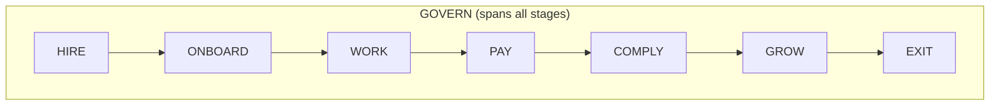

<picture>
  <source media="(prefers-color-scheme: dark)" srcset="../../assets/MultipliersKraftLogoDark.png">
  
</picture>

# GOV-01 — Vision and Scope

| Attribute | Value |
| :--- | :--- |
| Document ID | GOV-01 |
| Title | Vision and Scope |
| Product | Nucleus Suite (Nucleus HRMS Suite) |
| Version | 1.0.0 |
| Status | Issued for approval |
| Owner (role) | Product Owner |
| Author | Dhanraj Dadhich |
| Reviewed by | Product Council, PQA Lead — *pending* |
| Approved by | Steering Committee — *pending* |
| Date | 2026-11-05 |
| Classification | Internal |
| CMMI practice areas | GOV, RDM, PLAN |
| Related documents | DOC-01, GOV-02, GOV-03, GOV-05, GOV-08, PLN-02, REQ-02, RSK-02 |
| Quality & process-performance objectives | QPPO-05 (effective requirements reviews), QPPO-01 (escaped defects) |
| Process performance baseline used | PPB-01 (review defect density), PPB-02 (review rate) |
| Peer review record | *pending* (PR-xxxx, QA-02) |
| Tailoring record | none |
| Traceability anchor | BG-01 – BG-10 |
| Source inputs | Nucleus Technical & Functional Blueprint v1.1; Nucleus Process Flows & Process Maps v1.0; Nucleus Forms & Fields Complete; HRMS Demo Dataset v1.1; HR Demo Points Build Sheet v1.0 (client requirements R-01..R-27) |

---

## 1. Purpose of This Document

This document states **why Nucleus Suite exists, what it will and will not do, and how success will be measured**. It is the root of the requirements traceability chain: every process (`DOM-nn`), rule (`RL-nnn`), form (`FRM-<MOD>-nn`), screen (`SCR-nnn`) and client requirement (`R-nn`) MUST trace upward to at least one business objective (`BO-xx.y`) defined in §5 (see REQ-01, REQ-02). Business requirements (`BRQ-nnn`, BRS-01), stakeholder requirements (`STR-nnn`, STRS-01) and system requirements (`SYS-nnn`, SRS-01) are derived from these objectives.

It is approved at Gate G0 and re-baselined only through a Change Request (CM-02).

**Treatment of client requirements.** Any implementation status recorded against client demo points in source trackers (e.g. Implemented, WIP, Done) is **not** carried into this baseline. Every client requirement R-01..R-27 is treated as a **new requirement** that must be specified, traced, verified and validated under this framework before it can be considered delivered.

## 2. Problem Statement

| # | Problem | Who is affected | Impact today |
| :--- | :--- | :--- | :--- |
| P1 | HR processes and systems are usually designed around head-office knowledge workers; plant, shift, contract and gig workers are poorly served (weak attendance, no offline, English-only, desktop-first). | Plant supervisors, frontline and contract workers, plant HR | Manual muster rolls, punch disputes, gaps in Factories Act registers |
| P2 | Indian statutory payroll (PF, ESI, PT, LWF, TDS old/new regime, Code on Wages 50% rule, gratuity) is typically handled through partners or spreadsheets outside the core worker record. | Finance controllers, payroll admins, auditors | Reconciliation every cycle; compliance exposure; late filings |
| P3 | AI support in HR work is mostly assistive search and summarisation; actions still require navigating many screens and approval chains. | All personas, especially managers and employees | High click cost; low self-service adoption; slow cycle times |
| P4 | Talent decisions (calibration, promotion, internal mobility) rely on manager opinion with little bias detection or skills evidence. | CHRO, talent calibration leads, employees | Attrition of high performers; fairness and DEI risk |
| P5 | Workforce planning and organisation change are modelled in spreadsheets disconnected from live HR data. | CHRO, HRBPs, finance | Decisions on stale data; no cost/impact simulation before restructuring |
| P6 | Privacy law (DPDP Act 2023, GDPR) demands consent, purpose limitation and erasure; most HR data estates were not designed for it. | DPO, employees, legal | Regulatory exposure; erosion of employee trust |
| P7 | Pay is monthly and batch; hourly and plant workers face cash-flow stress and turn to informal lenders. | Hourly and frontline workers | Absenteeism, attrition, wellbeing harm |
| P8 | HR-to-finance hand-off (salary journal, GL mapping, posting, reconciliation) is manual and error-prone. | Finance controllers, auditors | Close delays; unbalanced journals |

## 3. Vision

> **Nucleus Suite is the AI-native human capital platform where every worker — from the boardroom to the shop floor — is understood, paid accurately and continuously, and grown on the evidence of their skills; and where HR work is done by governed AI agents under human control rather than by navigating screens.**

### 3.1 Vision Pillars

| Pillar | Statement | Goal link |
| :--- | :--- | :--- |
| One worker truth | A single effective-dated, bi-temporal worker record that every domain reads and writes | BG-01 |
| Agentic by default | Every routine transaction can be started by voice or conversation and executed by an agent through the policy gate and action ledger, with human approval wherever policy requires | BG-02 |
| Frontline first | Shop-floor workflows are designed first and degrade gracefully to the head office, not the reverse | BG-03 |
| Pay that flows | Payroll is continuously computed; employees see and can access earned pay | BG-04 |
| Skills as currency | Jobs, learning, mobility and pay are linked through a common skills ontology | BG-05 |
| Trust by design | Privacy, security, explainability and audit are built in, not configured on | BG-06 |
| Open and composable | Every capability is an API and an event; finance and ERP integration is native | BG-07 |
| Decide with foresight | Leaders simulate before they act, using a live digital twin of the organisation | BG-08 |

## 4. Positioning

| Element | Statement |
| :--- | :--- |
| For | Mid-to-large enterprises (1,000–100,000 workers) with mixed office and frontline/plant workforces, India-headquartered or with significant India operations, expanding globally |
| Who | Need enterprise-grade HCM on a single worker record, with payroll, attendance and statutory compliance in the same platform |
| Nucleus Suite is | An AI-native HCM suite |
| That | Delivers complete hire-to-retire coverage at field level, with native Indian statutory payroll, frontline time management, finance/ERP posting and governed AI agents |
| Distinctive because | Payroll, attendance and statutory compliance are built in rather than delegated to partners; the experience is mobile- and voice-first; effective dating, matrix organisations and configuration-led extensibility are native to the core |
| Our product | Combines a bi-temporal core, continuous payroll, multilingual voice operation, a governed agent layer and an organisation digital twin in one tenant |

Capability coverage and differentiators by domain are detailed in GOV-02; business requirements derived from these goals are specified in BRS-01 and the operational concept in CONOPS-01.

## 5. Business Goals and Measurable Objectives

All targets are **indicative** until baselined at the G1 gate of the phase that delivers them. Where no baseline exists yet, the table states the measurement method and the window in which the baseline is captured; captured baselines are recorded in MPM-01 and re-baselined through CM-02. Phase codes are defined in §7.

### BG-01 — enterprise-grade hire-to-retire core HCM on one bi-temporal worker model

| BO ID | Objective | Baseline | Indicative target | Measurement method | Phase |
| :--- | :--- | :--- | :--- | :--- | :--- |
| BO-01.1 | Coverage of the L0 value chain (HIRE → ONBOARD → WORK → PAY → COMPLY → GROW → EXIT → GOVERN) by live processes from the Process Flows workbook | 0% live (R0 prototype only) | 100% of processes tagged P0–P1 live at end P1; 100% of P2–P3 processes live at end P3 | Process inventory status vs. GOV-05 §3 | P0–P3 |
| BO-01.2 | Worker, position and compensation data reproducible "as of" any past date on both effective time and transaction time | Not available | 100% of PPL, CMB and LCY objects | Automated bi-temporal regression suite (TC-xxx) | P1 |
| BO-01.3 | Field-level coverage of the Forms & Fields workbook (49 forms, 860 fields, 119 picklists) | R0: forms rendered from local JSON | 100% of fields tagged for P1 live with validation; remaining per phase | Field-coverage report against Forms & Fields workbook | P1–P3 |

### BG-02 — AI-native, agentic experience with human-in-the-loop

| BO ID | Objective | Baseline | Indicative target | Measurement method | Phase |
| :--- | :--- | :--- | :--- | :--- | :--- |
| BO-02.1 | Share of top-50 employee/manager transactions executable end-to-end via Nucleus Talk (voice or chat) through the INT tool surface | ~3 commands in R0 (punch in/out, apply leave, navigation) | ≥ 20 by end P2; ≥ 40 by end P4 | Tool-surface catalogue coverage | P2–P4 |
| BO-02.2 | Median time-to-complete for agent-assisted transactions vs. screen navigation | Measured by a time-and-motion study of the top-20 transactions in R0 user validation, re-measured in the first P2 pilot month | ≥ 50% reduction | Instrumented task telemetry, A/B comparison | P2 |
| BO-02.3 | Agent actions requiring approval executed without a recorded human decision in the action ledger | n/a | 0 (hard invariant) | Reconciliation of action ledger vs. approval records | P2 onward |

### BG-03 — Frontline and plant workforce excellence

| BO ID | Objective | Baseline | Indicative target | Measurement method | Phase |
| :--- | :--- | :--- | :--- | :--- | :--- |
| BO-03.1 | Punches auto-paired without regularisation | Measured as the regularisation rate across the first three P1 shadow payroll cycles at the pilot plant | ≥ 98% | TIM exception report | P1 |
| BO-03.2 | Statutory registers (Factories Act Form 28 muster roll and related forms) generated from system data | Manual / spreadsheet | 100% system-generated on demand | CMP register inventory check | P1–P2 |
| BO-03.3 | Frontline journeys available in the user's preferred language | 11-language UI copy in R0 | 11 languages for all frontline journeys by P2; voice transactions in ≥ 6 languages by P4 | Localisation coverage audit | P1–P4 |
| BO-03.4 | Frontline transactions completed offline and synchronised without loss | Not available | ≥ 99.9% successful sync; zero silent data loss | Sync reconciliation telemetry | P3 |

### BG-04 — Continuous, compliant payroll

| BO ID | Objective | Baseline | Indicative target | Measurement method | Phase |
| :--- | :--- | :--- | :--- | :--- | :--- |
| BO-04.1 | Payslips requiring post-run correction | Measured from the pilot client's last three legacy payroll cycles and the first three P2 pilot cycles | ≤ 0.1% per cycle | Off-cycle corrections / total payslips | P1–P2 |
| BO-04.2 | Payroll time-to-lock after cut-off (10,000 workers, India) | Measured from control-room stage timestamps over the first three P2 pilot payroll cycles | ≤ 4 hours | Payroll control-room stage timestamps | P2 |
| BO-04.3 | Eligible workers able to view earned pay to date; earned wage access (EWA) where employer opts in | Not available | 100% view; EWA live for opted-in tenants | Feature adoption telemetry | P3 |

### BG-05 — Skills-based talent ecosystem

| BO ID | Objective | Baseline | Indicative target | Measurement method | Phase |
| :--- | :--- | :--- | :--- | :--- | :--- |
| BO-05.1 | Active workers with a validated skills profile mapped to the skills ontology | 0% | ≥ 70% within 12 months of TAL go-live | Skills profile completeness | P3 |
| BO-05.2 | Internal fill rate for roles and gigs via the talent marketplace | Measured as the internal fill rate over the 12 months before marketplace launch at the first P5 adopting tenant | +20 percentage points over pilot baseline | Source-of-hire analytics | P5 |
| BO-05.3 | Calibration cycles carrying a bias-check report before finalisation | 0% | 100% | TAL review workflow audit | P3 |

### BG-06 — Trust by design

| BO ID | Objective | Baseline | Indicative target | Measurement method | Phase |
| :--- | :--- | :--- | :--- | :--- | :--- |
| BO-06.1 | Access to sensitive personal data (PAN, Aadhaar, bank, salary, health) logged with actor, purpose and time | Prototype only | 100%, immutable | Audit-log completeness tests | P0 |
| BO-06.2 | Data-principal requests (access, correction, erasure) fulfilled within statutory time | Not available | 100% within legal period; median ≤ 7 days | DSR workflow SLA report | P1 |
| BO-06.3 | Critical / high security vulnerabilities open at go-live | n/a | 0 critical, 0 high at every G4 | Security scans and penetration tests | P0 onward |
| BO-06.4 | AI outcomes affecting workers that carry a human-readable explanation | n/a | 100% of AI features at risk tier ≥ Medium (GOV-11) | Model card and feature audit | P2 onward |

### BG-07 — Composable open platform with native finance integration

| BO ID | Objective | Baseline | Indicative target | Measurement method | Phase |
| :--- | :--- | :--- | :--- | :--- | :--- |
| BO-07.1 | Core business objects exposed via versioned APIs and domain events | 0% | 100% of objects in GOV-05 §5 | API catalogue vs. object catalogue | P0–P3 |
| BO-07.2 | Salary journal posted to ERP with balanced double entry and reconciled (FIN) | Not available | 100% of postings balanced; in all three supported ERP posting formats (structured XML document, CSV journal, XML voucher) | FIN reconciliation report | P2 |
| BO-07.3 | Customer workflow changes made through configuration (CMP-01 workflow & approval engine) without vendor release | n/a | ≥ 80% of workflow change requests in pilot | Change classification | P2–P4 |

### BG-08 — Decision intelligence

| BO ID | Objective | Baseline | Indicative target | Measurement method | Phase |
| :--- | :--- | :--- | :--- | :--- | :--- |
| BO-08.1 | Natural-language workforce questions answered with cited data | Not available | ≥ 85% accuracy on the curated question benchmark | Benchmark evaluation (GOV-11) | P2–P3 |
| BO-08.2 | Organisation changes above threshold simulated in the digital twin before approval | 0% | 100% | Workflow audit | P5 |
| BO-08.3 | Attrition-risk model precision on held-out data | n/a | ≥ 0.6 at top decile, with drift monitoring and subgroup error-rate gap ≤ 0.05 | Model monitoring dashboard | P3 |

### BG-09 — Process capability evidenced at CMMI Maturity Level 5 (high maturity)

High maturity means the programme manages its processes **quantitatively** against quantitative process-performance objectives (QPPOs), uses process-performance baselines (PPBs) and models (PPMs) to predict outcomes, performs **causal analysis and resolution (CAR)** on significant variation, and **continuously improves** process performance with measured results. ML5 is built on ML2 and ML3 foundations, so those are interim milestones. QPPO definitions (`QPPO-xx`), baselines and models are owned by MPM-01.

| BO ID | Objective | Baseline | Indicative target | Measurement method | Phase |
| :--- | :--- | :--- | :--- | :--- | :--- |
| BO-09.1 | Governance and requirements documents compliant with DOC-01 | 0% (pre-2026-11-05) | 100% at every gate | PQA audit (QA-04) | All |
| BO-09.2 | Bi-directional traceability R-nn / BO → DOM-nn → RL/FRM/SCR → TC | 0% | 100% of Must requirements at each G3 | RTM completeness (REQ-02) | P0 onward |
| BO-09.3 | ML2 + ML3 practice areas institutionalised | Gaps identified 2026-11-05 | Appraisal-ready evidence for all in-scope ML2/ML3 practice areas | Internal mini-appraisal | End P2 (ML2), end P3 (ML3) |
| BO-09.4 | Quantitative management: QPPOs defined, with PPBs and PPMs built from programme data and used in phase planning and gate decisions | No data | QPPOs approved at P0 G1; PPBs established from ≥ 3 sprints/iterations of stable data per sub-process by end P2; PPMs used in P3+ planning | MPM-01 QPPO dashboard; SteerCo process-performance review records | P0–P3 |
| BO-09.5 | Causal analysis and resolution on significant variation and escaped defects, with measured improvement | Not practised | 100% of out-of-control signals and Sev-1/Sev-2 escaped defects analysed; improvements show statistically supported effect on the targeted QPPO | CAR records (lessons-learned record, PCM-01), PPB before/after comparison | P2 onward |
| BO-09.6 | Readiness for an external CMMI ML5 benchmark appraisal | Not started | Appraisal-ready evidence for ML4/ML5 practices (MPM and CAR at high-maturity levels, PCM continuous improvement) | Internal high-maturity mini-appraisal | End P4 |

### BG-10 — Scalable multi-tenant SaaS economics

| BO ID | Objective | Baseline | Indicative target | Measurement method | Phase |
| :--- | :--- | :--- | :--- | :--- | :--- |
| BO-10.1 | New tenant provisioning (standard configuration) | Manual | ≤ 1 business day | Provisioning pipeline logs | P4 |
| BO-10.2 | Platform availability (monthly, excluding scheduled maintenance) | n/a | ≥ 99.9% | Uptime monitoring | P2 onward |
| BO-10.3 | Infrastructure cost per active worker per month | Measured from cost allocation over the first full quarter after P2 go-live | Year-on-year reduction; target set at P4 G1 | FinOps cost allocation | P4 |

## 6. Product Scope

### 6.1 L0 Value Chain

### 6.2 In Scope — by Process Domain

Process (`DOM-nn`), step, rule, form and screen inventories for each domain come from the Process Flows & Process Maps v1.0 and Forms & Fields workbooks and are maintained in the functional requirement packs. This table states scope at domain level only.

| Code | Domain | In-scope capability summary | L0 stage(s) | First phase |
| :--- | :--- | :--- | :--- | :--- |
| PLT | Platform & Foundations | Multi-tenancy, identity and access (RBAC + ABAC), audit, workflow & approval engine (CMP-01), notifications, i18n (11 languages incl. RTL), configuration, consent and privacy services, document generation | GOVERN | P0 |
| PPL | People Core | Worker record (bi-temporal), positions, job architecture, supervisory/matrix/cost-centre/legal-entity organisations, locations, documents, employee directory | WORK, GOVERN | P1 |
| TIM | Time & Attendance | Biometric/geofence/mobile/voice punch, punch pairing incl. cross-midnight, shift rosters, overtime, gate passes, regularisation | WORK | P1 |
| LVE | Leave | Leave types, accrual, balances, sandwich rule, comp-off with FIFO expiry, holiday calendars, approval chain | WORK | P1 |
| PAY | Payroll | Gross-to-net, PF/ESI/PT/LWF/TDS, 8-stage payroll control room, payslips, arrears and retro, F&F, gratuity; continuous payroll and EWA (P3) | PAY | P1 |
| CMP | Compliance | Statutory returns and registers (EPFO ECR, ESIC, PT, Form 16/24Q, Factories Act Forms 28/18/36, Form F), Code on Wages 50% rule, inspections, compliance calendar | COMPLY | P1 |
| LCY | Lifecycle | Pre-boarding, joining, confirmation, transfer, promotion, resignation, exit clearance | ONBOARD, EXIT | P1 |
| SSV | Self-service & Helpdesk | Employee/manager self-service, helpdesk tickets, business messaging channel (when external messaging is activated), grounded policy answers | WORK, GOVERN | P1 (portal) / P2 (channels, grounded answers) |
| CMB | Compensation, Loans & Benefits | Salary structures and bands, revisions, CTC exception approvals, loans and advances (guarantors, EMIs), benefits, total rewards | PAY, GROW | P2 |
| TAL | Talent | Requisitions, candidates, referrals, goals/OKR, reviews and 9-box calibration, skills, learning | HIRE, GROW | P3 |
| CTG | Contingent Workforce | Contractor agencies, contract workers, wage compliance, gate access, contractor billing inputs | WORK, COMPLY | P3 |
| EXP | Experience | Recognition, referral awards, announcements, HR letters | GROW | P3 |
| FIN | Finance & ERP | Finance master inbound (cost centres, GL), GL mapping, salary journal, posting in three ERP formats (structured XML document, CSV journal, XML voucher), reconciliation | PAY, GOVERN | P2 |
| INT | Intelligence & Agents | Policy gate, agent tool surface, action ledger, people analytics, natural-language query, predictions, executive consoles S1–S10, Nucleus Talk | GOVERN (spans all) | R0 (voice nav) / P2 |

### 6.3 Out of Scope (this programme)

| # | Item | Rationale / disposition |
| :--- | :--- | :--- |
| OS-01 | Live payroll disbursement (bank payment initiation) and live statutory filing before the P2 pilot | Payroll is dormant in R0; activation after compliance sign-off |
| OS-02 | Production database, external messaging (email/SMS/business messaging), payment gateways during R0 | R0 is local JSON UI validation; activation requires an explicit recorded programme decision (C-01) |
| OS-03 | General ledger, accounts payable, procurement | Owned by customer ERP; FIN integrates via posting and reconciliation |
| OS-04 | Full expense management with corporate card feeds | Basic claim workflow only; card feeds evaluated for P4 |
| OS-05 | Recruitment marketing / career-site CMS | Integrate with external tools |
| OS-06 | Physical access-control hardware and biometric device manufacturing | Integrate with certified devices |
| OS-07 | Medical / health records beyond benefits eligibility | Excluded on privacy grounds |
| OS-08 | Covert monitoring (keystroke logging, screen capture, emotion recognition) | Prohibited by GOV-11; wellbeing signals only with explicit consent |
| OS-09 | Fully autonomous AI decisions on hiring, termination, pay or promotion | Prohibited by GOV-11; human decision required |
| OS-10 | Country payroll packs outside India before P4 | Phased per PLN-02 |

## 7. Phase Scope Summary

Week numbers count from the start of P0, which begins only after the programme formally exits R0 by recorded decision (C-01). Phase content is reconciled against the Technical & Functional Blueprint v1.1; P5 is this programme's own proposal beyond the blueprint.

| Phase | Name | Window | Scope headline | Primary goals |
| :--- | :--- | :--- | :--- | :--- |
| R0 | UI-validation prototype (local JSON) — **current stage** | Now | All domain screens rendered from local JSON; consoles S1–S10; Nucleus Talk voice navigation; leave and attendance flows in memory; 11-language UI copy; demo dataset (fictional client Vindhya Precision Industries Pvt Ltd) | Validation of BG-01–BG-03 |
| P0 | Foundations | Weeks 1–8 | PLT: tenancy, identity, audit, CMP-01 workflow & approval engine, bi-temporal data foundation, API/event backbone, CI/CD, environments | BG-06, BG-07, BG-09 (QPPOs defined) |
| P1 | Core HRMS | Weeks 9–24 | PPL, TIM, LVE, LCY, PAY (India statutory), CMP registers and returns, SSV portal | BG-01, BG-03, BG-04 |
| P2 | Pilot & Intelligence | Weeks 25–40 | Pilot go-live and parallel run; INT (policy gate, tool surface, action ledger, analytics); FIN posting and reconciliation; CMB; SSV channels and grounded policy answers | BG-02, BG-04, BG-07, BG-08 |
| P3 | Depth | Weeks 41–64 | TAL, CTG, EXP; offline-first frontline; continuous payroll and EWA; predictions; bias-checked calibration | BG-03, BG-04, BG-05 |
| P4 | Scale | Weeks 65–96 | Multi-entity and multi-country scale, performance at 100k workers, configurable workflow designer, extensibility, ESG/DEI packs, tenant self-provisioning | BG-07, BG-10 |
| P5 | Frontier | After week 96 | Futuristic themes beyond the blueprint (§8): organisation digital twin, talent marketplace, verifiable credentials, wellbeing signals, predictive workforce planning, autonomous-with-oversight agent orchestration | BG-05, BG-08 |

Detailed WBS, dependencies and backlog (`BL-nnn`): PLN-02.

## 8. Futuristic Differentiator Themes

Where AI is involved, requirements for these themes include an AI feature specification and model card as defined in GOV-11.

| ID | Theme | Description | Owner domain | Phase | Governance |
| :--- | :--- | :--- | :--- | :--- | :--- |
| DT-01 | Agentic AI with human-in-the-loop | Agents prepare and execute multi-step transactions (e.g. "move these 12 operators to Line 3 from Monday") through the INT policy gate and tool surface; every action is written to the action ledger; approvals pause execution. Agents never exceed the invoking user's permissions. | INT | P2 (single-step) → P5 (multi-agent orchestration) | GOV-11 |
| DT-02 | Nucleus Talk multilingual voice | Voice and chat operation in 11 languages for low-literacy and hands-busy shop-floor contexts | INT, SSV | R0 (navigation) → P4 (transactions in ≥ 6 languages) | GOV-10, GOV-11 |
| DT-03 | Organisation digital twin and what-if simulation | Live model of positions, people, cost, skills and spans to simulate restructures, plant openings, shift changes and pay revisions before approval | INT, PPL | P5 | GOV-11 |
| DT-04 | Continuous payroll and earned wage access | Incremental gross-to-net as time, leave and pay events arrive; employees view earned pay and draw within employer policy | PAY, TIM | P3 | GOV-10 |
| DT-05 | Skills ontology and talent marketplace | Common skills graph linking jobs, people, learning and gigs; internal marketplace incl. frontline gigs (shift swaps, cross-line deployment) | TAL | P3 (ontology) → P5 (marketplace) | GOV-11 |
| DT-06 | Explainable, bias-audited AI | Every in-scope model has a model card, per-decision explanation and subgroup fairness metrics reviewed by the DAEB | INT | P2 onward | GOV-11 |
| DT-07 | Offline-first frontline | Mobile/kiosk capture of punches, leave and gate passes offline with conflict-safe, tamper-evident sync | TIM, SSV | P3 | GOV-10 |
| DT-08 | Verifiable credentials | Intake and issuance of cryptographically verifiable education, employment and certification credentials | TAL, LCY | P5 | GOV-10 |
| DT-09 | Predictive workforce planning | Demand, supply and attrition forecasts by skill, site and cost centre feeding headcount plans and requisitions | INT, TAL | P3 (predictions) → P5 (planning) | GOV-11 |
| DT-10 | Configurable workflow and extensibility | Visual designer on top of CMP-01, custom objects/fields, rules and UI extensions — versioned and tenant-isolated | PLT | P4 | CM-01 |
| DT-11 | ESG and DEI reporting | Disclosure-ready workforce metrics (headcount, pay equity, turnover, safety incidents, training hours) | INT, CMP | P4 | GOV-10 |
| DT-12 | Consent-based wellbeing signals | Opt-in pulse surveys, workload and overtime indicators, anonymised aggregates; never individual surveillance | EXP, INT | P5 | GOV-10, GOV-11 |

## 9. Success Criteria (Programme Level)

| # | Criterion | Evidence | Gate |
| :--- | :--- | :--- | :--- |
| SC-01 | R0 prototype validated with representative users for all ten role consoles and the 26 client demo points (R-01..R-27) | UX validation report; demo-point walkthrough sign-off | G1 (P0) |
| SC-02 | Each phase meets the V&V exit criteria in QA-03 | Test summary report, defect metrics | G4 per phase |
| SC-03 | At least one pilot customer live in P2, plus a second by end P3, with parallel-run variance within agreed tolerance | Parallel-run reconciliation reports | G4 (P2, P3) |
| SC-04 | BO targets in §5 achieved or formally re-baselined via CR | MPM-01 dashboard | G5 per phase |
| SC-05 | Zero unresolved critical compliance findings (statutory, privacy, security) at any go-live | Compliance and DPO sign-off | G4 |
| SC-06 | CMMI ML3 appraisal readiness by end P3, and **ML5 (high maturity) appraisal readiness by end P4** with QPPOs met or under statistically controlled improvement | Internal appraisal reports; MPM-01 QPPO records; CAR records | End P3 / End P4 |

## 10. Assumptions

| ID | Assumption | Impact if false | Owner |
| :--- | :--- | :--- | :--- |
| A-01 | Pilot customers provide anonymised historical payroll and attendance data for golden tests | BO-04.1 and BO-03.1 cannot be validated | Programme Manager |
| A-02 | Certified biometric device vendors expose documented integration interfaces | TIM device integration delayed | Integration Lead |
| A-03 | Statutory rule changes are published with enough lead time to update rule packs | Emergency releases; compliance risk | Payroll Product Owner |
| A-04 | AI model hosting can meet data-residency requirements for Indian personal data | DT-01/DT-03 delayed or re-architected | Head of AI, DPO |
| A-05 | Customers accept multi-tenant cloud as default deployment | Single-tenant variants raise cost (BG-10) | Executive Sponsor |
| A-06 | The HRMS Demo Dataset v1.1 (fictional client, 2 legal entities, 5 sites, 4 states) is representative of real customer configuration complexity | Rework after P2 pilot discovery | BA Lead |
| A-07 | The source workbooks (Blueprint v1.1, Process Flows v1.0, Forms & Fields, Demo Points v1.0) are the agreed requirement baseline inputs | Re-elicitation effort | Product Owner |
| A-08 | Enough stable, consistently defined process data will accumulate by end P2 to build statistically valid process-performance baselines | ML5 timeline (BO-09.4–09.6) slips | EPG Lead |

All assumptions are carried in the RAID log (RSK-03) as `RSK-A-xxx` entries. Open decisions from the source workbooks (`OD-nn`) are carried into DAR-02.

## 11. Constraints

| ID | Constraint | Source |
| :--- | :--- | :--- |
| C-01 | **Current stage is R0 — UI-validation prototype on local JSON.** All mutations are in-memory; no production database, external messaging, payments or live authentication may be activated without an explicit programme decision recorded in DAR-02. | Programme directive |
| C-02 | Client-side role checks are user-interface convenience only and MUST NOT be described or relied on as authorisation. | Security policy |
| C-03 | Indian statutory compliance (Code on Wages, Factories Act 1948, EPF & MP Act 1952, ESI Act 1948, Payment of Gratuity Act 1972, Income Tax Act, state PT/LWF Acts, DPDP Act 2023) is mandatory before any payroll go-live. | Law |
| C-04 | All user-facing text MUST be localisable; 11 languages including Arabic (RTL). | Product standard |
| C-05 | No hard-coded visual styling; UI uses the design-token system. | Engineering standard |
| C-06 | All AI features MUST pass DAEB review before production use. | GOV-11 |
| C-07 | Team capacity per phase is bounded by the RB-01 effort baseline (665 engineer-days across P0–P4: P0 77, P1 320, P2 120, P3 92, P4 56, excluding QA and implementation overhead); the monetary budget is approved by the Executive Sponsor at G0 on that basis. | GOV-03, RB-01 |

## 12. Dependencies

| ID | Dependency | Type | Needed by | Owner |
| :--- | :--- | :--- | :--- | :--- |
| D-01 | Hosting and managed database platform with an Indian region | External | P0 | Procurement (SAM-01) |
| D-02 | Biometric device SDKs / APIs | External | P1 | Integration Lead |
| D-03 | Statutory portal file specifications (EPFO ECR, ESIC, TRACES for Form 24Q/16) | External | P1 | Payroll Product Owner |
| D-04 | ERP format specifications from pilot customers (ERP system) | External | P2 | Integration Lead |
| D-05 | Language-model and speech services meeting GOV-11 and residency constraints | External | P2 (browser speech already used in R0) | Head of AI |
| D-06 | Skills taxonomy source (licensed or open) | External | P3 | TAL Product Owner |
| D-07 | PPL worker model before PAY, TAL, CMB and INT | Internal | P1 | Enterprise Architect |
| D-08 | CMP-01 workflow & approval engine and audit service (PLT) before any approval-based domain | Internal | P0 | Platform Lead |

Dependencies are tracked as `RSK-D-xxx` in RSK-03.

## Approval & Sign-off

| Role | Name | Date | Decision | Conditions / comments |
| :--- | :--- | :--- | :--- | :--- |
| Author | Dhanraj Dadhich | 2026-11-05 | Submitted | |
| Peer review moderator | *pending* | | | PR-xxxx |
| PQA (process compliance) | *pending* | | | NC-xxxx if any |
| Steering Committee | *pending* | | | |

## Measurement Data Captured

| Measure | Value | Unit | Notes |
| :--- | :--- | :--- | :--- |
| Size | 13 | sections | |
| Authoring effort | *to be recorded* | person-hours | |
| Review effort (preparation + meeting) | *pending review* | person-hours | From PR-xxxx |
| Rework effort | *pending review* | person-hours | |
| Review rate | *pending review* | pages / hour | Compare with PPB-02 control limits |
| Requirement volatility | 0 | CRs since baseline | Not yet baselined (CM-03) |

| Detection phase | Major | Minor | Editorial |
| :--- | :--- | :--- | :--- |
| Author self-check | 0 | 0 | 0 |
| Peer review | *pending* | | |

## 13. Revision History

| Version | Date | Author | Change summary | CR ref | Approved by |
| :--- | :--- | :--- | :--- | :--- | :--- |
| 1.0.0 | 2026-11-05 | Dhanraj Dadhich | Consolidated release | CR-0001 | *pending* |
