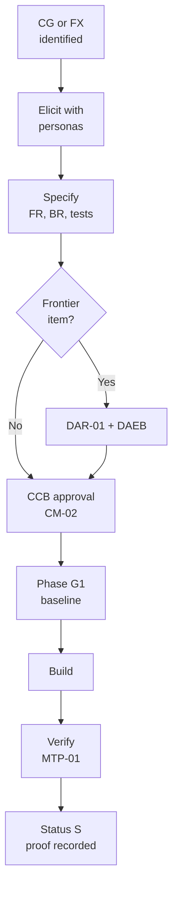
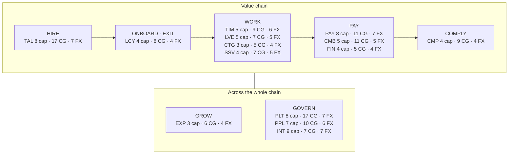
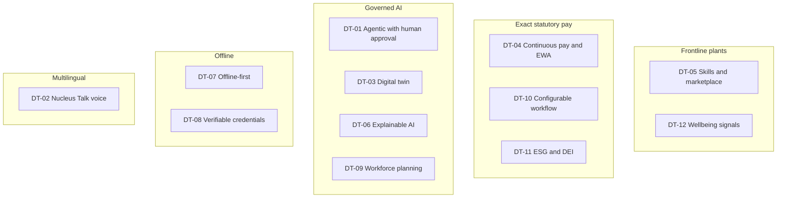

<picture>
  <source media="(prefers-color-scheme: dark)" srcset="../../assets/MultipliersKraftLogoDark.png">
  
</picture>

# GOV-02 — Capability Coverage and Differentiation

| Attribute | Value |
| :--- | :--- |
| Document ID | GOV-02 |
| Title | Capability Coverage and Differentiation |
| Product | Nucleus Suite (Nucleus HRMS Suite) |
| Version | 1.0.0 |
| Status | Issued for approval |
| Owner (role) | Product Owner |
| Author | Dhanraj Dadhich |
| Reviewed by | *pending* |
| Approved by | Steering Committee — *pending* |
| Date | 2026-11-05 |
| Classification | Internal |
| CMMI practice areas | GOV, RDM, PLAN |
| Related documents | GOV-01, GOV-05, GOV-08, GOV-10, GOV-11, BA-02, PLN-02, RB-03, TR-01, MTP-01, FRS-&lt;DOM&gt;-10 |
| Quality & process-performance objectives | QPPO-05 (effective requirements reviews), QPPO-04 (predictable phase delivery) |
| Process performance baseline used | PPB-01 (review defect density), PPB-02 (review rate) |
| Peer review record | *pending* (PR-xxxx, QA-02) |
| Tailoring record | none |
| Traceability anchor | BG-01 – BG-10; DT-01 – DT-12; CAP-&lt;DOM&gt;-nn (GOV-05 §4) |

---

## 1. Purpose

This document states, for every capability Nucleus Suite is meant to offer, **how far that capability is covered today by specified requirements**, what is still to be specified, what lies beyond the current blueprint, and **in which phase** each piece is planned. It then explains the twelve themes on which the product deliberately differentiates itself, and why each one matters to the people who will use it.

It describes our own capabilities only. It makes no comparison with any external product, and it is not a market analysis. It is the leadership view that sits between the vision (GOV-01), the capability model (GOV-05) and the release roadmap (PLN-02, RB-03).

## 2. Principles

1. **Coverage is evidence, not intent.** A capability counts as covered only where requirements exist in the source workbooks — processes, rules, forms, screens or client requirements — or have been approved through change control.
2. **Gaps are named, owned and phased.** Every known gap carries an ID, a priority and a target phase; none is left as a general statement.
3. **Frontier is a proposal until approved.** Items beyond the blueprint enter a phase only after a decision record (DAR-01), Change Control Board approval (CM-02) and, for AI features, Data & AI Ethics Board approval (GOV-11).
4. **Claims follow proof.** No capability or differentiator is described externally as available until the proof measure named in §8 has been met and evidenced through MTP-01.
5. **Users first.** Each differentiator is justified by a specific need of a named persona (GOV-08), not by feature count.

## 3. Coverage Status Vocabulary

| Status | Code | Meaning | What must happen before build |
| :--- | :--- | :--- | :--- |
| Specified in source | **S** | Requirements exist in the source workbooks (Process Flows & Process Maps v1.0, Forms & Fields, HR Demo Points Build Sheet, HRMS Demo Dataset v1.1) and are carried in the domain packs | Baseline at G1 of the phase that builds it |
| Capability gap | **CG** | A capability the product needs that the source workbooks do not specify, or specify only in part. Authored ID `<DOM>-CG-nnn` | Elicit and specify (processes, rules, forms, screens, tests) and approve through CM-02 before the target phase's G1 |
| Frontier | **FX** | A capability beyond the current blueprint that would make the product distinctive. Authored ID `<DOM>-FX-nnn`, with an AI risk tier where AI is involved | DAR-01 record, CCB approval and, for AI, DAEB approval; then specify as for CG |

**Identifier note.** RB-03 is the register of record for every `<DOM>-CG-nnn` and `<DOM>-FX-nnn` item: its ID, title, priority or AI tier, and target phase. Capability-gap IDs keep the numbers they were first issued with, so an item never changes identity when it moves between phases. The domain packs FRS-&lt;DOM&gt;-10 carry the same items at requirement level.

## 4. Capability Reference Model

### 4.1 Structure

The reference model has two axes:

- **Domains** — the 14 process domains (PLT, PPL, TIM, LVE, PAY, CMP, LCY, SSV, CMB, TAL, CTG, EXP, FIN, INT). Each domain's capabilities are the L2 capabilities `CAP-<DOM>-nn` of GOV-05 §4, 77 in total.
- **Capability areas** — eight cross-cutting kinds of capability that every domain draws on in different measure.

| Area | Name | What it covers |
| :--- | :--- | :--- |
| A | Record and structure | Master data, effective-dated and bi-temporal records, organisation and position structures, configuration objects |
| B | Capture and self-service | Punches, requests, forms, portals, mobile, kiosk, voice and business messaging channels |
| C | Rules and calculation | Accrual, time evaluation, gross-to-net, eligibility, proration, reconciliation logic |
| D | Workflow and control | Approval chains, locks, blocking items, overrides, segregation of duties |
| E | Statutory and compliance | Indian statutory deductions, registers, forms, returns, obligation calendars |
| F | Finance and integration | ERP master inbound, journals, bank files, APIs, events, outbox |
| G | Insight and intelligence | Reports, consoles, analytics, predictions, simulation, agents |
| H | Trust and governance | Data scope, privacy, consent, audit, AI governance, accessibility |

### 4.2 Capability areas × domains

Cells show which coverage statuses are present for that domain in that area. "—" means the area does not apply to the domain.

| Domain | A Record | B Capture | C Rules | D Workflow | E Statutory | F Integration | G Insight | H Trust |
| :--- | :--- | :--- | :--- | :--- | :--- | :--- | :--- | :--- |
| PLT | S · CG | CG | S · CG | S · CG | — | S · CG | FX | S · CG · FX |
| PPL | S · CG | FX | S | S · CG | — | S | S · CG · FX | S · CG · FX |
| TIM | S | S · CG · FX | S · FX | S · CG | S | S · CG | S · FX | S · FX |
| LVE | S · CG | S · CG | S · CG | S · CG · FX | S · CG | S | FX | S |
| PAY | S | S · CG · FX | S · CG · FX | S · CG · FX | S · CG | S · CG · FX | FX | S · CG |
| CMP | S | CG | S · CG | S | S · CG · FX | — | FX | S · CG · FX |
| LCY | S | S · FX | CG | S · CG | S | — | CG · FX | S |
| SSV | — | S · CG · FX | — | S · CG | — | S | S · FX | S · CG · FX |
| CMB | S · CG | CG · FX | S · CG | S | CG | S | CG · FX | FX |
| TAL | S | S · CG | — | S · CG | CG | — | S · CG · FX | FX |
| CTG | S · CG | S · CG | S · FX | — | S · CG | — | CG · FX | FX |
| EXP | S | S · CG | — | S | — | S | CG · FX | S |
| FIN | S | — | S · CG | S | — | S · CG · FX | CG · FX | S |
| INT | — | S · FX | — | S · FX | CG | S · FX | S · CG · FX | S · CG · FX |

### 4.3 Capability map

Each node shows the domain, its number of L2 capabilities, and how many capability gaps and frontier items it carries. Domains are placed in the value-chain stage they primarily serve.

## 5. Coverage Status per Capability

"Source evidence" names source processes (`<DOM>-nn`, BA-02), client requirements (`R-nn`, TR-01) or dataset sheets. "Target phase" gives the phase for the specified part first, then for gaps and frontier items. Each CG and FX item appears once, against the capability it extends.

### 5.1 PLT — Platform & Foundations

| Capability | Name | Status | Source evidence | Capability gaps | Frontier | Target phase |
| :--- | :--- | :--- | :--- | :--- | :--- | :--- |
| CAP-PLT-01 | Multi-tenancy and tenant isolation | S · CG · FX | PLT-01; NFR-01 provisioning and residency | PLT-CG-006, PLT-CG-008, PLT-CG-014 | PLT-FX-006 | P0 · P1–P3 · P4 |
| CAP-PLT-02 | Identity and access (RBAC + ABAC) | S · CG · FX | PLT-02; R-09; seam S-12 | PLT-CG-001, PLT-CG-005, PLT-CG-010, PLT-CG-016 | PLT-FX-001 | P0 · P0–P3 · P4 |
| CAP-PLT-03 | Workflow and approval engine | S · CG | PLT-04, PLT-05; workflows W-01..W-10 | PLT-CG-003 | — | P0 · P2 |
| CAP-PLT-04 | Audit and history | S · CG · FX | PLT-06, PLT-08 | PLT-CG-011 | PLT-FX-004 | P0 · P2 · P4 |
| CAP-PLT-05 | Localisation (11 base languages, RTL, expanded Indian languages) | S · CG | GOV-01 §6.2; R0 prototype interface copy | PLT-CG-017 | — | R0–P2 |
| CAP-PLT-06 | Consent and privacy operations | S · CG · FX | CMP-06p | PLT-CG-009 | PLT-FX-005 | P1 · P1 · P3 |
| CAP-PLT-07 | Configuration and extensibility | S · CG · FX | PLT-03 | PLT-CG-004, PLT-CG-007, PLT-CG-012, PLT-CG-013 | PLT-FX-002, PLT-FX-003, PLT-FX-007 | P0 · P2–P4 · P4–P5 |
| CAP-PLT-08 | Notifications and document generation | S · CG | PLT-07 | PLT-CG-002, PLT-CG-015 | — | P0 · P1–P2 |

### 5.2 PPL — People Core

| Capability | Name | Status | Source evidence | Capability gaps | Frontier | Target phase |
| :--- | :--- | :--- | :--- | :--- | :--- | :--- |
| CAP-PPL-01 | Worker record management | S · CG · FX | PPL-01, PPL-07, PPL-08 | PPL-CG-004, PPL-CG-007 | PPL-FX-002, PPL-FX-005, PPL-FX-006 | P1 · P1–P2 · P3–P4 |
| CAP-PPL-02 | Bi-temporal history | S | PPL-02, PLT-08 | — | — | P0–P1 |
| CAP-PPL-03 | Position management | S · CG | PPL-04; R-25, R-26 | PPL-CG-008 | — | P1 · P3 |
| CAP-PPL-04 | Organisation management | S · CG | PPL-05; R-23 | PPL-CG-002, PPL-CG-003, PPL-CG-005, PPL-CG-010 | — | P1 · P1–P4 |
| CAP-PPL-05 | Job architecture | CG | Designation and grade-rank masters in the dataset only | PPL-CG-001 | — | P1 |
| CAP-PPL-06 | Worker documents | S · CG · FX | PPL-06 | PPL-CG-009 | PPL-FX-003 | P1 · P2 · P5 |
| CAP-PPL-07 | Directory and organisation chart | S · CG | PPL-05; R-23 | PPL-CG-006 | — | P1 · P1 |

### 5.3 TIM — Time & Attendance

| Capability | Name | Status | Source evidence | Capability gaps | Frontier | Target phase |
| :--- | :--- | :--- | :--- | :--- | :--- | :--- |
| CAP-TIM-01 | Time capture | S · CG · FX | TIM-01 | TIM-CG-001, TIM-CG-002, TIM-CG-007, TIM-CG-009 | TIM-FX-003, TIM-FX-004, TIM-FX-006 | P1 · P1–P4 · P3–P4 |
| CAP-TIM-02 | Time evaluation | S · FX | TIM-02, TIM-04, TIM-05, TIM-09; R-01, R-13 | — | TIM-FX-002 | P1 · P4 |
| CAP-TIM-03 | Shift and roster management | S · CG · FX | TIM-03; R-14 | TIM-CG-003, TIM-CG-004, TIM-CG-005, TIM-CG-008 | TIM-FX-001 | P1 · P3–P4 · P5 |
| CAP-TIM-04 | Overtime and gate pass | S · CG · FX | TIM-06, TIM-07; R-05, R-11, R-12 | TIM-CG-006 | TIM-FX-005 | P1 · P1 · P4 |
| CAP-TIM-05 | Regularisation and team reports | S | TIM-08, TIM-10; R-02 | — | — | P1 |

### 5.4 LVE — Leave

| Capability | Name | Status | Source evidence | Capability gaps | Frontier | Target phase |
| :--- | :--- | :--- | :--- | :--- | :--- | :--- |
| CAP-LVE-01 | Leave plans and accrual | S · CG · FX | LVE-01, LVE-02, LVE-07; R-08 | LVE-CG-001, LVE-CG-002, LVE-CG-006 | LVE-FX-004 | P1 · P1–P2 · P4 |
| CAP-LVE-02 | Leave request and approval | S · CG · FX | LVE-03, LVE-04, LVE-05; R-06 | LVE-CG-004, LVE-CG-007 | LVE-FX-001, LVE-FX-002, LVE-FX-003, LVE-FX-005 | P1 · P2 · P4–P5 |
| CAP-LVE-03 | Balance management | S · CG | LVE-08 | LVE-CG-003 | — | P1 · P3 |
| CAP-LVE-04 | Special rules (comp-off, sandwich) | S | LVE-06; R-07 | — | — | P1 |
| CAP-LVE-05 | Holiday calendars | S · CG | 09_Holiday_Calendar | LVE-CG-005 | — | P1 · P1 |

### 5.5 PAY — Payroll

| Capability | Name | Status | Source evidence | Capability gaps | Frontier | Target phase |
| :--- | :--- | :--- | :--- | :--- | :--- | :--- |
| CAP-PAY-01 | Gross-to-net computation | S · CG · FX | PAY-01, PAY-02, PAY-04, PAY-05, PAY-06, PAY-10 | PAY-CG-008 | PAY-FX-001 | P1 · P2 · P5 |
| CAP-PAY-02 | Statutory deductions | S · CG · FX | PAY-07 | PAY-CG-005 | PAY-FX-005 | P1 · P3 · P4 |
| CAP-PAY-03 | Payroll control room | S · CG · FX | PAY-03, PAY-09, PAY-14, FIN-05 | PAY-CG-010, PAY-CG-011 | PAY-FX-004, PAY-FX-006 | P1 · P1–P2 · P3–P5 |
| CAP-PAY-04 | Retro and arrears | S · CG | PAY-11 | PAY-CG-002 | — | P1 · P1 |
| CAP-PAY-05 | Payslips and tax documents | S · CG · FX | PAY-13 | PAY-CG-003, PAY-CG-004, PAY-CG-007, PAY-CG-009 | PAY-FX-003 | P1 · P1–P3 · P4 |
| CAP-PAY-06 | Full and final settlement | S | PAY-12, LCY-07; R-17 | — | — | P1 |
| CAP-PAY-07 | Earned wage access | S · FX | CMB-05 | — | PAY-FX-002 | P2 · P4 |
| CAP-PAY-08 | Country packs and cross-border pay | CG · FX | — | PAY-CG-001, PAY-CG-006 | PAY-FX-007 | P4 · P5 |

### 5.6 CMP — Compliance

| Capability | Name | Status | Source evidence | Capability gaps | Frontier | Target phase |
| :--- | :--- | :--- | :--- | :--- | :--- | :--- |
| CAP-CMP-01 | Statutory returns | S | CMP-02p; R-18 | — | — | P1 |
| CAP-CMP-02 | Labour registers and statutory forms | S · CG · FX | CMP-03p; R-18, R-27 | CMP-CG-003 | CMP-FX-003 | P1 · P2 · P3 |
| CAP-CMP-03 | Wage-code compliance | S · CG | CMP-04p, PAY-05 | CMP-CG-001 | — | P1 · P2 |
| CAP-CMP-04 | Compliance calendar, cases and inspections | S · CG · FX | CMP-01p, CMP-02p | CMP-CG-002, CMP-CG-005, CMP-CG-006, CMP-CG-007, CMP-CG-008, CMP-CG-009 | CMP-FX-001, CMP-FX-002, CMP-FX-004 | P1 · P2 · P4–P5 |

### 5.7 LCY — Lifecycle

| Capability | Name | Status | Source evidence | Capability gaps | Frontier | Target phase |
| :--- | :--- | :--- | :--- | :--- | :--- | :--- |
| CAP-LCY-01 | Pre-boarding and joining | S · CG · FX | LCY-01, LCY-02, LCY-08; R-24, R-27 | LCY-CG-001 | LCY-FX-001, LCY-FX-004 | P1 · P2 · P4 |
| CAP-LCY-02 | Confirmation, transfer and promotion | S · CG | LCY-03, LCY-04, PPL-07 | LCY-CG-002, LCY-CG-005, LCY-CG-006 | — | P1 · P1–P2 |
| CAP-LCY-03 | Resignation and exit | S · CG · FX | LCY-05, LCY-06, LCY-07; R-17 | LCY-CG-003, LCY-CG-004, LCY-CG-007, LCY-CG-008 | LCY-FX-002, LCY-FX-003 | P1 · P1–P3 · P4–P5 |
| CAP-LCY-04 | Credentials intake | FX | — | — | Delivered through PPL-FX-003 (CAP-PPL-06) and CTG-FX-004 (CAP-CTG-01) | P5 |

### 5.8 SSV — Self-service & Helpdesk

| Capability | Name | Status | Source evidence | Capability gaps | Frontier | Target phase |
| :--- | :--- | :--- | :--- | :--- | :--- | :--- |
| CAP-SSV-01 | Employee and manager self-service | S · CG · FX | SSV-01, SSV-02 | SSV-CG-002, SSV-CG-003, SSV-CG-004, SSV-CG-007 | SSV-FX-002, SSV-FX-003, SSV-FX-004 | P1 · P1–P3 · P3–P4 |
| CAP-SSV-02 | Helpdesk and case management | S · CG · FX | SSV-04 | SSV-CG-001, SSV-CG-006 | SSV-FX-005 | P1 · P1–P2 · P4 |
| CAP-SSV-03 | Channels (web, mobile, voice, business messaging) | S · CG · FX | SSV-03; Nucleus Talk navigation in R0 | SSV-CG-005 | SSV-FX-001 | P2 · P2 · P4 |
| CAP-SSV-04 | Grounded policy answers | S | SSV-05 | — | — | P2 |

### 5.9 CMB — Compensation, Loans & Benefits

| Capability | Name | Status | Source evidence | Capability gaps | Frontier | Target phase |
| :--- | :--- | :--- | :--- | :--- | :--- | :--- |
| CAP-CMB-01 | Salary structures and bands | S · CG | PAY-05; 13_Salary_Structure | CMB-CG-001, CMB-CG-010 | — | P1 · P1–P3 |
| CAP-CMB-02 | Revisions, incentives and exceptions | S · CG · FX | CMB-06 | CMB-CG-002, CMB-CG-008, CMB-CG-009 | CMB-FX-001, CMB-FX-004, CMB-FX-005 | P2 · P3–P4 · P5 |
| CAP-CMB-03 | Loans and advances | S | CMB-01..CMB-05; R-10 | — | — | P1–P2 |
| CAP-CMB-04 | Benefits and statutory benefit administration | CG · FX | — | CMB-CG-003, CMB-CG-004, CMB-CG-005, CMB-CG-006, CMB-CG-011 | CMB-FX-003 | P2–P4 · P5 |
| CAP-CMB-05 | Total rewards | CG · FX | — | CMB-CG-007 | CMB-FX-002 | P3 · P4 |

### 5.10 TAL — Talent

| Capability | Name | Status | Source evidence | Capability gaps | Frontier | Target phase |
| :--- | :--- | :--- | :--- | :--- | :--- | :--- |
| CAP-TAL-01 | Requisition | S | TAL-01; R-25, R-26 | — | — | P3 |
| CAP-TAL-02 | Candidates and referrals | S · CG · FX | TAL-02, TAL-03; R-20 | TAL-CG-001, TAL-CG-002, TAL-CG-003, TAL-CG-004, TAL-CG-012, TAL-CG-013, TAL-CG-014 | TAL-FX-003, TAL-FX-007 | P2–P3 · P2–P3 · P4–P5 |
| CAP-TAL-03 | Goals and reviews | S · CG | TAL-04 | TAL-CG-005, TAL-CG-006, TAL-CG-007 | — | P3 · P3 |
| CAP-TAL-04 | Calibration | S · FX | TAL-04 | — | TAL-FX-005 | P3 · P4 |
| CAP-TAL-05 | Skills | S · FX | TAL-05 | — | TAL-FX-001, TAL-FX-006 | P3 · P4–P5 |
| CAP-TAL-06 | Learning | S · CG · FX | TAL-05; induction in LCY-02 (R-24) | TAL-CG-010, TAL-CG-011, TAL-CG-015, TAL-CG-017 | TAL-FX-004 | P1 · P2–P3 · P4 |
| CAP-TAL-07 | Talent marketplace | FX | — | — | TAL-FX-002 | P5 |
| CAP-TAL-08 | Succession, careers and development | CG | — | TAL-CG-008, TAL-CG-009, TAL-CG-016 | — | P3 |

### 5.11 CTG — Contingent Workforce

| Capability | Name | Status | Source evidence | Capability gaps | Frontier | Target phase |
| :--- | :--- | :--- | :--- | :--- | :--- | :--- |
| CAP-CTG-01 | Agency and contract worker management | S · CG · FX | CTG-01; R-03, R-04 | CTG-CG-001, CTG-CG-005 | CTG-FX-003, CTG-FX-004 | P3 · P2–P3 · P5 |
| CAP-CTG-02 | Contractor time and access | S · CG · FX | CTG-02, TIM-04 | CTG-CG-003, CTG-CG-004 | CTG-FX-002 | P3 · P2 · P4 |
| CAP-CTG-03 | Contractor compliance | S · CG · FX | CTG-03 | CTG-CG-002 | CTG-FX-001 | P3 · P2 · P4 |

### 5.12 EXP — Experience

| Capability | Name | Status | Source evidence | Capability gaps | Frontier | Target phase |
| :--- | :--- | :--- | :--- | :--- | :--- | :--- |
| CAP-EXP-01 | Recognition and awards | S · FX | EXP-01; R-19, R-20 | — | EXP-FX-003 | P2 · P4 |
| CAP-EXP-02 | Announcements, communications and letters | S · CG · FX | EXP-02, EXP-03; R-21, R-22 | EXP-CG-003, EXP-CG-005, EXP-CG-006 | EXP-FX-002 | P2 · P2–P4 · P4 |
| CAP-EXP-03 | Wellbeing signals and listening | CG · FX | — | EXP-CG-001, EXP-CG-002 | EXP-FX-001, EXP-FX-004 | P3 · P4–P5 |

### 5.13 FIN — Finance & ERP

| Capability | Name | Status | Source evidence | Capability gaps | Frontier | Target phase |
| :--- | :--- | :--- | :--- | :--- | :--- | :--- |
| CAP-FIN-01 | Finance master inbound | S | FIN-01; R-15 | — | — | P1 |
| CAP-FIN-02 | GL mapping, salary journal and workforce cost | S · CG · FX | FIN-02, FIN-03; R-16 | FIN-CG-001, FIN-CG-002, FIN-CG-003, FIN-CG-004, FIN-CG-005 | FIN-FX-001, FIN-FX-004 | P1–P2 · P2–P3 · P5 |
| CAP-FIN-03 | Posting to the customer's ERP system | S | FIN-03 | — | — | P2 |
| CAP-FIN-04 | Reconciliation and bank files | S · FX | FIN-04, FIN-05 | — | FIN-FX-003 | P2 · P4 |

### 5.14 INT — Intelligence & Agents

| Capability | Name | Status | Source evidence | Capability gaps | Frontier | Target phase |
| :--- | :--- | :--- | :--- | :--- | :--- | :--- |
| CAP-INT-01 | Policy gate | S | INT-01; seam S-11 | — | — | P2 |
| CAP-INT-02 | Tool surface and agent orchestration | S · FX | INT-01; IA-01 | — | INT-FX-003, INT-FX-007 | P2 · P4–P5 |
| CAP-INT-03 | Action ledger | S | INT-02, PLT-06, CMP-05p | — | — | P2 |
| CAP-INT-04 | Analytics and role consoles | S · CG · FX | INT-03, TIM-10; consoles S1–S10 in R0 | INT-CG-001, INT-CG-002, INT-CG-003, INT-CG-004, INT-CG-005, INT-CG-007 | INT-FX-004 | R0–P2 · P2–P3 · P4 |
| CAP-INT-05 | Natural-language query | FX | — | — | INT-FX-001 | P4 |
| CAP-INT-06 | Predictions and model transparency | S · CG · FX | INT-04 | INT-CG-006 | INT-FX-005, PPL-FX-004 | P3 · P5 · P4–P5 |
| CAP-INT-07 | Organisation digital twin and workforce planning | FX | — | — | FIN-FX-002, INT-FX-002, INT-FX-006, PPL-FX-001 | P5 |
| CAP-INT-08 | ESG, DEI and workforce disclosures | CG | — | CMP-CG-004, EXP-CG-004 | — | P3 |
| CAP-INT-09 | Nucleus Talk | S | Voice navigation in the R0 prototype | — | Extended by SSV-FX-001 and TIM-FX-004 | R0 · P3–P4 |

### 5.15 Coverage summary

| Domain | Capabilities | With specified part (S) | Capability gaps (CG) | Frontier items (FX) |
| :--- | ---: | ---: | ---: | ---: |
| PLT | 8 | 8 | 17 | 7 |
| PPL | 7 | 6 | 10 | 6 |
| TIM | 5 | 5 | 9 | 6 |
| LVE | 5 | 5 | 7 | 5 |
| PAY | 8 | 7 | 11 | 7 |
| CMP | 4 | 4 | 9 | 4 |
| LCY | 4 | 3 | 8 | 4 |
| SSV | 4 | 4 | 7 | 5 |
| CMB | 5 | 3 | 11 | 5 |
| TAL | 8 | 6 | 17 | 7 |
| CTG | 3 | 3 | 5 | 4 |
| EXP | 3 | 2 | 6 | 4 |
| FIN | 4 | 4 | 5 | 4 |
| INT | 9 | 6 | 7 | 7 |
| **Total** | **77** | **66** | **129** | **75** |

Counts of CG and FX are by the domain prefix of the item ID. 11 capabilities have no specified part yet: CAP-PPL-05, CAP-PAY-08, CAP-LCY-04, CAP-CMB-04, CAP-CMB-05, CAP-TAL-07, CAP-TAL-08, CAP-EXP-03, CAP-INT-05, CAP-INT-07 and CAP-INT-08.

| Phase | Capability gaps due | Frontier items due |
| :--- | ---: | ---: |
| P0 | 1 | 0 |
| P1 | 21 | 0 |
| P2 | 51 | 0 |
| P3 | 46 | 7 |
| P4 | 9 | 39 |
| P5 | 1 | 29 |
| **Total** | **129** | **75** |

## 6. Capability Gap Register

Priority is MoSCoW. Every item must be specified and approved before the G1 of its target phase. Titles follow RB-03, the register of record, with generic wording where the register names a product-specific mechanism.

| ID | Capability gap | Priority | Target phase | Capability |
| :--- | :--- | :--- | :--- | :--- |
| PLT-CG-001 | Adaptive multi-factor and step-up authentication | Must | P0 | CAP-PLT-02 |
| PLT-CG-002 | Notification matrix and preference centre | Must | P1 | CAP-PLT-08 |
| PLT-CG-003 | No-code business-process designer | Must | P2 | CAP-PLT-03 |
| PLT-CG-004 | Configuration sandbox and promotion | Should | P2 | CAP-PLT-07 |
| PLT-CG-005 | Proxy, delegation and act-as | Must | P1 | CAP-PLT-02 |
| PLT-CG-006 | Bulk data load with validation and rollback | Must | P1 | CAP-PLT-01 |
| PLT-CG-007 | Custom objects and fields | Should | P3 | CAP-PLT-07 |
| PLT-CG-008 | Legacy HRMS data migration toolkit | Must | P1 | CAP-PLT-01 |
| PLT-CG-009 | Data subject rights workflow | Must | P1 | CAP-PLT-06 |
| PLT-CG-010 | Identity provisioning (SCIM 2.0 and enterprise directory) | Must | P2 | CAP-PLT-02 |
| PLT-CG-011 | As-at time travel for every record | Must | P2 | CAP-PLT-04 |
| PLT-CG-012 | Policy-as-code with automated regression | Must | P2 | CAP-PLT-07 |
| PLT-CG-013 | Extension marketplace and low-code apps | Should | P4 | CAP-PLT-07 |
| PLT-CG-014 | Multi-currency and multi-entity consolidation | Must | P3 | CAP-PLT-01 |
| PLT-CG-015 | Document management with AI extraction | Must | P2 | CAP-PLT-08 |
| PLT-CG-016 | Visitor and gate management | Should | P3 | CAP-PLT-02 |
| PLT-CG-017 | Expanded Indian language coverage | Must | P2 | CAP-PLT-05 |
| PPL-CG-001 | Job architecture | Must | P1 | CAP-PPL-05 |
| PPL-CG-002 | Matrix and multiple organisation hierarchies | Must | P1 | CAP-PPL-04 |
| PPL-CG-003 | Global assignment and expatriate management | Should | P4 | CAP-PPL-04 |
| PPL-CG-004 | Dependants, nominees and emergency contacts | Must | P1 | CAP-PPL-01 |
| PPL-CG-005 | Mass reorganisation | Must | P2 | CAP-PPL-04 |
| PPL-CG-006 | Interactive organisation chart | Must | P1 | CAP-PPL-07 |
| PPL-CG-007 | Concurrent employment and multiple assignments | Must | P2 | CAP-PPL-01 |
| PPL-CG-008 | Headcount and position planning | Must | P3 | CAP-PPL-03 |
| PPL-CG-009 | Digital employee ID and verifiable employment letter | Should | P2 | CAP-PPL-06 |
| PPL-CG-010 | Organisation health metrics | Should | P3 | CAP-PPL-04 |
| TIM-CG-001 | Project and task timesheets | Should | P3 | CAP-TIM-01 |
| TIM-CG-002 | Mobile geofenced and selfie attendance | Must | P1 | CAP-TIM-01 |
| TIM-CG-003 | Shift swap and open-shift marketplace | Should | P3 | CAP-TIM-03 |
| TIM-CG-004 | Flexi-time and time banking | Could | P3 | CAP-TIM-03 |
| TIM-CG-005 | Labour-demand scheduling | Should | P4 | CAP-TIM-03 |
| TIM-CG-006 | Overtime pre-approval and budget control | Must | P1 | CAP-TIM-04 |
| TIM-CG-007 | Canteen and transport integration | Should | P3 | CAP-TIM-01 |
| TIM-CG-008 | Hybrid work and desk booking | Should | P3 | CAP-TIM-03 |
| TIM-CG-009 | Wearable and IoT presence (opt-in) | Could | P4 | CAP-TIM-01 |
| LVE-CG-001 | Statutory maternity and paternity tracking | Must | P1 | CAP-LVE-01 |
| LVE-CG-002 | Leave of absence (long, unpaid, sabbatical) | Must | P2 | CAP-LVE-01 |
| LVE-CG-003 | Leave donation and shared leave bank | Could | P3 | CAP-LVE-03 |
| LVE-CG-004 | Corporate calendar integration | Should | P2 | CAP-LVE-02 |
| LVE-CG-005 | Optional and restricted holidays | Must | P1 | CAP-LVE-05 |
| LVE-CG-006 | Leave policy simulator | Must | P2 | CAP-LVE-01 |
| LVE-CG-007 | Team coverage rules | Must | P2 | CAP-LVE-02 |
| PAY-CG-001 | Multi-country payroll | Should | P4 | CAP-PAY-08 |
| PAY-CG-002 | Retroactive pay processing | Must | P1 | CAP-PAY-04 |
| PAY-CG-003 | Tax declaration and proof management | Must | P1 | CAP-PAY-05 |
| PAY-CG-004 | Reimbursements and flexible benefit plan claims | Must | P2 | CAP-PAY-05 |
| PAY-CG-005 | Garnishments and court orders | Should | P3 | CAP-PAY-02 |
| PAY-CG-006 | Payroll extracts for external payroll processors | Should | P4 | CAP-PAY-08 |
| PAY-CG-007 | Year-end processing | Must | P2 | CAP-PAY-05 |
| PAY-CG-008 | Multi-frequency payroll | Must | P2 | CAP-PAY-01 |
| PAY-CG-009 | Employee net-pay what-if | Should | P3 | CAP-PAY-05 |
| PAY-CG-010 | Payroll audit trail explorer | Must | P2 | CAP-PAY-03 |
| PAY-CG-011 | Salary hold and release | Must | P1 | CAP-PAY-03 |
| CMP-CG-001 | Labour code readiness pack | Must | P2 | CAP-CMP-03 |
| CMP-CG-002 | POSH case management | Must | P2 | CAP-CMP-04 |
| CMP-CG-003 | Contract labour (CLRA) registers | Must | P2 | CAP-CMP-02 |
| CMP-CG-004 | ESG / BRSR workforce disclosures | Should | P3 | CAP-INT-08 |
| CMP-CG-005 | Compliance training tracking | Must | P2 | CAP-CMP-04 |
| CMP-CG-006 | Environment, health and safety incident management | Must | P2 | CAP-CMP-04 |
| CMP-CG-007 | Grievance and whistle-blower channel | Must | P2 | CAP-CMP-04 |
| CMP-CG-008 | Licence and registration renewals | Must | P2 | CAP-CMP-04 |
| CMP-CG-009 | Inspection visit register | Must | P2 | CAP-CMP-04 |
| LCY-CG-001 | Background verification orchestration | Must | P2 | CAP-LCY-01 |
| LCY-CG-002 | Internal mobility and transfer journeys | Must | P2 | CAP-LCY-02 |
| LCY-CG-003 | Rehire eligibility and alumni | Should | P3 | CAP-LCY-03 |
| LCY-CG-004 | Exit interview and attrition reasons | Must | P2 | CAP-LCY-03 |
| LCY-CG-005 | Probation review automation | Must | P1 | CAP-LCY-02 |
| LCY-CG-006 | Contract-to-permanent conversion | Must | P2 | CAP-LCY-02 |
| LCY-CG-007 | Notice period management and buy-out | Must | P1 | CAP-LCY-03 |
| LCY-CG-008 | Knowledge transfer at exit | Should | P3 | CAP-LCY-03 |
| SSV-CG-001 | HR service catalogue and knowledge base | Must | P1 | CAP-SSV-02 |
| SSV-CG-002 | Employee journeys | Should | P3 | CAP-SSV-01 |
| SSV-CG-003 | Accessibility conformance (WCAG 2.2 AA) | Must | P1 | CAP-SSV-01 |
| SSV-CG-004 | Native mobile application | Must | P2 | CAP-SSV-01 |
| SSV-CG-005 | Omnichannel virtual HR agent | Must | P2 | CAP-SSV-03 |
| SSV-CG-006 | Confidential HR case management | Must | P2 | CAP-SSV-02 |
| SSV-CG-007 | Document self-service on demand | Must | P2 | CAP-SSV-01 |
| CMB-CG-001 | Salary structures and grade ranges | Must | P1 | CAP-CMB-01 |
| CMB-CG-002 | Merit, bonus and variable pay cycles | Must | P3 | CAP-CMB-02 |
| CMB-CG-003 | Equity and ESOP administration | Should | P4 | CAP-CMB-04 |
| CMB-CG-004 | Health insurance enrolment | Must | P3 | CAP-CMB-04 |
| CMB-CG-005 | Retirement plans (NPS, superannuation) | Must | P3 | CAP-CMB-04 |
| CMB-CG-006 | Flexible benefits and perks | Should | P3 | CAP-CMB-04 |
| CMB-CG-007 | Total rewards statement | Should | P3 | CAP-CMB-05 |
| CMB-CG-008 | Pay equity analysis | Must | P3 | CAP-CMB-02 |
| CMB-CG-009 | Long-term incentives and retention bonuses | Should | P4 | CAP-CMB-02 |
| CMB-CG-010 | Internal pay benchmarking | Must | P3 | CAP-CMB-01 |
| CMB-CG-011 | Statutory bonus and gratuity administration | Must | P2 | CAP-CMB-04 |
| TAL-CG-001 | Sourcing and job-board multiposting | Must | P2 | CAP-TAL-02 |
| TAL-CG-002 | Applicant tracking pipeline | Must | P2 | CAP-TAL-02 |
| TAL-CG-003 | Interview scheduling and scorecards | Must | P2 | CAP-TAL-02 |
| TAL-CG-004 | Offer management | Must | P2 | CAP-TAL-02 |
| TAL-CG-005 | Goals and OKR cascade | Must | P3 | CAP-TAL-03 |
| TAL-CG-006 | Continuous feedback and check-ins | Must | P3 | CAP-TAL-03 |
| TAL-CG-007 | Performance reviews and 360 | Must | P3 | CAP-TAL-03 |
| TAL-CG-008 | Succession planning and talent pools | Must | P3 | CAP-TAL-08 |
| TAL-CG-009 | Career frameworks and development plans | Should | P3 | CAP-TAL-08 |
| TAL-CG-010 | Learning catalogue and content ingestion (SCORM, xAPI) | Must | P3 | CAP-TAL-06 |
| TAL-CG-011 | Certifications and licence tracking | Must | P3 | CAP-TAL-06 |
| TAL-CG-012 | Candidate relationship management | Must | P3 | CAP-TAL-02 |
| TAL-CG-013 | Campus and bulk hiring | Must | P3 | CAP-TAL-02 |
| TAL-CG-014 | Assessments and skill tests | Should | P3 | CAP-TAL-02 |
| TAL-CG-015 | Apprenticeship and trainee programmes | Must | P2 | CAP-TAL-06 |
| TAL-CG-016 | Mentoring and coaching | Should | P3 | CAP-TAL-08 |
| TAL-CG-017 | Learning experience and content authoring | Should | P3 | CAP-TAL-06 |
| CTG-CG-001 | Vendor management for contract labour | Must | P2 | CAP-CTG-01 |
| CTG-CG-002 | Statutory challan verification | Must | P2 | CAP-CTG-03 |
| CTG-CG-003 | Safety induction and PPE issue | Must | P2 | CAP-CTG-02 |
| CTG-CG-004 | Contract worker gate attendance and wage validation | Must | P2 | CAP-CTG-02 |
| CTG-CG-005 | Contractor workforce planning | Should | P3 | CAP-CTG-01 |
| EXP-CG-001 | Employee listening surveys | Must | P3 | CAP-EXP-03 |
| EXP-CG-002 | Wellbeing programmes | Should | P3 | CAP-EXP-03 |
| EXP-CG-003 | Communities and social feed | Could | P4 | CAP-EXP-02 |
| EXP-CG-004 | Diversity, equity and inclusion analytics | Must | P3 | CAP-INT-08 |
| EXP-CG-005 | Celebrations and milestones | Should | P2 | CAP-EXP-02 |
| EXP-CG-006 | Internal communications and campaigns | Should | P2 | CAP-EXP-02 |
| FIN-CG-001 | Labour cost allocation to projects | Must | P2 | CAP-FIN-02 |
| FIN-CG-002 | Leave and gratuity liability accruals | Should | P3 | CAP-FIN-02 |
| FIN-CG-003 | Headcount and workforce budget against actual | Should | P3 | CAP-FIN-02 |
| FIN-CG-004 | Travel and expense management | Must | P3 | CAP-FIN-02 |
| FIN-CG-005 | Benefits and statutory liability accounting | Must | P2 | CAP-FIN-02 |
| INT-CG-001 | Self-service report writer | Must | P2 | CAP-INT-04 |
| INT-CG-002 | Executive dashboards and people analytics | Must | P2 | CAP-INT-04 |
| INT-CG-003 | Data warehouse export | Should | P3 | CAP-INT-04 |
| INT-CG-004 | Regulatory and statutory reports library | Must | P2 | CAP-INT-04 |
| INT-CG-005 | Skills gap analysis | Must | P3 | CAP-INT-04 |
| INT-CG-006 | Organisation network analysis (consented) | Could | P5 | CAP-INT-06 |
| INT-CG-007 | Embedded analytics in every screen | Should | P3 | CAP-INT-04 |

## 7. Frontier Register

AI tier is the GOV-11 risk tier; "No AI" marks frontier items that are deterministic. The last column names the differentiator theme (§8) or, where the item serves a goal without a dedicated theme, the business goal.

| ID | Frontier item | AI tier | Target phase | Capability | Theme or goal |
| :--- | :--- | :--- | :--- | :--- | :--- |
| PLT-FX-001 | Zero-trust continuous authorisation | Tier 1 | P4 | CAP-PLT-02 | BG-06 |
| PLT-FX-002 | Natural-language configuration | Tier 2 | P5 | CAP-PLT-07 | DT-10 |
| PLT-FX-003 | Policy digital twin | Tier 1 | P5 | CAP-PLT-07 | DT-03 |
| PLT-FX-004 | Tamper-evident audit ledger | No AI | P4 | CAP-PLT-04 | BG-06 |
| PLT-FX-005 | Privacy vault and consent ledger | No AI | P3 | CAP-PLT-06 | BG-06 |
| PLT-FX-006 | Offline-first edge for plants | No AI | P4 | CAP-PLT-01 | DT-07 |
| PLT-FX-007 | Autonomous configuration health check | Tier 2 | P4 | CAP-PLT-07 | DT-10 |
| PPL-FX-001 | Organisation digital twin | Tier 3 | P5 | CAP-INT-07 | DT-03 |
| PPL-FX-002 | AI data-quality steward | Tier 2 | P4 | CAP-PPL-01 | DT-01 |
| PPL-FX-003 | Verifiable credentials wallet | No AI | P5 | CAP-PPL-06 | DT-08 |
| PPL-FX-004 | Explainable attrition risk | Tier 3 | P5 | CAP-INT-06 | DT-06 |
| PPL-FX-005 | Conversational profile updates | Tier 2 | P3 | CAP-PPL-01 | DT-01 |
| PPL-FX-006 | Self-updating skills and career profile | Tier 2 | P4 | CAP-PPL-01 | DT-05 |
| TIM-FX-001 | AI roster optimiser | Tier 2 | P5 | CAP-TIM-03 | DT-09 |
| TIM-FX-002 | Fatigue and safety risk scoring | Tier 2 | P4 | CAP-TIM-02 | DT-12 |
| TIM-FX-003 | Punch anomaly detection | Tier 2 | P4 | CAP-TIM-01 | BG-03 |
| TIM-FX-004 | Voice punch with geofence | Tier 1 | P3 | CAP-TIM-01 | DT-02 |
| TIM-FX-005 | Overtime budget burn forecasting | Tier 1 | P4 | CAP-TIM-04 | DT-09 |
| TIM-FX-006 | Computer-vision-free presence assurance | Tier 1 | P4 | CAP-TIM-01 | BG-06 |
| LVE-FX-001 | Coverage-aware leave planner | Tier 1 | P4 | CAP-LVE-02 | DT-09 |
| LVE-FX-002 | Within-policy auto-approval agent | Tier 2 | P4 | CAP-LVE-02 | DT-01 |
| LVE-FX-003 | Burnout nudges | Tier 1 | P4 | CAP-LVE-02 | DT-12 |
| LVE-FX-004 | Leave liability forecasting | Tier 1 | P4 | CAP-LVE-01 | DT-09 |
| LVE-FX-005 | Predictive absence planning | Tier 2 | P5 | CAP-LVE-02 | DT-09 |
| PAY-FX-001 | Continuous payroll | No AI | P5 | CAP-PAY-01 | DT-04 |
| PAY-FX-002 | Earned wage access | No AI | P4 | CAP-PAY-07 | DT-04 |
| PAY-FX-003 | Explainable payslip | Tier 1 | P4 | CAP-PAY-05 | DT-06 |
| PAY-FX-004 | Zero-touch pre-audit | Tier 2 | P3 | CAP-PAY-03 | DT-01 |
| PAY-FX-005 | Tax regime advisor | Tier 2 | P4 | CAP-PAY-02 | DT-06 |
| PAY-FX-006 | Zero-day payroll close | Tier 2 | P5 | CAP-PAY-03 | DT-04 |
| PAY-FX-007 | Instant cross-border pay for global assignees | No AI | P5 | CAP-PAY-08 | DT-04 |
| CMP-FX-001 | Regulatory change radar | Tier 3 | P5 | CAP-CMP-04 | BG-04 |
| CMP-FX-002 | Continuous compliance score | Tier 1 | P4 | CAP-CMP-04 | BG-06 |
| CMP-FX-003 | Inspection-ready pack in one action | Tier 2 | P3 | CAP-CMP-02 | BG-03 |
| CMP-FX-004 | Compliance copilot for inspectors' questions | Tier 2 | P5 | CAP-CMP-04 | DT-01 |
| LCY-FX-001 | Agentic onboarding concierge | Tier 2 | P4 | CAP-LCY-01 | DT-01 |
| LCY-FX-002 | Early-attrition early warning | Tier 3 | P5 | CAP-LCY-03 | DT-09 |
| LCY-FX-003 | Exit sentiment analysis | Tier 1 | P4 | CAP-LCY-03 | DT-12 |
| LCY-FX-004 | Personalised onboarding journeys by role and language | Tier 2 | P4 | CAP-LCY-01 | DT-02 |
| SSV-FX-001 | Voice-first HR in 11 languages | Tier 2 | P4 | CAP-SSV-03 | DT-02 |
| SSV-FX-002 | Proactive nudges | Tier 1 | P3 | CAP-SSV-01 | DT-01 |
| SSV-FX-003 | End-to-end task agents | Tier 2 | P4 | CAP-SSV-01 | DT-01 |
| SSV-FX-004 | Shop-floor kiosk mode | No AI | P3 | CAP-SSV-01 | DT-07 |
| SSV-FX-005 | Emotion-free sentiment-aware routing | Tier 2 | P4 | CAP-SSV-02 | DT-06 |
| CMB-FX-001 | AI compensation advisor with equity guardrails | Tier 3 | P5 | CAP-CMB-02 | DT-06 |
| CMB-FX-002 | Real-time total rewards wallet | Tier 1 | P4 | CAP-CMB-05 | DT-04 |
| CMB-FX-003 | Personalised benefits recommender | Tier 2 | P5 | CAP-CMB-04 | DT-06 |
| CMB-FX-004 | Pay transparency readiness | Tier 1 | P5 | CAP-CMB-02 | DT-11 |
| CMB-FX-005 | Fair-pay autopilot | Tier 3 | P5 | CAP-CMB-02 | DT-11 |
| TAL-FX-001 | Skills cloud and inferred skills | Tier 2 | P4 | CAP-TAL-05 | DT-05 |
| TAL-FX-002 | Internal talent marketplace | Tier 3 | P5 | CAP-TAL-07 | DT-05 |
| TAL-FX-003 | Bias-audited recruiting copilot | Tier 4 | P5 | CAP-TAL-02 | DT-06 |
| TAL-FX-004 | Adaptive learning paths | Tier 2 | P4 | CAP-TAL-06 | DT-05 |
| TAL-FX-005 | Calibration bias detection | Tier 3 | P4 | CAP-TAL-04 | DT-06 |
| TAL-FX-006 | Skills-based job architecture generator | Tier 3 | P5 | CAP-TAL-05 | DT-05 |
| TAL-FX-007 | AI interview scheduling and panel balancing | Tier 2 | P4 | CAP-TAL-02 | DT-06 |
| CTG-FX-001 | Contractor compliance score | Tier 2 | P4 | CAP-CTG-03 | BG-03 |
| CTG-FX-002 | Invoice-to-attendance auto-reconciliation | Tier 2 | P4 | CAP-CTG-02 | BG-07 |
| CTG-FX-003 | On-demand plant labour pool | Tier 1 | P5 | CAP-CTG-01 | DT-05 |
| CTG-FX-004 | Contract labour digital passport | No AI | P5 | CAP-CTG-01 | DT-08 |
| EXP-FX-001 | Continuous listening with language-model themes | Tier 1 | P4 | CAP-EXP-03 | DT-12 |
| EXP-FX-002 | Personalised multilingual communications | Tier 2 | P4 | CAP-EXP-02 | DT-02 |
| EXP-FX-003 | Recognition currency | No AI | P4 | CAP-EXP-01 | BG-05 |
| EXP-FX-004 | Personal wellbeing companion (opt-in) | Tier 1 | P5 | CAP-EXP-03 | DT-12 |
| FIN-FX-001 | Continuous labour-cost ledger | No AI | P5 | CAP-FIN-02 | DT-04 |
| FIN-FX-002 | Workforce cost scenario planning | Tier 1 | P5 | CAP-INT-07 | DT-03 |
| FIN-FX-003 | AI bank and ERP reconciliation | Tier 2 | P4 | CAP-FIN-04 | BG-07 |
| FIN-FX-004 | Real-time workforce profit and loss view | Tier 1 | P5 | CAP-FIN-02 | DT-04 |
| INT-FX-001 | Natural-language analytics | Tier 1 | P4 | CAP-INT-05 | BG-08 |
| INT-FX-002 | Predictive workforce planning | Tier 2 | P5 | CAP-INT-07 | DT-09 |
| INT-FX-003 | Agent ecosystem on the MCP open standard | Tier 2 | P4 | CAP-INT-02 | DT-01 |
| INT-FX-004 | Autonomous insight alerts | Tier 1 | P4 | CAP-INT-04 | BG-08 |
| INT-FX-005 | Model transparency centre | No AI | P4 | CAP-INT-06 | DT-06 |
| INT-FX-006 | Workforce scenario studio | Tier 2 | P5 | CAP-INT-07 | DT-03 |
| INT-FX-007 | Multi-agent orchestration with human approval chains | Tier 3 | P5 | CAP-INT-02 | DT-01 |

## 8. Differentiators

### 8.1 The user needs we design for

| Need | Who feels it (GOV-08) | What it looks like in practice |
| :--- | :--- | :--- |
| Frontline plant workforce | PER-03 Plant Supervisor, PER-11 Contract / Frontline Worker, PER-07 Line Manager | Twelve-hour shifts that cross midnight, dinner breaks between punches, contract and third-party worker classes with different rest-day and overtime rules, gate passes, shared terminals at the gate. The pilot dataset's Vindhya Precision Industries runs four factories in four states with nine worker classes |
| Exact Indian statutory pay | PER-13 Payroll Administrator, PER-05 Finance Controller, PER-14 Compliance Officer, PER-15 Auditor | PF, ESI, professional tax by state, LWF, TDS under the old and new regimes, the Code on Wages basic floor, gratuity and Factories Act registers, all reproducible to the rupee and to the state variant (obligations to be validated by Legal) |
| Governed AI | PER-01 CHRO, PER-06 Talent Calibration Lead, PER-14 DPO, every employee affected by an AI output | AI that proposes and explains, with a human decision on anything consequential, every action logged, and no autonomous decisions on hiring, termination, pay or promotion (GOV-11) |
| Work without reliable connectivity | PER-03, PER-11 | Plants where the network drops at shift change, devices that must keep capturing, and synchronisation that never loses or duplicates a punch |
| Many languages, many literacy levels | PER-11, PER-08, PER-03 | Workers who read Hindi, Marathi, Tamil or Telugu better than English, who may prefer to speak than type, and some who read right-to-left |

| Theme | Frontline | Statutory | Governed AI | Offline | Multilingual |
| :--- | :---: | :---: | :---: | :---: | :---: |
| DT-01 Agentic AI with human-in-the-loop | ○ | | ● | | ○ |
| DT-02 Nucleus Talk multilingual voice | ● | | ○ | | ● |
| DT-03 Organisation digital twin | ○ | ○ | ● | | |
| DT-04 Continuous payroll and earned wage access | ● | ● | | | |
| DT-05 Skills ontology and talent marketplace | ● | | ○ | | |
| DT-06 Explainable, bias-audited AI | | | ● | | |
| DT-07 Offline-first frontline | ● | | | ● | |
| DT-08 Verifiable credentials | ○ | | | ● | |
| DT-09 Predictive workforce planning | ● | | ● | | |
| DT-10 Configurable workflow and extensibility | | ● | ○ | | |
| DT-11 ESG and DEI reporting | ○ | ● | | | |
| DT-12 Consent-based wellbeing signals | ● | | ● | | |

● primary need served · ○ secondary need served

### 8.2 Differentiator themes

| Theme | Rationale grounded in user need | Building blocks today and planned | Proof required before any external claim | Phase |
| :--- | :--- | :--- | :--- | :--- |
| **DT-01 Agentic AI with human-in-the-loop** | Line managers approve on a phone between shift huddles and HR teams spend their day moving requests through chains. An agent that prepares a complete transaction — through the same permissions, approvals and audit as a person — removes the navigation, while the human keeps the decision | S: CAP-INT-01, CAP-INT-02, CAP-INT-03, seam S-11. CG: SSV-CG-005. FX: PPL-FX-002, PPL-FX-005, LVE-FX-002, PAY-FX-004, CMP-FX-004, LCY-FX-001, SSV-FX-002, SSV-FX-003, INT-FX-003, INT-FX-007 | BO-02.2 (≥ 50% faster agent-assisted completion), BO-02.3 (zero agent actions without a recorded human decision), agent reversal rate under 2% (NFR-01) | P2 single-step → P5 orchestration |
| **DT-02 Nucleus Talk multilingual voice** | A worker in gloves at a machine, or one more confident speaking than reading, should be able to punch, ask for leave or check a balance by voice in their language, with confirmation before anything happens | S: CAP-INT-09 voice navigation (R0), CAP-SSV-03. FX: TIM-FX-004, LCY-FX-004, SSV-FX-001, EXP-FX-002 | BO-03.3 (voice transactions in ≥ 6 languages); MET-20 by language and plant noise profile | R0 navigation → P4 transactions |
| **DT-03 Organisation digital twin** | Leaders opening a plant line, changing shift patterns or restructuring a department need to see headcount, cost, coverage and statutory effects before they approve, not after payroll shows them | S foundations: bi-temporal write (PLT-08), position control (PPL-04). CG: PLT-CG-011. FX: PLT-FX-003, PPL-FX-001, FIN-FX-002, INT-FX-006 | BO-08.2 (every above-threshold change simulated before approval) | P5 |
| **DT-04 Continuous payroll and earned wage access** | Hourly and plant workers face cash-flow stress between monthly pay dates and turn to informal lenders; payroll teams face a month-end crunch. Pay that is computed as time and leave events arrive lets workers see and, within employer policy, draw earned pay | S: CMB-05 salary advance and earned wage access, PAY-08 recoveries, ledger component. CG: PAY-CG-008. FX: PAY-FX-001, PAY-FX-002, PAY-FX-006, PAY-FX-007, CMB-FX-002, FIN-FX-001, FIN-FX-004 | BO-04.3; payroll parallel-run variance zero (QPPO-03) before any continuous computation is switched on | P3 → P5 |
| **DT-05 Skills ontology and talent marketplace** | Plant supervisors cover absences and line changes with whoever is free; a skills record lets them deploy certified people across lines, and lets frontline workers see shift swaps and gigs they qualify for | S: TAL-05. CG: TIM-CG-003, TAL-CG-009, TAL-CG-010, TAL-CG-011, TAL-CG-014, TAL-CG-015, INT-CG-005. FX: PPL-FX-006, TAL-FX-001, TAL-FX-002, TAL-FX-004, TAL-FX-006, CTG-FX-003 | BO-05.1 (≥ 70% validated skills profiles), BO-05.2 (internal fill-rate gain); bias audit before marketplace launch | P3 → P5 |
| **DT-06 Explainable, bias-audited AI** | Employees affected by a score, a recommendation or a calibration outcome are entitled to understand it, and leaders must defend it. Every in-scope model carries a model card, per-decision explanation and subgroup fairness metrics reviewed by the DAEB | S: INT-04 (predictive scoring with explanation), CMP-05p (AI governance logging). FX: PPL-FX-004, PAY-FX-003, PAY-FX-005, SSV-FX-005, CMB-FX-001, CMB-FX-003, TAL-FX-003, TAL-FX-005, TAL-FX-007, INT-FX-005 | BO-05.3 (100% calibration cycles with a bias-check report), BO-06.4, MET-14 and MET-15 at the lower confidence bound (QPPO-07) | P2 onward |
| **DT-07 Offline-first frontline** | Punches, leave and gate passes must be captured when the plant network is down, on shared terminals and basic handsets, and must synchronise without loss, duplication or tampering | S: TIM-01 multi-source punch ingestion. CG: TIM-CG-002. FX: PLT-FX-006, SSV-FX-004 | BO-03.4 (≥ 99.9% successful sync, zero silent data loss) under MTP-01 §5.6 | P3 – P4 |
| **DT-08 Verifiable credentials** | Candidates and mobile workers carry education, employment and certification proofs between employers; verifying them is slow. Cryptographically verifiable credentials speed joining and travel with the worker | CG: LCY-CG-001 (background verification orchestration), PPL-CG-009 (digital employee ID and verifiable employment letter). FX: PPL-FX-003, CTG-FX-004 | Pilot with consenting candidates; verification time measured against the background-verification baseline | P2 employment letter → P5 wallet |
| **DT-09 Predictive workforce planning** | Plant heads need to know next month's overtime burn, leave coverage gaps and attrition risk by line and skill before they become absenteeism or missed output | S: INT-04, PPL-04. CG: PPL-CG-008, LVE-CG-007, CTG-CG-005, FIN-CG-003. FX: TIM-FX-001, TIM-FX-005, LVE-FX-001, LVE-FX-004, LVE-FX-005, LCY-FX-002, INT-FX-002 | BO-08.3 (precision ≥ 0.6 at top decile, with drift and subgroup-parity monitoring) | P3 predictions → P5 planning |
| **DT-10 Configurable workflow and extensibility** | Statutory rates, state rules and company policies change during the year; customers must change approval chains, rules and fields through governed configuration rather than waiting for a release | S: PLT-03, PLT-04, CMP-01p (rule-pack authoring, test and deployment). CG: PLT-CG-003, PLT-CG-004, PLT-CG-007, PLT-CG-012, PLT-CG-013. FX: PLT-FX-002, PLT-FX-007 | BO-07.3 (≥ 80% of workflow change requests met by configuration in the pilot) | P2 designer → P4 extensibility |
| **DT-11 ESG and DEI reporting** | Boards and regulators ask for workforce disclosures — headcount, pay equity, turnover, safety incidents, training hours — that must reconcile to the HR and payroll records they come from | CG: CMP-CG-004, CMB-CG-008, EXP-CG-004. FX: CMB-FX-004, CMB-FX-005 | Disclosure pack reconciled line by line to source records for the pilot year | P3 – P5 |
| **DT-12 Consent-based wellbeing signals** | Long shifts and overtime-heavy months carry fatigue and safety risk. Opt-in pulse surveys and workload indicators, reported only as aggregates, help without turning into surveillance (GOV-01 OS-08) | CG: EXP-CG-001, EXP-CG-002, CMP-CG-006. FX: TIM-FX-002, LVE-FX-003, LCY-FX-003, EXP-FX-001, EXP-FX-004 | 100% of signals backed by a recorded consent; minimum aggregation thresholds enforced; DAEB review | P3 → P5 |

### 8.3 Goal-aligned frontier items without a dedicated theme

Fourteen frontier items strengthen a business goal directly rather than a single theme: PLT-FX-001, PLT-FX-004, PLT-FX-005, TIM-FX-006 and CMP-FX-002 (BG-06 trust by design); TIM-FX-003, CMP-FX-003 and CTG-FX-001 (BG-03 frontline and Factories Act readiness); CMP-FX-001 (BG-04 compliant payroll); CTG-FX-002 and FIN-FX-003 (BG-07 native finance integration); EXP-FX-003 (BG-05 talent ecosystem); INT-FX-001 and INT-FX-004 (BG-08 decision intelligence).

## 9. Known Coverage Risks and Mitigation

| Risk | Effect | Mitigation | Target |
| :--- | :--- | :--- | :--- |
| 129 capability gaps are not yet specified | Phases cannot baseline their scope; estimates are weak | Each owning domain elicits and specifies its gaps before the target phase G1; progress reported at each SteerCo against §5.15 | P0–P4 |
| Payroll outside India not specified | Limits multi-country tenants | PAY-CG-001 and PAY-CG-006 in P4; common engine with country rule packs | P4 |
| Frontier items depend on AI approvals | Themes DT-01, DT-06, DT-09 slip if DAEB approval is late (RSK-D-014) | Evaluation sets prepared early; features ship propose-only until approved | P2 onward |
| Breadth of pre-built integrations | Customers expect connectors for their ERP system, enterprise directory and business messaging channel | Contract-first integration (IA-01..IA-03); connectors prioritised by pilot demand | P2–P4 |
| Evidence at scale | Scale claims cannot be made from a 68-worker dataset | Performance proof against NFR-01 at 10,000 and 100,000 workers (MTP-01 §5.7) | P4 |
| Interface languages and site languages | The 11 supported languages do not include every language spoken at pilot sites | Language coverage reviewed per pilot with the Product Owner before P2 | P2 |

## 10. Maintenance

The Product Owner reviews this document at every gate and whenever RB-03, GOV-05 or GOV-01 changes. A change in coverage status, a new capability gap or a new frontier item is made through a change request (CM-02); strategic choices are recorded in DAR-02. When a capability gap or frontier item is delivered and verified under MTP-01, its status becomes S and its proof measure is recorded against the item.

## Approval & Sign-off

| Role | Name | Date | Decision | Conditions / comments |
| :--- | :--- | :--- | :--- | :--- |
| Author | Dhanraj Dadhich | 2026-11-05 | Submitted | |
| Peer review moderator | *pending* | | | PR-xxxx |
| PQA (process compliance) | *pending* | | | |
| Steering Committee | *pending* | | | |

## Measurement Data Captured

| Measure | Value | Unit | Notes |
| :--- | :--- | :--- | :--- |
| Size | 77 | capabilities | Plus 129 capability gaps, 75 frontier items and 12 differentiator themes |
| Authoring effort | *to be recorded* | person-hours | |
| Review effort (preparation + meeting) | *pending review* | person-hours | From PR-xxxx |
| Review rate | *pending review* | items / hour | Compare with PPB-02 control limits |
| Requirement volatility | 0 | CRs since baseline | |

## Revision History

| Version | Date | Author | Change summary | CR ref | Approved by |
| :--- | :--- | :--- | :--- | :--- | :--- |
| 1.0.0 | 2026-11-05 | Dhanraj Dadhich | Consolidated release | CR-0001 | *pending* |
