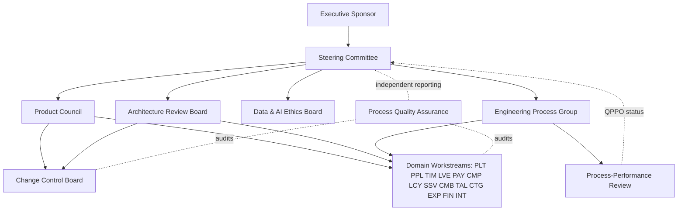

<picture>
  <source media="(prefers-color-scheme: dark)" srcset="../../assets/MultipliersKraftLogoDark.png">
  
</picture>

# GOV-04 — Governance Model and Decision Rights

| Attribute | Value |
| :--- | :--- |
| Document ID | GOV-04 |
| Title | Governance Model and Decision Rights |
| Product | Nucleus Suite (Nucleus HRMS Suite) |
| Version | 1.0.0 |
| Status | Issued for approval |
| Owner (role) | Programme Manager |
| Author | Dhanraj Dadhich |
| Reviewed by | Executive Sponsor, PQA Lead — *pending* |
| Approved by | Steering Committee — *pending* |
| Date | 2026-11-05 |
| Classification | Internal |
| CMMI practice areas | GOV, MC, DAR, MPM, CAR |
| Related documents | DOC-01, GOV-03, GOV-07, GOV-09, GOV-10, GOV-11, CM-02, DAR-01, MC-01, PCM-01, QA-01 |
| Quality & process-performance objectives | QPPO-05 (effective requirements reviews), QPPO-01 (escaped defects) |
| Process performance baseline used | PPB-01 (review defect density), PPB-02 (review rate) |
| Peer review record | *pending* (PR-xxxx, QA-02) |
| Tailoring record | none |
| Traceability anchor | BG-09 |

---

## 1. Purpose

Defines **who decides what, in which forum, on what evidence, and how fast issues escalate** in the Nucleus Suite programme. It implements the CMMI Governance (GOV) practice area: senior management sponsorship, policy, resourcing and oversight of process and product performance.

## 2. Governance Principles

| # | Principle |
| :--- | :--- |
| GP-1 | Every decision has exactly one accountable body or role (A in RACI). |
| GP-2 | Decisions are made at the lowest level that has the authority and information; escalation is by exception against tolerances (§6). |
| GP-3 | Significant decisions follow DAR-01 and are recorded in DAR-02 with rationale and alternatives. |
| GP-4 | Scope, baseline and compliance changes go through the CCB (CM-02) — never informally. |
| GP-5 | The Data & AI Ethics Board holds a veto on AI and sensitive-data uses that violate GOV-10/GOV-11; that veto can only be overridden by the Executive Sponsor in writing, recorded in DAR-02. |
| GP-6 | Process quality assurance (PQA) is independent of delivery and reports directly to the SteerCo. |
| GP-7 | Governance evidence (minutes, decisions, approvals) is a configuration item stored under CM-01. |

## 3. Governance Structure

### 3.1 Steering Committee (SteerCo)

| Element | Definition |
| :--- | :--- |
| Mandate | Strategic direction, funding, release scope approval, gate approvals G0 and G4/G5, risk acceptance above programme tolerance, resolution of cross-body conflicts |
| Chair | Executive Sponsor |
| Members (roles) | Executive Sponsor, CFO (or delegate), CTO, Head of Product — HCM, Chief HR Officer (customer-voice representative), Programme Manager (secretary, non-voting), PQA Lead (non-voting, independent) |
| Quorum | Chair + 3 voting members, including CFO delegate for budget decisions |
| Cadence | Monthly; ad hoc within 5 business days for escalations |
| Inputs | Programme status report (status report, MC-01), MPM-01 dashboard **including QPPO-xx status and process-performance review outcomes (§3.8)**, top risks (RSK-02), CR summary (CM-03), PQA audit summary, CAR summary, gate evidence packs |
| Outputs | Decisions (DAR-02), minutes (meeting minutes record, GOV-04), approved baselines, risk acceptance records, QPPO approvals and revisions, funding of process improvements |

### 3.2 Product Council (PC)

| Element | Definition |
| :--- | :--- |
| Mandate | Product roadmap and backlog priorities within approved phase scope; approval of functional requirement packs for the 14 process domains; G1 and G3 approvals; persona and UX standards |
| Chair | Head of Product — HCM |
| Members (roles) | Domain Product Owners (PLT, PPL, TIM, LVE, PAY, CMP, LCY, SSV, CMB, TAL, CTG, EXP, FIN, INT — one person may own several small domains), BA Lead, UX Research Lead, QA/Test Lead, Customer Success Lead, Statutory Compliance SME |
| Quorum | Chair + 50% of domain Product Owners, including the owner of any item being decided |
| Cadence | Fortnightly |
| Inputs | Requirements packs, RTM (REQ-02), user validation results, capability coverage and differentiation (GOV-02), BRS-01, STRS-01, SRS-01 |
| Outputs | Approved requirements baselines, prioritised backlog, referrals to CCB |

### 3.3 Architecture Review Board (ARB)

| Element | Definition |
| :--- | :--- |
| Mandate | Architecture principles, technology selection, data model and integration contract approval, G2 approval, technical-debt acceptance, NFR baselines |
| Chair | Enterprise Architect |
| Members (roles) | CTO (or delegate), Platform Lead, Security Lead, Data Architect, Integration Lead, Head of AI, two rotating domain tech leads |
| Quorum | Chair + Security Lead + 2 members |
| Cadence | Weekly design review slot; formal board fortnightly |
| Inputs | Architecture decision records (decision record, DAR-01), designs, NFR specs (NFR format, NFR-01), threat models |
| Outputs | Approved designs, ADRs in DAR-02, conditions of approval |

### 3.4 Change Control Board (CCB)

| Element | Definition |
| :--- | :--- |
| Mandate | Approve, reject or defer change requests against baselines (requirements, design, plan, documents) per CM-02 thresholds |
| Chair | Configuration Manager |
| Members (roles) | Programme Manager, Head of Product (or delegate), Enterprise Architect (or delegate), QA/Test Lead, affected domain Product Owner(s); DPO and Head of AI when CR touches personal data or AI |
| Quorum | Chair + Programme Manager + Product + Architecture representatives |
| Cadence | Weekly; emergency CCB within 24 hours |
| Inputs | Change requests (change request record, CM-02) with impact analysis |
| Outputs | CR decisions logged in CM-03; baseline updates |

Full charter: CM-02.

### 3.5 Data & AI Ethics Board (DAEB)

| Element | Definition |
| :--- | :--- |
| Mandate | Approve new personal-data processing purposes, AI features (by risk tier), model deployments and retraining with material change, wellbeing/sentiment features; review fairness and incident reports; veto per GP-5 |
| Chair | Data Protection Officer |
| Members (roles) | Head of AI, Security Lead, Legal Counsel, CHRO representative, Employee representative (customer advisory panel), independent ethics adviser (external) |
| Quorum | Chair + Legal + Head of AI + one of (employee rep, external adviser) |
| Cadence | Monthly; ad hoc within 3 business days for AI incidents |
| Inputs | AI feature specs and model cards (AI feature specification and model card, GOV-11), DPIAs, fairness reports, incident reports |
| Outputs | Approvals with conditions, risk tier assignment, decisions in DAR-02 |

Full framework: GOV-10, GOV-11.

### 3.6 Engineering Process Group (EPG)

| Element | Definition |
| :--- | :--- |
| Mandate | Own the organisational standard process, standard artefact formats (DOC-01 §4) and tailoring rules; process improvement backlog; process training (OT-01) |
| Chair | EPG Lead |
| Members (roles) | PQA Lead, Configuration Manager, QA/Test Lead, BA Lead, Delivery Lead, one rotating domain lead |
| Cadence | Fortnightly; quarterly process review to SteerCo |
| Outputs | Approved process assets (PCM-01), tailoring approvals, improvement proposals, CAR action plans, deployment of validated improvements |

### 3.7 Process Quality Assurance (PQA)

| Element | Definition |
| :--- | :--- |
| Mandate | Objectively evaluate processes and work products against DOC-01, PCM-01 and plans; raise and track non-conformances to closure; escalate unresolved non-conformance |
| Lead | PQA Lead — **organisationally independent of delivery** |
| Reporting | Directly to SteerCo (and Executive Sponsor for escalations) |
| Cadence | Audit schedule in QA-01; summary to every SteerCo |
| Outputs | Audit reports (QA-04), NC log, quality trend metrics (MPM-01) |

### 3.8 Measurement & Analysis and Process-Performance Review (PPR)

Supports BG-09 (CMMI Maturity Level 5): quantitative management, causal analysis and resolution, and continuous performance improvement.

| Element | Definition |
| :--- | :--- |
| Mandate | Review process-performance data against quantitative process-performance objectives (QPPO-xx), process-performance baselines (PPBs) and models (PPMs) defined in MPM-01; detect special-cause variation; commission causal analysis and resolution (CAR); evaluate pilots of process improvements statistically before organisation-wide deployment; recommend QPPO revisions |
| Chair | EPG Lead |
| Members (roles) | PMO / Measurement Analyst (secretary), PQA Lead, QA/Test Lead, Delivery Lead, Configuration Manager, two rotating domain tech leads |
| Quorum | Chair + Measurement Analyst + PQA Lead |
| Cadence | Monthly (aligned one week before SteerCo); ad hoc within 5 business days when a QPPO-critical sub-process goes out of control |
| Inputs | Control charts and capability analyses per sub-process, PPM predictions vs. actuals, defect containment and escape data, CAR proposals, improvement pilot results |
| Outputs | QPPO status report to SteerCo (green/amber/red with statistical evidence), CAR assignments (lessons-learned record, PCM-01), improvement proposals to EPG, PPB/PPM recalibration records |

**SteerCo responsibility:** at every monthly meeting the SteerCo reviews QPPO-xx status from the PPR, approves corrective actions where a QPPO is predicted to be missed, and approves QPPO changes. Gate decisions G1 and G4 MUST consider PPM predictions for the phase (e.g. predicted escaped-defect density, predicted schedule variance).

## 4. Decision-Rights Matrix

R = Responsible (prepares), A = Accountable (decides), C = Consulted, I = Informed.

| Decision | Exec Sponsor | SteerCo | Product Council | ARB | CCB | DAEB | EPG | PQA | Prog Mgr | Product Owner |
| :--- | :---: | :---: | :---: | :---: | :---: | :---: | :---: | :---: | :---: | :---: |
| Programme charter & budget | C | **A** | I | I | I | I | I | I | R | C |
| Phase scope (P0–P5 content) | C | **A** | R | C | C | C | I | I | C | R |
| Requirements baseline (domain pack) | I | I | **A** | C | I | C* | I | C | I | R |
| Change to baselined scope/requirements | I | A† | C | C | **A** | C* | I | I | R | R |
| Architecture & technology selection | I | I | C | **A** | I | C* | I | I | I | C |
| Data model / integration contract | I | I | C | **A** | I | C | I | I | I | R |
| Budget reallocation within tolerance | I | I | I | I | I | I | I | I | **A** | C |
| Budget change beyond tolerance | C | **A** | I | I | C | I | I | I | R | I |
| Release go-live (G4) | I | **A** | R | C | I | C | I | C | R | R |
| AI feature / model deployment to production | I | I | C | C | I | **A** | I | I | I | R |
| New personal-data processing purpose | I | I | C | C | I | **A** | I | I | I | R |
| QPPO definition / revision | I | **A** | C | C | I | I | R | C | C | I |
| Initiate CAR on special-cause variation or escaped defect | I | I | I | I | I | I | **A** | C | R | C |
| Deploy validated process improvement organisation-wide | I | C | I | I | I | I | **A** | C | R | I |
| Process tailoring for a workstream | I | I | I | I | I | I | **A** | C | R | C |
| Risk acceptance (score ≥ 15) | C | **A** | I | C | I | C | I | I | R | C |
| Risk acceptance (score < 15) | I | I | I | I | I | I | I | I | **A** | C |
| Exiting R0 / activating live backend or external services (constraint C-01; starts P0) | C | **A** | C | R | I | C | I | I | R | C |
| Supplier selection & contract | C | **A** | I | C | I | C | I | I | R | I |

\* DAEB consulted when the item involves personal data or AI.
† CR exceeding SteerCo tolerance (§6) is escalated from CCB to SteerCo.

## 5. Escalation Path

| Level | Forum | Trigger | Resolution time limit | Next level if unresolved |
| :--- | :--- | :--- | :--- | :--- |
| L0 | Workstream lead / Product Owner | Issue raised in RAID (RSK-03) | 3 business days | L1 |
| L1 | Programme Manager | Cross-workstream impact or tolerance at risk | 5 business days | L2 |
| L2 | Relevant body (PC / ARB / CCB / DAEB) | Decision needed within that body's mandate | Next scheduled meeting or ≤ 10 business days | L3 |
| L3 | Steering Committee | Tolerance breach, inter-body conflict, risk score ≥ 20 | ≤ 5 business days (ad hoc session) | L4 |
| L4 | Executive Sponsor | SteerCo deadlock, DAEB veto override request | ≤ 3 business days | Final |

**Fast-track:** Severity-1 compliance, security or privacy incidents bypass L0–L2 and go directly to Programme Manager + DPO/Security Lead, with SteerCo informed within 24 hours.

## 6. Tolerances (Escalation Thresholds)

Values are indicative and will be confirmed at G0.

| Dimension | Programme Manager tolerance | Escalate to SteerCo when |
| :--- | :--- | :--- |
| Schedule | Phase milestone slip ≤ 10 business days (≤ 2 weeks against the week plan) | Slip > 10 business days, or any G4 date slip |
| Cost / effort | ≤ 5% variance against phase budget/effort baseline | > 5% variance or forecast to exceed by > 5% |
| Scope | Re-prioritisation within phase without removing Must requirements | Any Must requirement removed or a new domain/theme added |
| Quality | Defect density and test pass rates within QA-03 thresholds | Any exit criterion forecast to fail at G3/G4; open Sev-1 defect at gate |
| Risk | Risks with score < 15 | Any risk with score ≥ 15, or any new compliance/privacy risk |
| Benefits | BO forecast within ±10% of target | Forecast deviation > 10% for any Must-level BO |
| Process compliance | NC closed within 15 business days | NC open > 30 business days or repeated NC on same process |
| Process performance (QPPO) | Sub-process within control limits; QPPO predicted to be met by PPM | Any QPPO predicted (PPM) to be missed at phase end, or a QPPO-critical sub-process out of control for 2 consecutive reporting periods |

## 7. Gate Review Process

1. **Preparation** (Programme Manager, 10 business days before gate): assemble the gate evidence pack per the gate's exit criteria (DOC-01 §12, GOV-03 §6).
2. **PQA pre-check** (5 business days before): PQA verifies evidence completeness and process compliance (QA-04) and issues a pre-gate report.
3. **Review meeting**: the approving body reviews evidence, open risks, CRs and PQA report.
4. **Decision** — one of:
   - **Go** — proceed; baseline configuration items (CM-01).
   - **Conditional Go** — proceed with named conditions, owners and due dates logged as actions (RSK-03).
   - **Hold** — rework required; re-review date set.
   - **Stop** — terminate or re-plan; SteerCo only.
5. **Record**: decision in DAR-02, minutes (meeting minutes record, GOV-04), baseline tag recorded in DOC-02.

| Gate | Approving body | Mandatory attendees |
| :--- | :--- | :--- |
| G0 | SteerCo | Exec Sponsor, CFO delegate, CTO, Head of Product, PQA |
| G1 | Product Council (SteerCo informed) | Module POs, BA Lead, QA Lead, Architect |
| G2 | ARB | Enterprise Architect, Security Lead, Data Architect |
| G3 | Product Council | QA/Test Lead, domain tech leads |
| G4 | SteerCo | All SteerCo + DPO + Security Lead + OCM Lead |
| G5 | SteerCo | SteerCo + Customer Success Lead |

## 8. Meeting and Record Standards

- Agendas circulated ≥ 2 business days ahead; papers ≥ 1 business day ahead.
- Minutes use the meeting minutes record (GOV-04) and are published within 2 business days.
- Every decision is assigned a `DEC-xxxx` ID and recorded in DAR-02.
- Actions are logged as `RSK-AC-xxx` in RSK-03 with owner and due date.
- Records are configuration items (CM-01) and retained for the life of the programme plus the period required by applicable law or contract.

## 9. Policy Statements (CMMI GOV)

Senior management, through the SteerCo, establishes the following policies for the programme:

| Policy ID | Policy |
| :--- | :--- |
| POL-01 | All work follows the organisational standard process (PCM-01) as tailored and approved by the EPG. |
| POL-02 | All requirements are managed per REQ-01 and traced per REQ-02. |
| POL-03 | All work products are placed under configuration control per CM-01. |
| POL-04 | Risks are identified, analysed and managed per RSK-01. |
| POL-05 | Work products undergo peer review per QA-02 before baseline. |
| POL-06 | Processes and work products are objectively evaluated by independent PQA per QA-01. |
| POL-07 | Measurement objectives and indicators are defined and reported per MPM-01. |
| POL-08 | Significant decisions follow DAR-01. |
| POL-09 | Personal data and AI are governed by GOV-10 and GOV-11. |
| POL-10 | Suppliers are managed per SAM-01. |
| POL-11 | Selected sub-processes are managed quantitatively against approved QPPOs, using PPBs and PPMs (MPM-01). |
| POL-12 | Significant variation, escaped defects and missed QPPOs trigger causal analysis and resolution; improvements are piloted and validated with data before deployment (CAR, PCM). |

## Approval & Sign-off

| Role | Name | Date | Decision | Conditions / comments |
| :--- | :--- | :--- | :--- | :--- |
| Author | Dhanraj Dadhich | 2026-11-05 | Submitted | |
| Peer review moderator | *pending* | | | PR-xxxx |
| PQA (process compliance) | *pending* | | | NC-xxxx if any |
| Steering Committee | *pending* | | | |

## Measurement Data Captured

| Measure | Value | Unit | Notes |
| :--- | :--- | :--- | :--- |
| Size | 10 | sections | |
| Authoring effort | *to be recorded* | person-hours | |
| Review effort (preparation + meeting) | *pending review* | person-hours | From PR-xxxx |
| Rework effort | *pending review* | person-hours | |
| Review rate | *pending review* | pages / hour | Compare with PPB-02 control limits |
| Requirement volatility | 0 | CRs since baseline | Not yet baselined (CM-03) |

| Detection phase | Major | Minor | Editorial |
| :--- | :--- | :--- | :--- |
| Author self-check | 0 | 0 | 0 |
| Peer review | *pending* | | |

## 10. Revision History

| Version | Date | Author | Change summary | CR ref | Approved by |
| :--- | :--- | :--- | :--- | :--- | :--- |
| 1.0.0 | 2026-11-05 | Dhanraj Dadhich | Consolidated release | CR-0001 | *pending* |
