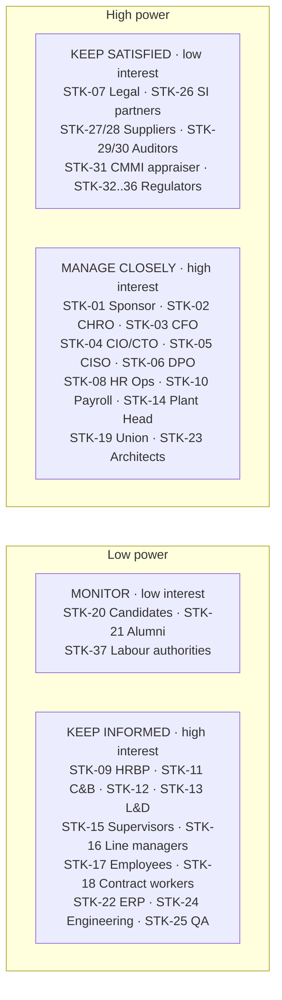

<picture>
  <source media="(prefers-color-scheme: dark)" srcset="../../assets/MultipliersKraftLogoDark.png">
  
</picture>

# GOV-07 — Stakeholder Register and RACI

| Attribute | Value |
| :--- | :--- |
| Document ID | GOV-07 |
| Title | Stakeholder Register and RACI |
| Product | Nucleus Suite (Nucleus HRMS Suite) |
| Version | 1.0.0 |
| Status | Issued for approval |
| Owner (role) | Programme Manager |
| Author | Dhanraj Dadhich |
| Reviewed by | PQA Lead, OCM Lead — *pending* |
| Approved by | Steering Committee — *pending* |
| Date | 2026-11-05 |
| Classification | Internal |
| CMMI practice areas | PLAN, GOV, MC |
| Related documents | DOC-01, GOV-03, GOV-04, GOV-08, GOV-09, OCM-01, RSK-02 |
| Quality & process-performance objectives | QPPO-05 (effective requirements reviews), QPPO-01 (escaped defects) |
| Process performance baseline used | PPB-01 (review defect density), PPB-02 (review rate) |
| Peer review record | *pending* (PR-xxxx, QA-02) |
| Tailoring record | none |
| Traceability anchor | BG-09 |

---

## 1. Purpose and Scope

This document identifies every party who affects, or is affected by, Nucleus Suite. For each one it records their interest, influence and expected involvement, and it assigns decision accountability through a RACI matrix. It satisfies the CMMI PLAN practice of planning stakeholder involvement, and it is the input for the communication plan (GOV-09) and the organisational change management strategy (OCM-01).

Scope: the current stage (R0 UI-validation prototype, local JSON), delivery phases P0–P5 and all 14 process domains (PLT, PPL, TIM, LVE, PAY, CMP, LCY, SSV, CMB, TAL, CTG, EXP, FIN, INT). The reference / pilot tenant context is the fictional demo client **Vindhya Precision Industries Pvt Ltd** (2 legal entities, 5 sites, 4 states). Stakeholders are recorded by **role**, not by named individual. Names are kept in a confidential appendix, managed by the Programme Manager, so that personal data is not spread across controlled documents.

## 2. Stakeholder Identification Method

1. **Sources:** project charter (GOV-03), business capability model (GOV-05), regulatory obligations (GOV-10), the module scope list in DOC-01 §6, and the persona research in GOV-08.
2. **Classification attributes:**
   - **Interest** (H/M/L): how much the outcome affects the stakeholder.
   - **Influence** (H/M/L): ability to change scope, funding, timeline or adoption.
   - **Quadrant:** Manage Closely (high power, high interest), Keep Satisfied (high power, low interest), Keep Informed (low power, high interest), Monitor (low power, low interest).
   - **Engagement:** Unaware → Resistant → Neutral → Supportive → Leading. Each entry records the current and the desired level.
3. **Review cadence:** the register is reviewed monthly by the Programme Manager and at every gate (G0–G5). Changes in quadrant or engagement are reported in the status report (status report, MC-01).

## 3. Stakeholder Register

### 3.1 Sponsorship and Executive

| ID | Role | Org unit | Interest | Influence | Quadrant | Engagement (current → desired) | Key expectations | Key concerns | Owner |
| :--- | :--- | :--- | :---: | :---: | :--- | :--- | :--- | :--- | :--- |
| STK-01 | Executive Sponsor | Executive Leadership | H | H | Manage Closely | Supportive → Leading | enterprise-grade platform at lower total cost of ownership (TCO); measurable business case; on-time P1 Core HRMS and P2 pilot | Budget overrun, delivery risk of AI scope | Programme Manager |
| STK-02 | Chief Human Resources Officer (CHRO) | HR | H | H | Manage Closely | Supportive → Leading | Single source of people truth; strategic workforce insight; better employee experience | Disruption to HR operations during cut-over | Product Owner |
| STK-03 | Chief Financial Officer (CFO) | Finance | H | H | Manage Closely | Neutral → Supportive | Accurate payroll cost, general ledger (GL) reconciliation, ERP outbox, statutory compliance | Payroll errors, audit findings, licence cost | Finance Workstream Lead |
| STK-04 | Chief Information / Technology Officer (CIO/CTO) | IT | H | H | Manage Closely | Supportive → Leading | Composable, API-first architecture; cloud scalability; vendor independence | Integration debt, operability, skills gap | Enterprise Architect |
| STK-05 | Chief Information Security Officer (CISO) | Security | H | H | Manage Closely | Neutral → Supportive | Zero-trust, tenant isolation, secure SDLC, penetration testing (pen-test) evidence | Sensitive data exposure, AI attack surface (prompt injection) | Security Lead |
| STK-06 | Data Protection Officer (DPO) | Legal / Compliance | H | H | Manage Closely | Neutral → Supportive | DPDP 2023 / GDPR compliance, DPIAs, data principal rights workflows | Biometric and health data, cross-border transfer, AI profiling | Data Governance Lead |
| STK-07 | General Counsel / Legal | Legal | M | H | Keep Satisfied | Neutral → Supportive | Contractual and statutory defensibility; AI liability position | Unvalidated legal claims in product, automated employment decisions | DPO |

### 3.2 HR, Payroll and Operations

| ID | Role | Org unit | Interest | Influence | Quadrant | Engagement (current → desired) | Key expectations | Key concerns | Owner |
| :--- | :--- | :--- | :---: | :---: | :--- | :--- | :--- | :--- | :--- |
| STK-08 | HR Operations Head | HR Ops | H | M | Manage Closely | Supportive → Leading | Fewer manual tickets; bulk actions; effective-dated changes | Data migration quality; workload during parallel runs | Product Owner (PPL / LCY) |
| STK-09 | HR Business Partners (HRBP) | HR | H | M | Keep Informed | Neutral → Supportive | Team insights, case management, approval efficiency | Learning curve; loss of familiar reports | OCM Lead |
| STK-10 | Payroll Manager | Finance / Payroll | H | H | Manage Closely | Neutral → Supportive | Correct gross-to-net calculation; PF/ESI/PT/TDS accuracy; parallel-run evidence | Go-live in the middle of the fiscal year; statutory deadlines | Product Owner (PAY) |
| STK-11 | Compensation & Benefits Lead | HR | H | M | Keep Informed | Neutral → Supportive | Salary structure simulator; Code on Wages 50% basic compliance | Exception approvals bypassed | Product Owner (CMB) |
| STK-12 | Talent Acquisition Lead | HR | H | M | Keep Informed | Supportive → Supportive | Applicant tracking (ATS), AI screening with bias controls, onboarding automation | Candidate experience; AI screening fairness | Product Owner (TAL) |
| STK-13 | Learning & Development / Capability Lead | HR | M | M | Keep Informed | Neutral → Supportive | Skills ontology, LMS, compliance training tracking | Content migration effort | Product Owner (TAL) |
| STK-14 | Plant / Factory Head | Manufacturing | H | H | Manage Closely | Neutral → Supportive | Shift rosters, overtime control, Factories Act registers, contractor compliance | Floor disruption; biometric device reliability; offline gaps | Product Owner (TIM / LVE) |
| STK-15 | Plant Supervisors / Time Office | Manufacturing | H | M | Keep Informed | Resistant → Supportive | Fast punch correction, gate passes, roster swaps | Extra admin; mobile literacy; salary visibility rules | OCM Lead |
| STK-16 | Line Managers | All business units | H | M | Keep Informed | Neutral → Supportive | One-click approvals; team dashboard; copilot help | Approval fatigue; more performance-process workload | OCM Lead |

### 3.3 Workforce and External Users

| ID | Role | Org unit | Interest | Influence | Quadrant | Engagement (current → desired) | Key expectations | Key concerns | Owner |
| :--- | :--- | :--- | :---: | :---: | :--- | :--- | :--- | :--- | :--- |
| STK-17 | Employees (corporate) | All | H | L | Keep Informed | Neutral → Supportive | Self-service, mobile access, accurate payslips, fast leave approval | Privacy of data; AI monitoring | OCM Lead |
| STK-18 | Contract / frontline workers | Manufacturing, Facilities | H | L | Keep Informed | Unaware → Supportive | Correct wages and overtime, attendance proof, local-language access | Low digital literacy; shared devices; surveillance concerns | OCM Lead |
| STK-19 | Works council / union representatives | Industrial Relations | H | H | Manage Closely | Neutral → Supportive | Transparency on monitoring, biometrics, overtime, AI use | Covert surveillance; automated discipline | Industrial Relations Lead |
| STK-20 | Candidates | External | M | L | Monitor | Unaware → Neutral | Simple application, timely status, fair assessment | Opaque AI rejection | Product Owner (TAL) |
| STK-21 | Alumni / exited employees | External | L | L | Monitor | Unaware → Neutral | Full & final settlement (F&F) status; experience letters; tax documents | Data retention after exit | Product Owner (PAY) |

### 3.4 Technology, Delivery and Partners

| ID | Role | Org unit | Interest | Influence | Quadrant | Engagement (current → desired) | Key expectations | Key concerns | Owner |
| :--- | :--- | :--- | :---: | :---: | :--- | :--- | :--- | :--- | :--- |
| STK-22 | ERP / Finance Systems team | IT / Finance | M | M | Keep Informed | Neutral → Supportive | Balanced GL postings; ERP system / ERP system / ERP system outbox formats | Mapping drift; reconciliation breaks | Integration Lead |
| STK-23 | Enterprise / Solution Architects | IT | H | H | Manage Closely | Supportive → Leading | Clean domain model, event-driven integration, ARB discipline | Prototype shortcuts carried into production | Enterprise Architect |
| STK-24 | Product Engineering team | Delivery | H | M | Keep Informed | Supportive → Leading | Clear, testable requirements; stable baselines | Requirements churn; unclear acceptance criteria | Delivery Lead |
| STK-25 | QA / Test team | Delivery | H | M | Keep Informed | Supportive → Supportive | Traceable requirements; test environments; synthetic data | Late requirement changes | QA/Test Lead |
| STK-26 | Implementation / system-integration (SI) partners | External | M | M | Keep Satisfied | Neutral → Supportive | Clear statements of work (SOW), acceptance criteria, change process | Scope creep; payment milestones | Vendor Manager |
| STK-27 | AI model / cloud providers | External | M | M | Keep Satisfied | Neutral → Supportive | Clear usage terms, service levels (SLA), data processing agreement (DPA) | Data residency; model change notifications | Vendor Manager |
| STK-28 | Biometric / device vendors | External | M | M | Keep Satisfied | Neutral → Supportive | Device integration specs; firmware support | Offline sync; template data handling | Vendor Manager |

### 3.5 Assurance and Regulators

| ID | Role | Org unit | Interest | Influence | Quadrant | Engagement (current → desired) | Key expectations | Key concerns | Owner |
| :--- | :--- | :--- | :---: | :---: | :--- | :--- | :--- | :--- | :--- |
| STK-29 | Internal Audit | Assurance | M | H | Keep Satisfied | Neutral → Supportive | Audit trail, segregation of duties (SoD), access reviews | Untraceable changes; privileged access | PQA Lead |
| STK-30 | Statutory / External Auditor | External | M | H | Keep Satisfied | Neutral → Neutral | Reproducible payroll and tax evidence; GL integrity | Retroactive changes after period lock | Finance Workstream Lead |
| STK-31 | CMMI Lead Appraiser | External | M | H | Keep Satisfied | Unaware → Supportive | Objective evidence for practice areas at Maturity Level 2/3 | Missing artefacts; no evidence that the defined process is followed | EPG Lead |
| STK-32 | Employees' Provident Fund Organisation (EPFO, regulator) | Government | L | H | Keep Satisfied | — | Correct contributions and filings in prescribed formats | Late or incorrect remittances | Payroll Manager |
| STK-33 | Employees' State Insurance Corporation (ESIC, regulator) | Government | L | H | Keep Satisfied | — | Correct contributions for eligible employees | Eligibility errors | Payroll Manager |
| STK-34 | Income Tax Department (regulator) | Government | L | H | Keep Satisfied | — | Correct tax deducted at source (TDS) computation, returns and Form 16 | Regime-selection and computation errors | Payroll Manager |
| STK-35 | Factory Inspectorate (regulator) | State Government | L | H | Keep Satisfied | — | Statutory registers and forms (e.g. muster roll, accident notice) available on inspection | Missing or incomplete registers | Plant Head |
| STK-36 | Data Protection Board of India (regulator) | Government | L | H | Keep Satisfied | — | Lawful processing; breach notification; rights handling | Breaches; non-response to data principals | DPO |
| STK-37 | Labour / Shops & Establishments authorities (regulator) | State Government | L | M | Monitor | — | Registers, working-hours and leave compliance | Overtime and leave non-compliance | HR Ops Head |

> **Note — to be validated by Legal:** this list of regulators and their expectations is indicative. Applicability depends on the tenant's establishments, headcount, states of operation and sector, and must be confirmed per tenant during implementation.

## 4. Power / Interest Grid

## 5. RACI Matrix

**Legend:** R = Responsible (does the work) · A = Accountable (one per row, signs off) · C = Consulted (two-way) · I = Informed (one-way).

**Column abbreviations:** Spon = Executive Sponsor · SteerCo = Steering Committee · PC = Product Council · PO = Product Owner · PgM = Programme Manager · EA = Enterprise Architect (also chairs ARB) · Sec = CISO / Security Lead · DPO = Data Protection Officer · CHRO · CFO · Pay = Payroll Manager · Plant = Plant Head · QA = QA/Test Lead · PQA = Process Quality Assurance · OCM = OCM Lead · CCB = Change Control Board · DAEB = Data & AI Ethics Board · Union = Works council / union representatives.

### 5.1 Programme Deliverables and Decisions

| Deliverable / decision | Spon | SteerCo | PC | PO | PgM | EA | Sec | DPO | CHRO | CFO | Pay | Plant | QA | PQA | OCM | CCB | DAEB | Union |
| :--- | :-: | :-: | :-: | :-: | :-: | :-: | :-: | :-: | :-: | :-: | :-: | :-: | :-: | :-: | :-: | :-: | :-: | :-: |
| Vision and scope (GOV-01) | C | A | C | R | C | C | I | I | C | C | I | I | I | I | I | — | I | I |
| Project charter (GOV-03) | A | R | C | C | R | C | I | I | C | C | I | I | I | I | I | — | — | — |
| Requirements baseline — PLT Platform & Foundations | I | I | A | C | C | R | C | C | I | I | I | I | C | C | I | I | C | — |
| Requirements baseline — PPL People Core / LCY Lifecycle | I | I | A | R | C | C | C | C | C | I | I | I | C | C | I | I | — | — |
| Requirements baseline — TIM Time & Attendance / LVE Leave | I | I | A | R | C | C | C | C | I | I | C | C | C | C | I | I | — | C |
| Requirements baseline — PAY Payroll | I | I | A | R | C | C | C | C | I | C | C | I | C | C | I | I | — | — |
| Requirements baseline — CMP Compliance | I | I | A | R | C | C | C | C | C | C | C | C | C | C | I | I | — | C |
| Requirements baseline — CMB Compensation, Loans & Benefits | I | I | A | R | C | C | I | C | C | C | C | I | C | C | I | I | — | — |
| Requirements baseline — SSV Self-service & Helpdesk (incl. business messaging) | I | I | A | R | C | C | C | C | C | I | I | C | C | C | C | I | C | — |
| Requirements baseline — TAL Talent / EXP Experience | I | I | A | R | C | C | I | C | C | I | — | I | C | C | I | I | C | — |
| Requirements baseline — CTG Contingent Workforce | I | I | A | R | C | C | C | C | C | C | C | C | C | C | I | I | — | C |
| Requirements baseline — FIN Finance & ERP | I | I | A | R | C | C | C | I | I | C | C | — | C | C | — | I | — | — |
| Requirements baseline — INT Intelligence & Agents | I | I | A | R | C | C | C | C | C | C | I | I | C | C | I | I | C | — |
| Solution architecture baseline (G2) | I | I | C | C | I | A/R | C | C | — | — | — | — | C | C | — | I | C | — |
| Enterprise data model | I | I | C | C | I | A | C | R | — | — | C | — | C | C | — | I | C | — |
| AI model / agent deployment (Tier 3–4) | I | I | C | R | I | C | C | C | C | — | — | — | C | C | I | I | A | C |
| Data protection impact assessment (DPIA) sign-off | I | I | I | C | I | C | C | A/R | C | — | — | — | — | I | — | — | C | — |
| Payroll parallel-run sign-off | I | I | I | C | C | I | — | — | I | A | R | — | C | C | — | — | — | — |
| Payroll go-live | C | A | C | R | R | C | C | I | C | C | R | I | C | C | C | — | — | I |
| User acceptance testing (UAT) sign-off per phase | I | I | A | R | C | I | C | C | C | C | C | C | R | C | I | — | — | — |
| Pilot / cut-over and go-live (per phase) | C | A | C | C | R | C | C | C | C | C | C | C | C | C | C | — | — | I |
| End-user training readiness | I | I | C | C | C | — | — | — | C | — | C | C | — | I | A/R | — | — | C |
| Change request — scope / schedule / cost | I | A (major) | C | R | C | C | C | C | I | C | — | — | C | I | I | A (minor) | — | — |
| Risk acceptance (High / Critical) | C | A | C | C | R | C | C | C | I | I | — | — | — | I | — | — | C | — |
| Process tailoring approval (PCM-01) | — | I | I | I | C | I | — | — | — | — | — | — | — | C | — | — | — | — |
| Workforce monitoring / biometric policy | C | A | C | C | I | C | C | R | C | — | — | C | — | I | C | — | C | C |

**Rules:**

1. Every row has exactly one **A**. Where a row shows "A (major)" against SteerCo and "A (minor)" against CCB, the change classification in CM-02 decides which body is accountable for a given change request.
2. The process-tailoring row is approved by the EPG Lead (not a column in this table) under PCM-01; PQA is Consulted.
3. Accountability can be delegated only through a recorded decision (DAR-02).

### 5.2 Escalation Path

Workstream Lead → Programme Manager (48 h) → Product Council (5 business days) → Steering Committee (next sitting, or an extraordinary sitting for Critical items) → Executive Sponsor.

Statutory, data-breach and safety matters skip these levels and go straight to the DPO, CISO or Plant Head, as set out in GOV-09 §7.

## 6. Engagement Strategy by Quadrant

| Quadrant | Strategy | Typical mechanisms |
| :--- | :--- | :--- |
| Manage Closely | Co-create; seat in a governance body; early previews | SteerCo / PC membership, design reviews, sprint demos, one-to-one briefings |
| Keep Satisfied | Consult at defined checkpoints; give assurance evidence | Gate packs, audit evidence packs, regulator-format previews |
| Keep Informed | Regular two-way communication; champion network | Release notes, town halls, in-app announcements, champion sessions, surveys |
| Monitor | Light-touch updates; watch for changes | Candidate portal notices, alumni portal, periodic review |

## 7. Engagement Gap Actions

| Stakeholder | Gap | Action | Owner | Due |
| :--- | :--- | :--- | :--- | :--- |
| STK-15 Plant Supervisors | Resistant → Supportive | Floor-level demos of the roster and gate-pass flows; plant champions; native-language job aids | OCM Lead | Before P1 UAT (Vindhya pilot sites) |
| STK-18 Contract workers | Unaware → Supportive | Voice-first onboarding through Nucleus Talk; kiosk mode; union co-briefing | OCM Lead | Before P2 pilot go-live |
| STK-19 Union | Neutral → Supportive | Joint review of the workforce-monitoring policy and AI prohibited-uses list (GOV-11 §4) | Industrial Relations Lead | Before G2 |
| STK-03 CFO | Neutral → Supportive | Payroll parallel-run plan and GL reconciliation proof points | Finance Workstream Lead | Before G1 (payroll scope) |
| STK-31 CMMI Appraiser | Unaware → Supportive | Readiness review against QA-04; evidence mapping | EPG Lead | End P2, before the internal ML2 mini-appraisal (BO-09.3) |

## Approval & Sign-off

| Role | Name | Date | Decision | Conditions / comments |
| :--- | :--- | :--- | :--- | :--- |
| Author | Dhanraj Dadhich | 2026-11-05 | Submitted | |
| Peer review moderator | *pending* | | | PR-xxxx |
| PQA (process compliance) | *pending* | | | NC-xxxx if any |
| Steering Committee | *pending* | | | |

## Measurement Data Captured

| Measure | Value | Unit | Notes |
| :--- | :--- | :--- | :--- |
| Size | 8 | sections | |
| Authoring effort | *to be recorded* | person-hours | |
| Review effort (preparation + meeting) | *pending review* | person-hours | From PR-xxxx |
| Rework effort | *pending review* | person-hours | |
| Review rate | *pending review* | pages / hour | Compare with PPB-02 control limits |
| Requirement volatility | 0 | CRs since baseline | Not yet baselined (CM-03) |

| Detection phase | Major | Minor | Editorial |
| :--- | :--- | :--- | :--- |
| Author self-check | 0 | 0 | 0 |
| Peer review | *pending* | | |

## 8. Revision History

| Version | Date | Author | Change summary | CR ref | Approved by |
| :--- | :--- | :--- | :--- | :--- | :--- |
| 1.0.0 | 2026-11-05 | Dhanraj Dadhich | Consolidated release | CR-0001 | *pending* |
