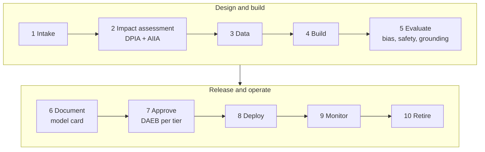

<picture>
  <source media="(prefers-color-scheme: dark)" srcset="../../assets/MultipliersKraftLogoDark.png">
  
</picture>

# GOV-11 — Responsible AI Governance Framework

| Attribute | Value |
| :--- | :--- |
| Document ID | GOV-11 |
| Title | Responsible AI Governance Framework |
| Product | Nucleus Suite (Nucleus HRMS Suite) |
| Version | 1.0.0 |
| Status | Issued for approval |
| Owner (role) | Head of AI |
| Author | Dhanraj Dadhich |
| Reviewed by | DPO, CISO, Legal, CHRO delegate, Industrial Relations Lead — *pending* |
| Approved by | Data & AI Ethics Board (DAEB) — *pending* |
| Date | 2026-11-05 |
| Classification | Internal |
| CMMI practice areas | GOV, RDM, VV, RSK, MPM, CAR |
| Related documents | DOC-01, GOV-07, GOV-08, GOV-10, OCM-01, QA-03, the AI feature specification and model card (GOV-11), INT domain requirement pack |
| Quality & process-performance objectives | QPPO-07 (fair and grounded AI) |
| Process performance baseline used | PPB-01 (review defect density), PPB-02 (review rate) |
| Peer review record | *pending* (PR-xxxx, QA-02) |
| Tailoring record | none |
| Traceability anchor | BG-02, BG-06 |

---

## 1. Purpose and Scope

Nucleus Suite is **AI-native**. It includes:

- the Nucleus Talk voice and chat copilot;
- governed AI agents in the INT Intelligence & Agents domain, such as the Policy Assistant;
- predictive analytics (attrition, workforce planning, organisation digital twin);
- skills inference and talent matching;
- anomaly detection in time and payroll;
- generative drafting (letters, job descriptions, feedback).

Because HR decisions affect people's livelihoods, AI in Nucleus Suite is governed as a **high-trust capability**. This framework:

1. defines principles, risk tiers and prohibited uses;
2. sets the lifecycle controls every AI feature must pass before release;
3. sets guardrails for agents that **take actions**, not just give answers;
4. turns all of the above into requirements (`INT-AI-xxx`, domain `AI` items, and `the AI feature specification and model card (GOV-11)` specifications).

It applies to all AI/ML components: in-house models, third-party foundation models and APIs, rule-plus-ML hybrids, and every phase. The current R0 prototype uses deterministic command parsing (e.g. voice commands). Learned models enter from P2 Pilot & Intelligence onward, and advanced autonomy is a P5 Frontier topic.

> **Regulatory alignment (to be validated by Legal):** AI used for recruitment, selection, promotion, termination, task allocation and performance monitoring falls within the *high-risk employment* category of the EU AI Act wherever EU-based workers or candidates are in scope. India currently relies on existing law — the DPDP Act 2023, labour and anti-discrimination law — together with emerging national AI governance guidance and advisories. Nucleus Suite adopts the stricter of these as its design baseline. This document does not cite specific articles or clauses; Legal maintains the obligation mapping.

## 2. Responsible AI Principles

| # | Principle | Commitment |
| :-: | :--- | :--- |
| AI-P1 | Human agency | AI recommends; accountable humans decide on anything affecting employment, pay or legal status |
| AI-P2 | Fairness | No unjustified disparity across protected and sensitive attributes; measured before release and continuously afterwards |
| AI-P3 | Transparency | Users are told when they interact with AI or when AI contributed to an outcome |
| AI-P4 | Explainability | Every Tier 3–4 output has a human-readable reason and evidence |
| AI-P5 | Privacy | Data minimisation, purpose limitation, no training on tenant data without a lawful basis and DAEB approval (GOV-10) |
| AI-P6 | Safety and security | Resilient to misuse, prompt injection and data leakage; fail-safe defaults |
| AI-P7 | Accountability | Named owner per AI feature; complete action ledger; incident response |
| AI-P8 | Proportionality | Use the simplest technique that meets the need; no AI where rules suffice for statutory computation |
| AI-P9 | Worker dignity | No covert surveillance; worker representatives consulted on monitoring-related AI |

## 3. AI Use-Case Risk Tiering

| Tier | Description | Examples | Mandatory controls | Approval |
| :-: | :--- | :--- | :--- | :--- |
| **1 — Informational** | Answers or navigation; no personal decision and no data change | Navigation by voice; policy Q&A via the Policy Assistant (read-only); help content | Grounding with citations; output filters; AI disclosure; logging | Product Owner + Head of AI (lightweight review) |
| **2 — Assistive** | Drafts or suggestions a human edits; or user-confirmed writes on the user's own records | Letter and job-description drafting; feedback writing aid; leave application by agent after employee confirmation | Tier 1 + human confirmation before any write; PII redaction; evaluation set | Head of AI + DPO screening |
| **3 — Advisory on people** | Scores, ranks or predicts about individuals; a human decides | Attrition risk; candidate skills match ranking; anomaly flags on punches or payroll; skills inference | Tier 2 + DPIA and AI impact assessment (AIIA); bias testing; explanations; model card; contestability; monitoring | **DAEB** |
| **4 — Consequential** | Materially influences employment, pay, discipline, access to opportunity or legal compliance | Shortlisting in high-volume hiring; calibration support; compensation recommendations; overtime / attendance exceptions that drive pay deductions | Tier 3 + mandatory human-in-the-loop (HITL) at the decision point; second-line review of fairness; legal review; worker-representative consultation where applicable; periodic independent audit | **DAEB + Legal + accountable business owner** |

Tier assignment is made at intake (§5, step 1). It is reassessed whenever the feature's data, autonomy or user population changes.

## 4. Prohibited Uses

The following MUST NOT be built, configured or enabled for any tenant:

1. Emotion recognition or affect inference (face, voice or text) used for performance, hiring, discipline or workplace monitoring.
2. Covert monitoring: keystroke logging, screen capture, or location tracking outside declared working contexts and outside the notice given (GOV-10).
3. Fully automated termination, demotion, disciplinary sanction or pay reduction without human decision and review.
4. Fully automated candidate rejection with no route to human review.
5. Inferring protected or sensitive characteristics (e.g. religion, caste, health, pregnancy, sexual orientation, union membership, political views) from proxy data.
6. Biometric categorisation of people by sensitive characteristics.
7. Social scoring of workers based on behaviour unrelated to the job.
8. Training on one tenant's data to benefit another tenant, unless the data is fully anonymised and contractually permitted.
9. Agents that self-grant permissions, approve their own actions, or act outside the scope of the persona they serve.

Requests for exceptions are rejected by default. Any reconsideration needs a unanimous DAEB decision, Legal sign-off and a recorded decision (DAR-02).

## 5. AI Lifecycle Controls

| Step | Control | Evidence (artefact) | Gate |
| :-: | :--- | :--- | :--- |
| 1 | Use-case intake: problem, users (PER-xx), decision supported, tier, alternatives without AI | AI feature specification (§1 intake section) | — |
| 2 | DPIA (GOV-10 §14) + AI impact assessment: affected people, harms, fairness risks, legal basis, worker-consultation needs | DPIA / AIIA record | DPO sign-off |
| 3 | Data: provenance, lawful basis, representativeness, labelling quality, sensitive-attribute handling (attributes kept separate, used only for fairness testing), synthetic data for development | Datasheet | — |
| 4 | Build: approved model sources, reproducible pipelines, prompts and system instructions under configuration control (CM-01) | Repository baseline | — |
| 5 | Evaluate — performance, robustness, fairness, safety, grounding (see §8) | Evaluation report | Thresholds met |
| 6 | Document: model card (intended use, limits, metrics, fairness results, explanation method, owner, version) | Model card | — |
| 7 | Approve per tier (§3) | DAEB minutes (meeting minutes record, GOV-04), DAR-02 entry | G2 / G4 |
| 8 | Deploy: feature flag per tenant, staged rollout (P2 pilot at the Vindhya reference tenant first), tenant admin opt-in for Tier 3–4 | Release record | G4 |
| 9 | Monitor: drift, fairness, override rates, complaints, incidents (§10) | Monitoring dashboard | Quarterly DAEB review |
| 10 | Retire: decommission plan, data disposal, notice to users | Retirement record | DAEB |

## 6. Agentic AI Guardrails

Agents in the INT domain can **act** — submit leave, raise tickets, draft and route approvals, update records. Every agent MUST implement these four control layers.

| Layer | Requirement |
| :--- | :--- |
| **1. Policy gate** | Before any tool call, a deterministic policy engine — not the model — evaluates the requested action against: the acting persona's RBAC/ABAC scope (GOV-08), tenant configuration, business invariants (e.g. INV-LEV-01 no negative leave, INV-SEC-02 no self-approval, INV-PAY-01 Code on Wages basic floor), data classification (GOV-10) and the prohibited-uses list (§4). A denied action is refused with a reason; the model cannot override the gate. |
| **2. Tool surface with permissions** | Each agent has an explicit, versioned allow-list of tools. Each tool declares: read or write; target domain; data classification; whether it is reversible; and the permission it requires. Agents act **on behalf of** an authenticated user with that user's permissions — never with elevated service rights. No tool exposes raw database or shell access. Adding a tool is a configuration-controlled change (CM-02). |
| **3. Approval thresholds** | Reads → auto-execute. Writes on the user's own records → explicit user confirmation, showing an action preview (what will change, effective date, impact). Writes affecting others, money, statutory data or irreversible actions → routed into the normal human approval workflow (e.g. manager or HRBP); the agent can prepare but never complete them. Tenant-configurable limits: maximum records per action, maximum monetary value, rate limits per user and per agent. Bulk actions always need human approval. |
| **4. Action ledger** | Every agent step is appended to an immutable action ledger: request, interpreted intent, policy-gate decision, tool called with parameters (Restricted values redacted or tokenised), confirmation or approval reference, result, model and prompt version, timestamp, acting user, tenant. The ledger is visible to the user (their own actions), auditors (PER-15) and the DPO (PER-14), and links to the business audit trail (GOV-10 §9). |

**Additional agent controls:**

- **Kill-switch:** a per-agent and per-tenant immediate disable, available to the Head of AI and tenant Super Admins. On failure the system falls back to standard UI flows.
- **Reversibility:** writes use the normal transactional services with compensating actions. Agent writes are flagged so they can be reviewed or reversed.
- **No chained privilege:** an agent cannot invoke another agent to obtain capabilities it lacks.
- **Bounded autonomy:** multi-step plans are shown to the user before execution when they include more than one write.

### 6.1 Reference Agent — Policy Assistant (INT)

| Aspect | Specification |
| :--- | :--- |
| Purpose | Answers employee and manager questions about tenant HR policies (leave, attendance, benefits, travel, code of conduct) and helps complete related self-service actions |
| Tier | 1 for answers; 2 for user-confirmed self-service writes |
| Grounding | Retrieves only from the tenant's approved, versioned policy corpus, filtered by the user's entity, location and grade. Every answer cites document, section and version. If no source is found it says so and offers human help (SSV helpdesk ticket). |
| Reads | Auto-execute within the user's scope (e.g. own leave balance) |
| Writes | Need confirmation with preview (e.g. "Apply 2 days Casual Leave, 12–13 Nov — confirm?") and are executed through the domain service (e.g. the leave workflow), so invariants are enforced server-side |
| Channels | In-app chat, Nucleus Talk voice, business messaging (where enabled). Restricted data is never sent over the business messaging channel. |
| Ledger | All actions recorded per §6 layer 4 |
| Languages | Tenant-enabled subset of the 11 supported languages. Answers state the language of the source policy if it differs from the user's language. |

## 7. Explainability and Contestability

- **EX-01:** Tier 3–4 outputs show:
  - the top contributing factors in plain language;
  - the evidence used (e.g. goals met, attendance pattern), with links;
  - the model confidence or uncertainty band;
  - what the system does **not** consider (e.g. "age, gender and religion are not used").
- **EX-02:** Explanations are localised and understandable without data-science training. They are validated with users of PER-02, PER-04, PER-06 and PER-07 in usability tests.
- **EX-03:** Affected individuals can request human review of any Tier 3–4 AI-influenced outcome through SSV. The reviewer sees the explanation and records a decision.
- **EX-04:** Decision makers must record a reason when accepting or overriding an AI recommendation on Tier 4 outcomes. Override rates are monitored (§10).
- **EX-05:** Candidates and employees are told, at the point of use, that AI is involved, what it does, and how to request human review.

## 8. Evaluation Requirements

| Area | Requirement | Default threshold (tunable by DAEB per use case) |
| :--- | :--- | :--- |
| Task performance | Use-case-specific metrics on a held-out, representative test set | Defined in the AI feature specification and model card (GOV-11) before build |
| Fairness | Measure selection rate / adverse-impact ratio and error-rate gaps across gender, age band, disability (where lawfully known), location / state, language, employment type (permanent vs contract) and other attributes Legal deems relevant | Adverse-impact ratio ≥ 0.8 (four-fifths rule) as a trigger for investigation; error-rate gap ≤ 5 percentage points |
| Robustness | Performance under noisy input — regional accents for voice, code-mixed language (e.g. Hinglish), OCR noise | Degradation ≤ 10% vs clean baseline |
| Grounding / hallucination (LLM) | Answer faithfulness to retrieved sources; citation correctness | ≥ 95% faithful on the policy evaluation set; 0 fabricated citations in release test |
| Safety | Red-team tests for harmful content, data leakage, jailbreaks, prompt injection | 0 critical findings open at release |
| Privacy | Membership-inference / PII leakage tests on generated output | 0 Restricted data leakage in test |
| Agent correctness | Intent-to-action accuracy; policy-gate bypass attempts | ≥ 98% correct intent on writes; 0 gate bypasses |

Evaluation sets are under configuration control. Results feed the model card and the V&V strategy (QA-03).

## 9. LLM-Specific Controls

| Risk | Control |
| :--- | :--- |
| Prompt injection (direct and indirect, e.g. text in uploaded CVs or documents) | Retrieved and uploaded content treated as untrusted data; instruction / data separation; injection classifiers; tool calls allowed only through the policy gate; no tool can change agent configuration |
| PII exposure | Pre-prompt redaction / tokenisation of Restricted fields; post-response PII scanning; minimal context (only fields needed for the task) |
| Hallucination | Retrieval-augmented generation (RAG) over approved corpora; mandatory citations; abstention when confidence is low; no free-form generation of numbers for pay or statutory figures — computations come from deterministic services |
| Data retention by provider | Zero-retention / no-training terms with model providers; region pinning per GOV-10 §12 |
| Model change | Provider model versions pinned; re-evaluation required before upgrading (CM-02 change request) |
| Toxicity / bias in generation | Output filters; inclusive-language checks for job descriptions and feedback |
| Over-reliance | UI cues ("AI-generated draft — review before sending"); confirmation steps |
| Cost / abuse | Per-tenant and per-user quotas; anomaly alerts |

## 10. Monitoring Metrics

| Metric | Frequency | Threshold / action |
| :--- | :--- | :--- |
| Fairness metrics (§8) on live outcomes | Monthly (Tier 3–4) | Breach → investigation within 10 business days; DAEB informed |
| Data and concept drift | Weekly | Drift beyond tolerance → retraining or rollback review |
| Human override rate (Tier 3–4) | Monthly | Sustained high override → model review; very low override → automation-bias review |
| Grounded-answer rate / "no source" rate (Policy Assistant) | Weekly | Falling grounding → corpus or retrieval fix |
| Agent write confirmations rejected by users | Weekly | High rejection → intent model review |
| Policy-gate denials by reason | Weekly | Spikes → abuse or misconfiguration review |
| AI-related complaints and human-review requests | Monthly | Trend reported to DAEB |
| AI incidents (§11) | Continuous | Per incident process |

### 10.1 Quantitative Measure Specifications (Input to Process-Performance Baselines, MPM-01)

For CMMI Maturity Level 5 (BG-09), AI monitoring measures are operationally defined for statistical control. Each is registered in the MPM-01 catalogue.

**Rules:**

- A PPB is set per AI feature after at least 20 subgroups (typically feature × tenant × week, starting with the Vindhya pilot).
- A special-cause signal follows the Western Electric rules: one point beyond 3σ; 2 of 3 beyond 2σ; or 8 consecutive points on one side of the centre line.
- Any such signal opens a CAR record. For Tier 4 features it is also an AI incident (§11).

| Measure ID | Operational definition | Unit | Subgroup & frequency | Data source | Control chart / method | Threshold | Process-performance model (PPM) use |
| :--- | :--- | :--- | :--- | :--- | :--- | :--- | :--- |
| MEA-AI-01 Adverse-impact ratio | Lowest group selection rate / highest group selection rate for a protected attribute (Tier 3–4 recommendations) | ratio | Feature × attribute × month (min. 30 decisions per group, else pooled) | Decision logs + fairness attribute store | p-chart per group + ratio trend; Fisher's exact test for significance | ≥ 0.80 | Predicts fairness breach from input-distribution shift (MEA-AI-03) |
| MEA-AI-02 Error-rate gap | Max − min error rate (FPR or FNR as defined in the AI feature specification and model card (GOV-11)) across groups | percentage points | Feature × month | Labelled outcome sample | I-MR chart | ≤ 5 pp | — |
| MEA-AI-03 Input drift | Population Stability Index (PSI) of key features vs training baseline | index | Feature × week | Feature store | I-MR chart; PSI > 0.2 = significant | PSI ≤ 0.1 normal; 0.1–0.2 watch | Leading indicator for MEA-AI-01/02 |
| MEA-AI-04 Human override rate | Tier 3–4 recommendations overridden / recommendations acted on | % | Feature × role × month | Decision logs | p-chart | Within control limits; trend reviewed by DAEB | Automation-bias and model-quality model |
| MEA-AI-05 Agent intent accuracy | Correctly interpreted write intents (sampled, human-labelled) / sampled write intents | % | Agent × week (sample n ≥ 50) | INT action ledger sample | p-chart | ≥ 98% | Predicts MEA-OCM-06 acceptance |
| MEA-AI-06 Grounded-answer rate | Policy Assistant answers with ≥ 1 valid citation judged faithful / answers given | % | Tenant × language × week | Evaluation sampler on action ledger | p-chart | ≥ 95% | Corpus-coverage improvement model |
| MEA-AI-07 Abstention ("no source") rate | Answers declined for lack of source / questions | % | Tenant × week | Action ledger | p-chart | Within control limits | Identifies policy-corpus gaps |
| MEA-AI-08 Policy-gate denial rate | Denied tool calls / tool calls requested | % | Agent × reason × week | Policy-gate log | u-chart by reason | Within control limits; spike → investigation | Misuse / misconfiguration detection |
| MEA-AI-09 AI incident rate | AI incidents (severity ≥ Medium) / 10,000 AI interactions | rate | Month | Incident register | u-chart | Target 0 critical | CAR effectiveness tracking |
| MEA-AI-10 Agent action latency | End-to-end time from user request to confirmed result for agent writes | seconds | Agent × week | Action ledger timestamps | X̄-S chart (95th percentile tracked) | 95th percentile ≤ 5 s | Capacity planning |

## 11. AI Incident Management

1. **Trigger:** harmful, biased, erroneous or unsafe AI output or agent action — including a policy-gate failure — reported by a user, by monitoring or by an auditor.
2. **Triage:** within 1 business day (4 h for Tier 4 or any data leakage). Severity follows GOV-09 §6.
3. **Contain:** kill-switch or feature-flag disable; revert agent writes through compensating actions.
4. **Remedy for affected people:** human review of affected outcomes; notify the people affected (GOV-09 §7.4).
5. **Root cause:** data, model, prompt, tool or policy-gate cause; CAR record.
6. **Report:** DAEB review; regulatory notification if a personal-data breach is involved (GOV-10 §11).
7. **Learn:** update evaluation sets, guardrails and this framework.

## 12. Third-Party and Foundation Model Governance

| Control | Requirement |
| :--- | :--- |
| Vendor due diligence | Security, privacy, data residency, sub-processors, training-data and IP position, model documentation; tracked under SAM-01 |
| Contract terms | No training on tenant data; data-retention limits; breach notification; audit rights; change-notification for model updates |
| Model registry | All models (internal and external) recorded with version, owner, tier, approval status and evaluation results |
| Exit strategy | Abstraction layer so models can be replaced; evaluation suite reused for the replacement |
| Open-weight models | Licence review by Legal; security scanning of artefacts |

## 13. Roles and Responsibilities

| Role | Responsibility |
| :--- | :--- |
| DAEB | Approves Tier 3–4 use cases; reviews monitoring; owns the prohibited-uses list; decides on incidents |
| Head of AI | Owns this framework, the model registry and the evaluation standards; Tier 1–2 approvals |
| AI Feature Owner (Product Owner of the domain) | Accountable for each AI feature's the AI feature specification and model card (GOV-11), model card and outcomes |
| DPO | DPIA / AIIA; privacy controls; rights handling |
| CISO | AI security testing (red-team), prompt-injection defences |
| Legal | Regulatory mapping; Tier 4 review |
| Industrial Relations Lead | Worker-representative consultation on monitoring-related AI |
| PQA | Audits compliance with this framework (QA-04) |

## 14. Framework KPIs

| KPI | Target |
| :--- | :--- |
| Tier 3–4 features with an approved model card and DPIA/AIIA before release | 100% |
| Agent actions with a complete ledger entry | 100% |
| Policy Assistant answers with a valid citation | ≥ 95% |
| Critical AI incidents per quarter | 0 (target); all closed with CAR |
| Fairness threshold breaches investigated within SLA | 100% |

## Approval & Sign-off

| Role | Name | Date | Decision | Conditions / comments |
| :--- | :--- | :--- | :--- | :--- |
| Author | Dhanraj Dadhich | 2026-11-05 | Submitted | |
| Peer review moderator | *pending* | | | PR-xxxx |
| PQA (process compliance) | *pending* | | | NC-xxxx if any |
| Data & AI Ethics Board (DAEB) | *pending* | | | |

## Measurement Data Captured

| Measure | Value | Unit | Notes |
| :--- | :--- | :--- | :--- |
| Size | 15 | sections | |
| Authoring effort | *to be recorded* | person-hours | |
| Review effort (preparation + meeting) | *pending review* | person-hours | From PR-xxxx |
| Rework effort | *pending review* | person-hours | |
| Review rate | *pending review* | pages / hour | Compare with PPB-02 control limits |
| Requirement volatility | 0 | CRs since baseline | Not yet baselined (CM-03) |

| Detection phase | Major | Minor | Editorial |
| :--- | :--- | :--- | :--- |
| Author self-check | 0 | 0 | 0 |
| Peer review | *pending* | | |

## 15. Revision History

| Version | Date | Author | Change summary | CR ref | Approved by |
| :--- | :--- | :--- | :--- | :--- | :--- |
| 1.0.0 | 2026-11-05 | Dhanraj Dadhich | Consolidated release | CR-0001 | *pending* |
