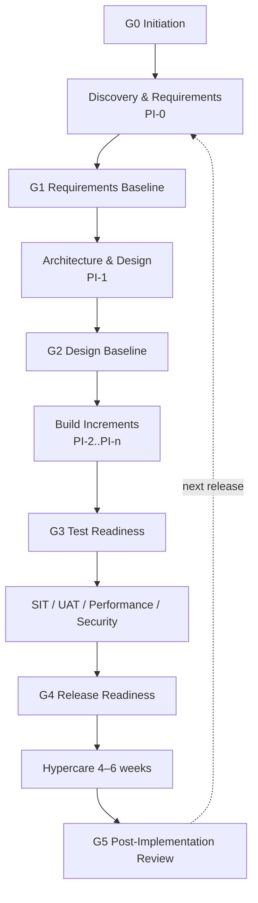
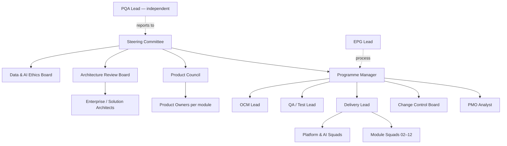

<picture>
  <source media="(prefers-color-scheme: dark)" srcset="../../assets/MultipliersKraftLogoDark.png">
  
</picture>

# PLN-01 — Project Management Plan

| Attribute | Value |
| :--- | :--- |
| Document ID | PLN-01 |
| Title | Project Management Plan |
| Product | Nucleus Suite (Nucleus HRMS Suite) |
| Version | 1.0.0 |
| Status | Issued for approval |
| Owner (role) | Programme Manager |
| Author | Dhanraj Dadhich |
| Reviewed by | PQA Lead, Delivery Lead — *pending* |
| Approved by | Steering Committee — *pending* |
| Date | 2026-11-05 |
| Classification | Internal |
| CMMI practice areas | PLAN, MC, II, EST, RSK, MPM, CAR |
| Related documents | DOC-01, GOV-01, GOV-03, GOV-04, GOV-07, GOV-09, PLN-02, PLN-03, REQ-01, CM-01, RSK-01, QA-01, MPM-01, MC-01, CAR-01, OCM-01, SAM-01, OT-01, PCM-01 |
| Quality & process-performance objectives | QPPO-04 (predictable phase delivery) |
| Process performance baseline used | PPB-05 (story cycle time), PPM-02 (Monte Carlo phase forecast) |
| Peer review record | *pending* (PR-xxxx, QA-02) |
| Tailoring record | none |
| Traceability anchor | BG-09 |

---

## 1. Purpose and Scope

This plan describes **how the Nucleus Suite programme is planned, executed, monitored, controlled and closed**. It is the master plan; detailed approaches live in the subsidiary plans indexed in §14. It covers the current R0 UI-validation prototype, delivery phases P0–P4, the P5 Frontier proposals (PLN-02 §3), and all 14 process domains: PLT, PPL, TIM, LVE, PAY, CMP, LCY, SSV, CMB, TAL, CTG, EXP, FIN, INT (REQ-01 §5).

The plan is re-baselined at every gate (G0–G5). Between gates it changes only through the change control procedure (CM-02).

## 2. Programme Context

| Item | Summary | Reference |
| :--- | :--- | :--- |
| Vision | AI-native, enterprise-grade HCM suite, India-first and global-ready | GOV-01 |
| Business goals | BG-01 … BG-10 | DOC-01 §13, GOV-01 |
| Current phase | **R0 — UI-validation prototype on local JSON.** All mutations are in memory. No production database, external API, production authentication, live payroll disbursement or statutory filing is active. Live backend and database work start only on the Executive Sponsor's explicit signal (DEC-0002). | DAR-02 |
| Delivery model | Hybrid: gated programme governance + agile delivery | §3 |
| Process maturity target | **CMMI Maturity Level 5** (BG-09). ML2/ML3 practices are established first; quantitative management (ML4) and causal analysis / continuous improvement (ML5) are built on the data collected from P0 onward. | PCM-01, MPM-01, CAR-01 |

## 3. Lifecycle Model

### 3.1 Hybrid model overview

The programme uses **stage gates for governance** and **agile increments for delivery**:

- **Gates (G0–G5)** are decision points where the Steering Committee approves baselines and commits funding to the next stage (DOC-01 §12).
- **Program Increments (PIs)** of 10 weeks (4 two-week sprints + 1 two-week innovation and planning sprint) carry the delivery work between gates.
- **Sprints** of 2 weeks are run by module squads.

Gates map onto phase exits (PLN-02 §4):
- **G0** — closes during R0 (initiation).
- **G1** — R0 exit / P0 entry (requirements baseline).
- **G2** — P0 exit at week 8, when a tenant can be provisioned (design baseline).
- **G3** — P1 exit at week 24 (test readiness).
- **G4** — P2 pilot go-live.
- **G5** — P2 exit (post-pilot review).

P3 and P4 each repeat a G1→G5 mini-cycle for their scope. P5 Frontier items enter only through DAR-01 and the CCB (and the DAEB for AI), never directly into a build phase.

R0 itself has no production deployment. It ends with prototype validation sign-off.

### 3.2 Stage entry/exit summary

| Stage | Entry criteria | Key activities | Exit evidence (gate) |
| :--- | :--- | :--- | :--- |
| Initiation | Sponsor mandate | Charter, vision, stakeholders, initial risks, process tailoring | G0: GOV-01, GOV-03, GOV-07, PLN-01 v0.x, RSK-02 seeded |
| Discovery & Requirements | G0 passed | Elicitation, module requirement packs (domain pack structure, DOC-01 §3), NFRs, AI specs, RTM | G1: packs approved, REQ-02 complete to FR level, PLN-02/PLN-03 baselined |
| Architecture & Design | G1 passed | Solution architecture, data model, integration contracts, UX specs, ADRs | G2: ARB approval, DM/INT/UI baselined, DAR records |
| Build | G2 passed | Sprints, code review, unit/integration tests, CI quality gates | G3: features complete, tests green, test plan approved |
| Test | G3 passed | SIT, UAT, performance, security, accessibility, AI evaluation | G4: QA-03 exit criteria, UAT sign-off, OCM readiness, cut-over plan |
| Deploy & Hypercare | G4 passed | Cut-over, data migration, hypercare | G5: benefits baseline, lessons learned (lessons-learned record, PCM-01) |

### 3.3 Agile cadence

| Event | Frequency | Participants | Output |
| :--- | :--- | :--- | :--- |
| PI Planning | Every 10 weeks | All squads, PO, architects, PM | PI objectives, dependency board, risk ROAM |
| Sprint Planning | Every 2 weeks | Squad | Sprint backlog |
| Daily stand-up | Daily | Squad | Impediments to RAID log (RSK-03) |
| Backlog refinement | Weekly | PO, BA, squad | Ready stories meeting the Definition of Ready |
| Sprint Review / Demo | Every 2 weeks | Squad, stakeholders | Accepted increment |
| Retrospective | Every 2 weeks | Squad | Improvement actions (PCM-01) |
| Scrum of Scrums | Twice weekly | Squad leads | Cross-squad dependencies |
| System Demo | End of PI | All | Integrated increment |

**Definition of Ready (DoR):** story has an ID (BL-nnn for imported backlog, `<DOM>-US-nnn` for new stories) and traces to its source (process DOM-nn, rule RL-nnn, screen SCR-nnn, or a new FR/NFR). It names the shared component(s) CMP-nn it reuses (the anti-repeat-work rule, PLN-02 §2.2) and has acceptance criteria, is estimated, its dependencies are identified, and UX/data specs are attached where relevant.

**Definition of Done (DoD):** code reviewed, typecheck/lint/test/build gates pass, acceptance criteria verified, RTM updated, documentation updated, i18n strings externalised, design tokens used (no hard-coded colours), accessibility checks passed, no open critical defects.

## 4. Organisation and Roles

| Role | Key responsibilities |
| :--- | :--- |
| Executive Sponsor | Owns business case and funding; chairs the SteerCo; gives the go/no-go signal for live backend work |
| Programme Manager | Owns this plan, integrated schedule, RAID, reporting, gate preparation |
| Product Owner (per module) | Owns backlog and requirements pack; accepts increments |
| BA Lead | Owns REQ-01/REQ-02; elicitation and traceability |
| Enterprise Architect | Owns GOV-05 and architecture baselines; ARB secretary |
| Delivery Lead | Sprint/PI execution, squad capacity, estimation (PLN-03) |
| QA / Test Lead | Owns QA-03, test strategy and execution |
| PQA Lead | Independent process assurance (QA-01, QA-04); escalates directly to SteerCo |
| Configuration Manager | Owns CM-01/02/03, DOC-02, baselines |
| Data Protection Officer | DPDP/GDPR compliance, GOV-10 |
| Head of AI | Owns GOV-11, AI feature specs, model governance |
| OCM Lead | Owns OCM-01/OCM-02, adoption readiness |
| EPG Lead | Process definition, tailoring, process improvement (PCM-01, OT-01) |
| Vendor Manager | Supplier agreements (SAM-01) |

The full RACI is in GOV-07.

## 5. Scope Management

- **Scope definition:** GOV-01 (in scope / out of scope), the business capability model GOV-05, and the WBS PLN-02 §2.
- **Requirements:** elicited, analysed and baselined per REQ-01; traced in REQ-02.
- **Scope verification:** increments are accepted by the Product Owner at Sprint Review; release scope is verified at G4 against the RTM.
- **Scope change:** only through a change request (CM-02). Each CR's impact is assessed against the baseline before approval.
- **Scope creep control:** any requirement without a parent BG/BO in REQ-02 is rejected at refinement.

## 6. Schedule Management

| Element | Approach |
| :--- | :--- |
| Schedule levels | L1 roadmap (R0, P0–P5, gates) → L2 phase plan (PIs, milestones, BL-nnn backlog sequencing) → L3 sprint plans |
| Baseline | L1/L2 baselined at G1 and re-baselined at each phase exit (PLN-02). Week numbering starts at P0 week 1, the sponsor's go signal (DEC-0002). |
| Critical path | Maintained in PLN-02 §6; reviewed at each Scrum of Scrums |
| Progress measure | Earned value on features (story points accepted / planned), milestone hit rate (MPM-01) |
| Thresholds | SPI < 0.90, or slip > 2 weeks on a critical-path milestone → escalation per MC-01. Once PPBs exist, velocity and cycle-time signals outside PPB control limits also trigger escalation. |
| Prediction | Monte Carlo schedule prediction (PLN-03 §4.6) gives P50/P80 phase-exit dates. Probability of meeting the schedule QPPO is reported at every sprint review. |

## 7. Cost and Effort Management

- Estimates follow PLN-03 (story points for backlog, function points / three-point PERT for release budgets).
- **Contingency:** held by the Programme Manager for known risks (sized from RSK-02 expected values).
- **Management reserve:** held by the SteerCo for unknown risks.
- Cost tracking: monthly actual vs plan, Cost Performance Index (CPI). If CPI < 0.90 → corrective action plan within 10 working days.
- Cloud, AI inference and third-party licence costs are tracked as separate cost lines, because AI features (BG-02, BG-08) carry variable run-costs.

## 8. Resource Management

| Resource type | Planning approach |
| :--- | :--- |
| People | Capacity plan per squad per PI; skills matrix kept in OT-01 |
| Squad topology | Domain-aligned squads: • Platform (PLT) — also owns the 11 shared components CMP-nn (PLN-02 §2.2) • People and Lifecycle (PPL, LCY) • Time and Leave (TIM, LVE) • Pay and Rewards (PAY, CMB, CMP) • Talent and Experience (TAL, EXP) • Workforce and Finance (CTG, FIN) • Self-service (SSV) • Intelligence & Agents (INT) • QA/Automation |
| Environments | DEV, SIT, UAT, PERF, PROD (CM-01 §9); R0 runs locally only |
| Tools | §11 |
| Suppliers | Managed per SAM-01 |

Resource conflicts across squads are resolved at Scrum of Scrums. Unresolved conflicts go to the Delivery Lead, then the Programme Manager.

## 9. Quality, Risk and Communication Management

| Area | Approach summary | Dedicated document |
| :--- | :--- | :--- |
| Quality | Quality objectives, PQA audits, peer reviews, V&V | QA-01, QA-02, QA-03, QA-04 |
| Risk and opportunity | Identify, analyse (P × I), plan responses, monitor weekly | RSK-01, RSK-02 |
| Issues, actions, assumptions, dependencies | RAID log reviewed weekly | RSK-03 |
| Communication | Audience, channels, frequency, owner | GOV-09 |
| Measurement | Measurement objectives, QPPOs, indicators, PPBs, PPMs | MPM-01 |
| Causal analysis | Root-cause analysis and improvement of outcomes | CAR-01 |
| Monitoring and control | Status reporting, reviews, corrective actions | MC-01 |
| Decisions | Formal DAR for significant decisions | DAR-01, DAR-02 |
| Organisational change | Adoption, training, readiness | OCM-01, OCM-02 |

### 9.1 Quantitative Project Management (ML4/ML5)

The programme is managed against **quality and process performance objectives (QPPO-xx)**. These are derived from the business goals and defined in MPM-01.

| Element | How it is used in this plan |
| :--- | :--- |
| QPPO-xx | Measurable objectives (e.g. delivered defect density, estimation accuracy, requirement volatility, cycle time, payroll-calculation accuracy, AI evaluation pass rate), each with a target and a confidence level. Every phase plan states which QPPOs it commits to. |
| Process performance baselines (PPB) | Statistical baselines (central tendency, spread, control limits) of key sub-process measures: review effectiveness, defect injection/removal per phase, velocity, BL actual-to-source effort ratio, CR cycle time. Published and refreshed in MPM-01. |
| Process performance models (PPM) | Predictive models built from the PPBs, for example: • delivered defects as a function of review coverage and requirement volatility • phase completion date via Monte Carlo over BL effort and velocity distributions (PLN-03 §4.6) • payroll parallel-run variance as a function of rule-pack test coverage |
| Use in planning | At each PI and phase plan, PPMs predict the probability of meeting each QPPO. If the probability falls below the QPPO confidence level, the plan is changed **before** commitment: scope, sub-process choice (e.g. inspection depth), capacity or sequencing. The prediction and the decision are recorded in the gate pack. |
| Use in control | Sub-process measures are monitored against PPB control limits (MC-01). Special-cause signals trigger analysis. PPM predictions are re-run at every sprint review and reported against the QPPOs. |
| Causal analysis and improvement | Signals, recurring defects and QPPO shortfalls feed CAR-01. Improvement proposals are selected through DAR-01 §7 and deployed through PCM-01. The effect is verified statistically against the PPB. |

Until enough data exists, typically after the first 2–3 PIs of P0/P1, PPBs are marked *provisional*. Planning then uses PLN-03 analogy and PERT methods, while the plan still records the QPPO targets.

## 10. Stakeholder Involvement Plan

| Stakeholder group | Involvement | Lifecycle stage | Mechanism |
| :--- | :--- | :--- | :--- |
| Executive Sponsor / SteerCo | Approve baselines, funding, gates | All gates | SteerCo monthly + gate reviews |
| CHRO and HR leadership | Vision validation, prioritisation | Initiation, Requirements | Product Council |
| HR operations (HRBP, payroll, time office) | Requirements, UAT | Requirements, Test | Workshops, UAT cycles |
| Plant supervisors and frontline workers | Field validation of attendance, mobile and voice flows | Requirements, Test | Gemba walks, pilot plants |
| Finance Controller | Payroll, GL and ERP outbox validation | Requirements, Test | Payroll parallel runs |
| Line managers and employees | Self-service usability | Design, Test | Usability tests, beta cohort |
| DPO / Legal / Compliance | Privacy, statutory compliance | All | DAEB, compliance reviews |
| IT / Security | Architecture, security, integrations | Design, Build, Test | ARB, security reviews |
| Works councils / unions (where applicable) | Consultation on monitoring features | Requirements, Deploy | Formal consultation per OCM-01 |
| Suppliers | Contracted deliverables | Per SAM-01 | Supplier reviews |

Detailed stakeholder register and RACI: GOV-07.

## 11. Work Environment and Tooling Plan

| Need | Tool / environment (current or target) | Notes |
| :--- | :--- | :--- |
| Source and document control | Git repository | Commits and pushes only on explicit approval (CM-01 §7) |
| Requirements docs | Markdown in the controlled `requirements/` tree (CM-01 §3.2) | Mermaid for diagrams (DOC-01 §10) |
| Build backlog | Source workbook `18_Build_Backlog` (BL-nnn), imported into `requirements/12_Release_and_Backlog` | Bottom-up estimate source (PLN-03) |
| Front-end stack | Server-rendered TypeScript (strict) web framework with a design-token component library; versions pinned in the code repository | DEC-0003 |
| Prototype data | Local JSON catalogues in the prototype code repository, read through a single data-access boundary | R0 only (DEC-0002) |
| Quality gates | Type check, lint, automated unit tests, production build | Required by DoD |
| Backlog / RAID tracking | Issue tracker with workflow states mirroring REQ-01 §9 and CM-02 | Markdown registers (RSK-03, CM-03, DAR-02) remain the system of record in R0; the issue tracker becomes the record at P0 G2 after a DAR-01 selection, with the registers exported at each baseline |
| CI/CD | CI pipeline running the quality gates on every merge request, with automated deployment to preview, SIT and UAT environments | Selected through DAR-01 and approved by the ARB at P0 G2; dormant in R0 (DEC-0002) |
| Collaboration | Organisation-approved messaging, video meeting and shared document workspace | Decisions made in collaboration channels are only binding once recorded in DAR-02 or meeting minutes |

## 12. Project Data Management Plan

| Data item | Form | Owner | Storage | Retention | Access |
| :--- | :--- | :--- | :--- | :--- | :--- |
| Governance documents | Markdown | Doc owner | `requirements/00_Programme_Governance` … `02_Engineering_Process` | Life of product + 7 years | Internal |
| Requirements packs | Markdown, JSON schemas | Domain PO | `requirements/06_Functional_Requirements/<NN>_<DOM>_<Name>/` and folders 03–05 and 07–11 | Life of product | Internal |
| Build backlog | Markdown / workbook import | Delivery Lead | `requirements/12_Release_and_Backlog` | Life of product | Internal |
| RAID, CR log, decision log | Markdown registers | PM / CM | `01_Project_Management/02_Risk_Issue_and_Dependency` (RSK-03), `02_Engineering_Process/02_Configuration_and_Change_Control` (CM-03), `01_Project_Management/04_Decision_Management` (DAR-02) | Life of product | Internal |
| Meeting minutes | the meeting minutes record (GOV-04) | Body secretary | Controlled governance document store (CM-01 configuration item, access by membership) | 3 years minimum | Members |
| Status reports | the status report (MC-01) | PM | Controlled governance document store, filed per reporting period | Life of programme | Stakeholders |
| Measurement data | Spreadsheet or BI | PMO Analyst | Measurement repository (MPM-01), versioned with each PPB recalculation | Life of programme | PMO, SteerCo |
| Test evidence | Test reports | QA Lead | Test management store linked to TC IDs and release tags (QA-03, MTP-01) | 3 years after release | QA, auditors |
| Synthetic demo data | JSON fixtures | Data owner | Prototype code repository (local JSON catalogues) | Per release | Developers |

Rules:
- Project data containing personal data is prohibited. Only synthetic data is used before G4 (GOV-10).
- Secrets, credentials and environment values are never stored in project documents.

## 13. Commitment, Planning Review and Re-planning

1. **Planning review:** at each PI planning and each gate, the Programme Manager reconciles work and resources (capacity vs estimated demand) and records the gaps.
2. **Commitment:** squads commit to PI objectives. The SteerCo commits funding and scope at gates. Commitments are recorded in the gate minutes (meeting minutes record, GOV-04).
3. **Re-planning triggers:**
   - SPI or CPI < 0.90 for two consecutive reporting periods
   - Approved major change request (CM-02)
   - A risk with exposure ≥ 15 materialises (RSK-01)
   - Regulatory change (for example, statutory payroll rule changes)
   - The sponsor signals transition from the R0 prototype to P0 Foundations (live backend)
   - A phase exit criterion is missed (e.g. the P0 week-8 exit "a tenant can be provisioned")
   - An open decision (OD-nn) is not closed by its due point (e.g. OD-01 by P0 week 2)
4. **Re-planning procedure:** impact analysis → revised PLN-02 / PLN-03 → CCB review → SteerCo approval → re-baseline and communicate (GOV-09).

## 14. Subsidiary Plan Index

| Plan | Doc ID |
| :--- | :--- |
| WBS, roadmap and release plan | PLN-02 |
| Estimation method and basis of estimate | PLN-03 |
| Requirements management plan | REQ-01 |
| Configuration management plan | CM-01 |
| Change control procedure | CM-02 |
| Risk and opportunity management plan | RSK-01 |
| Quality management plan | QA-01 |
| V&V strategy | QA-03 |
| Measurement, QPPO, PPB and PPM plan | MPM-01 |
| Causal analysis and resolution | CAR-01 |
| Monitoring and control procedure | MC-01 |
| Communication plan | GOV-09 |
| OCM strategy and training plan | OCM-01, OCM-02 |
| Supplier agreement management plan | SAM-01 |
| Organisational training plan (team) | OT-01 |
| Data governance and privacy | GOV-10 |
| Responsible AI governance | GOV-11 |

## Approval & Sign-off

| Role | Name | Date | Decision | Conditions / comments |
| :--- | :--- | :--- | :--- | :--- |
| Author | Dhanraj Dadhich | 2026-11-05 | Submitted | |
| Peer review moderator | *pending* | | | PR-xxxx |
| PQA (process compliance) | *pending* | | | NC-xxxx if any |
| Steering Committee | *pending* | | | |

## Measurement Data Captured

| Measure | Value | Unit | Notes |
| :--- | :--- | :--- | :--- |
| Size | 15 | sections | |
| Authoring effort | *to be recorded* | person-hours | |
| Review effort (preparation + meeting) | *pending review* | person-hours | From PR-xxxx |
| Rework effort | *pending review* | person-hours | |
| Review rate | *pending review* | pages / hour | Compare with PPB-02 control limits |
| Requirement volatility | 0 | CRs since baseline | Not yet baselined (CM-03) |

| Detection phase | Major | Minor | Editorial |
| :--- | :--- | :--- | :--- |
| Author self-check | 0 | 0 | 0 |
| Peer review | *pending* | | |

## 15. Revision History

| Version | Date | Author | Change summary | CR ref | Approved by |
| :--- | :--- | :--- | :--- | :--- | :--- |
| 1.0.0 | 2026-11-05 | Dhanraj Dadhich | Consolidated release | CR-0001 | *pending* |
