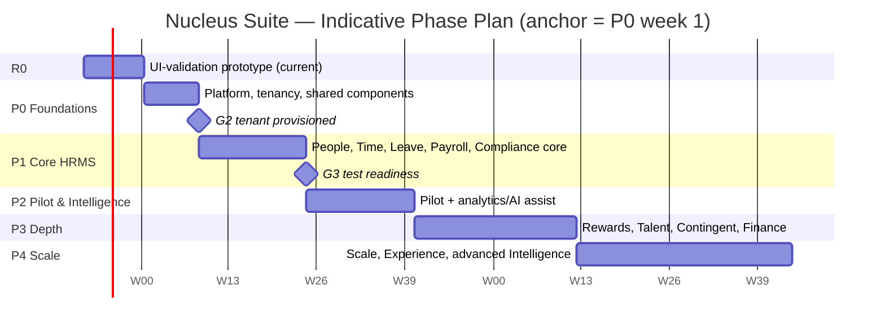

<picture>
  <source media="(prefers-color-scheme: dark)" srcset="../../assets/MultipliersKraftLogoDark.png">
  
</picture>

# PLN-02 — WBS, Product Roadmap and Phase Plan

| Attribute | Value |
| :--- | :--- |
| Document ID | PLN-02 |
| Title | WBS, Product Roadmap and Phase Plan |
| Product | Nucleus Suite (Nucleus HRMS Suite) |
| Version | 1.0.0 |
| Status | Issued for approval |
| Owner (role) | Programme Manager |
| Author | Dhanraj Dadhich |
| Reviewed by | Product Council, Delivery Lead, Enterprise Architect — *pending* |
| Approved by | Steering Committee — *pending* |
| Date | 2026-11-05 |
| Classification | Internal |
| CMMI practice areas | PLAN, EST, MC |
| Related documents | DOC-01, GOV-01, GOV-02, GOV-05, PLN-01, PLN-03, REQ-01, REQ-02, RSK-02, RSK-03, DAR-02 |
| Quality & process-performance objectives | QPPO-04 (predictable phase delivery) |
| Process performance baseline used | PPB-05 (story cycle time), PPM-02 (Monte Carlo phase forecast) |
| Peer review record | *pending* (PR-xxxx, QA-02) |
| Tailoring record | none |
| Traceability anchor | BG-09 |

---

## 1. Purpose

This document defines:
- the **Work Breakdown Structure (WBS)**, organised by the 14 process domains and the 11 shared components
- the **product roadmap**: R0 prototype → phases P0–P4 → P5 Frontier proposals
- **phase exits mapped to gates G0–G5**
- the **critical path** and **key dependencies**

Week numbers are relative to **P0 week 1**, which starts on the Executive Sponsor's go signal for live backend work (DEC-0002). Calendar dates are fixed only when that signal is given and the plan is re-baselined.

The **bottom-up source** for scope and effort is the source workbook's `18_Build_Backlog` (stories `BL-nnn`, each with epic, domain, phase, reusable component CMP-nn, dependencies, effort in days and DoD). It is imported into `requirements/12_Release_and_Backlog`. This document is the top-down structure that the backlog rolls up into. Where they disagree, the imported backlog is the detailed source and this plan is updated through a CR (CM-02).

## 2. Work Breakdown Structure

### 2.1 Level 1–3 WBS

| WBS ID | Lvl | Element | Owner (role) | Primary output / source |
| :--- | :--- | :--- | :--- | :--- |
| **1.0** | 1 | **Programme Governance and Management** | Programme Manager | |
| 1.1 | 2 | Initiation and governance bodies | PM | GOV-01, GOV-03, GOV-04, GOV-07 |
| 1.2 | 2 | Planning, estimation, control | PM / Delivery Lead | PLN-01..03, MC-01, MPM-01 |
| 1.3 | 2 | Process, quality, CM, risk, decisions | EPG / PQA / CM | PCM-01, QA-01..04, CM-01..03, RSK-01..03, DAR-01..02 |
| 1.4 | 2 | Open-decision closure (OD-nn) | Decision owners | DAR-02 (e.g. OD-01 by P0 wk 2) |
| **2.0** | 1 | **Shared Components (build once — §2.2)** | Platform Lead | CMP-nn |
| 2.1–2.11 | 2 | One element per shared component | Platform squad | Component + contract + tests |
| **3.0** | 1 | **Process Domains** | Domain POs | Imported DOM-nn, RL, FRM, SCR, BL |
| 3.1 | 2 | PLT — Platform & Foundations | Platform Lead | Tenancy, identity, RBAC/ABAC, audit, i18n, config |
| 3.2 | 2 | PPL — People Core | PO People | Worker/position/org, effective-dated master data |
| 3.3 | 2 | TIM — Time & Attendance | PO Time | Punch, rosters, OT, gate pass, regularisation, factory registers |
| 3.4 | 2 | LVE — Leave | PO Time | Leave types, accrual, sandwich rule, comp-off, approvals |
| 3.5 | 2 | PAY — Payroll | PO Payroll | Gross-to-net, statutory deductions, control room, payslips, F&F |
| 3.6 | 2 | CMP — Compliance | PO Compliance | Statutory registers and forms, Code on Wages checks, filings |
| 3.7 | 2 | LCY — Lifecycle | PO People | Hire, onboarding, transfer, promotion, exit, clearance |
| 3.8 | 2 | SSV — Self-service & Helpdesk | PO Experience | ESS/MSS, helpdesk, documents |
| 3.9 | 2 | CMB — Compensation, Loans & Benefits | PO Rewards | CTC structures, revisions, loans, benefits |
| 3.10 | 2 | TAL — Talent | PO Talent | Recruitment, performance, 9-box, learning, succession |
| 3.11 | 2 | CTG — Contingent Workforce | PO Workforce | Contractors, vendors, contract labour compliance |
| 3.12 | 2 | EXP — Experience | PO Experience | Engagement, surveys, recognition, wellbeing |
| 3.13 | 2 | FIN — Finance & ERP | PO Finance | GL mapping, ERP outbox formats, cost allocation |
| 3.14 | 2 | INT — Intelligence & Agents | Head of AI | Analytics, consoles, Nucleus Talk, governed agents |
| *3.x.1–3.x.n* | 3 | *Epics per domain, as imported from `18_Build_Backlog`* | Domain PO | BL-nnn grouped by epic |
| **4.0** | 1 | **Data, Integration and Non-Functional Architecture** | Enterprise Architect | |
| 4.1 | 2 | Data architecture and migration | Data Architect / Migration Lead | Data model, migration runs, reconciliation |
| 4.2 | 2 | Integration and API (incl. ERP, banks, devices, statutory portals) | Integration Lead | API contracts, connectors |
| 4.3 | 2 | NFR engineering (performance, security, availability, privacy) | Architect | NFR baseline, evidence |
| **5.0** | 1 | **Verification and Validation** | QA Lead | QA-03 |
| 5.1 | 2 | Test automation and golden datasets (TC-xxx) | QA squad | Test suites |
| 5.2 | 2 | SIT, UAT, payroll parallel runs, performance, security, accessibility | QA squad | Test reports |
| 5.3 | 2 | AI evaluation and red-teaming | INT squad / QA | Evaluation reports |
| **6.0** | 1 | **Organisational Change Management** | OCM Lead | OCM-01, OCM-02 |
| **7.0** | 1 | **Deployment and Operations** | Delivery Lead | Environments, CI/CD, pilot cut-over, hypercare |
| **8.0** | 1 | **P5 Frontier Proposals** | Product Owner / Head of AI | DAR records, DAEB reviews, proposal briefs |

### 2.2 Shared components and the anti-repeat-work rule

The source workbook identifies **11 shared components**. Each is built **once** (WBS 2.x), owned by the Platform squad, and reused by every domain.

**Anti-repeat-work rule:** a backlog story that re-implements the behaviour of a shared component is a **design defect**. It is rejected at refinement or design review and logged against the component owner. Domain stories must name the CMP-nn they consume (PLN-01 DoR).

| WBS | Shared component | Typical consumers |
| :--- | :--- | :--- |
| 2.1 | Approval chain | LVE, TIM (regularisation, OT), CMB (loans, revisions), LCY (exit), TAL (requisitions), PAY (lock) |
| 2.2 | Ledger | LVE balances, comp-off, CMB loans, PAY arrears/recoveries |
| 2.3 | Eligibility service | LVE types, CMB benefits/loans, PAY statutory applicability |
| 2.4 | Recompute worker | PAY retro, LVE accrual, TIM OT recalculation, PPL org rollups |
| 2.5 | Document renderer | Payslips, letters, statutory forms, notifications |
| 2.6 | Rule pack evaluator | CMP statutory rules, PAY deductions, TIM shift rules, jurisdiction packs |
| 2.7 | Blocking-item lock | PAY period lock, LCY exit clearance, TIM muster lock |
| 2.8 | Scope resolver | RBAC/ABAC data scope, plant vs head-office masking, manager hierarchy |
| 2.9 | Outbox | FIN ERP exports, notifications, integrations, event publishing |
| 2.10 | Effective-dated write | PPL, CMB, PAY master data, any time-variant entity |
| 2.11 | Tool surface | INT agents and Nucleus Talk — the governed action interface onto domain services |

The CMP-nn number for each component is cited from the source workbook and is not renumbered here. The mapping table above is completed when the backlog import lands in `requirements/12_Release_and_Backlog`.

## 3. Product Roadmap

### 3.1 Phase overview

| Stage | Name | Window (relative) | Theme | Exit criterion | Primary goals |
| :--- | :--- | :--- | :--- | :--- | :--- |
| R0 | UI-validation prototype (local JSON) — **current** | Now, before P0 | Validate screens, flows and role consoles using in-memory JSON data | Prototype validation sign-off; G1 requirements baseline | BG-01, BG-03, BG-09 |
| P0 | Foundations | Weeks 1–8 | Platform, tenancy, identity, shared components core | **A tenant can be provisioned** | BG-06, BG-07, BG-10 |
| P1 | Core HRMS | Weeks 9–24 | People Core, Time, Leave, Payroll and Compliance core, Lifecycle basics, Self-service | Core HRMS feature-complete and test-ready | BG-01, BG-03, BG-04 |
| P2 | Pilot & Intelligence | Weeks 25–40 | Pilot tenant go-live; first analytics and AI assistance | Pilot live and stable; post-pilot review | BG-02, BG-08 |
| P3 | Depth | Weeks 41–64 | Compensation/loans/benefits, Talent, Contingent, Finance & ERP depth | Depth scope accepted | BG-04, BG-05, BG-07 |
| P4 | Scale | Weeks 65–96 | Multi-tenant scale, Experience, advanced Intelligence, global readiness | Scale NFRs and multi-tenant operations proven | BG-08, BG-10 |
| P5 | Frontier | Proposals (not scheduled) | Beyond-blueprint, futuristic capabilities | Each item approved via DAR-01, CCB and (for AI) the DAEB before entering a phase | BG-02, BG-05, BG-08 |

### 3.2 Gate mapping

| Gate | Occurs at | Evidence |
| :--- | :--- | :--- |
| G0 Initiation | During R0 | Charter, vision, governance framework (CR-0001) |
| G1 Requirements Baseline | R0 exit / P0 entry | Imported domain content (DOM, RL, FRM, SCR, BL) baselined; RTM to process level; OD list owned |
| G2 Design Baseline | P0 exit (week 8) | Tenant provisioning demonstrated; architecture, shared-component contracts, data model approved by the ARB; OD-01 closed |
| G3 Test Readiness | P1 exit (week 24) | Core HRMS build complete, automated TC-xxx suites green |
| G4 Release Readiness | P2 pilot go-live | UAT and parallel runs passed, OCM readiness, cut-over plan |
| G5 Post-Implementation Review | P2 exit (week 40) | Pilot benefits, lessons learned, re-plan for P3 |
| G1→G5 mini-cycle | P3 and P4 | Repeated per phase scope |

### 3.3 Domain scope by phase (planning level; detail comes from BL-nnn)

| Domain | R0 | P0 | P1 | P2 | P3 | P4 |
| :--- | :--- | :--- | :--- | :--- | :--- | :--- |
| PLT | Design tokens, i18n (11 languages), client role gating, `readData` boundary | Tenancy, identity, RBAC/ABAC, audit, config; shared components core | Hardening | Pilot operations | Extensibility | Scale, data residency |
| PPL | People Core screens | Effective-dated write applied to worker/org | Worker, position, org, rollups | Pilot | Matrix/global org | — |
| TIM | Attendance pill, punch preview | — | Punch capture, rosters, OT, gate pass, regularisation | Pilot plants, offline | Device ecosystem | Predictive rostering |
| LVE | Leave dialog, workflow preview | — | Leave types, accrual, sandwich, comp-off, approvals | Pilot | — | — |
| PAY | Control room preview | — | Gross-to-net, statutory, payslips | Parallel runs, pilot payroll | F&F, arrears depth | Continuous payroll readiness |
| CMP | Compliance screens | Rule pack evaluator | Core statutory rules and registers | Pilot filings support | Full form set | Multi-state |
| LCY | Onboarding screens | — | Hire, transfer, exit basics | Pilot | Clearance depth | — |
| SSV | Self-service consoles | — | ESS/MSS core | Helpdesk | Knowledge base | — |
| CMB | Salary simulator preview | — | — | — | CTC, revisions, loans, benefits | — |
| TAL | Recruitment, performance, 9-box previews | — | — | — | Recruitment, performance, calibration, learning | Succession |
| CTG | Contract workforce screens | — | — | — | Contractor and vendor compliance | — |
| EXP | Experience screens | — | — | — | — | Engagement, wellbeing |
| FIN | — | Outbox | — | GL export for pilot | ERP outbox formats | — |
| INT | Nucleus Talk voice navigation, consoles S1–S10 | Tool surface contract | Operational reports | Analytics and AI assistance (read-only) | Agents with human-in-the-loop | Advanced intelligence |

### 3.4 P5 Frontier proposals (beyond the source blueprint)

These are **proposals**. Each needs a DAR record (DAR-01), CCB approval and, if AI is involved, DAEB approval under GOV-11 before it is scheduled into a phase.

| Proposal | Domain(s) | Goal | Notes |
| :--- | :--- | :--- | :--- |
| Organisation digital twin — "what-if" restructuring and cost simulation | PPL, INT | BG-08 | Uses effective-dated write + recompute worker in sandbox mode |
| Governed transactional agents (agent proposes, human approves) | INT + all | BG-02 | Only via the tool surface; full audit |
| Continuous payroll and earned wage access | PAY, CMB | BG-04 | Ledger + eligibility service |
| Skills ontology and internal talent marketplace | TAL | BG-05 | Bias audit mandatory |
| Bias-checked calibration copilot | TAL, INT | BG-05, BG-06 | Explainability required |
| Predictive attrition and workforce planning | INT | BG-08 | Privacy impact assessment |
| Verifiable digital credentials (learning, employment proofs) | TAL, SSV | BG-05 | Standards selection via DAR |
| Multilingual voice-first frontline workflows (offline) | TIM, LVE, SSV | BG-03 | Extends Nucleus Talk |
| AI payroll anomaly detection | PAY, INT | BG-04 | Blocking-item lock integration |
| Consent ledger and privacy self-service | PLT, SSV | BG-06 | Ledger + scope resolver |

## 4. Milestones (Indicative)

| Milestone | Stage | Relative timing | Gate |
| :--- | :--- | :--- | :--- |
| M-R0.1 Governance framework restructured (CR-0001) | R0 | Now | — |
| M-R0.2 Charter and vision approved | R0 | R0 | G0 |
| M-R0.3 Source workbooks imported into `requirements/` tree | R0 | R0 | — |
| M-R0.4 Prototype validation sign-off and requirements baseline | R0 exit | Before P0 wk 1 | G1 |
| M-P0.1 OD-01 (Node framework) closed | P0 | Week 2 | — |
| M-P0.2 Shared-component contracts approved | P0 | Week 6 | — |
| M-P0.3 **A tenant can be provisioned** | P0 exit | Week 8 | G2 |
| M-P1.1 Core HRMS feature complete | P1 exit | Week 24 | G3 |
| M-P2.1 Payroll parallel runs passed | P2 | ~Week 32 | — |
| M-P2.2 Pilot go-live | P2 | ~Week 34 | G4 |
| M-P2.3 Post-pilot review | P2 exit | Week 40 | G5 |
| M-P3.1 Depth scope accepted | P3 exit | Week 64 | G4/G5 (mini-cycle) |
| M-P4.1 Scale exit | P4 exit | Week 96 | G4/G5 (mini-cycle) |
| M-CMMI.1 Internal ML3 readiness assessment (interim) | — | ~Week 40 | — |
| M-CMMI.2 First process performance baselines (PPB) published from P0–P2 data | — | ~Week 40 | — |
| M-CMMI.3 Internal ML5 readiness assessment (QPPO-driven management, CAR-01 operating) | — | ~Week 96 | — |

## 5. Gantt (Relative Weeks — Indicative)

The chart uses a nominal anchor date of 2027-01-04 for P0 week 1 so that it renders. **The anchor is not a commitment.** The real start is the sponsor's go signal.

## 6. Critical Path

1. Sponsor go signal (DEC-0002) → P0 week 1
2. OD-01 Node framework decision (by P0 week 2)
3. Tenancy and identity (PLT) + **scope resolver** + **effective-dated write** + **audit**
4. **Approval chain**, **ledger**, **rule pack evaluator** contracts → tenant provisioning (G2, week 8)
5. People Core worker/org model (PPL)
6. Time and Leave (TIM, LVE) feeding Payroll (PAY) through the **recompute worker** and **blocking-item lock**
7. Payroll parallel runs → pilot go-live (G4)

Any slip in shared components ripples into every domain. They are therefore tracked as critical-path items in every Scrum of Scrums (PLN-01 §3.3).

## 7. Key Dependencies

| ID | Dependency | From → To | Owner | Status |
| :--- | :--- | :--- | :--- | :--- |
| RSK-D-011 | Sponsor go signal for live backend/database work | Sponsor → P0 | Executive Sponsor | Open |
| RSK-D-012 | OD-01 Node framework (NestJS vs Fastify) | Engineering lead → P0 build | Engineering lead | Open — close by P0 wk 2 |
| RSK-D-013 | Import of `18_Build_Backlog` and process/rule/screen catalogues into the requirements set | Requirements workstream → PLN-02/PLN-03 | BA Lead | Delivered (RB-01, FRS-<DOM>-09) |
| RSK-D-001 | Statutory rule updates (PF/ESI/PT/TDS, Code on Wages) | Regulators → CMP/PAY rule packs | Compliance PO | Open |
| RSK-D-004 | Biometric/geofence device specifications | Vendors → TIM | Time PO | Open |
| RSK-D-002 | ERP sandbox access (ERP system formats) | Customer IT → FIN | Integration Lead | Open |
| RSK-D-014 | DAEB approval for agentic features | DAEB → INT (P3+) and P5 | Head of AI | Open |
| RSK-D-015 | Pilot tenant and legacy data extracts | Customer → P2 | Migration Lead | Open |

RSK-03 is authoritative for dependency IDs. These rows are mirrored there.

## Approval & Sign-off

| Role | Name | Date | Decision | Conditions / comments |
| :--- | :--- | :--- | :--- | :--- |
| Author | Dhanraj Dadhich | 2026-11-05 | Submitted | |
| Peer review moderator | *pending* | | | PR-xxxx |
| PQA (process compliance) | *pending* | | | NC-xxxx if any |
| Steering Committee | *pending* | | | |

## Measurement Data Captured

| Measure | Value | Unit | Notes |
| :--- | :--- | :--- | :--- |
| Size | 8 | sections | |
| Authoring effort | *to be recorded* | person-hours | |
| Review effort (preparation + meeting) | *pending review* | person-hours | From PR-xxxx |
| Rework effort | *pending review* | person-hours | |
| Review rate | *pending review* | pages / hour | Compare with PPB-02 control limits |
| Requirement volatility | 0 | CRs since baseline | Not yet baselined (CM-03) |

| Detection phase | Major | Minor | Editorial |
| :--- | :--- | :--- | :--- |
| Author self-check | 0 | 0 | 0 |
| Peer review | *pending* | | |

## 8. Revision History

| Version | Date | Author | Change summary | CR ref | Approved by |
| :--- | :--- | :--- | :--- | :--- | :--- |
| 1.0.0 | 2026-11-05 | Dhanraj Dadhich | Consolidated release | CR-0001 | *pending* |
