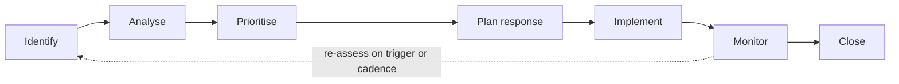

<picture>
  <source media="(prefers-color-scheme: dark)" srcset="../../assets/MultipliersKraftLogoDark.png">
  
</picture>

# RSK-01 — Risk and Opportunity Management Plan

| Attribute | Value |
| :--- | :--- |
| Document ID | RSK-01 |
| Title | Risk and Opportunity Management Plan |
| Product | Nucleus Suite (Nucleus HRMS Suite) |
| Version | 1.0.0 |
| Status | Issued for approval |
| Owner (role) | Programme Manager |
| Author | Dhanraj Dadhich |
| Reviewed by | PQA Lead, Security Lead, Data Protection Officer — *pending* |
| Approved by | Steering Committee — *pending* |
| Date | 2026-11-05 |
| Classification | Internal |
| CMMI practice areas | RSK, MC, GOV |
| Related documents | DOC-01, GOV-03, GOV-04, PLN-01, RSK-02, RSK-03, MC-01, MPM-01, DAR-01, GOV-10, GOV-11 |
| Quality & process-performance objectives | QPPO-04 (predictable phase delivery) |
| Process performance baseline used | PPM-02 (schedule risk input) |
| Peer review record | *pending* (PR-xxxx, QA-02) |
| Tailoring record | none |
| Traceability anchor | BG-09 |

---

## 1. Purpose

This plan defines how the Nucleus Suite programme **identifies, analyses, prioritises, responds to, monitors and closes risks and opportunities** across the product lifecycle (current stage R0 UI-validation prototype → phases P0 Foundations to P5 Frontier). It ensures that uncertainty affecting the business goals BG-01 to BG-10 is managed proactively rather than discovered as issues.

A **risk** is an uncertain future event that, if it occurs, has a negative effect on at least one objective. An **opportunity** is an uncertain future event with a positive effect. An **issue** is a risk that has materialised (or a problem that was never a risk) and is managed in the RAID log (RSK-03).

## 2. Scope

In scope:

- Programme risks (schedule, cost, scope, people, governance).
- Product risks (technical, AI/ethical, security, privacy, statutory accuracy, performance, adoption).
- Supplier and dependency risks (see SAM-01).
- Opportunities that could accelerate goals, reduce cost or create differentiation.

Out of scope: day-to-day operational incidents of a live production service (handled by the incident management process specified in the PLT (Platform & Foundations) domain once production is active).

## 3. Risk Categories

Every risk is tagged with exactly one primary category and optionally secondary categories.

| Code | Category | Typical sources | Default owner (role) |
| :--- | :--- | :--- | :--- |
| SCP | Scope and requirements | breadth of the hire-to-retire scope, unclear module packs, volatile stakeholder asks | Product Owner |
| TEC | Technical and architecture | Bi-temporal model complexity, multi-tenancy, event-driven integration, offline-first sync | Chief Architect |
| AIE | AI and ethical | Bias, hallucination, unexplainable outputs, agent autonomy, model drift | Head of AI |
| PRV | Privacy and regulatory | DPDP 2023, GDPR, labour code changes, sector regulators | Data Protection Officer |
| STA | Statutory and payroll accuracy | PF/ESI/PT/TDS rules, Code on Wages, Factories Act registers, retro arrears | Payroll Domain Lead |
| MIG | Data migration | Legacy data quality, mapping gaps, reconciliation failure | Migration Lead |
| SEC | Security | Tenant leakage, privilege escalation, credential compromise, supply chain | Security Lead |
| VND | Vendor and supplier | LLM provider, cloud, biometric devices, gateways, ERP connectors | Vendor Manager |
| HUM | People and adoption | Key-person dependency, skills gap, union / works-council resistance, change fatigue | OCM Lead |
| SCH | Schedule | Dependencies, estimation error, gate slippage | Programme Manager |
| CST | Cost | Cloud/LLM consumption, rework, vendor pricing changes | Programme Manager / Finance Controller |
| QLT | Quality | Defect leakage, insufficient test coverage, process non-compliance | QA/Test Lead |
| SEM | Domain seam (cross-domain hand-off) | The 12 domain seams S-01..S-12 (e.g. TIM→PAY, LVE→TIM, PAY→FIN, FIN→PPL, INT→all) where one domain's output is another's input | Chief Architect |
| DEC | Open decision | Open decisions OD-nn that block backlog items BL-nnn (e.g. OD-01 Node framework choice blocks BL-001) | Programme Manager |
| RUS | Reuse / duplication | Shared components CMP-nn re-implemented inside a domain instead of consumed (anti-repeat-work rule, PCM-01) | Chief Architect |

In addition to its category, every risk is tagged with the **process domain(s)** it affects, using the 14 canonical domain codes: PLT Platform & Foundations · PPL People Core · TIM Time & Attendance · LVE Leave · PAY Payroll · CMP Compliance · LCY Lifecycle · SSV Self-service & Helpdesk · CMB Compensation, Loans & Benefits · TAL Talent · CTG Contingent Workforce · EXP Experience · FIN Finance & ERP · INT Intelligence & Agents. Risk category codes (above) and domain codes are distinct vocabularies; the people/adoption category is coded `HUM` so as not to collide with the `PPL` domain.

## 4. Risk Process

### 4.1 Identification

Risks are identified through:

1. Gate preparation (G0–G5) — mandatory risk workshop before each gate.
2. Sprint/iteration planning and retrospectives.
3. Requirements peer reviews (QA-02) — reviewers record risk observations.
4. Architecture Review Board sessions (design risks).
5. Data & AI Ethics Board reviews (AI and privacy risks — GOV-10, GOV-11).
6. Supplier reviews (SAM-01).
7. Measurement thresholds breached (MPM-01) — any red metric triggers a risk assessment.
8. Any team member — via the risk entry format in RSK-02 §3, submitted to the Programme Manager.

Each risk is written in **cause → event → effect** form:

> *Because of* `<cause>`, *there is a risk that* `<event>`, *which would result in* `<effect on objective>`.

### 4.2 Analysis — Probability Scale

| Score | Level | Definition | Indicative likelihood |
| :---: | :--- | :--- | :--- |
| 1 | Rare | Could occur only in exceptional circumstances; no precedent in this programme | < 10% |
| 2 | Unlikely | Could occur; weak indicators present | 10–30% |
| 3 | Possible | Might occur; some indicators present or has occurred on comparable programmes | 31–50% |
| 4 | Likely | Will probably occur; clear indicators present | 51–80% |
| 5 | Almost certain | Expected to occur unless action is taken | > 80% |

### 4.3 Analysis — Impact Scale

Impact is assessed on each dimension; the **highest** dimension score is the risk's impact score.

| Score | Level | Schedule | Cost (vs. approved budget) | Scope / quality | Compliance / legal | Trust / reputation | People / safety |
| :---: | :--- | :--- | :--- | :--- | :--- | :--- | :--- |
| 1 | Negligible | < 1 week slip, no milestone impact | < 1% | Cosmetic defect | None | No external visibility | None |
| 2 | Minor | 1–2 week slip, absorbed in phase | 1–3% | Minor feature degraded, workaround exists | Internal policy deviation | Single customer complaint | Minor inconvenience to users |
| 3 | Moderate | Phase milestone slips < 1 month | 3–7% | Feature deferred to next phase | Reportable gap, no penalty expected | Several customers affected | Workers' pay or leave incorrect, corrected in next cycle |
| 4 | Major | Gate slips 1–3 months | 7–15% | Module cannot go live; phase capability objective (GOV-01 §5) missed | Probable regulatory finding or penalty | Public / media visibility; key customer escalation | Statutory dues or wages incorrect for a population; grievance raised |
| 5 | Severe | Gate slips > 3 months or programme viability threatened | > 15% | Core goal (BG-xx) unachievable | Breach of law (e.g. personal data breach, statutory non-payment) | Loss of market trust; contract termination | Harm to individuals (discriminatory decision, unlawful disclosure of sensitive data) |

### 4.4 Exposure Scoring and Thresholds

**Exposure = Probability × Impact** (range 1–25).

| Exposure | Rating | Required treatment | Review frequency | Visibility |
| :---: | :--- | :--- | :--- | :--- |
| 15–25 | **Critical (Red)** | Response plan within 5 working days; owner and contingency mandatory | Weekly | Steering Committee, every meeting |
| 8–14 | **High (Amber)** | Response plan within 10 working days | Fortnightly | Programme board; summarised to SteerCo |
| 4–7 | **Medium (Yellow)** | Response plan before next gate | Monthly | Workstream lead |
| 1–3 | **Low (Green)** | Accept and watch | At gate reviews | Register only |

**Override rule:** any risk with Impact = 5 in the *Compliance / legal*, *Trust* or *People / safety* dimension is treated as **Critical** regardless of probability. This applies especially to AIE, PRV, STA and SEC categories.

### 4.5 Response Strategies — Threats

| Strategy | When to use | Example |
| :--- | :--- | :--- |
| **Avoid** | Change plan or scope to eliminate the risk | Exclude autonomous agent write actions on payroll from P2; keep human approval |
| **Mitigate** | Reduce probability and/or impact | Golden-data statutory test suites; parallel payroll runs before go-live |
| **Transfer** | Shift financial impact to a third party | Supplier liability clauses, cyber insurance, implementation partner fixed-price SoW |
| **Accept (active)** | Exposure within tolerance; contingency reserve set aside | Minor UI localisation gaps in low-usage languages |
| **Accept (passive)** | Low exposure; no action beyond monitoring | Cosmetic theme inconsistencies |
| **Escalate** | Outside programme authority | Enterprise-wide budget or legal policy decisions |

### 4.6 Response Strategies — Opportunities

| Strategy | When to use | Example |
| :--- | :--- | :--- |
| **Exploit** | Ensure the opportunity is realised | Reuse the voice command engine across all modules |
| **Enhance** | Increase probability or benefit | Invest in Indian-language speech data to widen frontline adoption |
| **Share** | Partner with a party better placed to realise it | Co-develop statutory content with a compliance content provider |
| **Accept** | Take it if it occurs; no active effort | Regulatory simplification reducing rule complexity |

### 4.7 Response Plan Contents

Each Red/Amber/Yellow risk in RSK-02 must record:

- Response strategy and specific actions (linked to RSK-AC-xxx in RSK-03).
- Action owner and due date.
- **Trigger** — observable signal that the risk is materialising.
- **Contingency plan** — what happens if the trigger fires.
- **Residual exposure** expected after response.
- **Secondary risks** introduced by the response.

## 5. Roles and Responsibilities

| Role | Responsibilities |
| :--- | :--- |
| Steering Committee | Sets risk appetite and tolerances; reviews Critical risks; approves contingency reserve release; accepts residual Critical risks |
| Programme Manager | Owns this plan and RSK-02; facilitates identification; consolidates reporting; escalates per §7 |
| Risk owner (role) | Analyses, plans and executes response; updates status; reports trigger events |
| Workstream / module leads | Identify risks in their area; implement assigned actions |
| Data & AI Ethics Board | Reviews all AIE and PRV risks with Exposure ≥ 8; may veto AI features with unacceptable residual risk |
| Architecture Review Board | Reviews TEC and SEC risks affecting architecture |
| PQA Lead | Audits compliance with this plan (QA-04); verifies risk records are current |
| All team members | Raise risks; do not suppress bad news |

## 6. Cadence

| Activity | Frequency | Forum | Output |
| :--- | :--- | :--- | :--- |
| Risk review — Critical | Weekly | Programme board | Updated register, escalation if needed |
| Risk review — full register | Fortnightly | Programme board | Updated RSK-02 |
| Risk identification workshop | Before each gate (G0–G5) and at each phase planning | Cross-workstream | New risks, re-scored risks |
| Steering Committee risk report | Monthly | SteerCo | Top-10 risks, trend, reserve status |
| AI and privacy risk review | Monthly | DAEB | AIE/PRV risk decisions |
| Register snapshot baseline | At each gate | Configuration Manager | Baselined RSK-02 snapshot (CM-01) |

## 7. Risk Appetite, Tolerance and Escalation

### 7.1 Appetite Statements (proposed — for SteerCo approval)

| Area | Appetite | Statement |
| :--- | :--- | :--- |
| Statutory and payroll accuracy | **Minimal** | No release may go live with known statutory calculation defects affecting pay or dues. |
| Privacy and security | **Minimal** | No accepted risk with residual Impact ≥ 4 on personal data. |
| AI ethics | **Low** | AI features that influence employment decisions require human-in-the-loop and bias evaluation before release. |
| Innovation / differentiation | **Moderate–High** | The programme accepts technical uncertainty in futuristic features (agents, org digital twin) provided they are feature-flagged and isolated from core transactions. |
| Schedule | **Moderate** | Release dates may move to protect quality and compliance. |
| Cost | **Low–Moderate** | Within approved budget plus contingency reserve. |

### 7.2 Escalation Path

| Condition | Escalate to | Within |
| :--- | :--- | :--- |
| New Critical risk or risk re-scored to Critical | Programme Manager → SteerCo chair | 2 working days |
| Response action overdue > 10 working days on Red/Amber | Programme Manager | Next review |
| Risk requires decision outside programme authority | SteerCo | Next SteerCo or ad hoc |
| AIE/PRV risk with Impact = 5 | DAEB chair and DPO | 1 working day |
| Contingency reserve > 50% consumed | SteerCo | Immediately |

## 8. Contingency and Management Reserve

- **Contingency reserve** (schedule and cost) is sized at G1 from the quantified exposure of identified Red/Amber risks (expected monetary value where estimable — see PLN-03).
- **Management reserve** covers unknown-unknowns and is held by SteerCo.
- Reserve consumption is reported monthly (MPM-01 metric set).

## 9. Risk Closure

A risk may be closed when one of the following is true and recorded with rationale and date:

1. The event can no longer occur (window passed, scope removed).
2. Response has reduced exposure to Low and it remains Low for two consecutive reviews.
3. The risk has materialised and been transferred to the issue log (RSK-03) — the risk record is closed with a link to the issue.

Closed risks remain in the register (never deleted) for organisational learning and are reviewed in lessons learned (the lessons-learned record (PCM-01), PCM-01).

## 10. Opportunity Management

Opportunities follow the same lifecycle and scoring (Probability × Benefit, using the impact scale as a benefit scale). They are recorded in RSK-02 with prefix **RSK-R-** and category tag `OPP`. Opportunities with score ≥ 8 are presented to the Product Council for an exploit/enhance decision via DAR-01.

## 11. Integration with Other Processes

| Process | Integration |
| :--- | :--- |
| Planning (PLN-01, PLN-02) | Risk responses become WBS tasks; contingency in schedule |
| Estimation (PLN-03) | Risk-adjusted estimates; three-point ranges |
| Change control (CM-02) | Every CR includes a risk impact assessment |
| Decision analysis (DAR-01) | Risk is a mandatory evaluation criterion |
| Measurement (MPM-01) | MET-17 (risk exposure trend) and MET-18 (overdue risk actions); PPM predictions (e.g. PPM-02 schedule Monte Carlo) that show < 70% probability of meeting a QPPO or milestone raise a risk |
| Causal analysis (CAR-01) | Realised risks with Impact ≥ 4 trigger a CAR |
| Supplier management (SAM-01) | Supplier risks feed RSK-02 with VND category |
| Quality (QA-01, QA-04) | PQA audits risk process compliance |

## 12. Records

| Record | Location | Retention |
| :--- | :--- | :--- |
| Risk register | RSK-02 | Programme life + 3 years |
| Risk review minutes | the meeting minutes record (GOV-04) instances | Programme life + 3 years |
| Gate risk snapshots | Baselines per CM-01 | Programme life + 3 years |

## Approval & Sign-off

| Role | Name | Date | Decision | Conditions / comments |
| :--- | :--- | :--- | :--- | :--- |
| Author | Dhanraj Dadhich | 2026-11-05 | Submitted | |
| Peer review moderator | *pending* | | | PR-xxxx |
| PQA (process compliance) | *pending* | | | NC-xxxx if any |
| Steering Committee | *pending* | | | |

## Measurement Data Captured

| Measure | Value | Unit | Notes |
| :--- | :--- | :--- | :--- |
| Size | 13 | sections | |
| Authoring effort | *to be recorded* | person-hours | |
| Review effort (preparation + meeting) | *pending review* | person-hours | From PR-xxxx |
| Rework effort | *pending review* | person-hours | |
| Review rate | *pending review* | pages / hour | Compare with PPB-02 control limits |
| Requirement volatility | 0 | CRs since baseline | Not yet baselined (CM-03) |

| Detection phase | Major | Minor | Editorial |
| :--- | :--- | :--- | :--- |
| Author self-check | 0 | 0 | 0 |
| Peer review | *pending* | | |

## 13. Revision History

| Version | Date | Author | Change summary | CR ref | Approved by |
| :--- | :--- | :--- | :--- | :--- | :--- |
| 1.0.0 | 2026-11-05 | Dhanraj Dadhich | Consolidated release | CR-0001 | *pending* |
