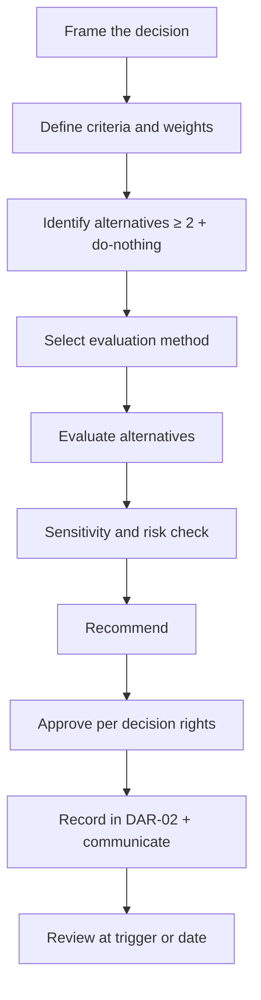

<picture>
  <source media="(prefers-color-scheme: dark)" srcset="../../assets/MultipliersKraftLogoDark.png">
  
</picture>

# DAR-01 — Decision Analysis and Resolution Procedure

| Attribute | Value |
| :--- | :--- |
| Document ID | DAR-01 |
| Title | Decision Analysis and Resolution Procedure |
| Product | Nucleus Suite (Nucleus HRMS Suite) |
| Version | 1.0.0 |
| Status | Issued for approval |
| Owner (role) | EPG Lead |
| Author | Dhanraj Dadhich |
| Reviewed by | Programme Manager, Enterprise Architect, PQA Lead — *pending* |
| Approved by | Steering Committee — *pending* |
| Date | 2026-11-05 |
| Classification | Internal |
| CMMI practice areas | DAR, CAR, PCM, MPM |
| Related documents | DAR-02, the decision record (DAR-01), GOV-04, GOV-11, CM-02, PLN-03, MPM-01, CAR-01, PCM-01, SAM-01 |
| Quality & process-performance objectives | QPPO-04, QPPO-06 |
| Process performance baseline used | n/a — decision procedure; uses PPM outputs as evaluation inputs |
| Peer review record | *pending* (PR-xxxx, QA-02) |
| Tailoring record | none |
| Traceability anchor | BG-09 |

---

## 1. Purpose

Defines when a **formal, documented evaluation of alternatives** is required, and how to carry it out. Significant decisions on Nucleus Suite are then:
- made against agreed criteria
- reproducible
- auditable
- revisited when their assumptions change

Every decision taken under this procedure is recorded in DAR-02 using the decision record (DAR-01).

## 2. When Formal DAR Is Mandatory

A formal DAR is required when **any** trigger below applies. If no trigger applies, the decision is taken by its normal owner and may still be logged in DAR-02 as *Recorded*.

| # | Trigger | Typical decision owner |
| :--- | :--- | :--- |
| T1 | Architecture choices with long-lived consequences (frameworks, persistence, tenancy model, eventing, API style) — e.g. open decision **OD-01 Node framework (NestJS vs Fastify)** | ARB |
| T2 | Build vs buy vs reuse (including shared components CMP-nn and third-party engines) | ARB + SteerCo if > threshold |
| T3 | AI model, AI vendor or AI hosting selection; changing an agent's autonomy level | Head of AI → DAEB |
| T4 | Data residency, cross-border transfer, retention design | DPO → DAEB |
| T5 | Supplier / vendor selection above the procurement threshold | Vendor Manager → SteerCo (SAM-01) |
| T6 | Statutory interpretation where the regulation is ambiguous | Compliance SME + Legal |
| T7 | Moving a P5 Frontier (FX) item into a delivery phase | Product Council → CCB/SteerCo |
| T8 | Selecting **process improvement proposals** for deployment (CAR-01 outputs, EPG proposals, innovations) — see §7 | EPG Lead → SteerCo |
| T9 | Choosing the QPPO set, or changing a PPB/PPM modelling approach | EPG + PMO Analyst |
| T10 | Any decision whose reversal would cost > 10 person-days or > 2 weeks of schedule | Owner per GOV-04 |
| T11 | Tool selection for programme infrastructure (requirements tool, CI/CD, secret store, model registry) | Delivery Lead / Platform Lead |
| T12 | Any open decision `OD-nn` carried in from the source workbooks | Owner named in the workbook |

## 3. Roles

| Role | Responsibility |
| :--- | :--- |
| Decision owner | Accountable for the decision; convenes the evaluation team |
| Evaluation team | 3–6 people with relevant expertise; at least one person independent of the preferred option |
| Facilitator (EPG or PMO) | Ensures the method is followed; keeps the record |
| Approver | Per GOV-04 decision rights (ARB, DAEB, Product Council, CCB, SteerCo) |
| PQA | Samples DAR records for compliance (QA-04) |

## 4. Method

### 4.1 Frame the decision

Record the following in the decision record (DAR-01):
- the question
- scope and constraints (regulatory, budget, schedule, architecture principles)
- the decision deadline (e.g. OD-01 by P0 week 2)
- the cost of delaying the decision
- linked requirements, risks and CRs

### 4.2 Criteria and weights

- Criteria are agreed **before** alternatives are scored.
- Weights total 100 and are approved by the decision owner.
- Mandatory criteria (pass/fail) are separated from weighted criteria. For example, compliance with DPDP 2023 is pass/fail, not a weight.

Typical criteria library (select and tailor):

| Category | Example criteria |
| :--- | :--- |
| Fit | Requirement coverage (R-xx, DOM-nn, CMP-nn), closure of authored capability gaps (`<DOM>-CG-nnn`), frontier enablement (`<DOM>-FX-nnn`) |
| Technical | Performance against NFRs, scalability, multi-tenancy support, maintainability, ecosystem maturity, team skills |
| Trust | Security, privacy-by-design, auditability, explainability (AI), data residency |
| Economics | Total cost of ownership over 3 years, licence model, AI inference cost per transaction |
| Delivery | Time to value, effect on critical path, estimate confidence (PLN-03) |
| Risk | Vendor lock-in, supplier viability, regulatory exposure, reversibility |
| Quantitative | Predicted effect on QPPOs via PPM (MPM-01) |

### 4.3 Alternatives

At least two credible alternatives, plus "do nothing / defer". Sources: market scan, existing assets (prototype, shared components), supplier proposals, the GOV-02 capability coverage and differentiation analysis.

### 4.4 Evaluation methods

| Method | Use when | Output |
| :--- | :--- | :--- |
| Weighted scoring matrix | Default for most decisions | Score per alternative (Σ weight × score, scores 1–5 with defined anchors) |
| Cost–benefit / NPV | Investment, build-vs-buy, supplier | Net benefit over 3 years |
| Risk-adjusted comparison | High uncertainty | Expected value including risk exposure (RSK-01 scales) |
| Prototype / spike | Technical uncertainty (e.g. OD-01 framework spike) | Measured results against NFRs |
| Simulation / PPM | Quantitative process or schedule decisions | Predicted QPPO attainment probability |
| Pairwise comparison (AHP-style) | Many qualitative criteria with contested weights | Consistent weights |

### 4.5 Sensitivity and risk check

- Vary the top two weights by ±20%. If the ranking changes, record it and discuss.
- List the residual risks of the recommended option and add them to RSK-02.
- Note the assumptions. Each one becomes a review trigger (§6).

### 4.6 Recommendation and approval

The recommendation states:
- the chosen alternative
- the rationale
- conditions
- rejected alternatives and why they were rejected
- review triggers

Approval follows GOV-04 decision rights. Approval is recorded with its date and the approving body.

## 5. Decision Record

Every formal DAR produces a **DEC-nnnn** record filed under `01_Project_Management/04_Decision_Management/decisions/DEC-nnnn.md` (the folder is opened with the first formal record) and indexed in DAR-02. Minimum content: context, criteria and weights, alternatives, evaluation, sensitivity, decision, rationale, consequences, approver, review triggers, links (OD-nn, CR, risks, requirements).

## 6. Review and Reversal

A decision is re-opened when:
- one of its recorded assumptions proves false
- a review date is reached
- a material change occurs (regulation, supplier, cost > 20% off, NFR not met in spike or test)
- PPB data contradicts the prediction used in the decision

Reversal of an approved decision is itself a DAR, and if baselines are affected it needs a CR (CM-02).

## 7. DAR for Selecting Process Improvement Proposals (ML5)

At Maturity Level 5, improvements are **selected on predicted and measured benefit**, not opinion. Improvement proposals come from:
- CAR-01 action proposals
- EPG and practitioner suggestions
- retrospectives
- PQA findings
- innovation scans (e.g. AI-assisted review, test generation)

All of them are evaluated through this procedure.

| Step | Activity |
| :--- | :--- |
| 1 | Log the proposal (`IMP-nnn`) with the problem statement, the targeted QPPO and its current PPB performance |
| 2 | Apply mandatory criteria: compatible with the CMMI-aligned process, no compliance/privacy regression, approved by DAEB if it uses AI on project data |
| 3 | Score with weighted criteria: **predicted QPPO improvement (from PPM)** — weight ≥ 30, cost to deploy, effort to adopt, risk, breadth of applicability, time to benefit |
| 4 | Where uncertain, **pilot** in one squad or domain for ≥ 1 PI and measure against the PPB using a statistical comparison (e.g. before/after with control limits, or hypothesis test at a stated significance level) |
| 5 | Decide: deploy organisation-wide / extend pilot / reject. Record as DEC-nnnn with category "Process improvement". |
| 6 | Deploy via PCM-01 (process asset update, training via OT-01). Recalibrate the affected PPB/PPM. |
| 7 | Verify sustained benefit after 2 PIs. If it is not sustained, re-open via CAR-01. |

Selected improvements are prioritised as a portfolio against available EPG capacity, using the same WSJF approach as product requirements (REQ-01 §8.2).

## 8. Metrics

| Metric | Use |
| :--- | :--- |
| Formal DARs per phase, by trigger | Coverage of mandatory triggers |
| Decision lead time (framed → approved) | Bottleneck detection; OD-nn closure against due dates |
| Decisions reversed within 2 phases | Decision quality indicator → CAR-01 if > 10% |
| Open OD-nn past due | Escalated in MC-01 |
| Improvement proposals: piloted / deployed / benefit verified | ML5 improvement effectiveness |

## Approval & Sign-off

| Role | Name | Date | Decision | Conditions / comments |
| :--- | :--- | :--- | :--- | :--- |
| Author | Dhanraj Dadhich | 2026-11-05 | Submitted | |
| Peer review moderator | *pending* | | | PR-xxxx |
| PQA (process compliance) | *pending* | | | NC-xxxx if any |
| Steering Committee | *pending* | | | |

## Measurement Data Captured

| Measure | Value | Unit | Notes |
| :--- | :--- | :--- | :--- |
| Size | 9 | sections | |
| Authoring effort | *to be recorded* | person-hours | |
| Review effort (preparation + meeting) | *pending review* | person-hours | From PR-xxxx |
| Rework effort | *pending review* | person-hours | |
| Review rate | *pending review* | pages / hour | Compare with PPB-02 control limits |
| Requirement volatility | 0 | CRs since baseline | Not yet baselined (CM-03) |

| Detection phase | Major | Minor | Editorial |
| :--- | :--- | :--- | :--- |
| Author self-check | 0 | 0 | 0 |
| Peer review | *pending* | | |

## 9. Revision History

| Version | Date | Author | Change summary | CR ref | Approved by |
| :--- | :--- | :--- | :--- | :--- | :--- |
| 1.0.0 | 2026-11-05 | Dhanraj Dadhich | Consolidated release | CR-0001 | *pending* |
