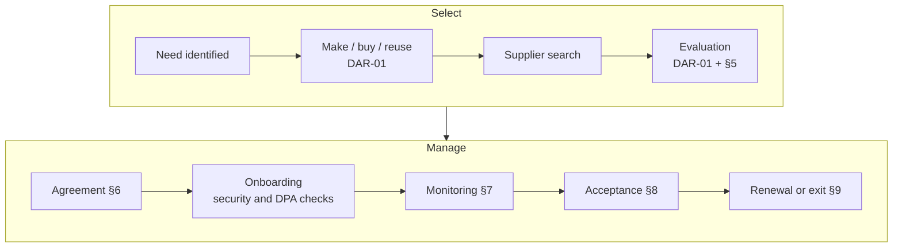

<picture>
  <source media="(prefers-color-scheme: dark)" srcset="../../assets/MultipliersKraftLogoDark.png">
  
</picture>

# SAM-01 — Supplier Agreement Management Plan

| Attribute | Value |
| :--- | :--- |
| Document ID | SAM-01 |
| Title | Supplier Agreement Management Plan |
| Product | Nucleus Suite (Nucleus HRMS Suite) |
| Version | 1.0.0 |
| Status | Issued for approval |
| Owner (role) | Vendor Manager (Procurement) |
| Author | Dhanraj Dadhich |
| Reviewed by | Security Lead, Data Protection Officer, Legal Counsel, Chief Architect, Head of AI — *pending* |
| Approved by | Steering Committee — *pending* |
| Date | 2026-11-05 |
| Classification | Internal |
| CMMI practice areas | SAM, DAR, RSK, VV |
| Related documents | DAR-01, RSK-01, RSK-02, RSK-03, GOV-10, GOV-11, QA-03, CM-01, MPM-01 |
| Quality & process-performance objectives | QPPO-01 (escaped defects from supplier components) |
| Process performance baseline used | PPB-06 |
| Peer review record | *pending* (PR-xxxx, QA-02) |
| Tailoring record | none |
| Traceability anchor | BG-07, BG-09 |

---

## 1. Purpose

Defines how the Nucleus Suite programme identifies supplier needs, selects suppliers, establishes agreements, monitors supplier performance and accepts supplier deliverables, so that third-party products and services meet the suite's functional, security, privacy, AI-ethics and continuity requirements.

In the current R0 UI-validation prototype stage **no external service is activated**; this plan prepares selection and contracting so that suppliers are ready for the phases that need them (RSK-03 dependencies RSK-D-001..RSK-D-009).

## 2. Supplier Categories

| Cat. | Category | Examples of need | Domains | Needed from | Criticality |
| :--- | :--- | :--- | :--- | :--- | :--- |
| SC-01 | Cloud hosting and managed data services | Compute, managed relational database, object storage, key management, India region | PLT | P0 | Critical |
| SC-02 | LLM / AI model and speech providers | Language models for Nucleus Talk, speech-to-text and text-to-speech for 11 languages incl. Indian languages, embeddings | INT, SSV | P1 (navigation), P2 (agents) | Critical |
| SC-03 | Biometric and attendance hardware | Fingerprint / face devices with on-device matching, kiosks, geofence-capable mobile | TIM, CTG | P1 | High |
| SC-04 | Messaging gateways | SMS, business messaging channel, email delivery | PLT, SSV | P1 | High |
| SC-05 | ERP connectors / partners | ERP system integration formats and sandboxes | FIN | P1 | High |
| SC-06 | Background verification | Identity, education, employment, address, criminal record checks | LCY, TAL | P3 | Medium |
| SC-07 | Implementation and staff-augmentation partners | Domain SMEs, developers, testers, migration specialists | All | P0 onwards | High |
| SC-08 | Statutory content providers | Current central/state labour, payroll and tax rules; notifications | PAY, CMP | P1 | Critical |
| SC-09 | Delivery tools (SaaS) | Tracker, CI, test management, monitoring, security scanning | Programme | P0 | Medium |
| SC-10 | Payment / disbursement partners | Bank file formats, earned wage access disbursement | PAY, CMB | P3+ | Critical |

## 3. Supplier Management Process

## 4. Roles

| Role | Responsibilities |
| :--- | :--- |
| Vendor Manager | Owns this plan; runs selection; maintains supplier register; coordinates reviews |
| Requesting domain / architecture lead | Defines technical requirements and acceptance criteria |
| Security Lead | Security assessment; security clauses; ongoing assurance review |
| Data Protection Officer | Data processing agreement; data residency; DPIA input |
| Head of AI | AI-specific evaluation and contract terms (SC-02) |
| Legal Counsel | Contract terms, liability, IP |
| Steering Committee | Approves Critical supplier awards |
| PQA | Audits SAM compliance (QA-04 §5.13) |

## 5. Selection Criteria

Suppliers are selected using **DAR-01** (formal evaluation with weighted criteria). Mandatory criteria are pass/fail; weighted criteria are scored.

### 5.1 Mandatory (pass/fail) for any supplier handling tenant or personal data

| ID | Criterion |
| :--- | :--- |
| M-01 | Signs a data processing agreement compliant with DPDP Act 2023 and, where EU data subjects are involved, GDPR |
| M-02 | Can host/process Indian tenant data in India (or meets the data-residency position set in GOV-10) |
| M-03 | Provides independent security assurance (e.g. recognised certification or audit report) acceptable to the Security Lead |
| M-04 | Supports encryption in transit and at rest; customer-managed or programme-managed keys where required |
| M-05 | Breach notification commitment within the timeline required by GOV-10 |
| M-06 | Supports data return and deletion at termination |
| M-07 (SC-02 only) | Contractual commitment that **customer/tenant data is not used to train or improve the provider's models**, no retention of prompts/outputs beyond what is agreed, and availability of zero/limited-retention options |
| M-08 (SC-03 only) | Supports on-device biometric matching so templates are not required centrally (RSK-R-009) |

### 5.2 Weighted Criteria (default weights, adjustable per category in the DAR record)

| Criterion | Weight |
| :--- | :---: |
| Functional fit to requirements (domain FRs/NFRs) | 25% |
| Security and privacy posture beyond mandatory | 15% |
| Reliability, SLA and support model | 15% |
| Total cost of ownership (incl. usage-based cost growth) | 15% |
| Indian-language and localisation support (where relevant) | 10% |
| Integration quality (APIs, documentation, sandbox) | 10% |
| Vendor viability and lock-in / exit ease | 10% |

For SC-02 (AI), functional fit is measured by running the programme's **AI evaluation sets** (QA-03 §5.9) on candidate models — accuracy, groundedness, fairness, robustness, latency and cost per task — not by vendor claims.

## 6. Agreement Contents

Every agreement (or order under a framework agreement) includes:

| Area | Required content |
| :--- | :--- |
| Scope and deliverables | Precise description; acceptance criteria; delivery schedule |
| Service levels | Availability, performance, support response/resolution times aligned to the relevant NFRs in 05_System_Requirements; service credits |
| Data processing agreement | Roles (processor/sub-processor), purposes, data categories, sub-processor approval, cross-border transfer rules, retention, deletion, audit |
| Data residency | Location of storage and processing; change-notification obligations |
| Security | Security controls, vulnerability management, penetration test rights or reports, incident notification, personnel vetting |
| **AI-specific terms (SC-02)** | No training on customer data; retention limits for prompts/outputs; model version pinning and deprecation notice period; change notification for model updates; content filtering options; usage/rate limits; transparency on sub-processors; indemnity for IP claims where available |
| Statutory content (SC-08) | Update timeliness after notifications; accuracy warranty; source citation for each rule |
| Intellectual property | Ownership of deliverables; licence terms; open-source disclosure |
| Audit rights | Right to audit or receive audit reports; cooperation with customer audits |
| Business continuity | Supplier BCP/DR; escrow where appropriate |
| Exit | Transition assistance, data export in usable formats, deletion certificate, minimum notice period |
| Liability and insurance | Caps proportional to risk; cyber insurance |
| Change control | Changes via written amendment; linked to CM-02 where they affect baselines |
| Reporting | Performance reports at agreed cadence |

## 7. Supplier Monitoring

| Activity | Frequency | Evidence |
| :--- | :--- | :--- |
| SLA performance review | Monthly (Critical), quarterly (others) | Supplier reports vs SLA |
| Security assurance refresh | Annually or on material change | Updated certification/report |
| AI provider evaluation re-run | On every model version change and quarterly | Evaluation results (MET-14, MET-15) |
| Cost and usage review (SC-01, SC-02) | Monthly | Usage vs budget (RSK-R-018) |
| Relationship review | Quarterly (Critical) | Minutes, actions |
| Supplier risk review | Quarterly | Supplier risks in RSK-02 (category VND) |

Under-performance triggers a corrective action plan with the supplier; persistent failure triggers exit planning.

## 8. Acceptance of Supplier Deliverables

1. Acceptance criteria are defined in the agreement before work starts.
2. Deliverables are verified using QA-03 methods (e.g. contract tests for ERP connectors, golden-dataset checks for statutory content packs, evaluation sets for AI models, device tests at a pilot site for biometric hardware).
3. Code and documents from implementation partners follow the same peer review (QA-02) and configuration management (CM-01) as internal work, including the anti-repeat-work rule (PCM-01 §5.4).
4. Acceptance is recorded with evidence; rejected deliverables are tracked to resolution.

## 9. Renewal and Exit

- Renewal decisions are made ≥ 90 days before expiry based on monitoring data.
- For Critical suppliers, an **exit plan** is maintained: alternative supplier(s), data migration approach, abstraction layers (e.g. AI provider abstraction — RSK-R-018), estimated switching effort.

## 10. Supplier Register

| Field | Content |
| :--- | :--- |
| Supplier ID | SUP-NNN |
| Category | SC-xx |
| Services | |
| Criticality | Critical / High / Medium / Low |
| Agreement reference and expiry | |
| DPA / security / AI terms status | |
| Owner (role) | |
| Last review date / rating | |
| Linked risks | RSK-R-xxx |

No suppliers are contracted at v0.1.

## Approval & Sign-off

| Role | Name | Date | Decision | Conditions / comments |
| :--- | :--- | :--- | :--- | :--- |
| Author | Dhanraj Dadhich | 2026-11-05 | Submitted | |
| Peer review moderator | *pending* | | | PR-xxxx |
| PQA (process compliance) | *pending* | | | NC-xxxx if any |
| Steering Committee | *pending* | | | |

## Measurement Data Captured

| Measure | Value | Unit | Notes |
| :--- | :--- | :--- | :--- |
| Size | 11 | sections | |
| Authoring effort | *to be recorded* | person-hours | |
| Review effort (preparation + meeting) | *pending review* | person-hours | From PR-xxxx |
| Rework effort | *pending review* | person-hours | |
| Review rate | *pending review* | pages / hour | Compare with PPB-02 control limits |
| Requirement volatility | 0 | CRs since baseline | Not yet baselined (CM-03) |

| Detection phase | Major | Minor | Editorial |
| :--- | :--- | :--- | :--- |
| Author self-check | 0 | 0 | 0 |
| Peer review | *pending* | | |

## 11. Revision History

| Version | Date | Author | Change summary | CR ref | Approved by |
| :--- | :--- | :--- | :--- | :--- | :--- |
| 1.0.0 | 2026-11-05 | Dhanraj Dadhich | Consolidated release | CR-0001 | *pending* |
