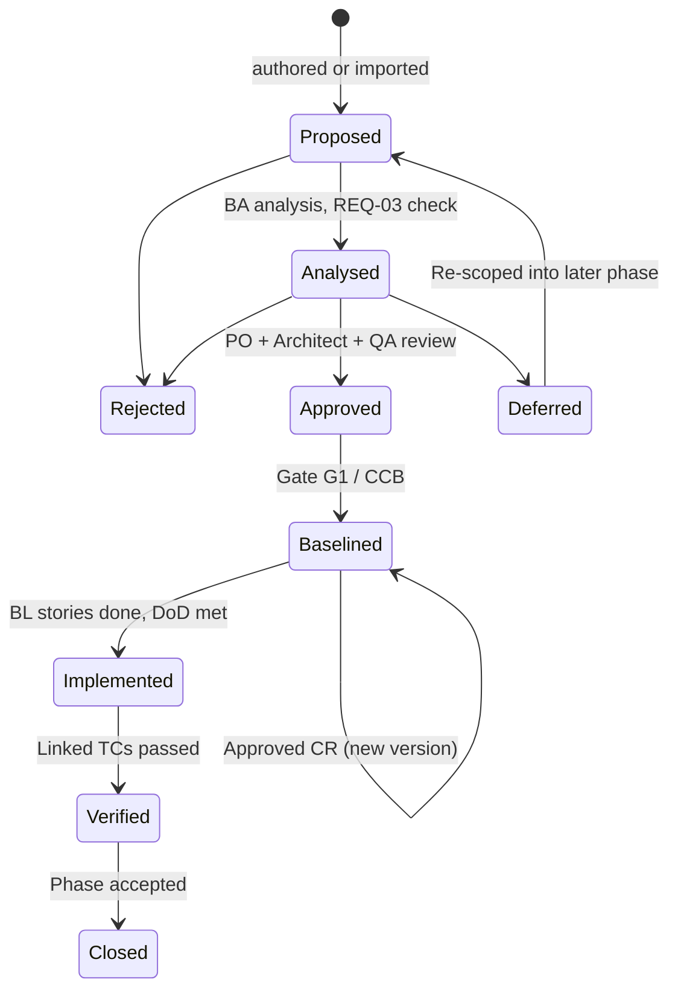
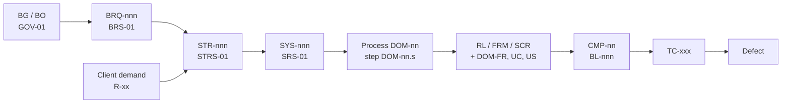

<picture>
  <source media="(prefers-color-scheme: dark)" srcset="../../assets/MultipliersKraftLogoDark.png">
  
</picture>

# REQ-01 — Requirements Management Plan

| Attribute | Value |
| :--- | :--- |
| Document ID | REQ-01 |
| Title | Requirements Management Plan |
| Product | Nucleus Suite (Nucleus HRMS Suite) |
| Version | 1.0.0 |
| Status | Issued for approval |
| Owner (role) | BA Lead |
| Author | Dhanraj Dadhich |
| Reviewed by | Domain Product Owners, Enterprise Architect, QA Lead, PQA Lead — *pending* |
| Approved by | Product Council — *pending* |
| Date | 2026-11-05 |
| Classification | Internal |
| CMMI practice areas | RDM, VV, CM, PR, MPM, CAR |
| Related documents | DOC-01, GOV-01, GOV-02, GOV-05, GOV-08, PLN-02, REQ-02, REQ-03, CM-01, CM-02, DAR-02, MPM-01, CAR-01, QA-02, QA-03, the standard artefact formats (DOC-01 §4) |
| Quality & process-performance objectives | QPPO-05 (effective requirements reviews), QPPO-01 |
| Process performance baseline used | PPB-01 (review defect density), PPB-02 (review rate) |
| Peer review record | *pending* (PR-xxxx, QA-02) |
| Tailoring record | none |
| Traceability anchor | BG-01 – BG-10 |

---

## 1. Purpose

Defines how Nucleus Suite requirements are **imported, elicited, analysed, specified, prioritised, validated, baselined, traced and changed** across the 14 process domains. It ensures that:
- every delivered capability traces to a business goal and a client demand
- every capability is verified by a test
- no requirement enters build without approval
- requirements imported from the source workbooks keep their original identifiers

## 2. Roles

| Role | Responsibility |
| :--- | :--- |
| Domain Product Owner | Owns the domain requirement pack; prioritises; accepts |
| BA Lead | Owns this plan, the RTM (REQ-02), source-workbook imports and requirement quality |
| Business Analysts | Import, elicit and specify using the standard artefact formats (DOC-01 §4) |
| Domain SMEs (HR, payroll, statutory, plant operations, finance) | Source and validate rules |
| Enterprise / Solution Architect | NFRs, feasibility, allocation to shared components (CMP-nn) |
| UX Research Lead | Persona-based validation (GOV-08) |
| Head of AI | AI requirement specs (AI feature specification and model card, GOV-11) and evaluation criteria (INT domain) |
| DPO | Privacy requirements and DPIA triggers (GOV-10) |
| QA Lead | Verifiability review; maps and derives test cases (TC-xxx) |
| PQA Lead | Audits compliance with this plan (QA-04) |
| Configuration Manager | Baselines, import versions, change history |

## 3. Requirements Sources

| Source | Content | ID scheme (cited, never renumbered) |
| :--- | :--- | :--- |
| Client demo points (26) | Client-stated demands | `R-01` … `R-27` |
| Process catalogue (source workbook) | Processes per domain and their steps | Process `DOM-nn`, step `DOM-nn.s` (e.g. `LVE-03`, `LVE-03.2`) |
| Business rules catalogue | Rules, thresholds, statutory logic | `RL-nnn` |
| Screen catalogue | Screens | `SCR-nnn` |
| Form catalogue | Data-entry forms | `FRM-<MOD>-nn` |
| Test catalogue | Test cases | `TC-xxx` |
| Component catalogue | Reusable shared components | `CMP-nn` |
| Build backlog (`18_Build_Backlog`) | Stories with epic, domain, phase, CMP-nn, dependencies, effort, DoD | `BL-nnn` |
| Open decisions | Unresolved design/technology decisions | `OD-nn` (tracked in DAR-02) |
| Business goals/objectives | Programme intent | `BG-nn`, `BO-nn.n` (GOV-01) |
| Business, stakeholder and system requirements | Business needs (BRS-01, CONOPS-01), stakeholder needs (STRS-01), system-level requirements (SRS-01, NFR-01, SEC-01, OPS-01, NOT-01, RPT-01, LOC-01) | `BRQ-nnn`, `STR-nnn`, `SYS-nnn`, `<DOM>-<TYPE>-nnn` |
| Statutory and regulatory texts | Labour codes, Factories Act, PF/ESI/PT/TDS, DPDP 2023, GDPR | Cited by legal reference inside RL / BR |
| Capability coverage analysis | Capability gaps and differentiators | GOV-02; authored gaps `<DOM>-CG-nnn` |
| R0 prototype validation feedback | Usability and flow corrections | Feedback log → CR or new requirement |

The imported source catalogues live under `requirements/` (CM-01 §3.2). Each import is a configuration item that carries the workbook name, version/date and an import checksum.

## 4. Elicitation and Import Techniques

| Technique | Best for | Output |
| :--- | :--- | :--- |
| **Workbook import** | Processes, rules, screens, forms, tests, components, backlog | Imported catalogues with original IDs |
| Gap analysis against imports | Finding missing behaviour, NFRs, AI and privacy needs | New `<DOM>-<TYPE>-nnn` requirements |
| Stakeholder interviews | Executive intent, pain points | BO, candidate requirements |
| Facilitated workshops (JAD) | Cross-domain processes (hire-to-retire, time-to-pay) | Process confirmations, new rules |
| Gemba / shop-floor walk-throughs | TIM, LVE, CMP plant realities | Frontline NFRs, offline needs |
| Regulation analysis | CMP, PAY rules | RL validation with legal citation |
| Prototype review (R0 JSON UI) | Screen and flow validation against SCR-nnn | Validated or changed screens |
| Persona journey mapping | EXP, SSV | Journeys, user stories |
| Capability coverage review | Coverage gaps and differentiators (GOV-02) | `<DOM>-CG-nnn` gap requirements, P5 Frontier proposals |
| AI opportunity workshops | INT agent use cases | AI specs (AI feature specification and model card, GOV-11) with GOV-11 risk class |

## 5. Identification Rules

### 5.1 Imported content — cite, never renumber

Imported artefacts keep their source IDs exactly (`R-07`, `PAY-04.3`, `RL-112`, `SCR-030`, `FRM-LVE-02`, `TC-LV-014`, `CMP-03`, `BL-087`, `OD-01`).
- An imported item that is **changed** keeps its ID. The change is recorded via a CR with a version suffix in the RTM (e.g. `RL-112 v2`).
- An imported item that is **rejected** stays listed with status Rejected and a rationale. It is never deleted.

### 5.2 New requirements we author

New requirements use **`<DOM>-<TYPE>-<NNN>`** with the 14 domain codes:

| Code | Domain | Code | Domain |
| :--- | :--- | :--- | :--- |
| PLT | Platform & Foundations | SSV | Self-service & Helpdesk |
| PPL | People Core | CMB | Compensation, Loans & Benefits |
| TIM | Time & Attendance | TAL | Talent |
| LVE | Leave | CTG | Contingent Workforce |
| PAY | Payroll | EXP | Experience |
| CMP | Compliance | FIN | Finance & ERP |
| LCY | Lifecycle | INT | Intelligence & Agents |

Types: BR, FR, NFR, SEC, OPS, NOT, RPT, LOC, MIG, INT (integration), AI, UC, US, DM, UI, TC, plus two types specific to this programme:

| Type | Meaning | Example | Rules |
| :--- | :--- | :--- | :--- |
| **CG** | **Capability gap**: capability needed for complete hire-to-retire coverage that the source workbooks do not describe | `PPL-CG-004` | Must cite the GOV-02 capability coverage row. The statement describes our own behaviour and names no third-party product (DOC-01 §10 rule 3). |
| **FX** | **Frontier feature**: beyond-blueprint futuristic capability | `INT-FX-002` | Always starts as a P5 proposal. Needs a DAR record (DAR-01) and, for AI, a GOV-11 risk class before it can be Approved. |

Examples: `PAY-NFR-004`, `INT-AI-002`, `TIM-CG-001`, `TAL-FX-003`. A new requirement must first be checked against the imported catalogues to confirm it is not a duplicate of an existing RL, DOM step, SCR or FRM.

> Note: the type code `INT` (integration) and the domain code `INT` (Intelligence & Agents) differ by position. `INT-INT-003` is a valid integration requirement of the Intelligence domain. Authors should prefer clear titles to avoid confusion.

### 5.3 Domain requirement document naming

Domain requirement documents are named **`FRS-<DOM>-nn_<Title>`**, for example `FRS-TIM-03_Forms_and_Fields`. The `FRS-` prefix is mandatory. `<DOM>-nn` alone would collide with workbook process IDs (`TIM-01` is a process, not a document). Documents live in `requirements/06_Functional_Requirements/<NN>_<DOM>_<Name>/` and run from `FRS-<DOM>-00` (domain overview) to `FRS-<DOM>-13`, where `FRS-<DOM>-12` holds the domain's use cases (`<DOM>-UC-nnn`) and `FRS-<DOM>-13` its user stories (`<DOM>-US-nnn`). Cross-domain catalogues of use cases and user stories are UCC-01 and USC-01.

### 5.4 Client tracker statuses are not carried over

Statuses from the client's tracker (e.g. *Implemented*, *WIP*, *Done*) are **not** imported as requirement statuses. Every imported client demand (R-xx) and every derived requirement enters this lifecycle as **Proposed** and is treated as a new requirement. It must be specified, verified against its own TCs and accepted through §9 before it counts as Closed. Prototype screens built during R0 are evidence of UI validation only. They are not evidence of implementation.

## 6. Requirement Attributes (Mandatory)

| Attribute | Description | Allowed values |
| :--- | :--- | :--- |
| ID | Source ID (imported) or `<DOM>-<TYPE>-nnn` (new) | §5 |
| Origin | Imported / New (incl. CG / FX) | |
| Source reference | Workbook + sheet + row, or stakeholder/regulation | |
| Title | ≤ 10 words | |
| Statement | One testable statement using MUST/SHOULD/MAY (imported text kept verbatim; clarifications added as notes) | |
| Type | Process, step, rule, screen, form, BR, FR, NFR, AI… | |
| Domain | One of the 14 codes | |
| Rationale | Why it exists | |
| Parent | Upward trace: R-xx / DOM-nn / BO | ID |
| Priority | MoSCoW | Must / Should / Could / Won't (this phase) |
| WSJF score | Backlog ordering | Number |
| Acceptance criteria | Given/When/Then or measurable criteria | |
| Owner | Accountable role | |
| Status | §9 lifecycle | |
| Target phase | R0, P0–P4, or P5 (proposal) | |
| Shared components | CMP-nn consumed | |
| Backlog stories | BL-nnn realising it | |
| Persona(s) | GOV-08 persona/console | |
| Jurisdiction | Country / state applicability | IN, IN-MH, … |
| Compliance tag | Statutory/privacy relevance | |
| Data classification | Public / Internal / Confidential / Restricted | |
| AI involvement | None / Assistive / Agentic | |
| Verification method | Test / Demo / Inspection / Analysis | |
| Test cases | TC-xxx | |
| Version / change history | Version, CR IDs | |
| Baseline date | Date first Baselined | ISO date |
| Change count | Number of approved CRs since baseline (volatility data) | Integer, auto-derived from CM-03 |
| Change causes | Cause category of each change | Clarification / Missed requirement / Stakeholder change / Regulatory / Defect-driven / Design-driven |
| Injected defects | Defects whose root cause is this requirement, with the phase where each was found | Defect IDs + phase found |
| Review findings | Peer-review findings against this requirement (peer review record, QA-02) | Count by severity |

## 7. Requirement Quality Criteria

Each requirement must pass REQ-03 before approval. Imported items are checked for quality too: defects found in source content are logged and corrected through a CR. They are not silently rewritten.

## 8. Prioritisation

### 8.1 MoSCoW (phase scope)

| Category | Meaning | Guideline share of phase effort |
| :--- | :--- | :--- |
| Must | Phase fails without it (legal, safety, core flow, phase exit criterion) | ≤ 60% |
| Should | Important; a workaround exists | ~20% |
| Could | Desirable | ~20% (contingency buffer) |
| Won't (this phase) | Explicitly deferred | 0%, with target phase |

Rules:
- Client demands `R-xx` that the sponsor committed to are **Must** in their committed phase.
- Statutory, privacy and security requirements with legal effect are **Must** in the phase where the capability goes live.
- Shared components (CMP-nn) on the critical path are **Must** in P0.

### 8.2 WSJF (backlog ordering)

**WSJF = (Business Value + Time Criticality + Risk Reduction / Opportunity Enablement) ÷ Job Size**

Each factor is scored on 1, 2, 3, 5, 8, 13, 20 relative to other items. Job size comes from the BL effort-days or PLN-03 estimate.

## 9. Requirement Lifecycle

| State | Entry condition | Who sets it |
| :--- | :--- | :--- |
| Proposed | Captured or imported with ID and source | BA |
| Analysed | Mandatory attributes complete; REQ-03 pass | BA |
| Approved | PO, Architect and QA review complete (QA-02 record) | Domain PO |
| Baselined | Included in an approved domain baseline | Configuration Manager |
| Implemented | All linked BL stories done | Squad lead |
| Verified | All linked TCs passed | QA Lead |
| Closed | Phase accepted | Domain PO |
| Deferred | Postponed to a named phase | PO (via CCB if baselined) |
| Rejected | Not pursued; rationale recorded; never deleted | PO |

## 10. Baselining

- **G1 (R0 exit / P0 entry):** the imported catalogues (R-xx, DOM, RL, SCR, FRM, TC, CMP, BL) are baselined as `Source-Import v1.0`. Domain packs for P0–P1 scope are baselined per domain (e.g. `LVE-pack-P1 v1.0`).
- **P3 and P4:** each phase's G1 mini-gate baselines that phase's domain scope.
- **P5 Frontier items** are never baselined directly. They become requirements only after approval via DAR-01, CCB and (for AI) the DAEB.
- Baseline content: imported catalogue versions, new requirements, UC/US, DM, INT, UI, NFR, AI specs, and the RTM snapshot.
- After baselining, any change requires a CR (CM-02).

## 11. Traceability

### 11.1 Chain

Code modules are linked to BL stories through the code repository (CM-01); the chain above is held in the RTM (REQ-02).

### 11.2 Rules

| Rule | Description |
| :--- | :--- |
| T1 | Every R-xx traces to at least one BO and at least one DOM-nn |
| T2 | Every DOM-nn traces to at least one R-xx or BO (otherwise it is flagged as possible scope creep) |
| T3 | Every RL, FRM and SCR traces to at least one DOM-nn step |
| T4 | Every new `<DOM>-FR/NFR/BR/AI` traces to a DOM-nn, an R-xx or a BO (cross-cutting NFRs may trace to a BG) |
| T5 | Every BL-nnn traces to at least one DOM step / RL / FRM / SCR / new requirement, and names its CMP-nn |
| T6 | Every Must item has at least one TC-xxx before G3 (or before the phase test-readiness gate) |
| T7 | Every defect traces to the TC and requirement it violates |
| T8 | Every statutory RL cites its legal source and jurisdiction |
| T9 | Every AI requirement (INT or embedded) traces to a GOV-11 risk classification |
| T10 | No BL story re-implements a CMP-nn behaviour (anti-repeat-work rule, PLN-02 §2.2) |
| T11 | Every BRQ traces to a BO; every STR traces to a BRQ (or an R-xx); every SYS traces to an STR; every FR, UC and US traces to a SYS or STR |

Orphans and untested items are reported weekly by the BA Lead (REQ-02 §4).

## 12. Requirements Change Management

1. A change to any **Baselined** item (imported or new) is raised as a CR (change request record, CM-02) and logged in CM-03.
2. The BA performs impact analysis through the RTM: affected R-xx, processes, rules, screens, forms, components, BL stories, tests, estimates and compliance.
3. The CCB decides (CM-02). Approved changes increment the item version. Imported IDs are kept.
4. A **new version of a source workbook** is treated as a CR. The BA produces an import diff (added, changed, removed IDs) for CCB review.
5. Pre-baseline changes are handled by the PO in refinement, with history recorded.

## 13. Volatility and Health Metrics

| Metric | Formula | Threshold / action |
| :--- | :--- | :--- |
| Requirements volatility | (added + modified + rejected after baseline) ÷ baselined count, per PI | > 10% per PI → root-cause review |
| Source drift | Imported items changed by CR ÷ imported items | > 5% per phase → review with source owner |
| Demand coverage | R-xx with ≥ 1 DOM-nn ÷ 27 | < 100% at G1 → gate blocked |
| Test coverage | Must items with TC ÷ Must items | < 100% at test readiness → gate blocked |
| Component reuse compliance | BL stories naming CMP-nn where applicable ÷ applicable BL | < 100% → design review |
| Requirement defect density | Defects caused by requirement errors ÷ requirements | Trend reviewed at G5 |
| Review first-pass rate | Packs passing REQ-03 first time ÷ packs reviewed | < 70% → BA coaching (OT-01) |
| Unknown-value ageing | Open RSK-03 actions for unknown values older than 30 days (controlled documents carry no placeholders, DOC-01 §10 rule 8) | Escalated at the fortnightly programme board |

Operational definitions are in MPM-01.

### 13.1 Per-requirement data for statistical baselines and CAR (ML4/ML5)

To support quantitative management, measurement is kept **per requirement**, not just per document. The attributes in §6 (baseline date, change count, change causes, injected defects, review findings) give:

| Derived measure | Use |
| :--- | :--- |
| Volatility per requirement and per domain/type (changes ÷ requirement ÷ PI) | Input to the **volatility PPB** (MPM-01) and to Monte Carlo volatility injection (PLN-03 §4.6) |
| Requirement defect injection rate (defects rooted in requirements ÷ requirements), by domain, type and origin (Imported / New / CG / FX) | Input to the **defect-injection PPB** and to the delivered-defect PPM |
| Review effectiveness (defects found in requirement review ÷ total requirement defects found later) | PPB for peer-review sub-process; sets the review-depth decision in planning |
| Change-cause distribution | Pareto input to **CAR-01** |

**CAR triggers from requirements data (CAR-01):**
- a domain's volatility or injection rate goes outside PPB control limits
- the same change cause recurs ≥ 3 times within a PI
- any escaped defect (found after G4) is rooted in a requirement

CAR actions that change this process (for example, a new elicitation technique or a stronger checklist item in REQ-03) are selected through DAR-01 §7 and deployed via PCM-01. Their effect is checked against the PPB.

## 14. Supporting Environment

| Need | Current | Target |
| :--- | :--- | :--- |
| Specification | Markdown under `requirements/` using the standard artefact formats (DOC-01 §4) | Same, with requirement attributes held as structured document metadata; any dedicated requirements repository is selected through DAR-01 before P1 G1 |
| Imports | Workbook → Markdown catalogues in `requirements/` | Scripted, repeatable import with checksum |
| Traceability | Markdown RTM (REQ-02) in `requirements/11_Traceability` | RTM assembled automatically from requirement metadata and checked in the CI pipeline |
| Change control | CM-03 Markdown log | Issue tracker workflow mirroring CM-02 states, selected through DAR-01 at P0 G2 |
| Diagrams | Mermaid | Mermaid |

## Approval & Sign-off

| Role | Name | Date | Decision | Conditions / comments |
| :--- | :--- | :--- | :--- | :--- |
| Author | Dhanraj Dadhich | 2026-11-05 | Submitted | |
| Peer review moderator | *pending* | | | PR-xxxx |
| PQA (process compliance) | *pending* | | | NC-xxxx if any |
| Product Council | *pending* | | | |

## Measurement Data Captured

| Measure | Value | Unit | Notes |
| :--- | :--- | :--- | :--- |
| Size | 15 | sections | |
| Authoring effort | *to be recorded* | person-hours | |
| Review effort (preparation + meeting) | *pending review* | person-hours | From PR-xxxx |
| Rework effort | *pending review* | person-hours | |
| Review rate | *pending review* | pages / hour | Compare with PPB-02 control limits |
| Requirement volatility | 0 | CRs since baseline | Not yet baselined (CM-03) |

| Detection phase | Major | Minor | Editorial |
| :--- | :--- | :--- | :--- |
| Author self-check | 0 | 0 | 0 |
| Peer review | *pending* | | |

## 15. Revision History

| Version | Date | Author | Change summary | CR ref | Approved by |
| :--- | :--- | :--- | :--- | :--- | :--- |
| 1.0.0 | 2026-11-05 | Dhanraj Dadhich | Consolidated release | CR-0001 | *pending* |
