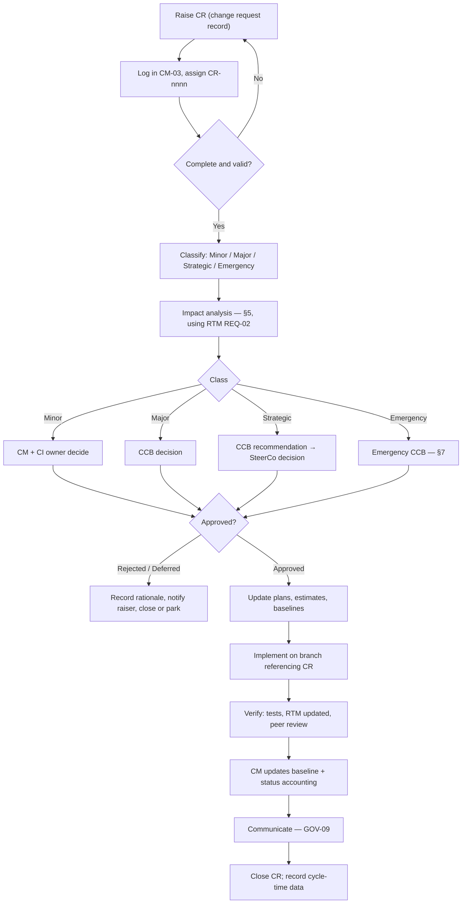

<picture>
  <source media="(prefers-color-scheme: dark)" srcset="../../assets/MultipliersKraftLogoDark.png">
  
</picture>

# CM-02 — Change Control Procedure and CCB Charter

| Attribute | Value |
| :--- | :--- |
| Document ID | CM-02 |
| Title | Change Control Procedure and CCB Charter |
| Product | Nucleus Suite (Nucleus HRMS Suite) |
| Version | 1.0.0 |
| Status | Issued for approval |
| Owner (role) | Configuration Manager |
| Author | Dhanraj Dadhich |
| Reviewed by | Programme Manager, Enterprise Architect, PQA Lead, DPO — *pending* |
| Approved by | Steering Committee — *pending* |
| Date | 2026-11-05 |
| Classification | Internal |
| CMMI practice areas | CM, RDM, MC, MPM |
| Related documents | CM-01, CM-03, REQ-01, REQ-02, PLN-01, PLN-03, RSK-02, DAR-01, GOV-04, GOV-10, GOV-11, the change request record (CM-02) |
| Quality & process-performance objectives | QPPO-06 (fast, controlled change) |
| Process performance baseline used | PPB-07 (CR cycle time) |
| Peer review record | *pending* (PR-xxxx, QA-02) |
| Tailoring record | none |
| Traceability anchor | BG-09 |

---

## 1. Purpose

Defines how changes to **baselined** configuration items are requested, analysed, decided, implemented, verified and communicated. It also charters the **Change Control Board (CCB)**.

Changes to items that are not baselined follow the owner's normal workflow (REQ-01 §12 rule 5).

## 2. What Requires a Change Request

- Any change to a baselined CI (CM-01 §6): requirements (imported or new), FRS documents, architecture, data model, API contracts, shared-component contracts (CMP-nn), code baselines, environment configuration, AI assets, test baselines, PPB/PPM/QPPO definitions
- A new version of a source workbook (an import diff is required)
- Phase scope changes (adding or removing BL-nnn stories after phase baseline)
- Moving any P5 Frontier item (FX) into a delivery phase
- Changes to governance documents after approval
- Any production configuration change

## 3. CR Classification

| Class | Definition | Examples | Decision authority |
| :--- | :--- | :--- | :--- |
| **Minor** | No effect on phase scope, schedule (< 2 days), cost (< 1% of phase budget), compliance, privacy or AI behaviour | Clarification of an acceptance criterion; typo in an FRS; non-functional doc fix | Configuration Manager + CI owner (reported to CCB) |
| **Major** | Exceeds any minor threshold, **or** touches statutory logic, privacy, security, AI behaviour, shared components, or an R-xx commitment | New rule pack; change to approval-chain contract; new agent tool action; workbook re-import | CCB |
| **Strategic** | Changes a phase exit criterion, a gate date by > 2 weeks, budget by > 5%, a business goal, or adds an FX item to a phase | Pull a frontier feature into P3; change the P0 exit criterion | CCB recommends → SteerCo decides |
| **Emergency** | Production incident, security vulnerability or regulatory deadline needing action before the next CCB | Statutory rate change effective next payroll; critical security fix | Emergency CCB (§7) with retrospective full review |

## 4. Change Request Workflow

**Target cycle times** (initial; replaced by the CR cycle-time PPB once established):

| Class | Logged → decision | Decision → close |
| :--- | :--- | :--- |
| Minor | ≤ 3 working days | ≤ 10 working days |
| Major | ≤ 10 working days | Per plan |
| Strategic | ≤ 20 working days | Per plan |
| Emergency | ≤ 24 hours | ≤ 5 working days, plus retrospective within 10 |

## 5. Impact Analysis Dimensions

Each Major, Strategic or Emergency CR must analyse every dimension below. "None" must be stated explicitly, not left blank.

| Dimension | Questions | Primary input |
| :--- | :--- | :--- |
| Scope and traceability | Which R-xx, DOM-nn, RL, FRM, SCR, new requirements, BL stories and TCs are affected? Any orphans created? | RTM (REQ-02) |
| Shared components | Does it change a CMP-nn contract? Which consumers are affected? Does it risk re-implementation? | PLN-02 §2.2 |
| Schedule | Phase-exit or gate impact; critical-path effect; Monte Carlo re-run result (E3) | PLN-02, PLN-03 §4.6 |
| Effort and cost | BoE delta; contingency/reserve draw | PLN-03 |
| Quality / QPPO | Predicted effect on QPPOs via PPM (e.g. defect density, volatility) | MPM-01 |
| Risk | New or changed risks | RSK-02 |
| Statutory compliance | Labour codes, Factories Act, PF/ESI/PT/TDS, Code on Wages; jurisdiction | CMP-domain rules |
| Privacy and data | Personal data, purpose, consent, retention, DPIA trigger | GOV-10 (DPO review mandatory if yes) |
| Security | Access scope, masking, attack surface | Security Lead |
| AI | Model/prompt/tool-surface change; risk class change; evaluation re-run; DAEB approval needed? | GOV-11 |
| Architecture | ARB involvement needed? DAR needed? | DAR-01 |
| Operations and OCM | Training, communication, support, data migration | OCM-01 |
| Contracts | Supplier or client contract impact | SAM-01 |

## 6. CCB Charter

### 6.1 Mandate

The CCB protects the integrity of baselines and the programme's commitments. It:
- decides Major CRs
- recommends Strategic CRs to the SteerCo
- ratifies Minor CR decisions
- reviews emergency changes after the fact
- monitors change trends

### 6.2 Membership

| Role | CCB role | Vote |
| :--- | :--- | :--- |
| Programme Manager | **Chair** | Yes (casting) |
| Configuration Manager | Secretary; maintains CM-03 | No |
| Product Owner(s) of affected domain(s) | Member | Yes |
| Enterprise Architect | Member | Yes |
| Delivery Lead | Member | Yes |
| QA / Test Lead | Member | Yes |
| Data Protection Officer | Member for privacy-affecting CRs | Yes (veto on unlawful processing) |
| Head of AI | Member for AI-affecting CRs | Yes |
| Compliance SME | Member for statutory CRs | Yes |
| PQA Lead | Observer (process compliance) | No |

### 6.3 Quorum and decisions

- **Quorum:** Chair (or delegate), Architect, QA Lead, and the PO of each affected domain. Privacy, AI or statutory CRs also need the DPO, Head of AI or Compliance SME respectively.
- **Decisions:** consensus first, then simple majority of voting members present. The Chair has the casting vote.
- **Outcomes:** Approved / Approved with conditions / Deferred (target phase) / Rejected / Escalated to SteerCo.
- Decisions are minuted (meeting minutes record, GOV-04) and recorded in CM-03. Decisions that set precedent are also recorded in DAR-02.

### 6.4 Cadence

| Phase | Regular CCB |
| :--- | :--- |
| R0 | Fortnightly, or ad hoc |
| P0–P2 | Weekly |
| P3–P4 | Weekly; fortnightly if the PPB shows low CR volume |
| Emergency | Within 24 hours on call |

### 6.5 Decision thresholds and escalation

| Impact | CCB may approve | Escalate to SteerCo |
| :--- | :--- | :--- |
| Schedule | ≤ 2 weeks on a non-gate milestone | > 2 weeks, or any gate/phase-exit date |
| Cost/effort | ≤ 5% of phase budget (from contingency) | > 5%, or any management-reserve draw |
| Scope | Swap of equal-size BL items; Should/Could changes | Removing a Must, an R-xx commitment or a phase exit criterion; adding an FX item |
| Compliance / privacy | Approve with DPO / Compliance SME concurrence | Any residual legal risk accepted |
| AI | With Head of AI concurrence, within the approved risk class | Risk-class increase → DAEB, then SteerCo |

## 7. Emergency Change

1. Raised by the incident or compliance owner. Logged as `CR-nnnn (EMERGENCY)`.
2. Emergency CCB = Chair (or delegate) + Architect + QA Lead, plus DPO, Head of AI or Compliance SME if relevant. Convened within 24 hours, by call if needed.
3. Minimum impact analysis: risk of acting vs not acting, rollback plan, test evidence (at least smoke and targeted regression).
4. Implementation through the normal pipeline. No manual production changes.
5. **Retrospective review** at the next regular CCB within 10 working days. The full impact analysis is completed and baselines and RTM updated.
6. Each emergency CR is reviewed for root cause. Recurring emergencies trigger CAR-01.

## 8. Communication

- The raiser is notified of the decision within 2 working days.
- Approved Major/Strategic changes are communicated to affected stakeholders per GOV-09 (e.g. change digest in the weekly status report, the status report (MC-01)).
- Changes affecting end users are routed to the OCM Lead (OCM-01) for training and communication updates.

## 9. Metrics

| Metric | Definition | Use |
| :--- | :--- | :--- |
| CR volume | CRs raised per PI by class and domain | Trend; volatility input |
| CR cycle time | Logged → decision, decision → close | **Candidate PPB** (MPM-01) |
| Approval ratio | Approved ÷ decided | Health of requirements stability |
| Emergency ratio | Emergency ÷ total | > 10% → CAR-01 |
| Change cause distribution | By cause category (REQ-01 §6) | Pareto for CAR-01 |
| Unauthorised changes | Baseline changes without a CR found in audit | Target 0; any → NC + CAR |
| Impact-analysis accuracy | Actual vs predicted effort/schedule impact | Calibration of PPMs |

## Approval & Sign-off

| Role | Name | Date | Decision | Conditions / comments |
| :--- | :--- | :--- | :--- | :--- |
| Author | Dhanraj Dadhich | 2026-11-05 | Submitted | |
| Peer review moderator | *pending* | | | PR-xxxx |
| PQA (process compliance) | *pending* | | | NC-xxxx if any |
| Steering Committee | *pending* | | | |

## Measurement Data Captured

| Measure | Value | Unit | Notes |
| :--- | :--- | :--- | :--- |
| Size | 10 | sections | |
| Authoring effort | *to be recorded* | person-hours | |
| Review effort (preparation + meeting) | *pending review* | person-hours | From PR-xxxx |
| Rework effort | *pending review* | person-hours | |
| Review rate | *pending review* | pages / hour | Compare with PPB-02 control limits |
| Requirement volatility | 0 | CRs since baseline | Not yet baselined (CM-03) |

| Detection phase | Major | Minor | Editorial |
| :--- | :--- | :--- | :--- |
| Author self-check | 0 | 0 | 0 |
| Peer review | *pending* | | |

## 10. Revision History

| Version | Date | Author | Change summary | CR ref | Approved by |
| :--- | :--- | :--- | :--- | :--- | :--- |
| 1.0.0 | 2026-11-05 | Dhanraj Dadhich | Consolidated release | CR-0001 | *pending* |
