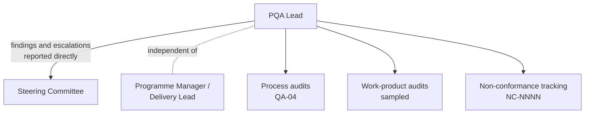

<picture>
  <source media="(prefers-color-scheme: dark)" srcset="../../assets/MultipliersKraftLogoDark.png">
  
</picture>

# QA-01 — Quality Management Plan

| Attribute | Value |
| :--- | :--- |
| Document ID | QA-01 |
| Title | Quality Management Plan |
| Product | Nucleus Suite (Nucleus HRMS Suite) |
| Version | 1.0.0 |
| Status | Issued for approval |
| Owner (role) | PQA Lead |
| Author | Dhanraj Dadhich |
| Reviewed by | Programme Manager, EPG Lead, QA/Test Lead — *pending* |
| Approved by | Steering Committee — *pending* |
| Date | 2026-11-05 |
| Classification | Internal |
| CMMI practice areas | PQA, VV, PR, GOV, MPM, CAR |
| Related documents | DOC-01, QA-02, QA-03, QA-04, MPM-01, MC-01, PCM-01, CAR-01, CM-01, GOV-04 |
| Quality & process-performance objectives | QPPO-02 (defect removal before system test), QPPO-03 (exact payroll), QPPO-05 |
| Process performance baseline used | PPB-01, PPB-02, PPB-03, PPB-04 |
| Peer review record | *pending* (PR-xxxx, QA-02) |
| Tailoring record | none |
| Traceability anchor | BG-09 |

---

## 1. Purpose

Defines how quality is planned, assured and controlled for the Nucleus Suite programme. It separates two complementary responsibilities:

- **Process Quality Assurance (PQA)** — objective, independent evaluation that the defined processes are followed and that work products conform to standards (CMMI PQA).
- **Product quality control** — verification and validation that the product meets its requirements and is fit for purpose (detailed in QA-03; peer reviews in QA-02).

## 2. Quality Policy (proposed for SteerCo approval)

> Nucleus Suite handles people's pay, livelihoods and personal data. We build quality in rather than test it in: every requirement is verifiable, every baseline is peer-reviewed, every statutory calculation is proven against golden data, every AI capability is evaluated for accuracy and fairness, and every process step leaves objective evidence.

## 3. Quality Objectives

Quality objectives derive from BG-09 (delivery maturity) and BG-06 (trust by design), and are measured via MPM-01.

| ID | Objective | Measure | Target (proposed, baselined at G1) |
| :--- | :--- | :--- | :--- |
| QO-01 | Process capability demonstrable at CMMI ML5 (high maturity), via ML3 and ML4 milestones | QA-04 compliance rating across practice areas incl. MPM levels 4–5, CAR and PCM high-maturity practices | All in-scope practices rated "Largely" or "Fully" implemented before each staged appraisal (PCM-01 §9) |
| QO-02 | Defects are found early | Review effectiveness (MET-09) | ≥ 60% of total defects found before system test |
| QO-03 | Few defects escape to users | Defect leakage (MET-08) | ≤ 5% of defects found after release |
| QO-04 | Calculations reconcile exactly to the golden dataset | Golden-dataset reconciliation against HRMS Demo Dataset v1.1 expected results (MET-12) | 100% match for in-scope domains; zero known statutory defects at G4 |
| QO-05 | Requirements fully verified | Requirements coverage (MET-05) | 100% of Must-have FRs traced to passing test cases at G4 |
| QO-06 | Inclusive, accessible product | Accessibility conformance (MET-23) | 100% of in-scope screens meet WCAG 2.2 AA at G4 |
| QO-07 | Secure product | Open critical/high vulnerabilities and their age (MET-24) | Zero open critical/high at G4 |
| QO-08 | Fair and grounded AI | MET-14, MET-15 | Within thresholds approved by DAEB per feature |
| QO-09 | Non-conformances resolved promptly | MET-25 | ≥ 90% closed within agreed due date |
| QO-10 | No duplicated shared capability | Peer-review reuse findings (QA-02 check R-5) | Zero re-implementations of shared components CMP-nn reaching G3 |

NFR targets (availability, performance, security, etc.) are **not** restated here: they are owned by 05_System_Requirements (imported from the workbook's 20_NFR_and_DoD with target, how-measured, gate and owner). Quality objectives refer to them by ID.

### 3.1 Relationship to Quality and Process-Performance Objectives (ML4–ML5)

Quality objectives QO-01..QO-10 are the programme's quality commitments. For high maturity, the measurable subset is formalised as **Quality and Process-Performance Objectives (QPPO-xx)** in MPM-01 §4, each traced to a business goal/objective and supported by process performance baselines (PPB-xx) and models (PPM-xx). Where a QO and a QPPO overlap, MPM-01 governs the statistical target and QA-01 governs the audit of whether it is managed.

## 4. Quality Standards and Reference Models

| Standard / model | Applied to | How used |
| :--- | :--- | :--- |
| CMMI V2.0/V3.0 (Development), **Maturity Level 5 target** (staged via ML3 → ML4 → ML5) | Programme processes | Process architecture and improvement (PCM-01), statistical management (MPM-01), causal analysis (CAR-01), audit checklist (QA-04) |
| ISO/IEC 25010 product quality model | Product NFRs | NFR categories in NFR-01: functional suitability, performance efficiency, compatibility, interaction capability (usability), reliability, security, maintainability, flexibility (portability), safety |
| WCAG 2.2 Level AA | All user interfaces | UI acceptance criteria (screen specification format, FRS-<DOM>-04), accessibility testing (QA-03) |
| OWASP ASVS (target level agreed by ARB per component) | Application security | Security requirements and verification (QA-03) |
| OWASP Top 10 for LLM Applications | AI features | AI threat model and red-team scenarios (GOV-11, QA-03) |
| RFC 2119 requirement keywords | All requirements | DOC-01 §10 |
| Internal: DOC-01, REQ-03, design token and i18n rules | Documents, UI | Peer review checklists |

## 5. Organisation and Independence of PQA

- The PQA Lead **does not report to the Programme Manager or Delivery Lead** for PQA matters; findings are reported directly to the SteerCo.
- PQA auditors never audit their own work. Where a team member performs PQA part-time, they audit a different workstream.
- PQA has authority to request evidence from any role and to escalate unresolved non-conformances to the SteerCo.

## 6. Roles and Responsibilities

| Role | Responsibilities |
| :--- | :--- |
| Steering Committee | Approves quality policy and objectives; receives PQA reports; resolves escalated non-conformances |
| PQA Lead | Owns this plan; schedules and performs audits; tracks NCs; reports quality status |
| QA/Test Lead | Owns QA-03; plans and runs verification and validation; reports test metrics |
| EPG Lead | Maintains process assets; acts on systemic findings via improvement proposals (PCM-01) |
| Workstream / domain leads | Ensure team follows processes; resolve NCs assigned to them |
| Peer reviewers | Perform reviews per QA-02 |
| All team members | Follow defined processes; raise quality concerns without fear of reprisal |

## 7. Objective Evaluation

### 7.1 Process Audits

PQA evaluates performed processes against the defined process (PCM-01 and the procedures listed in DOC-02) using the QA-04 checklist.

| Process area | Audit frequency | Sample basis |
| :--- | :--- | :--- |
| Requirements (RDM) | Each domain pack before G1 | 100% of domain packs at G1 |
| Configuration and change (CM) | Monthly | ≥ 10 CRs or all if fewer; baseline integrity check |
| Peer review (PR) | Monthly | ≥ 5 review records |
| Planning, monitoring (PLAN, MC) | Quarterly and before each gate | Plan vs actual records |
| Risk (RSK) | Quarterly | Full register |
| Verification and validation (VV) | Before G3 and G4 | Test plans, results, RTM |
| Decision analysis (DAR) | Quarterly | All decisions logged in DAR-02 since last audit |
| Supplier management (SAM) | Before supplier contract award; then semi-annually | All active supplier agreements |
| Measurement (MPM) — levels 2–3 | Quarterly | Metric data integrity |
| Statistical management (MPM levels 4–5) | Quarterly from P2 | QPPO traceability, PPB/PPM derivation records, control charts and special-cause actions for every statistically managed sub-process |
| Causal analysis (CAR) | Quarterly | All CAR records closed in the period; evidence of statistical evaluation of action effect |
| Organisational improvement (PCM high maturity) | Semi-annually from P2 | Improvement proposal pipeline, pilot evaluations, deployment records, innovation scans |
| Training (OT) | Semi-annually | Training records |

### 7.2 Work-Product Audits

PQA samples work products to verify conformance with standards (not technical correctness, which is the role of peer review):

| Work product | Conformance checked against |
| :--- | :--- |
| Any controlled document | DOC-01 header, IDs, revision history, status, approvals |
| Functional domain pack (06_Functional_Requirements) | Domain pack structure (DOC-01 §3); REQ-03 quality checklist |
| RTM | REQ-01 attribute completeness; bidirectional links |
| Change requests | CM-02 workflow evidence |
| Review records | QA-02 entry/exit criteria |
| Test cases | Test case fields defined in the master test plan (MTP-01); trace to requirement |
| AI feature specs | AI feature specification and model card content (GOV-11); DAEB approval |

### 7.3 Audit Workflow

1. **Plan** — PQA publishes a quarterly audit calendar (§8).
2. **Notify** — audited party notified ≥ 5 working days ahead with scope and checklist.
3. **Perform** — evidence gathered; interviews where needed.
4. **Report** — findings within 3 working days, classified per §9.
5. **Resolve** — owners agree corrective actions and due dates.
6. **Verify** — PQA verifies corrective action evidence and closes the NC.
7. **Trend** — quarterly analysis of NCs to EPG for systemic improvement.

## 8. Audit Calendar (initial)

| Period | Audits |
| :--- | :--- |
| Before G0 | Governance folder conformance (DOC, GOV, CM, PAD) — verifies RSK-I-001 closure |
| G0 + 30 days | First full QA-04 process audit |
| Monthly | CM baseline integrity; peer review records sample |
| Before each domain G1 | RDM audit of domain pack |
| Quarterly | PLAN/MC, RSK, DAR, MPM |
| Before G3/G4 of each phase | VV audit; quality gate readiness |
| Semi-annually | SAM, OT |

## 9. Non-Conformance Handling

### 9.1 Classification

| Class | Definition | Resolution target |
| :--- | :--- | :--- |
| **Major** | Required process step not performed, or a baseline released without required approval/evidence; or product conformance gap with compliance, security, privacy or statutory impact | 10 working days; blocks gate exit until closed or waived by SteerCo |
| **Minor** | Process performed but evidence incomplete or not in the standard format (DOC-01 §4) | 20 working days |
| **Observation** | Improvement opportunity; no requirement breached | Considered by EPG; no mandatory closure |

### 9.2 NC Record (NC-NNNN)

| Field | Content |
| :--- | :--- |
| ID | NC-NNNN |
| Audit reference | Audit ID / date |
| Requirement breached | Doc ID and clause |
| Evidence | What was observed |
| Class | Major / Minor / Observation |
| Owner | Role |
| Corrective action | Plan (and preventive action for Majors) |
| Due date | ISO date |
| Status | Open / Action agreed / Verified / Closed / Escalated / Waived |
| Verification | PQA evidence of closure |

### 9.3 Escalation

| Condition | Escalate to |
| :--- | :--- |
| Owner does not agree an action within 5 working days | Programme Manager |
| Major NC overdue | SteerCo (directly by PQA Lead) |
| Repeat NC of same type in 3 consecutive audits | EPG for causal analysis (CAR-01) |
| Waiver requested | SteerCo decision recorded in DAR-02 |

## 10. Quality Gates

| Gate | Quality exit criteria (in addition to gate criteria in DOC-01 §12) |
| :--- | :--- |
| G0 Initiation | G0 documents peer-reviewed (QA-02) and approved; quality policy approved; PQA appointed and independent |
| G1 Requirements Baseline | Every domain pack passes REQ-03 checklist; NFRs measurable (targets as defined in 05_System_Requirements); RTM to FR level; no open Major NC on RDM |
| G2 Design Baseline | ARB approval records; design peer reviews complete; threat models for security and AI; test strategy updated |
| G3 Test Readiness | Unit/integration exit criteria met (QA-03 §7); static analysis clean of critical findings; test environments and synthetic data ready |
| G4 Release Readiness | QA-03 system/UAT exit criteria met; MET-05 = 100% Must-have; zero open critical defects; golden-dataset reconciliation 100% for in-scope domains (QA-03 §5.2); accessibility and security exit met; DAEB sign-off for AI features; no open Major NC |
| G5 Post-Implementation | Defect leakage measured; lessons learned captured (lessons-learned record, PCM-01); improvement proposals raised |

## 11. Quality Records

| Record | Format / location | Retention |
| :--- | :--- | :--- |
| Audit plans and reports | QA-04 completed instances | Programme life + 3 years |
| Non-conformance records | NC log maintained by PQA Lead | Programme life + 3 years |
| Peer review records | Peer review record PR-NNNN (QA-02) | Programme life + 3 years |
| Test plans, results, defect reports | QA-03, MTP-01 and UAT-01 artefacts | Programme life + 3 years |
| Quality status reports | Monthly to SteerCo | Programme life + 3 years |
| Gate quality checklists | Gate review minutes (meeting minutes record, GOV-04) | Programme life + 3 years |

## 12. Quality Reporting

- **Monthly PQA report** to SteerCo: audits performed, NCs opened/closed by class, overdue NCs, trends, systemic issues.
- **Quality dashboard** (MPM-01): QO-01 to QO-09 status, red/amber/green.
- **Gate quality statement**: PQA Lead signs a statement of conformance or lists exceptions at every gate.

## Approval & Sign-off

| Role | Name | Date | Decision | Conditions / comments |
| :--- | :--- | :--- | :--- | :--- |
| Author | Dhanraj Dadhich | 2026-11-05 | Submitted | |
| Peer review moderator | *pending* | | | PR-xxxx |
| PQA (process compliance) | *pending* | | | NC-xxxx if any |
| Steering Committee | *pending* | | | |

## Measurement Data Captured

| Measure | Value | Unit | Notes |
| :--- | :--- | :--- | :--- |
| Size | 13 | sections | |
| Authoring effort | *to be recorded* | person-hours | |
| Review effort (preparation + meeting) | *pending review* | person-hours | From PR-xxxx |
| Rework effort | *pending review* | person-hours | |
| Review rate | *pending review* | pages / hour | Compare with PPB-02 control limits |
| Requirement volatility | 0 | CRs since baseline | Not yet baselined (CM-03) |

| Detection phase | Major | Minor | Editorial |
| :--- | :--- | :--- | :--- |
| Author self-check | 0 | 0 | 0 |
| Peer review | *pending* | | |

## 13. Revision History

| Version | Date | Author | Change summary | CR ref | Approved by |
| :--- | :--- | :--- | :--- | :--- | :--- |
| 1.0.0 | 2026-11-05 | Dhanraj Dadhich | Consolidated release | CR-0001 | *pending* |
