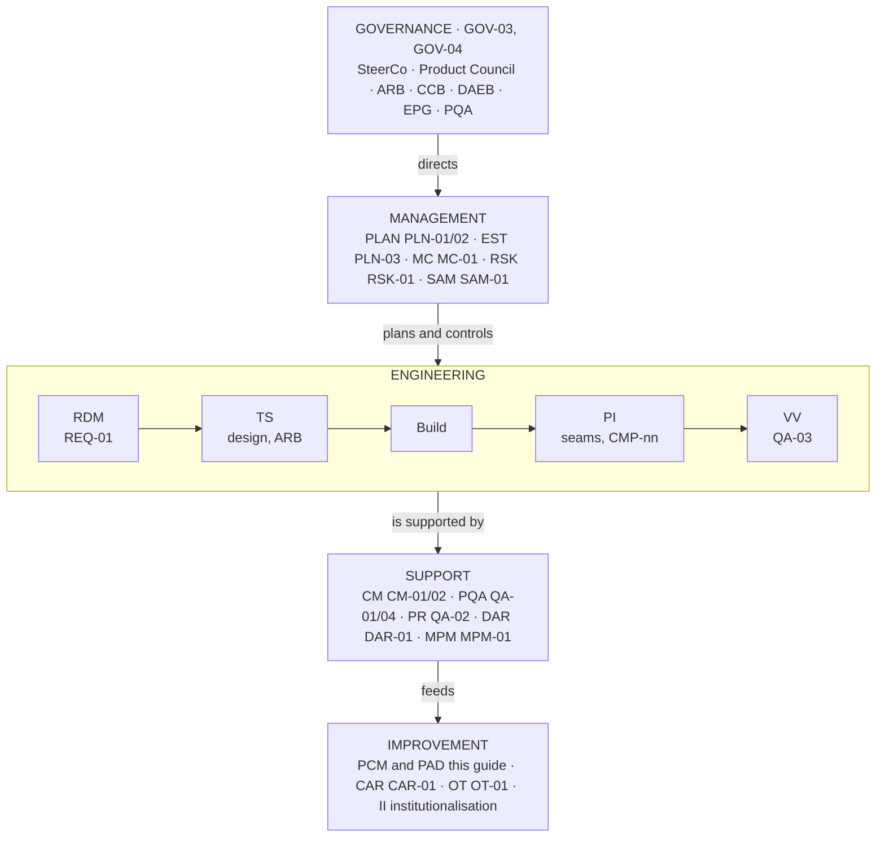
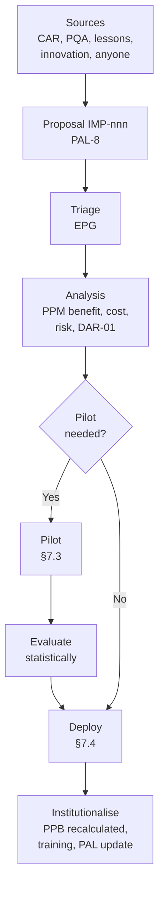

<picture>
  <source media="(prefers-color-scheme: dark)" srcset="../../assets/MultipliersKraftLogoDark.png">
  
</picture>

# PCM-01 — Process Definition, Tailoring and Organisational Improvement Guide

| Attribute | Value |
| :--- | :--- |
| Document ID | PCM-01 |
| Title | Process Definition, Tailoring and Organisational Improvement Guide |
| Product | Nucleus Suite (Nucleus HRMS Suite) |
| Version | 1.0.0 |
| Status | Issued for approval |
| Owner (role) | EPG Lead |
| Author | Dhanraj Dadhich |
| Reviewed by | PQA Lead, Programme Manager, Chief Architect, Measurement Analyst — *pending* |
| Approved by | Steering Committee — *pending* |
| Date | 2026-11-05 |
| Classification | Internal |
| CMMI practice areas | PCM (incl. high maturity), PAD, MPM, CAR, OT, II |
| Related documents | DOC-01, DOC-02, QA-01, QA-02, QA-04, MPM-01, MC-01, CAR-01, OT-01, DAR-01, CM-01, the lessons-learned record (PCM-01), the causal analysis record (CAR-01) |
| Quality & process-performance objectives | QPPO-01 – QPPO-07 (process improvement targets) |
| Process performance baseline used | PPB-01 – PPB-07 |
| Peer review record | *pending* (PR-xxxx, QA-02) |
| Tailoring record | none |
| Traceability anchor | BG-09 |

---

## 1. Purpose

Defines the **organisational standard process set** for delivering Nucleus Suite, the **process asset library (PAL)**, the rules for **tailoring** the standard process to a domain, phase or work product, the **Engineering Process Group (EPG)** charter, and how processes are **continuously and quantitatively improved** to reach and sustain CMMI Maturity Level 5 (BG-09).

## 2. Organisational Standard Process Set

### 2.1 Process Architecture

### 2.2 Standard Processes

| Process | Defined in | CMMI | Key outputs |
| :--- | :--- | :--- | :--- |
| Governance and decision rights | GOV-03, GOV-04 | GOV | Charter, governance minutes |
| Project planning | PLN-01, PLN-02 | PLAN | Plans, WBS, phase plan |
| Estimation | PLN-03 | EST | Basis of estimate |
| Monitoring and control | MC-01 | MC | Status, corrective actions, signal dispositions |
| Risk and opportunity management | RSK-01 | RSK | Risk register |
| Requirements development and management | REQ-01, REQ-03 | RDM | Domain packs, RTM |
| Technical solution | ARB procedures (GOV-04) and design artefacts: system requirements (SRS-01, NFR-01, SEC-01), data model and interfaces (DA-01, ICD-01), screen specifications (FRS-<DOM>-04), AI feature specification and model card (GOV-11) | TS | Designs, contracts |
| Product integration (seams and shared components) | Seam contracts, component catalogue; §5.4 | PI | Integrated increments |
| Verification and validation | QA-03 | VV | Test results, reconciliation reports |
| Peer reviews | QA-02 | PR | PR-NNNN records |
| Configuration and change management | CM-01, CM-02 | CM | Baselines, CRs |
| Process quality assurance | QA-01, QA-04 | PQA | Audit reports, NCs |
| Decision analysis | DAR-01 | DAR | DEC-NNNN, OD dispositions |
| Measurement and statistical management | MPM-01 | MPM | MET, QPPO, PPB, PPM |
| Causal analysis and resolution | CAR-01 | CAR | CAR-NNNN |
| Supplier agreement management | SAM-01 | SAM | Supplier agreements, reviews |
| Organisational training | OT-01 | OT | Training records |
| Process management and improvement | This guide | PCM, PAD | Improvement proposals, pilots, deployments |

### 2.3 Lifecycle Model

- **Programme lifecycle:** current R0 UI-validation prototype (local JSON) → P0 Foundations (wk 1–8) → P1 Core HRMS (wk 9–24) → P2 Pilot & Intelligence (wk 25–40) → P3 Depth (wk 41–64) → P4 Scale (wk 65–96) → P5 Frontier.
- **Within each phase:** iterative two-week sprints; domain packs and seam contracts baselined at G1/G2 for the phase scope; increments verified continuously; gates G3/G4 per phase release.
- **All requirements are treated as new** regardless of statuses carried in client trackers (Implemented / WIP / Done); evidence is produced afresh under this process.

## 3. Process Element Standards

Every process description contains: purpose, entry criteria, inputs, roles, activities, outputs, exit criteria, measures (with MET/PPB IDs), verification (PQA), and related artefact formats. Process descriptions follow DOC-01 document control.

## 4. Process Asset Library (PAL)

| Section | Contents | Owner |
| :--- | :--- | :--- |
| PAL-1 Standard processes | Procedures and plans listed in §2.2 | EPG |
| PAL-2 Artefact formats | Mandatory document blocks and standard artefact formats (DOC-01 §4) | EPG |
| PAL-3 Checklists | QA-02 checklists, REQ-03, QA-04 | PQA |
| PAL-4 Tailoring guidelines and tailoring records | §5; per-domain/phase tailoring records | EPG |
| PAL-5 Measurement repository | Base measures, MET definitions, PPB versions, PPM versions | Measurement Analyst |
| PAL-6 Lessons learned | Lessons-learned records, searchable by domain/seam/topic | EPG |
| PAL-7 Causal analysis records | Causal analysis records CAR-NNNN (CAR-01) | EPG |
| PAL-8 Improvement proposals, pilot plans and evaluations | §6–§8 records | EPG |
| PAL-9 Reusable engineering assets | Shared component (CMP-nn) consumer guides, seam contract patterns, golden-dataset reconciliation harness, AI evaluation sets | Chief Architect |
| PAL-10 Training material | OT-01 courses | EPG |

PAL content is version-controlled (CM-01), indexed in DOC-02, and searchable. Each asset carries owner, version, status and usage guidance.

## 5. Tailoring

### 5.1 Tailoring Criteria

| Factor | Effect |
| :--- | :--- |
| Domain criticality (statutory: PAY, CMP, TIM, LVE; security: PLT; AI: INT) | Higher criticality ⇒ no reduction in review/verification rigour |
| Work-product risk (seam contract, shared component, statutory rule, AI artefact) | Mandatory inspection; may not be tailored down |
| Size and novelty | Small, low-novelty changes may use lighter review |
| Phase | R0 prototype may use lightweight evidence for UI validation; P0 onwards full process applies |
| Supplier-delivered work | SAM-01 acceptance criteria added |

### 5.2 May Be Tailored (with EPG approval and tailoring record)

- Review type for low-risk work products (one level down; QA-02 §11).
- Report formats and cadence of non-gate meetings.
- Document granularity (e.g. combining small FRS and use cases in one file) provided all required content and IDs are present.
- Sprint length (1–3 weeks).
- Tools, provided the required base measures are still captured (MPM-01 §6).

### 5.3 May Not Be Tailored

- Document control header, ID scheme, revision history (DOC-01).
- Gates G0–G5 and their exit evidence.
- Change control through CCB for baselined items (CM-02).
- Inspection of statutory rules, security-relevant code, seam contracts, shared components and AI artefacts.
- Golden-dataset reconciliation for domains that have expected results (QA-03 §5.2).
- Synthetic-data-only rule outside production.
- Mandatory base measures for statistically managed sub-processes (QA-02 §9.1).
- Human-in-the-loop for employment-affecting AI outputs (GOV-11).
- **The anti-repeat-work rule (§5.4).**

### 5.4 Anti-Repeat-Work Rule (Shared Components)

Nucleus Suite defines **11 shared components (CMP-01..CMP-11)** that are built once and consumed by many domains — for example **CMP-01 Workflow & Approval Engine, consumed by 13 domains**. The rule:

1. A domain **MUST** consume the relevant shared component through its published interface and configuration, not re-specify or re-implement it.
2. **Re-implementing a shared component (or a material part of one) inside a domain is a design defect** (severity Major), detected in peer review via checklist item **QA-02 R-5** and in ARB design reviews.
3. If a shared component lacks a needed capability, the domain raises a change request against the **component** (CM-02), not a local workaround.
4. Exceptions require ARB approval recorded as a DEC-NNNN in DAR-02 with an expiry and a plan to converge.
5. The component consumer map (CMP-nn → consuming domains) is maintained by the Chief Architect in PAL-9; reuse violations are tracked (QA-01 QO-10) and analysed through CAR-01 (root-cause category RC-REUSE).

### 5.5 Tailoring Record and Approval

Each domain/phase records its tailoring in a short tailoring record (process element, standard requirement, tailored approach, rationale, risk, approver, date). Records are approved by the EPG Lead, stored in PAL-4 and audited by PQA (QA-04).

## 6. EPG Charter

| Item | Content |
| :--- | :--- |
| Mission | Define, maintain, deploy and improve the organisational process so that it measurably supports business goals |
| Membership | EPG Lead (chair), Measurement Analyst, PQA Lead (advisory, retains independence), Chief Architect delegate, QA/Test Lead, BA Lead, a rotating delivery-team representative |
| Authority | Approves process assets, tailoring records, PPB/PPM versions, CAR selections, and pilots; recommends deployments to SteerCo |
| Cadence | Fortnightly; monthly quantitative management review jointly with MC-01 forum |
| Reports to | Steering Committee (monthly) |
| Inputs | PQA findings, CAR outcomes, lessons learned, improvement proposals, measurement analysis, innovation scans |
| Outputs | Updated PAL, improvement roadmap, deployment plans, organisational performance report |

## 7. Organisational Performance Management and Improvement (ML5)

### 7.1 Organisational Performance Management

At least quarterly, the EPG and SteerCo:

1. Review **business performance** against BG-01..BG-10 and their objectives (BO-xx) and the QPPOs (MPM-01 §4).
2. Use PPBs and PPMs to determine whether current process capability can achieve the objectives; identify **gaps** (stable but not capable, or objectives raised).
3. Prioritise improvement areas by expected contribution to business objectives.
4. Maintain the **improvement roadmap** and reallocate improvement capacity accordingly.

### 7.2 Improvement Proposal Pipeline

| Stage | Criteria / activity |
| :--- | :--- |
| Submit | Anyone may submit an improvement proposal (IMP-nnn): problem/opportunity, proposed change, affected process assets, expected effect on which measure |
| Triage | EPG checks completeness and alignment with business objectives; duplicates merged |
| Analyse | Expected benefit estimated (where possible using a PPM, e.g. PPM-01 for review changes); cost, risk, and impact on other processes; significant choices via DAR-01 |
| Decide | EPG approves for pilot, direct deployment (low risk), deferral or rejection; decision recorded |
| Track | Pipeline metrics: proposals by stage, age, approval rate, realised benefit |

### 7.3 Piloting with Statistical Evaluation

Each pilot plan states:

- Hypothesis (e.g. "Adding seam-specific checklist items R-1..R-4 to seam contract inspections reduces RC-SEAM escaped defects").
- Pilot scope (teams, domains, duration) and comparison group or baseline period.
- Measures and the PPB affected.
- **Success criteria** with statistical method (shift detection plus appropriate test — MPM-01 §9.4), significance level, minimum sample size, and minimum practical effect.
- Risks of the pilot and rollback plan.

At pilot end, the Measurement Analyst evaluates results; EPG decides **deploy / adjust and re-pilot / abandon**. Results (including failures) are stored in PAL-8.

### 7.4 Deployment

1. Deployment plan: affected assets, teams, training (OT-01), timing (avoiding gate crunches), support.
2. Assets updated and versioned (CM-01); DOC-02 updated.
3. Training delivered and recorded.
4. Post-deployment monitoring: affected PPB watched for the expected shift; limits recomputed once the shift is confirmed (MPM-01 §8.2 rule 4).
5. Deployment effectiveness reported to the SteerCo.

### 7.5 Innovation Scanning

The EPG maintains a quarterly **innovation scan** of practices and technologies that could improve process performance, including:

| Area | Examples to evaluate |
| :--- | :--- |
| AI-assisted engineering | AI-assisted requirement quality checks (ambiguity, missing acceptance criteria, ID-scheme validation); AI-assisted code review as an *additional* reviewer (never replacing the human peer review in QA-02); test-case generation from FRs and golden-dataset rows; automated traceability suggestions for REQ-02 |
| Automation of evidence | Auto-generated RTM, review metrics and control charts from tool data |
| Testing | Property-based testing of statutory calculators; mutation testing; contract testing for seams |
| Delivery flow | WIP limits, story slicing practices, trunk-based development |
| Measurement | Better estimators for small samples; Bayesian updating for provisional PPBs |

Each candidate is assessed for expected benefit against QPPOs, cost and risk (including confidentiality: no tenant or personal data may be sent to external AI tools), and promising ones enter the proposal pipeline as IMP-nnn with a pilot.

## 8. Lessons Learned and CAR Linkage

- Lessons learned are captured at each phase retrospective and gate G5 using the lessons-learned record (PCM-01), stored in PAL-6.
- Lessons describing recurring problems are referred to CAR-01; CAR outcomes that change process assets become improvement proposals (§7.2).
- Before each phase start, domain leads must review relevant PAL-6 lessons and PAL-7 CAR records (checked at G1 by PQA).

## 9. Appraisal Readiness Roadmap

| Milestone | Target window (indicative) | Scope | Evidence focus |
| :--- | :--- | :--- | :--- |
| **ML2 readiness (internal check)** | End of P0 | PLAN, EST, MC, RDM, CM, PQA, RSK, SAM, GOV, II | Plans, baselines, CR records, PQA audits, risk records performed across P0 work |
| **ML3 readiness** | End of P1 | + PR, VV, TS, PI, DAR, PCM, PAD, OT, MPM (levels 2–3) | Standard process, tailoring records, PAL, peer review records, V&V results, decision records, training records |
| **ML3 appraisal (benchmark)** | Early P2 | ML3 practice areas | Objective evidence across at least two phase increments |
| **ML4 readiness** | During P2 (data collection from P0) | MPM levels 4, PPBs established, quantitative management in MC | QPPOs, ≥ 20-point stable PPBs for selected sub-processes, signal dispositions, PPM-02 in use |
| **ML5 readiness** | During P3 | + CAR, PCM high-maturity practices, MPM level 5 | CAR records with statistical evaluation, improvement pipeline with piloted and deployed improvements, organisational performance reviews, PPM-01/03 validated |
| **ML5 appraisal (benchmark)** | P3–P4, when evidence windows are sufficient | All practice areas in scope at ML5 | Sustained institutionalisation across multiple phases |

Windows are indicative and depend on data sufficiency (RSK-R-033); readiness is checked by PQA using QA-04 before any external appraisal is booked.

## Approval & Sign-off

| Role | Name | Date | Decision | Conditions / comments |
| :--- | :--- | :--- | :--- | :--- |
| Author | Dhanraj Dadhich | 2026-11-05 | Submitted | |
| Peer review moderator | *pending* | | | PR-xxxx |
| PQA (process compliance) | *pending* | | | NC-xxxx if any |
| Steering Committee | *pending* | | | |

## Measurement Data Captured

| Measure | Value | Unit | Notes |
| :--- | :--- | :--- | :--- |
| Size | 10 | sections | |
| Authoring effort | *to be recorded* | person-hours | |
| Review effort (preparation + meeting) | *pending review* | person-hours | From PR-xxxx |
| Rework effort | *pending review* | person-hours | |
| Review rate | *pending review* | pages / hour | Compare with PPB-02 control limits |
| Requirement volatility | 0 | CRs since baseline | Not yet baselined (CM-03) |

| Detection phase | Major | Minor | Editorial |
| :--- | :--- | :--- | :--- |
| Author self-check | 0 | 0 | 0 |
| Peer review | *pending* | | |

## 10. Revision History

| Version | Date | Author | Change summary | CR ref | Approved by |
| :--- | :--- | :--- | :--- | :--- | :--- |
| 1.0.0 | 2026-11-05 | Dhanraj Dadhich | Consolidated release | CR-0001 | *pending* |
