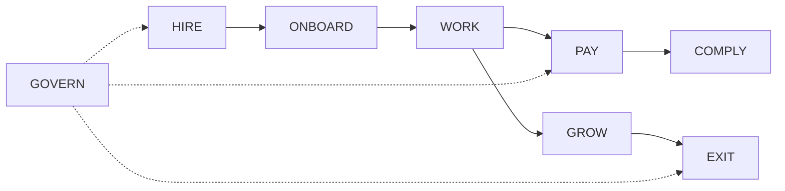
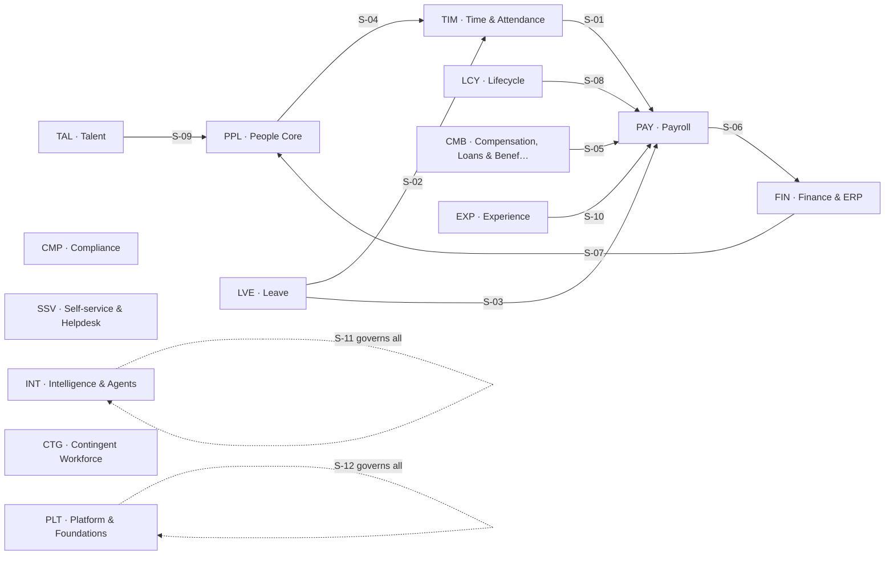

<picture>
  <source media="(prefers-color-scheme: dark)" srcset="../assets/MultipliersKraftLogoDark.png">
  
</picture>

# BA-01 — Process Architecture and Value Chain

| Attribute | Value |
| :--- | :--- |
| Document ID | BA-01 |
| Title | Process Architecture and Value Chain |
| Product | Nucleus Suite (Nucleus HRMS Suite) |
| Version | 1.0.0 |
| Status | Issued for approval |
| Owner (role) | Enterprise Architect |
| Author | Dhanraj Dadhich |
| Reviewed by | *pending* |
| Approved by | Architecture Review Board — *pending* |
| Date | 2026-11-05 |
| Classification | Internal |
| CMMI practice areas | RDM, TS |
| Related documents | BRS-01, GOV-05, BA-02, FRS-00 |
| Quality & process-performance objectives | QPPO-05 (effective requirements reviews), QPPO-01 (escaped defects) — MPM-01 |
| Process performance baseline used | PPB-01 (review defect density), PPB-02 (review rate) — MPM-01 |
| Peer review record | *pending* (PR-xxxx, QA-02) |
| Tailoring record | none |
| Traceability anchor | BG-01 – BG-10 |
| Source of record | Nucleus — Process Flows & Process Maps v1.0 — sheet(s) 02_Process_Architecture |

> **Source of record.** Requirements in this document are taken from the source workbook(s) named above and keep their workbook IDs, which are never renumbered. Changes are made through a change request (CM-02) against the source workbook. Sections marked **Authored** are original additions that are not present in the source workbooks.

> PROCESS ARCHITECTURE — LEVEL 0 AND LEVEL 1
> The value chain, the fourteen process domains and the seams between them. Domain prefixes here are used by every other sheet.

## 1. Level 0 — the value chain

| ID / prefix | Name | Scope | Blueprint reference | Phase / tier |
| :--- | :--- | :--- | :--- | :--- |
| L0-1 | HIRE | Sanctioned strength to requisition to candidate to offer to accepted | TAL, PPL | R2 |
| L0-2 | ONBOARD | Offer accepted to person, assignment, statutory registration, forms, assets, induction | LCY, PPL, CMP | R1 |
| L0-3 | WORK | Roster, punch, attendance day, leave, gate pass, overtime — the daily engine | TIM, LVE | R1 |
| L0-4 | PAY | Inputs locked, audited, computed, approved, disbursed, posted, reconciled | PAY, FIN | R1 |
| L0-5 | COMPLY | Rule packs, obligations, returns, registers, statutory forms, AI and data governance | CMP | R1 |
| L0-6 | GROW | Goals, reviews, skills, learning, capability index, recognition | TAL, EXP | R2/R3 |
| L0-7 | EXIT | Resignation, notice, clearance, F&F on the last working day, alumni record | LCY, PAY | R1 |
| L0-8 | GOVERN | Tenancy, identity, scope, workflow, audit, action ledger, analytics | PLT, INT | R1 |

## 2. Level 1 — domains

| ID / prefix | Name | Scope | Blueprint reference | Phase / tier |
| :--- | :--- | :--- | :--- | :--- |
| PLT | Platform & Foundations | Tenancy, identity, scope resolution, config, workflow engine, events, audit, bi-temporal write | Platform (blueprint §7, §8) | P0 |
| PPL | People Core | Person, position, assignment, employment, org unit, worker class, documents, position control | Module 1 | P0/P1 |
| TIM | Time & Attendance | Ingestion, day derivation, shift inference, disposition, gate pass, overtime, regularisation, recompute | Module 2 | P1 |
| LVE | Leave | Accrual, proration, ledger, application, validation, approval, early return, comp-off, year end | Module 2 | P1 |
| PAY | Payroll | Run types, snapshot, pre-audit, gross-to-net DAG, statutory, recovery, disbursement, payslip, rollback | Module 3 | P1 |
| CMP | Compliance | Rule packs, obligation calendar, statutory forms and registers, Labour Codes simulation, AI and DPDP governance | Module 6 | P1/P2 |
| LCY | Lifecycle | Pre-boarding, joining, confirmation, promotion, transfer, resignation, clearance, F&F, assets | Module 5 | P1 |
| SSV | Self-service & Helpdesk | Employee and manager surfaces, business messaging channel, tickets, grounded policy assistant | Modules 4, 7 | P1/P2 |
| CMB | Compensation, Loans & Benefits | Structures, revision cycle, loan eligibility, guarantors, sanction, recovery, EWA | Module 12 | P1 (loans) / P3 |
| TAL | Talent | Requisition and position control, candidate pipeline, referrals, goals and reviews, skills and learning | Modules 8, 9, 10 | P2/P3 |
| CTG | Contingent Workforce | Contractor engagement, sub-populations by worker class, gate attendance, invoice reconciliation | Module 13 | P2/P3 |
| EXP | Experience | Recognition, referral awards, announcements, letters and the issue register | Module 15 | P2 |
| FIN | Finance & ERP | Employee master inbound, GL mapping, salary journal, posting, reconciliation, bank file | Blueprint §9 | P1/P2 |
| INT | Intelligence & Agents | Policy gate, tool surface, action ledger, analytics projections, predictive models | Blueprint §6 | P2/P3 |

## 3. Seams between domains

| ID / prefix | Name | Scope | Blueprint reference | Phase / tier |
| :--- | :--- | :--- | :--- | :--- |
| S-01 | TIM → PAY | attendance_day totals and disposition are payroll inputs. A late recompute after INPUTS_LOCKED must raise an exception, never silently change a locked run. | TIM-09, PAY-02 | P1 |
| S-02 | LVE → TIM | An approved leave day and a biometric punch on the same date is a conflict, resolved by RL-063 before disposition. | LVE-04, TIM-05 | P1 |
| S-03 | LVE → PAY | Loss of pay, encashment and re-credit all move money. The ledger is the only source. | LVE-08, PAY-04 | P1 |
| S-04 | PPL → TIM | worker_class and its assignment-level overrides supply rest days, wage type and OT eligibility as at the attendance date, read bi-temporally. | PPL-03, TIM-04 | P1 |
| S-05 | CMB → PAY | Loan eligibility and outstanding balance are owned by CMB; payroll only recovers and reports back. | CMB-01, PAY-08 | P1 |
| S-06 | PAY → FIN | One balanced, dimensioned journal per run per entity. Run type is a journal dimension. | PAY-09, FIN-03 | P1 |
| S-07 | FIN → PPL | ERP-owned master fields are read-only in Nucleus. The ownership map is the referee. | FIN-01, PPL-02 | P1 |
| S-08 | LCY → PAY | Clearance blocking items gate the F&F run using the same lock semantics as the payroll input lock. | LCY-06, PAY-12 | P1 |
| S-09 | TAL → PPL | A requisition consumes sanctioned strength unless it names a vacated position code. | TAL-01, PPL-04 | P3 |
| S-10 | EXP → PAY | Recognition and referral awards raise a payroll input in a named run, never a side payment. | EXP-01, PAY-01 | P2 |
| S-11 | INT → all | Every agent action passes the same permission model, approval workflow and audit trail as a human action, plus an agent identity dimension. | INT-01, PLT-06 | P2 |
| S-12 | PLT → all | Location scope sits alongside entity and reporting line. Plant users see time, not rate. | PLT-02 | P0 |

## Approval & Sign-off

| Role | Name | Date | Decision | Conditions / comments |
| :--- | :--- | :--- | :--- | :--- |
| Author | Dhanraj Dadhich | 2026-11-05 | Submitted | |
| Peer review moderator | *pending* | | | PR-xxxx |
| PQA (process compliance) | *pending* | | | |
| Approval authority (DOC-01 §7) | *pending* | | | |

## Measurement Data Captured

| Measure | Value | Unit | Notes |
| :--- | :--- | :--- | :--- |
| Size | 34 | specified items (table rows) | Counted automatically at generation |
| Authoring effort | *to be recorded* | person-hours | |
| Review effort (preparation + meeting) | *pending review* | person-hours | From PR-xxxx |
| Rework effort | *pending review* | person-hours | |
| Review rate | *pending review* | items / hour | Compare with PPB control limits |
| Requirement volatility (changes since baseline) | 0 | CRs touching this artefact | Not yet baselined (CM-03) |

**Defects found, by detection phase and severity**

| Detection phase | Major | Minor | Editorial | Injected in phase (major) |
| :--- | :--- | :--- | :--- | :--- |
| Author self-check | 0 | 0 | 0 | — |
| Peer review | *pending* | | | |
| Design / build | | | | |
| System / integration test | | | | |
| UAT | | | | |
| Production (escaped) | | | | each escaped major opens a CAR record (CAR-01) |

Within control limits of the review-rate PPB? *To be assessed at peer review.*

## Revision History

| Version | Date | Author | Change summary | CR ref | Approved by |
| :--- | :--- | :--- | :--- | :--- | :--- |
| 1.0.0 | 2026-11-05 | Dhanraj Dadhich | Consolidated release | CR-0001 | *pending* |
