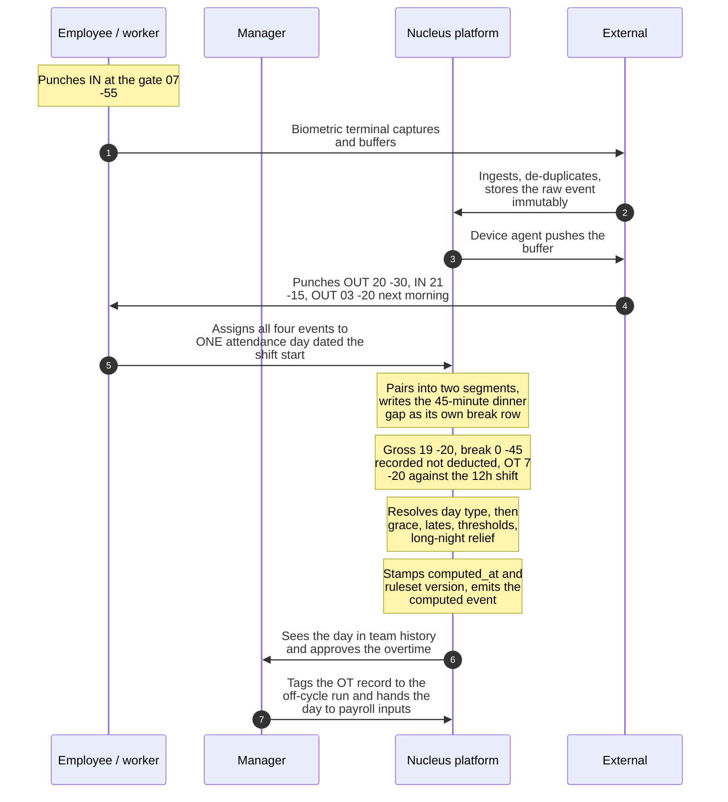
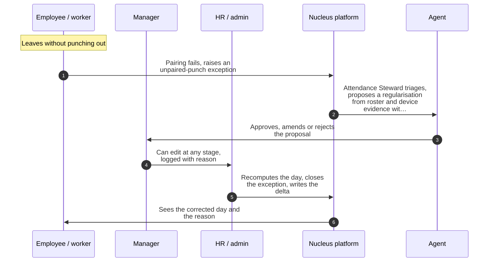
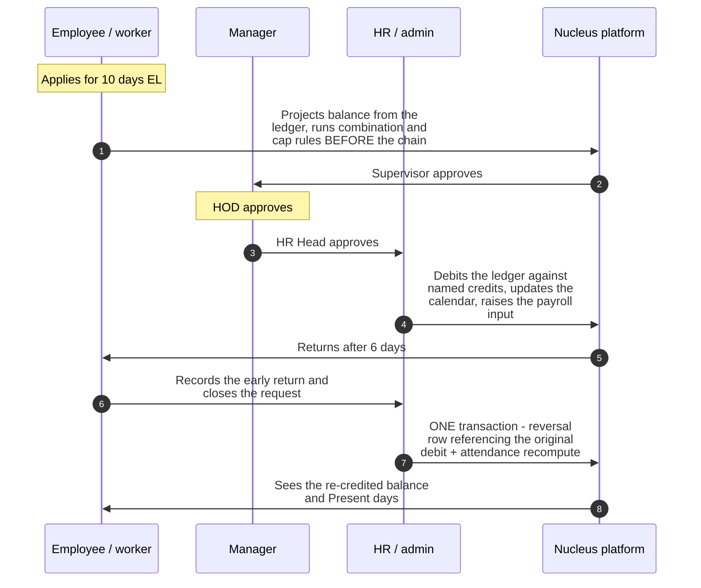
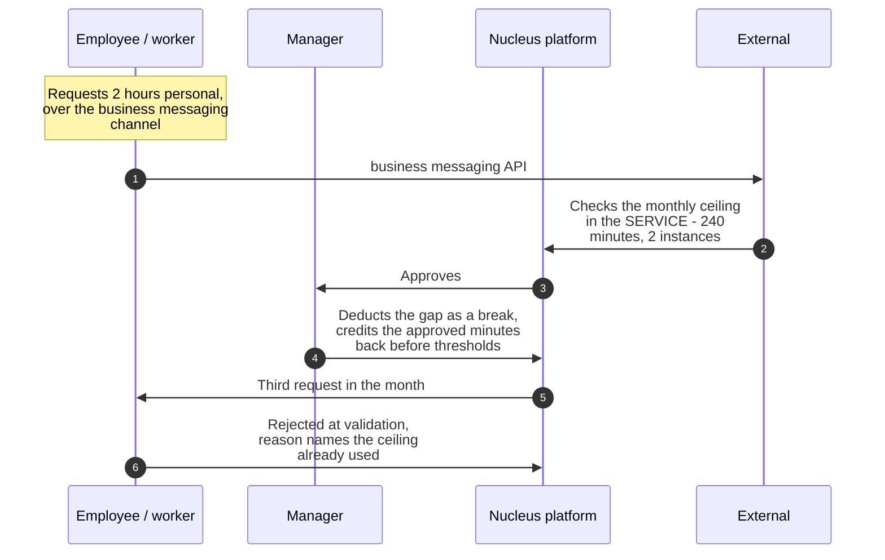
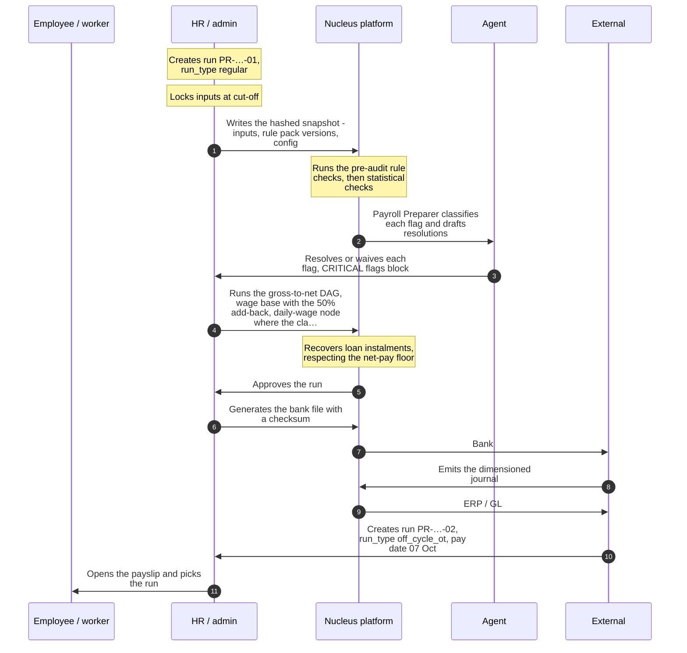
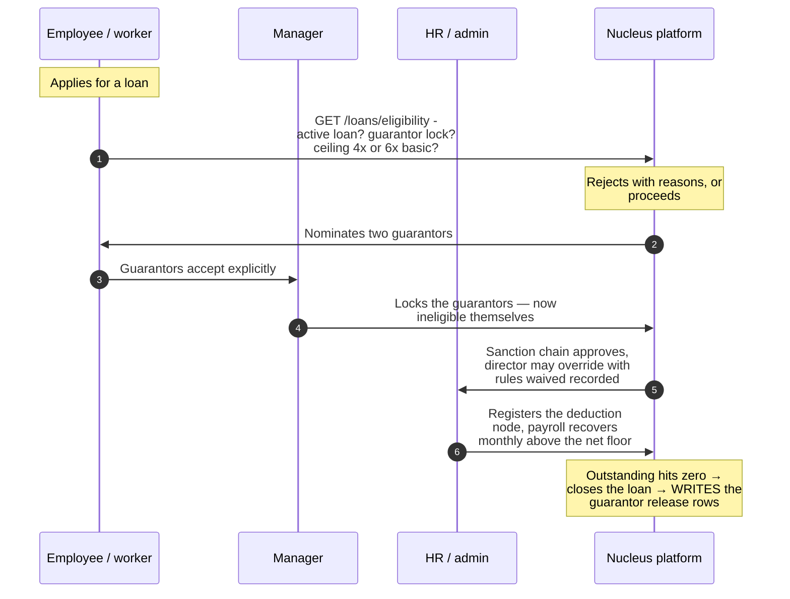
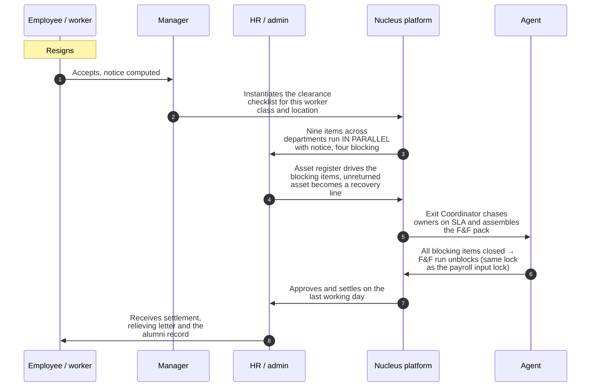
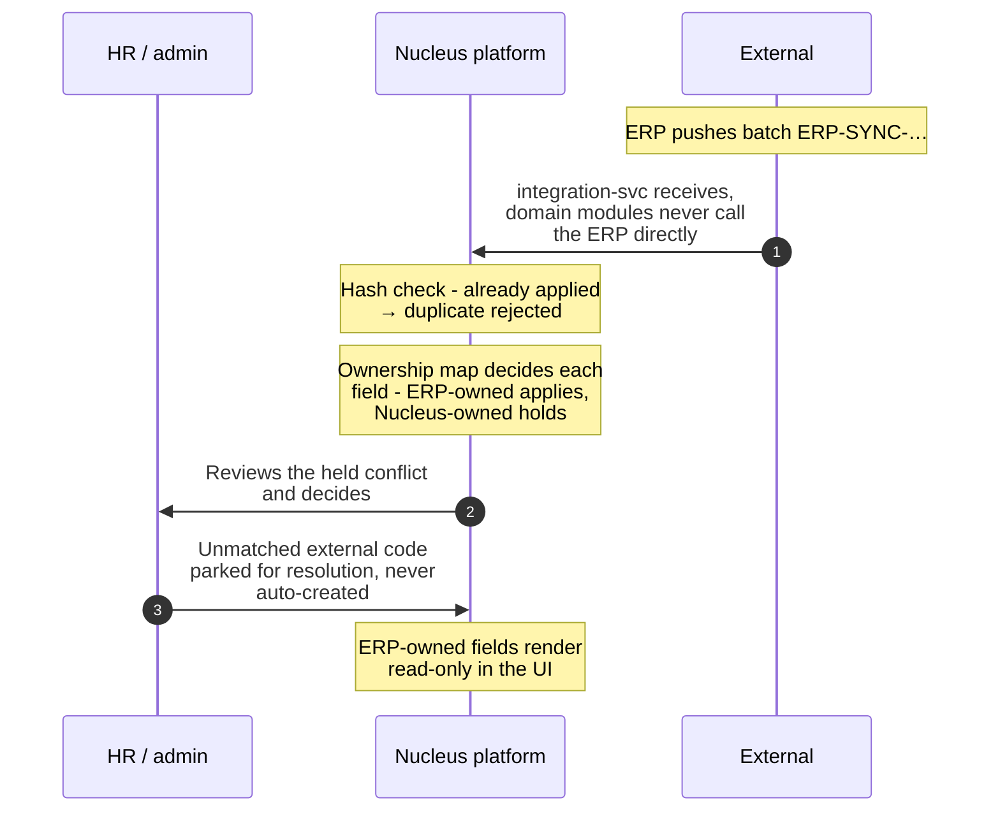
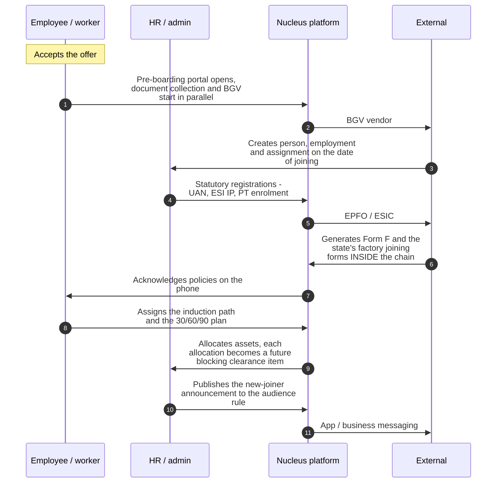

<picture>
  <source media="(prefers-color-scheme: dark)" srcset="../assets/MultipliersKraftLogoDark.png">
  
</picture>

# BA-03 — Swimlane Process Maps

| Attribute | Value |
| :--- | :--- |
| Document ID | BA-03 |
| Title | Swimlane Process Maps |
| Product | Nucleus Suite (Nucleus HRMS Suite) |
| Version | 1.0.0 |
| Status | Issued for approval |
| Owner (role) | Business Analyst Lead |
| Author | Dhanraj Dadhich |
| Reviewed by | *pending* |
| Approved by | Product Council — *pending* |
| Date | 2026-11-05 |
| Classification | Internal |
| CMMI practice areas | RDM, TS |
| Related documents | BA-02, FRS-<DOM>-01 |
| Quality & process-performance objectives | QPPO-05 (effective requirements reviews), QPPO-01 (escaped defects) — MPM-01 |
| Process performance baseline used | PPB-01 (review defect density), PPB-02 (review rate) — MPM-01 |
| Peer review record | *pending* (PR-xxxx, QA-02) |
| Tailoring record | none |
| Traceability anchor | BG-01 – BG-10 |
| Source of record | Nucleus — Process Flows & Process Maps v1.0 — sheet(s) 05_Swimlane_Maps |

> **Source of record.** Requirements in this document are taken from the source workbook(s) named above and keep their workbook IDs, which are never renumbered. Changes are made through a change request (CM-02) against the source workbook. Sections marked **Authored** are original additions that are not present in the source workbooks.

> SWIMLANE MAPS
> Nine flows that cross the most boundaries, drawn lane by lane. Read left to right for who acts, top to bottom for sequence.

## SM-1 — ATTENDANCE DAY — punch to disposition to payroll input (demo points 1, 12, 13)

| Flow | Step | Employee / worker | Manager | HR / admin | System (Nucleus) | Agent | External | Note |
| :--- | :--- | :--- | :--- | :--- | :--- | :--- | :--- | :--- |
| Attendance day | 1 | Punches IN at the gate 07:55 |  |  |  |  | Biometric terminal captures and buffers |  |
| Attendance day | 2 |  |  |  | Ingests, de-duplicates, stores the raw event immutably |  | Device agent pushes the buffer | Clock drift corrected; raw value retained |
| Attendance day | 3 | Punches OUT 20:30, IN 21:15, OUT 03:20 next morning |  |  |  |  |  |  |
| Attendance day | 4 |  |  |  | Assigns all four events to ONE attendance day dated the shift start |  |  | The single most common error in this domain |
| Attendance day | 5 |  |  |  | Pairs into two segments; writes the 45-minute dinner gap as its own break row |  |  | Break report exists because breaks are rows |
| Attendance day | 6 |  |  |  | Gross 19:20; break 0:45 recorded not deducted; OT 7:20 against the 12h shift |  |  | Gate-to-gate for this client — configuration |
| Attendance day | 7 |  |  |  | Resolves day type, then grace, lates, thresholds, long-night relief |  |  | Day type FIRST, always |
| Attendance day | 8 |  |  |  | Stamps computed_at and ruleset version, emits the computed event |  |  |  |
| Attendance day | 9 |  | Sees the day in team history and approves the overtime |  |  |  |  |  |
| Attendance day | 10 |  |  |  | Tags the OT record to the off-cycle run and hands the day to payroll inputs |  |  |  |

## SM-2 — EXCEPTION AND REGULARISATION (demo point 1, agent pattern)

| Flow | Step | Employee / worker | Manager | HR / admin | System (Nucleus) | Agent | External | Note |
| :--- | :--- | :--- | :--- | :--- | :--- | :--- | :--- | :--- |
| Regularisation | 1 | Leaves without punching out |  |  |  |  |  |  |
| Regularisation | 2 |  |  |  | Pairing fails; raises an unpaired-punch exception |  |  | Never silently discarded |
| Regularisation | 3 |  |  |  |  | Attendance Steward triages, proposes a regularisation from roster and device evidence with a dry-run diff |  |  |
| Regularisation | 4 |  | Approves, amends or rejects the proposal |  |  |  |  | Auto-resolve only under the tenant threshold |
| Regularisation | 5 |  |  | Can edit at any stage, logged with reason |  |  |  |  |
| Regularisation | 6 |  |  |  | Recomputes the day, closes the exception, writes the delta |  |  |  |
| Regularisation | 7 | Sees the corrected day and the reason |  |  |  |  |  |  |

## SM-3 — LEAVE — apply, validate, approve, early return (demo points 5, 7)

| Flow | Step | Employee / worker | Manager | HR / admin | System (Nucleus) | Agent | External | Note |
| :--- | :--- | :--- | :--- | :--- | :--- | :--- | :--- | :--- |
| Leave | 1 | Applies for 10 days EL |  |  |  |  |  |  |
| Leave | 2 |  |  |  | Projects balance from the ledger; runs combination and cap rules BEFORE the chain |  |  | CL+EL blocked here, with the rule named |
| Leave | 3 |  | Supervisor approves |  |  |  |  |  |
| Leave | 4 |  | HOD approves |  |  |  |  | Sequential, each with an SLA |
| Leave | 5 |  |  | HR Head approves |  |  |  |  |
| Leave | 6 |  |  |  | Debits the ledger against named credits; updates the calendar; raises the payroll input |  |  |  |
| Leave | 7 | Returns after 6 days |  |  |  |  |  |  |
| Leave | 8 |  |  | Records the early return and closes the request |  |  |  | HR edit right, logged with actor and reason |
| Leave | 9 |  |  |  | ONE transaction: reversal row referencing the original debit + attendance recompute |  |  | Split them and the payslip disagrees with the ledger |
| Leave | 10 | Sees the re-credited balance and Present days |  |  |  |  |  |  |

## SM-4 — GATE PASS (demo point 11)

| Flow | Step | Employee / worker | Manager | HR / admin | System (Nucleus) | Agent | External | Note |
| :--- | :--- | :--- | :--- | :--- | :--- | :--- | :--- | :--- |
| Gate pass | 1 | Requests 2 hours personal, over the business messaging channel |  |  |  |  | business messaging API |  |
| Gate pass | 2 |  |  |  | Checks the monthly ceiling in the SERVICE: 240 minutes, 2 instances |  |  | Same rule whichever channel it arrives on |
| Gate pass | 3 |  | Approves |  |  |  |  |  |
| Gate pass | 4 |  |  |  | Deducts the gap as a break, credits the approved minutes back before thresholds |  |  | Net hours unchanged by an approved pass |
| Gate pass | 5 | Third request in the month |  |  |  |  |  |  |
| Gate pass | 6 |  |  |  | Rejected at validation, reason names the ceiling already used |  |  |  |

## SM-5 — PAYROLL CYCLE INCLUDING THE OFF-CYCLE OT RUN (demo points 10, 15)

| Flow | Step | Employee / worker | Manager | HR / admin | System (Nucleus) | Agent | External | Note |
| :--- | :--- | :--- | :--- | :--- | :--- | :--- | :--- | :--- |
| Payroll | 1 |  |  | Creates run PR-…-01, run_type regular |  |  |  |  |
| Payroll | 2 |  |  | Locks inputs at cut-off |  |  |  | Late punches now raise exceptions, not changes |
| Payroll | 3 |  |  |  | Writes the hashed snapshot: inputs, rule pack versions, config |  |  |  |
| Payroll | 4 |  |  |  | Runs the pre-audit rule checks, then statistical checks |  |  |  |
| Payroll | 5 |  |  |  |  | Payroll Preparer classifies each flag and drafts resolutions |  | Propose only. Always. |
| Payroll | 6 |  |  | Resolves or waives each flag; CRITICAL flags block |  |  |  |  |
| Payroll | 7 |  |  |  | Runs the gross-to-net DAG; wage base with the 50% add-back; daily-wage node where the class says so |  |  |  |
| Payroll | 8 |  |  |  | Recovers loan instalments, respecting the net-pay floor |  |  |  |
| Payroll | 9 |  |  | Approves the run |  |  |  | Blocked if any component lacks a GL mapping |
| Payroll | 10 |  |  |  | Generates the bank file with a checksum |  | Bank | Total verified out of band, dual control |
| Payroll | 11 |  |  |  | Emits the dimensioned journal |  | ERP / GL | Split at employee level before aggregation |
| Payroll | 12 |  |  | Creates run PR-…-02, run_type off_cycle_ot, pay date 07 Oct |  |  |  | Its own approval, bank file and journal |
| Payroll | 13 | Opens the payslip and picks the run |  |  |  |  |  | Run selector everywhere |

## SM-6 — LOAN — eligibility, guarantors, sanction, recovery, release (demo point 9)

| Flow | Step | Employee / worker | Manager | HR / admin | System (Nucleus) | Agent | External | Note |
| :--- | :--- | :--- | :--- | :--- | :--- | :--- | :--- | :--- |
| Loan | 1 | Applies for a loan |  |  |  |  |  |  |
| Loan | 2 |  |  |  | GET /loans/eligibility: active loan? guarantor lock? ceiling 4x or 6x basic? |  |  | One service method, four consumers |
| Loan | 3 |  |  |  | Rejects with reasons, or proceeds |  |  | E1041 rejected: he guarantees an active loan |
| Loan | 4 | Nominates two guarantors |  |  |  |  |  |  |
| Loan | 5 |  | Guarantors accept explicitly |  |  |  |  |  |
| Loan | 6 |  |  |  | Locks the guarantors — now ineligible themselves |  |  |  |
| Loan | 7 |  |  | Sanction chain approves; director may override with rules waived recorded |  |  |  |  |
| Loan | 8 |  |  |  | Registers the deduction node; payroll recovers monthly above the net floor |  |  |  |
| Loan | 9 |  |  |  | Outstanding hits zero → closes the loan → WRITES the guarantor release rows |  |  | Without the release row they are blocked forever |

## SM-7 — EXIT — clearance in parallel with notice, F&F on the last working day (demo point 16)

| Flow | Step | Employee / worker | Manager | HR / admin | System (Nucleus) | Agent | External | Note |
| :--- | :--- | :--- | :--- | :--- | :--- | :--- | :--- | :--- |
| Exit | 1 | Resigns |  |  |  |  |  |  |
| Exit | 2 |  | Accepts; notice computed |  |  |  |  |  |
| Exit | 3 |  |  |  | Instantiates the clearance checklist for this worker class and location |  |  | Plant and head office templates differ |
| Exit | 4 |  |  | Nine items across departments run IN PARALLEL with notice, four blocking |  |  |  |  |
| Exit | 5 |  |  |  | Asset register drives the blocking items; unreturned asset becomes a recovery line |  |  |  |
| Exit | 6 |  |  |  |  | Exit Coordinator chases owners on SLA and assembles the F&F pack |  | Prepare; a human releases |
| Exit | 7 |  |  |  | All blocking items closed → F&F run unblocks (same lock as the payroll input lock) |  |  |  |
| Exit | 8 |  |  | Approves and settles on the last working day |  |  |  |  |
| Exit | 9 | Receives settlement, relieving letter and the alumni record |  |  |  |  |  |  |

## SM-8 — ERP EMPLOYEE MASTER INBOUND (demo point 14)

| Flow | Step | Employee / worker | Manager | HR / admin | System (Nucleus) | Agent | External | Note |
| :--- | :--- | :--- | :--- | :--- | :--- | :--- | :--- | :--- |
| ERP sync | 1 |  |  |  |  |  | ERP pushes batch ERP-SYNC-… |  |
| ERP sync | 2 |  |  |  | integration-svc receives; domain modules never call the ERP directly |  |  |  |
| ERP sync | 3 |  |  |  | Hash check: already applied → duplicate rejected |  |  | Idempotent on the external employee code |
| ERP sync | 4 |  |  |  | Ownership map decides each field: ERP-owned applies, Nucleus-owned holds |  |  | Never implicit last-write-wins |
| ERP sync | 5 |  |  | Reviews the held conflict and decides |  |  |  |  |
| ERP sync | 6 |  |  |  | Unmatched external code parked for resolution, never auto-created |  |  |  |
| ERP sync | 7 |  |  |  | ERP-owned fields render read-only in the UI |  |  |  |

## SM-9 — JOINING CHAIN (demo points 23, 26)

| Flow | Step | Employee / worker | Manager | HR / admin | System (Nucleus) | Agent | External | Note |
| :--- | :--- | :--- | :--- | :--- | :--- | :--- | :--- | :--- |
| Joining | 1 | Accepts the offer |  |  |  |  |  |  |
| Joining | 2 |  |  |  | Pre-boarding portal opens; document collection and BGV start in parallel |  | BGV vendor |  |
| Joining | 3 |  |  | Creates person, employment and assignment on the date of joining |  |  |  |  |
| Joining | 4 |  |  |  | Statutory registrations: UAN, ESI IP, PT enrolment |  | EPFO / ESIC |  |
| Joining | 5 |  |  |  | Generates Form F and the state's factory joining forms INSIDE the chain |  |  | Not chased in an audit week |
| Joining | 6 | Acknowledges policies on the phone |  |  |  |  |  |  |
| Joining | 7 |  |  |  | Assigns the induction path and the 30/60/90 plan |  |  |  |
| Joining | 8 |  |  | Allocates assets; each allocation becomes a future blocking clearance item |  |  |  |  |
| Joining | 9 |  |  |  | Publishes the new-joiner announcement to the audience rule |  | App / business messaging |  |

## Approval & Sign-off

| Role | Name | Date | Decision | Conditions / comments |
| :--- | :--- | :--- | :--- | :--- |
| Author | Dhanraj Dadhich | 2026-11-05 | Submitted | |
| Peer review moderator | *pending* | | | PR-xxxx |
| PQA (process compliance) | *pending* | | | |
| Approval authority (DOC-01 §7) | *pending* | | | |

## Measurement Data Captured

| Measure | Value | Unit | Notes |
| :--- | :--- | :--- | :--- |
| Size | 80 | specified items (table rows) | Counted automatically at generation |
| Authoring effort | *to be recorded* | person-hours | |
| Review effort (preparation + meeting) | *pending review* | person-hours | From PR-xxxx |
| Rework effort | *pending review* | person-hours | |
| Review rate | *pending review* | items / hour | Compare with PPB control limits |
| Requirement volatility (changes since baseline) | 0 | CRs touching this artefact | Not yet baselined (CM-03) |

**Defects found, by detection phase and severity**

| Detection phase | Major | Minor | Editorial | Injected in phase (major) |
| :--- | :--- | :--- | :--- | :--- |
| Author self-check | 0 | 0 | 0 | — |
| Peer review | *pending* | | | |
| Design / build | | | | |
| System / integration test | | | | |
| UAT | | | | |
| Production (escaped) | | | | each escaped major opens a CAR record (CAR-01) |

Within control limits of the review-rate PPB? *To be assessed at peer review.*

## Revision History

| Version | Date | Author | Change summary | CR ref | Approved by |
| :--- | :--- | :--- | :--- | :--- | :--- |
| 1.0.0 | 2026-11-05 | Dhanraj Dadhich | Consolidated release | CR-0001 | *pending* |
