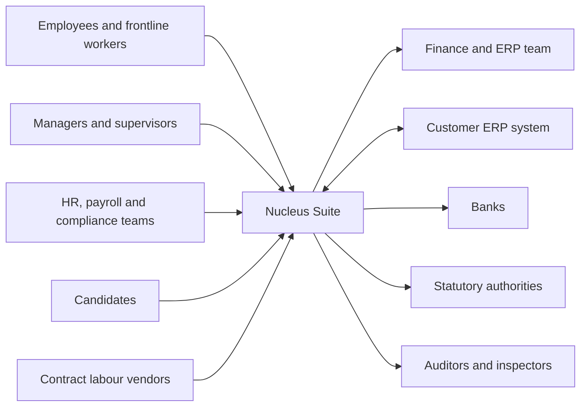
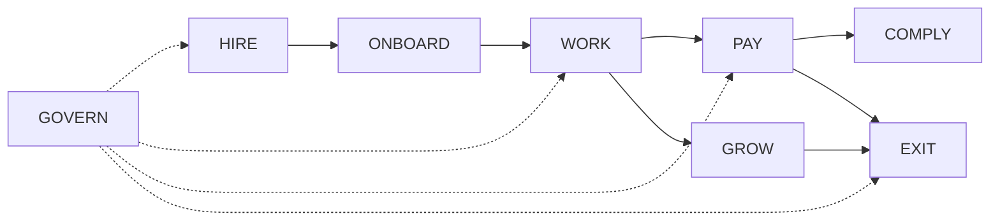
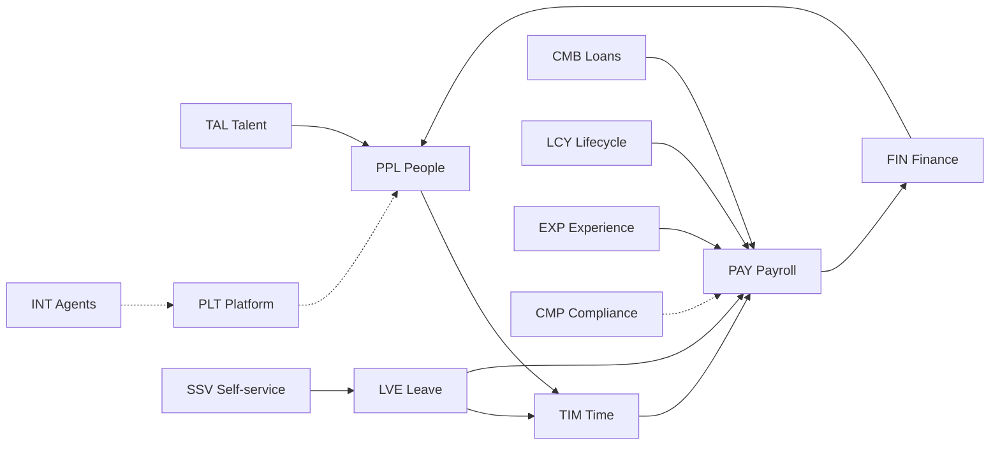

<picture>
  <source media="(prefers-color-scheme: dark)" srcset="../assets/MultipliersKraftLogoDark.png">
  
</picture>

# BRS-01 — Business Requirements Specification

| Attribute | Value |
| :--- | :--- |
| Document ID | BRS-01 |
| Title | Business Requirements Specification |
| Product | Nucleus Suite (Nucleus HRMS Suite) |
| Version | 1.0.0 |
| Status | Issued for approval |
| Owner (role) | Business Analyst Lead (with the Product Owner as business authority) |
| Author | Dhanraj Dadhich |
| Reviewed by | *pending* |
| Approved by | Product Council — *pending* |
| Date | 2026-11-05 |
| Classification | Internal |
| CMMI practice areas | RDM, VV, GOV |
| Related documents | GOV-01, GOV-03, GOV-05, GOV-07, GOV-08, GOV-10, GOV-11, BA-01, BA-02, BA-04, BA-05, TR-01, VV-02, RB-02, CONOPS-01, STRS-01 |
| Quality & process-performance objectives | QPPO-05 (effective requirements reviews), QPPO-01 (escaped defects) |
| Process performance baseline used | PPB-01 (review defect density), PPB-02 (review rate) |
| Peer review record | *pending* (PR-xxxx, QA-02) |
| Tailoring record | none |
| Traceability anchor | BG-01 – BG-10 · R-01 – R-27 · processes PLT-01 – INT-04 (BA-02) |

---

## 1. Introduction

### 1.1 Purpose

This specification states what the business needs from Nucleus Suite, expressed independently of how the software will be built. It is the business layer of the requirements chain defined by ISO/IEC/IEEE 29148 (adapted): business goals (BG) and objectives (BO) in GOV-01 are refined here into business requirements (`BRQ-nnn`); these are refined into stakeholder requirements (`STR-nnn`, STRS-01), system requirements (`SYS-nnn`, folder `05_System_Requirements`) and the domain functional packs (`FRS-<DOM>-nn`, folder `06_Functional_Requirements`).

### 1.2 Audience

Product Council, Product Owners per domain, Business Analysts, Enterprise Architect, Payroll and Statutory Compliance SMEs, QA/Test Lead, DPO, and the design-partner client team that validates the 26 client demo points.

### 1.3 How to read a requirement

Every business requirement carries: an identifier; a single statement using MUST, SHOULD or MAY; a rationale; a trace to business goal, client requirement and process; a MoSCoW priority; a verification method (Inspection, Analysis, Demonstration or Test); and an acceptance criterion that a reviewer can check without interpretation. Where a client acceptance test exists in VV-02 (`T-nn`) it is named in the acceptance criterion.

### 1.4 Treatment of client demo points

The 26 demo points from the design-partner client (TR-01) generate client requirements R-01 to R-27. Any status recorded in the client tracker is disregarded. Each R-xx is treated as a new requirement and is covered by at least one BRQ (see §14.2).

### 1.5 Delivery stage

The programme is at **R0 — UI-validation prototype on local JSON** (DEC-0002). This specification describes the target business capability across phases P0–P5. Nothing in it authorises live backend, database, external messaging, payment or statutory filing work during R0; each requirement carries the phase in which it first becomes live.

## 2. Business Purpose and Context

### 2.1 Business purpose

MultipliersKraft is building Nucleus Suite to give mid-to-large enterprises with mixed head-office and plant workforces a single, enterprise-grade human capital platform. The suite replaces the common arrangement of a general HR tool, a separate attendance system, an outsourced or spreadsheet payroll, and manual statutory registers. Its business purpose is threefold:

1. **Pay every worker correctly and on time,** including shift, contract and daily-wage workers whose pay depends on complex attendance and overtime rules.
2. **Keep the employer compliant** with Indian labour, wage, social-security, tax and privacy law at every site, with registers and returns generated from system data rather than typed.
3. **Let HR work be done by people and governed AI agents together,** through voice, chat and mobile as well as screens, with every action authorised, explained and recorded.

### 2.2 Business problems addressed

| # | Business problem | Who feels it | Evidence from client demo points |
| :--- | :--- | :--- | :--- |
| BP-P1 | Attendance for plant and shift workers is computed by hand from device exports, so overtime, breaks, late marks and half days are disputed every month | Time office, plant HR, frontline workers | Points 1, 11, 12, 13 |
| BP-P2 | Policy differences between worker groups (contract, third-party employee, helper, trainee, senior grade) are held in people's heads, not in the employee master | HR operations, payroll | Points 2, 3, 4, 7 |
| BP-P3 | Leave accrual, comp-off lapse, early return and year-end processing are spreadsheet exercises that disagree with payroll | HR operations, employees | Points 5, 6, 7 |
| BP-P4 | Salary visibility leaks to plant users who only need attendance | Payroll, finance, employees | Point 8 |
| BP-P5 | Loans, guarantors and salary advances are tracked manually, so policy limits are breached | Finance, HR Head, Director | Point 9 |
| BP-P6 | Overtime is paid in a separate cycle, but the separation is managed outside the system | Payroll, finance | Point 10 |
| BP-P7 | The employee master is keyed twice (ERP and HR) and the payroll journal is re-typed into the ERP system | Finance, ERP team | Points 14, 15 |
| BP-P8 | Full and final settlement waits weeks for paper no-dues signatures | Exiting employees, HR, finance | Point 16 |
| BP-P9 | Factories Act and state-specific registers, returns and joining forms are prepared manually per state | Compliance owner, plant head | Points 17, 26 |
| BP-P10 | Recognition, referrals, announcements and HR letters are informal and not linked to payroll or the employee record | HR, employees | Points 18, 19, 20, 21 |
| BP-P11 | Organisation chart, sanctioned manpower and replacement hiring are maintained in separate documents and drift from reality | CHRO, HR, hiring managers | Points 22, 24, 25 |
| BP-P12 | Induction and asset issue are not tracked, so assets are not recovered at exit | HR, admin, IT | Point 23 |

### 2.3 Business context summary

The reference business is the fictional design-partner client **Vindhya Precision Industries Pvt Ltd**: two legal entities, five sites across four states, a corporate head office, manufacturing plants (including the Peenya plant in Karnataka and the Chennai plant in Tamil Nadu), on-roll employees, contract workers supplied by vendors, third-party employees and helpers, and trainees. Some plant employees are paid by head-office payroll while their attendance is captured at the plant. This mix is the business context against which every requirement in this document is tested.

## 3. Business Scope

### 3.1 In scope

| Area | In-scope business capability | Value-chain stage | Domains |
| :--- | :--- | :--- | :--- |
| Workforce planning and hiring | Sanctioned manpower, position control, requisitions, candidate pipeline, referrals | HIRE | TAL, PPL |
| Joining | Pre-boarding, joining chain, statutory joining forms, induction, asset issue, letters | ONBOARD | LCY, PPL, CMP, EXP |
| Daily work | Worker record and worker classes, organisation, punches, shifts, attendance disposition, overtime, gate pass, leave, comp-off, self-service, helpdesk, contractor workforce | WORK | PPL, TIM, LVE, SSV, CTG |
| Pay | Payroll runs (regular, overtime, full and final, arrears), statutory deductions, loans and advances, compensation, ERP posting and reconciliation | PAY | PAY, CMB, FIN |
| Compliance | Rule packs, obligation calendar, statutory forms and registers, privacy and AI governance | COMPLY | CMP |
| Growth | Recognition, announcements, goals and reviews, calibration, skills and learning | GROW | TAL, EXP, CMB |
| Exit | Resignation, notice, no-dues clearance, full and final settlement on the last working day | EXIT | LCY, PAY |
| Governance | Tenancy, identity and data scope, configuration, workflow and approvals, audit and action ledger, APIs and events, agents, voice, consoles, analytics | GOVERN | PLT, INT |

### 3.2 Out of scope

| # | Item | Business disposition |
| :--- | :--- | :--- |
| OS-01 | Live bank payment initiation and live statutory filing before the P2 pilot | The business prepares files and evidence; transmission is activated after compliance sign-off |
| OS-02 | Production database, external messaging, payment gateways during R0 | R0 validates the user experience on local data only |
| OS-03 | General ledger, accounts payable and procurement | Owned by the customer's ERP system; Nucleus Suite posts and reconciles |
| OS-04 | Full expense management with corporate card feeds | Basic claims only; card feeds considered from P4 |
| OS-05 | Recruitment marketing and career-site content management | Integrated rather than built |
| OS-06 | Biometric device manufacture and physical access hardware | Certified devices are integrated |
| OS-07 | Medical and health records beyond benefits eligibility | Excluded on privacy grounds |
| OS-08 | Covert monitoring, emotion recognition, keystroke or screen capture | Prohibited (GOV-11 §4) |
| OS-09 | Fully automated hiring, termination, pay or promotion decisions | Prohibited; a human decides |
| OS-10 | Country payroll outside India before P4 | Phased by the roadmap |

## 4. Business Goals and Objectives

The business goals and measurable objectives are owned by GOV-01 §5. They are restated here in the form used for tracing. Targets are indicative until baselined at the G1 gate of the delivering phase; baselines that do not yet exist are measured during R0 validation and the P2 pilot and recorded in MPM-01.

| Goal | Statement | Measurable objectives used in this BRS |
| :--- | :--- | :--- |
| BG-01 | Enterprise-grade hire-to-retire core HCM on one effective-dated (bi-temporal) worker model | BO-01.1 L0 coverage by live processes; BO-01.2 100% of PPL, CMB and LCY objects reproducible as of any past date; BO-01.3 100% of P1 fields live with validation |
| BG-02 | AI-native, agentic experience with human-in-the-loop | BO-02.1 ≥ 20 top transactions via Nucleus Talk by end P2, ≥ 40 by end P4; BO-02.2 ≥ 50% faster agent-assisted transactions; BO-02.3 zero agent actions needing approval executed without a recorded human decision |
| BG-03 | Frontline and plant workforce excellence | BO-03.1 ≥ 98% punches auto-paired; BO-03.2 100% statutory registers system-generated; BO-03.3 11 languages for frontline journeys by P2; BO-03.4 ≥ 99.9% offline transactions synchronised with zero silent loss |
| BG-04 | Continuous, compliant payroll | BO-04.1 ≤ 0.1% payslips corrected after run; BO-04.2 payroll lock ≤ 4 hours after cut-off for 10,000 workers; BO-04.3 100% of eligible workers see earned pay, earned wage access for opted-in tenants |
| BG-05 | Skills-based talent ecosystem | BO-05.1 ≥ 70% workers with validated skills profile; BO-05.2 +20 points internal fill rate; BO-05.3 100% calibration cycles with bias-check report |
| BG-06 | Trust by design | BO-06.1 100% sensitive-data access logged immutably; BO-06.2 100% data-principal requests within statutory period, median ≤ 7 days; BO-06.3 zero critical or high vulnerabilities at every G4; BO-06.4 100% Medium-and-above AI features explainable |
| BG-07 | Composable open platform with native finance integration | BO-07.1 100% core objects as versioned APIs and events; BO-07.2 100% salary journals balanced and reconciled; BO-07.3 ≥ 80% workflow changes by configuration |
| BG-08 | Decision intelligence | BO-08.1 ≥ 85% accuracy on curated workforce-question benchmark; BO-08.2 100% above-threshold organisation changes simulated; BO-08.3 attrition precision ≥ 0.6 at top decile |
| BG-09 | Process capability at CMMI Maturity Level 5 | BO-09.2 100% bidirectional traceability of Must requirements at each G3 (this BRS is the business anchor) |
| BG-10 | Scalable multi-tenant SaaS economics | BO-10.1 tenant provisioning ≤ 1 business day; BO-10.2 availability ≥ 99.9% |

## 5. Business Model and Operational Context

### 5.1 Business model

Nucleus Suite is offered by MultipliersKraft as a multi-tenant subscription service hosted in a cloud region in India. Each customer organisation is a tenant. Implementation consultants configure the tenant (legal entities, sites, worker classes, shifts, leave schemes, rule packs, workflows, GL mapping) from a standard reference configuration derived from the HRMS Demo Dataset v1.1. Customer rules are configured, not coded; a client rule that needs a developer is treated as a product gap. The first design partner is a manufacturing enterprise, so frontline and plant journeys are designed first and extended to the head office.

### 5.2 Business context diagram

### 5.3 Level 0 value chain

| L0 stage | Business purpose | Primary domains | Business outcome |
| :--- | :--- | :--- | :--- |
| HIRE | Turn sanctioned demand into an accepted offer | TAL, PPL | Positions filled within sanctioned strength |
| ONBOARD | Make a joiner compliant and productive | LCY, PPL, CMP | Complete record, statutory forms, induction and assets on day one |
| WORK | Run the daily engine of time, attendance, leave and help | PPL, TIM, LVE, SSV, CTG | Every hour worked is captured and evaluated once |
| PAY | Compute, approve, pay and account for remuneration | PAY, CMB, FIN | Correct pay, balanced journal, reconciled bank advice |
| COMPLY | Meet statutory, labour and privacy obligations | CMP | Registers and returns from live data, on time |
| GROW | Recognise, develop and reward | TAL, EXP, CMB | Recognition and development linked to the record and to pay |
| EXIT | Clear, settle and close the relationship | LCY, PAY | Settlement on the last working day |
| GOVERN | Secure, configure, audit and govern AI across all stages | PLT, INT | Every action authorised, recorded and explainable |

### 5.4 Operating locations

| Location type | Business activity | Typical users |
| :--- | :--- | :--- |
| Corporate head office | Policy, payroll for head-office groups, finance posting, compliance oversight, talent | CHRO, HR operations, payroll, finance, compliance |
| Manufacturing plant | Shift operations, punches, overtime, gate passes, contract labour, plant HR, registers | Plant head, time office, supervisors, frontline workers |
| Remote and mobile | Self-service, approvals, voice operation | Employees, managers |
| External | Applications, audits, statutory submissions, ERP exchange | Candidates, auditors, regulators, ERP system |

## 6. Business Processes

### 6.1 Level 1 process domains and seams

The fourteen domains and their hand-offs (seams S-01 to S-12, BA-01) are where most business defects arise. The business requirements in §7 state the expected behaviour on each seam.

| Seam | Hand-off | Business expectation |
| :--- | :--- | :--- |
| S-01 | TIM → PAY | Attendance totals feed payroll; a change after the payroll input lock raises an exception and never silently alters a locked run |
| S-02 | LVE → TIM | A leave day and a punch on the same date is a conflict resolved by rule before the day status is set |
| S-03 | LVE → PAY | Loss of pay, encashment and re-credit come only from the leave ledger |
| S-04 | PPL → TIM | Worker class supplies rest days, wage type and overtime eligibility as at the attendance date |
| S-05 | CMB → PAY | Loan balances belong to CMB; payroll recovers and reports back |
| S-06 | PAY → FIN | One balanced, dimensioned journal per run per legal entity |
| S-07 | FIN → PPL | Fields owned by the ERP system are read-only in Nucleus Suite |
| S-08 | LCY → PAY | Open blocking clearance items stop the full and final run |
| S-09 | TAL → PPL | A requisition consumes sanctioned strength unless it names a vacated position |
| S-10 | EXP → PAY | Awards become payroll inputs in a named run, never side payments |
| S-11 | INT → all | Agent actions pass the same permissions, approvals and audit as human actions |
| S-12 | PLT → all | Location scope sits beside entity and reporting line; plant users see time, not rate |

### 6.2 Level 1 processes per domain

The authoritative process inventory is BA-02 (93 rows from the Process Flows & Process Maps v1.0 workbook). The table below groups the processes that the business requirements in §7 depend on.

| L0 | Domain | Processes (BA-02 IDs) |
| :--- | :--- | :--- |
| HIRE | TAL | TAL-01 requisition and position control · TAL-02 candidate pipeline to offer · TAL-03 referral tracking and award |
| HIRE / ONBOARD | PPL | PPL-01 create person, position, assignment · PPL-04 position control and sanctioned strength · PPL-08 duplicate detection |
| ONBOARD | LCY | LCY-01 pre-boarding · LCY-02 joining chain · LCY-03 probation and confirmation · LCY-08 asset allocation and return |
| WORK | PPL | PPL-02 assignment change · PPL-03 worker class resolution · PPL-05 organisation change · PPL-06 documents · PPL-07 rehire and transfer |
| WORK | TIM | TIM-01 punch ingestion · TIM-02 attendance day derivation · TIM-03 shift inference · TIM-04 day type · TIM-05 disposition · TIM-06 gate pass · TIM-07 overtime · TIM-08 exceptions and regularisation · TIM-09 recompute · TIM-10 team history |
| WORK | LVE | LVE-01 accrual · LVE-02 proration · LVE-03 validation · LVE-04 approval chain · LVE-05 early return · LVE-06 comp-off · LVE-07 year end · LVE-08 balance projection |
| WORK | SSV | SSV-01 self-service · SSV-02 approval inbox · SSV-03 messaging channel · SSV-04 helpdesk · SSV-05 grounded policy answer |
| WORK | CTG | CTG-01 contractor engagement · CTG-02 invoice reconciliation · CTG-03 principal employer verification |
| PAY | PAY | PAY-01 run creation · PAY-02 input lock · PAY-03 pre-payroll audit · PAY-04 gross-to-net · PAY-05 wage floor · PAY-06 daily wage · PAY-07 statutory · PAY-08 recovery · PAY-09 approval and disbursement · PAY-10 overtime run · PAY-11 arrears · PAY-12 full and final run · PAY-13 payslips · PAY-14 rollback |
| PAY | CMB | CMB-01 loan eligibility · CMB-02 application and guarantors · CMB-03 sanction and Director override · CMB-04 repayment and release · CMB-05 advance and earned wage access · CMB-06 revision cycle |
| PAY | FIN | FIN-01 ERP master inbound · FIN-02 GL mapping · FIN-03 journal and posting · FIN-04 reconciliation · FIN-05 bank file and dual control |
| COMPLY | CMP | CMP-01p rule packs · CMP-02p obligation calendar · CMP-03p forms and registers · CMP-04p wage-base simulation · CMP-05p AI governance · CMP-06p consent, retention, erasure |
| GROW | EXP, TAL | EXP-01 recognition · EXP-02 announcements · EXP-03 letters · TAL-04 goals and reviews · TAL-05 skills and learning |
| EXIT | LCY, PAY | LCY-05 resignation and notice · LCY-06 clearance · LCY-07 settlement on last working day · PAY-12 full and final run |
| GOVERN | PLT, INT | PLT-01 provisioning · PLT-02 identity and data scope · PLT-03 configuration · PLT-04 workflow definition · PLT-05 approval execution · PLT-06 audit · PLT-07 events · PLT-08 bi-temporal write · INT-01 agent policy gate · INT-02 action ledger · INT-03 analytics · INT-04 predictive scoring |

Approval workflows W-01 to W-10 (BA-05) are the business routes for leave, early return, overtime, gate pass, loans, special terms, no-dues, settlement, requisitions and regularisation.

## 7. Business Requirements

Priorities use MoSCoW. Phase is the first phase in which the requirement is live. Verification: **I** Inspection, **A** Analysis, **D** Demonstration, **T** Test.

### 7.1 HIRE — Talent (TAL) and position control

| ID | Requirement | Rationale | Trace (BG · R · process · phase) | Priority | Verif. | Acceptance criterion |
| :--- | :--- | :--- | :--- | :--- | :--- | :--- |
| BRQ-001 | The business MUST hold approved (sanctioned) manpower per department, location and designation and show it beside actual on-roll headcount, open requisitions and variance. | Hiring and cost decisions need one structure in which sanctioned, actual and open are three readings of the same positions. | BG-01 · R-26 · PPL-04, TAL-01 · P3 | Must | D | For OU-111 Machining at the Peenya plant the matrix shows sanctioned 24, actual 24, open 1, variance 0, and can be filtered by location and designation. |
| BRQ-002 | A requisition raised to replace a leaver MUST be linked to the vacated position code and MUST NOT increase departmental headcount. | Replacement hiring otherwise double-counts headcount and inflates cost. | BG-01 · R-25 · TAL-01, PPL-04 · P3 | Must | T | T-39: a Replacement requisition against a vacated position leaves department headcount unchanged. |
| BRQ-003 | A requisition that would take a department beyond its sanctioned strength MUST be blocked or routed to an additional approval level before it can open. | Sanction is a budget control; exceeding it is a management decision, not a recruiter decision. | BG-01 · R-26 · TAL-01 · W-09 · P3 | Must | T | T-40: the requisition is held with the message that the department is at sanctioned capacity until the additional level approves. |
| BRQ-004 | Candidate selection decisions MUST be taken by a person; AI ranking MAY assist but MUST record reasons, MUST NOT auto-reject, and candidates MUST be told when AI is used and how to request human review. | Fair hiring and protection against automated adverse decisions (GOV-11 Tier 4). | BG-05, BG-06 · — · TAL-02 · P3 | Must | I | Inspection of the pipeline shows no rejection without a human actor and a recorded reason; the candidate notice states AI use and the review route. |
| BRQ-005 | Employee referrals MUST be tracked from submission to hire, and the referral award MUST be paid through payroll in milestones (first part on joining, balance on confirmation). | Referral awards are earnings and must be taxed and recorded like any other. | BG-05 · R-20 · TAL-03, LCY-03 · P2 | Must | T | T-34: after conversion and the qualifying period the award appears as a payroll input in a named run; a referral under probation shows the balance as pending confirmation. |

### 7.2 ONBOARD — Lifecycle (LCY), People Core (PPL), Compliance (CMP)

| ID | Requirement | Rationale | Trace (BG · R · process · phase) | Priority | Verif. | Acceptance criterion |
| :--- | :--- | :--- | :--- | :--- | :--- | :--- |
| BRQ-006 | An accepted offer MUST create one person with a position assignment and employment record; the person MUST survive rehire and entity transfer, and likely duplicates (same name, date of birth and site) MUST be flagged before creation. | One worker truth is the foundation of every downstream calculation; duplicates are routine in manufacturing. | BG-01 · R-15 · PPL-01, PPL-07, PPL-08 · P1 | Must | T | Creating a joiner whose name, date of birth and site match an existing person raises a duplicate review; a rehire reuses the original person. |
| BRQ-007 | Pre-boarding tasks (document collection, background verification, asset and IT requests) SHOULD run in parallel between offer acceptance and the joining date. | Parallel tasks let the joiner be productive on day one. | BG-01 · R-24 · LCY-01 · P1 | Should | D | A joiner's pre-boarding checklist shows the three task groups progressing independently with owners and due dates. |
| BRQ-008 | Statutory joining forms, including Form F (gratuity nomination), MUST be generated inside the joining chain from the employee record and nominee data, with digital submission time recorded. | Joining forms are statutory and must not be typed separately (to be validated by Legal). | BG-03 · R-27 · LCY-02, CMP-03p · P1 | Must | T | T-31: Form F is populated from the record in the correct state variant with a gapless serial in the register. |
| BRQ-009 | Induction training and asset issue MUST be part of the joining chain, and confirmation MUST be blocked while any mandatory induction item is incomplete. | Induction is a safety and compliance obligation in plants. | BG-01 · R-24 · LCY-02, LCY-08, TAL-05 · P2 | Must | T | T-38: confirmation is blocked while one mandatory induction item is Pending. |
| BRQ-010 | Issued assets MUST be held in an asset register and MUST appear automatically as blocking clearance items at exit. | Assets not recovered are a direct financial loss. | BG-01 · R-24, R-17 · LCY-08, LCY-06 · P1 | Must | T | Laptop, access card and toolkit issued to E1066 appear as blocking items on his clearance when separation is initiated. |
| BRQ-011 | Appointment, confirmation, relieving and other HR letters MUST be issued from versioned letter formats; each issued letter MUST keep the format version and merged data so that it reprints exactly. | Letters are legal evidence and must be provably reproducible. | BG-01 · R-22 · EXP-03, LCY-03 · P2 | Must | T | T-36: a reopened issue record reproduces the letter exactly; a letter format that references a missing field cannot be published. |

### 7.3 WORK — People Core (PPL)

| ID | Requirement | Rationale | Trace (BG · R · process · phase) | Priority | Verif. | Acceptance criterion |
| :--- | :--- | :--- | :--- | :--- | :--- | :--- |
| BRQ-012 | Each worker class MUST define rest-day applicability, wage basis (monthly or daily) and overtime eligibility basis, and an assignment MAY override them with a reason and an effective date. | Policy differences between populations must live in the employee master, not in people's heads. | BG-01 · R-03, R-04, R-05 · PPL-03 · S-04 · P1 | Must | I | Inspection of the worker-class configuration shows the three attributes and an override carrying reason and dates. |
| BRQ-013 | Contractual daily-wage workers MUST NOT be given a generated weekly off and MUST be paid for days worked. | The client pays these workers daily and they have no rest days. | BG-03 · R-03 · TIM-04, PAY-06 · P1 | Must | T | T-06: over a week containing the usual weekly off no weekly off is generated and pay follows days worked. |
| BRQ-014 | Rest-day applicability MUST resolve at worker sub-category level, so that third-party Employees and third-party Helpers under the same vendor receive different rest-day treatment. | Employment type alone is not enough to decide entitlement. | BG-03 · R-04 · PPL-03, CTG-01 · P1 | Must | T | T-07: the third-party Employee receives a weekly off; the Helper does not. |
| BRQ-015 | The organisation chart and department hierarchy MUST be derived from the reporting relationships and organisation units on the employee record, with no separate hierarchy to maintain. | A separately maintained chart drifts from reality. | BG-01 · R-23 · PPL-05 · P1 | Must | T | T-37: changing a reporting manager is reflected in the chart on reopening. |
| BRQ-016 | Worker, position, organisation and compensation facts MUST be effective-dated and reproducible as of any past date on both effective time and recorded time. | Payroll arrears, attendance recompute and audits depend on as-at reads. | BG-01 · — · PPL-02, PLT-08 · P1 | Must | T | A grade change entered today, effective last month, produces arrears for the closed period and the original record remains readable as it was. |
| BRQ-017 | Personal documents SHOULD be captured, classified and tracked for expiry, with reminders before expiry. | Expired documents create compliance exposure. | BG-06 · R-27 · PPL-06 · P1 | Should | D | A document within 30 days of expiry appears in the owner's reminder list. |

### 7.4 WORK — Time & Attendance (TIM)

| ID | Requirement | Rationale | Trace (BG · R · process · phase) | Priority | Verif. | Acceptance criterion |
| :--- | :--- | :--- | :--- | :--- | :--- | :--- |
| BRQ-018 | Punches MUST be accepted from every capture source (biometric device, geofenced mobile, kiosk, web, voice, business messaging channel, gate) and stored unaltered, including punches buffered offline and received late. | Raw punches are evidence in wage disputes and inspections. | BG-03 · R-01 · TIM-01 · P1 | Must | T | A punch captured offline and synchronised later is stored with its original capture time and source and is never edited. |
| BRQ-019 | The attendance day MUST be keyed on the date the shift started, so that a multi-punch session crossing midnight is one session whose total hours run from first in to last out. | Night shifts otherwise split across two calendar days and lose overtime. | BG-03 · R-01 · TIM-02 · P1 | Must | T | T-01: IN 08:00, OUT 20:30, IN 21:15, OUT 03:20 gives one record on day 1 with gross hours 19:20. |
| BRQ-020 | Intermediate breaks (the gap between an OUT and the next IN) MUST be derived and reported in a separate break register. | The client needs dinner breaks reported separately from work hours. | BG-03 · R-01 · TIM-02, INT-03 · P1 | Must | T | T-02: one break row 20:30–21:15, 45 minutes. |
| BRQ-021 | Overtime MUST be computed on the basis configured for the tenant (gross span for the design partner) and MUST respect each worker's overtime eligibility basis, including "rest days and holidays only". | Overtime is money; eligibility differs by population. | BG-03, BG-04 · R-01, R-05 · TIM-07 · P1 | Must | T | T-03: overtime 7:20 for an all-days-eligible worker; T-04: zero on a working day for a rest-day-only worker. |
| BRQ-022 | Overtime MUST be approved Supervisor → HOD against computed hours; an approver MAY reduce but MUST NOT increase the hours. | Overtime must be authorised before it is paid and cannot be inflated. | BG-04 · R-01, R-11 · TIM-07 · W-03 · P1 | Must | T | An approver entering more hours than computed is refused; a reduction is recorded with actor and reason. |
| BRQ-023 | The working shift MUST be inferred from the in-punch time using non-overlapping detection windows, and both the rostered and inferred shift MUST be recorded. | Workers rostered to A shift sometimes work B shift; thresholds must follow the shift actually worked. | BG-03 · R-14 · TIM-03 · P1 | Must | T | T-27: a worker rostered to A shift who punches in at 20:05 is processed on B shift and the override is recorded. |
| BRQ-024 | Half-day and absent thresholds MUST be held per shift length as configuration (12, 10, 9 and 8-hour shifts with the client's values). | Thresholds change by policy and must not need a release. | BG-03 · R-13 · TIM-05 · P1 | Must | T | T-24: on a 12-hour shift net 11:45, 11:00 and 6:00 give Present, Half day and Absent. |
| BRQ-025 | A 15-minute in and out grace MUST apply up to three times a month; from the fourth late beyond grace the day MUST become a half day; designation ranks from Assistant Manager upward MUST be exempt by data, not code. | Late rules are a frequent cause of disputes. | BG-03 · R-13 · TIM-05 · P1 | Must | T | T-25: the fourth late for a non-exempt worker is a half day; an Assistant Manager with five lates remains Present. |
| BRQ-026 | A worker who worked past the configured late-night hour MUST be allowed a later arrival next day and still receive a full day (long-night relief). | Rewarding late-night work avoids penalising the next day. | BG-03 · R-13 · TIM-05 · P1 | Must | T | T-26: work to 03:20, arrive 09:15, work to 20:00 gives a full day with no late mark. |
| BRQ-027 | Personal gate pass entitlement MUST be four hours a month in at most two passes, checked at submission and again at approval, and approved time MUST be added to work hours. | The entitlement is a client policy and is also used from the messaging channel. | BG-03 · R-12 · TIM-06 · W-04 · P2 | Must | T | T-23: a third pass in the month is blocked; approved hours are added to net hours, a pending pass adds nothing. |
| BRQ-028 | Attendance exceptions (unpaired punch, device failure, dispute) MUST be routed to an exception queue and corrected only through a regularisation with evidence and approval. | Corrections must be traceable to protect both worker and employer. | BG-03 · — · TIM-08 · W-10 · P1 | Must | T | An unpaired punch appears in the supervisor queue; a regularisation records original and corrected status, actor and evidence. |
| BRQ-029 | Attendance MUST be recomputed after late punches, approved regularisations, rule changes or roster republication; a recompute affecting a locked payroll period MUST raise an exception rather than change the locked run. | Locked payroll must stay reproducible. | BG-04 · — · TIM-09 · S-01 · P1 | Must | T | A regularisation approved after input lock creates an exception item for the next run; the locked run's totals are unchanged. |
| BRQ-030 | A manager MUST be able to view attendance, overtime and late history for any date range (including ranges spanning months) for individuals in their reporting line, and export exactly what is shown. | The client asked for date-range team history in the Team Calendar. | BG-03 · R-02 · TIM-10 · P1 | Must | T | T-05: a range from 01 January to 15 March returns full history; the export matches the screen; non-reportees are not selectable. |
| BRQ-031 | The business SHOULD receive configured operational time reports: break register, overtime register, late summary, gate-pass utilisation and team history. | The client names these reports; they must not need a report builder. | BG-03, BG-08 · R-01, R-02, R-12 · INT-03 · P2 | Should | D | Each of the five reports runs for a site and period without design work. |

### 7.5 WORK — Leave (LVE)

| ID | Requirement | Rationale | Trace (BG · R · process · phase) | Priority | Verif. | Acceptance criterion |
| :--- | :--- | :--- | :--- | :--- | :--- | :--- |
| BRQ-032 | Leave MUST accrue automatically by grade: AGM and above receive 18 EL, 6 CL and 6 SL on 1 January; other employees receive 6 CL and 6 SL in January and 1.5 EL each month; accrual MUST be idempotent. | Manual credits are slow and error-prone; double credit must be impossible. | BG-01 · R-08 · LVE-01 · P1 | Must | T | T-11 and T-12: annual and monthly credits match; re-running accrual creates no extra credit. |
| BRQ-033 | New joiners MUST receive no EL for six months and then 9 EL on completing six months; CL and SL MUST be prorated by joining month from a proration table held as data. | Client policy; the table must be changeable without code. | BG-01 · R-08 · LVE-02 · P1 | Must | T | T-13 and T-14: joiners of January, April and December receive 6, 4 and 1 CL and SL; a March joiner receives 9 EL on 1 September. |
| BRQ-034 | Leave applications MUST be validated before entering the approval chain for combination restrictions (CL not combined or contiguous with EL or SL) and monthly caps (2 CL, 10 EL availed), with a message naming the rule. | Invalid requests waste approvers' time and confuse employees. | BG-01 · R-08 · LVE-03 · P1 | Must | T | T-15 and T-16: a contiguous CL then EL is blocked; the third CL day and the eleventh EL day in a month are blocked. |
| BRQ-035 | Eligibility rules SHOULD support trainee categories (DET and GET trainees eligible for CL) and birthday leave as configurable leave types. | Named by the client; birthday leave quantum is open (Q-03). | BG-01 · R-08 · LVE-01 · P1 | Should | I | Configuration shows trainee eligibility for CL and a birthday leave type whose quantum is set once Q-03 is closed at P1 G1. |
| BRQ-036 | Leave MUST be approved Supervisor → HOD → HR Head in sequence, with escalation after the configured SLA and an HR Head right to edit an application that is logged against the editor. | The client's three-level chain and HR override. | BG-01 · R-06 · LVE-04 · W-01 · P1 | Must | T | T-09: HR Head cannot approve before the Supervisor; each level records actor and time. |
| BRQ-037 | When an employee returns early, HR MUST record the actual return so that unused days are marked Present and credited back to the balance in one transaction. | Ledger and attendance must agree or the payslip will be wrong. | BG-01, BG-04 · R-06 · LVE-05 · W-02 · P1 | Must | T | T-08: 10 days approved, return on day 7, 4 days credited as a reversal and days 7–10 marked Present. |
| BRQ-038 | Each comp-off credit MUST carry its earned date and its own expiry (60 days for the design partner) and MUST lapse automatically with a ledger entry. | A balance-level expiry is wrong; each credit has its own clock. | BG-01 · R-07 · LVE-06 · P1 | Must | T | T-10: a comp-off earned 10 March lapses on 9 May with a ledger entry naming the credit. |
| BRQ-039 | Year-end processing MUST encash EL through a payroll input and lapse CL and SL, with a preview that equals the committed result. | Client policy; encashment is pay. | BG-04 · R-08 · LVE-07 · S-03 · P1 | Must | T | T-17: preview and commit report identical figures for 7 EL, 2 CL and 3 SL. |
| BRQ-040 | Leave balances MUST be projections of the leave ledger, MUST NOT go negative after a submitted request, and approved leave spans for one employee MUST NOT overlap. | The ledger is the single source of truth for leave money. | BG-01 · — · LVE-08 · P1 | Must | T | A request exceeding the balance and a request overlapping an approved span are both rejected. |
| BRQ-041 | An approved leave day that also has a punch MUST be resolved by a configured rule before the day status is set. | Unresolved conflicts create double payment or loss of pay errors. | BG-03 · — · LVE-04, TIM-05 · S-02 · P1 | Must | T | A punch on an approved leave day produces the outcome defined by the conflict rule and an audit entry. |

### 7.6 WORK — Self-service & Helpdesk (SSV) and Contingent Workforce (CTG)

| ID | Requirement | Rationale | Trace (BG · R · process · phase) | Priority | Verif. | Acceptance criterion |
| :--- | :--- | :--- | :--- | :--- | :--- | :--- |
| BRQ-042 | Employees MUST complete common self-service actions (punch, apply leave, view balance, view payslip) in three taps or fewer, and attendance and payslip MUST be viewable offline on mobile. | Self-service adoption depends on effort; plants have weak connectivity. | BG-02, BG-03 · R-01 · SSV-01 · P1 | Must | D | A usability walkthrough completes each action in ≤ 3 taps; the last payslip opens with the device offline. |
| BRQ-043 | Managers MUST have one approval inbox covering every module (leave, overtime, gate pass, regularisation, loans, requisitions, clearance). | One inbox per module causes missed approvals. | BG-02 · R-06, R-12 · SSV-02 · P1 | Must | D | Pending items of five types appear in one list with age and SLA. |
| BRQ-044 | A business messaging channel SHOULD be a first-class channel for apply, approve, check-in and payslip, applying exactly the same rules as the portal once external messaging is activated. | Frontline workers live in messaging apps; rule parity avoids loopholes. | BG-03 · R-12, R-21 · SSV-03 · P2 | Should | T | A gate pass beyond entitlement is refused on the messaging channel with the same message as on the portal. |
| BRQ-045 | Policy questions MUST be answered only from retrieved, cited policy sources; when no source is found the system MUST say so and raise a helpdesk ticket routed with SLA and escalation. | Ungrounded answers about pay or leave cause disputes. | BG-02, BG-06 · R-08 · SSV-04, SSV-05 · P2 | Must | T | A question with no source returns "no answer found" and a ticket number; every answer carries at least one citation. |
| BRQ-046 | A contractor engagement MUST register its workers under one or more worker classes, with class as the unit of policy. | One vendor supplies employees and helpers with different entitlements. | BG-03 · R-03, R-04 · CTG-01 · P3 | Must | D | Vendor VN-01 shows workers under WC-3PE and WC-3PH with different rest-day badges. |
| BRQ-047 | Contractor invoices SHOULD be reconciled against attendance already held, and the contractor's own PF and ESI filings SHOULD be held as monthly principal-employer evidence. | Paying against unverified invoices and missing contractor filings are financial and statutory exposures (to be validated by Legal). | BG-03 · R-18 · CTG-02, CTG-03 · P3 | Should | D | An invoice whose billed days exceed attendance shows the variance before payment; a missing contractor filing is flagged. |

### 7.7 PAY — Payroll (PAY)

| ID | Requirement | Rationale | Trace (BG · R · process · phase) | Priority | Verif. | Acceptance criterion |
| :--- | :--- | :--- | :--- | :--- | :--- | :--- |
| BRQ-048 | A pay period MUST support several run types (regular, overtime, full and final, arrears), each with its own approval, bank advice and journal. | The client pays overtime and settlements outside the salary run. | BG-04 · R-11 · PAY-01 · P1 | Must | I | A September period shows PR-2026-09-01 (regular) and PR-2026-09-02 (overtime) with separate approvals, advices and journals. |
| BRQ-049 | Overtime MUST NOT be paid in the regular salary run, and the overtime run MUST execute only after the linked salary run is closed. | Client policy (point 10). | BG-04 · R-11 · PAY-10 · P1 | Must | T | T-22: an overtime run before salary closure is blocked; afterwards it executes and posts separately. |
| BRQ-050 | Locking payroll inputs MUST take an immutable, hashed snapshot of inputs, rule-pack versions and configuration, so that any run can be reproduced exactly. | Reproducibility is required by auditors and for dispute resolution. | BG-04 · — · PAY-02 · P1 | Must | T | Re-executing a locked run from its snapshot gives identical results line for line. |
| BRQ-051 | A pre-payroll audit MUST run rule checks and statistical anomaly checks, and critical findings MUST block approval until resolved or waived with reason. | Errors are cheaper to stop before calculation is approved. | BG-04 · — · PAY-03 · P1 | Must | T | A run with an unresolved critical finding cannot be approved. |
| BRQ-052 | Gross-to-net MUST be computed once per employee with every intermediate value stored, using central and state statutory packs for PF, ESI, PT, LWF and TDS under both tax regimes. | Statutory accuracy and explainability (to be validated by Legal). | BG-04 · R-18 · PAY-04, PAY-07 · P1 | Must | T | Golden payroll cases reproduce expected net pay; each payslip line can be traced to its intermediate values. |
| BRQ-053 | The wage base MUST apply the Code on Wages 50% floor with add-back of excess allowances, and the business SHOULD be able to simulate the effect of a structure change before adopting it. | Statutory wage-base rule and a strong decision aid (to be validated by Legal). | BG-04 · — · PAY-05, CMP-04p · P1 | Must | T | A structure with basic plus DA under 50% of total remuneration shows the add-back in PF, ESI and gratuity bases; the simulation shows the cost impact. |
| BRQ-054 | Daily-wage earnings MUST be a distinct pay component, visible as such on the payslip. | Daily-wage workers must see how their pay was built. | BG-04 · R-03 · PAY-06 · P1 | Must | D | A contract worker's payslip shows days worked × daily rate on its own line. |
| BRQ-055 | Payroll approval and disbursement MUST be under dual control with independent verification of bank totals, and a bank-detail change inside a payroll window MUST raise an alert. | Payroll fraud prevention. | BG-04, BG-06 · — · PAY-09, FIN-05 · P2 | Must | T | The same user cannot both prepare and approve disbursement; a bank-detail change during the window raises an alert to finance. |
| BRQ-056 | A change affecting a closed period MUST be settled as arrears computed as at the old rule version; a run MAY be rolled back only before disbursement is prepared. | Closed payroll must never be rewritten. | BG-04 · — · PAY-11, PAY-14 · P1 | Must | T | A retro grade change creates an arrears line in the next run; rollback after disbursement preparation is refused. |
| BRQ-057 | Payslips MUST be published per run with a run selector, and each deduction MUST be explainable to the employee. | Opaque payslips drive helpdesk volume. | BG-04 · R-11 · PAY-13 · P1 | Must | D | An employee selects the overtime run and the regular run separately and opens an explanation for each deduction. |

### 7.8 PAY — Compensation, Loans & Benefits (CMB)

| ID | Requirement | Rationale | Trace (BG · R · process · phase) | Priority | Verif. | Acceptance criterion |
| :--- | :--- | :--- | :--- | :--- | :--- | :--- |
| BRQ-058 | An employee with an outstanding loan MUST NOT be eligible for another loan or for a salary advance until the loan is fully repaid. | Client loan policy (point 9). | BG-04 · R-10 · CMB-01 · P1 | Must | T | T-19: both the second loan and the advance are blocked with the same reason and clear after final repayment. |
| BRQ-059 | The loan ceiling MUST be four times basic salary, rising to six times after five years of service. | Client loan policy; service definition is open (Q-09). | BG-04 · R-10 · CMB-01 · P2 | Must | T | T-21: on a basic of 40,000, ceilings of 160,000 and 240,000 for four and six years of service. |
| BRQ-060 | Each loan MUST have two mandatory guarantors and a third above a configured amount; a guarantor MUST NOT take a loan or guarantee another loan while their guarantee is active, and guarantors MUST be released by an explicit event on closure. | Guarantor interlock is the client's main credit control; without release a guarantor is blocked forever. | BG-04 · R-10 · CMB-02, CMB-04 · P2 | Must | T | T-20: both directions of the interlock block; both clear when the guaranteed loan closes. |
| BRQ-061 | A special-terms exception MUST be granted only by a Director through a recorded approval that names the rules waived and the reason. | An override must survive edits and be auditable. | BG-04, BG-06 · R-10 · CMB-03 · W-06 · P2 | Must | T | LN-2026-0012 shows a Director approval record; editing the amount without that approval is refused. |
| BRQ-062 | Loan and advance recovery MUST be taken in payroll while respecting a net-pay floor, MUST stop on closure, and MUST report the balance back to the loan record. | Loan balances belong to CMB; payroll only recovers. | BG-04 · R-10 · PAY-08, CMB-04 · S-05 · P2 | Must | T | When net pay would fall below the floor the recovery is reduced and the shortfall rescheduled; the loan balance matches payroll recovery. |
| BRQ-063 | Workers COULD view earned pay to date and draw earned wage access within employer policy, capped at 50% of accrued net pay. | Reduces reliance on informal lenders. | BG-04 · — · CMB-05 · P3 | Could | T | An opted-in tenant shows earned pay to date; a request above 50% of accrued net is refused. |
| BRQ-064 | The business SHOULD run an annual compensation revision cycle with budget cascade, manager proposals, simulation, exception approval above threshold and letter generation. | Revisions are the largest controllable payroll cost. | BG-04, BG-05 · R-22 · CMB-06 · P3 | Should | D | A proposal above the configured threshold routes to the exception approval and the revision letter is generated from its letter format. |

### 7.9 PAY — Finance & ERP (FIN)

| ID | Requirement | Rationale | Trace (BG · R · process · phase) | Priority | Verif. | Acceptance criterion |
| :--- | :--- | :--- | :--- | :--- | :--- | :--- |
| BRQ-065 | The employee master MUST synchronise inbound from the ERP system with an explicit field-ownership map; ERP-owned fields MUST be read-only in Nucleus Suite, failed records MUST be queued with a reason, and duplicate payloads MUST be rejected. | Double keying and silent last-write-wins cause master-data drift. Ownership per field is open (Q-15, OD-07). | BG-07 · R-15 · FIN-01 · S-07 · P1 | Must | T | T-28: an ERP change lands; a forced failure appears in the queue with its reason; a repeated payload is rejected. |
| BRQ-066 | Every pay component MUST be mapped to a GL account and cost-centre dimension, and an unmapped component MUST stop the run reaching Approved. | A journal with unmapped lines cannot be posted. | BG-07 · R-16 · FIN-02 · P1 | Must | T | With GL-023 unmapped the run cannot be approved; after mapping it can. |
| BRQ-067 | Each approved run MUST produce one balanced, dimensioned journal per legal entity in the posting format each customer's ERP system requires; re-running MUST NOT create a duplicate posting and a posting failure MUST be visible. | Finance close depends on correct, idempotent posting. | BG-07 · R-16 · FIN-03 · S-06 · P1 | Must | T | T-29: debits equal credits; the second run does not duplicate; a failure is shown on the posting screen. |
| BRQ-068 | The business MUST reconcile each posted journal against the net bank advice in a product screen. | Reconciliation must not depend on support scripts. | BG-07 · R-16 · FIN-04 · P1 | Must | D | For September the reconciliation shows journal net pay equal to the bank advice total, with differences listed by employee. |

### 7.10 COMPLY — Compliance (CMP)

| ID | Requirement | Rationale | Trace (BG · R · process · phase) | Priority | Verif. | Acceptance criterion |
| :--- | :--- | :--- | :--- | :--- | :--- | :--- |
| BRQ-069 | The business MUST maintain a statutory obligation calendar across legal entities and states, showing owner, due date and status for each return, register and filing. | Late filings carry penalties (to be validated by Legal). | BG-04, BG-06 · R-18 · CMP-02p · P1 | Must | D | Filtering September–November across both legal entities lists every obligation with owner and status. |
| BRQ-070 | Statutory forms and registers (including Form 28, Form 18, Form 36 and Form F) MUST be generated from live data in the variant prescribed by the state of the establishment, with gapless serials. | Typed forms are error-prone; the wrong state variant is non-compliant (state applicability is open, Q-13). | BG-03 · R-18, R-27 · CMP-03p · P1 | Must | T | T-32 and T-31: each form is populated from data in the correct state variant for Karnataka and Tamil Nadu establishments. |
| BRQ-071 | State-specific professional tax and labour welfare fund rules MUST apply per establishment within the same payroll run. | Multi-state employers run one payroll across several state regimes. | BG-04 · R-18 · PAY-07 · P1 | Must | T | In one run the Peenya plant uses Karnataka PT slabs and the Chennai plant uses Tamil Nadu slabs. |
| BRQ-072 | Statutory rule packs MUST be versioned, effective-dated and deployable only after a passing test suite and a named reviewer's approval. | Statutory changes must be fast but safe. | BG-04 · — · CMP-01p · P1 | Must | I | Inspection of a rule-pack release shows version, effective date, test evidence and reviewer approval. |
| BRQ-073 | Personal data processing MUST follow notice and consent, retention schedules and data-principal rights under the DPDP Act 2023, with erasure reconciled against statutory retention (to be validated by Legal). | Privacy is a legal obligation and a trust requirement. | BG-06 · — · CMP-06p · P3 | Must | T | An erasure request removes or pseudonymises identifiers while statutory payroll records remain in the legally required form, with a confirmation listing what was retained and why. |
| BRQ-074 | Every AI inference affecting a person MUST be logged, disclosed to the affected user and explainable, and no adverse decision MUST rest on AI alone. | Responsible AI (GOV-11). | BG-06 · — · CMP-05p · P2 | Must | I | Inspection of the AI log shows inputs, model version, explanation and the human decision for each Tier 3–4 use. |

### 7.11 GROW — Experience (EXP) and Talent (TAL)

| ID | Requirement | Rationale | Trace (BG · R · process · phase) | Priority | Verif. | Acceptance criterion |
| :--- | :--- | :--- | :--- | :--- | :--- | :--- |
| BRQ-075 | The business MUST run a star-employee programme (nomination, selection, publication) whose monetary award becomes a payroll input in a named run and whose selection raises an announcement automatically. | Recognition must be visible and paid correctly. | BG-05 · R-19 · EXP-01 · S-10 · P2 | Must | T | T-33: publishing a selection raises the announcement without a second manual step and the award appears in the next named run. |
| BRQ-076 | Announcements MUST be generated from lifecycle events (birthdays, new joiners, star employees, referrals) and from management messages, with audience targeting (company, plant, head office), a channel list and an editorial override before publication. | The client wants automatic, targeted announcements. | BG-05 · R-21 · EXP-02 · P2 | Must | T | T-35: a birthday today and a joiner today raise announcements scoped to their audience. |
| BRQ-077 | Goals, check-ins, reviews, skills profiles and learning assignments SHOULD be supported, with AI drafting allowed and humans deciding and signing. | Development and skills underpin BG-05. | BG-05 · R-24 · TAL-04, TAL-05 · P3 | Should | I | Inspection of a review shows any AI draft marked as such and the manager's signed decision. |
| BRQ-078 | Performance calibration SHOULD use a 9-box view with distribution variance flagged against quota and a bias-check report produced before finalisation. | Fairness and consistency of ratings (BO-05.3). | BG-05 · — · TAL-04 · P3 | Should | D | A calibration cannot be finalised without its bias-check report; variance beyond ±2% shows a warning. |

### 7.12 EXIT — Lifecycle (LCY) and Payroll (PAY)

| ID | Requirement | Rationale | Trace (BG · R · process · phase) | Priority | Verif. | Acceptance criterion |
| :--- | :--- | :--- | :--- | :--- | :--- | :--- |
| BRQ-079 | Resignation MUST start the notice computation and the clearance process in parallel, and the notice outcome MUST feed recovery or payment in settlement. | Waiting for notice to end before clearance delays settlement. | BG-01 · R-17 · LCY-05 · P1 | Must | D | A resignation shows notice end date, shortfall days and open clearance lines from the same day. |
| BRQ-080 | No-dues clearance MUST collect one sign-off per department in parallel, and any open blocking item MUST prevent settlement release. | The client wants a no-dues checklist; the department list is open (Q-16). | BG-01 · R-17 · LCY-06 · W-07 · P1 | Must | T | T-30: release is blocked while one line is Pending and permitted once it is Cleared or Waived with reason. |
| BRQ-081 | Full and final settlement MUST be generated and releasable on the last working day once clearance is complete, including salary to date, leave encashment, gratuity where eligible, notice recovery and negative-net handling, and the record MUST save at every step. | Same-day settlement is the client's explicit expectation; a save defect was reported. | BG-01, BG-04 · R-17 · LCY-07, PAY-12 · W-08 · P1 | Must | T | T-30: E1068 with all items cleared receives a settlement on 30 September; each intermediate save succeeds. |

### 7.13 GOVERN — Platform (PLT) and Intelligence & Agents (INT)

| ID | Requirement | Rationale | Trace (BG · R · process · phase) | Priority | Verif. | Acceptance criterion |
| :--- | :--- | :--- | :--- | :--- | :--- | :--- |
| BRQ-082 | A new tenant with standard configuration SHOULD be provisioned within one business day from a signed order. | SaaS economics (BO-10.1). | BG-10 · — · PLT-01 · P4 | Should | T | Provisioning logs show a standard tenant ready for configuration within one business day. |
| BRQ-083 | Access MUST combine role with data scope (legal entity, reporting line, location and payroll group), and salary and rate fields MUST be hidden from users outside the employee's payroll group in every channel (screen, report, export, API, voice and agent output). | Plant users need attendance but must not see head-office salary. | BG-06 · R-09 · PLT-02 · S-12 · P0 | Must | T | T-18: a plant user sees attendance for E1056 but no compensation in the record, the salary register, an export or the API. |
| BRQ-084 | Client rules (worker classes, thresholds, leave schemes, entitlements, ceilings, lapse windows) MUST be configuration with effective dates, not code. | Rules change often; a rule needing a developer is a product gap. | BG-07 · R-03 – R-08, R-10, R-12, R-13 · PLT-03 · P0 | Must | I | Inspection confirms each client rule in R-03 to R-13 is a configuration row with effective dates. |
| BRQ-085 | All approvals MUST run on one workflow and approval engine with versioned definitions (in-flight instances finish on their starting version), SLA reminders and escalation, and no one MUST approve their own request. | One engine gives consistent control and audit. | BG-07, BG-06 · R-06, R-10, R-12, R-17, R-26 · PLT-04, PLT-05 · P0 | Must | T | A self-approval attempt is refused (INV-SEC-02); a workflow change does not alter in-flight instances; an overdue step escalates. |
| BRQ-086 | Every write and every read of sensitive data (PAN, Aadhaar, bank account, salary) MUST be recorded in an append-only audit trail with actor, purpose and time; elevated access MUST be time-boxed and logged. | Accountability and DPDP Act 2023 obligations. | BG-06 · — · PLT-06 · P0 | Must | T | Revealing a PAN creates an access event; audit records cannot be altered or deleted by any role. |
| BRQ-087 | Core business objects MUST be available through versioned APIs and domain events published reliably from the transaction that changed them. | Composability and integration (BO-07.1). | BG-07 · R-15, R-16 · PLT-07 · P0 | Must | I | The API catalogue lists every core object with a version; an event is emitted for each committed change. |
| BRQ-088 | AI agents MUST act only through a policy gate with a scoped role no wider than the invoking user, dry-run before consequential actions, a blast-radius limit and human approval where policy requires, and every agent action MUST be written to an action ledger with a reversal handle. | Agentic work must be at least as controlled as human work (BO-02.3). | BG-02, BG-06 · — · INT-01, INT-02 · S-11 · P2 | Must | T | An agent asked to approve leave for a user without approval rights is refused; every executed action appears in the ledger with its approval and reversal handle. |
| BRQ-089 | Users MUST be able to operate common journeys by voice and chat (Nucleus Talk) and in any of the 11 supported languages, including Arabic right-to-left. | Frontline workers need native-language, low-literacy operation. | BG-02, BG-03 · R-06 · SSV-01, INT-01 · R0 (navigation), P2 (transactions) | Must | D | "Apply for leave" spoken in Hindi opens the leave journey; the frontline journeys render in all 11 languages. |
| BRQ-090 | Each role MUST have a role console (S1–S10) with its signature widgets, and leaders SHOULD be able to ask natural-language workforce questions answered with cited data and explainable predictions. | Decision intelligence (BG-08) without waiting for reports. | BG-08 · R-26 · INT-03, INT-04 · R0 (consoles), P2 (questions) | Must | D | Each persona lands on its console; a question such as "overtime by plant last month" returns a figure with its data source. |

## 8. Business Rules Summary

Business rules are specified in the Business Rules document of each domain pack (`FRS-<DOM>-02`), using workbook rule IDs (`RL-nnn`) and client calculation rules (`BS:RL-nn`). Counts are those recorded in each pack overview.

| Domain | RL rules | BS:RL rules | Representative rule themes | Specification |
| :--- | ---: | ---: | :--- | :--- |
| PLT | 13 | 1 | Scope resolution by entity, reporting line and location; append-only audit; versioned workflows | [FRS-PLT-02](../06_Functional_Requirements/01_PLT_Platform_and_Foundations/FRS-PLT-02_Business_Rules.md) |
| PPL | 23 | 2 | Worker-class defaults with dated overrides; effective dating; duplicate detection | [FRS-PPL-02](../06_Functional_Requirements/02_PPL_People_Core/FRS-PPL-02_Business_Rules.md) |
| TIM | 55 | 10 | Shift-start keying; pairing across midnight; thresholds by shift length; grace and late counter; gate-pass ceiling; overtime basis | [FRS-TIM-02](../06_Functional_Requirements/03_TIM_Time_and_Attendance/FRS-TIM-02_Business_Rules.md) |
| LVE | 26 | 10 | Grade accrual; proration table; combination and cap rules; per-credit comp-off expiry; year-end encashment and lapse; leave-punch conflict (RL-063) | [FRS-LVE-02](../06_Functional_Requirements/04_LVE_Leave/FRS-LVE-02_Business_Rules.md) |
| PAY | 42 | 0 | Run types; immutable snapshot; integer money; 50% wage floor; statutory packs; net-pay floor; rollback limit | [FRS-PAY-02](../06_Functional_Requirements/05_PAY_Payroll/FRS-PAY-02_Business_Rules.md) |
| CMP | 12 | 0 | State-variant forms; gapless serials; rule-pack deployment gate; AI disclosure | [FRS-CMP-02](../06_Functional_Requirements/06_CMP_Compliance/FRS-CMP-02_Business_Rules.md) |
| LCY | 12 | 1 | Clearance blocks settlement; parallel notice and clearance; assets as clearance items | [FRS-LCY-02](../06_Functional_Requirements/07_LCY_Lifecycle/FRS-LCY-02_Business_Rules.md) |
| SSV | 7 | 0 | Channel parity; grounded answers only; ticket on unknown | [FRS-SSV-02](../06_Functional_Requirements/08_SSV_Self_Service_and_Helpdesk/FRS-SSV-02_Business_Rules.md) |
| CMB | 13 | 2 | One active loan; ceiling by service; guarantor interlock and release; Director override | [FRS-CMB-02](../06_Functional_Requirements/09_CMB_Compensation_Loans_and_Benefits/FRS-CMB-02_Business_Rules.md) |
| TAL | 7 | 0 | Replacement versus addition; sanction check; no auto-reject | [FRS-TAL-02](../06_Functional_Requirements/10_TAL_Talent/FRS-TAL-02_Business_Rules.md) |
| CTG | 3 | 0 | Class as unit of policy; invoice against held attendance | [FRS-CTG-02](../06_Functional_Requirements/11_CTG_Contingent_Workforce/FRS-CTG-02_Business_Rules.md) |
| EXP | 6 | 0 | Awards as payroll inputs; letter format version retained; audience rules | [FRS-EXP-02](../06_Functional_Requirements/12_EXP_Experience/FRS-EXP-02_Business_Rules.md) |
| FIN | 14 | 0 | Field ownership; unmapped component blocks approval; balanced journal per run per entity | [FRS-FIN-02](../06_Functional_Requirements/13_FIN_Finance_and_ERP/FRS-FIN-02_Business_Rules.md) |
| INT | 6 | 0 | Agent scope never exceeds user; dry-run; action ledger; HR-only predictions by default | [FRS-INT-02](../06_Functional_Requirements/14_INT_Intelligence_and_Agents/FRS-INT-02_Business_Rules.md) |

## 9. Business Policies

Policies are standing business decisions that every requirement and configuration must respect.

| ID | Policy | Owner (role) | Related requirements |
| :--- | :--- | :--- | :--- |
| POL-01 | No person approves their own request, and no agent approves its own action. | CHRO; Head of AI | BRQ-085, BRQ-088 |
| POL-02 | Decisions on hiring, termination, pay, promotion and discipline are taken by a person; AI may advise only. | Data & AI Ethics Board | BRQ-004, BRQ-074, BRQ-078 |
| POL-03 | Salary and rate structures are visible only to roles serving the employee's payroll group. | CFO; DPO | BRQ-083 |
| POL-04 | A locked or closed payroll run is never rewritten; corrections flow as arrears or exceptions. | Payroll Manager | BRQ-029, BRQ-050, BRQ-056 |
| POL-05 | Money moves only through named payroll runs; recognition, referral, encashment and loan recovery are payroll inputs, never side payments. | CFO | BRQ-005, BRQ-039, BRQ-062, BRQ-075 |
| POL-06 | Customer rules are configuration with effective dates; needing a developer is a product gap. | Product Owner | BRQ-084 |
| POL-07 | Raw punches and issued letters are immutable evidence. | Plant Head; HR Operations Head | BRQ-011, BRQ-018 |
| POL-08 | Personal data is processed and stored in a cloud region in India, retained per statute and erased on lawful request (to be validated by Legal). | DPO | BRQ-073 |
| POL-09 | Covert monitoring, emotion recognition and inference of protected characteristics are prohibited. | Data & AI Ethics Board | BRQ-074 |
| POL-10 | ERP-owned master fields are read-only in Nucleus Suite; ownership is decided per field, never by last write. | Integration Lead; CFO | BRQ-065 |
| POL-11 | Client tracker statuses are not evidence of delivery; every client requirement is verified under this framework. | Product Owner | §1.4 |

## 10. Business Constraints

| ID | Constraint | Source |
| :--- | :--- | :--- |
| C-01 | The current stage is R0, a UI-validation prototype on local JSON; no production database, external messaging, payments, live authentication or statutory filing may be activated without a recorded programme decision. | DEC-0002; GOV-01 |
| C-02 | Client-side role checks are a user-interface convenience and are never relied on as authorisation; authorisation is enforced on the server. | Security policy |
| C-03 | Indian statutory compliance (Code on Wages, Factories Act 1948, EPF and ESI legislation, Payment of Gratuity Act 1972, Income-tax, state PT and LWF, DPDP Act 2023) is mandatory before any payroll go-live (to be validated by Legal). | Law |
| C-04 | All user-facing text is localisable; 11 languages including Arabic right-to-left. | Product standard |
| C-05 | The user interface uses the design-token system; no hard-coded visual styling. | Engineering standard |
| C-06 | Every AI feature passes Data & AI Ethics Board review before production use. | GOV-11 |
| C-07 | Programme budget and team capacity are fixed by the Executive Sponsor at Gate G0 and per phase at each G1. | GOV-03 |
| C-08 | Third-party AI services used for voice and language must meet Indian data-residency and the GOV-11 provider controls. | GOV-10, GOV-11 |

## 11. Assumptions and Dependencies

### 11.1 Assumptions

| ID | Assumption | Impact if false | Owner (role) |
| :--- | :--- | :--- | :--- |
| A-01 | Pilot customers provide anonymised historical payroll and attendance data for golden tests. | BO-03.1 and BO-04.1 cannot be validated | Programme Manager |
| A-02 | Certified biometric devices expose documented integration interfaces. | Punch ingestion delayed | Integration Lead |
| A-03 | Statutory changes are published with enough lead time to update rule packs. | Emergency releases and compliance risk | Payroll Product Owner |
| A-04 | AI model hosting can meet data residency for Indian personal data. | Agent and voice transactions delayed | Head of AI; DPO |
| A-05 | Customers accept multi-tenant cloud as the default deployment. | Single-tenant variants raise cost | Executive Sponsor |
| A-06 | The HRMS Demo Dataset v1.1 is representative of real customer configuration complexity. | Rework after pilot discovery | BA Lead |
| A-07 | The source workbooks are the agreed requirement baseline inputs. | Re-elicitation effort | Product Owner |
| A-08 | Open client questions Q-01 to Q-16 are answered by the client before the G1 gate of the phase that builds the affected rule. | Rules built on assumptions and reworked | HR Product Owner |
| A-09 | The design-partner client remains a manufacturing enterprise (OD-05), so frontline journeys are validated first. | Persona priorities change | Product Owner |

### 11.2 Dependencies

| ID | Dependency | Type | Needed by | Owner (role) |
| :--- | :--- | :--- | :--- | :--- |
| D-01 | Hosting and managed database in a cloud region in India | External | P0 | Procurement |
| D-02 | Biometric device integration interfaces | External | P1 | Integration Lead |
| D-03 | Statutory file specifications (EPFO, ESIC, income-tax returns) | External | P1 | Payroll Product Owner |
| D-04 | ERP posting format specifications from pilot customers | External | P2 | Integration Lead |
| D-05 | Language-model and speech services meeting GOV-11 and residency | External | P2 | Head of AI |
| D-06 | Skills taxonomy source | External | P3 | TAL Product Owner |
| D-07 | People Core worker model before PAY, TAL, CMB and INT | Internal | P1 | Enterprise Architect |
| D-08 | Workflow and approval engine and audit service before any approval-based domain | Internal | P0 | Platform Lead |
| D-09 | Field-ownership decision for the ERP employee master (OD-07, Q-15) | Decision | P0 exit | Product Owner with Integration Lead |
| D-10 | Retained payroll subject-matter expert (OD-14) | Resource | P0 | Executive Sponsor |

## 12. Business Risks

| ID | Risk | Likelihood | Impact | Response | Owner (role) |
| :--- | :--- | :--- | :--- | :--- | :--- |
| BRK-01 | A statutory rule or form is implemented in the wrong state variant. | Medium | High | State-variant golden cases; Legal validation; compliance SME review per rule pack | Statutory Compliance SME |
| BRK-02 | Ambiguous client rules (Q-01 to Q-16) are built on guesses and reworked. | High | Medium | Close each question before the phase G1; no default without a recorded decision | HR Product Owner |
| BRK-03 | ERP and Nucleus Suite both edit the same master field and data drifts. | Medium | High | Field-ownership map; read-only enforcement; reconciliation queue | Integration Lead |
| BRK-04 | Plant supervisors resist the new process because of extra administration. | Medium | High | Floor demos, plant champions, native-language job aids, voice operation | OCM Lead |
| BRK-05 | Unions object to biometrics or perceived monitoring. | Medium | High | Joint review of the monitoring policy; transparency notices; prohibited-uses list | Industrial Relations Lead |
| BRK-06 | Payroll defects go undetected for lack of payroll expertise. | Medium | High | Retain a practising payroll consultant as reviewer (OD-14); parallel run | Executive Sponsor |
| BRK-07 | AI outputs are biased or wrong and erode trust. | Medium | High | Tiering, bias testing, explanations, human decision, monitoring | Head of AI |
| BRK-08 | Prototype shortcuts are carried into production. | Medium | Medium | Architecture review at G2; R0 assets treated as UI evidence only | Enterprise Architect |
| BRK-09 | Payroll go-live falls mid financial year and complicates tax computation. | Medium | Medium | Opening-balance migration of year-to-date figures; parallel run | Payroll Manager |
| BRK-10 | Sensitive data exposure through exports or agent output that bypass masking. | Low | High | Masking enforced in the service layer for every channel; tests T-18 | CISO |

Business risks are carried into the programme RAID log (RSK-03) at the next G1.

## 13. Success Measures

| ID | Measure | Target | Evidence | Related |
| :--- | :--- | :--- | :--- | :--- |
| SM-01 | Client acceptance tests T-01 to T-40 passed on the golden dataset | 100% at the G4 of the phase delivering each requirement | Test summary report | BRQ trace §14 |
| SM-02 | R0 prototype validated with representative users for all ten consoles and the 26 demo points | Walkthrough sign-off by the design partner | UX validation report | GOV-01 SC-01 |
| SM-03 | Punches auto-paired without regularisation | ≥ 98% at the pilot plant | TIM exception report | BO-03.1 |
| SM-04 | Payslips corrected after run | ≤ 0.1% per cycle | Off-cycle correction ratio | BO-04.1 |
| SM-05 | Payroll time-to-lock after cut-off, 10,000 workers | ≤ 4 hours | Control-room timestamps | BO-04.2 |
| SM-06 | Salary journals balanced and reconciled | 100% of postings | FIN reconciliation report | BO-07.2 |
| SM-07 | Statutory registers generated from system data | 100% on demand | Register inventory check | BO-03.2 |
| SM-08 | Settlements released on the last working day where clearance is complete | 100% | Settlement register | R-17 |
| SM-09 | Sensitive-data access events logged | 100%, immutable | Audit completeness test | BO-06.1 |
| SM-10 | Agent actions needing approval without a recorded human decision | 0 | Action ledger reconciliation | BO-02.3 |
| SM-11 | Top transactions executable through Nucleus Talk | ≥ 20 by end P2 | Tool-surface catalogue | BO-02.1 |
| SM-12 | Must business requirements traced to stakeholder, system requirement and test | 100% at each G3 | Traceability matrix | BO-09.2 |

## 14. Traceability

### 14.1 BRQ → goal → client requirement → domain

| BRQ | Goal(s) | Client req. | Domain | L0 |
| :--- | :--- | :--- | :--- | :--- |
| BRQ-001 | BG-01 | R-26 | TAL, PPL | HIRE |
| BRQ-002 | BG-01 | R-25 | TAL | HIRE |
| BRQ-003 | BG-01 | R-26 | TAL | HIRE |
| BRQ-004 | BG-05, BG-06 | — | TAL | HIRE |
| BRQ-005 | BG-05 | R-20 | TAL, LCY | HIRE |
| BRQ-006 | BG-01 | R-15 | PPL | ONBOARD |
| BRQ-007 | BG-01 | R-24 | LCY | ONBOARD |
| BRQ-008 | BG-03 | R-27 | LCY, CMP | ONBOARD |
| BRQ-009 | BG-01 | R-24 | LCY, TAL | ONBOARD |
| BRQ-010 | BG-01 | R-24, R-17 | LCY | ONBOARD |
| BRQ-011 | BG-01 | R-22 | EXP, LCY | ONBOARD |
| BRQ-012 | BG-01 | R-03, R-04, R-05 | PPL | WORK |
| BRQ-013 | BG-03 | R-03 | TIM, PAY | WORK |
| BRQ-014 | BG-03 | R-04 | PPL, CTG | WORK |
| BRQ-015 | BG-01 | R-23 | PPL | WORK |
| BRQ-016 | BG-01 | — | PPL, PLT | WORK |
| BRQ-017 | BG-06 | R-27 | PPL | WORK |
| BRQ-018 | BG-03 | R-01 | TIM | WORK |
| BRQ-019 | BG-03 | R-01 | TIM | WORK |
| BRQ-020 | BG-03 | R-01 | TIM, INT | WORK |
| BRQ-021 | BG-03, BG-04 | R-01, R-05 | TIM | WORK |
| BRQ-022 | BG-04 | R-01, R-11 | TIM | WORK |
| BRQ-023 | BG-03 | R-14 | TIM | WORK |
| BRQ-024 | BG-03 | R-13 | TIM | WORK |
| BRQ-025 | BG-03 | R-13 | TIM | WORK |
| BRQ-026 | BG-03 | R-13 | TIM | WORK |
| BRQ-027 | BG-03 | R-12 | TIM | WORK |
| BRQ-028 | BG-03 | — | TIM | WORK |
| BRQ-029 | BG-04 | — | TIM, PAY | WORK |
| BRQ-030 | BG-03 | R-02 | TIM | WORK |
| BRQ-031 | BG-03, BG-08 | R-01, R-02, R-12 | INT, TIM | WORK |
| BRQ-032 | BG-01 | R-08 | LVE | WORK |
| BRQ-033 | BG-01 | R-08 | LVE | WORK |
| BRQ-034 | BG-01 | R-08 | LVE | WORK |
| BRQ-035 | BG-01 | R-08 | LVE | WORK |
| BRQ-036 | BG-01 | R-06 | LVE | WORK |
| BRQ-037 | BG-01, BG-04 | R-06 | LVE, TIM | WORK |
| BRQ-038 | BG-01 | R-07 | LVE | WORK |
| BRQ-039 | BG-04 | R-08 | LVE, PAY | WORK |
| BRQ-040 | BG-01 | — | LVE | WORK |
| BRQ-041 | BG-03 | — | LVE, TIM | WORK |
| BRQ-042 | BG-02, BG-03 | R-01 | SSV | WORK |
| BRQ-043 | BG-02 | R-06, R-12 | SSV | WORK |
| BRQ-044 | BG-03 | R-12, R-21 | SSV | WORK |
| BRQ-045 | BG-02, BG-06 | R-08 | SSV | WORK |
| BRQ-046 | BG-03 | R-03, R-04 | CTG | WORK |
| BRQ-047 | BG-03 | R-18 | CTG | WORK |
| BRQ-048 | BG-04 | R-11 | PAY | PAY |
| BRQ-049 | BG-04 | R-11 | PAY | PAY |
| BRQ-050 | BG-04 | — | PAY | PAY |
| BRQ-051 | BG-04 | — | PAY | PAY |
| BRQ-052 | BG-04 | R-18 | PAY | PAY |
| BRQ-053 | BG-04 | — | PAY, CMP | PAY |
| BRQ-054 | BG-04 | R-03 | PAY | PAY |
| BRQ-055 | BG-04, BG-06 | — | PAY, FIN | PAY |
| BRQ-056 | BG-04 | — | PAY | PAY |
| BRQ-057 | BG-04 | R-11 | PAY | PAY |
| BRQ-058 | BG-04 | R-10 | CMB | PAY |
| BRQ-059 | BG-04 | R-10 | CMB | PAY |
| BRQ-060 | BG-04 | R-10 | CMB | PAY |
| BRQ-061 | BG-04, BG-06 | R-10 | CMB | PAY |
| BRQ-062 | BG-04 | R-10 | CMB, PAY | PAY |
| BRQ-063 | BG-04 | — | CMB | PAY |
| BRQ-064 | BG-04, BG-05 | R-22 | CMB | PAY |
| BRQ-065 | BG-07 | R-15 | FIN | PAY |
| BRQ-066 | BG-07 | R-16 | FIN | PAY |
| BRQ-067 | BG-07 | R-16 | FIN | PAY |
| BRQ-068 | BG-07 | R-16 | FIN | PAY |
| BRQ-069 | BG-04, BG-06 | R-18 | CMP | COMPLY |
| BRQ-070 | BG-03 | R-18, R-27 | CMP | COMPLY |
| BRQ-071 | BG-04 | R-18 | PAY, CMP | COMPLY |
| BRQ-072 | BG-04 | — | CMP | COMPLY |
| BRQ-073 | BG-06 | — | CMP | COMPLY |
| BRQ-074 | BG-06 | — | CMP, INT | COMPLY |
| BRQ-075 | BG-05 | R-19 | EXP | GROW |
| BRQ-076 | BG-05 | R-21 | EXP | GROW |
| BRQ-077 | BG-05 | R-24 | TAL | GROW |
| BRQ-078 | BG-05 | — | TAL | GROW |
| BRQ-079 | BG-01 | R-17 | LCY | EXIT |
| BRQ-080 | BG-01 | R-17 | LCY | EXIT |
| BRQ-081 | BG-01, BG-04 | R-17 | LCY, PAY | EXIT |
| BRQ-082 | BG-10 | — | PLT | GOVERN |
| BRQ-083 | BG-06 | R-09 | PLT | GOVERN |
| BRQ-084 | BG-07 | R-03 – R-08, R-10, R-12, R-13 | PLT | GOVERN |
| BRQ-085 | BG-06, BG-07 | R-06, R-10, R-12, R-17, R-26 | PLT | GOVERN |
| BRQ-086 | BG-06 | — | PLT | GOVERN |
| BRQ-087 | BG-07 | R-15, R-16 | PLT | GOVERN |
| BRQ-088 | BG-02, BG-06 | — | INT | GOVERN |
| BRQ-089 | BG-02, BG-03 | R-06 | INT, SSV | GOVERN |
| BRQ-090 | BG-08 | R-26 | INT | GOVERN |

### 14.2 Client requirement coverage (R-xx → BRQ)

| R-xx | Demo point | BRQ coverage | Client acceptance tests |
| :--- | :--- | :--- | :--- |
| R-01 | 1 | BRQ-018, 019, 020, 021, 022, 031 | T-01, T-02, T-03 |
| R-02 | 1 (remark) | BRQ-030, 031 | T-05 |
| R-03 | 2 | BRQ-012, 013, 046, 054 | T-06 |
| R-04 | 3 | BRQ-012, 014, 046 | T-07 |
| R-05 | 4 | BRQ-012, 021 | T-04 |
| R-06 | 5 | BRQ-036, 037, 043 | T-08, T-09 |
| R-07 | 6 | BRQ-038 | T-10 |
| R-08 | 7 | BRQ-032, 033, 034, 035, 039 | T-11 – T-17 |
| R-09 | 8 | BRQ-083 | T-18 |
| R-10 | 9 | BRQ-058, 059, 060, 061, 062 | T-19, T-20, T-21 |
| R-11 | 10 | BRQ-048, 049, 057 | T-22 |
| R-12 | 11 | BRQ-027, 043 | T-23 |
| R-13 | 12 | BRQ-024, 025, 026 | T-24, T-25, T-26 |
| R-14 | 13 | BRQ-023 | T-27 |
| R-15 | 14 | BRQ-065, 006 | T-28 |
| R-16 | 15 | BRQ-066, 067, 068 | T-29 |
| R-17 | 16 | BRQ-079, 080, 081, 010 | T-30 |
| R-18 | 17 | BRQ-069, 070, 071, 052 | T-32 |
| R-19 | 18 | BRQ-075 | T-33 |
| R-20 | 19 | BRQ-005 | T-34 |
| R-21 | 20 | BRQ-076 | T-35 |
| R-22 | 21 | BRQ-011 | T-36 |
| R-23 | 22 | BRQ-015 | T-37 |
| R-24 | 23 | BRQ-009, 010, 007 | T-38 |
| R-25 | 24 | BRQ-002 | T-39 |
| R-26 | 25 | BRQ-001, 003 | T-40 |
| R-27 | 26 | BRQ-008, 070 | T-31 |

All 27 client requirements are covered by at least one Must business requirement.

### 14.3 Goal coverage

| Goal | BRQ count | BRQ IDs |
| :--- | ---: | :--- |
| BG-01 | 22 | 001, 002, 003, 006, 007, 009, 010, 011, 012, 015, 016, 032, 033, 034, 035, 036, 037, 038, 040, 079, 080, 081 |
| BG-02 | 5 | 042, 043, 045, 088, 089 |
| BG-03 | 22 | 008, 013, 014, 018, 019, 020, 021, 023, 024, 025, 026, 027, 028, 030, 031, 041, 042, 044, 046, 047, 070, 089 |
| BG-04 | 26 | 021, 022, 029, 037, 039, 048–064, 069, 071, 072, 081 |
| BG-05 | 7 | 004, 005, 064, 075, 076, 077, 078 |
| BG-06 | 12 | 004, 017, 045, 055, 061, 069, 073, 074, 083, 085, 086, 088 |
| BG-07 | 7 | 065, 066, 067, 068, 084, 085, 087 |
| BG-08 | 2 | 031, 090 |
| BG-09 | 0 | Served by the traceability in this section and success measure SM-12 rather than by a product requirement |
| BG-10 | 1 | 082 |

A requirement may serve more than one goal, so the counts add up to more than 90.

## Approval & Sign-off

| Role | Name | Date | Decision | Conditions / comments |
| :--- | :--- | :--- | :--- | :--- |
| Author | Dhanraj Dadhich | 2026-11-05 | Submitted | |
| Peer review moderator | *pending* | | | PR-xxxx |
| PQA (process compliance) | *pending* | | | |
| Product Council | *pending* | | | |

## Measurement Data Captured

| Measure | Value | Unit | Notes |
| :--- | :--- | :--- | :--- |
| Size | 90 | business requirements | 79 Must, 10 Should, 1 Could |
| Authoring effort | *to be recorded* | person-hours | |
| Review effort (preparation + meeting) | *pending review* | person-hours | From PR-xxxx |
| Review rate | *pending review* | items / hour | Compare with PPB-02 control limits |
| Requirement volatility | 0 | CRs since baseline | |

## Revision History

| Version | Date | Author | Change summary | CR ref | Approved by |
| :--- | :--- | :--- | :--- | :--- | :--- |
| 1.0.0 | 2026-11-05 | Dhanraj Dadhich | Consolidated release | CR-0001 | *pending* |
