

<picture>
  <source media="(prefers-color-scheme: dark)" srcset="../assets/MultipliersKraftLogoDark.png">
  
</picture>

# CONOPS-01 — Concept of Operations and System Context

| Attribute | Value |
| :--- | :--- |
| Document ID | CONOPS-01 |
| Title | Concept of Operations and System Context |
| Product | Nucleus Suite (Nucleus HRMS Suite) |
| Version | 1.0.0 |
| Status | Issued for approval |
| Owner (role) | Enterprise Architect (with the Product Owner) |
| Author | Dhanraj Dadhich |
| Reviewed by | *pending* |
| Approved by | Product Council — *pending* |
| Date | 2026-11-05 |
| Classification | Internal |
| CMMI practice areas | RDM, TS, VV |
| Related documents | GOV-01, GOV-05, GOV-07, GOV-08, GOV-10, GOV-11, BA-01, BA-02, BA-04, BA-05, TR-01, VV-02, BRS-01, STRS-01 |
| Quality & process-performance objectives | QPPO-05 (effective requirements reviews), QPPO-01 (escaped defects) |
| Process performance baseline used | PPB-01 (review defect density), PPB-02 (review rate) |
| Peer review record | *pending* (PR-xxxx, QA-02) |
| Tailoring record | none |
| Traceability anchor | BG-01 – BG-10 · R-01 – R-27 · BRQ-001 – BRQ-090 |

---

## 1. Introduction

### 1.1 Purpose

This concept of operations describes, in the language of the people who will use it, how work is done today at a head office and its plants, how it will be done once Nucleus Suite is in service, and where the suite sits among the people, devices and external systems around it. It gives the business requirements (BRS-01) and stakeholder requirements (STRS-01) their operational setting, and it gives architects and testers the scenarios against which the system context and the end-to-end behaviour are validated.

### 1.2 Scope

All fourteen domains (PLT, PPL, TIM, LVE, PAY, CMP, LCY, SSV, CMB, TAL, CTG, EXP, FIN, INT) across the value chain HIRE → ONBOARD → WORK → PAY → COMPLY → GROW → EXIT, with GOVERN spanning all stages. Scenarios are illustrated with the fictional design-partner client **Vindhya Precision Industries Pvt Ltd** (two legal entities, five sites, four states) and its golden demo data.

### 1.3 Stage note

The programme is at **R0 — UI-validation prototype on local JSON** (DEC-0002). The R0 prototype already renders the ten role consoles, Nucleus Talk voice navigation and in-memory leave and attendance flows so that the scenarios below can be walked through with users. Everything that touches a live database, an external system, a bank or a statutory portal becomes operational only in the phase stated against it, after a recorded programme decision.

## 2. Current State

### 2.1 How the head office and plants operate today

| Area | Head office today | Plants today |
| :--- | :--- | :--- |
| Employee master | Kept in the ERP system and re-keyed into a separate HR tool; worker-group rules held informally | Plant HR keeps its own lists of contract workers, helpers and trainees by vendor |
| Attendance | Office staff mark attendance on a basic portal | Biometric devices at gates; the time office exports punches daily and computes hours, breaks, lates and overtime in spreadsheets |
| Shifts | Not applicable for most staff | Rosters drawn on paper or spreadsheets; workers who come in on another shift are corrected by hand |
| Leave | Applications by email or paper; balances in spreadsheets; credits posted manually each month | Leave registers kept by the time office; comp-off tracked loosely and rarely lapsed on time |
| Payroll | Head-office payroll group processed centrally; overtime paid in a separate cycle prepared by hand | Plant payroll group processed locally; plant users can often open salary details of head-office-paid staff working at the plant |
| Loans | Loan register in a spreadsheet; guarantor eligibility checked from memory | Requests forwarded to head office on paper |
| Finance | Payroll journal typed into the ERP system; reconciliation done after close | Not involved |
| Compliance | Returns prepared by consultants from payroll exports | Muster rolls, accident notices and inspection books written or typed per state format |
| Lifecycle | Appointment letters drafted in a word processor; offboarding waits for paper no-dues | Induction and asset issue noted on forms; assets often not recovered |
| Engagement | Announcements by email and notice board | Notice boards only |
| Planning | Organisation chart and sanctioned manpower kept as slides and spreadsheets | Replacement hiring raised by email |

### 2.2 Pain points from the 26 client demo points

| Point | What happens today | Consequence | Target response | R-xx |
| :--- | :--- | :--- | :--- | :--- |
| 1 | Night-shift sessions crossing midnight are split across two days; the dinner break is not reported | Overtime under-paid or disputed | One session keyed on shift start, separate break register, overtime on gross span | R-01, R-02 |
| 2 | Contractual workers are given weekly offs they are not entitled to | Wrong wages and attendance | Rest-day applicability and daily wage on the worker class | R-03 |
| 3 | Third-party Employees and Helpers under one vendor are treated the same | Helpers wrongly receive rest days | Rest days resolved by sub-category | R-04 |
| 4 | Overtime for rest-day-only workers is removed by hand | Overpayment on weekdays | Overtime eligibility basis on the worker class | R-05 |
| 5 | Early returns from leave are corrected manually in two places | Ledger and payslip disagree | Early-return transaction with three-level approval chain | R-06 |
| 6 | Comp-off rarely lapses on time | Liability builds up | Per-credit expiry and automatic lapse | R-07 |
| 7 | Grade accrual, joiner proration, caps and year-end done in spreadsheets | Disputes and audit findings | Leave scheme with accrual, proration, caps and year-end as configuration | R-08 |
| 8 | Plant users can see head-office salaries | Confidentiality breach | Data scope by payroll group in every channel | R-09 |
| 9 | Loans and guarantors tracked manually | Policy limits breached | Single eligibility service with guarantor interlock and Director override | R-10 |
| 10 | Overtime paid in a hand-prepared separate cycle | Late or duplicated overtime | Off-cycle overtime run with its own approval, advice and journal | R-11 |
| 11 | Gate passes on paper | Entitlement exceeded, hours not credited | Gate pass with entitlement check and credit on approval | R-12 |
| 12 | Half-day, grace and late rules applied inconsistently | Disputes, morale loss | Thresholds, grace, exemptions and long-night relief as configuration | R-13 |
| 13 | Workers coming in on another shift are marked late | Unfair penalties | Shift inferred from in-punch | R-14 |
| 14 | Employee master keyed twice | Drift between ERP and HR | Inbound sync with field ownership | R-15 |
| 15 | Payroll journal typed into the ERP system | Unbalanced or late postings | Balanced, idempotent journal per run per entity | R-16 |
| 16 | Settlement waits for paper no-dues | Weeks of delay for leavers | Parallel department clearance and settlement on the last working day | R-17 |
| 17 | Registers and returns prepared per state by hand | Inspection risk | Obligation calendar and state-variant forms from live data | R-18 |
| 18 | Star employees recognised informally | Awards paid outside payroll | Recognition programme feeding payroll and announcements | R-19 |
| 19 | Referrals tracked by email | Awards missed or duplicated | Referral tracking with milestone payout through payroll | R-20 |
| 20 | Announcements sent manually | Birthdays and joiners missed | Event-generated, targeted announcements | R-21 |
| 21 | Letters drafted individually | Inconsistent, not reproducible | Versioned letter formats with issue register | R-22 |
| 22 | Organisation chart drawn as slides | Out of date | Chart derived from the employee record | R-23 |
| 23 | Induction and assets on forms | Assets not recovered at exit | Induction and asset register linked to clearance | R-24 |
| 24 | Replacement hiring by email | Headcount double-counted | Requisition linked to the vacated position | R-25 |
| 25 | Sanctioned manpower in spreadsheets | Hiring beyond budget | Sanctioned manpower matrix with blocking check | R-26 |
| 26 | Form F typed at joining | Missing or wrong nominations | Form F generated in the joining chain | R-27 |

### 2.3 Current time-to-pay flow at a plant

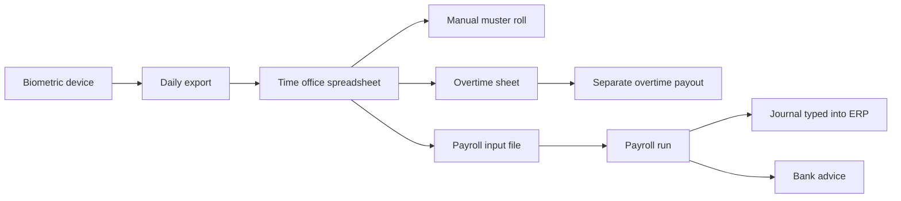

Each arrow in this flow is a manual hand-off and a point at which disputes, delays and errors enter.

## 3. Justification for Change

The current state fails on three business outcomes the client cares about: workers are not reliably paid for every hour worked (points 1–4, 10–13), the employer cannot prove compliance on demand (points 8, 17, 26), and HR administration consumes time that should go to people (points 5–7, 9, 14–16, 18–25). The change is justified by business goals BG-01, BG-03, BG-04, BG-06 and BG-07 (BRS-01 §4). Changes that are desirable but not demanded by the client points (agents, voice, analytics, skills) are justified by BG-02, BG-05 and BG-08 and are phased later.

## 4. Target Operational Concept

### 4.1 Operating principles

| # | Principle | What it means on the floor and in the office |
| :--- | :--- | :--- |
| OP-1 | One worker record | Every domain reads the same effective-dated worker, assignment and worker class |
| OP-2 | Capture once, evaluate by rule | A punch, a leave day or a gate pass is captured once and evaluated by configured rules; people handle exceptions, not routine |
| OP-3 | Exceptions, not spreadsheets | Supervisors and HR work from exception queues and approval inboxes |
| OP-4 | Money moves through named runs | Every rupee paid is a line in a named payroll run with a balanced journal |
| OP-5 | Scope by location, entity and payroll group | Plant users see time, not rate; the same rule applies on every channel |
| OP-6 | Any channel, same rules | Portal, mobile, kiosk, voice and the business messaging channel apply the same validations |
| OP-7 | Agents under human control | Agents prepare and execute through a policy gate; people approve where policy requires; every action is in the ledger |
| OP-8 | Evidence on demand | Registers, returns, audit trails and reproducible payroll snapshots are produced from data at any time |

### 4.2 Target operating model

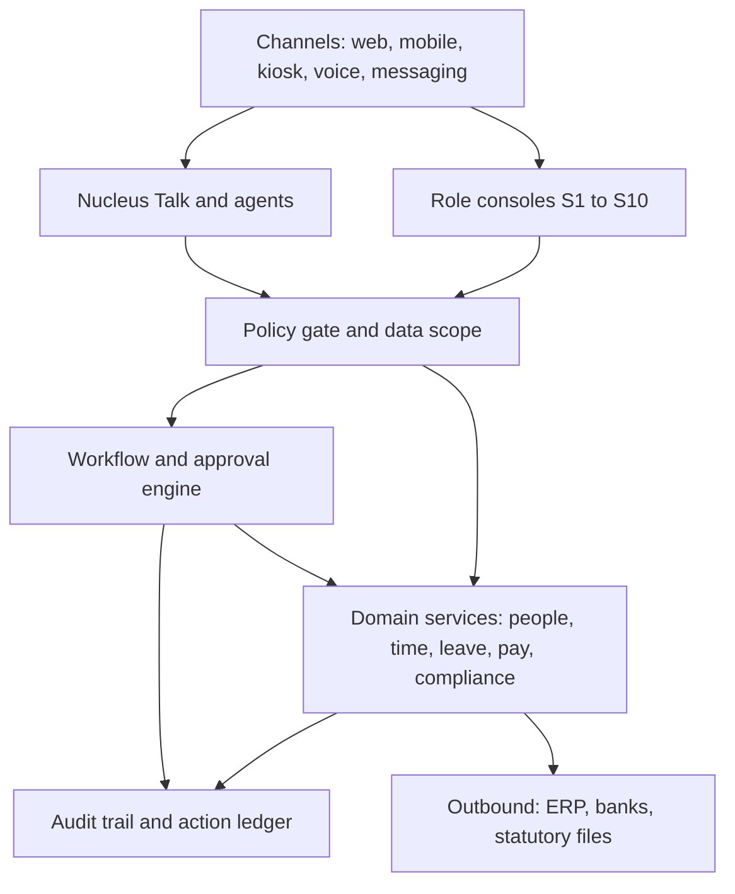

### 4.3 Target time-to-pay flow at a plant

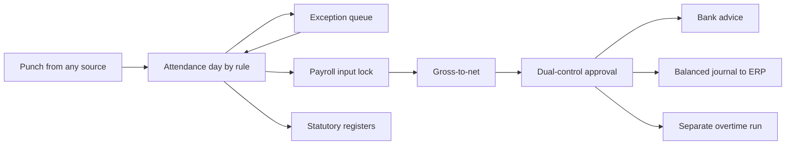

## 5. System Context

### 5.1 Context diagram

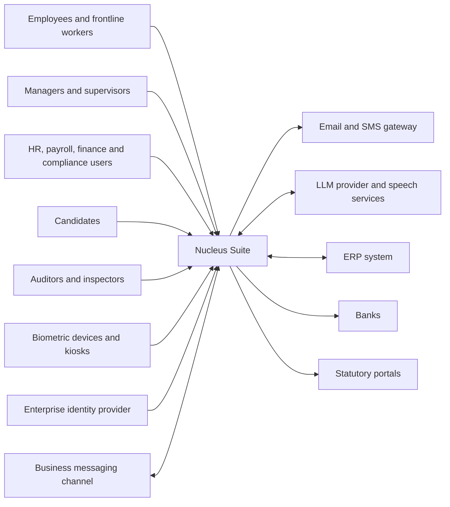

### 5.2 External interfaces

| Interface | Direction | Exchanged content | Frequency | First phase | Standards and controls |
| :--- | :--- | :--- | :--- | :--- | :--- |
| Biometric devices and kiosks | Inbound | Punch events with device, time and identity reference; offline buffers | Continuous, peak about 500 punches per second across tenants | P1 | Device certificates; raw events immutable; biometric reference data never leaves the device estate |
| Enterprise identity provider | Inbound | Authentication assertions; user provisioning and de-provisioning | Per sign-in; near-real-time provisioning | P0 | OIDC, SAML 2.0, SCIM 2.0; FIDO2 for privileged users |
| Business messaging channel | Two-way | Leave, gate pass, check-in, approvals, payslip notifications | Continuous | P2 (after activation decision) | Same validation as the portal; opt-in; masking applies |
| Email and SMS gateway | Outbound | Notifications, reminders, one-time codes | Event-driven | P1 (after activation decision) | No sensitive values in message bodies |
| LLM provider and speech services | Two-way | Prompts with minimised context; transcripts; generated drafts | On demand | R0 (browser speech for navigation), P2 (governed agents) | Residency in India, no training on tenant data, prompt and output filtering (GOV-11) |
| ERP system | Two-way | Inbound employee master and finance masters; outbound salary journal; posting acknowledgements | Nightly or on change (inbound); per run (outbound) | P1 (inbound), P2 (posting) | Field-ownership map; idempotency keys; OpenAPI 3.1 contracts; CloudEvents for change events |
| Banks | Outbound | Salary and overtime payment advice files | Per approved run | P2 (files), live initiation after compliance sign-off | Dual control; independent total verification |
| Statutory portals | Outbound | PF, ESI, professional tax and income-tax return files | Per statutory calendar | P1 (files), live filing after compliance sign-off | Prescribed formats per authority (to be validated by Legal) |
| Auditors and inspectors | Inbound read | Time-boxed read-only access; registers and evidence packs | Periodic | P1 | Every access logged |
| Candidates | Two-way | Applications, status, offers, pre-boarding documents | Continuous | P3 | Notice and consent at collection; WCAG 2.2 AA |

### 5.3 What stays outside the system

General ledger, accounts payable and procurement remain in the ERP system; biometric hardware, physical access control and recruitment marketing remain with their own providers; bank payment initiation and statutory submission remain manual until the recorded compliance sign-off (BRS-01 §3.2).

## 6. Users and Operational Roles

User classes, their characteristics and needs are specified in STRS-01 and GOV-08. The operational roles used in the scenarios below are:

| Persona | Role in operations | Primary console and channel |
| :--- | :--- | :--- |
| PER-01 CHRO | Sets people strategy; reviews workforce and cost | S1, desktop and voice briefing |
| PER-02 HRBP / HR operations / HR Head | Runs lifecycle events, approves leave at level 3, releases settlements | S2, desktop |
| PER-03 Plant supervisor / time office | Runs shifts, clears exceptions, approves gate passes | S3, shared terminal, rugged mobile |
| PER-04 Talent acquisition lead | Raises and fills requisitions | S4, desktop |
| PER-05 Finance controller | Authorises payroll lock, posts and reconciles journals | S5, desktop |
| PER-07 Line manager | Approves team requests, reviews team history | S7, mobile first |
| PER-08 Employee | Self-service by app, voice and chat | S8, mobile |
| PER-11 Contract / frontline worker | Punches, checks hours and wages, raises grievances | S8 lite, kiosk, voice |
| PER-13 Payroll administrator | Runs the eight-stage payroll control room | S5, desktop |
| PER-14 DPO / compliance officer | Owns obligations, registers, privacy requests | S10 privacy and compliance workspace |
| PER-16 Integration user | Exchanges data with the ERP system | API only |

## 7. Operational Scenarios

Each scenario names its actors, the starting condition, the flow, the outcome and its trace. Names and identifiers come from the golden demo dataset.

### OS-01 — A night-shift session crossing midnight

**Actors:** Ravi Kulkarni (E1018, PER-11), Nikhil Iyer (E1017, PER-07 manager), attendance engine. **Precondition:** Ravi is rostered to A shift 08:00–20:00 (12 hours) and is eligible for overtime on all days.

Ravi punches in at 08:00 and out at 20:30 for dinner, returns at 21:15 and works until 03:20. The engine keys the day on the shift start date, pairs the four punches into one session, derives a 45-minute break, computes gross hours of 19:20 and overtime of 7:20. Next morning he arrives at 09:30; long-night relief gives him a full day without a late mark. Nikhil approves the overtime from his phone and later reviews 01–15 September history for his team in the Team Calendar.

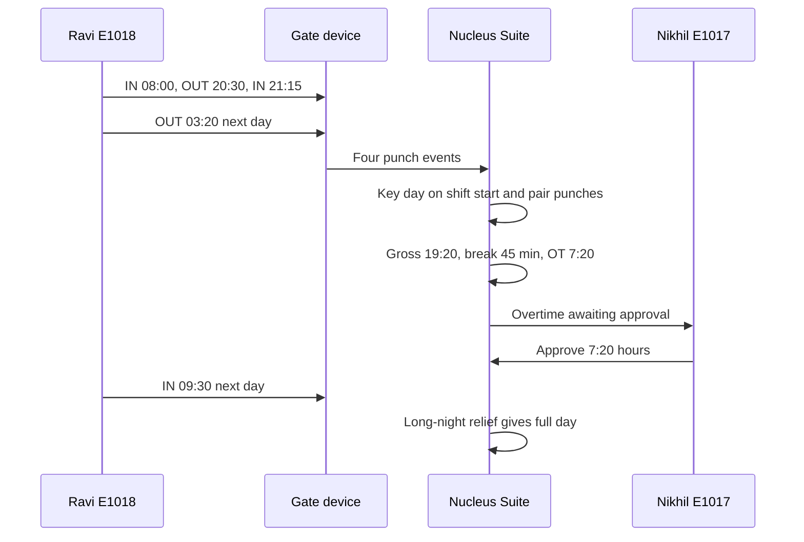

**Outcome:** One attendance record, a break-register row, approved overtime ready for the overtime run. **Trace:** R-01, R-02, R-13 · BRQ-019 – BRQ-022, BRQ-026, BRQ-030 · T-01 – T-03, T-05, T-26.

### OS-02 — Morning exception clearance and a gate pass

**Actors:** Plant supervisor (PER-03), worker E1023 (PER-11), reporting manager. **Precondition:** The Peenya plant had a device outage for 20 minutes during B shift.

At 07:30 the supervisor opens the live shift board. Three missed punches from the outage sit in the exception queue; she regularises them with the device incident as evidence. Arjun Bhat (E1020), rostered to A shift, punched in at 13:50 and has been processed on B shift with the override recorded. Later, E1023 requests a two-hour personal gate pass from the messaging channel; the entitlement check shows 2 of 4 hours and 1 of 2 passes used. The manager approves, and the two hours are credited to net hours. A third request later in the month is refused at submission.

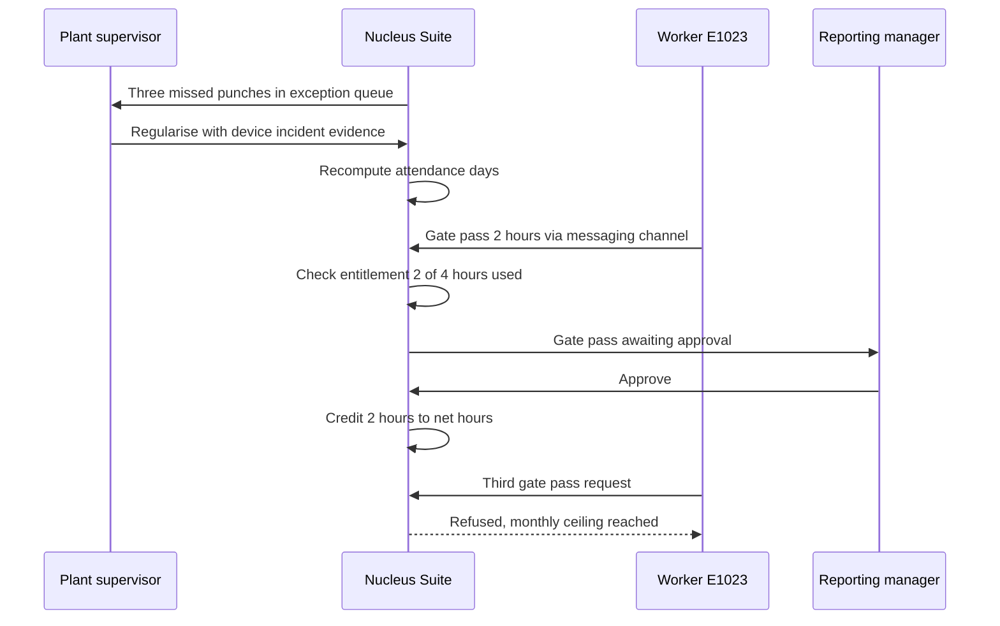

**Outcome:** All exceptions cleared before shift end; gate-pass hours credited only on approval. **Trace:** R-12, R-14 · BRQ-023, BRQ-027, BRQ-028, BRQ-044 · T-23, T-27 · W-04, W-10.

### OS-03 — Leave by voice, three-level approval and early return

**Actors:** Neha Mishra (E1043, PER-08), her Supervisor, HOD, Ritu Balachandran (E1004, HR Head). **Precondition:** Neha has 12 EL available.

Neha says "apply for ten days of earned leave from the first" to Nucleus Talk in Hindi. The agent drafts the request, validation passes (no CL combination, within caps), and Neha confirms. The request moves Supervisor → HOD → HR Head; each step records actor and time. Neha returns after six days. Ritu records the early return; in one transaction the remaining four days are credited back as a reversal and marked Present in attendance.

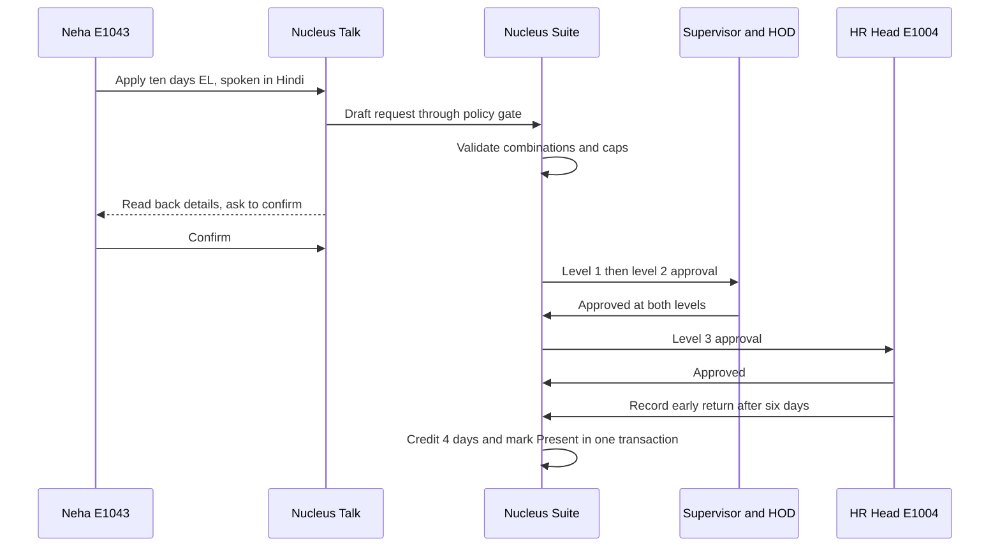

**Outcome:** Ledger and attendance agree; the action ledger shows the agent draft and Neha's confirmation. **Trace:** R-06, R-08 · BRQ-034, BRQ-036, BRQ-037, BRQ-088, BRQ-089 · T-08, T-09 · W-01, W-02.

### OS-04 — The nightly leave engine and year end

**Actors:** Leave engine (system), HR operations (PER-02). **Precondition:** Leave schemes configured for senior grades, other employees, joiners and trainees.

On 1 January the engine credits 18 EL, 6 CL and 6 SL to AGM-and-above employees and 6 CL and 6 SL to others; on the first of each month it credits 1.5 EL. On 16 September Ankita Bhargava (E1067) completes six months and receives 9 EL. Comp-off credit CO-2026-0231 reaches day 60 and lapses with a ledger entry while CO-2026-0288 stays active. At year end HR runs Preview, checks encashment for each employee, then Commit; EL encashment becomes a payroll input and CL and SL lapse.

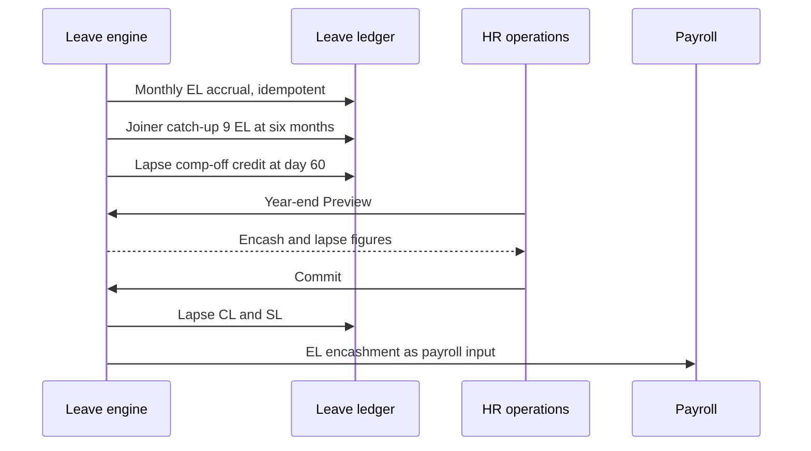

**Outcome:** Balances are ledger projections with no manual credits. **Trace:** R-07, R-08 · BRQ-032, BRQ-033, BRQ-038, BRQ-039, BRQ-040 · T-10 – T-17.

### OS-05 — Same employee, two answers: salary masking by payroll group

**Actors:** Kalaivani Subramani (U-001, plant HR Chennai), Deepak Sarangi (U-002, head-office payroll). **Precondition:** Anand Krishnan (E1056) works at the Chennai plant and is paid by head-office payroll.

Kalaivani opens E1056: attendance is visible and editable; every compensation field is blank. She runs the salary register and an export; E1056 is absent from both, and an API call returns no compensation. She asks Nucleus Talk for "Anand's basic salary" and is told she does not have access. Deepak opens the same record and sees the full structure.

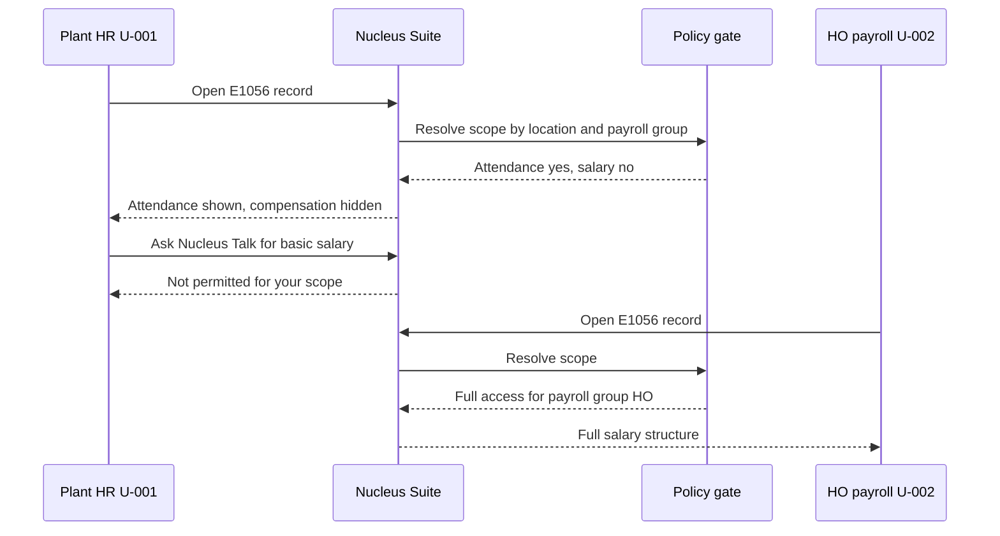

**Outcome:** Masking holds on screen, report, export, API and voice. **Trace:** R-09 · BRQ-083 · T-18 · S-12.

### OS-06 — Monthly payroll and the separate overtime run

**Actors:** Payroll administrator (PER-13), Finance controller (PER-05). **Precondition:** September attendance is closed; overtime approvals are complete.

On cut-off the administrator locks inputs and the system takes a hashed snapshot. The pre-payroll audit flags one critical item (a bank-detail change inside the payroll window) that finance verifies. Gross-to-net runs with Karnataka and Tamil Nadu professional tax slabs in the same run. The controller reviews variance and authorises the lock; the regular run PR-2026-09-01 pays salary without overtime. On 7 October the overtime run PR-2026-09-02 executes, producing its own bank advice and journal.

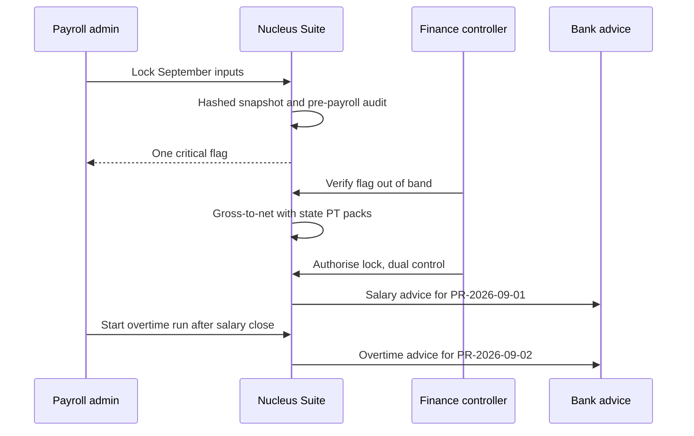

**Outcome:** Two runs, two advices, two journals; the regular run is reproducible from its snapshot. **Trace:** R-11, R-18 · BRQ-048 – BRQ-052, BRQ-055, BRQ-071 · T-22.

### OS-07 — ERP master sync, journal posting and reconciliation

**Actors:** Integration user (PER-16), Nandita Bose (U-007, Finance). **Precondition:** Field-ownership map agreed; GL mapping configured except GL-023.

Overnight, batch ERP-SYNC-2026-09-14 delivers six rows: three are applied, one is held for a field-ownership conflict, one has an unmatched employee code and one is a duplicate payload and is rejected. In the morning Nandita tries to approve the September run; it is blocked because a component maps to the missing GL-023. She adds the mapping, approves, and the journal posts as one balanced, dimensioned entry per legal entity. A re-run creates no duplicate. The reconciliation screen ties journal net pay to the bank advice.

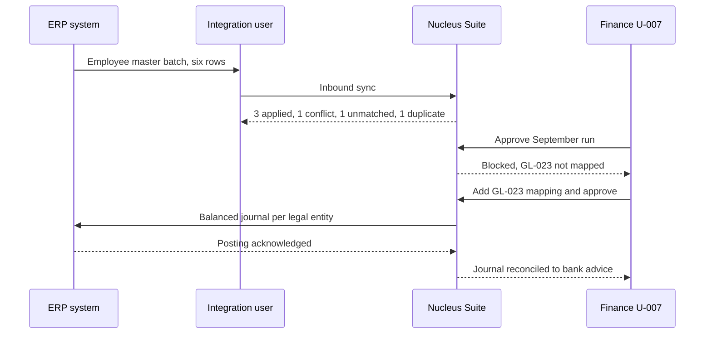

**Outcome:** No re-keying; postings balanced, idempotent and reconciled. **Trace:** R-15, R-16 · BRQ-065 – BRQ-068 · T-28, T-29.

### OS-08 — A loan with guarantors and a Director override

**Actors:** Employee E1044 (PER-08), guarantors E1040 and E1041, HOD, HR Head, Finance, Arvind Raghunathan (E1001, Director). **Precondition:** E1044 has no active loan; basic salary known.

E1044 checks eligibility in self-service: ceiling four times basic. He names E1040 and E1041; each accepts on their phone, which locks them from borrowing or guaranteeing. The application routes HOD → HR Head → Finance. Separately, E1022 needs more than his ceiling; the request routes to the Director, who approves special terms with a recorded reason naming the waived rule. When E1041 later tries to apply for his own loan, the guarantor lockout refuses it.

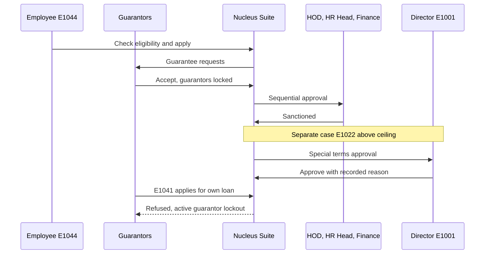

**Outcome:** Policy enforced at application; the override is an approval record, not an edit. **Trace:** R-10 · BRQ-058 – BRQ-062 · T-19 – T-21 · W-05, W-06.

### OS-09 — Replacement hiring to a compliant first day

**Actors:** Hiring manager, Talent acquisition lead (PER-04), HR operations (PER-02), Capability lead (PER-09), joiner Abhinav Rastogi (E1066). **Precondition:** Position POS-2214 is vacated; OU-111 Machining is at 24 of 24 sanctioned.

The hiring manager raises REQ-2026-0037 as a Replacement against POS-2214; headcount is unchanged and it is approved. A separate New Headcount request for Machining is held because the department is at sanctioned capacity. Abhinav accepts the offer; pre-boarding collects documents and raises asset and IT requests in parallel. On the joining date the chain creates his record, generates Form F from his nominee data, issues the appointment letter from its versioned format, assigns the induction path and records the laptop, access card and toolkit in the asset register.

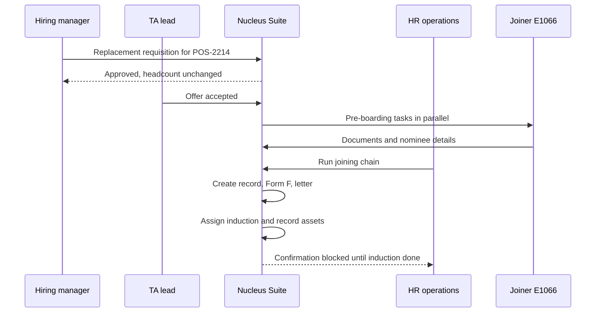

**Outcome:** Headcount controlled; statutory joining forms and assets captured on day one. **Trace:** R-22, R-24 – R-27 · BRQ-001 – BRQ-003, BRQ-006 – BRQ-011 · T-31, T-36, T-38 – T-40 · W-09.

### OS-10 — Exit with no-dues clearance and settlement on the last working day

**Actors:** Dinesh Vaidya (E1068), Swapnil Kadam (E1042), department clearance owners, Anita Mathew (E1006, HR Head), Finance, Payroll administrator. **Precondition:** Both have resigned; last working days 30 September and 18 September.

On resignation the notice period and nine department clearance lines open in parallel. Assets issued at joining appear as blocking items. Swapnil still has the IT laptop and library dues open, so "Generate settlement" stays disabled with a warning. For Dinesh all nine lines are cleared by 30 September morning; the settlement run computes salary to date, leave encashment, gratuity eligibility and notice recovery; Anita and Finance approve and the settlement is released the same day.

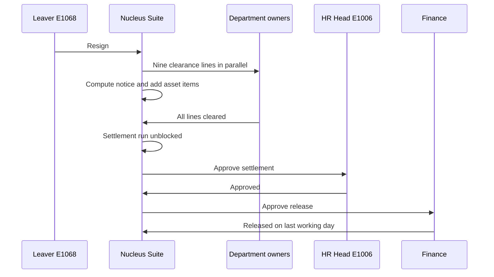

**Outcome:** Settlement on the last working day; held settlements show exactly what blocks them. **Trace:** R-17 · BRQ-010, BRQ-079 – BRQ-081 · T-30 · W-07, W-08.

### OS-11 — Statutory calendar, state forms and an inspection visit

**Actors:** Vikram Chauhan (U-009, compliance owner), Factory Inspector (STK-35), plant head. **Precondition:** Establishments registered in Karnataka and Tamil Nadu.

Vikram opens the obligation calendar for September to November across both legal entities and sees owners and status. He generates Form 28 for the Peenya plant in the Karnataka variant and compares it with the Tamil Nadu register set for Chennai. During an inspection the plant head produces the muster roll, the accident notice register and the inspection book from live data; the inspector's remarks are recorded against Form 36.

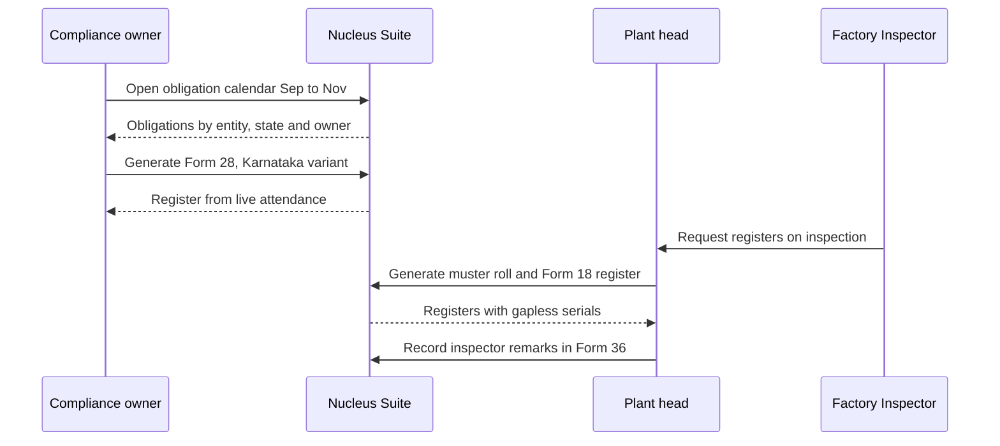

**Outcome:** Registers produced in minutes from data, in the right state variant. **Trace:** R-18, R-27 · BRQ-069 – BRQ-071 · T-31, T-32.

### OS-12 — The CHRO's Monday: recognition, announcements and a question

**Actors:** CHRO (PER-01), line managers, HR operations. **Precondition:** Q2 star-employee nominations are closed.

The committee's selections RC-2026-Q2-004 and RC-2026-Q2-007 are published; announcements are raised automatically for the whole company and the plants concerned, and the monetary awards appear as inputs in the next named run. Birthday and new-joiner announcements for the day appear without anyone typing them. The CHRO asks Nucleus Talk "where are we above sanctioned manpower and what does it cost?" and receives an answer with the departments, figures and the data sources cited.

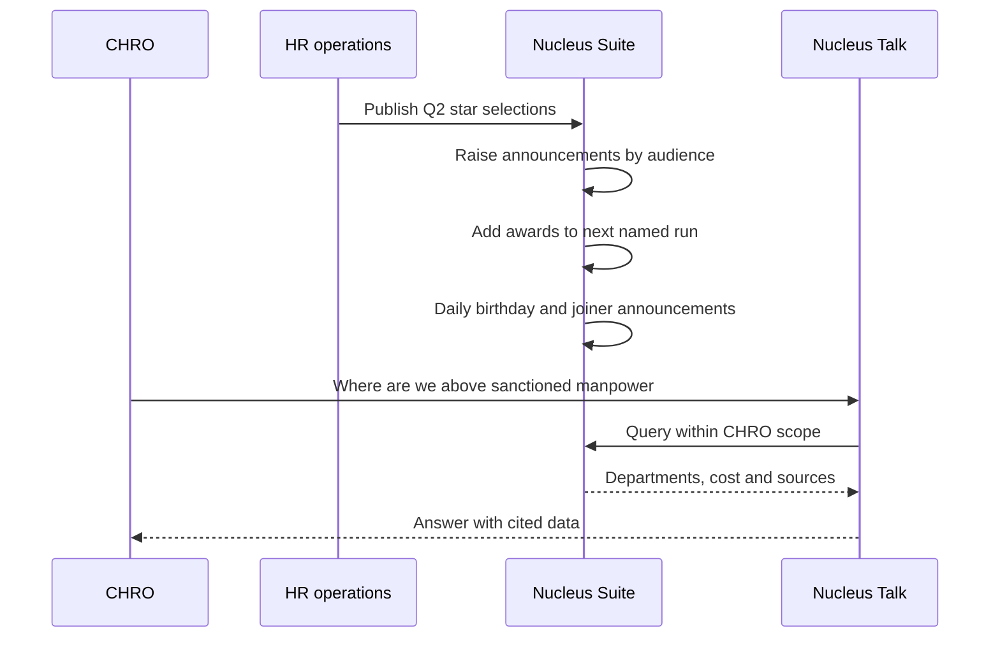

**Outcome:** Recognition is visible and paid through payroll; leadership questions are answered with evidence. **Trace:** R-19, R-21, R-26 · BRQ-001, BRQ-075, BRQ-076, BRQ-090 · T-33, T-35.

## 8. Operating Modes

### 8.1 Mode definitions

| Mode | Trigger | What changes | What never changes | First phase |
| :--- | :--- | :--- | :--- | :--- |
| M-1 Normal | Default | All channels and approvals operate online | — | P1 |
| M-2 Offline plant | Loss of connectivity at a site | Devices and kiosks buffer punches, leave and gate-pass requests with tamper-evident sequencing; screens show last-synchronised data; on reconnect, events synchronise and conflicts go to the exception queue | Raw punches remain unaltered; no silent data loss (BO-03.4) | P1 (device buffering), P3 (offline-first apps) |
| M-3 Payroll lock | Input lock for a run | Attendance and leave changes for the locked period become exceptions for the next run; configuration affecting pay is frozen for that run; bank-detail changes raise alerts | A locked run is reproducible from its snapshot | P1 |
| M-4 Month-end close | Regular run approved | Overtime run, journal posting, reconciliation, payslip publication and statutory return preparation run in sequence; maintenance windows are not scheduled | Debits equal credits for every posting | P1 (runs), P2 (posting) |
| M-5 Statutory filing window | Due dates in the obligation calendar | Registers and returns for the period are generated and frozen as filed versions; corrections create revised versions with reasons | Filed versions are retained unaltered | P1 |
| M-6 Incident | Security or privacy breach, AI incident, or major outage | Affected agents or integrations can be switched off; access can be restricted to break-glass roles; breach and incident procedures start (GOV-10 §11, GOV-11 §11); a degraded read-only mode serves payslips and balances | Audit trail and action ledger keep recording | P0 |

### 8.2 Mode transitions

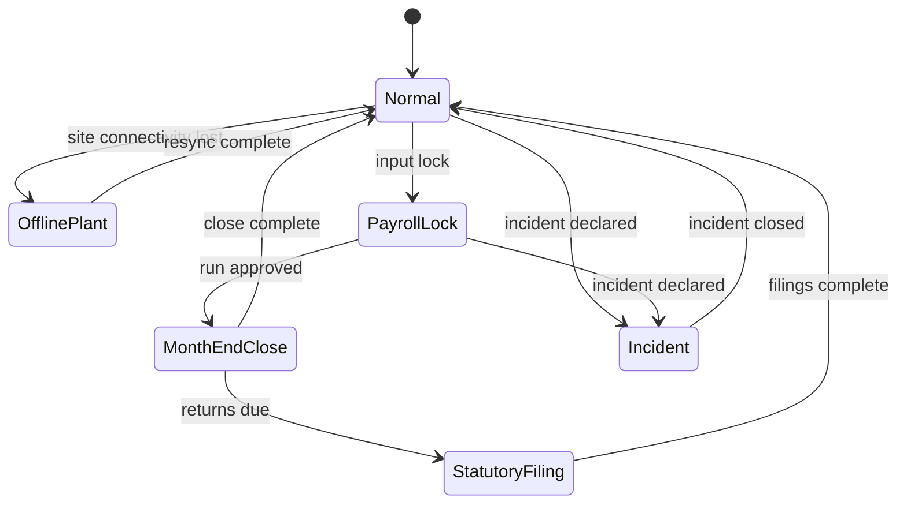

A plant can be offline while the tenant is in payroll lock; offline punches that arrive after the lock follow the M-3 rule and become exceptions.

## 9. Support and Operations Concept

### 9.1 Support tiers

| Tier | Who | Handles | Channel |
| :--- | :--- | :--- | :--- |
| L0 Self-help | Policy Assistant agent and help content | Policy questions with citations; payslip explanations; how-to | Nucleus Talk, portal, messaging channel |
| L1 Tenant helpdesk | Customer HR helpdesk (SSV-04) | Employee tickets, corrections, access requests | Helpdesk tickets with SLA |
| L2 Product support | MultipliersKraft support team | Configuration questions, defects, data fixes through approved procedures | Support portal |
| L3 Engineering | Domain engineering and rule-pack team | Code defects, statutory rule changes, performance | Internal escalation |

### 9.2 Service levels

The service levels below are the operational targets of record. They are owned by OPS-01 (support and availability requirements `PLT-OPS-nnn`) and NFR-01 (quality targets); this concept restates them in operational terms and sets no values of its own. They become binding in P2, the phase named on each OPS-01 requirement.

**Support response and restoration** (OPS-01 §5.2, §5.3; PLT-OPS-008, PLT-OPS-009, PLT-OPS-010)

| Severity | Example | Coverage | Initial response | Workaround or restoration | Permanent fix |
| :--- | :--- | :--- | :--- | :--- | :--- |
| Sev-1 | Payroll run blocked during month-end close; payroll calculation defect reaching disbursement; personal-data breach suspected | 24 × 7 × 365 | 15 minutes | 4 hours | Root-cause fix scheduled within 10 business days |
| Sev-2 | Punch ingestion lag above its service level at shift change; approvals not routing; ERP posting failures | 24 × 7 in the payroll window; otherwise Indian business hours | 30 minutes | 1 business day | Next scheduled release |
| Sev-3 | One report failing; a single device integration failing; a defect with a reasonable workaround | Indian business hours | 4 business hours | 5 business days | Within two releases |
| Sev-4 | Question, label or translation correction, enhancement | 09:00–18:00 IST, Monday to Friday | 1 business day | Not applicable | Prioritised in the backlog |

Any Sev-2 on the payroll path during the payroll window (the 25th to the 5th) is handled as Sev-1. A payroll calculation defect reaching disbursement, any cross-tenant exposure, any personal-data breach and any policy-gate bypass are raised as Sev-1 automatically (PLT-OPS-010). Targets are met for at least 95% of tickets per severity per month, and every Sev-1 breach is reviewed (PLT-OPS-009).

**Availability, performance and recovery** (NFR-01; OPS-01 §4, §9.1, §12)

| Service | Target | Source |
| :--- | :--- | :--- |
| Core platform (web, mobile, API) | 99.9% monthly availability, excluding notified maintenance | NFR-01 Availability · PLT-OPS-001 · BO-10.2 |
| Payroll path | 99.95% availability from the 25th to the 5th, reported separately | NFR-01 Payroll availability · PLT-OPS-002 |
| Interactive reads | p95 under 300 ms, p99 under 800 ms | NFR-01 API latency · OPS-01 §4 |
| Punch ingestion | 500 events per second per tenant at shift change; p95 receipt-to-queue lag under 60 seconds | NFR-01 Attendance ingestion · OPS-01 §4 |
| Attendance recompute | A full month for 5,000 employees in under 10 minutes without degrading interactive latency | NFR-01 Attendance recompute · OPS-01 §4 |
| Payroll computation | 10,000 employees gross-to-net in under 120 seconds | NFR-01 Payroll throughput · OPS-01 §4 |
| Recovery of systems of record | RPO 5 minutes, RTO 1 hour, proven by quarterly restore drill | NFR-01 Recovery · OPS-01 §9.1 |
| Planned maintenance | Only between 01:00 and 04:30 IST, at most 4 hours a month, notified 5 business days ahead; never in the payroll window or on the two working days before a statutory due date | PLT-OPS-055 · PLT-OPS-056 |

### 9.3 Operational monitoring

| Signal | Why it matters | Alert threshold (initial) |
| :--- | :--- | :--- |
| Punch ingestion lag per site | Late punches drive disputes | p95 receipt-to-queue lag over 60 seconds (OPS-01 §4); no events from a device 15 minutes after shift start (PLT-OPS-018) |
| Attendance recompute duration | A month for 5,000 people must complete in under 10 minutes | Over 10 minutes |
| Offline synchronisation failures | Silent loss is unacceptable | Any failed batch |
| Payroll stage timestamps | Time-to-lock target of 4 hours | Stage over plan by 30 minutes |
| ERP posting failures and sync conflicts | Finance close | Any failure |
| Agent reversal rate and refusals | Trust in agents | Reversal rate above tenant threshold |
| Sensitive-access events outside working pattern | Insider risk | Rule-based anomaly |

### 9.4 Change and release operations

Tenant rules are changed as configuration with effective dates and are reviewed by the tenant's configuration owner. Statutory rule packs are released centrally after a passing test suite and a named reviewer, with release notes per state. Product releases follow the programme's configuration and change control; customers receive release notes and a preview tenant before releases that change behaviour. Data is hosted in a cloud region in India with backups, retention and erasure applied as in GOV-10.

### 9.5 Training and adoption

Plant champions and native-language job aids for supervisors; voice-first onboarding and kiosk mode for contract workers; a co-briefing with union representatives on biometrics and the prohibited-uses list; role-based training for HR, payroll and finance before the parallel run (GOV-07 §7).

## 10. Impacts

### 10.1 Operational impacts

| Role | Today | With Nucleus Suite |
| :--- | :--- | :--- |
| Time office | Exports punches and builds spreadsheets daily | Works the exception queue; registers produced on demand |
| Plant supervisor | Paper gate passes, verbal approvals | Approves on mobile in seconds with entitlement shown |
| HR operations | Credits leave, drafts letters, chases no-dues | Handles exceptions and approvals; letters and credits run by rule |
| Payroll | Assembles inputs from several sources | Locks a validated snapshot and reviews audit findings |
| Finance | Types journals and reconciles after close | Approves balanced postings and reviews reconciliation |
| Compliance owner | Commissions forms per state | Generates, reviews and files from the calendar |
| Employees and workers | Ask HR for balances and payslip explanations | Self-serve in their language by app, kiosk or voice |

### 10.2 Organisational impacts

New accountabilities appear: a tenant configuration owner, a rule-pack reviewer for statutory changes, data stewards for verified fields, and an AI steward who reviews agent autonomy and reversal rates. Approval chains become visible and measurable, which will expose slow approvers; SLA escalation must be agreed with management before go-live.

### 10.3 Transition impacts

A parallel payroll run is required before go-live, with year-to-date figures migrated as opening balances. Employee master ownership with the ERP system must be decided per field before People Core is built (OD-07). Open client questions Q-01 to Q-16 must be closed before the affected rules are built. During R0 none of these transition activities take place; R0 only validates the experience.

### 10.4 Privacy and workforce-relations impacts

Biometric attendance, geofenced mobile punches and AI features require notices, consent where applicable and DPIAs (GOV-10 §14). Covert monitoring is prohibited (GOV-11 §4). Workers' representatives are consulted on the monitoring policy before G2.

## 11. Analysis of the Concept

| Aspect | Assessment |
| :--- | :--- |
| Benefits | Every client pain point has a defined target response; manual hand-offs in time-to-pay are removed; compliance evidence is produced from data; frontline workers get native-language access |
| Limitations | Live bank initiation and statutory filing wait for compliance sign-off; offline-first apps arrive in P3; voice transactions in six or more languages arrive by P4 |
| Alternatives considered | Keeping a separate attendance system with file transfer into payroll was rejected because seams S-01 to S-04 would remain manual; building payroll only was rejected because the client points span hiring to exit |
| Residual risks | State-variant forms, ERP field ownership and plant adoption (BRS-01 §12) |

## Approval & Sign-off

| Role | Name | Date | Decision | Conditions / comments |
| :--- | :--- | :--- | :--- | :--- |
| Author | Dhanraj Dadhich | 2026-11-05 | Submitted | |
| Peer review moderator | *pending* | | | PR-xxxx |
| PQA (process compliance) | *pending* | | | |
| Product Council | *pending* | | | |

## Measurement Data Captured

| Measure | Value | Unit | Notes |
| :--- | :--- | :--- | :--- |
| Size | 11 | sections | 12 operational scenarios, 6 operating modes, 10 external interfaces |
| Authoring effort | *to be recorded* | person-hours | |
| Review effort (preparation + meeting) | *pending review* | person-hours | From PR-xxxx |
| Review rate | *pending review* | items / hour | Compare with PPB-02 control limits |
| Requirement volatility | 0 | CRs since baseline | |

## Revision History

| Version | Date | Author | Change summary | CR ref | Approved by |
| :--- | :--- | :--- | :--- | :--- | :--- |
| 1.0.0 | 2026-11-05 | Dhanraj Dadhich | Consolidated release | CR-0001 | *pending* |
