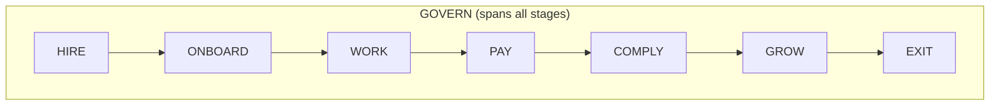
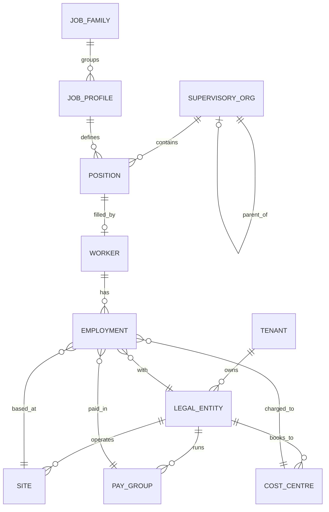
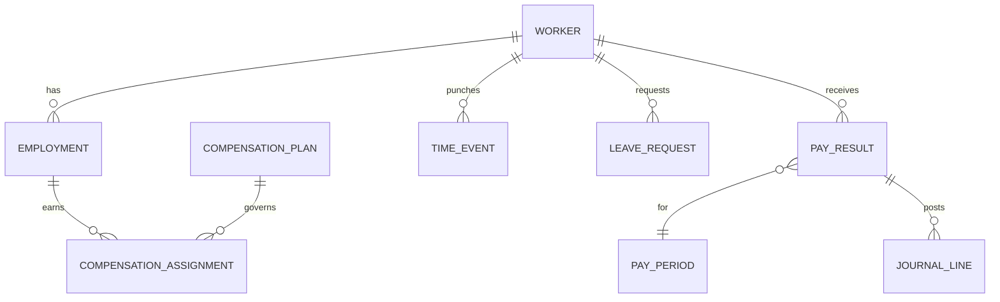
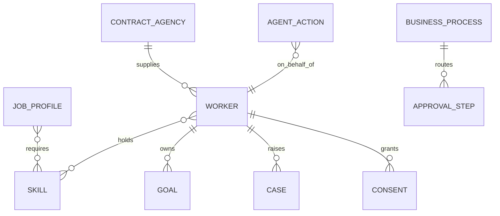

<picture>
  <source media="(prefers-color-scheme: dark)" srcset="../assets/MultipliersKraftLogoDark.png">
  
</picture>

# GOV-05 — Business Capability Model and Value Streams

| Attribute | Value |
| :--- | :--- |
| Document ID | GOV-05 |
| Title | Business Capability Model and Value Streams |
| Product | Nucleus Suite (Nucleus HRMS Suite) |
| Version | 1.0.0 |
| Status | Issued for approval |
| Owner (role) | Enterprise Architect |
| Author | Dhanraj Dadhich |
| Reviewed by | Product Council, BA Lead — *pending* |
| Approved by | Architecture Review Board — *pending* |
| Date | 2026-11-05 |
| Classification | Internal |
| CMMI practice areas | RDM, TS |
| Related documents | GOV-01, GOV-02, GOV-06, GOV-08, PLN-02, REQ-02 |
| Quality & process-performance objectives | QPPO-05 (effective requirements reviews), QPPO-01 (escaped defects) |
| Process performance baseline used | PPB-01 (review defect density), PPB-02 (review rate) |
| Peer review record | *pending* (PR-xxxx, QA-02) |
| Tailoring record | none |
| Traceability anchor | BG-01, BG-07 |
| Source inputs | Nucleus Process Flows & Process Maps v1.0 (14 domains, processes DOM-nn, steps DOM-nn.s); Nucleus Technical & Functional Blueprint v1.1 (reusable components CMP-nn); Forms & Fields Complete; HRMS Demo Dataset v1.1 |

---

## 1. Purpose

This document describes **what the business of human capital management does** — independent of screens, code or organisation charts — so that every requirement can be anchored to a stable capability. It provides:

1. The L0 value chain and its mapping to the 14 process domains (§2–3).
2. The L1/L2 capability map, with selected L3 capabilities (§4). L2 capability IDs `CAP-<DOM>-nn` are shared with GOV-02.
3. End-to-end value streams with stages and the domains that serve them (§5).
4. The core business object model (§6).
5. A capability priority heat-map by phase (§7).

Process-level detail (`DOM-nn` processes, `DOM-nn.s` steps, rules `RL-nnn`) is owned by the functional requirement packs and sourced from the Process Flows & Process Maps workbook. This model is the layer above it: **capability → process → step → rule/form/screen**. Business requirements (`BRQ-nnn`, BRS-01) and the concept of operations (CONOPS-01) are organised by the capabilities defined here.

## 2. L0 Value Chain

| L0 stage | Business purpose | Primary domains | Supporting domains |
| :--- | :--- | :--- | :--- |
| HIRE | Plan demand, requisition, attract, select and offer | TAL | PPL, CMB, INT |
| ONBOARD | Pre-board, join, induct and make productive | LCY | PPL, SSV, TIM |
| WORK | Organise, schedule, attend, take leave, get help, contract labour | PPL, TIM, LVE, SSV, CTG | EXP |
| PAY | Compute, approve, pay and account for remuneration | PAY, CMB, FIN | TIM, LVE |
| COMPLY | Meet statutory, labour and privacy obligations | CMP | PAY, TIM, CTG, PLT |
| GROW | Perform, learn, recognise, move and reward | TAL, EXP, CMB | INT |
| EXIT | Resign/terminate, clear, settle and retain alumni relationship | LCY | PAY, CMP |
| GOVERN | Secure, audit, configure, analyse and govern AI across all stages | PLT, INT | All |

## 3. Domain Catalogue

| Code | Domain | Business responsibility | Reusable components consumed (examples) |
| :--- | :--- | :--- | :--- |
| PLT | Platform & Foundations | Tenancy, identity, access, audit, workflow, configuration, localisation, privacy services | CMP-01 workflow & approval engine (owner) |
| PPL | People Core | System of record for workers, positions, jobs and organisations | CMP-01 |
| TIM | Time & Attendance | Capture and evaluate time worked | CMP-01 |
| LVE | Leave | Plan, request, approve and account for absence | CMP-01 |
| PAY | Payroll | Compute and control pay | CMP-01 |
| CMP | Compliance | Statutory returns, registers, inspections and calendar | CMP-01 |
| LCY | Lifecycle | Joiner, mover, confirmation and leaver events | CMP-01 |
| SSV | Self-service & Helpdesk | Self-service, cases, channels, grounded policy answers | CMP-01 |
| CMB | Compensation, Loans & Benefits | Structures, revisions, loans, benefits, rewards | CMP-01 |
| TAL | Talent | Requisition, candidates, referrals, goals, reviews, skills, learning | CMP-01 |
| CTG | Contingent Workforce | Agencies, contract workers and their compliance | CMP-01 |
| EXP | Experience | Recognition, referral awards, announcements, letters | CMP-01 |
| FIN | Finance & ERP | Finance masters inbound, GL mapping, salary journal, posting, reconciliation | — |
| INT | Intelligence & Agents | Policy gate, tool surface, action ledger, analytics, predictions | All domains via tool surface |

The full reusable component catalogue (`CMP-nn`) is defined in the Technical & Functional Blueprint v1.1 and referenced, not redefined, here. Note: the domain code **CMP (Compliance)** and the component prefix **CMP-nn** are distinct — component IDs always carry a number (e.g. `CMP-01`); the domain code never does.

## 4. Capability Map (L1 → L2 → selected L3)

L1 = domain. L2 = capability (`CAP-<DOM>-nn`). L3 = sub-capability (listed where it clarifies scope).

### 4.1 PLT — Platform & Foundations

| L2 ID | L2 capability | Selected L3 capabilities |
| :--- | :--- | :--- |
| CAP-PLT-01 | Multi-tenancy & tenant isolation | Tenant provisioning; tenant configuration; data partitioning |
| CAP-PLT-02 | Identity & access (RBAC + ABAC) | Authentication; role assignment; context/attribute policies; delegation; segregation of duties |
| CAP-PLT-03 | Workflow & approval engine (CMP-01) | Routing; conditions; delegation; SLA reminders and escalation; parallel/serial approval |
| CAP-PLT-04 | Audit & history | Immutable change log; sensitive-access log; bi-temporal record history |
| CAP-PLT-05 | Localisation | 11 languages; RTL; locale formats; translation catalogue |
| CAP-PLT-06 | Consent & privacy operations | Consent ledger; purpose binding; data-principal requests; retention and erasure |
| CAP-PLT-07 | Configuration & extensibility | Picklists; custom fields/objects; configurable designer; versioned configuration |
| CAP-PLT-08 | Notifications & document generation | Templates; multilingual rendering; delivery channels (when activated) |

### 4.2 PPL — People Core

| L2 ID | L2 capability | Selected L3 capabilities |
| :--- | :--- | :--- |
| CAP-PPL-01 | Worker record management | Personal data; identity documents; contacts; dependants; bank details |
| CAP-PPL-02 | Bi-temporal history | As-of (effective) view; as-known (transaction) view; correction vs. change |
| CAP-PPL-03 | Position management | Position creation; headcount budget; vacancy; position freeze |
| CAP-PPL-04 | Organisation management | Supervisory org; cost centre; legal entity; site/location; matrix relationships |
| CAP-PPL-05 | Job architecture | Job family; job profile; grade; skills on profile |
| CAP-PPL-06 | Worker documents | Templates; storage; e-signature; expiry tracking |
| CAP-PPL-07 | Directory & org chart | Search; hierarchy views; matrix views |

### 4.3 TIM — Time & Attendance

| L2 ID | L2 capability | Selected L3 capabilities |
| :--- | :--- | :--- |
| CAP-TIM-01 | Time capture | Biometric; geofenced mobile; kiosk; voice punch; offline capture |
| CAP-TIM-02 | Time evaluation | Punch pairing; cross-midnight; break deduction; net presence |
| CAP-TIM-03 | Shift & roster management | Shift patterns; roster publication; swaps; skill-aware rostering |
| CAP-TIM-04 | Overtime & gate pass | OT computation and caps; pre-approval; gate-pass quota and types |
| CAP-TIM-05 | Regularisation | Missed-punch correction; approval chain; payroll lock |

### 4.4 LVE — Leave

| L2 ID | L2 capability | Selected L3 capabilities |
| :--- | :--- | :--- |
| CAP-LVE-01 | Leave plans & accrual | Leave types; eligibility; accrual; carry-forward; encashment |
| CAP-LVE-02 | Leave request & approval | Request; L1/L2 approval; cancellation; withdrawal |
| CAP-LVE-03 | Balance management | Balance invariants; adjustments; ledger |
| CAP-LVE-04 | Special rules | Sandwich rule; comp-off credit and FIFO expiry |
| CAP-LVE-05 | Holiday calendars | Calendar per site/state; optional holidays |

### 4.5 PAY — Payroll

| L2 ID | L2 capability | Selected L3 capabilities |
| :--- | :--- | :--- |
| CAP-PAY-01 | Gross-to-net computation | Earnings; deductions; proration; continuous recomputation (P3) |
| CAP-PAY-02 | Statutory deductions | PF/VPF; ESI; PT; LWF; TDS old/new regime |
| CAP-PAY-03 | Payroll control room | Stages 1–8: input validation → structure lock → time & leave integration → statutory → gross-to-net → exception gate → lock → bank file |
| CAP-PAY-04 | Retro & arrears | Retro triggers from bi-temporal changes; arrears computation |
| CAP-PAY-05 | Payslips & tax documents | Payslip; Form 16; tax projection |
| CAP-PAY-06 | Full & final settlement | Pro-rata pay; leave encashment; gratuity; notice recovery; asset deductions |
| CAP-PAY-07 | Earned wage access | Earned-to-date; policy limits; withdrawal; recovery |
| CAP-PAY-08 | Country packs | Country rules on common engine (P4) |

### 4.6 CMP — Compliance

| L2 ID | L2 capability | Selected L3 capabilities |
| :--- | :--- | :--- |
| CAP-CMP-01 | Statutory returns | EPFO ECR; ESIC; PT; Form 24Q; Form 16 |
| CAP-CMP-02 | Labour registers | Factories Act Form 28 (muster roll), Form 18 (accident notice), Form 36 (inspection book); gratuity Form F |
| CAP-CMP-03 | Wage-code compliance | Code on Wages 50% basic-plus-DA floor; minimum wage checks |
| CAP-CMP-04 | Compliance calendar & inspections | Due dates; evidence; inspection visits and orders |

### 4.7 LCY — Lifecycle

| L2 ID | L2 capability | Selected L3 capabilities |
| :--- | :--- | :--- |
| CAP-LCY-01 | Pre-boarding & joining | Offer acceptance hand-off; document collection; day-one tasks |
| CAP-LCY-02 | Confirmation, transfer & promotion | Probation review; inter-site/entity transfer; promotion |
| CAP-LCY-03 | Resignation & exit | Resignation; notice; exit interview; four-way no-dues clearance |
| CAP-LCY-04 | Credentials intake | Verifiable credentials (P5) |

### 4.8 SSV — Self-service & Helpdesk

| L2 ID | L2 capability | Selected L3 capabilities |
| :--- | :--- | :--- |
| CAP-SSV-01 | Employee & manager self-service | Profile; requests; approvals inbox; consoles S7/S8 |
| CAP-SSV-02 | Helpdesk & case management | Tickets; categories; SLA; knowledge base |
| CAP-SSV-03 | Channels | Web; mobile; voice (Nucleus Talk); business messaging (when activated) |
| CAP-SSV-04 | Grounded policy answers | Answers cited from tenant policy documents only |

### 4.9 CMB — Compensation, Loans & Benefits

| L2 ID | L2 capability | Selected L3 capabilities |
| :--- | :--- | :--- |
| CAP-CMB-01 | Salary structures & bands | Components; CTC templates; bands |
| CAP-CMB-02 | Revisions & exceptions | Revision cycle; CTC exception approval |
| CAP-CMB-03 | Loans & advances | Loan types; guarantors; EMI schedule; board approval above limits |
| CAP-CMB-04 | Benefits | Plans; enrolment; life events |
| CAP-CMB-05 | Total rewards | Statement; real-time earned pay view |

### 4.10 TAL — Talent

| L2 ID | L2 capability | Selected L3 capabilities |
| :--- | :--- | :--- |
| CAP-TAL-01 | Requisition | Request; approval chain; budget check |
| CAP-TAL-02 | Candidates & referrals | Sourcing; screening; interviews; offers; referrals |
| CAP-TAL-03 | Goals & reviews | OKR/KRA cascade; check-ins; reviews |
| CAP-TAL-04 | Calibration | 9-box; distribution quotas; bias check |
| CAP-TAL-05 | Skills | Ontology; profiles; inference; validation |
| CAP-TAL-06 | Learning | Catalogue; paths; compliance training; assessments |
| CAP-TAL-07 | Talent marketplace | Roles; projects; gigs; matching (P5) |
| CAP-TAL-08 | Succession | Critical roles; talent pools; readiness |

### 4.11 CTG — Contingent Workforce

| L2 ID | L2 capability | Selected L3 capabilities |
| :--- | :--- | :--- |
| CAP-CTG-01 | Agency & contract worker management | Agency master; worker onboarding; contract terms |
| CAP-CTG-02 | Contractor time & access | Shared capture; gate access; safety training check |
| CAP-CTG-03 | Contractor compliance | Wage compliance; statutory proof from agencies |

### 4.12 EXP — Experience

| L2 ID | L2 capability | Selected L3 capabilities |
| :--- | :--- | :--- |
| CAP-EXP-01 | Recognition & awards | Peer recognition; referral awards |
| CAP-EXP-02 | Announcements & letters | Announcements; HR letters; multilingual generation |
| CAP-EXP-03 | Wellbeing signals | Consent; pulse surveys; aggregate indicators (P5) |

### 4.13 FIN — Finance & ERP

| L2 ID | L2 capability | Selected L3 capabilities |
| :--- | :--- | :--- |
| CAP-FIN-01 | Finance master inbound | Cost centres; GL accounts; legal entities |
| CAP-FIN-02 | GL mapping & salary journal | Component-to-GL mapping; journal build; double-entry validation |
| CAP-FIN-03 | Posting | Structured XML document; CSV journal; XML voucher — the three supported ERP posting formats |
| CAP-FIN-04 | Reconciliation | Posting acknowledgement; variance analysis |

### 4.14 INT — Intelligence & Agents

| L2 ID | L2 capability | Selected L3 capabilities |
| :--- | :--- | :--- |
| CAP-INT-01 | Policy gate | Permission check; policy check; risk tier; human-approval requirement |
| CAP-INT-02 | Tool surface | Tool catalogue; versioning; input/output contracts |
| CAP-INT-03 | Action ledger | Proposal; approval; execution; reversal record |
| CAP-INT-04 | Analytics & role consoles | Consoles S1–S10; dashboards; widgets |
| CAP-INT-05 | Natural-language query | Question parsing; cited answers; access-scoped results |
| CAP-INT-06 | Predictions | Attrition; absenteeism; payroll anomaly; model monitoring |
| CAP-INT-07 | Organisation digital twin | Scenario modelling; cost/span/coverage simulation (P5) |
| CAP-INT-08 | ESG / DEI reporting | Disclosure packs; pay-equity analytics (P4) |
| CAP-INT-09 | Nucleus Talk | Voice navigation; voice transactions; speech in 11 languages |

## 5. Value Streams

Each value stream is an end-to-end flow that delivers value to a stakeholder. Stages map to domains; detailed steps are the `DOM-nn.s` steps in the Process Flows workbook.

### VS-01 Hire-to-Retire (umbrella)

| Stage | Outcome | Domains |
| :--- | :--- | :--- |
| 1 Plan | Approved position and budget | PPL, TAL, FIN |
| 2 Hire | Accepted offer | TAL |
| 3 Onboard | Productive joiner with complete record | LCY, PPL |
| 4 Work | Attendance, leave, help | TIM, LVE, SSV |
| 5 Pay | Accurate, compliant pay | PAY, CMB, CMP, FIN |
| 6 Grow | Goals met, skills grown, recognised | TAL, EXP |
| 7 Move | Transfer / promotion executed | LCY, PPL |
| 8 Exit | Cleared and settled | LCY, PAY, CMP |

### VS-02 Recruit-to-Onboard

| Stage | Outcome | Domains |
| :--- | :--- | :--- |
| 1 Requisition raised & approved | Approved requisition | TAL, PPL |
| 2 Source & refer | Candidate pool | TAL, EXP (referral awards) |
| 3 Screen & interview | Shortlist with scorecards | TAL |
| 4 Offer | Accepted offer; CTC approved | TAL, CMB |
| 5 Pre-board | Documents and verification complete | LCY |
| 6 Join | Worker record active; access provisioned | LCY, PPL, PLT |
| 7 Induct | Day-30 productive | LCY, TAL (learning) |

### VS-03 Time-to-Pay (Pay-to-Post)

| Stage | Outcome | Domains |
| :--- | :--- | :--- |
| 1 Capture | Punches captured | TIM |
| 2 Evaluate | Paired, net hours, OT | TIM |
| 3 Absence | Approved leave applied | LVE |
| 4 Inputs locked | Validated payroll inputs | PAY |
| 5 Compute | Gross-to-net with statutory | PAY, CMB |
| 6 Approve & lock | Exceptions approved; payroll locked | PAY |
| 7 Pay & file | Bank file; statutory returns | PAY, CMP |
| 8 Post & reconcile | Balanced journal posted and reconciled | FIN |

### VS-04 Plan-to-Perform

| Stage | Outcome | Domains |
| :--- | :--- | :--- |
| 1 Set objectives | Company → team → individual goals | TAL |
| 2 Check-in | Continuous feedback | TAL |
| 3 Review | Ratings | TAL |
| 4 Calibrate | 9-box with bias check | TAL, INT |
| 5 Reward | Revision / bonus | CMB |
| 6 Develop | Development plan | TAL |

### VS-05 Learn-to-Grow

| Stage | Outcome | Domains |
| :--- | :--- | :--- |
| 1 Identify gap | Skills gap vs. role | TAL |
| 2 Recommend | Learning or gig suggested | TAL, INT |
| 3 Learn | Completion and assessment | TAL |
| 4 Validate | Skill validated; credential issued (P5) | TAL, LCY |
| 5 Move | Internal role or gig | TAL, LCY |

### VS-06 Request-to-Resolve

| Stage | Outcome | Domains |
| :--- | :--- | :--- |
| 1 Ask | Question or request via portal, voice or chat | SSV, INT |
| 2 Answer / triage | Grounded answer or case created | SSV |
| 3 Act | Transaction executed via tool surface | INT, owning domain |
| 4 Approve | Human approval where required | PLT (CMP-01) |
| 5 Close | Resolution confirmed; SLA recorded | SSV |

### VS-07 Data-to-Decision

| Stage | Outcome | Domains |
| :--- | :--- | :--- |
| 1 Collect | Governed transactional data | All |
| 2 Model | Metrics and predictions with model cards | INT |
| 3 Ask | Natural-language or console query | INT |
| 4 Simulate | What-if in digital twin (P5) | INT, PPL |
| 5 Decide | Recorded decision | Business owner |
| 6 Act | Transactions raised and tracked | INT, owning domain |

### VS-08 Comply-to-Assure

| Stage | Outcome | Domains |
| :--- | :--- | :--- |
| 1 Obligation | Compliance calendar populated | CMP |
| 2 Generate | Returns / registers produced | CMP, PAY, TIM |
| 3 Validate | File-format and data checks pass | CMP |
| 4 File / retain | Filed (when live) and evidence retained | CMP |
| 5 Inspect | Inspection support from evidence store | CMP |

## 6. Core Business Object Model

The model is shown in three views that share the WORKER and EMPLOYMENT objects.

**6.1 Organisation and employment structure**

**6.2 Pay, time and finance**

**6.3 Talent, service and governance**

| Object | Definition | Owning domain | Temporal model |
| :--- | :--- | :--- | :--- |
| Tenant | A customer organisation's isolated instance | PLT | Transaction time |
| Legal Entity | Registered employing company (PF/ESI/PT registrations attach here) | PPL | Bi-temporal |
| Site / Location | Physical place of work (plant, office); carries state for PT/LWF/holidays | PPL | Bi-temporal |
| Supervisory Organisation | Reporting hierarchy unit with a manager; drives approvals and access | PPL | Bi-temporal |
| Cost Centre | Financial unit for cost allocation; mastered from FIN inbound | FIN / PPL | Bi-temporal |
| Matrix Organisation | Secondary (dotted-line) reporting relationship | PPL | Bi-temporal |
| Job Family / Job Profile | Grouping and definition of work, grade and required skills | PPL | Bi-temporal |
| Position | A budgeted seat in a supervisory organisation | PPL | Bi-temporal |
| Worker | A person who works for the tenant: employee or contingent | PPL | Bi-temporal |
| Employment | The relationship of a worker with a legal entity, including dates and assignments | PPL / LCY | Bi-temporal |
| Compensation Plan / Assignment | Pay components, structure and the worker's assigned amounts | CMB | Bi-temporal |
| Pay Group / Pay Period | Set of workers paid together; the period paid | PAY | Transaction time |
| Pay Result | Calculated gross-to-net for a worker and period | PAY | Transaction time (immutable once locked) |
| Journal Line | GL-mapped debit/credit for posting | FIN | Transaction time |
| Time Event | A punch or time entry | TIM | Transaction time + event time |
| Leave Request / Balance | Absence request and ledger | LVE | Bi-temporal ledger |
| Skill | Node in the skills ontology | TAL | Versioned |
| Goal | Objective or key result | TAL | Versioned |
| Case | Helpdesk request | SSV | Transaction time |
| Contract Agency | Supplier of contingent workers | CTG | Bi-temporal |
| Consent | Data principal's consent for a purpose | PLT | Transaction time (append-only) |
| Business Process / Approval Step | Instance of a CMP-01 workflow and its steps | PLT | Transaction time |
| Agent Action | Proposed/approved/executed action in the INT action ledger | INT | Transaction time (append-only) |

## 7. Capability Priority Heat-Map by Phase

Legend: ● build/major delivery · ◐ enhancement · ○ validated in R0 prototype only · — not in phase.

| Domain | R0 | P0 | P1 | P2 | P3 | P4 | P5 |
| :--- | :---: | :---: | :---: | :---: | :---: | :---: | :---: |
| PLT | ○ | ● | ◐ | ◐ | ◐ | ● (designer, extensibility) | ◐ |
| PPL | ○ | ◐ (model) | ● | ◐ | ◐ | ◐ | ◐ (twin) |
| TIM | ○ | — | ● | ◐ | ● (offline) | ◐ | — |
| LVE | ○ | — | ● | ◐ | ◐ | ◐ | — |
| PAY | ○ | — | ● | ● (pilot run) | ● (continuous, EWA) | ● (country packs) | — |
| CMP | ○ | — | ● | ● | ◐ | ◐ (ESG) | — |
| LCY | ○ | — | ● | ◐ | ◐ | ◐ | ● (credentials) |
| SSV | ○ | — | ● (portal) | ● (channels, grounded answers) | ◐ | ◐ | ◐ |
| CMB | ○ | — | — | ● | ◐ | ◐ | — |
| TAL | ○ | — | — | — | ● | ◐ | ● (marketplace) |
| CTG | ○ | — | — | — | ● | ◐ | — |
| EXP | ○ | — | — | — | ● | ◐ | ● (wellbeing) |
| FIN | ○ | — | — | ● | ◐ | ◐ | — |
| INT | ○ (consoles, voice nav) | — | ◐ (consoles) | ● (gate, tools, ledger) | ● (predictions) | ● (ESG/DEI) | ● (twin, orchestration) |

Phase allocation is indicative and is reconciled with the Blueprint v1.1 phase plan in PLN-02.

## 8. Capability-to-Location Mapping

| Domain | Functional requirement pack | Typical source IDs carried in the pack |
| :--- | :--- | :--- |
| PLT … INT (14) | One pack per domain under `06_Functional_Requirements/<NN>_<DOM>_<Name>/` (FRS-<DOM>-00..13, with use cases in FRS-<DOM>-12 and user stories in FRS-<DOM>-13) | `DOM-nn`, `DOM-nn.s`, `RL-nnn`, `FRM-<MOD>-nn`, `SCR-nnn`, `TC-xxx`, `CMP-nn`, `OD-nn`, `BL-nnn`, `R-nn` |

Every L2 capability MUST be realised by at least one process `DOM-nn`; every process MUST be traced to at least one L2 capability (REQ-02).

## Approval & Sign-off

| Role | Name | Date | Decision | Conditions / comments |
| :--- | :--- | :--- | :--- | :--- |
| Author | Dhanraj Dadhich | 2026-11-05 | Submitted | |
| Peer review moderator | *pending* | | | PR-xxxx |
| PQA (process compliance) | *pending* | | | NC-xxxx if any |
| Architecture Review Board | *pending* | | | |

## Measurement Data Captured

| Measure | Value | Unit | Notes |
| :--- | :--- | :--- | :--- |
| Size | 9 | sections | |
| Authoring effort | *to be recorded* | person-hours | |
| Review effort (preparation + meeting) | *pending review* | person-hours | From PR-xxxx |
| Rework effort | *pending review* | person-hours | |
| Review rate | *pending review* | pages / hour | Compare with PPB-02 control limits |
| Requirement volatility | 0 | CRs since baseline | Not yet baselined (CM-03) |

| Detection phase | Major | Minor | Editorial |
| :--- | :--- | :--- | :--- |
| Author self-check | 0 | 0 | 0 |
| Peer review | *pending* | | |

## 9. Revision History

| Version | Date | Author | Change summary | CR ref | Approved by |
| :--- | :--- | :--- | :--- | :--- | :--- |
| 1.0.0 | 2026-11-05 | Dhanraj Dadhich | Consolidated release | CR-0001 | *pending* |
