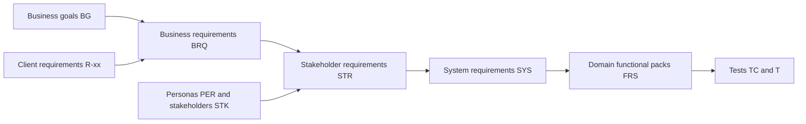

<picture>
  <source media="(prefers-color-scheme: dark)" srcset="../assets/MultipliersKraftLogoDark.png">
  
</picture>

# STRS-01 — Stakeholder Requirements Specification

| Attribute | Value |
| :--- | :--- |
| Document ID | STRS-01 |
| Title | Stakeholder Requirements Specification |
| Product | Nucleus Suite (Nucleus HRMS Suite) |
| Version | 1.0.0 |
| Status | Issued for approval |
| Owner (role) | Business Analyst Lead (with the UX Research Lead) |
| Author | Dhanraj Dadhich |
| Reviewed by | *pending* |
| Approved by | Product Council — *pending* |
| Date | 2026-11-05 |
| Classification | Internal |
| CMMI practice areas | RDM, VV, PLAN |
| Related documents | GOV-01, GOV-07, GOV-08, GOV-09, GOV-10, GOV-11, BA-04, BA-05, TR-01, VV-02, NFR-01, BRS-01, CONOPS-01 |
| Quality & process-performance objectives | QPPO-05 (effective requirements reviews), QPPO-01 (escaped defects) |
| Process performance baseline used | PPB-01 (review defect density), PPB-02 (review rate) |
| Peer review record | *pending* (PR-xxxx, QA-02) |
| Tailoring record | none |
| Traceability anchor | BRQ-001 – BRQ-090 · BG-01 – BG-10 · R-01 – R-27 · STK-01 – STK-37 · PER-01 – PER-16 |

---

## 1. Introduction

### 1.1 Purpose

This specification records what each stakeholder and user class needs from Nucleus Suite, stated from their point of view and in terms they can validate. It refines the business requirements of BRS-01 into stakeholder requirements (`STR-nnn`) and is in turn refined into system requirements (`SYS-nnn`) and the functional packs. Each stakeholder requirement names the business requirement, business goal and, where applicable, the client requirement it serves.

### 1.2 Derivation chain

### 1.3 Conventions

Requirements use MUST, SHOULD and MAY, one per statement. Priority uses MoSCoW. Verification uses **I** Inspection, **A** Analysis, **D** Demonstration, **T** Test. Client acceptance tests from VV-02 are named as `T-nn`. Personas and data scopes follow GOV-08 and BA-04; where they differ, BA-04 (derived from the source workbook) prevails.

### 1.4 Stage note

The current stage is **R0 — UI-validation prototype on local JSON** (DEC-0002). Stakeholder requirements are validated in R0 by walkthrough on the prototype; behaviour that needs a live backend, external system, bank or statutory portal is validated only in the phase that delivers it.

## 2. Stakeholder Classes

| Class | Stakeholders (GOV-07) | Interest in Nucleus Suite | Influence | How represented here |
| :--- | :--- | :--- | :--- | :--- |
| Sponsorship and executive | STK-01 Executive Sponsor, STK-02 CHRO, STK-03 CFO, STK-04 CIO/CTO, STK-05 CISO, STK-06 DPO, STK-07 Legal | Business case, people strategy, payroll cost and GL integrity, architecture, security, privacy, legal defensibility | High | PER-01, PER-05, PER-14 requirements; §5.17; §6 quality expectations |
| HR, payroll and operations | STK-08 HR Operations Head, STK-09 HRBPs, STK-10 Payroll Manager, STK-11 C&B Lead, STK-12 TA Lead, STK-13 Capability Lead, STK-14 Plant Head, STK-15 Plant Supervisors, STK-16 Line Managers | Daily operation of HR, time, payroll, hiring, learning and plants | Medium to high | PER-02 – PER-07, PER-09, PER-13 requirements |
| Workforce and external users | STK-17 Employees, STK-18 Contract and frontline workers, STK-19 Works council and union representatives, STK-20 Candidates, STK-21 Alumni | Correct pay, fair treatment, privacy, easy access in their language | Low individually, high collectively (STK-19 high) | PER-08, PER-11, PER-12 requirements; §5.17 |
| Technology, delivery and partners | STK-22 ERP and finance systems team, STK-23 Architects, STK-24 Engineering, STK-25 QA, STK-26 Implementation partners, STK-27 AI and cloud providers, STK-28 Biometric device vendors | Clean interfaces, testable requirements, stable contracts | Medium | PER-10, PER-16 requirements; §6, §8 |
| Assurance and regulators | STK-29 Internal Audit, STK-30 External Auditor, STK-31 CMMI Lead Appraiser, STK-32 EPFO, STK-33 ESIC, STK-34 Income Tax Department, STK-35 Factory Inspectorate, STK-36 Data Protection Board of India, STK-37 Labour and Shops & Establishments authorities | Evidence, correct filings, lawful processing | High (regulators), medium (appraiser) | PER-15 requirements; §5.17 |

Regulator expectations are indicative and their applicability depends on each tenant's establishments, headcount, states and sector (to be validated by Legal).

## 3. User Classes and Characteristics

| Persona | User class | Console | Typical population | Frequency of use | Digital literacy | Primary channel | Language | Data scope (default) |
| :--- | :--- | :--- | :--- | :--- | :--- | :--- | :--- | :--- |
| PER-01 | CHRO / people strategy executive | S1 | 1–5 | Weekly, ad hoc | High | Desktop, tablet, voice briefing | English plus a regional language | Aggregated organisation-wide; individual drill-down with recorded purpose |
| PER-02 | HR business partner, HR operations, HR Head | S2 | 1 per 100–300 employees | Daily, intensive | High | Desktop, keyboard-first | English plus a regional language | Assigned entities or units; sensitive identifiers masked by default |
| PER-03 | Plant supervisor / time office | S3 | 1 per 30–80 workers | Every shift | Medium | Shared plant terminal, rugged mobile, voice | Regional language first | Location-scoped; salary masked |
| PER-04 | Talent acquisition lead / recruiter | S4 | Small team | Daily | High | Desktop, mobile approvals | English | Candidates for assigned requisitions; offer bands only |
| PER-05 | Finance controller | S5 | 1–3 | Per payroll cycle | High | Desktop | English | Compensation and cost; bank details masked |
| PER-06 | Talent calibration lead | S6 | 1–3 | Per cycle | High | Desktop, large-screen session | English | Ratings for the calibration population |
| PER-07 | Line manager | S7 | 1 per 6–12 employees | Daily, short sessions | Medium to high | Mobile first, desktop, voice | English plus a regional language | Direct and indirect reports |
| PER-08 | Employee (knowledge worker) | S8 | Majority of corporate staff | Weekly | Medium to high | Mobile, desktop, voice, messaging channel (opt-in) | Any of 11 languages | Own records |
| PER-09 | Capability / learning lead | S9 | 1–5 | Weekly | High | Desktop | English; content in several languages | Learning and skills; no compensation |
| PER-10 | Super admin / platform admin | S10 | 1–3 per tenant | Weekly | Very high | Desktop | English | Configuration and metadata only |
| PER-11 | Contract / frontline worker | S8 lite, kiosk | Large share in manufacturing | Every shift (punch), monthly (pay) | Low | Kiosk, shared device, basic mobile, voice | Regional language, voice-first | Own records; session ends on shared devices |
| PER-12 | Candidate | Careers portal | Many per opening | During application | Varied | Mobile web | Multilingual | Own application |
| PER-13 | Payroll administrator | S5 control room | 1 per 1,000–3,000 employees | Daily during cycle | High | Desktop | English | Payroll group; bank details revealed only at disbursement |
| PER-14 | DPO / compliance officer | S10 privacy and compliance workspace | 1–2 | Weekly, on events | High | Desktop | English | Metadata, logs, consent; personal data per request |
| PER-15 | External / statutory auditor | Read-only audit workspace | Periodic | Per audit | High | Desktop | English | Read-only, time-bound, audit period |
| PER-16 | Integration / system user | API only | Per integration | Continuous | Not applicable | API and events | Not applicable | Declared integration scopes only |

Two further roles from BA-04 act in approval routes without a dedicated persona: the **Director** (special-terms sanction on loans) and **department clearance owners** (no-dues sign-off). Their requirements are in §5.17.

## 4. Stakeholder Needs

| Persona | Top needs | Pain points today | Success indicator |
| :--- | :--- | :--- | :--- |
| PER-01 CHRO | Live workforce and cost picture; answers with evidence; manpower against sanction | Reports weeks late; spreadsheets for planning | Standard question answered in under 1 minute |
| PER-02 HR operations | Effective-dated changes without payroll errors; fewer approval chases; reproducible letters | Retro mistakes; manual credits; paper no-dues | Lifecycle transaction under 3 minutes; first-time-right above 98% |
| PER-03 Plant supervisor | Exceptions, not spreadsheets; quick approvals; registers ready for inspection | Missed punches, manual muster rolls, salary visibility rules | Exceptions cleared before shift end; zero register gaps at inspection |
| PER-04 TA lead | Hiring within sanction; fair, explainable shortlists | Double-counted headcount; email requisitions | Time-to-fill; adverse-impact ratio within threshold |
| PER-05 Finance controller | Balanced, idempotent postings; reconciled payroll; controlled lock | Typed journals; late adjustments | 100% balanced postings; fewer close days |
| PER-06 Calibration lead | Fair calibration with distribution and bias checks | Spreadsheets and rater bias | Variance within ±2% of quota |
| PER-07 Line manager | One inbox; team history; mobile approvals | Approvals scattered across modules | Approval cycle under 24 hours |
| PER-08 Employee | Self-service in own language; clear payslip; quick leave | HR tickets for simple questions | Self-service resolution above 80% |
| PER-09 Capability lead | Induction and mandatory training tracked from joining | Content and records in silos | 100% mandatory completion by due date |
| PER-10 Super admin | Configure without code; least privilege with impact preview | Risky bulk changes; unclear permission effects | Zero unauthorised privilege escalations |
| PER-11 Contract worker | Paid for every hour; proof of attendance; voice in own language | Wage disputes; no personal smartphone | Kiosk task success above 90% unaided; fewer wage disputes |
| PER-12 Candidate | Simple application; status; fair assessment | No updates; opaque rejection | Application completion rate |
| PER-13 Payroll administrator | Validated inputs; reproducible runs; explained variances | Late inputs; retro changes; state rules | Payroll accuracy above 99.9%; zero statutory penalties |
| PER-14 DPO / compliance | Obligations, registers and rights handled with evidence | No data map; forms per state by hand | Rights requests within statutory time; registers on demand |
| PER-15 Auditor | Reliable, reproducible evidence | Untraceable changes | Evidence turnaround time |
| PER-16 Integration user | Reliable, idempotent exchange | Re-keying and silent failures | Delivery success rate; recovery time |

## 5. Stakeholder Requirements

### 5.1 PER-01 — CHRO (S1)

| ID | Requirement | Rationale | Trace (BRQ · BG · R) | Priority | Verif. | Acceptance criterion |
| :--- | :--- | :--- | :--- | :--- | :--- | :--- |
| STR-001 | The CHRO MUST see headcount, people cost, overtime, attrition and diversity trends on the S1 console without requesting a report. | Decisions are taken on stale data today. | BRQ-090 · BG-08 · — | Must | D | S1 shows the five widgets for the current month and the previous twelve, filtered by entity and site. |
| STR-002 | The CHRO SHOULD be able to ask workforce questions in natural language and receive answers that cite their data sources. | Time to insight under one minute is the CHRO's success measure. | BRQ-090 · BG-08 · R-26 | Should | T | On the curated question benchmark at least 85% of answers are correct and every answer lists its sources. |
| STR-003 | The CHRO MUST see sanctioned, actual and open manpower and the variance by department, location and designation. | Hiring and cost control depend on this view. | BRQ-001 · BG-01 · R-26 | Must | D | The matrix for OU-111 Machining shows 24 sanctioned, 24 actual, 1 open, variance 0. |
| STR-004 | Any prediction shown to the CHRO MUST show its explanation and confidence and MUST NOT appear as an unexplained score. | Leaders must be able to challenge AI outputs. | BRQ-074, BRQ-090 · BG-06, BG-08 · — | Must | I | Each attrition-risk entry shows its top contributing factors and a confidence band. |
| STR-005 | Drilling from aggregated figures to named individuals MUST require a recorded purpose and MUST be logged. | Aggregated access is the CHRO default; individual access is sensitive. | BRQ-086 · BG-06 · — | Must | T | A drill-down without a purpose is refused; with a purpose an access event is written. |

### 5.2 PER-02 — HR business partner, HR operations and HR Head (S2)

| ID | Requirement | Rationale | Trace (BRQ · BG · R) | Priority | Verif. | Acceptance criterion |
| :--- | :--- | :--- | :--- | :--- | :--- | :--- |
| STR-006 | HR operations MUST be able to record a transfer, promotion or worker-class change with a past or future effective date and see its payroll effect before saving. | Effective-dating mistakes are the top HR operations pain point. | BRQ-016, BRQ-012 · BG-01 · — | Must | D | A transfer effective next month shows the change in location scope, professional tax state and holiday calendar before save, and completes in under three minutes. |
| STR-007 | HR operations MUST be able to set rest-day applicability, wage basis and overtime eligibility per worker class and override them per worker with reason and dates. | Client worker groups differ in entitlement. | BRQ-012, BRQ-013, BRQ-014 · BG-01 · R-03, R-04, R-05 | Must | D | WC-CONT shows no rest days and daily wage; WC-3PE rest days active; WC-3PH no rest days; an override on one worker carries reason and dates. |
| STR-008 | The HR Head MUST be able to approve leave at level 3 only after levels 1 and 2, and MAY edit an application with a reason that is logged against the HR Head. | The client's three-level chain and HR override. | BRQ-036 · BG-01 · R-06 | Must | T | T-09 passes; the edit history names the HR Head, not the original approver. |
| STR-009 | The HR Head MUST be able to record an early return and see confirmation that unused days were credited and attendance corrected. | Ledger and attendance must agree. | BRQ-037 · BG-01 · R-06 | Must | T | T-08 passes and the confirmation lists the credited days and corrected dates. |
| STR-010 | HR operations MUST be able to issue appointment and other HR letters from versioned letter formats with preview, and reprint any issued letter exactly. | Letters are legal evidence. | BRQ-011 · BG-01 · R-22 | Must | T | T-36 passes for the appointment letter of E1066. |
| STR-011 | An HRBP MUST see all pending approvals in their scope that have exceeded SLA, across modules, with the current approver named. | Approval chases consume HRBP time. | BRQ-085, BRQ-043 · BG-02 · R-06 | Must | D | The SLA view lists overdue leave, overtime, loan and clearance items with age and approver. |
| STR-012 | From the day of resignation the HR Head MUST see the notice shortfall and exactly which clearance lines (including assets issued at joining) hold a settlement, and MUST be able to release it the moment they clear. | Same-day settlement is the client's expectation. | BRQ-079, BRQ-080, BRQ-081, BRQ-010 · BG-01 · R-17, R-24 | Must | T | T-30 passes; E1042 shows the IT laptop and library lines blocking; E1068 is released on his last working day. |
| STR-013 | HR operations MUST be able to browse the organisation chart by department with search, expand, collapse and zoom, and open an employee's record from any card. | The chart is used daily for routing and planning. | BRQ-015 · BG-01 · R-23 | Must | D | Searching for an employee expands the branch to their card; T-37 passes. |
| STR-014 | HR operations SHOULD be warned of a likely duplicate person before a new record is created. | Same name and date of birth at one site is common. | BRQ-006 · BG-01 · R-15 | Should | T | Creating a person who matches name, date of birth and site raises a duplicate review. |
| STR-099 | HR operations SHOULD record each personal document with its type, classification, issue date and expiry date, and see every document due to expire within 30 days for the workers in their scope. | Expired licences, permits and medical fitness certificates create compliance exposure at plants. | BRQ-017 · BG-06 · R-27 | Should | D | The expiry list for the Peenya plant shows a medical fitness certificate due in 21 days with the worker, document type and owner; documents outside HR operations' scope are not listed. |

### 5.3 PER-03 — Plant supervisor and time office (S3)

| ID | Requirement | Rationale | Trace (BRQ · BG · R) | Priority | Verif. | Acceptance criterion |
| :--- | :--- | :--- | :--- | :--- | :--- | :--- |
| STR-015 | The supervisor MUST see a live shift board with exceptions (missed punch, late beyond grace, overtime above cap) for their assigned sites and shifts only. | Exceptions must be cleared before shift end. | BRQ-028 · BG-03 · — | Must | D | The board for the Peenya plant B shift lists open exceptions; workers from other sites are absent. |
| STR-016 | The supervisor MUST be able to regularise a missed or wrong punch with evidence, and the original punch MUST remain visible. | Corrections must be traceable for disputes. | BRQ-028, BRQ-018 · BG-03 · — | Must | T | A regularisation shows original and corrected status, evidence, actor and approver. |
| STR-017 | The supervisor MUST be able to open a punch timeline for any worker in scope, showing session segments, breaks, gross hours and overtime. | Night-shift sessions are the most disputed. | BRQ-019, BRQ-020, BRQ-021 · BG-03 · R-01 | Must | D | E1018 on 08 September shows segments 08:00–20:30 and 21:15–03:20, break 45 minutes, gross 19:20, overtime 7:20 (T-01 – T-03). |
| STR-018 | The supervisor MUST see computed overtime when approving and MUST be able to reduce but not increase it. | Overtime cannot be inflated. | BRQ-022 · BG-04 · R-01, R-11 | Must | T | Entering more than the computed hours is refused; a reduction requires a reason. |
| STR-019 | The approver MUST be able to approve a gate pass in about ten seconds, with the month's used hours and passes shown on the request. | Gate passes are frequent and time-sensitive. | BRQ-027 · BG-03 · R-12 | Must | D | The request card shows "2 of 4 hours, 1 of 2 passes used" and approval takes one action. |
| STR-020 | The supervisor MUST see both the rostered and the inferred shift for a day and why the inferred shift was chosen. | Workers coming in on another shift must not be marked late. | BRQ-023 · BG-03 · R-14 | Must | D | E1020 on 04 September shows rostered SH-A, inferred SH-B, and the in-punch time that decided it (T-27). |
| STR-021 | For each day status the supervisor MUST see the rule applied: shift-length threshold, late count, grade exemption, long-night relief or leave-and-punch conflict. | Explaining a half day prevents disputes. | BRQ-024, BRQ-025, BRQ-026, BRQ-041 · BG-03 · R-13 | Must | D | E1019 on 10 September shows "fourth late beyond grace this month"; E1021 shows "grade exempt" (T-24 – T-26). |
| STR-022 | The supervisor MUST see a rest-day badge for contract workers, third-party employees and helpers. | Rest-day entitlement differs by sub-category. | BRQ-013, BRQ-014, BRQ-046 · BG-03 · R-03, R-04 | Must | D | E1032 and E1036 show "No rest days (daily wage)"; E1034 shows "Rest days active". |
| STR-023 | The supervisor MUST NOT see compensation or rate fields for workers outside their payroll group in any screen, report, export, voice answer or agent output. | Plant users see time, not rate. | BRQ-083 · BG-06 · R-09 | Must | T | T-18 passes for E1056 when signed in as plant HR Chennai. |
| STR-024 | The time office MUST be able to keep capturing punches and approvals when the site loses connectivity, with later synchronisation and no silent loss. | Plants have unreliable connectivity. | BRQ-018 · BG-03 · — | Must | T | Punches captured during a simulated two-hour outage all arrive with their original times; conflicts appear in the exception queue. |
| STR-025 | The supervisor MUST be able to use S3 in their regional language with icon-led navigation and touch targets usable with gloves on a shared terminal. | Floor conditions and language needs. | BRQ-089 · BG-03 · — | Must | D | S3 tasks are completed in Tamil and Marathi by plant users in R0 validation; touch targets meet the size set in NFR-01. |
| STR-026 | The time office MUST be able to generate the muster roll and overtime register for its site and period on demand. | Inspections are unannounced. | BRQ-070, BRQ-031 · BG-03 · R-18 | Must | D | Form 28 and the overtime register for September generate for the Peenya plant without manual entry. |

### 5.4 PER-04 — Talent acquisition lead (S4)

| ID | Requirement | Rationale | Trace (BRQ · BG · R) | Priority | Verif. | Acceptance criterion |
| :--- | :--- | :--- | :--- | :--- | :--- | :--- |
| STR-027 | The TA lead MUST be able to raise a replacement requisition by selecting the vacated position code. | Replacement must not add headcount. | BRQ-002 · BG-01 · R-25 | Must | T | T-39 passes for REQ-2026-0037 against POS-2214. |
| STR-028 | The TA lead MUST be told at submission when a requisition exceeds sanctioned strength and see the additional approval route. | Hiring beyond sanction is a management decision. | BRQ-003 · BG-01 · R-26 | Must | T | T-40 passes; the message names the department, its sanction and the extra approver. |
| STR-029 | The TA lead MUST see AI ranking with its explanation and MUST be the one who rejects a candidate, with a recorded reason. | AI may rank but never auto-reject. | BRQ-004 · BG-05, BG-06 · — | Must | I | No candidate in the pipeline has a rejection without a human actor and reason. |
| STR-030 | The TA lead SHOULD see referral status and award milestones for each referred candidate. | Referral awards depend on joining and confirmation. | BRQ-005 · BG-05 · R-20 | Should | D | RF-2026-0021 shows first-stage award paid; RF-2026-0026 shows balance pending confirmation. |
| STR-031 | An accepted offer MUST flow into pre-boarding without re-keying candidate data. | Re-keying causes errors and delay. | BRQ-006, BRQ-007 · BG-01 · R-24 | Must | D | Accepting an offer creates the pre-boarding checklist populated from the candidate record. |

### 5.5 PER-05 — Finance controller (S5)

| ID | Requirement | Rationale | Trace (BRQ · BG · R) | Priority | Verif. | Acceptance criterion |
| :--- | :--- | :--- | :--- | :--- | :--- | :--- |
| STR-032 | The finance controller MUST be prevented from approving a run that contains unmapped pay components and MUST see the list of unmapped components. | Unmapped lines cannot be posted. | BRQ-066 · BG-07 · R-16 | Must | T | With GL-023 missing, approval is refused and the component is listed. |
| STR-033 | The finance controller MUST receive one balanced journal per run per legal entity in the posting format of their ERP system, with no duplicate on re-run and visible failures. | Finance close depends on correct postings. | BRQ-067 · BG-07 · R-16 | Must | T | T-29 passes. |
| STR-034 | The finance controller MUST be able to reconcile the posted journal against the bank advice on screen. | Reconciliation must not depend on support scripts. | BRQ-068 · BG-07 · R-16 | Must | D | The September reconciliation shows equal totals and lists any differences by employee. |
| STR-035 | The finance controller MUST see the overtime run as a separate run with its own bank advice and journal. | Overtime is paid after salary. | BRQ-048, BRQ-049 · BG-04 · R-11 | Must | T | T-22 passes; PR-2026-09-02 has its own advice and journal batch. |
| STR-036 | The finance controller MUST authorise payroll lock with the variance against the previous run explained, under dual control. | Lock is a financial control. | BRQ-051, BRQ-055 · BG-04 · — | Must | T | The lock screen shows variance by component with causes; the preparer cannot also authorise. |
| STR-037 | The finance approver of a loan MUST see the eligibility snapshot (outstanding loans, ceiling, guarantor status) taken at application. | Loan approvals must be informed and auditable. | BRQ-058, BRQ-059, BRQ-060 · BG-04 · R-10 | Must | D | LN-2026-0041 shows ceiling 4× basic and guarantors E1040 and E1041 locked. |

### 5.6 PER-06 — Talent calibration lead (S6)

| ID | Requirement | Rationale | Trace (BRQ · BG · R) | Priority | Verif. | Acceptance criterion |
| :--- | :--- | :--- | :--- | :--- | :--- | :--- |
| STR-038 | The calibration lead SHOULD run sessions on a 9-box board showing distribution against quota with variance beyond ±2% flagged. | Consistent, fair calibration. | BRQ-078 · BG-05 · — | Should | D | A cell exceeding quota by more than 2% shows a warning badge. |
| STR-039 | The calibration lead SHOULD receive a bias-check report before finalising a cycle. | BO-05.3 requires it for every cycle. | BRQ-078 · BG-05 · — | Should | T | Finalisation is refused until the report is generated and acknowledged. |
| STR-040 | No final rating MUST be produced by AI; AI evidence summaries MUST be labelled as AI-generated. | Consequential decisions stay human (GOV-11 Tier 4). | BRQ-074, BRQ-077 · BG-06 · — | Must | I | Every final rating carries a human actor; AI summaries carry a label. |

### 5.7 PER-07 — Line manager (S7)

| ID | Requirement | Rationale | Trace (BRQ · BG · R) | Priority | Verif. | Acceptance criterion |
| :--- | :--- | :--- | :--- | :--- | :--- | :--- |
| STR-041 | The manager MUST have one approval inbox for every module, usable on mobile. | Approvals are scattered today. | BRQ-043 · BG-02 · R-06, R-12 | Must | D | Leave, overtime, gate pass and regularisation items appear together on a phone. |
| STR-042 | The manager MUST be able to view and export attendance, overtime and late history for any date range for people in their reporting line only. | Requested by the client for Team Calendar. | BRQ-030 · BG-03 · R-02 | Must | T | T-05 passes for U-003 Nikhil Iyer; non-reportees are not selectable. |
| STR-043 | The manager SHOULD see team coverage for the requested dates when approving leave. | Coverage-aware approvals reduce disruption. | BRQ-036, BRQ-043 · BG-02 · R-06 | Should | D | The approval card shows who else is absent on those dates. |
| STR-044 | The manager MUST NOT be able to approve their own request; it MUST route to their own approver. | No self-approval (INV-SEC-02). | BRQ-085 · BG-06 · — | Must | T | A manager's own leave never appears in their inbox. |
| STR-045 | The manager SHOULD be able to approve from the business messaging channel with the same rules as the portal. | Managers on the floor rarely sit at a desk. | BRQ-044 · BG-03 · R-12 | Should | T | A gate pass beyond entitlement cannot be approved from the messaging channel. |
| STR-046 | The manager MUST be able to nominate a team member for the star-employee programme. | Recognition starts with the manager. | BRQ-075 · BG-05 · R-19 | Must | D | A nomination appears in the programme's selection queue with the nominator recorded. |
| STR-106 | The manager SHOULD be able to propose compensation revisions for their reportees within the budget cascaded to their team, see the simulated cost before submitting, and see the exception route for any proposal above the configured threshold. | Revision quality depends on managers seeing budget and cost at the point of decision. | BRQ-064 · BG-04, BG-05 · R-22 | Should | D | A proposal that keeps the team within budget submits on the normal route; a proposal above the threshold shows the exception approver before submission. |

### 5.8 PER-08 — Employee (S8)

| ID | Requirement | Rationale | Trace (BRQ · BG · R) | Priority | Verif. | Acceptance criterion |
| :--- | :--- | :--- | :--- | :--- | :--- | :--- |
| STR-047 | The employee MUST be able to apply for leave by voice or chat in their language, hear or read the details back and confirm before submission. | Agent writes on the user's own records need confirmation (GOV-11 Tier 2). | BRQ-089, BRQ-088 · BG-02 · R-06 | Must | D | A spoken request in Hindi is read back and submitted only after the employee confirms; the action ledger shows both steps. |
| STR-048 | The employee MUST be told why a leave application is refused, with the rule named. | Unexplained refusals drive tickets. | BRQ-034 · BG-01 · R-08 | Must | T | T-15 and T-16 refusals show the combination rule or the monthly cap. |
| STR-049 | The employee MUST see balances by leave type, credited automatically under their leave scheme, including each comp-off credit with its own expiry date. | Manual credits are slow; comp-off lapses per credit. | BRQ-032, BRQ-033, BRQ-038, BRQ-040 · BG-01 · R-07, R-08 | Must | D | E1067 shows 9 EL credited on 16 September; E1028 shows CO-2026-0231 Lapsed and CO-2026-0288 Active with expiry 05 November. |
| STR-050 | The employee MUST be able to open the payslip of each run separately, see an explanation of each deduction, and view the latest payslip offline. | Opaque payslips; separate overtime run. | BRQ-057, BRQ-042 · BG-04 · R-11 | Must | D | The regular and overtime payslips for September open separately; PF and PT lines show explanations; the latest opens offline. |
| STR-051 | The employee MUST be able to check loan eligibility and apply, naming guarantors, before any approval step. | Eligibility must be known before applying. | BRQ-058, BRQ-059, BRQ-060 · BG-04 · R-10 | Must | T | T-19 and T-21 pass from the employee's view. |
| STR-052 | An employee asked to be a guarantor MUST be able to accept or decline and MUST be told that acceptance blocks their own borrowing and further guarantees. | Informed consent to the interlock. | BRQ-060 · BG-04 · R-10 | Must | T | The request shows the lockout consequence; T-20 passes after acceptance. |
| STR-053 | The employee MUST receive policy answers with citations, and when no answer is found MUST be told so and given a ticket number. | Grounded answers only. | BRQ-045 · BG-02 · R-08 | Must | T | An out-of-policy question returns "no answer found" with a ticket; answered questions show sources. |
| STR-054 | The employee MUST be able to see and change consents and request a copy, correction or erasure of their personal data. | DPDP Act 2023 rights (to be validated by Legal). | BRQ-073 · BG-06 · — | Must | D | The privacy centre shows consents by purpose and accepts each request type with tracking. |
| STR-055 | The employee SHOULD be able to refer a candidate to an open requisition and track the award. | Referral programme engagement. | BRQ-005 · BG-05 · R-20 | Should | D | T-34 passes from the referrer's view. |
| STR-056 | The employee SHOULD see announcements for their audience (company, plant or head office). | Targeted communication. | BRQ-076 · BG-05 · R-21 | Should | D | T-35 passes; a plant-only announcement is not shown to head-office staff. |
| STR-057 | A joiner MUST be able to submit Form F nomination details digitally and receive the appointment letter in the joining flow. | Statutory joining forms belong in the joining chain. | BRQ-008, BRQ-011 · BG-03 · R-27, R-22 | Must | T | T-31 passes with the joiner's submission timestamp recorded. |
| STR-058 | The employee MUST be able to punch in from mobile within the geofence and see their attendance status in three taps or fewer. | Self-service effort. | BRQ-018, BRQ-042 · BG-03 · — | Must | D | A punch inside the geofence is accepted and today's status is visible within three taps; outside it is refused with a reason. |
| STR-100 | The employee SHOULD receive a reminder before one of their own documents expires and SHOULD be able to upload the renewed document, with the expired version kept in history. | The document holder is the person who can renew it. | BRQ-017 · BG-06 · R-27 | Should | D | A reminder arrives 30 days before a driving-licence expiry date; the uploaded renewal becomes current and the previous version remains viewable with its validity dates. |
| STR-101 | A DET or GET trainee SHOULD see casual leave in their balances and be able to apply for it, and an eligible employee SHOULD be able to apply for birthday leave once the tenant enables that leave type. | The client grants CL to trainee categories and names birthday leave as a benefit. | BRQ-035 · BG-01 · R-08 | Should | D | A GET trainee's balance screen shows CL under the trainee scheme; with birthday leave enabled, an application for the employee's birthday is accepted under the birthday leave type. |

### 5.9 PER-09 — Capability and learning lead (S9)

| ID | Requirement | Rationale | Trace (BRQ · BG · R) | Priority | Verif. | Acceptance criterion |
| :--- | :--- | :--- | :--- | :--- | :--- | :--- |
| STR-059 | The capability lead MUST have induction paths assigned automatically at joining and see completion, with incomplete mandatory items blocking confirmation. | Induction is a plant safety obligation. | BRQ-009 · BG-01 · R-24 | Must | T | T-38 passes. |
| STR-060 | The capability lead COULD see a skills heatmap and assign mandatory training by population. | Skills-based development (BO-05.1). | BRQ-077 · BG-05 · — | Could | D | Mandatory safety training is assigned to all Peenya plant workers and completion is tracked. |

### 5.10 PER-10 — Super admin (S10)

| ID | Requirement | Rationale | Trace (BRQ · BG · R) | Priority | Verif. | Acceptance criterion |
| :--- | :--- | :--- | :--- | :--- | :--- | :--- |
| STR-061 | The admin MUST be able to change client rules (thresholds, grace, entitlements, accrual, ceilings, lapse windows) as configuration with an effective date and a preview of affected records. | Rules must not need a release. | BRQ-084 · BG-07 · R-07, R-08, R-10, R-12, R-13 | Must | I | Changing the comp-off lapse window shows the affected credits before saving and applies from the effective date. |
| STR-062 | The admin MUST be able to grant a role with data scope (entity, reporting line, location, payroll group) and see what the grantee will and will not see before saving. | Least privilege with visible effect. | BRQ-083 · BG-06 · R-09 | Must | D | Granting R-PLANT-HR for LOC-CHN previews attendance access and salary masking for E1056. |
| STR-063 | The admin MUST be able to define and version approval workflows without code, with in-flight requests finishing on their starting version. | Workflow change without vendor release (BO-07.3). | BRQ-085 · BG-07 · — | Must | T | Adding a level to W-01 does not alter requests already in progress. |
| STR-064 | The admin role MUST NOT grant access to business data; any such access MUST be a time-boxed, logged break-glass grant. | Separation of configuration from data. | BRQ-086 · BG-06 · — | Must | T | An admin opening a payslip without break-glass is refused; a break-glass grant expires and is logged. |
| STR-065 | The admin MUST be able to set agent autonomy per tenant and per tool (propose only, execute after user confirmation, execute within limits) and the blast-radius limits. | Autonomy defaults are a tenant decision (OD-13). | BRQ-088 · BG-02 · — | Must | I | The agent policy screen shows autonomy and limits per tool; the first tenant starts at propose-only. |
| STR-102 | The admin SHOULD be able to make trainee categories eligible for casual leave and define birthday leave as a leave type through configuration, entering its quantum when the client confirms it. | Eligibility rules differ by client and must not need a release. | BRQ-035, BRQ-084 · BG-01, BG-07 · R-08 | Should | I | Configuration shows DET and GET eligible for CL and a birthday leave type whose quantum is set once Q-03 is closed at the P1 G1 gate. |
| STR-103 | The super admin of a newly contracted tenant SHOULD find the hosting region, default roles, default approval chain, reference rule packs and picklists already in place at first sign-in, so that configuration can start the same business day. | Implementation starts from a working baseline, not an empty tenant. | BRQ-082 · BG-10 · — | Should | D | At first sign-in the new tenant's S10 console lists the default roles, the default approval chain and the effective statutory rule packs, and the provisioning log shows completion within one business day of the signed order. |

### 5.11 PER-11 — Contract and frontline worker

| ID | Requirement | Rationale | Trace (BRQ · BG · R) | Priority | Verif. | Acceptance criterion |
| :--- | :--- | :--- | :--- | :--- | :--- | :--- |
| STR-066 | The worker MUST be able to identify at a kiosk or shared device without stored credentials, and the session MUST end automatically. | Shared devices must not expose another worker's data. | BRQ-086, BRQ-042 · BG-06 · — | Must | T | After the inactivity limit in NFR-01 the session closes; no credential is stored on the device. |
| STR-067 | The worker MUST be able to hear this week's hours, overtime and wage summary in their language, with audio read-back. | Low literacy and no personal smartphone. | BRQ-089, BRQ-054 · BG-03 · R-03 | Must | D | A Tamil-speaking worker hears the summary at a kiosk and completes the task unaided in R0 validation. |
| STR-068 | A daily-wage worker MUST see days worked and daily rate as a separate line on the payslip. | Pay must be understandable. | BRQ-054 · BG-04 · R-03 | Must | D | E1032's payslip shows days worked × daily rate. |
| STR-069 | The worker MUST be able to raise a grievance or wage dispute by voice and be routed to a person. | Disputes must reach a human. | BRQ-045 · BG-02 · — | Must | D | A spoken dispute creates a ticket assigned to plant HR with the recording reference. |
| STR-070 | The worker SHOULD be able to request a gate pass from a kiosk or the messaging channel. | Frontline access to self-service. | BRQ-027, BRQ-044 · BG-03 · R-12 | Should | D | A kiosk gate-pass request reaches the manager's inbox with the entitlement shown. |
| STR-104 | The worker COULD see their earned pay to date for the current period and request earned wage access up to the amount the employer's policy allows, with that amount shown before submission. | Access to wages already earned reduces reliance on informal lenders. | BRQ-063 · BG-04 · — | Could | T | In an opted-in tenant the worker sees earned pay to date and the available amount; a request above 50% of accrued net pay is refused with the available amount stated. |

### 5.12 PER-12 — Candidate

| ID | Requirement | Rationale | Trace (BRQ · BG · R) | Priority | Verif. | Acceptance criterion |
| :--- | :--- | :--- | :--- | :--- | :--- | :--- |
| STR-071 | The candidate SHOULD be able to apply on a mobile browser and track application status. | Candidate experience. | BRQ-004 · BG-05 · — | Should | D | An application completes on a mobile browser and the status page reflects each stage. |
| STR-072 | The candidate MUST be told when AI is used in screening and MUST be able to request human review. | Transparency and contestability (GOV-11). | BRQ-004, BRQ-074 · BG-06 · — | Must | I | The application notice states AI use; a review request reaches the recruiter. |

### 5.13 PER-13 — Payroll administrator (S5 payroll control room)

| ID | Requirement | Rationale | Trace (BRQ · BG · R) | Priority | Verif. | Acceptance criterion |
| :--- | :--- | :--- | :--- | :--- | :--- | :--- |
| STR-073 | The payroll administrator MUST run payroll through an eight-stage control room showing each stage's status and timestamps. | Time-to-lock is measured by stage. | BRQ-050 – BRQ-056 · BG-04 · — | Must | D | The September run shows all eight stages with start and end times. |
| STR-074 | The payroll administrator MUST be able to lock inputs into a snapshot and reproduce any locked run exactly. | Reproducibility for audit and disputes. | BRQ-050 · BG-04 · — | Must | T | Re-executing PR-2026-09-01 from its snapshot gives identical results. |
| STR-075 | The payroll administrator MUST be able to explain why net pay changed for a group of employees against the previous run. | "Why did net pay change for 42 employees?" is a recurring question. | BRQ-051, BRQ-052 · BG-04 · — | Must | D | Selecting the changed group shows causes by component (attendance, arrears, statutory). |
| STR-076 | The payroll administrator MUST be able to start the overtime run only after the linked salary run is closed. | Client policy. | BRQ-049 · BG-04 · R-11 | Must | T | T-22 passes. |
| STR-077 | The payroll administrator MUST have professional tax and labour welfare fund rules applied per establishment state within the same run. | Multi-state payroll. | BRQ-071 · BG-04 · R-18 | Must | T | Peenya and Chennai employees in one run carry Karnataka and Tamil Nadu slabs respectively. |
| STR-078 | The payroll administrator MUST be prevented from running a settlement while any blocking clearance line is open. | Clearance gates settlement. | BRQ-080, BRQ-081 · BG-04 · R-17 | Must | T | The settlement run for E1042 is disabled with the open lines listed. |
| STR-079 | The payroll administrator MUST receive leave encashment, recognition awards, referral awards and loan recoveries as inputs in a named run. | Money moves only through named runs. | BRQ-039, BRQ-075, BRQ-005, BRQ-062 · BG-04 · R-08, R-19, R-20, R-10 | Must | T | Each of the four input types appears in the input register of the next named run with its source record. |
| STR-080 | Attendance changes for a locked period MUST reach the payroll administrator as exceptions for the next run, never as changes to the locked run. | Locked runs are immutable. | BRQ-029 · BG-04 · — | Must | T | A late regularisation creates an exception item; the locked run's totals are unchanged. |
| STR-105 | The payroll administrator COULD see each earned wage access drawdown as a recovery input in the next named run, applied within the net-pay floor. | A drawdown is an advance against pay and is recovered only through a named run. | BRQ-063, BRQ-062 · BG-04 · R-10 | Could | T | A drawdown taken on 12 September appears in the input register of the September regular run and is recovered without breaching the net-pay floor. |

### 5.14 PER-14 — DPO and compliance officer

| ID | Requirement | Rationale | Trace (BRQ · BG · R) | Priority | Verif. | Acceptance criterion |
| :--- | :--- | :--- | :--- | :--- | :--- | :--- |
| STR-081 | The compliance officer MUST see an obligation calendar across legal entities and states with owners, due dates and status. | Late filings carry penalties. | BRQ-069 · BG-04 · R-18 | Must | D | September–November obligations for both legal entities are listed with owners. |
| STR-082 | The compliance officer MUST be able to generate statutory forms and registers in the state variant of each establishment, with gapless serials. | Wrong variants are non-compliant. | BRQ-070 · BG-03 · R-18, R-27 | Must | T | T-31 and T-32 pass. |
| STR-083 | The DPO MUST have a queue of data-principal requests in which each erasure is reconciled against statutory retention before completion. | Statutory retention overrides erasure. | BRQ-073 · BG-06 · — | Must | T | An erasure for a former employee pseudonymises identifiers and keeps statutory payroll records, with a reasons statement. |
| STR-084 | The DPO MUST be able to review sensitive-data access events and receive alerts for unusual patterns. | Insider risk and accountability. | BRQ-086 · BG-06 · — | Must | D | Access events for PAN, Aadhaar, bank and salary are searchable by actor and purpose; an out-of-pattern burst raises an alert. |
| STR-085 | The DPO MUST be able to inspect the AI inference log and the disclosures shown for each AI feature. | AI accountability. | BRQ-074 · BG-06 · — | Must | I | For each Tier 3–4 feature the log shows inputs, model version, explanation and human decision. |
| STR-086 | The compliance officer SHOULD receive each contractor's monthly PF and ESI filing evidence and be alerted when it is missing. | Principal-employer exposure (to be validated by Legal). | BRQ-047 · BG-03 · R-18 | Should | D | Vendor VN-01's missing September filing raises an alert. |

### 5.15 PER-15 — External and statutory auditor

| ID | Requirement | Rationale | Trace (BRQ · BG · R) | Priority | Verif. | Acceptance criterion |
| :--- | :--- | :--- | :--- | :--- | :--- | :--- |
| STR-087 | The auditor MUST work in a time-boxed, read-only workspace scoped to the audit period, with every access logged. | Evidence without risk of change. | BRQ-086 · BG-06 · — | Must | T | Write actions are unavailable; access after the end date is refused; every view is logged. |
| STR-088 | The auditor MUST be able to reproduce any payroll run and see the rule-pack versions it used. | Reproducible payroll evidence. | BRQ-050, BRQ-072 · BG-04 · — | Must | T | The auditor reproduces PR-2026-09-01 and sees the PF, ESI, PT and TDS pack versions. |

### 5.16 PER-16 — Integration and system user

| ID | Requirement | Rationale | Trace (BRQ · BG · R) | Priority | Verif. | Acceptance criterion |
| :--- | :--- | :--- | :--- | :--- | :--- | :--- |
| STR-089 | The integration user MUST be able to send employee-master changes inbound with field ownership enforced, failures queued with reasons and duplicate payloads rejected. | Prevents master-data drift. | BRQ-065 · BG-07 · R-15 | Must | T | T-28 passes for batch ERP-SYNC-2026-09-14. |
| STR-090 | The posting interface MUST accept an idempotency key and return an acknowledgement for each journal. | Safe retries. | BRQ-067, BRQ-087 · BG-07 · R-16 | Must | T | Re-sending a journal with the same key creates no second posting. |
| STR-091 | Integrations MUST be offered as versioned APIs and events with published schemas. | Stable contracts for partners. | BRQ-087 · BG-07 · R-15, R-16 | Must | I | The catalogue lists each API with an OpenAPI 3.1 contract and each event with a JSON Schema. |

### 5.17 Other stakeholders

| ID | Requirement | Rationale | Trace (BRQ · BG · R) | Priority | Verif. | Acceptance criterion |
| :--- | :--- | :--- | :--- | :--- | :--- | :--- |
| STR-092 | The Director MUST be able to approve loan special terms through a recorded approval that shows the rules being waived and requires a reason. | Overrides must be explicit and auditable. | BRQ-061 · BG-04 · R-10 | Must | T | LN-2026-0012 shows the Director approval with reason and waived rule; it survives later edits. |
| STR-093 | Each department clearance owner MUST be able to sign off their own line independently and record any recovery amount or waiver reason. | Parallel clearance enables same-day settlement. | BRQ-080 · BG-01 · R-17 | Must | T | IT clears E1068's laptop line while Finance's line is still open; each sign-off carries actor and time. |
| STR-094 | Works council and union representatives (STK-19) MUST receive a published notice of biometric use, monitoring scope and AI uses, and no covert monitoring MUST be possible. | Workforce trust and law (to be validated by Legal). | BRQ-073, BRQ-074 · BG-06 · — | Must | I | The notice exists per tenant; configuration offers no keystroke, screen or emotion monitoring. |
| STR-095 | The CFO (STK-03) MUST receive parallel-run reconciliation evidence within the agreed tolerance before payroll go-live. | Payroll go-live is a financial risk decision. | BRQ-050, BRQ-052 · BG-04 · — | Must | A | The parallel-run report compares net pay per employee for at least one cycle and shows variance within tolerance. |
| STR-096 | The CISO (STK-05) MUST receive evidence of tenant isolation and zero open critical or high vulnerabilities at every go-live. | BO-06.3. | BRQ-086 · BG-06 · — | Must | T | Security test reports at each G4 show zero critical and high findings and a passing tenant-isolation test. |
| STR-097 | Statutory authorities (STK-32 – STK-34) MUST receive returns in their prescribed formats generated from payroll data. | Correct filings (to be validated by Legal). | BRQ-052, BRQ-069 · BG-04 · R-18 | Must | I | PF, ESI and TDS return files for September are produced from the locked run and pass format validation. |
| STR-098 | The Factory Inspectorate (STK-35) MUST be able to inspect statutory registers at the establishment on demand. | Inspections are unannounced. | BRQ-070 · BG-03 · R-18 | Must | D | During OS-11 the muster roll, accident notice register and inspection book are produced from live data. |
| STR-107 | The Compensation & Benefits Lead (STK-11) SHOULD cascade the annual revision budget by legal entity and department, track utilisation as proposals arrive, and issue revision letters from the approved letter format once the cycle is approved. | The annual revision is the largest controllable payroll cost. | BRQ-064 · BG-04, BG-05 · R-22 | Should | D | The cycle view shows budget, proposed and approved amounts for each department of both legal entities; approving the cycle generates each revision letter with its letter-format version recorded. |
| STR-108 | Implementation partners (STK-26) SHOULD receive a tenant with standard configuration within one business day of a signed order. | Fast starts are central to the service's economics (BO-10.1). | BRQ-082 · BG-10 · — | Should | T | The provisioning log for a new tenant shows it ready for configuration within one business day of the order date. |

## 6. Operational and Quality Expectations

Stakeholder-level expectations, organised by ISO/IEC 25010 characteristic. System-level targets and measurement methods are fixed in NFR-01.

| Characteristic | Stakeholder expectation | Indicative target | Source |
| :--- | :--- | :--- | :--- |
| Functional suitability | Client rules produce the client's expected results | 100% of T-01 – T-40 pass on the golden dataset | VV-02 |
| Performance efficiency | Punches land without visible delay at peak shift change | About 500 punches per second across tenants without backlog | BA-02 TIM-01 |
| Performance efficiency | A month's attendance recompute is quick enough to run during the day | 5,000 people in under 10 minutes | BA-02 TIM-09 |
| Performance efficiency | Payroll locks soon after cut-off | ≤ 4 hours for 10,000 workers | BO-04.2 |
| Reliability | The service is available when shifts and payroll need it | ≥ 99.9% monthly | BO-10.2 |
| Reliability | Offline work is never lost | ≥ 99.9% synchronisation success, zero silent loss | BO-03.4 |
| Security | Sensitive access is always logged and salary masking holds on every channel | 100% logged; T-18 passes on every channel | BO-06.1 |
| Usability | Common self-service needs little effort | ≤ 3 taps; kiosk task success ≥ 90% unaided | GOV-08 |
| Usability | Managers approve quickly | Approval cycle under 24 hours | GOV-08 |
| Compatibility | Fits the customer's identity and ERP landscape | OIDC, SAML 2.0, SCIM 2.0; OpenAPI 3.1 and CloudEvents interfaces | GOV-01 BG-07 |
| Maintainability | Client rules change without a release | 100% of R-03 – R-13 rules as configuration | BRQ-084 |
| Portability | Works on the devices the workforce has | Shared terminals, basic mobile phones, kiosks, desktop browsers | GOV-08 |
| Explainability | People can see why the system decided something | Every day status, refusal and AI output shows its reason | GOV-11 §7 |

## 7. Accessibility and Language Needs

| Need | Who | Expectation |
| :--- | :--- | :--- |
| Accessibility standard | All users, especially PER-08 and PER-12 | WCAG 2.2 AA conformance, screen-reader support, keyboard operation |
| Languages | All users | 11 languages: English, Hindi, Marathi, Tamil, Telugu, Bengali, Spanish, French, German, Japanese and Arabic (right-to-left); frontline journeys in all 11 by P2 |
| Voice | PER-03, PER-07, PER-08, PER-11 | Voice navigation from R0; voice transactions in at least six languages by P4 |
| Low literacy | PER-11 | Icon-led screens, audio read-back, minimal text entry, simple confirmations |
| Floor conditions | PER-03, PER-11 | Large, glove-friendly touch targets; high-contrast themes; usable in noise through visual confirmation |
| Shared devices | PER-03, PER-11 | No stored credentials; automatic session end; no personal data left on screen |
| Executive view | PER-01 | Large-type summaries suited to tablets and presentation |
| Keyboard-first | PER-02, PER-13 | High-volume screens fully operable from the keyboard |
| Locale formats | All users | Indian number grouping and currency format, locale-aware dates |

## 8. Stakeholder Constraints

| ID | Constraint | Raised by |
| :--- | :--- | :--- |
| SC-01 | R0 validation uses local JSON only; no live database, external messaging, payments, live authentication or statutory filing until a recorded decision (DEC-0002). | Steering Committee |
| SC-02 | Personal data is stored and processed in a cloud region in India; AI and speech services must meet the same residency. | DPO (STK-06) |
| SC-03 | Client-side role checks are never relied on as authorisation. | CISO (STK-05) |
| SC-04 | Biometric and monitoring policy is reviewed jointly with workforce representatives before G2. | Works council and unions (STK-19) |
| SC-05 | Payroll go-live requires parallel-run evidence and compliance sign-off. | CFO (STK-03), Payroll Manager (STK-10) |
| SC-06 | Client tracker statuses are not acceptance evidence; every R-xx is verified under this specification. | Product Council |
| SC-07 | No AI-only decision on hiring, termination, pay, promotion or discipline. | Data & AI Ethics Board; Legal (STK-07) |
| SC-08 | Open client questions Q-01 to Q-16 are answered by the client before the affected stakeholder requirement is validated. | HR Product Owner |

## 9. Acceptance and Validation Approach

| Step | What is validated | Who validates | When | Evidence |
| :--- | :--- | :--- | :--- | :--- |
| V-1 R0 persona walkthroughs | Each persona's key journeys on the prototype, including voice navigation and language rendering | Representative users per persona, UX Research Lead | R0, before G1 of P0 | UX validation report per console (S1 – S10) |
| V-2 Demo-point walkthrough | All 26 client demo points against T-01 – T-40 on the golden dataset | Design-partner client, Product Owner | R0 (experience) and each phase G4 (behaviour) | Signed walkthrough record |
| V-3 Accessibility and language audit | WCAG 2.2 AA and the 11 languages | Accessibility specialist, native-language reviewers | Each phase G3 | Audit report |
| V-4 User acceptance testing | Stakeholder requirements of the phase | Stakeholder representatives per class | Each phase G4 | UAT sign-off |
| V-5 Payroll parallel run | Net pay, statutory deductions, journals | Payroll Manager, CFO | Before payroll go-live (P2) | Parallel-run reconciliation |
| V-6 AI evaluation | Accuracy, grounding, bias, explanations | Head of AI, Data & AI Ethics Board | Before any AI feature goes live | Evaluation and model-card records (GOV-11) |
| V-7 Pilot and post-implementation review | Success indicators in §4 | Steering Committee | Pilot go-live and G5 (+90 days) | Post-implementation review |

A stakeholder requirement is accepted when its acceptance criterion is met by the stated verification method and the responsible stakeholder representative signs the record. A failed criterion is raised as a defect against the phase; a criterion that the stakeholder wishes to change is raised as a change request.

## 10. Traceability

### 10.1 STR → BRQ → goal → client requirement

| STR | Stakeholder | BRQ | BG | R-xx |
| :--- | :--- | :--- | :--- | :--- |
| STR-001 | PER-01 | BRQ-090 | BG-08 | — |
| STR-002 | PER-01 | BRQ-090 | BG-08 | R-26 |
| STR-003 | PER-01 | BRQ-001 | BG-01 | R-26 |
| STR-004 | PER-01 | BRQ-074, BRQ-090 | BG-06, BG-08 | — |
| STR-005 | PER-01 | BRQ-086 | BG-06 | — |
| STR-006 | PER-02 | BRQ-016, BRQ-012 | BG-01 | — |
| STR-007 | PER-02 | BRQ-012, BRQ-013, BRQ-014 | BG-01 | R-03, R-04, R-05 |
| STR-008 | PER-02 | BRQ-036 | BG-01 | R-06 |
| STR-009 | PER-02 | BRQ-037 | BG-01 | R-06 |
| STR-010 | PER-02 | BRQ-011 | BG-01 | R-22 |
| STR-011 | PER-02 | BRQ-085, BRQ-043 | BG-02 | R-06 |
| STR-012 | PER-02 | BRQ-079, BRQ-080, BRQ-081, BRQ-010 | BG-01 | R-17, R-24 |
| STR-013 | PER-02 | BRQ-015 | BG-01 | R-23 |
| STR-014 | PER-02 | BRQ-006 | BG-01 | R-15 |
| STR-015 | PER-03 | BRQ-028 | BG-03 | — |
| STR-016 | PER-03 | BRQ-028, BRQ-018 | BG-03 | — |
| STR-017 | PER-03 | BRQ-019, BRQ-020, BRQ-021 | BG-03 | R-01 |
| STR-018 | PER-03 | BRQ-022 | BG-04 | R-01, R-11 |
| STR-019 | PER-03 | BRQ-027 | BG-03 | R-12 |
| STR-020 | PER-03 | BRQ-023 | BG-03 | R-14 |
| STR-021 | PER-03 | BRQ-024, BRQ-025, BRQ-026, BRQ-041 | BG-03 | R-13 |
| STR-022 | PER-03 | BRQ-013, BRQ-014, BRQ-046 | BG-03 | R-03, R-04 |
| STR-023 | PER-03 | BRQ-083 | BG-06 | R-09 |
| STR-024 | PER-03 | BRQ-018 | BG-03 | — |
| STR-025 | PER-03 | BRQ-089 | BG-03 | — |
| STR-026 | PER-03 | BRQ-070, BRQ-031 | BG-03 | R-18 |
| STR-027 | PER-04 | BRQ-002 | BG-01 | R-25 |
| STR-028 | PER-04 | BRQ-003 | BG-01 | R-26 |
| STR-029 | PER-04 | BRQ-004 | BG-05, BG-06 | — |
| STR-030 | PER-04 | BRQ-005 | BG-05 | R-20 |
| STR-031 | PER-04 | BRQ-006, BRQ-007 | BG-01 | R-24 |
| STR-032 | PER-05 | BRQ-066 | BG-07 | R-16 |
| STR-033 | PER-05 | BRQ-067 | BG-07 | R-16 |
| STR-034 | PER-05 | BRQ-068 | BG-07 | R-16 |
| STR-035 | PER-05 | BRQ-048, BRQ-049 | BG-04 | R-11 |
| STR-036 | PER-05 | BRQ-051, BRQ-055 | BG-04 | — |
| STR-037 | PER-05 | BRQ-058, BRQ-059, BRQ-060 | BG-04 | R-10 |
| STR-038 | PER-06 | BRQ-078 | BG-05 | — |
| STR-039 | PER-06 | BRQ-078 | BG-05 | — |
| STR-040 | PER-06 | BRQ-074, BRQ-077 | BG-06 | — |
| STR-041 | PER-07 | BRQ-043 | BG-02 | R-06, R-12 |
| STR-042 | PER-07 | BRQ-030 | BG-03 | R-02 |
| STR-043 | PER-07 | BRQ-036, BRQ-043 | BG-02 | R-06 |
| STR-044 | PER-07 | BRQ-085 | BG-06 | — |
| STR-045 | PER-07 | BRQ-044 | BG-03 | R-12 |
| STR-046 | PER-07 | BRQ-075 | BG-05 | R-19 |
| STR-047 | PER-08 | BRQ-089, BRQ-088 | BG-02 | R-06 |
| STR-048 | PER-08 | BRQ-034 | BG-01 | R-08 |
| STR-049 | PER-08 | BRQ-032, BRQ-033, BRQ-038, BRQ-040 | BG-01 | R-07, R-08 |
| STR-050 | PER-08 | BRQ-057, BRQ-042 | BG-04 | R-11 |
| STR-051 | PER-08 | BRQ-058, BRQ-059, BRQ-060 | BG-04 | R-10 |
| STR-052 | PER-08 | BRQ-060 | BG-04 | R-10 |
| STR-053 | PER-08 | BRQ-045 | BG-02 | R-08 |
| STR-054 | PER-08 | BRQ-073 | BG-06 | — |
| STR-055 | PER-08 | BRQ-005 | BG-05 | R-20 |
| STR-056 | PER-08 | BRQ-076 | BG-05 | R-21 |
| STR-057 | PER-08 | BRQ-008, BRQ-011 | BG-03 | R-27, R-22 |
| STR-058 | PER-08 | BRQ-018, BRQ-042 | BG-03 | — |
| STR-059 | PER-09 | BRQ-009 | BG-01 | R-24 |
| STR-060 | PER-09 | BRQ-077 | BG-05 | — |
| STR-061 | PER-10 | BRQ-084 | BG-07 | R-07, R-08, R-10, R-12, R-13 |
| STR-062 | PER-10 | BRQ-083 | BG-06 | R-09 |
| STR-063 | PER-10 | BRQ-085 | BG-07 | — |
| STR-064 | PER-10 | BRQ-086 | BG-06 | — |
| STR-065 | PER-10 | BRQ-088 | BG-02 | — |
| STR-066 | PER-11 | BRQ-086, BRQ-042 | BG-06 | — |
| STR-067 | PER-11 | BRQ-089, BRQ-054 | BG-03 | R-03 |
| STR-068 | PER-11 | BRQ-054 | BG-04 | R-03 |
| STR-069 | PER-11 | BRQ-045 | BG-02 | — |
| STR-070 | PER-11 | BRQ-027, BRQ-044 | BG-03 | R-12 |
| STR-071 | PER-12 | BRQ-004 | BG-05 | — |
| STR-072 | PER-12 | BRQ-004, BRQ-074 | BG-06 | — |
| STR-073 | PER-13 | BRQ-050 – BRQ-056 | BG-04 | — |
| STR-074 | PER-13 | BRQ-050 | BG-04 | — |
| STR-075 | PER-13 | BRQ-051, BRQ-052 | BG-04 | — |
| STR-076 | PER-13 | BRQ-049 | BG-04 | R-11 |
| STR-077 | PER-13 | BRQ-071 | BG-04 | R-18 |
| STR-078 | PER-13 | BRQ-080, BRQ-081 | BG-04 | R-17 |
| STR-079 | PER-13 | BRQ-039, BRQ-075, BRQ-005, BRQ-062 | BG-04 | R-08, R-19, R-20, R-10 |
| STR-080 | PER-13 | BRQ-029 | BG-04 | — |
| STR-081 | PER-14 | BRQ-069 | BG-04 | R-18 |
| STR-082 | PER-14 | BRQ-070 | BG-03 | R-18, R-27 |
| STR-083 | PER-14 | BRQ-073 | BG-06 | — |
| STR-084 | PER-14 | BRQ-086 | BG-06 | — |
| STR-085 | PER-14 | BRQ-074 | BG-06 | — |
| STR-086 | PER-14 | BRQ-047 | BG-03 | R-18 |
| STR-087 | PER-15 | BRQ-086 | BG-06 | — |
| STR-088 | PER-15 | BRQ-050, BRQ-072 | BG-04 | — |
| STR-089 | PER-16 | BRQ-065 | BG-07 | R-15 |
| STR-090 | PER-16 | BRQ-067, BRQ-087 | BG-07 | R-16 |
| STR-091 | PER-16 | BRQ-087 | BG-07 | R-15, R-16 |
| STR-092 | Director | BRQ-061 | BG-04 | R-10 |
| STR-093 | Clearance owners | BRQ-080 | BG-01 | R-17 |
| STR-094 | STK-19 | BRQ-073, BRQ-074 | BG-06 | — |
| STR-095 | STK-03 | BRQ-050, BRQ-052 | BG-04 | — |
| STR-096 | STK-05 | BRQ-086 | BG-06 | — |
| STR-097 | STK-32 – STK-34 | BRQ-052, BRQ-069 | BG-04 | R-18 |
| STR-098 | STK-35 | BRQ-070 | BG-03 | R-18 |
| STR-099 | PER-02 | BRQ-017 | BG-06 | R-27 |
| STR-100 | PER-08 | BRQ-017 | BG-06 | R-27 |
| STR-101 | PER-08 | BRQ-035 | BG-01 | R-08 |
| STR-102 | PER-10 | BRQ-035, BRQ-084 | BG-01, BG-07 | R-08 |
| STR-103 | PER-10 | BRQ-082 | BG-10 | — |
| STR-104 | PER-11 | BRQ-063 | BG-04 | — |
| STR-105 | PER-13 | BRQ-063, BRQ-062 | BG-04 | R-10 |
| STR-106 | PER-07 | BRQ-064 | BG-04, BG-05 | R-22 |
| STR-107 | STK-11 | BRQ-064 | BG-04, BG-05 | R-22 |
| STR-108 | STK-26 | BRQ-082 | BG-10 | — |

### 10.2 Coverage summary

| Check | Result |
| :--- | :--- |
| Stakeholder requirements | 108 (85 Must, 20 Should, 3 Could) |
| Personas with at least one requirement | 16 of 16 (PER-01 – PER-16), plus the Director, clearance owners and seven stakeholder classes in §5.17 |
| Must business requirements refined into at least one STR | 79 of 79 |
| Business requirements refined into at least one STR | 90 of 90; the last five to be covered were BRQ-017 (document expiry: STR-099, STR-100), BRQ-035 (trainee and birthday leave: STR-101, STR-102), BRQ-063 (earned wage access: STR-104, STR-105), BRQ-064 (compensation revision: STR-106, STR-107) and BRQ-082 (tenant provisioning: STR-103, STR-108) |
| Client requirements R-01 – R-27 traced to at least one STR | 27 of 27 |
| Business goals traced | BG-01 – BG-08 and BG-10 (BG-10 through STR-103 and STR-108); BG-09 is served by this traceability |

## Approval & Sign-off

| Role | Name | Date | Decision | Conditions / comments |
| :--- | :--- | :--- | :--- | :--- |
| Author | Dhanraj Dadhich | 2026-11-05 | Submitted | |
| Peer review moderator | *pending* | | | PR-xxxx |
| PQA (process compliance) | *pending* | | | |
| Product Council | *pending* | | | |

## Measurement Data Captured

| Measure | Value | Unit | Notes |
| :--- | :--- | :--- | :--- |
| Size | 108 | stakeholder requirements | 85 Must, 20 Should, 3 Could |
| Authoring effort | *to be recorded* | person-hours | |
| Review effort (preparation + meeting) | *pending review* | person-hours | From PR-xxxx |
| Review rate | *pending review* | items / hour | Compare with PPB-02 control limits |
| Requirement volatility | 0 | CRs since baseline | |

## Revision History

| Version | Date | Author | Change summary | CR ref | Approved by |
| :--- | :--- | :--- | :--- | :--- | :--- |
| 1.0.0 | 2026-11-05 | Dhanraj Dadhich | Consolidated release | CR-0001 | *pending* |
