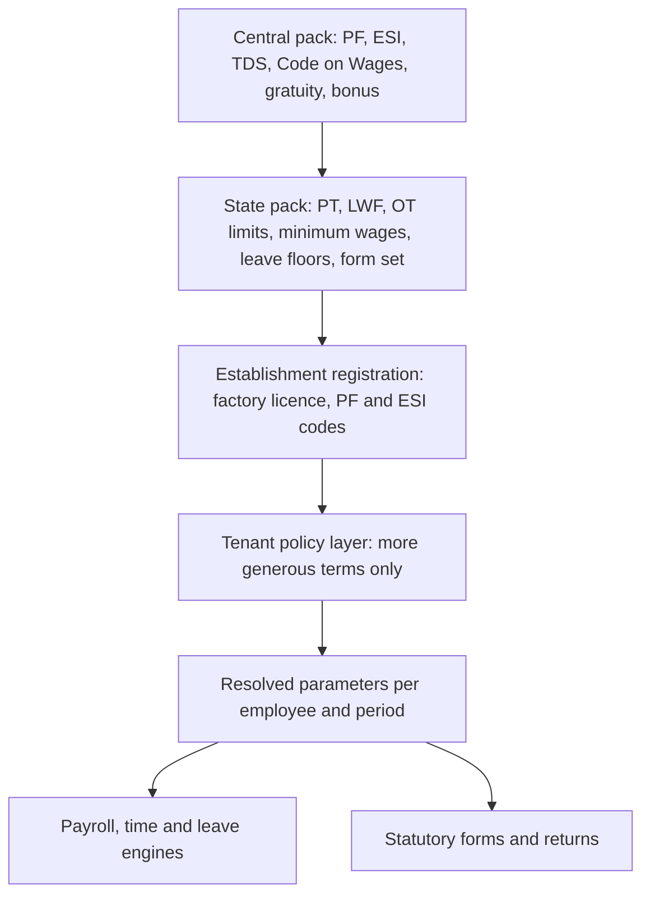
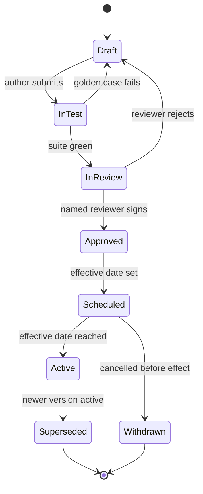
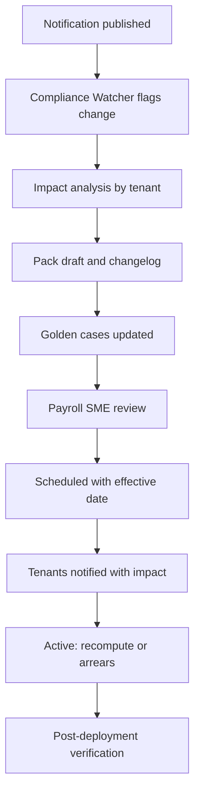

<picture>
  <source media="(prefers-color-scheme: dark)" srcset="../assets/MultipliersKraftLogoDark.png">
  
</picture>

# LOC-01 — Localisation and Statutory Requirements

| Attribute | Value |
| :--- | :--- |
| Document ID | LOC-01 |
| Title | Localisation and Statutory Requirements |
| Product | Nucleus Suite (Nucleus HRMS Suite) |
| Version | 1.0.0 |
| Status | Issued for approval |
| Owner (role) | Head of Compliance Product (Statutory and Localisation) |
| Author | Dhanraj Dadhich |
| Reviewed by | *pending* |
| Approved by | Product Council — *pending* |
| Date | 2026-11-05 |
| Classification | Internal |
| CMMI practice areas | RDM, TS, VV |
| Related documents | NFR-01, NOT-01, RPT-01, BA-04, DA-02, DA-04, GOV-10, FRS-CMP-01, FRS-CMP-02, FRS-PAY-02, FRS-TIM-02, FRS-LVE-02 |
| Quality & process-performance objectives | QPPO-01 (minimise defects reaching users), QPPO-03 (exact payroll at go-live), QPPO-05 (effective requirements reviews) |
| Process performance baseline used | PPB-01 (review defect density), PPB-02 (review rate), PPB-04 (payroll parallel run) |
| Peer review record | *pending* (PR-xxxx, QA-02) |
| Tailoring record | none |
| Traceability anchor | BG-03, BG-04, BG-06 · R-09, R-17, R-18, R-27 · CMP-01p to CMP-04p, PAY-05, PAY-07, TIM-04 · RL-100, RL-280 to RL-304, RL-360 to RL-383 |

---

## 1. Purpose and scope

This document specifies how Nucleus Suite adapts to the language, formatting conventions and statutory regime of each place it operates. It covers the eleven interface languages including right-to-left Arabic; number, date, time and currency formats with Indian digit grouping; the multi-state statutory parameters for provident fund, employees' state insurance, professional tax, labour welfare fund, income-tax deduction at source, the Code on Wages wage-base floor, gratuity, bonus, overtime and minimum wages; Factories Act registers and forms; the statutory calendar; holiday calendars by location; versioning of rule packs by effective date; statutory outputs; and the handling of regulatory change.

**Legal statements.** Statutory descriptions here are deliberately general. Every specific obligation, rate, threshold or due date is marked "(to be validated by Legal)" and is held as a rule-pack parameter, never as code. Values quoted from the Demo Dataset v1.1 are demonstration values; the dataset itself warns that slabs are amended by state notification and must be confirmed against the current notification.

**Delivery stage.** R0 is a UI-validation prototype on local JSON. No statutory filing, authority portal connection or live payroll computation is authorised (DEC-0002). R0 behaviour is defined in §12.

**Pilot reference.** The fictional pilot client Vindhya Precision Industries Pvt Ltd has two legal entities and five sites in four states:

| Location | Name | Entity | State | Establishment | Factory Act applies | PT slab set | LWF set | Payroll group |
| :--- | :--- | :--- | :--- | :--- | :--- | :--- | :--- | :--- |
| LOC-BLR | Bengaluru Corporate Office | LE-01 | Karnataka (KA) | Office | N | KA-PT-Slab-2026 | KA-LWF | HO |
| LOC-PLA | Peenya Works | LE-01 | Karnataka (KA) | Factory | Y | KA-PT-Slab-2026 | KA-LWF | PLANT-BLR |
| LOC-PUN | Chakan Works | LE-01 | Maharashtra (MH) | Factory | Y | MH-PT-Slab-2026 | MH-LWF | PLANT-PUN |
| LOC-HYD | Medchal Works | LE-02 | Telangana (TS) | Factory | Y | TS-PT-Slab-2026 | TS-LWF | PLANT-HYD |
| LOC-CHN | Oragadam Works | LE-02 | Tamil Nadu (TN) | Factory | Y | TN-PT-Slab-2026 | TN-LWF | PLANT-CHN |

Source: Demo Dataset 03_Locations; both entities run an April–March financial year (02_Legal_Entities).

## 2. Principles

1. **Statute is data.** Rates, slabs, ceilings, forms and due dates live in versioned, effective-dated rule packs (RL-360), never in code or in tenant-editable fields.
2. **Jurisdiction follows the fact that creates the obligation.** Professional tax follows the employee's work-location state; Factories Act forms follow the plant's registration, not the company's (RL-380); provident fund and insurance follow the entity's establishment registration.
3. **Language follows the person; format follows the locale.** A user may read Tamil while numbers follow Indian conventions.
4. **Every figure can be reproduced.** A computation records the rule-pack versions it used (RL-251, RL-273).
5. **No silent change.** A new pack version announces its effect before it changes a payslip (NOT-01 NM-034).

## 3. Languages

### 3.1 Interface languages

| Code | Language | Script | Direction | Principal audience in the pilot and beyond |
| :--- | :--- | :--- | :--- | :--- |
| en | English | Latin | LTR | Source language; head office; authoritative legal text |
| hi | Hindi | Devanagari | LTR | Migrant and north-Indian workforce at all plants |
| mr | Marathi | Devanagari | LTR | Chakan Works (LOC-PUN) |
| ta | Tamil | Tamil | LTR | Oragadam Works (LOC-CHN) |
| te | Telugu | Telugu | LTR | Medchal Works (LOC-HYD) |
| bn | Bengali | Bengali | LTR | Eastern-India and migrant workforce |
| es | Spanish | Latin | LTR | Global entities (P4) |
| fr | French | Latin | LTR | Global entities (P4) |
| de | German | Latin | LTR | Global entities (P4) |
| ja | Japanese | Kanji and kana | LTR | Global entities (P4) |
| ar | Arabic | Arabic | **RTL** | Gulf entities (P4) |

### 3.2 Communication languages

The employee's preferred language for messages, announcements and letters is held in the mother-tongue field (FRM-PPL-01) using picklist PL_LANGUAGE: English, Hindi, Kannada, Tamil, Telugu, Malayalam, Marathi, Gujarati, Bengali, Odia, Punjabi, Assamese, Urdu, Other. The field note says it "drives business messaging and notice language where enabled". Kannada, Malayalam, Gujarati, Odia, Punjabi, Assamese and Urdu are communication languages without an interface translation; Spanish, French, German, Japanese and Arabic are interface languages without a PL_LANGUAGE value. Kannada and the other Indian languages are delivered as interface languages through capability gap PLT-CG-017; the five non-Indian interface languages are added to PL_LANGUAGE with the same change.

### 3.3 Language requirements

| ID | Requirement | Rationale | Source / trace | Realises SYS | Priority | Verification | Acceptance criterion |
| :--- | :--- | :--- | :--- | :--- | :--- | :--- | :--- |
| CMP-LOC-001 | Every user-facing string MUST be held as a translation key in the locale catalogue; text literals in screens, reports, notifications and exports are not permitted. | Translation is impossible otherwise. | FRS-PLT-04 to FRS-INT-04, §4 UX rules | SYS-066 | Must | Inspection | Copy-verification scan reports zero unharvested literals. |
| CMP-LOC-002 | The interface MUST render completely in all eleven languages in §3.1. | BG-03 commits to 11 languages. | BG-03 | SYS-066 | Must | Test | Automated screenshot run across 11 languages shows no missing key on the 61 inventoried screens. |
| CMP-LOC-003 | A missing translation MUST fall back to the tenant default language and then English, MUST never show a raw key, and MUST be logged for the localisation team. | Graceful degradation with visibility. | NOT-01 PLT-NOT-044 | SYS-066 | Must | Test | Deleting one Telugu key shows English text and creates a gap log entry. |
| CMP-LOC-004 | Users MUST choose their interface language independently of their formatting region; the default region for Indian entities is India. | A Tamil reader still expects ₹ 1,00,000. | §2 principle 3 | SYS-066, SYS-067 | Must | Test | A user with language ta and region IN sees Tamil labels and Indian grouping. |
| CMP-LOC-005 | Arabic MUST render right-to-left with mirrored layout, logical spacing properties, mirrored directional icons and isolated left-to-right runs for employee codes, numbers and dates. | Correct RTL is more than text alignment. | i18n RTL rule; BG-03 | SYS-066 | Must (target P4) | Demonstration | Arabic payslip and leave screen reviewed by a native reader with no layout defects. |
| CMP-LOC-006 | Fonts MUST cover Latin, Devanagari, Tamil, Telugu, Bengali, Japanese and Arabic scripts on web, mobile, kiosk and generated PDFs, with no missing-glyph boxes. | Generated documents fail silently otherwise. | RP-12, payslip PDF | SYS-066 | Must | Test | PDF rendering test with a sample string per script shows no missing glyphs. |
| CMP-LOC-007 | Layouts MUST tolerate 40% text expansion and the line height of Indic scripts without truncating labels or values. | German and Indic scripts break tight layouts. | WCAG 2.2 AA | SYS-066, SYS-069 | Must | Test | Pseudo-localised build shows no truncation on key screens. |
| CMP-LOC-008 | Translations MUST follow a per-language HR and payroll glossary; where an authority publishes an official regional term for a statutory concept, that term MUST be used. | Consistent, recognisable terms. | DA-02 picklists | SYS-066 | Must | Inspection | Glossary exists per language and is referenced in translation review records. |
| CMP-LOC-009 | Pay, statutory and legal content MUST use human-approved translations; machine translation MAY produce drafts only. | Wrong pay wording is a defect. | RL-501 (human review) | SYS-066 | Must | Inspection | Payslip and letter translations show a named approver. |
| CMP-LOC-010 | English MUST be the authoritative version of legal and statutory documents unless a rule requires a regional-language version for display or issue, in which case both versions MUST be produced (to be validated by Legal). | Clarity when translations differ. | NOT-01 PLT-NOT-048 | SYS-066, SYS-086 | Must | Inspection | Letter and notice templates declare their authoritative language. |
| CMP-LOC-011 | Payslip lines MUST support a local-language label per pay component alongside the English label. | Workers must read their payslip. | FRM-PAY-01 payslip_label | SYS-066 | Must | Test | A Tamil-preferring worker's payslip shows Tamil labels and English labels side by side. |
| CMP-LOC-012 | Messages, announcements and letters MUST support every PL_LANGUAGE value as a communication language, independently of interface translation coverage. | Reach workers in their own language. | PL_LANGUAGE, FRM-EXP-03 language_variants | SYS-066, SYS-070 | Should | Test | An announcement with a Kannada variant reaches a Kannada-preferring worker in Kannada. |
| CMP-LOC-013 | Nucleus Talk MUST support speech recognition and synthesis in each enabled interface language, and MET-20 voice success MUST be reported per language. | Voice is the primary channel for many frontline users. | BG-02, BG-03, MET-20 | SYS-066, SYS-079 | Should | Test | Voice evaluation set per language meets the feature target. |
| CMP-LOC-014 | Person names MUST be stored as the legal name as on the identity document, with an optional display name in a local script; the system MUST NOT require a first-name and last-name split and MUST support single-name persons. | Indian naming conventions vary widely. | PPL-01, RL-030 match keys | SYS-066 | Must | Test | A single-name worker is created and appears correctly on payslip and Form F. |
| CMP-LOC-015 | Search MUST match names across scripts by transliteration (for example a Latin query finding a Devanagari display name). | Supervisors search in whatever script they type. | SCR-010 | SYS-017, SYS-066 | Could | Test | Searching "Ramesh" returns a person whose display name is written in Devanagari. |
| CMP-LOC-016 | The build MUST include a pseudo-localised language used in automated tests to detect hard-coded strings, truncation and concatenation. | Catch defects before translation. | QA-03 | SYS-066 | Should | Inspection | CI job runs the pseudo-locale screenshot suite. |

## 4. Number, date, time and currency formats

| ID | Requirement | Rationale | Source / trace | Realises SYS | Priority | Verification | Acceptance criterion |
| :--- | :--- | :--- | :--- | :--- | :--- | :--- | :--- |
| CMP-LOC-017 | INR amounts MUST display with Indian digit grouping and the rupee symbol, for example ₹ 1,00,000.00 and ₹ 3,17,20,000.00; other currencies MUST use the grouping of the user's region. | Indian readers expect lakh grouping. | DOC-01 writing rule 6 | SYS-067 | Must | Test | The T-29 journal total renders as ₹ 3,17,20,000.00 for an en-IN user. |
| CMP-LOC-018 | Letters, payslips, settlement statements and loan sanction letters MUST show amounts in words using the Indian numbering system (thousand, lakh, crore) in English and, where enabled, in the preferred language. | Common requirement on Indian pay documents. | EXP-03, PAY-12, CMB-03 | SYS-067 | Must | Test | ₹ 1,50,000 renders as "One lakh fifty thousand rupees only". |
| CMP-LOC-019 | Every monetary amount MUST be stored with its ISO 4217 currency code and at least two-decimal precision; no currency conversion may happen implicitly. | Global readiness and exactness. | BG-04 | SYS-028 | Must | Inspection | Schema review shows currency on every amount column. |
| CMP-LOC-020 | Dates MUST be stored in ISO 8601; display MUST follow the locale with an unambiguous default for India of day-month-year with the month abbreviated (05 Nov 2026); numeric month-first formats MUST NOT be used for India. | Avoid 05/11 versus 11/05 errors. | DOC-01 writing rule 6 | SYS-067 | Must | Test | en-IN users see 05 Nov 2026; CSV exports carry 2026-11-05. |
| CMP-LOC-021 | Attendance, shift and punch times MUST display in 24-hour format by default; cross-midnight sessions MUST show both calendar dates. | 22:00–06:00 shifts are common. | R-01, RL-080 | SYS-067, SYS-068 | Must | Test | E1018's 08 Sep session shows 08:00 on 08 Sep to 03:20 on 09 Sep. |
| CMP-LOC-022 | Each location MUST carry a time zone; timestamps MUST be stored in UTC with the zone; the attendance day MUST be the date the shift started in the location's time zone. | Correct day attribution. | RL-080 | SYS-068 | Must | Test | A punch at 01:00 IST belongs to the previous day's night shift. |
| CMP-LOC-023 | Each legal entity MUST carry its financial year (April–March for Indian entities); financial-year labels MUST be unambiguous (FY27 = April 2026 to March 2027) and the leave year MUST be configurable separately (calendar year in the pilot). | Statutory periods follow the financial year; leave may not. | 02_Legal_Entities, 28_Statutory_Calendar "Q2 FY27" | SYS-006, SYS-059 | Must | Test | TDS quarter Q2 FY27 resolves to July–September 2026. |
| CMP-LOC-024 | Week start, weekly off and weekend days MUST come from the location work calendar and worker-class rest-day policy, never from a fixed Saturday–Sunday assumption. | Plants run six-day and continuous rosters. | RL-100, RL-101 | SYS-026, SYS-068 | Must | Test | A contractual worker with no rest day shows Sundays as working (T-06). |
| CMP-LOC-025 | Native digits (Devanagari, Arabic-Indic) MAY be enabled for display per language; exports, files and APIs MUST always use ASCII digits. | Readability without breaking machines. | §3 | SYS-067, SYS-089 | Could | Test | Arabic display with native digits; CSV export with ASCII digits. |
| CMP-LOC-026 | Postal addresses MUST validate a six-digit PIN against the selected state, use the 36-value PL_STATE picklist, and phone numbers MUST be stored in E.164 with +91 as the default country code. | Clean statutory and communication data. | PL_STATE, 03_Locations | SYS-067 | Must | Test | PIN 560058 with state Tamil Nadu is flagged. |
| CMP-LOC-027 | Statutory identifiers MUST be validated for format at capture — PAN (ten characters: five letters, four digits, one letter), Aadhaar (twelve digits with checksum, displayed masked except the last four), UAN (twelve digits), IFSC (eleven characters) — with patterns held as configuration (to be validated by Legal). | Bad identifiers block filings later. | RL-033, 62_Documents | SYS-033, SYS-067 | Must | Test | An eleven-digit Aadhaar is rejected; a valid PAN is accepted. |
| CMP-LOC-028 | Sorting and collation MUST follow the language's rules in lists and reports. | Expected ordering per script. | RPT-01 §13 | SYS-066 | Should | Test | Tamil names sort in Tamil alphabetical order. |
| CMP-LOC-029 | Rounding of statutory amounts MUST follow the rounding rule declared in the rule pack for each contribution or tax, not a global UI rounding setting. | Authorities prescribe rounding. | RL-273 | SYS-029 | Must | Test | Changing UI decimal display does not change any computed contribution. |

## 5. Rule packs and statutory parameter model

### 5.1 Layering

### 5.2 Rule-pack lifecycle

### 5.3 Rule-pack requirements

| ID | Requirement | Rationale | Source / trace | Realises SYS | Priority | Verification | Acceptance criterion |
| :--- | :--- | :--- | :--- | :--- | :--- | :--- | :--- |
| CMP-LOC-030 | Statutory rules MUST be delivered as rule packs that are versioned, effective-dated, jurisdiction-scoped and carry a changelog citing the source notification. | Traceable statute. | RL-360, CMP-01p | SYS-045 | Must | Inspection | Each pack version shows jurisdiction, effective-from, changelog and notification reference. |
| CMP-LOC-031 | Packs MUST layer in the order central, state, establishment, tenant policy; the tenant layer MAY grant terms more generous than statute but MUST NOT reduce a statutory floor. | Statute is the floor. | RL-364 | SYS-045, SYS-059 | Must | Test | A tenant setting PF below the statutory rate is rejected at save. |
| CMP-LOC-032 | Jurisdiction MUST resolve per obligation: professional tax and labour welfare fund by the employee's work-location state; Factories Act forms by the plant's registration; provident fund and insurance by the entity's establishment codes. | Different facts create different obligations. | RL-302, RL-380, 55_Payroll_Register E1056 | SYS-006, SYS-045 | Must | Test | E1056 (payroll group HO, work location LOC-CHN) receives Tamil Nadu PT treatment. |
| CMP-LOC-033 | Every computed statutory amount MUST record the pack ID and version that produced it, and the payroll snapshot MUST hash the pack versions in force. | Reproducibility to the paisa. | RL-251, RL-273 | SYS-030, SYS-031 | Must | Test | Payslip line drill-down shows pack and version; snapshot lists versions. |
| CMP-LOC-034 | Every rule in a pack MUST have golden cases verified by hand against the statute, and a pack MUST NOT move to Approved without a green suite and a named reviewer with the payroll SME role. | No unverified statute in production. | RL-361, RL-363, OD-14 | SYS-046 | Must | Inspection | Pack approval record shows suite result and reviewer. |
| CMP-LOC-035 | Each pack MUST declare its period-boundary rule for changes effective mid-period (for example whole-month application by pay date or apportionment by days). | Mid-month amendments are common. | PAY-07 | SYS-026, SYS-045 | Must | Inspection | Pack schema has a mandatory boundary-rule field. |
| CMP-LOC-036 | A pack version effective inside a closed payroll period MUST produce arrears or recoveries in the next open run; closed runs MUST NOT be rewritten. | Closed periods are immutable. | RL-041, PAY-11 | SYS-025, SYS-052 | Must | Test | Backdating a PT slab change raises `payroll.arrears.requested` for affected employees. |
| CMP-LOC-037 | Activating a pack MUST emit `compliance.pack.deployed`, trigger recompute of affected open periods and notify affected roles with an impact summary. | Visible change. | IA-02, NOT-01 NM-034 | SYS-053, SYS-057, SYS-070 | Must | Test | Deploying a test MH pack recomputes the open period for LOC-PUN employees only. |
| CMP-LOC-038 | Tenant users MUST NOT edit statutory pack values; only the compliance-engineer role may author packs through the lifecycle in §5.2. | Separation of statute and policy. | SCR-070, 21_Roles_and_RACI | SYS-019, SYS-045 | Must | Test | HR admin cannot open a pack for edit. |

## 6. Statutory parameters

### 6.1 Code on Wages wage base

| Parameter | Rule | Source |
| :--- | :--- | :--- |
| Statutory wage base | Basic + dearness allowance + retaining allowance | RL-280 |
| 50% floor | Where excluded components exceed 50% of total remuneration, the excess is added back to the wage base | RL-281; demo E1014 and E1049 (TC-Y281) |
| Single node | The wage base is computed once per employee and consumed by PF, ESI, gratuity, bonus, overtime and encashment | RL-282 |

| ID | Requirement | Rationale | Source / trace | Realises SYS | Priority | Verification | Acceptance criterion |
| :--- | :--- | :--- | :--- | :--- | :--- | :--- | :--- |
| CMP-LOC-039 | The payroll engine MUST compute the statutory wage base and the 50% floor add-back as a single node consumed by every dependent statutory computation, with the floor percentage held in the central pack (to be validated by Legal). | One definition for every contribution. | RL-280 to RL-282, PAY-05 | SYS-045, SYS-047 | Must | Test | TC-Y281 passes for E1014 and E1049. |
| CMP-LOC-040 | The salary-structure simulator MUST show the wage base, floor test result, statutory cost and take-home impact of a proposed structure before it is adopted, and MUST block adoption of a structure that fails the floor without an approved exception. | Prevent non-compliant structures. | SCR-052, CMP-04p | SYS-048, SYS-051 | Must | Test | A structure with 60% excluded components shows the add-back and cannot be adopted silently. |

### 6.2 Provident fund and pension

| ID | Requirement | Rationale | Source / trace | Realises SYS | Priority | Verification | Acceptance criterion |
| :--- | :--- | :--- | :--- | :--- | :--- | :--- | :--- |
| CMP-LOC-041 | Employee and employer provident fund MUST be computed on the statutory wage base at the rates in the central pack (12% each in the demo, 47_Pay_Components), with the employer share split into pension and fund portions and the wage ceiling applied as the pack version defines it (to be validated by Legal). | Correct contributions. | RL-300, PC-PF-EE, PC-PF-ER | SYS-045, SYS-047 | Must | Test | Golden cases for below-ceiling and above-ceiling employees pass. |
| CMP-LOC-042 | The system MUST support voluntary contribution above the statutory rate and employer contribution on wages above the ceiling as per-employee elections with effective dates. | Common enterprise choices. | PAY-07 | SYS-021 | Should | Test | A voluntary contribution election changes only that employee's deduction from its effective date. |
| CMP-LOC-043 | The system MUST produce the monthly electronic challan-cum-return file in the format prescribed by EPFO from posted payroll records (to be validated by Legal). | Statutory output. | OB-2026-0912, RL-371 | SYS-086 | Must | Test | ECR for August 2026 reconciles to INT-RPT-035 PF totals. |

### 6.3 Employees' state insurance

| ID | Requirement | Rationale | Source / trace | Realises SYS | Priority | Verification | Acceptance criterion |
| :--- | :--- | :--- | :--- | :--- | :--- | :--- | :--- |
| CMP-LOC-044 | ESI MUST be computed on gross at the employee and employer rates in the central pack (0.75% and 3.25% in the demo) for employees whose gross is at or below the coverage ceiling held in the pack (to be validated by Legal). | Correct coverage and contribution. | PC-ESI-EE, PC-ESI-ER | SYS-045 | Must | Test | E1032 and E1036 (daily-wage) carry ESI; salaried employees above the ceiling do not. |
| CMP-LOC-045 | An employee crossing the ESI ceiling mid-period MUST continue contributing to the end of the contribution period defined in the pack. | Statutory continuation rule. | RL-301 | SYS-045 | Must | Test | A revision in August keeps ESI deductions to the end of the contribution period. |

### 6.4 Professional tax

Demo slabs from Demo Dataset 48_PT_Slabs. These are demonstration values; each must be confirmed against the current state notification before use (to be validated by Legal).

| Slab set | State | Monthly gross from (₹) | Monthly gross to (₹) | PT per month (₹) | Frequency | Special rule | Locations |
| :--- | :--- | ---: | ---: | ---: | :--- | :--- | :--- |
| KA-PT-Slab-2026 | Karnataka | 0 | 24,999 | 0 | Monthly | — | LOC-BLR, LOC-PLA |
| KA-PT-Slab-2026 | Karnataka | 25,000 | no upper limit | 200 | Monthly | — | LOC-BLR, LOC-PLA |
| MH-PT-Slab-2026 | Maharashtra | 0 | 7,500 | 0 | Monthly | — | LOC-PUN |
| MH-PT-Slab-2026 | Maharashtra | 7,501 | 10,000 | 175 | Monthly | Nil for women in this band | LOC-PUN |
| MH-PT-Slab-2026 | Maharashtra | 10,001 | no upper limit | 200 | Monthly | February deduction 300 so the annual total reaches 2,500 | LOC-PUN |
| TS-PT-Slab-2026 | Telangana | 0 | 15,000 | 0 | Monthly | — | LOC-HYD |
| TS-PT-Slab-2026 | Telangana | 15,001 | 20,000 | 150 | Monthly | — | LOC-HYD |
| TS-PT-Slab-2026 | Telangana | 20,001 | no upper limit | 200 | Monthly | — | LOC-HYD |
| TN-PT-Slab-2026 | Tamil Nadu | — | — | — | Half-yearly | Levied by the local body on half-yearly income, not monthly on gross | LOC-CHN |

| ID | Requirement | Rationale | Source / trace | Realises SYS | Priority | Verification | Acceptance criterion |
| :--- | :--- | :--- | :--- | :--- | :--- | :--- | :--- |
| CMP-LOC-046 | Professional tax MUST be computed by a slab engine reading the state slab set of the employee's work location, supporting monthly and half-yearly frequencies, gender-specific bands, month-specific amounts and an annual cap. | PT is a slab engine, not a constant. | RL-302, 48_PT_Slabs | SYS-045 | Must | Test | September run for LE-01 and LE-02 shows four different PT outcomes in one register (TC-Y302). |
| CMP-LOC-047 | States without monthly PT on salary, or where PT is levied by a local body, MUST be modelled explicitly (not as a zero slab) so the obligation calendar shows the correct frequency and authority. | "Not applicable this month" differs from "not applicable". | OB-2026-0917, TN-PT-Slab-2026 | SYS-045, SYS-086 | Must | Test | August cycle shows TN PT as not applicable for the month with the half-yearly obligation still on the calendar. |
| CMP-LOC-048 | PT payable MUST post to a state-specific liability account per entity. | Remittance is per state. | 35_GL_Mapping GL-026 | SYS-026, SYS-084 | Must | Test | LE-02 journal credits Telangana PT to its own account. |
| CMP-LOC-049 | The PT slab sets for every Indian state and union territory with a PT levy MUST be available as state packs before general availability (to be validated by Legal). | National coverage. | BL-120 (state packs), PL_STATE | SYS-045 | Should (target P3) | Inspection | Pack catalogue lists every levying state. |

### 6.5 Labour welfare fund

The pilot locations carry LWF sets KA-LWF, MH-LWF, TS-LWF and TN-LWF (03_Locations), and pay component PC-LWF deducts "from the state LWF set, at the stated frequency" (47_Pay_Components). The source workbooks do not give contribution values; they are captured from each state's notification when the state pack is authored and reviewed by the payroll SME reviewer (RL-363) before the first parallel run in P2.

| ID | Requirement | Rationale | Source / trace | Realises SYS | Priority | Verification | Acceptance criterion |
| :--- | :--- | :--- | :--- | :--- | :--- | :--- | :--- |
| CMP-LOC-050 | Each state LWF set MUST hold employee contribution, employer contribution, deduction frequency, deduction months, applicability threshold and remittance due date as pack parameters (to be validated by Legal). | LWF differs by state in every dimension. | PC-LWF, OB-2026-0920 | SYS-045 | Must | Inspection | KA-LWF pack shows all six parameters with notification citation. |
| CMP-LOC-051 | LWF MUST be deducted only in the months the state set defines and MUST appear on the obligation calendar for the state. | Avoid monthly deduction of a periodic levy. | OB-2026-0920 | SYS-045, SYS-086 | Must | Test | Karnataka LWF obligation for H1 2026 appears with its due date; no deduction in non-deduction months. |

### 6.6 Income-tax deduction at source

| ID | Requirement | Rationale | Source / trace | Realises SYS | Priority | Verification | Acceptance criterion |
| :--- | :--- | :--- | :--- | :--- | :--- | :--- | :--- |
| CMP-LOC-052 | Salary TDS MUST be computed under the employee's chosen regime, with the default regime, slabs, rebates, standard deduction and surcharge held in the central pack for each financial year (to be validated by Legal). | Rates change every budget. | RL-303, PC-TDS | SYS-045 | Must | Test | Golden cases for both regimes pass for FY27. |
| CMP-LOC-053 | TDS MUST project annual liability to year end and spread it over remaining months, and MUST handle a mid-year regime switch, prior-employer income for joiners and arrears. | Expected cases, not exceptions. | RL-303 | SYS-025, SYS-047 | Must | Test | A switch in October recomputes the remaining-month deduction without rewriting earlier months. |
| CMP-LOC-054 | Employees MUST be able to declare investments and submit proofs within configured windows, and the projection MUST show the effect before submission. | Self-service tax planning. | SCR-054, PAY-07 | SYS-048 | Must | Demonstration | Projection updates live as a declaration is entered. |
| CMP-LOC-055 | The system MUST produce the quarterly salary TDS return data and the annual TDS certificate for employees from posted records, and MUST treat non-salary payments such as retainer fees under their own TDS rules (to be validated by Legal). | Statutory outputs; retainers are not salary. | OB-2026-0919, PC-RETAINER | SYS-045, SYS-086 | Must | Test | Q2 FY27 return data reconciles to monthly TDS deposits. |

### 6.7 Gratuity, bonus, overtime and minimum wages

| ID | Requirement | Rationale | Source / trace | Realises SYS | Priority | Verification | Acceptance criterion |
| :--- | :--- | :--- | :--- | :--- | :--- | :--- | :--- |
| CMP-LOC-056 | Gratuity MUST be computed as 15/26 of last-drawn basic plus dearness allowance for each completed year of service, with the eligibility period (five years of continuous service in the demo, with statutory exceptions), year-rounding rule and payment ceiling held in the central pack (to be validated by Legal). | Correct F&F settlement. | PC-GRATUITY, 58_FnF_Settlement | SYS-045, SYS-047 | Must | Test | F&F golden case for E1068 matches 58_FnF_Settlement. |
| CMP-LOC-057 | Monthly gratuity and bonus provisions MUST accrue on the statutory wage base for the salary journal, and the obligation calendar MUST carry the periodic actuarial valuation. | Finance needs provisions; valuation is periodic. | RL-304, OB-2026-0921 | SYS-047, SYS-084 | Must | Test | Journal shows provision lines; OB-2026-0921 is on the calendar. |
| CMP-LOC-058 | Statutory bonus eligibility, wage ceiling, minimum and maximum percentages MUST be held as central pack parameters (to be validated by Legal). | Bonus rules are statutory. | PAY-07 | SYS-045 | Should | Inspection | Bonus parameters present in the central pack. |
| CMP-LOC-059 | The overtime multiplier and daily, weekly and quarterly overtime limits MUST come from the state pack; exceeding a statutory limit MUST warn the approver; overtime pay MUST use the statutory wage base (to be validated by Legal). | Overtime is state-regulated. | RL-133, RL-332 (client multiplier 2.0) | SYS-045, SYS-047 | Must | Test | OT-2026-0912 pays 7h20m at twice the hourly wage base; a week over the limit warns the approver. |
| CMP-LOC-060 | Minimum wage schedules by state, zone and skill category, including periodic variable dearness revisions, MUST be held as effective-dated state pack parameters, and the system MUST warn when a salary structure or daily rate falls below the applicable minimum and MUST protect the net floor for recoveries (to be validated by Legal). | Floors protect workers. | RL-311 | SYS-026, SYS-045 | Must | Test | A daily rate below the schedule raises a blocking warning; a loan recovery is reduced to protect the floor. |
| CMP-LOC-061 | Leave-with-wages minimums from the applicable state statutes MUST be held as floors so tenant leave policies cannot be configured below them (to be validated by Legal). | Policy cannot undercut statute. | LVE-01, SCR-032 | SYS-045, SYS-059 | Should | Test | A leave policy below the factory leave floor is refused at save. |

### 6.8 Factories Act registers and forms

From Demo Dataset 29_Statutory_Forms. Form numbering and layouts are prescribed by each state's factory rules and differ between states; the titles below are as recorded in the dataset and are to be validated by Legal (open question Q-13).

| Form instance | Form (as recorded) | Rules | State | Entity | Location | Period | Status in demo |
| :--- | :--- | :--- | :--- | :--- | :--- | :--- | :--- |
| FRM-F-2026-0112 | Form F — particulars of workers | Factories Rules | KA | LE-01 | LOC-PLA | On joining | Generated in the joining chain for E1066 |
| FRM-F-2026-0108 | Form F — particulars of workers | Factories Rules | TN | LE-02 | LOC-CHN | On joining | Generated for E1061 |
| FRM-28-2026-09 | Form 28 — overtime register | Factories Rules | KA | LE-01 | LOC-PLA | Sep 2026 | Open, generated from approved OT records |
| FRM-28-2026-08 | Form 28 — overtime register | Factories Rules | KA | LE-01 | LOC-PLA | Aug 2026 | Filed 2026-09-05 |
| FRM-18-2026-H1 | Form 18 — leave with wages register | Factories Rules | KA | LE-01 | LOC-PLA | H1 2026 | Filed 2026-07-12 |
| FRM-36-2026-H1 | Form 36 — muster roll | Factories Rules | KA | LE-01 | LOC-PLA | H1 2026 | Filed 2026-07-12 |
| FRM-36-2026-H1T | State equivalent — muster roll | Factories Rules | TN | LE-02 | LOC-CHN | H1 2026 | Filed; a different form set applies in Tamil Nadu |
| FRM-XIII-2026-09 | Register of workmen — contract labour | Contract labour rules | KA | LE-01 | LOC-PLA | Sep 2026 | Open; covers VN-01 and VN-02 populations |

| ID | Requirement | Rationale | Source / trace | Realises SYS | Priority | Verification | Acceptance criterion |
| :--- | :--- | :--- | :--- | :--- | :--- | :--- | :--- |
| CMP-LOC-062 | The applicable form set MUST be selected by the plant's registration state and establishment type; offices without Factories Act applicability MUST NOT generate factory registers. | Forms follow the plant. | RL-380, 03_Locations "Factory Act applies" | SYS-045, SYS-086 | Must | Test | LOC-BLR generates no Form 28; LOC-PLA and LOC-CHN generate different sets (T-32). |
| CMP-LOC-063 | Each form MUST be generated by binding a declarative query to a versioned layout so that a state amendment is a configuration change, not a code change. | Amendments are frequent. | RL-381 | SYS-059, SYS-086 | Must | Inspection | Form definition shows query and layout versions separately. |
| CMP-LOC-064 | Joining forms including Form F MUST be generated inside the joining chain from the employee record, with a gapless serial per establishment. | Generated, not typed. | RL-382, RP-13, R-27 | SYS-086 | Must | Test | FRM-F-2026-0112 generated for E1066 with the next serial (T-31). |
| CMP-LOC-065 | A filed form MUST retain its acknowledgement reference against the period, and a correction MUST create a new instance linked to the original. | Evidence of filing. | RL-383 | SYS-022, SYS-086 | Must | Test | FRM-28-2026-08 shows filed date and acknowledgement; correction links back. |
| CMP-LOC-066 | Registers required under contract labour rules MUST be generated for contractor populations deployed at each establishment, and principal-employer verification of contractor compliance MUST be recorded. | Principal-employer obligations (to be validated by Legal). | CTG-03, FRM-XIII-2026-09 | SYS-086 | Must | Test | Register of workmen for September covers VN-01 and VN-02 workers. |

### 6.9 Statutory calendar

From Demo Dataset 28_Statutory_Calendar (demo values, to be validated by Legal).

| Obligation ID | Obligation | Authority | Entity | State | Period | Due date | Status |
| :--- | :--- | :--- | :--- | :--- | :--- | :--- | :--- |
| OB-2026-0912 | PF ECR and challan | EPFO | LE-01 | Central | Aug 2026 | 2026-09-15 | Filed |
| OB-2026-0913 | ESI contribution | ESIC | LE-01 | Central | Aug 2026 | 2026-09-15 | Filed |
| OB-2026-0914 | Professional tax remittance | State commercial taxes, Karnataka | LE-01 | KA | Aug 2026 | 2026-09-20 | Due |
| OB-2026-0915 | Professional tax remittance | State finance department, Maharashtra | LE-01 | MH | Aug 2026 | 2026-09-30 | Due |
| OB-2026-0916 | Professional tax remittance | State commercial taxes, Telangana | LE-02 | TS | Aug 2026 | 2026-09-15 | Filed |
| OB-2026-0917 | Professional tax — not applicable this month | Tamil Nadu local body | LE-02 | TN | Aug 2026 | Half-yearly, next 2026-09-30 | Not applicable |
| OB-2026-0918 | TDS deposit | Income-tax department | LE-01 | Central | Aug 2026 | 2026-09-07 | Filed |
| OB-2026-0919 | TDS quarterly return 24Q | Income-tax department | LE-01 | Central | Q2 FY27 | 2026-10-31 | Not started |
| OB-2026-0920 | Labour welfare fund | State labour department, Karnataka | LE-01 | KA | H1 2026 | 2026-07-15 | Filed |
| OB-2026-0921 | Gratuity actuarial valuation | Accounting standard requirement | LE-01 | Central | FY27 H1 | 2026-10-31 | Not started |
| OB-2026-0922 | Factory annual return | State factories department, Karnataka | LE-01 | KA | CY 2026 | 2027-01-31 | Not started |
| OB-2026-0923 | Contract labour half-yearly return | State labour department, Tamil Nadu | LE-02 | TN | H1 2026 | 2026-07-30 | Filed |

| ID | Requirement | Rationale | Source / trace | Realises SYS | Priority | Verification | Acceptance criterion |
| :--- | :--- | :--- | :--- | :--- | :--- | :--- | :--- |
| CMP-LOC-067 | The obligation calendar MUST be generated automatically per entity and state from an applicability matrix in the rule packs, with due-date rules (including the authority's rule when a due date falls on a holiday) held in the pack (to be validated by Legal). | No manually maintained calendar. | RL-370, CMP-02p | SYS-045, SYS-086 | Must | Test | Adding a Gujarat location adds Gujarat obligations without manual entry. |
| CMP-LOC-068 | Filing packs MUST be assembled from posted records only; the Compliance Watcher MAY prepare packs and alert, but filing MUST always be performed and confirmed by a named human. | Evidence integrity; filing is irreversible. | RL-371, RL-544, 14_Agents | SYS-074, SYS-086 | Must | Test | The Compliance Watcher cannot mark OB-2026-0914 as filed. |
| CMP-LOC-069 | Each obligation MUST hold owner, status, evidence and acknowledgement, and MUST drive reminders and escalations per NOT-01 NM-070. | A calendar without owners is not a control. | 28_Statutory_Calendar, NOT-01 | SYS-043, SYS-070, SYS-086 | Must | Test | OB-2026-0914 shows owner E1007 and reminder history. |

## 7. Holiday and work calendars

From Demo Dataset 09_Holiday_Calendar (2026). "ALL" means every location; LOC-PLA is listed in the dataset only through "ALL" entries.

| Date | Holiday | Type | LOC-BLR | LOC-PLA | LOC-PUN | LOC-HYD | LOC-CHN |
| :--- | :--- | :--- | :---: | :---: | :---: | :---: | :---: |
| 2026-01-01 | New Year's Day | Festival | ✓ | — | ✓ | ✓ | ✓ |
| 2026-01-14 | Makara Sankranti / Pongal | Festival | ✓ | — | — | ✓ | ✓ |
| 2026-01-26 | Republic Day | National | ✓ | ✓ | ✓ | ✓ | ✓ |
| 2026-03-04 | Holi | Festival | — | — | ✓ | — | — |
| 2026-04-14 | Dr Ambedkar Jayanti / Tamil New Year | Festival | ✓ | — | ✓ | — | ✓ |
| 2026-05-01 | May Day | Statutory | ✓ | ✓ | ✓ | ✓ | ✓ |
| 2026-08-15 | Independence Day | National | ✓ | ✓ | ✓ | ✓ | ✓ |
| 2026-08-26 | Ganesh Chaturthi | Festival | ✓ | — | ✓ | — | — |
| 2026-09-15 | Vinayaka Chaturthi | Festival | — | — | — | ✓ | ✓ |
| 2026-10-02 | Gandhi Jayanti | National | ✓ | ✓ | ✓ | ✓ | ✓ |
| 2026-10-20 | Ayudha Puja / Dussehra | Festival | ✓ | — | — | ✓ | ✓ |
| 2026-11-08 | Deepavali | Festival | ✓ | ✓ | ✓ | ✓ | ✓ |
| 2026-12-25 | Christmas | Festival | — | — | — | — | ✓ |

| ID | Requirement | Rationale | Source / trace | Realises SYS | Priority | Verification | Acceptance criterion |
| :--- | :--- | :--- | :--- | :--- | :--- | :--- | :--- |
| CMP-LOC-070 | Each location MUST have its own effective-dated work and holiday calendar, with holiday types National, Statutory, Festival and Restricted (optional), and day type MUST be resolved from the location's calendar. | Holidays differ by location. | RL-100, 09_Holiday_Calendar | SYS-026, SYS-068 | Must | Test | 15 Sep 2026 is a holiday for E1056 at LOC-CHN and a working day at LOC-PLA. |
| CMP-LOC-071 | The worker class's rest-day policy MUST overlay the location calendar, so a worker class without rest days works through weekly offs while holidays still resolve per policy. | Contractual workers have no rest days. | RL-101, R-03, R-04 | SYS-026, SYS-059 | Must | Test | E1032 shows Sundays as working (T-06). |
| CMP-LOC-072 | The calendar validation MUST check each location's holiday list against the minimum national and festival holiday count required by the applicable state statute (to be validated by Legal). | Statutory holiday minimums vary by state. | CMP-01p | SYS-045 | Should | Test | A state calendar with fewer holidays than the pack minimum is flagged at publication. |
| CMP-LOC-073 | Restricted holidays MUST be selectable by employees up to a configured quota and treated as approved leave-type days. | Common Indian practice. | LVE-03 | SYS-049, SYS-059 | Should | Test | An employee picks two restricted holidays; a third is refused. |
| CMP-LOC-074 | A change to a published calendar MUST trigger attendance recompute for affected open dates and notify employees of the location (NOT-01 NM-073). | Calendar changes affect pay. | TIM-09 | SYS-025, SYS-057, SYS-070 | Must | Test | Adding a holiday on a past open date recomputes those days. |
| CMP-LOC-075 | Work on a holiday or rest day MUST be paid or credited per the worker class's overtime eligibility (rest-day-and-holiday-only, always, or none) and comp-off rules. | Holiday work treatment is a worker-class policy. | RL-130 to RL-132, LVE-06 | SYS-047, SYS-049 | Must | Test | E1034's rest-day span pays in full; his working-day span pays nothing (T-04). |

## 8. Statutory outputs

| Output | Authority | Frequency | Generated from | Format | Process |
| :--- | :--- | :--- | :--- | :--- | :--- |
| PF electronic challan-cum-return | EPFO | Monthly | Posted payroll run | Prescribed text file | PAY-07, CMP-02p |
| ESI contribution return | ESIC | Monthly | Posted payroll run | Prescribed upload format | PAY-07, CMP-02p |
| Professional tax returns and challans | State authority or local body | Per state | Posted payroll run | Per state | PAY-07, CMP-02p |
| Labour welfare fund return | State labour welfare board | Per state | Posted payroll run | Per state | PAY-07, CMP-02p |
| Salary TDS quarterly return | Income-tax department | Quarterly | Posted runs and deposits | Prescribed return file | PAY-07, CMP-02p |
| Annual TDS certificate to employees | Income-tax department format | Annual | Posted runs and deposits | Prescribed certificate | PAY-07 |
| Overtime, leave-with-wages and muster-roll registers | State factories department | Per state rules | Approved attendance, OT and leave | State layout | CMP-03p |
| Joining form and serial register (Form F) | State factories department | On joining | Employee record | State layout | LCY-02, CMP-03p |
| Factory annual return | State factories department | Annual | Registers and headcount | State layout | CMP-02p |
| Contract labour registers and returns | State labour department | Monthly and half-yearly | Contractor deployments and attendance | State layout | CTG-03 |
| Gratuity valuation inputs | Actuary (accounting) | Half-yearly | Service and wage base | Data extract | PAY-07 |

All formats and frequencies are to be validated by Legal.

| ID | Requirement | Rationale | Source / trace | Realises SYS | Priority | Verification | Acceptance criterion |
| :--- | :--- | :--- | :--- | :--- | :--- | :--- | :--- |
| CMP-LOC-076 | The system MUST generate every output in §8 from posted records in the format prescribed by the authority at the period's effective date. | Statutory compliance. | RL-371, RP-12 | SYS-086 | Must | Test | Each output for September 2026 generates and reconciles to INT-RPT-035. |
| CMP-LOC-077 | Before generation, each output MUST pass a validation step against the authority's published file rules held in the pack, reporting errors per record. | Rejected filings cost time and penalties. | CMP-02p | SYS-045, SYS-086 | Must | Test | A missing UAN is reported before the ECR is produced. |
| CMP-LOC-078 | Generated outputs, submitted files and acknowledgements MUST be stored in the document vault against the obligation and retained for the statutory retention period held in the pack (to be validated by Legal). | Inspection readiness. | RL-383, GOV-10 | SYS-005, SYS-027, SYS-086 | Must | Inspection | OB-2026-0912 shows ECR file and acknowledgement in the vault. |

## 9. Regulatory change handling

| ID | Requirement | Rationale | Source / trace | Realises SYS | Priority | Verification | Acceptance criterion |
| :--- | :--- | :--- | :--- | :--- | :--- | :--- | :--- |
| CMP-LOC-079 | The compliance team MUST track statutory notifications for every jurisdiction with an active pack, and the Compliance Watcher MUST flag each relevant change with the tenants and employees affected. | Nothing changes unnoticed. | 14_Agents Compliance Watcher | SYS-045 | Must | Inspection | Change register shows notification, date seen, jurisdictions and impact. |
| CMP-LOC-080 | Tenants MUST receive an impact summary (employees affected, estimated monthly amount change, effective date) at least 5 working days before the first payroll input lock the change affects, where the notification's own timing allows. | Payroll teams need time to communicate. | NOT-01 NM-072, NM-034 | SYS-045, SYS-070 | Must | Test | A test PT amendment produces the impact summary and notification on schedule. |
| CMP-LOC-081 | An expedited path MUST allow a pack correction to complete test and review within 2 working days when a notification takes effect immediately or retrospectively, without skipping the golden suite or the named reviewer. | Urgent change still needs control. | RL-363, CM-02 emergency change | SYS-046 | Must | Inspection | Expedited change record shows suite result and reviewer. |
| CMP-LOC-082 | After a pack activates, the first affected payroll run MUST be compared with a shadow computation on the previous version, and every difference MUST be explained by the changelog. | Prove the change did only what it should. | PPB-04, MET-13 | SYS-031, SYS-048 | Must | Test | Shadow comparison report shows only changelog-explained differences. |
| CMP-LOC-083 | Each pack version MUST record the citation of its source notification, the date the change was identified and the review sign-off, and the history MUST be readable by auditors. | Audit trail of statute. | RL-360, SCR-070, PER-15 | SYS-045 | Must | Inspection | Auditor views pack history with citations. |

## 10. Global readiness

| ID | Requirement | Rationale | Source / trace | Realises SYS | Priority | Verification | Acceptance criterion |
| :--- | :--- | :--- | :--- | :--- | :--- | :--- | :--- |
| CMP-LOC-084 | The rule-pack model MUST support country packs for non-Indian jurisdictions with the same lifecycle, layering and golden-case controls. | Global-ready by design. | BG-04 | SYS-045, SYS-046 | Should (target P4) | Inspection | A sample country pack passes the lifecycle in a test tenant. |
| CMP-LOC-085 | Entities MUST carry their functional currency and country; payroll for an entity MUST run in its currency, and consolidated reports MUST convert using an explicit, dated rate. | No implicit conversion. | CMP-LOC-019 | SYS-006, SYS-028 | Should (target P4) | Test | A Gulf entity payroll runs in its currency; the S1 cost view states the rate and date. |
| CMP-LOC-086 | Identifier formats, address structures and name conventions MUST be configurable per country without code change. | Countries differ. | CMP-LOC-026, CMP-LOC-027 | SYS-059, SYS-060 | Should (target P4) | Inspection | Country configuration includes identifier patterns and address schema. |

## 11. Data residency and privacy in localisation

| ID | Requirement | Rationale | Source / trace | Realises SYS | Priority | Verification | Acceptance criterion |
| :--- | :--- | :--- | :--- | :--- | :--- | :--- | :--- |
| CMP-LOC-087 | Indian tenant data, including statutory outputs and acknowledgements, MUST reside in the cloud region in India. | Residency target in NFR-01. | NFR-01 data residency | SYS-005 | Must | Inspection | Infrastructure policy test passes. |
| CMP-LOC-088 | Privacy notices and consent texts MUST be available in the data principal's preferred language from the languages the tenant enables (to be validated by Legal). | DPDP Act 2023 notice expectations. | CMP-06p, GOV-10 | SYS-066 | Must | Inspection | Consent notice exists in each enabled language with version numbers. |

## 12. R0 prototype behaviour

| ID | Requirement | Rationale | Source / trace | Realises SYS | Priority | Verification | Acceptance criterion |
| :--- | :--- | :--- | :--- | :--- | :--- | :--- | :--- |
| CMP-LOC-089 | In R0, all eleven interface languages MUST be selectable and every screen MUST read its labels through the locale catalogue and the UI data boundary. | Validate localisation early. | R0 data boundary, BG-03 | SYS-066, SYS-077 | Must | Demonstration | Prototype switches among 11 languages without missing keys. |
| CMP-LOC-090 | In R0, statutory parameters (PT slabs, holiday calendars, statutory calendar, form list) MUST be read from local JSON configuration mirroring §6–§8, labelled as demonstration values, and no filing or authority connection may be attempted. | Show the behaviour without asserting legal correctness. | DEC-0002, 48_PT_Slabs warning | SYS-045 | Must | Demonstration | The PT screen shows four state outcomes labelled "demonstration values". |

## 13. Verification summary

| Area | Requirements | Primary method | Key evidence |
| :--- | :--- | :--- | :--- |
| Languages | CMP-LOC-001 to 016 | Test, inspection | 11-language screenshot run, pseudo-locale run, PDF glyph test |
| Formats | CMP-LOC-017 to 029 | Test | Format golden strings, cross-midnight display (T-01) |
| Rule packs | CMP-LOC-030 to 038 | Test, inspection | Pack lifecycle walkthrough on SCR-070, E1056 jurisdiction test |
| Statutory parameters | CMP-LOC-039 to 061 | Test | TC-Y281, TC-Y302, PF/ESI/TDS/gratuity golden cases |
| Forms and calendar | CMP-LOC-062 to 069 | Test | T-31, T-32, obligation generation test |
| Holiday calendars | CMP-LOC-070 to 075 | Test | 15 Sep 2026 location test, T-04, T-06 |
| Outputs and change | CMP-LOC-076 to 083 | Test, inspection | Output reconciliation, shadow comparison |
| Global, privacy, R0 | CMP-LOC-084 to 090 | Inspection, demonstration | Residency policy test, R0 walkthrough |

## 14. Traceability to system requirements

Every requirement in this document carries a **Realises SYS** column naming the one to three system requirements in SRS-01 that it realises or refines; the choice is the most specific SYS ID by meaning, not by domain prefix. The table below reads that column the other way: for each SYS ID cited it lists the requirements here that realise it. In total, 90 requirements cite 37 distinct SYS IDs, and every cited ID exists in SRS-01 §11 or §12.

| SYS ID | SRS-01 group | Requirements in this document | Count |
| :--- | :--- | :--- | :--- |
| SYS-005 | 11.1 Tenancy, entities and residency | CMP-LOC-078, CMP-LOC-087 | 2 |
| SYS-006 | 11.1 Tenancy, entities and residency | CMP-LOC-023, CMP-LOC-032, CMP-LOC-085 | 3 |
| SYS-017 | 11.3 Authorisation and data scope | CMP-LOC-015 | 1 |
| SYS-019 | 11.3 Authorisation and data scope | CMP-LOC-038 | 1 |
| SYS-021 | 11.4 Effective dating and bi-temporal data | CMP-LOC-042 | 1 |
| SYS-022 | 11.4 Effective dating and bi-temporal data | CMP-LOC-065 | 1 |
| SYS-025 | 11.4 Effective dating and bi-temporal data | CMP-LOC-036, CMP-LOC-053, CMP-LOC-074 | 3 |
| SYS-026 | 11.4 Effective dating and bi-temporal data | CMP-LOC-024, CMP-LOC-035, CMP-LOC-048, CMP-LOC-060, CMP-LOC-070, CMP-LOC-071 | 6 |
| SYS-027 | 11.4 Effective dating and bi-temporal data | CMP-LOC-078 | 1 |
| SYS-028 | 11.5 Money and calculation integrity | CMP-LOC-019, CMP-LOC-085 | 2 |
| SYS-029 | 11.5 Money and calculation integrity | CMP-LOC-029 | 1 |
| SYS-030 | 11.5 Money and calculation integrity | CMP-LOC-033 | 1 |
| SYS-031 | 11.5 Money and calculation integrity | CMP-LOC-033, CMP-LOC-082 | 2 |
| SYS-033 | 11.6 Audit and action ledger | CMP-LOC-027 | 1 |
| SYS-043 | 11.7 Workflow and approvals | CMP-LOC-069 | 1 |
| SYS-045 | 11.8 Rules, ledgers and locks | CMP-LOC-030 to CMP-LOC-032, CMP-LOC-035, CMP-LOC-038, CMP-LOC-039, CMP-LOC-041, CMP-LOC-044 to CMP-LOC-047, CMP-LOC-049 to CMP-LOC-052, CMP-LOC-055, CMP-LOC-056, CMP-LOC-058 to CMP-LOC-062, CMP-LOC-067, CMP-LOC-072, CMP-LOC-077, CMP-LOC-079, CMP-LOC-080, CMP-LOC-083, CMP-LOC-084, CMP-LOC-090 | 30 |
| SYS-046 | 11.8 Rules, ledgers and locks | CMP-LOC-034, CMP-LOC-081, CMP-LOC-084 | 3 |
| SYS-047 | 11.8 Rules, ledgers and locks | CMP-LOC-039, CMP-LOC-041, CMP-LOC-053, CMP-LOC-056, CMP-LOC-057, CMP-LOC-059, CMP-LOC-075 | 7 |
| SYS-048 | 11.8 Rules, ledgers and locks | CMP-LOC-040, CMP-LOC-054, CMP-LOC-082 | 3 |
| SYS-049 | 11.8 Rules, ledgers and locks | CMP-LOC-073, CMP-LOC-075 | 2 |
| SYS-051 | 11.8 Rules, ledgers and locks | CMP-LOC-040 | 1 |
| SYS-052 | 11.8 Rules, ledgers and locks | CMP-LOC-036 | 1 |
| SYS-053 | 11.9 Events, outbox and recompute | CMP-LOC-037 | 1 |
| SYS-057 | 11.9 Events, outbox and recompute | CMP-LOC-037, CMP-LOC-074 | 2 |
| SYS-059 | 11.10 Configuration, extensibility and data load | CMP-LOC-023, CMP-LOC-031, CMP-LOC-061, CMP-LOC-063, CMP-LOC-071, CMP-LOC-073, CMP-LOC-086 | 7 |
| SYS-060 | 11.10 Configuration, extensibility and data load | CMP-LOC-086 | 1 |
| SYS-066 | 11.12 Localisation and accessibility | CMP-LOC-001 to CMP-LOC-016, CMP-LOC-028, CMP-LOC-088, CMP-LOC-089 | 19 |
| SYS-067 | 11.12 Localisation and accessibility | CMP-LOC-004, CMP-LOC-017, CMP-LOC-018, CMP-LOC-020, CMP-LOC-021, CMP-LOC-025 to CMP-LOC-027 | 8 |
| SYS-068 | 11.12 Localisation and accessibility | CMP-LOC-021, CMP-LOC-022, CMP-LOC-024, CMP-LOC-070 | 4 |
| SYS-069 | 11.12 Localisation and accessibility | CMP-LOC-007 | 1 |
| SYS-070 | 11.13 Notifications and channels | CMP-LOC-012, CMP-LOC-037, CMP-LOC-069, CMP-LOC-074, CMP-LOC-080 | 5 |
| SYS-074 | 11.14 AI governance and tool surface | CMP-LOC-068 | 1 |
| SYS-077 | 12.1 User interfaces | CMP-LOC-089 | 1 |
| SYS-079 | 12.1 User interfaces | CMP-LOC-013 | 1 |
| SYS-084 | 12.3 Software interfaces | CMP-LOC-048, CMP-LOC-057 | 2 |
| SYS-086 | 12.3 Software interfaces | CMP-LOC-010, CMP-LOC-043, CMP-LOC-047, CMP-LOC-051, CMP-LOC-055, CMP-LOC-062 to CMP-LOC-069, CMP-LOC-076 to CMP-LOC-078 | 16 |
| SYS-089 | 12.4 Communications interfaces | CMP-LOC-025 | 1 |

## Approval & Sign-off

| Role | Name | Date | Decision | Conditions / comments |
| :--- | :--- | :--- | :--- | :--- |
| Author | Dhanraj Dadhich | 2026-11-05 | Submitted | |
| Peer review moderator | *pending* | | | PR-xxxx |
| PQA (process compliance) | *pending* | | | |
| Product Council | *pending* | | | Legal review of all "(to be validated by Legal)" statements is a condition of approval |

## Measurement Data Captured

| Measure | Value | Unit | Notes |
| :--- | :--- | :--- | :--- |
| Size | 90 | requirements | CMP-LOC-001 to CMP-LOC-090; plus reference tables for 5 locations, 9 PT slab rows, 8 form instances, 12 obligations, 13 holidays |
| Authoring effort | *to be recorded* | person-hours | |
| Review effort (preparation + meeting) | *pending review* | person-hours | From PR-xxxx |
| Review rate | *pending review* | items / hour | Compare with PPB-02 control limits |
| Requirement volatility | 0 | CRs since baseline | |

## Revision History

| Version | Date | Author | Change summary | CR ref | Approved by |
| :--- | :--- | :--- | :--- | :--- | :--- |
| 1.0.0 | 2026-11-05 | Dhanraj Dadhich | Consolidated release | CR-0001 | *pending* |
