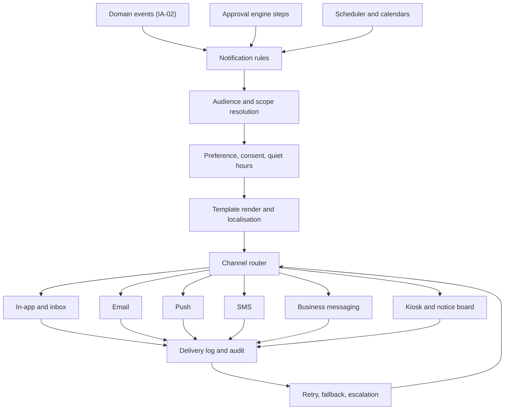
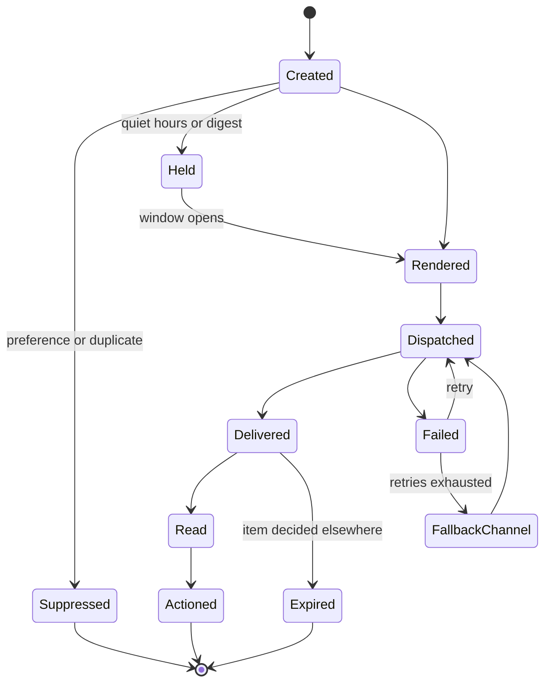
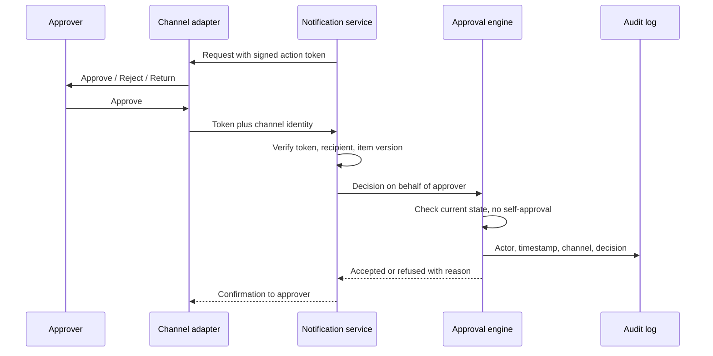

<picture>
  <source media="(prefers-color-scheme: dark)" srcset="../assets/MultipliersKraftLogoDark.png">
  
</picture>

# NOT-01 — Notification and Communication Requirements

| Attribute | Value |
| :--- | :--- |
| Document ID | NOT-01 |
| Title | Notification and Communication Requirements |
| Product | Nucleus Suite (Nucleus HRMS Suite) |
| Version | 1.0.0 |
| Status | Issued for approval |
| Owner (role) | Platform Product Owner (Notifications and Communications) |
| Author | Dhanraj Dadhich |
| Reviewed by | *pending* |
| Approved by | Architecture Review Board — *pending* |
| Date | 2026-11-05 |
| Classification | Internal |
| CMMI practice areas | RDM, TS, PI, VV |
| Related documents | NFR-01, IA-02, BA-04, BA-05, GOV-08, GOV-10, GOV-11, AI-01, FRS-PLT-01, FRS-SSV-01, FRS-EXP-01, FRS-PLT-06 to FRS-INT-06, RPT-01, LOC-01 |
| Quality & process-performance objectives | QPPO-01 (minimise defects reaching users), QPPO-05 (effective requirements reviews), QPPO-07 (fair and grounded AI) |
| Process performance baseline used | PPB-01 (review defect density), PPB-02 (review rate) |
| Peer review record | *pending* (PR-xxxx, QA-02) |
| Tailoring record | none |
| Traceability anchor | BG-02, BG-03, BG-06, BG-07 · R-06, R-07, R-12, R-17, R-18, R-21 · PLT-05, PLT-07, SSV-02, SSV-03, EXP-02 · RL-011, RL-013, RL-062, RL-411 |

---

## 1. Purpose and scope

This document specifies how Nucleus Suite tells people that something has happened or that something needs them. It covers the notification architecture, the six delivery channels, the complete notification matrix, the preference centre, quiet hours, digesting, localisation, delivery-failure handling and the governance of notification templates.

In scope: every domain event in the Process Flows workbook sheet 12_Events (41 events, catalogued in IA-02), every approval workflow W-01 to W-10 (Build Sheet 07_Approval_Workflows and Demo Dataset 64_Approval_Workflows, catalogued in BA-05), statutory due-date reminders (Demo Dataset 28_Statutory_Calendar), payslip publication, document expiry, agent and assistant confirmations, security and privacy notices, and broadcast announcements (Demo Dataset 31_Announcements, client requirement R-21).

Out of scope: the content of letters (EXP-03, governed by FRS-EXP), statutory filings themselves (LOC-01) and report scheduling mechanics beyond delivery (RPT-01).

**Delivery stage.** The current stage is R0, a UI-validation prototype on local JSON. Nothing in this document authorises sending email, SMS, push or business-messaging traffic, or connecting to any external gateway (DEC-0002). R0 behaviour is defined in §15.

## 2. Design principles

1. **One notification service.** Domain modules publish events or call the notification interface; they never send a message themselves.
2. **Every notification is actionable or explains why not.** Where the recipient can act, they can act in place on the channel they received it on (RL-411), subject to the security limits in §13.
3. **Scope travels with the message.** A notification never carries data the recipient could not see on screen. Salary masking for plant and location-scoped users applies to every channel, including business messaging and voice read-out (GOV-08 §4, R-09).
4. **Nothing silent.** A failed delivery is visible, retried, and escalated when it matters (§11). A failed payroll posting or a lapsing comp-off credit must never pass unnoticed (RP-06, RP-15).
5. **Respect people's time.** Quiet hours, digests and preferences are the default; only critical classes bypass them (§8).
6. **Language follows the person.** A message is rendered in the recipient's preferred language and format conventions, not the sender's (§10, LOC-01).

## 3. Notification architecture

### 3.1 Logical flow

### 3.2 Delivery lifecycle

### 3.3 Architecture requirements

| ID | Requirement | Rationale | Source / trace | Realises SYS | Priority | Verification | Acceptance criterion |
| :--- | :--- | :--- | :--- | :--- | :--- | :--- | :--- |
| PLT-NOT-001 | The system MUST route every user-facing notification through a single notification service; domain modules MUST NOT call a channel gateway directly. | One place for preferences, scope, audit and failure handling. | PLT-07, RL-512 (same pattern for ERP calls) | SYS-070, SYS-071 | Must | Inspection | Static analysis finds no channel-gateway client imported outside the notification service. |
| PLT-NOT-002 | The system MUST create notifications only from committed state: either from an event relayed by the outbox or from an approval-engine step that has committed. | A rolled-back transaction must not produce a message. | PLT-07, IA-02 | SYS-053, SYS-070 | Must | Test | Forcing a rollback after a leave approval produces zero notifications. |
| PLT-NOT-003 | Notification rules MUST be configuration keyed by event type, workflow step or schedule, versioned and effective-dated like other tenant configuration. | Rules change without code releases and remain reproducible. | PLT-03, RL-020 | SYS-026, SYS-059 | Must | Inspection | A rule change is stored as a new version with valid-from; the prior version remains readable. |
| PLT-NOT-004 | The system MUST resolve recipients at send time from current role, reporting line and data scope, using the intersection rule. | A person who has lost scope must not receive the item. | RL-004, RL-160 | SYS-016, SYS-017 | Must | Test | After a manager change, the old manager receives no new notification for the reportee. |
| PLT-NOT-005 | The system MUST de-duplicate notifications on the triple (rule version, recipient, event idempotency key). | Events may be delivered more than once. | IA-02 idempotency keys | SYS-054, SYS-055 | Must | Test | Replaying `leave.request.approved` twice yields one notification per recipient. |
| PLT-NOT-006 | Notification content MUST be limited to fields the recipient may see under their data scope, evaluated with the same policy used for screens, reports, exports and APIs. | Masking enforced in four surfaces must also hold in the fifth. | R-09, 43_Roles_and_Data_Scope, T-18 | SYS-017, SYS-018 | Must | Test | U-001 (plant HR, Chennai) receives no notification containing E1056's salary fields on any channel. |
| PLT-NOT-007 | Every notification MUST carry a deep link to the source record or queue item, resolved under the recipient's own permissions. | The message is a pointer, not a copy of the record. | RL-411, SCR-040 | SYS-015, SYS-070 | Must | Demonstration | Opening the link from any channel lands on the item or on an access-denied page, never on another person's record. |
| PLT-NOT-008 | The notification service MUST expose its own events (`notification.sent`, `notification.failed`, `notification.actioned`) on the event bus with the standard envelope. | Analytics and audit consume delivery outcomes. | IA-02 envelope | SYS-054, SYS-058 | Should | Inspection | Event schemas registered with schema_version and CloudEvents-shaped envelope. |

## 4. Channels

### 4.1 Channel definitions

| Code | Channel | Primary personas | May carry personal data | Actionable | Constraints |
| :--- | :--- | :--- | :--- | :--- | :--- |
| IA | In-app notification centre and unified approval inbox (web, mobile app) | All | Yes, within scope | Yes | Always on; the system of record for every notification. |
| EM | Email (work address; personal address only for leavers and candidates) | PER-01, 02, 04, 05, 06, 09, 10, 13, 14, 15; PER-12 | Summary only; detail behind authenticated link | Yes, by link | No unencrypted personal-data attachments. |
| PU | Push notification to the Nucleus mobile app | PER-03, 07, 08, 11 | No amounts, no leave reasons, no medical or identity data on the lock screen | Yes, opens the app | Requires installed app and device registration. |
| SM | SMS | PER-11, PER-08 without the app, PER-12 | No personal data beyond first name and a reference | No (link only) | Transactional use only; segment limits in PLT-NOT-012. |
| BM | Business messaging channel (opt-in) | PER-08, PER-11, PER-07 | Limited, per template classification | Yes, for low-risk decisions | Explicit consent; phone number bound to the principal. |
| KI | Kiosk, shared plant terminal and digital notice board | PER-11, PER-03 | Kiosk: yes after authentication; notice board: broadcast only | Kiosk: yes | Auto-clear after 30 seconds of inactivity. |

### 4.2 Default channel set by persona

| Persona | Default channels for action items | Default channels for information | Fallback when primary fails |
| :--- | :--- | :--- | :--- |
| PER-01 CHRO | IA, EM | IA digest, EM digest | EM |
| PER-02 HRBP · PER-13 Payroll Administrator · PER-14 DPO / Compliance | IA, EM, PU | IA, EM digest | EM, then SM for critical class |
| PER-03 Plant Supervisor / Time Office | IA, PU, KI | IA, KI | SM |
| PER-04 TA Lead · PER-06 Calibration Lead · PER-09 Capability Lead | IA, EM | IA, EM digest | EM |
| PER-05 Finance Controller | IA, EM | IA, EM | SM for critical class |
| PER-07 Line Manager | IA, PU, BM (if consented) | IA, PU digest | EM, then SM |
| PER-08 Employee | IA, PU, BM (if consented) | IA, PU | EM, then SM |
| PER-10 Super Admin | IA, EM | IA | SM for critical class |
| PER-11 Contract / Frontline Worker | KI, SM, BM (if consented) | KI, SM | SM |
| PER-12 Candidate | EM, SM | EM | SM |
| PER-15 Auditor | IA | IA | EM |
| PER-16 Integration User | Event bus and webhook only | — | Dead-letter queue (§11) |

### 4.3 Channel requirements

| ID | Requirement | Rationale | Source / trace | Realises SYS | Priority | Verification | Acceptance criterion |
| :--- | :--- | :--- | :--- | :--- | :--- | :--- | :--- |
| PLT-NOT-009 | The system MUST record every notification in the in-app notification centre regardless of other channels, with read state, and retain it there for 13 months. | In-app is the system of record and the fallback a user can always reach. | SCR-040, SCR-042 | SYS-070 | Must | Test | A notification sent only by SMS by preference still appears in the recipient's in-app centre. |
| PLT-NOT-010 | Email MUST be sent from a tenant-verified sending domain authenticated with SPF, DKIM and DMARC, and MUST NOT attach unencrypted personal data; personal content is reached through an authenticated link. | Spoofing protection and data minimisation. | GOV-10, BG-06 | SYS-070, SYS-088 | Must | Inspection | Sample payslip email contains a link, no attachment, and passes DMARC alignment. |
| PLT-NOT-011 | Push payloads MUST NOT contain monetary amounts, leave reasons, medical, identity or bank data; the lock-screen text MUST be a neutral summary. | Lock screens are visible to others. | GOV-10, R-09 | SYS-070 | Must | Test | Payslip push reads "Your payslip for Sep 2026 is ready" with no figure. |
| PLT-NOT-012 | SMS MUST be limited to transactional messages from registered sender identities and pre-registered templates as required by Indian telecom rules on commercial communication (to be validated by Legal), and MUST fit in two segments (306 GSM-7 or 134 Unicode characters). | Deliverability and regulatory registration. | LOC-01 §3 | SYS-070 | Must | Inspection | Template lint rejects an SMS template over two segments in any enabled language. |
| PLT-NOT-013 | The business messaging channel MUST be enabled per user only after explicit, recorded consent, MUST bind the phone number to the principal through a one-time verification, and MUST use pre-approved templates. | Consent under the DPDP Act 2023 and protection against number reassignment (to be validated by Legal). | SSV-03, CMP-06p, FRM-PPL-01 mother_tongue note | SYS-070 | Must | Test | A user without a consent record receives nothing on BM; withdrawing consent stops BM within 5 minutes. |
| PLT-NOT-014 | Kiosk notifications MUST appear only after the worker authenticates at the kiosk and MUST clear after 30 seconds of inactivity; the digital notice board MUST show broadcast content only. | Shared devices are seen by others. | SCR-020, PER-11 | SYS-070, SYS-078 | Must | Demonstration | A worker's gate-pass approval appears after badge or biometric sign-in and is gone 30 seconds after inactivity. |
| PLT-NOT-015 | Nucleus Talk MUST be able to read in-app notifications aloud on request, in the user's language, and MUST NOT speak masked fields. | Voice access for frontline and low-literacy users. | BG-02, BG-03, GOV-11 | SYS-018, SYS-079 | Should | Demonstration | "Read my notifications" in Hindi reads the last five items without amounts for a plant-scoped user. |
| PLT-NOT-016 | Every frontline worker (PER-11) without the mobile app or email MUST be reachable for action-class notifications through at least one of SM, BM or KI. | Most frontline users are not at a desk. | 07_Screens header note, PER-11 | SYS-070, SYS-078 | Must | Test | Configuration validation flags any active PER-11 principal with no reachable channel. |

## 5. Notification classes and timing

| Class | Meaning | Delivery target (p95, event occurred_at to channel hand-off, normal load) | Quiet hours | Digest | Opt-out |
| :--- | :--- | :--- | :--- | :--- | :--- |
| C1 Critical | Security alerts, emergency announcements, bank-detail change in a payroll window, statutory obligation due today and unfiled, payroll posting failure | 60 seconds | Bypassed | Never | Not allowed |
| C2 Action | Approval requests, confirmations, time-critical worker items (gate pass, punch exception before cut-off) | 2 minutes | Respected for PU, SM and BM unless the rule is flagged time-critical | Never | Channel choice only |
| C3 Information | Outcomes, receipts, credits, status changes | 15 minutes | Respected | Allowed | Allowed unless marked mandatory |
| C4 Broadcast and digest | Announcements, briefs, digests, scheduled reminders | At the scheduled time ± 5 minutes | Respected (except emergency and statutory notices) | Not applicable | Allowed except emergency and statutory notices |

| ID | Requirement | Rationale | Source / trace | Realises SYS | Priority | Verification | Acceptance criterion |
| :--- | :--- | :--- | :--- | :--- | :--- | :--- | :--- |
| PLT-NOT-017 | Every notification rule MUST declare exactly one class (C1–C4), and the class MUST determine latency target, quiet-hour handling, digest eligibility and opt-out. | Consistent behaviour, testable targets. | §5 | SYS-070 | Must | Inspection | Rule configuration without a class fails validation. |
| PLT-NOT-018 | The system MUST meet the class delivery targets at the 95th percentile with 10,000 notifications per minute per tenant (shift-change and pay-day peaks). | Pay day and shift change are bursts. | NFR-01 (attendance ingestion 500 events per second) | SYS-070 | Must | Test | Load test at 10,000 per minute shows C1 p95 ≤ 60 s and C2 p95 ≤ 2 min. |
| PLT-NOT-019 | During the payroll availability window (25th to 5th) the notification service MUST meet 99.95% availability for C1 and C2 classes. | Payroll approvals and alerts cannot wait. | NFR-01 payroll availability | SYS-070 | Must | Analysis | Monthly availability report per class. |

## 6. Notification matrix

### 6.1 Legend

| Column | Codes |
| :--- | :--- |
| Key | `NM-nnn` — matrix row key used by test cases and the delivery log. |
| Channels | IA in-app · EM email · PU push · SM SMS · BM business messaging (consented users only) · KI kiosk or notice board |
| Lang. | **Pref** — recipient's preferred language, then tenant default, then English · **Pref+EN** — preferred language with the English authoritative version linked · **EN** — English for technical recipients (user may change) |
| Opt-out | **No** — mandatory · **Ch** — may change channel, in-app always kept · **Dg** — may move to digest · **Yes** — may suppress |
| Audit | **A1** delivery log (rule, recipient, channel, template version, status timestamps) · **A2** A1 plus read and action evidence including the channel of any decision · **A3** A2 plus rendered-content hash retained for the life of the underlying record |
| Persona | Approver roles from BA-05 map to personas as: Supervisor = PER-03 or PER-07; HOD = PER-07 holding the department-head position; HR Head = PER-02 holding R-HRHEAD; Finance = PER-05; Director = approver role R-DIRECTOR (BA-04); department owners = role holders named on the clearance checklist |

### 6.2 Domain-event notifications (all 41 events in 12_Events)

| Key | Trigger | Recipients | Channels | Timing / SLA | Escalation | Lang. | Content summary | Opt-out | Audit |
| :--- | :--- | :--- | :--- | :--- | :--- | :--- | :--- | :--- | :--- |
| NM-001 | `people.worker.hired` (PPL-01) | Joiner (PER-08/PER-11); line manager (PER-07); HR operations (PER-02) | Joiner: SM, EM, BM, IA · Manager and HR: IA, EM | C3; joiner welcome at 09:00 local on the day before joining | None — joining-chain SLAs apply (NM-029) | Pref | Welcome, reporting manager, location, first-day checklist, app activation link | Joiner activation: No · welcome: Yes | A2 |
| NM-002 | `people.assignment.changed` (PPL-02) | Employee; old and new manager; PER-13 when a pay-relevant attribute changed; PER-10 when scope changed | IA, EM, PU | C3 within 15 min | None | Pref | Changed fields, effective date, reason; notice that a change inside a closed period raises arrears (RL-041) | Ch | A2 |
| NM-003 | `people.position.vacated` (PPL-04) | Hiring manager (PER-07); PER-04; PER-02 | IA, EM | C3, daily digest by default | None | Pref | Position code, vacated on, prompt to raise a replacement requisition that does not consume headcount (R-25) | Dg | A1 |
| NM-004 | `people.document.expiring` (PPL-06) | Document holder; PER-02; line manager when the document blocks work (62_Documents "Blocks") | IA, EM, PU, SM, BM | C3 at 60, 30 and 7 days before expiry and on the expiry date (RL-062) | At 7 days to PER-02; on expiry to PER-02 and manager for mandatory classes | Pref | Document class, expiry date, upload link; document number never shown | Mandatory class: No · optional: Yes | A2 |
| NM-005 | `time.punch.ingested` (TIM-01) | Worker who punched; PER-03 for device-health conditions | KI (on-screen), IA; PU only for offline punches synced later | On-device confirmation within 2 s; in-app within 1 min | Device silent for 30 min during a shift → PER-03 (C2) | Pref | Punch time, source, geofence result; for synced offline punches the original signed time | App receipt: Yes · kiosk confirmation: No | A1 |
| NM-006 | `time.recompute.requested` (TIM-01/09) | Requester (PER-02/PER-03); PER-13 if the range touches a locked period | IA | C3 on job completion | Locked-period collision → PER-13 (C2) | EN | Job reference, range, deltas produced, collisions | Yes | A1 |
| NM-007 | `time.attendance_day.computed` (TIM-02) | Employee when the status is not Present or a late instance is counted; manager team digest | IA, PU, BM, KI | C3; employee before the next shift start or 08:00 local; manager daily digest 08:00 | None | Pref | Day status, net hours, late instance number and allowance remaining (RL-116); warning when the next late becomes a half day (BS:RL-17) | Adverse status: Ch · routine: Yes | A1 |
| NM-008 | `time.attendance_day.recomputed` (TIM-09) | Employee when status changed; PER-13 when the day is in a locked or closed period | IA, PU | C3 within 30 min | None | Pref | Old and new status, reason, whether arrears will follow | Ch | A2 |
| NM-009 | `time.shift.inferred` (TIM-03) | Roster owner (PER-03); employee via day detail only | IA | C3, roster-owner daily digest | None | Pref | Assigned versus applied shift and reason (RL-092) | Dg | A1 |
| NM-010 | `time.exception.raised` (TIM-08) | Employee; supervisor queue (PER-03/PER-07); PER-13 for payroll-blocking exceptions | IA, PU, BM, KI, SM fallback | C2 for the employee within 30 min (quiet hours respected); payroll-blocking items daily from 3 days before input lock | Unresolved after 2 working days → supervisor; 1 day before input lock → plant HR and PER-13 | Pref | Exception type and date; action to confirm the agent proposal or raise a regularisation (W-10) | No | A2 |
| NM-011 | `time.gate_pass.approved` (TIM-06) | Applicant; gate desk terminal | PU, IA, BM, SM fallback, KI (gate) | C2 time-critical; within 1 min, quiet hours bypassed for PU | Undelivered after 2 min → SM | Pref | Approved minutes, time window, minutes and passes used this month against 240 minutes and 2 passes (RL-121) | No | A2 |
| NM-012 | `time.overtime.approved` (TIM-07) | Employee; PER-13 | IA, PU, EM | C3 within 15 min | None | Pref | Approved hours (original hours if reduced), day type, the separate OT run that will pay it (BS:RL-23) | Ch | A2 |
| NM-013 | `leave.credit.posted` (LVE-01/02) | Employee | IA, PU; EM monthly digest | C3; monthly accruals digested on the 1st at 09:00; annual and catch-up credits sent individually | None | Pref | Leave type, days, expiry, new balance; rule that credited it | Dg | A1 |
| NM-014 | `leave.request.approved` (LVE-04) | Applicant; approvers in the chain; team (as "away", no leave type); PER-13 for loss-of-pay days | IA, PU, EM, BM, SM fallback; iCalendar attachment to the applicant | C3 within 1 min of the final decision | None | Pref | Dates, days, type, approver trail; team sees only availability | Ch | A2 |
| NM-015 | `leave.credit.reversed` (LVE-05) | Employee; supervisor; HR Head who closed it | IA, PU, EM | C3 within 15 min | None | Pref | Days credited back, attendance corrected for the same dates, both references (W-02) | Ch | A2 |
| NM-016 | `leave.compoff.lapsed` (LVE-06) | Employee; manager digest | IA, PU, SM, BM | C3 on the lapse run | None | Pref | Days lapsed, earned date, expiry date; pre-lapse warnings are NM-074 | No | A2 |
| NM-017 | `payroll.inputs.locked` (PAY-02) | PER-13; PER-03 and PER-02 of the payroll group; managers with pending items affecting the run | IA, EM | C3 immediately | None | Pref | Period locked; later changes become arrears in the next open run | No | A1 |
| NM-018 | `payroll.snapshot.taken` (PAY-02) | PER-13 | IA | C3 | None | EN | Snapshot reference, input hash, rule-pack versions (RL-251) | Yes | A1 |
| NM-019 | `payroll.run.approved` (PAY-09) | PER-05 (dual-control release due); PER-13; PER-01 summary | IA, EM | C2 immediately | Bank file not released by 12:00 on the working day before pay date → PER-05 and PER-01 (C1) | Pref | Run, period, totals, release task | No | A2 |
| NM-020 | `payroll.run.disbursed` (PAY-09) | All employees in the run (payslip — NM-090); PER-13; PER-05 | See NM-090; IA, EM for PER-13 and PER-05 | C3; payslip notices within 2 h | See NM-090 | Pref | Disbursement complete, pay date, net total (finance roles only) | Ch | A3 |
| NM-021 | `payroll.journal.ready` (FIN-03) | PER-05 | IA, EM | C2 immediately | Not posted within 1 working day → PER-05 reminder | Pref | Journal reference, line count, totals, post action | No | A1 |
| NM-022 | `payroll.run.posted` (FIN-03) | PER-05; PER-13 | IA, EM | C3; posting failure is C1 | Failure → PER-05 and integration engineer immediately; unresolved 4 h → PER-01 | Pref | ERP document number written back (RL-524) or failure reason (RP-15) | No | A2 |
| NM-023 | `payroll.arrears.requested` | Employee; PER-13 | IA, EM | C3 within 15 min | None | Pref | Period corrected, reason, run that will carry the arrears or recovery | Ch | A2 |
| NM-024 | `payroll.input.raised` (EXP/TAL/LVE) | PER-13 (digest); employee for award inputs | IA, EM | C3; PER-13 daily digest | None | Pref | Component, run, source reference; amounts only in IA/EM | Dg | A1 |
| NM-025 | `loan.sanctioned` (CMB-03) | Borrower; guarantors; PER-13; chain approvers | IA, EM, PU, BM | C3 within 15 min | None | Pref+EN | Sanction, principal and instalment (IA/EM only), schedule link; guarantors told they are now locked (RL-442) | No | A3 |
| NM-026 | `loan.repayment.posted` (PAY-08) | Borrower | IA, EM digest with payslip | C3 | Recovery reduced or skipped by the net floor (RL-311) → borrower, PER-13 and PER-05 (C2) | Pref | Instalment recovered, outstanding after | Dg | A1 |
| NM-027 | `loan.closed` (CMB-04) | Borrower; guarantors; PER-05 | IA, EM, PU | C3 | None | Pref+EN | Closure date, closure statement link, guarantor release pending | No | A2 |
| NM-028 | `loan.guarantor.released` (CMB-04) | Guarantor | IA, EM, PU | C3 | None | Pref | Released from the loan; own borrowing and guaranteeing eligibility restored (RL-432) | No | A2 |
| NM-029 | `lifecycle.joining.started` (LCY-02) | PER-02; step owners (statutory registrations, IT, assets, induction); joiner | IA, EM; joiner SM, BM | C2 per step on assignment | Step SLA breach → step owner, then PER-02 (Onboarding Runner escalation) | Pref | Step, due date, blocking flag; joiner tasks (documents, policy acknowledgement) | No | A2 |
| NM-030 | `lifecycle.clearance.item_cleared` (LCY-06) | Leaver; exit coordinator (PER-02); HR Head when the last blocking line clears | IA, EM | C3 immediately; "ready for F&F" is C2 | See W-07 in §6.4 | Pref | Item, cleared or waived, recovery amount (leaver and HR only) | No | A2 |
| NM-031 | `payroll.fnf.settled` (PAY-12) | Leaver (personal email); PER-02; PER-05; manager; access administrator | EM, SM, IA | C2 within 15 min | Access not revoked within 1 h → PER-10 (C1) | Pref+EN | Settlement statement link, relieving letter availability, alumni access | No | A3 |
| NM-032 | `compliance.form.generated` (CMP-03p) | Compliance owner (PER-14/R-COMPLIANCE); plant HR for site registers | IA, EM | C3 | Not filed by the obligation due date → NM-070 | Pref+EN | Form, state variant, period, instance reference | No | A3 |
| NM-033 | `compliance.obligation.filed` (CMP-02p) | Compliance owner; HR Head; PER-05 | IA, EM | C3 | None — closes NM-070 reminders | Pref+EN | Obligation, acknowledgement reference, filed on (RL-383) | No | A3 |
| NM-034 | `compliance.pack.deployed` (CMP-01p) | PER-13; PER-14; HR Head; PER-10; implementation consultant | IA, EM | C2; C1 when the effective date falls inside an open payroll period | None | Pref+EN | Jurisdiction, version, effective date, changelog citation, employees affected, recomputes or arrears triggered | No | A3 |
| NM-035 | `integration.sync.applied` (FIN-01) | Integration administrator (digest); employee sees ERP-owned field changes in activity feed | IA | C3 daily digest | None | EN | Batch, rows applied, fields changed | Dg | A1 |
| NM-036 | `integration.sync.conflict` (FIN-01) | HR review queue (PER-02); integration engineer | IA, EM | C2 within 15 min | Unresolved after 2 working days → HR Head | Pref | Field, ERP value, Nucleus value, owning system (RL-514); unmatched codes parked (RL-516) | No | A2 |
| NM-037 | `experience.recognition.nominated` (EXP-01) | Programme approver; nominee's manager; nominee on approval | IA, EM, PU | C2 to approver; C3 to nominee | Follows the approval chain configured for the programme | Pref | Programme, citation; announcement follows on approval (RL-492) | Ch | A2 |
| NM-038 | `experience.letter.issued` (EXP-03) | Recipient employee; issuing HR user | IA, EM, PU | C3 within 15 min | None | Pref+EN | Letter type, link to document vault; template version retained (RL-502) | No | A3 |
| NM-039 | `talent.requisition.blocked` (TAL-01) | Hiring manager; HR Head; PER-04 | IA, EM | C2 immediately | None — additional approval level is requested from the screen | Pref | Requisition, reason, sanctioned headroom (RL-462) | No | A2 |
| NM-040 | `agent.action.executed` (INT-01) | Accountable human owner; human principal; affected employee when their record changed | IA, EM digest for owners | C3 within 1 min to the affected employee | None | Pref | What the agent did, tool, outcome, reversal link valid for the reversal window | Affected employee: No · owner: Dg | A3 |
| NM-041 | `agent.action.reversed` (INT-02) | Agent owner; approving human; affected employee; PER-10 when weekly reversal rate exceeds 2% | IA, EM | C3; threshold breach C2 | Reversal rate above 2% for a week → Head of AI and Product owner | Pref | Action reversed, by whom, reason; record restored | No | A3 |

### 6.3 Approval workflow notifications — step rules (apply to W-01 to W-10)

| Key | Trigger (approval-engine step) | Recipients | Channels | Timing / SLA | Escalation | Lang. | Content summary | Opt-out | Audit |
| :--- | :--- | :--- | :--- | :--- | :--- | :--- | :--- | :--- | :--- |
| NM-050 | Approval requested (step opened, RL-011) | Current approver(s); applicant receives a submission receipt | Approver: IA (unified inbox), PU, EM, BM · Applicant: IA, PU | C2 within 1 min | Per workflow (§6.4) | Pref | Request summary, rule context (RL-412), due-by time, approve / reject / return / delegate in place | Ch | A2 |
| NM-051 | Reminder (50% of step SLA elapsed, and one working day before escalation) | Current approver | IA, PU, EM | C2 | — | Pref | Pending item, time left before escalation | Ch | A1 |
| NM-052 | Approved at an intermediate level | Applicant (progress); next approver receives NM-050 | IA, PU | C3 | — | Pref | Level approved, by whom, next level | Dg | A2 |
| NM-053 | Approved (final) | Applicant; all prior approvers; downstream owners named per workflow | IA, PU, EM, BM | C3 within 1 min | — | Pref | Outcome, approval trail with actor and timestamp per level | Ch | A2 |
| NM-054 | Rejected | Applicant; prior approvers | IA, PU, EM, BM, SM fallback | C2 within 1 min | — | Pref | Outcome with mandatory reason (RL-013) and what the applicant can do next | No | A2 |
| NM-055 | Returned to applicant | Applicant; prior approvers | IA, PU, EM, BM | C2 within 1 min | Applicant does not resubmit within 5 working days → reminder; the request lapses after 10 working days with notice | Pref | Reason for return, fields to change, resubmit link | No | A2 |
| NM-056 | Escalated (SLA breached) | Escalation target; original approver; applicant | IA, PU, EM | C2 within 1 min | Further breach follows the workflow configuration | Pref | Item moved to whom and why, original due time | No | A2 |
| NM-057 | Delegated (by the approver, or automatically while the approver is on approved leave) | Delegate (receives NM-050 content); delegator; applicant | IA, PU, EM | C2 within 1 min | Delegate's own SLA starts at delegation | Pref | Who delegated to whom, delegation window | No | A2 |
| NM-058 | Rerouted because the approver has left (RL-012) | Successor or role holder; applicant; PER-02 | IA, EM | C2 within 1 min | — | Pref | Item rerouted, previous approver, reason | No | A2 |
| NM-059 | HR edit or close after approval (RL-015) | Applicant; original approvers | IA, EM | C3 | — | Pref | What changed, recorded against the HR user, reason | No | A2 |
| NM-060 | Withdrawn or cancelled by the applicant | Pending and prior approvers | IA, PU | C3 | — | Pref | Item withdrawn; removed from inbox | Yes | A1 |

### 6.4 Approval workflow notifications — per workflow

| Workflow | Chain (BA-05) | Requested (NM-050) goes to | Final outcome (NM-053) goes to | Rejected (NM-054) | Returned (NM-055) | Escalated (NM-056) | Delegated (NM-057) | Workflow-specific notifications |
| :--- | :--- | :--- | :--- | :--- | :--- | :--- | :--- | :--- |
| W-01 Leave application | Supervisor → HOD → HR Head, sequential | Supervisor, then HOD, then HR Head | Applicant; team (availability only); PER-13 when loss of pay | Applicant and prior levels | HR Head only, with a reason | After 3 days to the next level | Allowed | Overlap and team-coverage warning to approvers; HR update after approval (NM-059) |
| W-02 Leave early return | HR Head, single level | HR Head | Employee and supervisor (NM-015) | Employee | Not allowed | None; reminder to HR Head at 16:00 on the day submitted | Not allowed | Confirmation lists both the ledger credit and attendance correction references (one commit) |
| W-03 Overtime | Supervisor → HOD, sequential | Supervisor, then HOD | Employee and PER-13 (NM-012) | Employee | Allowed | After 2 days | Allowed | Reduced hours shown as original versus approved; reminder to all pending approvers 1 day before the OT run cut-off; statutory weekly-limit warning to approver (RL-133) |
| W-04 Gate pass | Reporting manager, single level | Reporting manager (time-critical) | Applicant and gate desk (NM-011) | Applicant, with reason such as the monthly ceiling | Not allowed | None; undecided after 15 min → reminder to approver | Allowed | Entitlement re-checked at approval; if exceeded since submission the approver is warned and the applicant told why it was refused |
| W-05 Loan application | HOD → HR Head → Finance, sequential | Guarantor acceptance requests first (CMB-02), then HOD, HR Head, Finance | Borrower, guarantors, PER-13 (NM-025) | Borrower and guarantors | Allowed | After 5 days | Not allowed | Eligibility failure at submission returns reasons immediately and no chain starts (RL-434); guarantor accepted or declined notices to the borrower |
| W-06 Loan special terms | Director, inserted step that cannot be skipped | Director, with the rules being waived named | Borrower, Finance, HR Head | Borrower and chain | Not allowed | None | Not allowed | Finance told the sanction is held pending the Director decision; decision carries the override reason |
| W-07 No dues clearance | One sign-off per department, parallel | All department owners at once | Leaver; HR Head ("ready for F&F") | Not applicable — lines are Cleared or Waived with a reason | Not allowed | After 5 days to HR | Allowed | Daily digest to HR of blocking lines; on the morning of the last working day, open blocking lines are C1 to owners and HR Head |
| W-08 Full and final settlement | HR Head → Finance, sequential | HR Head, then Finance | Leaver, PER-05, access administrator (NM-031) | Leaver and HR | Allowed | None per source; hourly reminder to the pending approver from 12:00 on the last working day | Not allowed | Held settlement notice names the blocking clearance lines |
| W-09 Manpower requisition | HOD → HR Head, plus a level when sanction is exceeded | HOD, HR Head, then the additional approver | Hiring manager and PER-04 | Hiring manager | Allowed | After 5 days | Allowed | Additional-level request names the headroom shortfall; blocked requisitions follow NM-039 |
| W-10 Attendance regularisation | Reporting manager, single level | Reporting manager | Employee (original versus corrected status) and time office | Employee, with the rule that prevented it | Allowed | After 3 days | Allowed | Agent-proposed regularisations are labelled as proposals; reminder before payroll input lock (NM-079) |

### 6.5 Scheduled and reminder notifications

| Key | Trigger | Recipients | Channels | Timing / SLA | Escalation | Lang. | Content summary | Opt-out | Audit |
| :--- | :--- | :--- | :--- | :--- | :--- | :--- | :--- | :--- | :--- |
| NM-070 | Statutory obligation due (28_Statutory_Calendar, RL-370) | Obligation owner (PER-13 or PER-14) | IA, EM, PU | C4 at 09:00 local on due date −7, −3 and −1; C1 at 09:00 on the due date; daily while overdue | Due date 12:00 and not filed → HR Head and PER-05; overdue → PER-01 weekly digest | Pref+EN | Obligation, authority, entity, state, period, due date, filing-pack status, evidence required | No | A3 |
| NM-071 | Filing pack assembled by the Compliance Watcher | Obligation owner | IA, EM | C2 | Not reviewed within 1 working day → reminder | Pref+EN | Pack reference, posted-record basis (RL-371); filing is always human | No | A3 |
| NM-072 | Statutory rule change detected with tenant impact | PER-14; PER-13; implementation consultant | IA, EM | C2 | None | Pref+EN | Notification cited, jurisdictions, estimated employees affected, proposed pack change (LOC-01 §9) | No | A3 |
| NM-073 | Holiday calendar published or changed for a location | Employees of the location; PER-03 | IA, PU, KI notice board | C4 | None | Pref | Holiday list or change, effective dates (LOC-01 §7) | Yes | A1 |
| NM-074 | Comp-off credit nearing lapse (RL-06, RP-06) | Employee; manager digest | IA, PU, SM, BM | C3 at 14 and 3 days before expiry | None | Pref | Credit, earned date, expiry date, apply link | No | A2 |
| NM-075 | Probation end approaching (LCY-03) | Line manager; PER-02 | IA, EM | C4 at 30 and 7 days before | Not actioned by the end date → PER-02 and HOD | Pref | Employee, probation end, confirmation blockers (induction, assets) | No | A2 |
| NM-076 | Tax declaration and proof windows (PAY-07) | Employees | IA, PU, EM | C4 at window open, 7 days and 1 day before close; regime choice reminder at financial-year start | None | Pref+EN | Window dates, regime choice, proofs pending | Ch | A1 |
| NM-077 | Policy acknowledgement pending (SCR-062) | Employee | IA, PU, KI | C4 at publish, +3 and +7 days | +14 days → line manager | Pref+EN | Policy, version, acknowledge link | No | A2 |
| NM-078 | Learning assignment due or overdue (SCR-063) | Employee; manager when overdue; PER-09 digest | IA, PU, EM | C4 at 7 days and 1 day before due | Overdue mandatory course → manager | Pref | Course, due date, statutory flag | Ch | A1 |
| NM-079 | Payroll input cut-off approaching (PAY-02) | PER-03; PER-02; approvers holding pay-affecting items | IA, EM, PU | C4 at lock date −3 and −1 | None | Pref | Cut-off time, count of open exceptions and approvals | No | A1 |
| NM-080 | Late allowance used up (RL-116) | Employee | IA, PU, KI | C3 on the day the last forgiven late is counted | None | Pref | Lates this month, next late becomes a half day | Ch | A1 |
| NM-081 | Helpdesk ticket status change or SLA risk (SSV-04) | Raiser; assignee; queue lead | IA, PU, EM, BM | C3 for status; C2 at 75% of SLA to assignee | Breach → queue lead | Pref | Ticket, status, resolution | Ch | A1 |
| NM-082 | Year-end leave preview published (LVE-07, RP-08) | Employees | IA, EM | C4 30 days before year end | None | Pref | Projected encashment and lapse per leave type | Yes | A1 |
| NM-083 | Pre-boarding task due (LCY-01, 61_Preboarding_Chain) | Candidate (PER-12) | EM, SM | C4 at assignment and 2 days before due | Overdue blocking step → PER-02 | Pref | Task, due date, secure upload link | No | A2 |
| NM-084 | Interview scheduled or changed (TAL-02, Recruiting Coordinator) | Candidate; panel members | EM, SM; panel IA, EM | C3 | None | Pref | Date, time, mode, location or link; iCalendar attachment | Ch | A1 |

**Statutory reminder coverage (from 28_Statutory_Calendar, demo values to be validated by Legal).** NM-070 MUST be generated for each obligation type below, per entity and state:

| Obligation | Authority | Frequency | Demo due date | Reminder owner (demo) |
| :--- | :--- | :--- | :--- | :--- |
| PF ECR and challan | EPFO | Monthly | 2026-09-15 | E1009 compliance owner |
| ESI contribution | ESIC | Monthly | 2026-09-15 | E1009 |
| Professional tax remittance — Karnataka | State commercial taxes | Monthly | 2026-09-20 | E1007 payroll manager |
| Professional tax remittance — Maharashtra | State finance department | Monthly | 2026-09-30 | E1007 |
| Professional tax remittance — Telangana | State commercial taxes | Monthly | 2026-09-15 | E1007 |
| Professional tax — Tamil Nadu (local body) | Local body | Half-yearly | 2026-09-30 | E1007 |
| TDS deposit | Income-tax department | Monthly | 2026-09-07 | E1007 |
| TDS quarterly return 24Q | Income-tax department | Quarterly | 2026-10-31 | E1007 |
| Labour welfare fund — Karnataka | State labour department | Per state frequency | 2026-07-15 | E1009 |
| Gratuity actuarial valuation | Accounting standard requirement | Half-yearly | 2026-10-31 | E1010 finance |
| Factory annual return — Karnataka | State factories department | Annual | 2027-01-31 | E1009 |
| Contract labour half-yearly return — Tamil Nadu | State labour department | Half-yearly | 2026-07-30 | E1009 |

### 6.6 Pay communications

| Key | Trigger | Recipients | Channels | Timing / SLA | Escalation | Lang. | Content summary | Opt-out | Audit |
| :--- | :--- | :--- | :--- | :--- | :--- | :--- | :--- | :--- | :--- |
| NM-090 | Payslip published (PAY-13, after `payroll.run.disbursed`) | Every employee in the run | IA, PU, EM (link), SM, BM (no amounts), KI (view after authentication) | C3 within 2 h of disbursement; send rate spread so the payslip service stays within NFR-01 latency | Not opened in 7 days by a PER-11 worker → kiosk banner at next punch | Pref+EN | Period, run type, availability; net pay visible only after authentication | Ch | A3 |
| NM-091 | Off-cycle OT payslip (PAY-10) | Employees in the OT run | As NM-090 | C3 within 2 h | As NM-090 | Pref+EN | OT run identity, linked salary period | Ch | A3 |
| NM-092 | Settlement statement issued (PAY-12) | Leaver | EM (personal), SM | C2 within 15 min of approval | None | Pref+EN | Statement link, components summary, payment date | No | A3 |
| NM-093 | Projected TDS change above 10% month on month (PAY-07) | Employee | IA, EM | C3 | None | Pref | Reason (declaration, arrears, regime), new monthly projection | Yes | A1 |
| NM-094 | Bank details changed inside a payroll window (RL-322, RL-393) | Employee (confirm it was you); PER-13; PER-05 | IA, PU, SM, EM | C1 within 60 s | Employee reports "not me" → account locked for bank changes and PER-10 alerted | Pref | Change made, when, from which channel; masked account number | No | A3 |
| NM-095 | Pre-payroll CRITICAL flag raised (RL-262) | PER-13; flag owner | IA, EM | C2 | Unresolved at approval time → payroll manager or above (waiver role) | Pref | Flag, severity, agent-drafted resolution, blocking status | No | A2 |
| NM-096 | GL mapping missing blocks run approval (RL-521) | PER-05; PER-13 | IA, EM | C2 | None | Pref | Component without mapping, run blocked | No | A2 |
| NM-097 | Annual tax certificate available | Employees; leavers at personal email | IA, EM | C4 on publication | None | Pref+EN | Certificate year, download link | Ch | A3 |
| NM-098 | Contractor invoice held for attendance variance (CTG-02, RP-16) | Purchase owner; PER-05; vendor contact | IA, EM | C2 | Not decided in 5 working days → PER-05 | EN | Invoice, claimed versus attendance days, variance evidence (RL-482) | No | A2 |

### 6.7 Agent and assistant confirmations

| Key | Trigger | Recipients | Channels | Timing / SLA | Escalation | Lang. | Content summary | Opt-out | Audit |
| :--- | :--- | :--- | :--- | :--- | :--- | :--- | :--- | :--- | :--- |
| NM-100 | Agent proposal awaiting approval (dry-run diff, RL-543) | Accountable owner or configured approver | IA (SCR-110), EM, PU | C2 within 1 min; proposal expires after 24 h | Expiry → proposal withdrawn and owner told | Pref | Plan, simulated diff, records affected, approve / reject in place | No | A3 |
| NM-101 | Assistant write needs confirmation (RL-422) | Employee in the conversation | Same channel as the conversation (IA, BM, voice) | Inline; confirmation prompt expires after 5 min | None | Pref | Exact action and values, Confirm / Cancel; nothing executes without confirmation | No | A3 |
| NM-102 | Irreversible action needs a named human (RL-544: disbursement, termination, offer release, statutory filing, loan sanction) | Named human approver | IA, EM | C2 | Undecided after 1 working day → approver's manager | Pref+EN | Action, evidence, agent preparing it; step-up authentication required | No | A3 |
| NM-103 | Assistant could not answer; ticket created (RL-423) | Employee | Conversation channel, IA | Inline | Ticket SLA (NM-081) | Pref | Ticket number, what will happen next | No | A1 |
| NM-104 | Manager Coach weekly brief (14_Agents) | Line manager | IA, EM | C4 Monday 08:00 local | None | Pref | Who needs attention and why, with source signals | Yes | A1 |
| NM-105 | Attendance Steward nudge (14_Agents) | Supervisor or manager | IA, PU | C4 daily digest 08:00 | None | Pref | Open exceptions, proposals awaiting decision | Dg | A1 |
| NM-106 | Weekly agent reversal rate above 2% (NFR-01) | PER-10; product owner; Head of AI | IA, EM | C2 on Monday computation | None | EN | Agent, rate, top reversal reasons | No | A2 |

### 6.8 Security, privacy and platform notifications

| Key | Trigger | Recipients | Channels | Timing / SLA | Escalation | Lang. | Content summary | Opt-out | Audit |
| :--- | :--- | :--- | :--- | :--- | :--- | :--- | :--- | :--- | :--- |
| NM-110 | Account activation or first sign-in link | New user | EM or SM | C1; link valid 72 h | Unused after 72 h → PER-02 | Pref | Activation link, support contact | No | A2 |
| NM-111 | Sign-in from a new device, or lockout after failed attempts | User | IA, EM, PU, SM | C1 | Reported "not me" → PER-10 | Pref | Device, time, approximate location, action to secure | No | A3 |
| NM-112 | Credential or second-factor reset | User | EM, SM | C1 | None | Pref | Reset performed or requested; secure-account action | No | A3 |
| NM-113 | Role or data-scope grant changed (SCR-005, PLT-02) | Principal; PER-10 | IA, EM | C3 | None | Pref | Grant added or revoked, scope, granted by | No | A3 |
| NM-114 | Impersonation session started (SCR-005) | Impersonated user (after the session); PER-10; PER-14 digest | IA, EM | C3 at session end | None | Pref | Who, when, reason recorded | No | A3 |
| NM-115 | Bulk personal-data export (RL-162) | PER-14 daily digest; exporter's manager for exports above 1,000 rows | IA, EM | C4 daily | None | EN | Exporter, report, row count, purpose stated | No | A3 |
| NM-116 | Data principal rights request received, due or fulfilled (CMP-06p) | Requester; PER-14 | EM, IA | C2 on receipt; reminders at 50% and 80% of the response window (to be validated by Legal) | Window at 80% → DPO's manager | Pref+EN | Request type, reference, due date, outcome | No | A3 |
| NM-117 | Consent given or withdrawn for SM or BM | Data principal | Channel affected plus IA | C3 | None | Pref | Consent state, purpose, how to change it | No | A3 |
| NM-118 | Personal data breach affecting the person (CMP-06p) | Affected data principals; PER-14; PER-10 | EM, IA, SM | C1 when the DPO authorises notification | Per breach procedure in GOV-10 | Pref+EN | What happened, data involved, steps taken, contact (to be validated by Legal) | No | A3 |
| NM-119 | Planned maintenance or service incident | All active users of the tenant; PER-10 | IA banner, EM to PER-10 | C4 at 72 h and 1 h before maintenance; C1 for incidents | None | Pref | Window, impact, status page link | Yes for maintenance; No for incidents | A1 |
| NM-120 | Integration batch or outbox failure (FIN-01, PLT-07) | Integration engineer; PER-10 | IA, EM | C2 | Unresolved 4 h → PER-10 escalates as C1 | EN | Flow, failed count, dead-letter reference | No | A2 |

### 6.9 Broadcast announcements (EXP-02, R-21)

| Key | Trigger | Recipients | Channels | Timing / SLA | Escalation | Lang. | Content summary | Opt-out | Audit |
| :--- | :--- | :--- | :--- | :--- | :--- | :--- | :--- | :--- | :--- |
| NM-130 | Birthday (auto from date of birth; AN-2026-0088) | Audience rule (e.g. location) | IA, BM, KI notice board | C4 at 09:00 local on the day | None | Pref | Greeting; birthday only if the employee has not opted out of publication | Yes (publication and receipt) | A1 |
| NM-131 | Work anniversary (auto from date of joining; AN-2026-0095) | Audience rule | IA | C4 at 09:00 | None | Pref | Years of service | Yes | A1 |
| NM-132 | New joiner welcome (from NM-001 via the joining chain; AN-2026-0091) | Audience rule (location or org unit) | IA, EM | C4 on the joining date | None | Pref | Name, team, location, photo if consented | Yes | A1 |
| NM-133 | Recognition award (RL-492; AN-2026-0089, AN-2026-0090) | Audience rule (entity) | IA, BM, EM | C4 after approval, editorial override before publish | None | Pref | Award, citation, programme | Yes | A1 |
| NM-134 | Referral award paid (AN-2026-0092) | Audience rule (org unit) | IA | C4 | None | Pref | Referrer thanked; no amount | Yes | A1 |
| NM-135 | Management or policy message (manual; AN-2026-0094) | Audience rule | IA, BM, EM, KI notice board | C4 at publish-from time after approval | None | Pref+EN | Message, effective date, acknowledgement link where required (NM-077) | Yes, unless flagged mandatory | A2 |
| NM-136 | Emergency announcement (announcement type Emergency) | Audience rule, typically a location | All channels including SM | C1; quiet hours and preferences bypassed | Undelivered after 5 min → SM to every unreached recipient | Pref+EN | Instruction, location, contact | No | A3 |
| NM-137 | Statutory notice (announcement type Statutory) | Employees of the establishment | IA, KI notice board, EM | C4 | None | Pref+EN | Notice text, display period, establishment | No | A3 |

### 6.10 Matrix requirements

| ID | Requirement | Rationale | Source / trace | Realises SYS | Priority | Verification | Acceptance criterion |
| :--- | :--- | :--- | :--- | :--- | :--- | :--- | :--- |
| PLT-NOT-020 | The system MUST implement every row NM-001 to NM-137 as a configured, enabled-by-default rule for each new tenant. | The matrix is the baseline contract. | §6 | SYS-004, SYS-070 | Must | Inspection | Tenant provisioning creates one active rule per matrix key. |
| PLT-NOT-021 | Each event in IA-02 MUST map to at least one matrix row, and adding an event to IA-02 MUST fail the release check until a row (or an explicit "no user notification" row) is added. | Coverage cannot erode silently. | IA-02, 12_Events | SYS-058, SYS-070 | Must | Inspection | CI check compares the event registry with the rule registry. |
| PLT-NOT-022 | Approval notifications MUST be generated by the shared approval engine for every workflow, using the step rules NM-050 to NM-060 and the per-workflow configuration in §6.4. | One approval engine, no per-module notification tables (BA-05). | CMP-01 shared component, BA-05 | SYS-037 | Must | Test | Each of W-01 to W-10 produces the configured notifications on request, approve, reject, return, escalate and delegate in an end-to-end test. |
| PLT-NOT-023 | Rejection and return notifications MUST include the reason the approver entered; the engine MUST refuse a rejection or return without one. | Reason is mandatory on reject (RL-013). | RL-013, W-01 | SYS-040 | Must | Test | Rejecting without a reason is refused; the notification shows the reason text. |
| PLT-NOT-024 | Approval notifications MUST show the rule context that affects the decision, such as balance after leave, gate-pass minutes used, loan ceiling or sanctioned headroom. | Approvers decide on evidence. | RL-412 | SYS-037, SYS-049 | Must | Demonstration | The W-04 approval request shows 240-minute and 2-pass usage for the month. |
| PLT-NOT-025 | Statutory reminders MUST be generated per entity and state from the obligation calendar and stop only when the obligation is filed with an acknowledgement reference or marked not applicable with a reason. | A reminder that stops on its own is not a control. | RL-370, RL-383, OB-2026-0917 | SYS-086 | Must | Test | OB-2026-0914 (Karnataka PT, due 2026-09-20) generates reminders until filed; OB-2026-0917 generates none for the monthly cycle. |
| PLT-NOT-026 | Pre-lapse warnings for comp-off credits MUST be sent at 14 and 3 days before expiry (configurable per tenant), and lapse notices on the lapse run. | Lapsing without warning is the complaint R-07 records. | R-07, RP-06, BS:RL-06 | SYS-049, SYS-050 | Must | Test | E1028's credit receives warnings on the configured days before its expiry date. |
| PLT-NOT-027 | Document expiry reminders MUST follow the remind-days configuration (default 60, 30, 7) per document class. | Configurable reminder intervals. | RL-062 | SYS-059 | Must | Test | Changing remind-days to 45, 15 changes the next scheduled reminder dates. |

## 7. Preference centre

| ID | Requirement | Rationale | Source / trace | Realises SYS | Priority | Verification | Acceptance criterion |
| :--- | :--- | :--- | :--- | :--- | :--- | :--- | :--- |
| PLT-NOT-028 | The system MUST provide each user a preference centre showing every notification category, its class, and a per-channel setting, reachable from mobile, web and kiosk. | People control how they are reached. | SSV-01, SCR-042 | SYS-070 | Must | Demonstration | A worker changes leave-outcome notifications from SM to BM at the kiosk. |
| PLT-NOT-029 | Mandatory categories (opt-out "No") MUST be shown as locked with the reason, and the user MUST NOT be able to remove every channel from a "Ch" category. | Some notices are obligations. | §6 legend | SYS-070 | Must | Test | Attempting to switch off all channels for NM-054 is refused with an explanation. |
| PLT-NOT-030 | The preference centre MUST hold preferred language, script, time zone, quiet hours and digest frequency per user, defaulting from the employee record (mother tongue, location). | Language and time follow the person. | FRM-PPL-01 mother_tongue, PL_LANGUAGE | SYS-066, SYS-068 | Must | Test | A new joiner whose mother tongue is Tamil receives the welcome in Tamil without touching preferences. |
| PLT-NOT-031 | Consent for SM and BM MUST be captured with purpose, timestamp, channel identity and notice version, and withdrawal MUST be as easy as giving consent (to be validated by Legal). | DPDP Act 2023 consent obligations. | CMP-06p, GOV-10 | SYS-032, SYS-070 | Must | Test | Consent history shows given and withdrawn events with notice versions; withdrawal is one action. |
| PLT-NOT-032 | Tenant administrators MAY set tenant defaults and lock categories, but MUST NOT enable SM or BM for a user without that user's consent. | Employer convenience cannot override consent. | GOV-10 | SYS-070 | Must | Test | A tenant default of "BM on" has no effect for users without a consent record. |
| PLT-NOT-033 | Approvers MUST be able to set a delegate for a date range; while an approver is on approved leave, new approval requests MUST route to the configured delegate or, failing that, the next solid-line manager, for workflows where delegation is allowed. | Approvals must not wait on an absent approver. | 64_Approval_Workflows "Delegation allowed", RL-012 | SYS-014, SYS-039 | Must | Test | With E1017 on approved leave, a new W-03 request goes to his delegate and NM-057 is sent. |
| PLT-NOT-034 | Every preference and consent change MUST be audited with actor, channel and timestamp. | Evidence of choice. | PLT-06 | SYS-032 | Must | Inspection | Audit log entry exists for each change. |

## 8. Quiet hours and urgency

| ID | Requirement | Rationale | Source / trace | Realises SYS | Priority | Verification | Acceptance criterion |
| :--- | :--- | :--- | :--- | :--- | :--- | :--- | :--- |
| PLT-NOT-035 | The default quiet hours MUST be 21:00 to 07:00 in the recipient's time zone, adjustable by the user within tenant limits. | Respect off-work time. | BG-03 | SYS-068, SYS-070 | Must | Test | A C3 push generated at 22:15 is held until 07:00. |
| PLT-NOT-036 | For shift workers, quiet hours SHOULD be derived from the roster as the rest window between the end of one shift and two hours before the next, instead of fixed clock hours. | A night-shift worker sleeps by day. | TIM-03, 52_Shift_Roster | SYS-068 | Should | Test | A worker on the 22:00–06:00 shift receives no C3 push between 06:30 and 20:00. |
| PLT-NOT-037 | C1 notifications and rules flagged time-critical (NM-011, NM-136) MUST bypass quiet hours; all other classes MUST be held for PU, SM and BM and delivered in-app immediately. | Urgency without noise. | §5 | SYS-070 | Must | Test | A gate-pass approval at 23:00 for a night-shift worker is pushed immediately. |
| PLT-NOT-038 | When quiet hours end, held notifications MUST be released in class order, and more than three held C3 items for one user MUST be merged into one summary. | Avoid a burst at 07:00. | §9 | SYS-070 | Should | Test | Five held items arrive as one summary push. |
| PLT-NOT-039 | Approval SLA and escalation clocks MUST count working days and hours on the approver's work and holiday calendar, not the applicant's. | Escalation after 3 days must mean 3 working days for the approver. | RL-011, LOC-01 §7 | SYS-043 | Must | Test | A W-01 request submitted before a Hyderabad-only holiday escalates one day later for a Hyderabad approver. |

## 9. Digesting

| ID | Requirement | Rationale | Source / trace | Realises SYS | Priority | Verification | Acceptance criterion |
| :--- | :--- | :--- | :--- | :--- | :--- | :--- | :--- |
| PLT-NOT-040 | The system MUST aggregate digest-eligible notifications per user at the chosen frequency (daily at 08:00 by default, or weekly on Monday at 08:00). | Fewer, better messages. | §5 | SYS-070 | Must | Test | Thirty monthly leave credits for one user arrive as one digest. |
| PLT-NOT-041 | A digest MUST show counts by category, the five most relevant items and a deep link to the full list. | Scannable summaries. | §2 principle 5 | SYS-070 | Should | Demonstration | Digest layout reviewed against this structure. |
| PLT-NOT-042 | Action items MUST NOT be delivered only through a digest; they MUST also be present in the unified inbox from the moment they are created. | Digests delay; approvals cannot. | RL-410 | SYS-037, SYS-070 | Must | Test | An approval request for a digest-preferring manager appears in the inbox immediately. |
| PLT-NOT-043 | Managers SHOULD receive a daily team digest of attendance dispositions, exceptions and pending approvals for their reporting line, evaluated at send time. | One morning view of the team. | RL-160, S7 console | SYS-016, SYS-017 | Should | Demonstration | U-003 receives a digest covering E1018, E1019, E1025, E1029, E1030 and E1032 only. |

## 10. Localisation

| ID | Requirement | Rationale | Source / trace | Realises SYS | Priority | Verification | Acceptance criterion |
| :--- | :--- | :--- | :--- | :--- | :--- | :--- | :--- |
| PLT-NOT-044 | The system MUST render each notification in the recipient's preferred language, falling back to the tenant default and then English, and MUST record which language was used. | Language follows the person. | LOC-01 §3, FRM-EXP-03 language_variants | SYS-066 | Must | Test | A Hindi-preferring employee without a Hindi variant for one template receives the tenant default and the log records the fallback. |
| PLT-NOT-045 | Templates in the pay, statutory and legal categories MUST NOT publish until every enabled language variant is approved; other categories MAY publish with logged fallbacks. | A wrong pay message in any language is a defect. | §12 | SYS-066 | Must | Test | Publishing a payslip template with a missing Marathi variant is blocked. |
| PLT-NOT-046 | Numbers, currency, dates and times in notifications MUST use the recipient's locale conventions, including Indian digit grouping for INR amounts. | Consistency with LOC-01. | LOC-01 §4 | SYS-067 | Must | Test | An amount renders as ₹ 1,50,000 for an en-IN recipient. |
| PLT-NOT-047 | In-app and email notifications in Arabic MUST render right-to-left with correct handling of embedded left-to-right content such as employee codes and amounts. | RTL support. | LOC-01 §3 | SYS-066 | Must | Demonstration | An Arabic leave-approval email shows "E1018" and dates correctly embedded. |
| PLT-NOT-048 | Where a notification carries legal or statutory meaning, the English authoritative version MUST be linked from the localised message. | Translations assist; the authoritative text governs (to be validated by Legal). | LOC-01 §3 | SYS-066 | Must | Inspection | NM-070 and NM-092 templates carry the authoritative-version link. |

## 11. Delivery failure handling

| ID | Requirement | Rationale | Source / trace | Realises SYS | Priority | Verification | Acceptance criterion |
| :--- | :--- | :--- | :--- | :--- | :--- | :--- | :--- |
| PLT-NOT-049 | The system MUST retry failed dispatches with exponential back-off: three attempts within 15 minutes for C1 and C2, and six attempts within 2 hours for C3 and C4. | Transient gateway failures are normal. | §3.2 | SYS-070 | Must | Test | A simulated gateway outage of 5 minutes results in delivery on retry with no duplicate. |
| PLT-NOT-050 | When retries are exhausted for C1 or C2, the system MUST attempt the next channel in the recipient's fallback chain (§4.2) and record the switch. | The message matters more than the channel. | §4.2 | SYS-070 | Must | Test | A push to an uninstalled app falls back to SMS for NM-011. |
| PLT-NOT-051 | If no channel succeeds for a C1 or C2 notification within its class target plus 10 minutes, the system MUST notify the recipient's manager or, for approvers, the escalation target, and raise an operational alert. | An undelivered approval is a stuck approval. | RL-012 | SYS-043, SYS-070 | Must | Test | All channels failing for an approver triggers NM-056-style escalation. |
| PLT-NOT-052 | Hard bounces and invalid numbers MUST mark the contact point invalid, stop further sends to it, and create a correction task for the employee and HR operations. | Stop wasting sends; fix the data. | PPL-01 | SYS-070 | Must | Test | A hard bounce creates a task on the employee's home screen and in the HR queue. |
| PLT-NOT-053 | The delivery log MUST hold, per notification and channel: created, held, rendered, dispatched, delivered, read, actioned, failed and expired timestamps where known, with gateway response codes. | Traceable delivery. | §3.2 | SYS-032, SYS-070 | Must | Inspection | Log schema review. |
| PLT-NOT-054 | The system MUST alert the tenant administrator and on-call engineer when any channel's failure rate exceeds 5% over 15 minutes. | Detect a broken channel early. | NFR-01 availability | SYS-070 | Must | Test | Injected failures above 5% raise the alert within 2 minutes of breach. |
| PLT-NOT-055 | Undeliverable notifications MUST be kept in a dead-letter store for 30 days and MUST be replayable without creating duplicates. | Recover after an outage. | PLT-07 | SYS-055 | Should | Test | Replay delivers each dead-lettered item once. |

## 12. Template governance

| ID | Requirement | Rationale | Source / trace | Realises SYS | Priority | Verification | Acceptance criterion |
| :--- | :--- | :--- | :--- | :--- | :--- | :--- | :--- |
| PLT-NOT-056 | Notification templates MUST be versioned, effective-dated, owned by a named role, and approved before publication; pay, statutory and legal categories require an additional review by Legal or the compliance owner. | Content is configuration with consequences. | RL-500 (same rule for letters), PLT-03 | SYS-026, SYS-070 | Must | Inspection | Each published template version shows owner, approver and effective date. |
| PLT-NOT-057 | Merge fields MUST come from a governed field catalogue; a template referencing an unknown field MUST fail on save, not at send time. | A bad merge field must fail early (as for letters in T-36). | T-36, DA-01 | SYS-066, SYS-070 | Must | Test | Saving a template with `{{net_pay_amt}}` misspelled is refused. |
| PLT-NOT-058 | Templates for PU, SM, BM and KI notice board MUST NOT reference fields classified confidential (salary amounts, bank, identity numbers, medical, leave reason); the check MUST run at save. | Channel-appropriate data minimisation. | GOV-10, PLT-NOT-011 | SYS-018, SYS-070 | Must | Test | A push template containing the net-pay field is refused. |
| PLT-NOT-059 | Authors MUST be able to preview each template in every enabled language and channel using synthetic data before approval. | See before sending. | §10 | SYS-066 | Must | Demonstration | Preview renders all 11 languages for a selected template. |
| PLT-NOT-060 | Every sent notification MUST retain the template version and language that produced it. | Reproduce what was said, later. | RL-502 | SYS-032 | Must | Test | Delivery log entry for NM-090 references template version and language. |
| PLT-NOT-061 | Model-generated free text MUST NOT be sent as a notification without human review, except grounded assistant replies inside a conversation the user started. | The system drafts, a human reviews. | RL-501, RL-421, GOV-11 | SYS-073, SYS-074 | Must | Inspection | Agent-drafted manager nudges are held as drafts until a human sends or approves the rule. |
| PLT-NOT-062 | Email and in-app templates MUST use tenant branding through design tokens and MUST meet WCAG 2.2 AA contrast and alternative-text requirements. | Accessible, consistent communication. | NFR-01 accessibility | SYS-069 | Must | Test | Automated accessibility check on rendered templates passes. |

## 13. Actionable notifications and security

| ID | Requirement | Rationale | Source / trace | Realises SYS | Priority | Verification | Acceptance criterion |
| :--- | :--- | :--- | :--- | :--- | :--- | :--- | :--- |
| PLT-NOT-063 | Action tokens in notifications MUST be signed, single-use, bound to the recipient and the item version, and expire after 72 hours or when the item is decided, whichever comes first. | Prevent replay and stale decisions. | RL-411, OWASP ASVS | SYS-015, SYS-088 | Must | Test | Reusing a token, or using it after another approver decided, is refused with a clear message. |
| PLT-NOT-064 | Decisions with financial or irreversible effect (W-05, W-06, W-08, payroll approval, bank-file release, statutory filing) MUST require step-up authentication in the app or web and MUST NOT be decidable from SM or BM. | High-impact actions need strong identity (RL-544). | RL-544, RL-322 | SYS-071, SYS-074 | Must | Test | A loan approval link from email opens the app and requires step-up before the decision is accepted. |
| PLT-NOT-065 | Tenants MAY enable in-channel decisions on BM for W-01, W-03, W-04 and W-10 only; the decision MUST record the channel (RL-013). | Low-risk decisions where the workforce is. | SSV-03, RL-013 | SYS-040, SYS-071 | Should | Test | A W-04 approval made on BM is stored with channel = business messaging. |
| PLT-NOT-066 | The approval engine MUST refuse a decision by the applicant on their own request, whatever the channel (no-self-approval invariant INV-SEC-02). | Self-approval defeats the control. | INV-SEC-02 | SYS-020 | Must | Test | An HR Head applying for leave cannot approve it from any channel. |

## 14. Audit, retention and privacy

| ID | Requirement | Rationale | Source / trace | Realises SYS | Priority | Verification | Acceptance criterion |
| :--- | :--- | :--- | :--- | :--- | :--- | :--- | :--- |
| PLT-NOT-067 | Delivery logs MUST be retained by audit level: A1 for 13 months, A2 for 3 years, A3 for the retention period of the underlying record as set in GOV-10. | Evidence proportional to consequence. | §6 legend, GOV-10 | SYS-027, SYS-034 | Must | Inspection | Retention policy configuration reviewed against GOV-10. |
| PLT-NOT-068 | Stored notification content MUST be minimised to the template version, merge-field references and a content hash, except A3 notifications, which keep the rendered copy. | Data minimisation. | GOV-10, DPDP Act 2023 | SYS-027, SYS-070 | Must | Inspection | Storage schema shows no rendered body for A1/A2 rows. |
| PLT-NOT-069 | An erasure request MUST remove the person's A1 and A2 notification records and contact points; A3 evidence MAY be retained where a legal obligation requires it, with the basis recorded (to be validated by Legal). | Right to erasure with statutory retention. | CMP-06p | SYS-027 | Must | Test | After erasure, only A3 entries remain, each tagged with its retention basis. |

## 15. R0 prototype behaviour

| ID | Requirement | Rationale | Source / trace | Realises SYS | Priority | Verification | Acceptance criterion |
| :--- | :--- | :--- | :--- | :--- | :--- | :--- | :--- |
| PLT-NOT-070 | In R0, notifications MUST be generated in memory from local JSON events and shown in the in-app centre only; other channels MUST be shown as previews labelled "not sent". | No external gateways before DEC-0002 is lifted. | DEC-0002 | SYS-070 | Must | Demonstration | The prototype shows an SMS preview for NM-011 and records no outbound call. |
| PLT-NOT-071 | The R0 prototype MUST read notification rules and template text through the UI data boundary, not from inline component arrays. | Same data contract the product will use. | DA-04, R0 data boundary | SYS-059, SYS-066 | Must | Inspection | No notification text literals in components. |

## 16. Measurement

| ID | Requirement | Rationale | Source / trace | Realises SYS | Priority | Verification | Acceptance criterion |
| :--- | :--- | :--- | :--- | :--- | :--- | :--- | :--- |
| PLT-NOT-072 | The system MUST measure, per tenant and class: delivery latency (p50, p95), delivery success rate, fallback rate, in-place action rate and opt-out rate per category, and publish them to the notification delivery report in RPT-01. | Manage the service by numbers (MPM-01). | RPT-01 INT-RPT-043 | SYS-070 | Must | Inspection | Metrics visible in the S10 console. |

## 17. Verification summary

| Area | Requirements | Primary method | Key evidence |
| :--- | :--- | :--- | :--- |
| Architecture and scope | PLT-NOT-001 to 008 | Test, inspection | Rollback test, U-001 masking test (T-18 extension) |
| Channels | PLT-NOT-009 to 016 | Test, demonstration | Channel lint, kiosk session test |
| Classes and timing | PLT-NOT-017 to 019 | Load test, analysis | 10,000 per minute load run |
| Matrix | PLT-NOT-020 to 027 | Test | W-01 to W-10 end-to-end run with LV-2026-0774, OT-2026-0912, GP-2026-0163, LN-2026-0012, E1042 |
| Preferences, quiet hours, digest | PLT-NOT-028 to 043 | Test | Shift-worker quiet-hour test, digest test |
| Localisation | PLT-NOT-044 to 048 | Test, demonstration | 11-language preview, Arabic RTL check |
| Failure handling | PLT-NOT-049 to 055 | Test | Fault-injection run |
| Templates and security | PLT-NOT-056 to 066 | Test, inspection | Template lint, token replay test |
| Privacy and R0 | PLT-NOT-067 to 072 | Inspection, demonstration | Erasure test, R0 walkthrough |

## 18. Traceability to system requirements

Every requirement in this document carries a **Realises SYS** column naming the one to three system requirements in SRS-01 that it realises or refines; the choice is the most specific SYS ID by meaning, not by domain prefix. The table below reads that column the other way: for each SYS ID cited it lists the requirements here that realise it. In total, 72 requirements cite 34 distinct SYS IDs, and every cited ID exists in SRS-01 §11 or §12.

| SYS ID | SRS-01 group | Requirements in this document | Count |
| :--- | :--- | :--- | :--- |
| SYS-004 | 11.1 Tenancy, entities and residency | PLT-NOT-020 | 1 |
| SYS-014 | 11.2 Identity and principals | PLT-NOT-033 | 1 |
| SYS-015 | 11.3 Authorisation and data scope | PLT-NOT-007, PLT-NOT-063 | 2 |
| SYS-016 | 11.3 Authorisation and data scope | PLT-NOT-004, PLT-NOT-043 | 2 |
| SYS-017 | 11.3 Authorisation and data scope | PLT-NOT-004, PLT-NOT-006, PLT-NOT-043 | 3 |
| SYS-018 | 11.3 Authorisation and data scope | PLT-NOT-006, PLT-NOT-015, PLT-NOT-058 | 3 |
| SYS-020 | 11.3 Authorisation and data scope | PLT-NOT-066 | 1 |
| SYS-026 | 11.4 Effective dating and bi-temporal data | PLT-NOT-003, PLT-NOT-056 | 2 |
| SYS-027 | 11.4 Effective dating and bi-temporal data | PLT-NOT-067 to PLT-NOT-069 | 3 |
| SYS-032 | 11.6 Audit and action ledger | PLT-NOT-031, PLT-NOT-034, PLT-NOT-053, PLT-NOT-060 | 4 |
| SYS-034 | 11.6 Audit and action ledger | PLT-NOT-067 | 1 |
| SYS-037 | 11.7 Workflow and approvals | PLT-NOT-022, PLT-NOT-024, PLT-NOT-042 | 3 |
| SYS-039 | 11.7 Workflow and approvals | PLT-NOT-033 | 1 |
| SYS-040 | 11.7 Workflow and approvals | PLT-NOT-023, PLT-NOT-065 | 2 |
| SYS-043 | 11.7 Workflow and approvals | PLT-NOT-039, PLT-NOT-051 | 2 |
| SYS-049 | 11.8 Rules, ledgers and locks | PLT-NOT-024, PLT-NOT-026 | 2 |
| SYS-050 | 11.8 Rules, ledgers and locks | PLT-NOT-026 | 1 |
| SYS-053 | 11.9 Events, outbox and recompute | PLT-NOT-002 | 1 |
| SYS-054 | 11.9 Events, outbox and recompute | PLT-NOT-005, PLT-NOT-008 | 2 |
| SYS-055 | 11.9 Events, outbox and recompute | PLT-NOT-005, PLT-NOT-055 | 2 |
| SYS-058 | 11.9 Events, outbox and recompute | PLT-NOT-008, PLT-NOT-021 | 2 |
| SYS-059 | 11.10 Configuration, extensibility and data load | PLT-NOT-003, PLT-NOT-027, PLT-NOT-071 | 3 |
| SYS-066 | 11.12 Localisation and accessibility | PLT-NOT-030, PLT-NOT-044, PLT-NOT-045, PLT-NOT-047, PLT-NOT-048, PLT-NOT-057, PLT-NOT-059, PLT-NOT-071 | 8 |
| SYS-067 | 11.12 Localisation and accessibility | PLT-NOT-046 | 1 |
| SYS-068 | 11.12 Localisation and accessibility | PLT-NOT-030, PLT-NOT-035, PLT-NOT-036 | 3 |
| SYS-069 | 11.12 Localisation and accessibility | PLT-NOT-062 | 1 |
| SYS-070 | 11.13 Notifications and channels | PLT-NOT-001, PLT-NOT-002, PLT-NOT-007, PLT-NOT-009 to PLT-NOT-014, PLT-NOT-016 to PLT-NOT-021, PLT-NOT-028, PLT-NOT-029, PLT-NOT-031, PLT-NOT-032, PLT-NOT-035, PLT-NOT-037, PLT-NOT-038, PLT-NOT-040 to PLT-NOT-042, PLT-NOT-049 to PLT-NOT-054, PLT-NOT-056 to PLT-NOT-058, PLT-NOT-068, PLT-NOT-070, PLT-NOT-072 | 37 |
| SYS-071 | 11.13 Notifications and channels | PLT-NOT-001, PLT-NOT-064, PLT-NOT-065 | 3 |
| SYS-073 | 11.14 AI governance and tool surface | PLT-NOT-061 | 1 |
| SYS-074 | 11.14 AI governance and tool surface | PLT-NOT-061, PLT-NOT-064 | 2 |
| SYS-078 | 12.1 User interfaces | PLT-NOT-014, PLT-NOT-016 | 2 |
| SYS-079 | 12.1 User interfaces | PLT-NOT-015 | 1 |
| SYS-086 | 12.3 Software interfaces | PLT-NOT-025 | 1 |
| SYS-088 | 12.4 Communications interfaces | PLT-NOT-010, PLT-NOT-063 | 2 |

## Approval & Sign-off

| Role | Name | Date | Decision | Conditions / comments |
| :--- | :--- | :--- | :--- | :--- |
| Author | Dhanraj Dadhich | 2026-11-05 | Submitted | |
| Peer review moderator | *pending* | | | PR-xxxx |
| PQA (process compliance) | *pending* | | | |
| Architecture Review Board | *pending* | | | |

## Measurement Data Captured

| Measure | Value | Unit | Notes |
| :--- | :--- | :--- | :--- |
| Size | 72 | requirements | PLT-NOT-001 to PLT-NOT-072; plus 102 notification matrix rows (NM-001 to NM-137) and 10 per-workflow rows |
| Authoring effort | *to be recorded* | person-hours | |
| Review effort (preparation + meeting) | *pending review* | person-hours | From PR-xxxx |
| Review rate | *pending review* | items / hour | Compare with PPB-02 control limits |
| Requirement volatility | 0 | CRs since baseline | |

## Revision History

| Version | Date | Author | Change summary | CR ref | Approved by |
| :--- | :--- | :--- | :--- | :--- | :--- |
| 1.0.0 | 2026-11-05 | Dhanraj Dadhich | Consolidated release | CR-0001 | *pending* |
