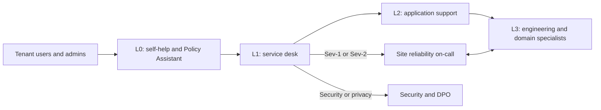
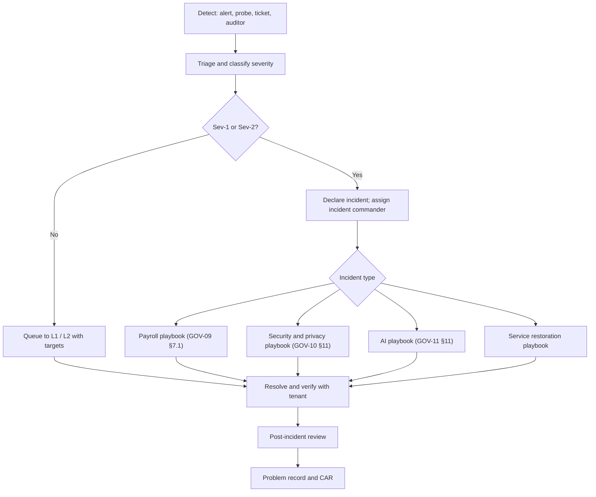
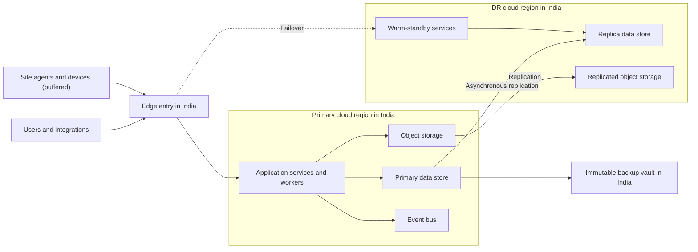
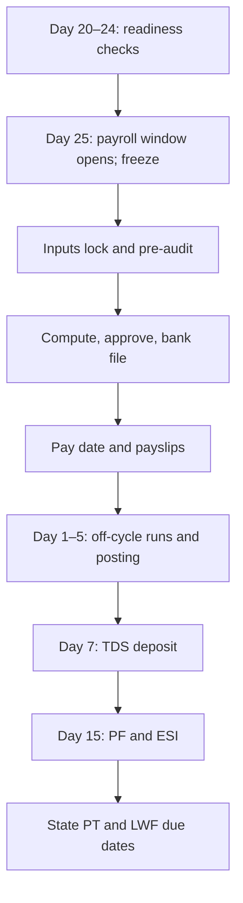

<picture>
  <source media="(prefers-color-scheme: dark)" srcset="../assets/MultipliersKraftLogoDark.png">
  
</picture>

# OPS-01 — Operational and Support Requirements

| Attribute | Value |
| :--- | :--- |
| Document ID | OPS-01 |
| Title | Operational and Support Requirements |
| Product | Nucleus Suite (Nucleus HRMS Suite) |
| Version | 1.0.0 |
| Status | Issued for approval |
| Owner (role) | Head of Platform Operations (site reliability) |
| Author | Dhanraj Dadhich |
| Reviewed by | *pending* |
| Approved by | Architecture Review Board — *pending* |
| Date | 2026-11-05 |
| Classification | Internal |
| CMMI practice areas | RDM, TS, CONT, MC |
| Related documents | SRS-01, SEC-01, NFR-01, GOV-09, GOV-10, GOV-11, BA-06, IA-03, AI-01, QA-03, PLN-02, RSK-03, CM-02 |
| Quality & process-performance objectives | QPPO-01 (minimise defects reaching users), QPPO-03 (exact payroll at go-live), QPPO-06 (fast, controlled change) |
| Process performance baseline used | PPB-01 (review defect density), PPB-02 (review rate), PPB-04 (payroll parallel run), PPB-06 (release quality) |
| Peer review record | *pending* (PR-xxxx, QA-02) |
| Tailoring record | none |
| Traceability anchor | BG-04, BG-06, BG-10 · BO-04.2, BO-10.2 · NFR-01 (Availability, Payroll availability, Recovery, Data residency) |

---

## 1. Purpose and Scope

This document states how Nucleus Suite is operated and supported once it runs as a service: the service levels it commits to, how support is organised, how the platform is observed, how incidents and problems are handled, how data is backed up and recovered, how disasters are survived, how releases and environments are managed, how capacity is planned, when maintenance may happen, how retention is operated, how the payroll and statutory calendar shapes operations, and how each new tenant is carried through hypercare.

Requirements carry the identifier `PLT-OPS-nnn`. They elaborate the quality targets in NFR-01 (which remain the source for every numeric availability, latency, throughput and recovery target) and the operational expectations in SRS-01.

**Stage applicability.** The programme is in **R0 — UI-validation prototype on local JSON**. R0 is not operated as a service: there are no production users, no service levels and no on-call. Environment and pipeline requirements become binding in P0 Foundations; service-level, support, continuity and hypercare requirements become binding at the P2 pilot go-live. Each requirement names its binding phase.

## 2. Conventions

Requirement rows follow SRS-01 §3.1: ID, statement (MUST / SHOULD / MAY), rationale, source / trace, priority (**M**ust, **S**hould, **C**ould), binding phase, verification (**T**est, **D**emonstration, **A**nalysis, **I**nspection) and acceptance criterion.

| Term | Meaning |
| :--- | :--- |
| Indian business hours | 08:00–20:00 IST, Monday to Saturday |
| Payroll window | The 25th of a month to the 5th of the next month inclusive (NFR-01) |
| Payroll path | Services needed to lock inputs, compute, audit, approve, disburse, publish payslips and generate statutory outputs |
| SLO / SLI | Service level objective / the indicator that measures it |
| Error budget | Permitted unreliability in a period: 100% minus the SLO |

## 3. Service Model Overview

## 4. Availability and Service Level Objectives

| Service class | SLI | SLO | Measurement window | Source |
| :--- | :--- | :--- | :--- | :--- |
| Core platform (web, mobile, API) | Successful requests ÷ valid requests; synthetic journey success | 99.9% | Calendar month, excluding notified maintenance | NFR-01 Availability |
| Payroll path | Synthetic journey success for lock, compute, approve, payslip, bank file, statutory file | 99.95% | 25th to 5th, reported separately | NFR-01 Payroll availability |
| Interactive reads | Latency | p95 < 300 ms, p99 < 800 ms | Rolling 28 days | NFR-01 API latency |
| Punch ingestion | Sustained rate; receipt-to-queue lag | 500 events per second per tenant; p95 lag < 60 s | Shift-change peaks | NFR-01 Attendance ingestion |
| Attendance recompute | Duration of a full-month recompute | 5,000 employees in < 10 minutes without breaching interactive latency | Per release load test and live | NFR-01 Attendance recompute |
| Payroll computation | Gross-to-net duration | 10,000 employees in < 120 s | Per release load test and live | NFR-01 Payroll throughput |
| Event delivery | Outbox commit-to-publish lag | p99 < 60 s | Rolling 28 days | SRS-01 SYS-053 |

| ID | Requirement | Rationale | Source / trace | Pri | Phase | Ver | Acceptance criterion |
| :--- | :--- | :--- | :--- | :--- | :--- | :--- | :--- |
| PLT-OPS-001 | Core platform services MUST achieve at least 99.9% monthly availability, excluding maintenance notified under §12. | Contractual and business expectation. | NFR-01 Availability · BO-10.2 | M | P2 | T | Monthly availability report from probes and incident records shows ≥ 99.9%. |
| PLT-OPS-002 | Payroll-path services MUST achieve at least 99.95% availability from the 25th to the 5th, reported separately from the monthly figure. | Payroll cannot slip. | NFR-01 Payroll availability · BG-04 | M | P2 | T | The payroll-window report shows ≥ 99.95% for every window. |
| PLT-OPS-003 | Each user journey listed in §4 MUST have a documented SLI, SLO and error budget, and an error-budget policy MUST freeze non-critical releases to a service whose budget is exhausted until it recovers. | Reliability is managed, not hoped for. | NFR-01 · QPPO-01 | M | P2 | I, T | SLO catalogue exists; a simulated budget exhaustion blocks a non-critical deployment. |
| PLT-OPS-004 | Synthetic probes MUST exercise sign-in, punch, leave apply, approval, payslip view and payroll-path journeys every minute from at least two locations in India. | Detect outages before users report them. | NFR-01 measurement method | M | P2 | T | Probe dashboards show one-minute resolution from two vantage points. |
| PLT-OPS-005 | Tenant administrators MUST see a status page and an in-app banner for incidents and maintenance, updated at least every 60 minutes during an incident. | Transparency. | GOV-09 §7.3 | M | P2 | D | During a drill, banner and status page update on schedule until closure. |
| PLT-OPS-006 | A monthly service report per tenant MUST show availability (with the payroll window separated), latency percentiles, incidents by severity, SLA attainment and open problems. | Accountable service management. | NFR-01 · MC-01 | M | P2 | I | Reports issued by the 7th of each month for the previous month. |

## 5. Support Model

### 5.1 Tiers

| Tier | Who | Scope | Hours |
| :--- | :--- | :--- | :--- |
| L0 | Self-help: knowledge base, in-product guidance, Policy Assistant | How-to, policy questions, simple self-service | Always available |
| L1 | Service desk (tenant HR helpdesk for employee queries; Nucleus service desk for tenant administrators) | Intake, classification, known-error resolution, access issues | Per §5.3 coverage |
| L2 | Nucleus application support | Configuration, data fixes through governed tools, workflow and integration diagnosis | Per §5.3 coverage |
| L3 | Engineering and domain specialists (payroll, statutory, time, platform, AI) | Defects, performance, rule packs, root cause | On-call for Sev-1 and Sev-2 |

### 5.2 Severity definitions

| Severity | Definition | Examples |
| :--- | :--- | :--- |
| Sev-1 Critical | Service unavailable or unusable for a tenant; payroll accuracy, statutory compliance, data security or tenant isolation compromised; no workaround | Platform outage; payroll calculation defect reaching disbursement (NFR-01); cross-tenant data exposure; personal-data breach; policy-gate bypass by an agent |
| Sev-2 High | Major function impaired for many users or a payroll-path function degraded; workaround exists but is costly | Punch ingestion lag above SLO at shift change; approvals not routing; bank file generation failing outside the last two working days before pay date |
| Sev-3 Medium | Single function impaired for some users; reasonable workaround | One report failing; a notification channel delayed; a single device integration failing |
| Sev-4 Low | Cosmetic, documentation or how-to | Label truncation; translation correction |

Any Sev-2 on the payroll path during the payroll window is handled as Sev-1. Severity maps to the programme escalation levels in GOV-09 §6 (Sev-1 ↔ Critical, Sev-2 ↔ High).

### 5.3 Response and resolution targets

| Severity | Coverage | Initial response | Status updates | Workaround or restoration | Permanent fix |
| :--- | :--- | :--- | :--- | :--- | :--- |
| Sev-1 | 24 × 7 × 365 | 15 minutes | Every 60 minutes | 4 hours | Root-cause fix scheduled within 10 business days |
| Sev-2 | 24 × 7 in the payroll window; otherwise Indian business hours | 30 minutes | Every 4 hours | 1 business day | Next scheduled release |
| Sev-3 | Indian business hours | 4 business hours | Daily | 5 business days | Within two releases |
| Sev-4 | 09:00–18:00 IST, Monday to Friday, excluding national holidays | 1 business day | On change | Not applicable | Prioritised in backlog |

| ID | Requirement | Rationale | Source / trace | Pri | Phase | Ver | Acceptance criterion |
| :--- | :--- | :--- | :--- | :--- | :--- | :--- | :--- |
| PLT-OPS-007 | Support MUST be organised in tiers L0–L3 with the scopes in §5.1 and documented hand-offs between tiers. | Clear ownership speeds resolution. | §5.1 | M | P2 | I | Support operating manual approved; hand-off checklists exist for each boundary. |
| PLT-OPS-008 | Every ticket MUST be classified with a severity per §5.2 at intake and re-classified as facts emerge, with each change recorded. | Severity drives response. | GOV-09 §6 | M | P2 | T | Ticket audit shows severity history for every Sev-1 and Sev-2. |
| PLT-OPS-009 | Response and restoration targets in §5.3 MUST be met for at least 95% of tickets per severity per month, and every Sev-1 breach MUST be reviewed. | Measured service. | §5.3 | M | P2 | T | Monthly SLA report shows attainment per severity. |
| PLT-OPS-010 | A payroll calculation defect that reaches disbursement, any cross-tenant exposure, any personal-data breach and any policy-gate bypass MUST be raised as Sev-1 automatically. | These are never routine. | NFR-01 Payroll accuracy · GOV-10 §11 · GOV-11 §11 | M | P2 | T | Each trigger, simulated, opens a Sev-1 with the right playbook. |
| PLT-OPS-011 | Tickets MUST be accepted in-app, by email and through the tenant admin portal, with a telephone route for Sev-1, and employee-facing L1 MUST support English, Hindi and each tenant-enabled language for frontline workers. | Frontline users must be able to ask for help. | BG-03 · GOV-09 §8 | M | P2 | D | A Tamil-language frontline ticket is handled end to end in Tamil. |
| PLT-OPS-012 | Support engineers MUST access tenant data only through just-in-time, ticket-bound, logged access, and data fixes MUST use governed tools that write audit entries, never direct database edits. | Support is an insider risk. | SEC-01 PLT-SEC-046 · SYS-032 | M | P2 | T | Access report reconciles every support session to a ticket; no direct data change appears outside governed tools. |
| PLT-OPS-013 | Each resolved Sev-1 and Sev-2 MUST update or create a knowledge-base article or runbook. | Learning compounds. | CAR-01 | S | P2 | I | Post-incident records link to the updated article. |

## 6. Monitoring and Observability

| ID | Requirement | Rationale | Source / trace | Pri | Phase | Ver | Acceptance criterion |
| :--- | :--- | :--- | :--- | :--- | :--- | :--- | :--- |
| PLT-OPS-014 | All services, workers, the outbox relay and tool calls MUST emit traces, metrics and structured logs following OpenTelemetry conventions and W3C Trace Context, with the trace identifier carried into audit entries. | One request, one story across components. | NFR-01 API latency method | M | P0 | T | A sampled request can be followed from gateway to outbox to recompute by trace identifier. |
| PLT-OPS-015 | Logs MUST be structured, tagged with tenant and service, scrubbed of personal and Restricted data, kept hot for 90 days and cold for 1 year; security logs follow GOV-10 retention. | Diagnosis without data leakage. | SEC-01 PLT-SEC-039, PLT-SEC-068 | M | P0 | T | Scrubbing tests pass; retention policies are visible in configuration. |
| PLT-OPS-016 | Business-health metrics MUST be collected per tenant: punches received versus expected per device per shift, recompute queue depth and oldest item age, outbox lag and dead-letter count, payroll stage durations, approval SLA breaches, policy-gate denials by reason, and agent reversal rate. | Most HR incidents start as business anomalies, not server errors. | IA-03 device reconciliation · NFR-01 Agent reversal rate · GOV-11 §10 | M | P1 | D | The operations dashboard shows each metric per tenant. |
| PLT-OPS-017 | Alerts MUST be based on SLO burn rate over multiple windows, route to the on-call engineer with a runbook link, and be reviewed monthly for noise. | Page on user impact, not on every blip. | PLT-OPS-003 | M | P2 | T | A burn-rate drill pages the on-call engineer with the runbook link. |
| PLT-OPS-018 | A device that sends no events within 15 minutes after a configured shift start MUST raise an alert to the site's plant supervisor console and to L1. | Silent devices become pay disputes. | SRS-01 SYS-082 | M | P1 | T | A stopped device simulator raises the alert within 15 minutes. |
| PLT-OPS-019 | Outbox lag above 60 seconds or any non-empty dead-letter queue MUST alert; recompute items older than 30 minutes MUST alert during the payroll window. | Event backbone health underpins payroll. | SYS-053, SYS-057 | M | P1 | T | Each condition, induced, raises an alert. |
| PLT-OPS-020 | A pre-payroll readiness dashboard MUST show, per run: days not recomputed since the last rule change, unmapped GL codes, open blocking items, rule-pack versions effective for the period and bank format validity. | Problems are found before lock, not after. | RL-154 · S-06 · CMP-05 | M | P1 | D | For PR-2026-09-01 the dashboard lists all five checks with status. |
| PLT-OPS-021 | Telemetry containing tenant identifiers MUST stay in the tenant's region, and cross-tenant operational views MUST be aggregated. | Residency applies to operational data. | NFR-01 Data residency · GOV-10 R-TEN-01 | M | P0 | I | Telemetry store location matches tenant region. |

## 7. Incident and Problem Management

| ID | Requirement | Rationale | Source / trace | Pri | Phase | Ver | Acceptance criterion |
| :--- | :--- | :--- | :--- | :--- | :--- | :--- | :--- |
| PLT-OPS-022 | Every Sev-1 and Sev-2 MUST have a named incident commander within 15 minutes, a communication lead, a timeline record and stakeholder updates at least every 60 minutes until restoration. | Coordinated response. | GOV-09 §7.3 | M | P2 | D | Incident drill records show each role and update. |
| PLT-OPS-023 | Payroll incidents MUST follow the payroll playbook: halt affected disbursement or correction runs where possible, inform the finance controller within 2 hours, assess scope, and notify affected employees in their language with the correction date. | Payroll errors hurt people directly. | GOV-09 §7.1 · NFR-01 Payroll accuracy | M | P2 | D | A drill on a seeded payroll defect follows each step within its time limit. |
| PLT-OPS-024 | Security and personal-data incidents MUST be triaged by the CISO within 1 hour with the DPO engaged immediately, and notifications to the Data Protection Board, data principals and tenant controllers MUST follow the Legal-validated process. | Statutory notification obligations (to be validated by Legal). | GOV-10 §11 · GOV-09 §7.2 | M | P2 | D | Breach drill shows CISO triage inside 1 hour and a breach-register entry. |
| PLT-OPS-025 | AI incidents MUST be triaged within 1 business day, or 4 hours for Tier 4 features or any data leakage, contained by kill-switch where needed, and agent writes reversed through compensating actions. | Agents can act at scale. | GOV-11 §11 · SEC-01 PLT-SEC-077 | M | P2 | D | AI incident drill disables the agent and reverses its test writes. |
| PLT-OPS-026 | A post-incident review MUST be drafted within 5 business days and completed with corrective actions within 10 business days for every Sev-1 and Sev-2, blameless in form. | Learning, not blame. | GOV-09 §7.1 · CAR-01 | M | P2 | I | Review records exist for 100% of Sev-1 and Sev-2 with action owners. |
| PLT-OPS-027 | Three or more incidents with the same suspected cause within 30 days MUST open a problem record; problems MUST be tracked to a known-error entry and a permanent fix. | Stop recurrences. | CAR-01 | M | P2 | T | Problem register shows linked incidents and closure evidence. |
| PLT-OPS-028 | Escaped Sev-1 and Sev-2 defects MUST be counted per release and fed to the release-quality baseline and causal analysis. | Quantitative management at high maturity. | PPB-06 · QPPO-01 · BO-09.5 | M | P2 | I | MPM-01 dashboard shows escaped defects per release with CAR links. |

## 8. Backup and Restore

| ID | Requirement | Rationale | Source / trace | Pri | Phase | Ver | Acceptance criterion |
| :--- | :--- | :--- | :--- | :--- | :--- | :--- | :--- |
| PLT-OPS-029 | Transactional data stores MUST support continuous point-in-time recovery sufficient for an RPO of 5 minutes. | NFR-01 Recovery. | NFR-01 Recovery | M | P2 | T | Restore drill to a chosen second shows data loss ≤ 5 minutes. |
| PLT-OPS-030 | Full backups MUST be taken daily and retained 35 days, with monthly backups retained 12 months; backups MUST be encrypted, immutable for their retention period, held in the tenant's region and isolated from production credentials. | Recover from corruption and ransomware. | GOV-10 §8 backups · SEC-01 PLT-SEC-063 | M | P2 | I, T | Attempted deletion of a backup with production credentials fails. |
| PLT-OPS-031 | Restore drills MUST run quarterly, be documented, and measure achieved RPO and RTO against §9.1. | Untested backups are hopes. | NFR-01 Recovery method | M | P2 | T | Four drill reports per year with measured RPO and RTO. |
| PLT-OPS-032 | The system MUST support point-in-time restore of a single tenant into an isolated environment for investigation, without affecting other tenants. | Tenant-level recovery and forensics. | BG-10 | M | P2 | T | A single-tenant restore completes with other tenants unaffected. |
| PLT-OPS-033 | After any restore, erasure and disposal actions recorded since the backup point MUST be re-applied before the restored data is used. | Erased data must stay erased. | GOV-10 §8 · SEC-01 PLT-SEC-061 | M | P2 | T | Post-restore check finds no identifier erased after the backup point. |
| PLT-OPS-034 | Documents in object storage MUST be versioned and replicated; configuration, rule packs, workflow definitions, prompts and tool registries MUST be recoverable from their versioned configuration baseline. | Not all state lives in the database. | CM-01 · CMP-09, CMP-11 | M | P2 | T | Rule packs and prompts are restored to their exact versions in a drill. |

## 9. Disaster Recovery and Business Continuity

### 9.1 RPO and RTO per data class

| Data class | Examples | RPO | RTO | Recovery method |
| :--- | :--- | :--- | :--- | :--- |
| Systems of record | Worker, assignment, compensation, leave and loan ledgers, payroll runs and results, approvals | 5 minutes | 1 hour | Replicated database in DR region; point-in-time recovery |
| Audit trail and action ledger | Audit entries, access events, agent ledger | 5 minutes | 1 hour, with hash-chain verification before use | Replicated; chain re-verified after failover |
| Raw punch events | Device and mobile punches | 5 minutes on the server; zero loss end to end through device and site-agent buffers | 1 hour | Replication plus buffer replay, idempotent on event identifier |
| Configuration and rule packs | Policies, chains, rule packs, tool registry, prompts | 5 minutes | 1 hour | Replicated database and versioned configuration baseline |
| Documents and generated files | Letters, payslip files, statutory files, uploads | 15 minutes | 4 hours | Cross-region object replication |
| Derived projections | Attendance days, balances, analytics projections, search indexes | Rebuildable from systems of record and events | 4 hours for operational projections; 24 hours for analytics | Rebuild by replay; recompute worker |
| AI interaction logs | Conversation logs, evaluation samples | 24 hours | 72 hours | Daily backup |
| Operational telemetry | Metrics, traces, non-security logs | Best effort | 24 hours | Re-collected; not restored |

All recovery locations for Indian tenants are in India (NFR-01 Data residency).

### 9.2 Disaster recovery topology

| ID | Requirement | Rationale | Source / trace | Pri | Phase | Ver | Acceptance criterion |
| :--- | :--- | :--- | :--- | :--- | :--- | :--- | :--- |
| PLT-OPS-035 | Recovery MUST meet the RPO and RTO per data class in §9.1, and in no case worse than RPO 5 minutes and RTO 1 hour for systems of record. | NFR-01 Recovery. | NFR-01 Recovery | M | P2 | T | DR drill evidence meets each class target. |
| PLT-OPS-036 | The service MUST run in a primary cloud region in India with a warm-standby disaster-recovery region also in India, with data replicated asynchronously and backups in an immutable vault in India. | Survive a regional loss without leaving India. | NFR-01 Data residency · SRS-01 DC-02 | M | P2 | I | Architecture inspection and infrastructure policy test confirm the topology and locations. |
| PLT-OPS-037 | A failover runbook MUST define the decision (incident commander with the Head of Engineering), the steps, verification of the audit hash chain, and fail-back; a full regional failover test MUST run at least twice a year and component failovers quarterly. | Failover that is never practised fails. | CONT practice | M | P2 | T | Two full failover test reports per year meet the §9.1 targets. |
| PLT-OPS-038 | After failover, the outbox relay MUST resume from the last committed position and consumers MUST tolerate replay, so that no event is lost or applied twice. | Exactly-once effect through idempotency. | SYS-053, SYS-055 | M | P2 | T | Failover drill reconciliation shows identical downstream counts to the primary. |
| PLT-OPS-039 | Site agents and devices MUST buffer at least 7 days of punches and replay them on reconnection. | Plants keep working when the WAN or a region fails. | SYS-062, SYS-063 · IA-03 devices | M | P1 | T | A site agent disconnected for 72 hours replays all punches without loss or duplicates. |
| PLT-OPS-040 | For each tenant the system MUST retain a downloadable contingency pack for the latest approved run (payroll register, bank file, statutory summary), so the tenant can execute its own contingency procedure if the service is unavailable near pay date. | Workers must be paid even in a disaster. | BG-04 · GOV-09 §7.1 | M | P2 | D | The tenant admin downloads the pack for PR-2026-08-01 and its totals reconcile to the run. |
| PLT-OPS-041 | AI features MUST degrade gracefully to standard screens when the LLM provider or speech service is unavailable, and notifications MUST fall back to in-app delivery when a messaging channel is unavailable. | External dependencies fail. | GOV-11 §6 kill-switch · SYS-070 | M | P2 | T | With the model gateway disabled, all transactions remain possible through screens. |
| PLT-OPS-042 | Support and on-call capability MUST be staffed from at least two locations with documented cover rotas, so that the loss of one location does not stop Sev-1 response. | People continuity. | CONT practice | S | P2 | I | Rota shows two-location cover for every Sev-1 role. |

## 10. Release and Environment Management

### 10.1 Environments

| Environment | Purpose | Data | Binding phase |
| :--- | :--- | :--- | :--- |
| Local prototype | R0 UI validation | Local JSON, synthetic personas | R0 |
| Development | Feature work and preview environments per change | Synthetic | P0 |
| Test | Integration, contract, golden-case and property testing | Synthetic and golden demo dataset | P0 |
| Staging | Production-like performance, security and release rehearsal | Synthetic or irreversibly masked | P0 |
| Tenant sandbox | Customer configuration authoring and user acceptance | Tenant-approved synthetic or masked data | P2 |
| Production | Live service | Tenant data | P2 |

| ID | Requirement | Rationale | Source / trace | Pri | Phase | Ver | Acceptance criterion |
| :--- | :--- | :--- | :--- | :--- | :--- | :--- | :--- |
| PLT-OPS-043 | The environments in §10.1 MUST exist with the stated data rules, and no production Restricted data MAY enter any non-production environment. | GOV-10 §13. | SEC-01 PLT-SEC-041 | M | P0 | I | Environment register matches §10.1; data-source checks pass. |
| PLT-OPS-044 | Infrastructure and configuration MUST be defined as code, and changes MUST reach production only through the delivery pipeline with an approved change record; manual production changes MUST be blocked outside break-glass. | Reproducibility and control. | CM-01, CM-02 | M | P0 | T | A manual change attempt in production is refused and alerted. |
| PLT-OPS-045 | Standard releases SHOULD ship at least fortnightly; emergency fixes MAY ship at any time through the emergency change route with retrospective CCB review. | Small, frequent change is safer. | CM-02 · QPPO-06 | S | P2 | I | Release log shows cadence and emergency changes with reviews. |
| PLT-OPS-046 | Releases touching the payroll path MUST be frozen during the payroll window, except Sev-1 or Sev-2 fixes and rule-pack changes required by a statutory effective date, each approved by the CCB. | Stability when it matters most. | NFR-01 Payroll availability | M | P2 | T | The pipeline refuses a non-exempt payroll-path deployment between the 25th and the 5th. |
| PLT-OPS-047 | Deployments MUST use feature flags per tenant, canary or progressive rollout and automated rollback on SLO breach, and database migrations MUST be backward-compatible (expand, migrate, contract). | Zero-downtime change with a way back. | SYS-042 · BG-10 | M | P2 | T | An induced canary failure rolls back automatically with no user-visible outage. |
| PLT-OPS-048 | Rule-pack releases MUST pass their own test suite and statutory golden cases, publish a tenant impact report, and be deployed at least 5 working days before their effective date where the source notification allows. | Statutory change without surprises. | SYS-045, SYS-046 · RL-360 | M | P1 | T | The pipeline evidence for a pack shows tests, impact report and deployment lead time. |
| PLT-OPS-049 | Release notes describing behaviour changes MUST reach tenant administrators at least 5 business days before deployment, in the tenant's administration language. | Customers plan around change. | GOV-09 | M | P2 | I | The release-notes register shows lead time per release. |
| PLT-OPS-050 | Configuration MUST be promoted from tenant sandbox to production only as a reviewed package with a difference report and tenant approval. | Configuration is change too. | SYS-008 · PLT-PG-004 | M | P2 | D | A promotion shows the difference report and the tenant approver. |

## 11. Capacity Management

| ID | Requirement | Rationale | Source / trace | Pri | Phase | Ver | Acceptance criterion |
| :--- | :--- | :--- | :--- | :--- | :--- | :--- | :--- |
| PLT-OPS-051 | A capacity model MUST forecast load per tenant size and seasonal peak (shift change, month-end, financial-year end) and keep at least 30% headroom at forecast peak. | Peaks are predictable in HR. | NFR-01 · BG-10 | M | P2 | A | Quarterly capacity review shows headroom ≥ 30% at forecast peaks. |
| PLT-OPS-052 | Each release MUST pass load tests for payroll throughput, punch ingestion and full-month recompute run concurrently with the interactive suite. | NFR-01 release gates. | NFR-01 Payroll throughput, Attendance ingestion, Attendance recompute | M | P1 | T | Release load-test report meets every NFR-01 target. |
| PLT-OPS-053 | Background workers MUST enforce per-tenant fairness (queue quotas and concurrency limits) so that one tenant's payroll or recompute cannot degrade another's service. | Noisy-neighbour protection. | BG-10 · SYS-057 | M | P2 | T | A synthetic 50,000-employee recompute for one tenant leaves another tenant's latency within SLO. |
| PLT-OPS-054 | Capacity and cost per active worker MUST be reviewed monthly and the platform MUST demonstrate operation at 100,000 workers per tenant by the end of P4. | Scale economics. | BO-10.3 · GOV-01 P4 scope | S | P4 | T | P4 scale test report at 100,000 workers meets NFR-01 targets. |

## 12. Maintenance Windows

| ID | Requirement | Rationale | Source / trace | Pri | Phase | Ver | Acceptance criterion |
| :--- | :--- | :--- | :--- | :--- | :--- | :--- | :--- |
| PLT-OPS-055 | Planned maintenance that may affect availability MUST occur only between 01:00 and 04:30 IST, preferably on Sundays, MUST total no more than 4 hours per month, and MUST be notified to tenant administrators at least 5 business days in advance. | Maintenance outside Indian business hours and away from typical shift changes. | NFR-01 Availability | M | P2 | I | Maintenance calendar and notices comply for every window. |
| PLT-OPS-056 | No planned maintenance MAY be scheduled during the payroll window or on the two working days before any statutory due date in §14. | Protect payroll and filings. | NFR-01 Payroll availability | M | P2 | I | Calendar check rejects a window inside the protected dates. |
| PLT-OPS-057 | Standard application releases MUST deploy without downtime; maintenance windows are reserved for infrastructure changes that cannot. | Most change should be invisible. | PLT-OPS-047 | M | P2 | T | Release availability data shows no deployment-caused outage. |

## 13. Data Retention Operations

| ID | Requirement | Rationale | Source / trace | Pri | Phase | Ver | Acceptance criterion |
| :--- | :--- | :--- | :--- | :--- | :--- | :--- | :--- |
| PLT-OPS-058 | The disposal service MUST run at least weekly, record evidence for each disposal, and alert operations on any failure. | Storage limitation must actually happen. | GOV-10 R-RET-01 · SEC-01 PLT-SEC-059 | M | P1 | T | Weekly run log and evidence exist; a forced failure alerts. |
| PLT-OPS-059 | Legal holds MUST be applied and released only by Legal-authorised roles, and operations MUST report active holds monthly to the DPO. | Holds must be deliberate and visible. | GOV-10 R-RET-02 | M | P1 | I | Monthly hold report issued. |
| PLT-OPS-060 | Payroll registers, statutory registers and returns for the current and previous three financial years MUST be retrievable online; older records within retention MUST be retrievable from archive within 2 business days. | Inspections and disputes need records quickly. | GOV-10 §8 · Factories Act registers (to be validated by Legal) | M | P2 | T | An archived register from five years earlier is produced within 2 business days in a drill. |
| PLT-OPS-061 | On contract end the system MUST provide the tenant a complete export in open, documented formats within 30 days, then delete tenant data within 90 days with a deletion certificate, except records the tenant has contractually asked to be retained for statutory purposes. | Exit rights and storage limitation. | GOV-10 §8 · R-XBT-02 | M | P2 | T | An offboarding drill produces the export and certificate on time. |

## 14. Payroll-Critical Calendar Operations

### 14.1 Monthly operating cycle

### 14.2 Protected dates

| Date or period | Operation | Source |
| :--- | :--- | :--- |
| 25th to 5th | Payroll window: lock, compute, approve, disburse, publish payslips, post journal | NFR-01 Payroll availability |
| Last working day of a separation | Same-day full and final settlement | R-17 |
| After the regular run | Off-cycle overtime run (for example PR-2026-09-02 paid on 2026-10-07) | R-11 · Demo Dataset 26_Payroll_Runs |
| 7th of the following month | TDS deposit | Demo Dataset 28_Statutory_Calendar (to be validated by Legal) |
| 15th of the following month | PF ECR and challan; ESI contribution | Demo Dataset 28_Statutory_Calendar (to be validated by Legal) |
| State-specific | Professional tax remittance (for example the 20th in Karnataka and the 30th in Maharashtra in the demo calendar); labour welfare fund half-yearly | Demo Dataset 28_Statutory_Calendar (to be validated by Legal) |
| Quarter end plus one month | TDS quarterly return 24Q | Demo Dataset 28_Statutory_Calendar (to be validated by Legal) |
| Financial-year end (March) and calendar-year end | Form 16, leave year-end, gratuity valuation, annual factory return | Demo Dataset 28_Statutory_Calendar, 54_Year_End_Leave_Preview (to be validated by Legal) |

| ID | Requirement | Rationale | Source / trace | Pri | Phase | Ver | Acceptance criterion |
| :--- | :--- | :--- | :--- | :--- | :--- | :--- | :--- |
| PLT-OPS-062 | Operations MUST maintain a per-tenant operating calendar generated from the tenant's payroll calendar and obligation calendar, and publish it to on-call rotas and the release pipeline. | Operations must know which days are critical for whom. | Demo Dataset 28_Statutory_Calendar · CMP domain | M | P2 | D | The calendar for the demo tenant shows every obligation OB-2026-0912..0923 with its due date. |
| PLT-OPS-063 | During the payroll window, payroll-path on-call MUST be doubled with a payroll specialist and a platform engineer, and every payroll-path Sev-2 MUST be handled as Sev-1. | Payroll is the highest-consequence workload. | §5.2 · NFR-01 | M | P2 | I | On-call rota for each window shows both roles. |
| PLT-OPS-064 | Readiness checks (§6 PLT-OPS-020) MUST run automatically from the 20th of each month and daily until inputs lock, with failures routed to the payroll owner. | Find problems before the window opens. | RL-154 · S-06 | M | P2 | T | Readiness reports exist for the 20th to lock date for each run. |
| PLT-OPS-065 | Statutory file generation and evidence capture MUST meet the payroll-path SLO for the three days before each statutory due date. | Missed filings carry penalties. | NFR-01 Payroll availability · SYS-086 | M | P2 | T | Availability report for those days shows ≥ 99.95%. |
| PLT-OPS-066 | Bank files MUST be generated and verified at least one business day before the pay date, with an alert to finance if not. | Bank cut-offs are fixed. | IA-03 bank flow · SYS-085 | M | P2 | T | A run without a verified bank file one business day before pay date raises the alert. |
| PLT-OPS-067 | Off-cycle runs (overtime after the regular run, full and final on the last working day) MUST be operable within the payroll window and on any working day, including multiple runs per entity per period. | Four runs against one period is normal (PR-2026-09-01..03). | R-11, R-17 · Demo Dataset 26_Payroll_Runs | M | P1 | D | The demo tenant runs regular, overtime and F&F runs for LE-01 September without conflict. |
| PLT-OPS-068 | Financial-year-end and calendar-year-end operations (Form 16, leave year-end, annual returns) MUST be rehearsed in staging at least four weeks beforehand each year. | Annual peaks are rare and risky. | Demo Dataset 54_Year_End_Leave_Preview | M | P2 | D | Rehearsal report filed each year with issues closed. |

## 15. Hypercare

| ID | Requirement | Rationale | Source / trace | Pri | Phase | Ver | Acceptance criterion |
| :--- | :--- | :--- | :--- | :--- | :--- | :--- | :--- |
| PLT-OPS-069 | Before go-live each tenant MUST complete two full parallel payroll and attendance cycles reconciled to the rupee, with unexplained variance zero. | Exact payroll at go-live. | BL-111 · QPPO-03 · PPB-04 | M | P2 | T | Parallel-run reports for two cycles show zero unexplained variance lines. |
| PLT-OPS-070 | Each tenant go-live MUST enter hypercare lasting the longer of two complete payroll cycles or eight weeks, with a daily review, dedicated L2 and L3 contacts and a named hypercare lead. | The first cycles reveal configuration gaps. | GOV-01 SC-03 · OCM-01 | M | P2 | I | Hypercare log shows daily reviews and contacts for the full period. |
| PLT-OPS-071 | During hypercare, every payroll-path or attendance-disposition ticket MUST be handled at no lower than Sev-2. | Early signals deserve fast attention. | §5.2 | M | P2 | T | Ticket audit shows no such ticket below Sev-2. |
| PLT-OPS-072 | Hypercare MUST exit only when: no Sev-1 or Sev-2 is open; two consecutive payroll cycles have closed with no post-run correction above 0.1% of payslips; regularisations per 100 employees are flat or falling; and the tenant has signed acceptance. | Objective exit, not a date. | BO-04.1 · NFR-01 Regularisations | M | P2 | I | Exit checklist with evidence signed by the tenant and the hypercare lead. |
| PLT-OPS-073 | Hypercare MUST hand over to steady-state support with runbooks, known errors, configuration decisions, contact matrix and open-item list. | Continuity of knowledge. | §5 | M | P2 | I | Handover pack accepted by L1 and L2 leads. |

## 16. Operational Readiness

| ID | Requirement | Rationale | Source / trace | Pri | Phase | Ver | Acceptance criterion |
| :--- | :--- | :--- | :--- | :--- | :--- | :--- | :--- |
| PLT-OPS-074 | An operational readiness review MUST precede each G4 go-live, confirming SLOs and alerts, dashboards, runbooks, a passed restore drill, a passed DR test, trained support tiers and an approved on-call rota. | Go live only when the service can be run. | QA-03 exit criteria · G4 | M | P2 | I | Signed readiness checklist in the G4 pack. |
| PLT-OPS-075 | Each shared component (CMP-01..CMP-11) and each integration flow in IA-03 MUST have a tested runbook covering health checks, common failures, safe restart and data reconciliation. | Shared components are shared failure points. | BA-06 · IA-03 | M | P2 | D | Runbook drills recorded for each component and flow. |
| PLT-OPS-076 | During R0, no production operations, service levels, support commitments or on-call MUST be offered or represented to clients. | R0 is a prototype on local JSON. | DEC-0002 · GOV-01 C-01 | M | R0 | I | Client-facing materials for R0 state that the prototype is not an operated service. |

## 17. Traceability

| Section | PLT-OPS range | SRS-01 / SEC-01 | NFR-01 rows | Business anchor |
| :--- | :--- | :--- | :--- | :--- |
| Availability and SLOs | 001–006 | SYS-053, SYS-057 | Availability; Payroll availability; API latency; Attendance ingestion; Attendance recompute; Payroll throughput | BG-10 · BO-10.2 |
| Support model | 007–013 | PLT-SEC-046 | Payroll accuracy (Sev-1) | BG-06 |
| Monitoring and observability | 014–021 | SYS-082 · PLT-SEC-039, PLT-SEC-068 | API latency; Agent reversal rate | BG-03, BG-10 |
| Incident and problem | 022–028 | PLT-SEC-069, PLT-SEC-077 | Payroll accuracy; Security | BG-04, BG-06 · BO-09.5 |
| Backup and restore | 029–034 | PLT-SEC-061, PLT-SEC-063 | Recovery | BG-06 |
| DR and continuity | 035–042 | SYS-062, SYS-063, SYS-070 · DC-02 | Recovery; Data residency | BG-04, BG-10 |
| Release and environments | 043–050 | SYS-008, SYS-042, SYS-045, SYS-046 · PLT-SEC-041 | Test coverage; Security | BG-09 · QPPO-06 |
| Capacity | 051–054 | SYS-057 | Payroll throughput; Attendance ingestion; Attendance recompute | BG-10 · BO-10.3 |
| Maintenance | 055–057 | — | Availability | BG-10 |
| Retention operations | 058–061 | SYS-027 · PLT-SEC-059, PLT-SEC-060 | Data residency | BG-06 |
| Payroll calendar | 062–068 | SYS-085, SYS-086 | Payroll availability | BG-04 · R-11, R-17, R-18 |
| Hypercare | 069–073 | — | Payroll accuracy; Regularisations | BG-04 · BO-04.1 · QPPO-03 |
| Operational readiness | 074–076 | — | All release gates | BG-09 |

## Approval & Sign-off

| Role | Name | Date | Decision | Conditions / comments |
| :--- | :--- | :--- | :--- | :--- |
| Author | Dhanraj Dadhich | 2026-11-05 | Submitted | |
| Peer review moderator | *pending* | | | PR-xxxx |
| PQA (process compliance) | *pending* | | | |
| Architecture Review Board | *pending* | | | |

## Measurement Data Captured

| Measure | Value | Unit | Notes |
| :--- | :--- | :--- | :--- |
| Size | 76 | requirements (PLT-OPS-001..PLT-OPS-076) | Plus severity, response-target, RPO/RTO and environment tables |
| Authoring effort | *to be recorded* | person-hours | |
| Review effort (preparation + meeting) | *pending review* | person-hours | From PR-xxxx |
| Review rate | *pending review* | items / hour | Compare with PPB-02 control limits |
| Requirement volatility | 0 | CRs since baseline | |

## Revision History

| Version | Date | Author | Change summary | CR ref | Approved by |
| :--- | :--- | :--- | :--- | :--- | :--- |
| 1.0.0 | 2026-11-05 | Dhanraj Dadhich | Consolidated release | CR-0001 | *pending* |
