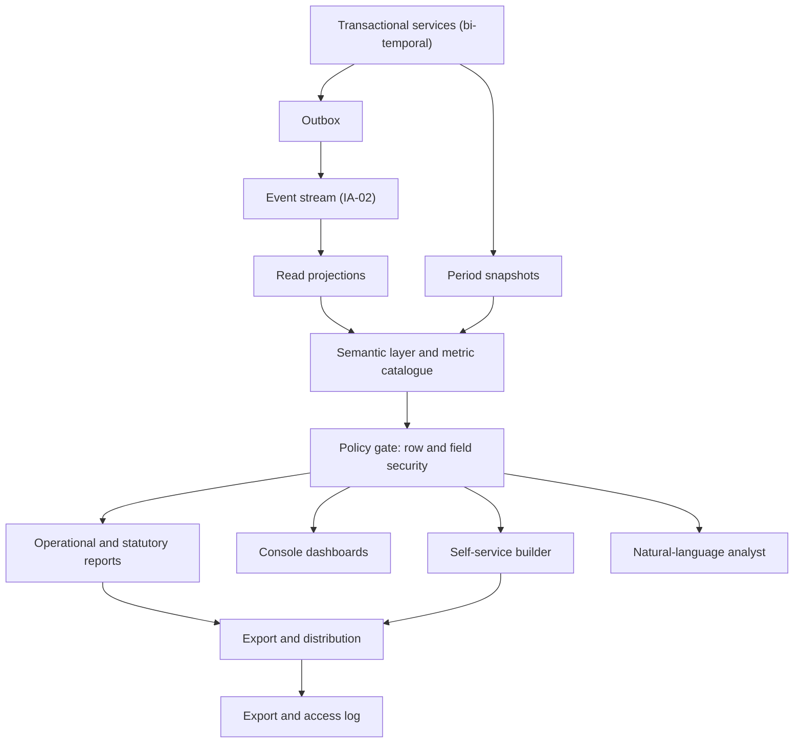
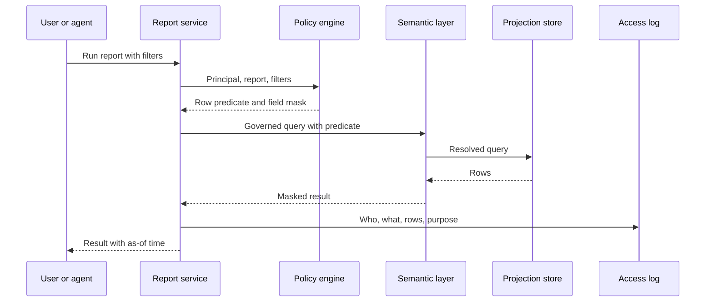

<picture>
  <source media="(prefers-color-scheme: dark)" srcset="../assets/MultipliersKraftLogoDark.png">
  
</picture>

# RPT-01 — Reporting and Analytics Requirements

| Attribute | Value |
| :--- | :--- |
| Document ID | RPT-01 |
| Title | Reporting and Analytics Requirements |
| Product | Nucleus Suite (Nucleus HRMS Suite) |
| Version | 1.0.0 |
| Status | Issued for approval |
| Owner (role) | Head of People Analytics (Product) |
| Author | Dhanraj Dadhich |
| Reviewed by | *pending* |
| Approved by | Architecture Review Board — *pending* |
| Date | 2026-11-05 |
| Classification | Internal |
| CMMI practice areas | RDM, TS, VV |
| Related documents | NFR-01, IA-02, BA-04, GOV-08, GOV-10, GOV-11, AI-01, DA-01, FRS-PLT-04 to FRS-INT-04, FRS-INT-01, NOT-01, LOC-01 |
| Quality & process-performance objectives | QPPO-01 (minimise defects reaching users), QPPO-03 (exact payroll at go-live), QPPO-05 (effective requirements reviews), QPPO-07 (fair and grounded AI) |
| Process performance baseline used | PPB-01 (review defect density), PPB-02 (review rate), PPB-04 (payroll parallel run) |
| Peer review record | *pending* (PR-xxxx, QA-02) |
| Tailoring record | none |
| Traceability anchor | BG-01, BG-03, BG-04, BG-06, BG-08 · R-01 to R-27 (report-bearing) · INT-03, TIM-10, FIN-04 · RP-01 to RP-17 · SCR-027, SCR-103, SCR-110, SCR-111 |

---

## 1. Purpose and scope

This document specifies the reporting and analytics capability of Nucleus Suite: the architecture from transaction to export, the full catalogue of operational, statutory and financial reports, the console dashboards for each persona, governed self-service reporting, data freshness, row- and field-level security, export controls, guardrails for natural-language analytics and the acceptance criteria every report must meet.

The catalogue carries every report in Build Sheet 08_Reports_and_Outputs (RP-01 to RP-15) and Demo Dataset 67_Reports_Register (RP-16 and RP-17 added in v1.1), plus the reports that screens, business rules, console widgets and NFR-01 measures make necessary. Source report IDs are kept exactly; additional reports are identified by their requirement ID.

**Delivery stage.** R0 is a UI-validation prototype on local JSON; reports in R0 are computed in memory from the local data boundary and exports are generated on the device. No warehouse, database or external analytics service is authorised (DEC-0002).

## 2. Reporting principles

| ID | Requirement | Rationale | Source / trace | Realises SYS | Priority | Verification | Acceptance criterion |
| :--- | :--- | :--- | :--- | :--- | :--- | :--- | :--- |
| INT-RPT-001 | Every report figure MUST be derived from posted records; no report may accept typed figures. | Statutory and financial outputs are evidence. | RL-371, RP-12 note | SYS-049, SYS-086 | Must | Inspection | No report definition contains an editable value column. |
| INT-RPT-002 | Data scope MUST be enforced identically in screen, report, export and API for the same principal and query. | A restriction proven in one surface must hold in all four. | 43_Roles_and_Data_Scope, T-18 | SYS-016, SYS-017 | Must | Test | U-001 and U-002 run RP-14 on screen, export and API; E1056 is absent from all three for U-001. |
| INT-RPT-003 | Every balance or total shown MUST be explainable line by line by drill-through to the records that produced it. | "A balance that cannot be explained line by line is a defect." | RP-05 note, RL-531 | SYS-030, SYS-049 | Must | Test | Any RP-05 closing balance drills to ledger movements that sum to it. |
| INT-RPT-004 | A report run in preview mode and the same report on committed data MUST produce identical figures for the same inputs. | Preview must not mislead. | RP-08 note, BS:RL-14 | SYS-048 | Must | Test | RP-08 preview run twice, then committed, shows identical figures (T-17). |
| INT-RPT-005 | Every report MUST display its as-of time, data freshness class and rule-pack versions where calculations depend on them. | Readers must know what they are looking at. | RL-021, RL-251 | SYS-023, SYS-045 | Must | Inspection | Report header shows as-of timestamp and freshness badge. |
| INT-RPT-006 | Reports that drive a downstream gate (payroll approval, F&F release, vendor payment) MUST show the gate status they feed. | Reports are operational controls. | RP-11, RP-17 notes | SYS-051 | Should | Demonstration | RP-17 shows "blocks payroll" per exception. |

## 3. Reporting architecture

### 3.1 Data flow

### 3.2 Query-time security

### 3.3 Architecture requirements

| ID | Requirement | Rationale | Source / trace | Realises SYS | Priority | Verification | Acceptance criterion |
| :--- | :--- | :--- | :--- | :--- | :--- | :--- | :--- |
| INT-RPT-007 | Operational reports MUST read from read projections built from domain events, not from transactional tables under write load. | Reporting must not degrade interactive latency. | INT-03, NFR-01 API latency | SYS-053, SYS-055 | Must | Test | Running RP-03 for 5,000 employees during a recompute leaves interactive p95 under 300 ms. |
| INT-RPT-008 | Payroll, statutory and financial reports MUST be able to read from the immutable period snapshot of a locked run, identified by snapshot ID. | Reproducibility to the paisa. | RL-251, PAY-02 | SYS-024, SYS-031 | Must | Test | RP-14 for PR-2026-09-01 from the snapshot matches the run totals exactly. |
| INT-RPT-009 | All reports, dashboards, self-service queries and natural-language queries MUST resolve measures and dimensions through one semantic layer with a governed metric catalogue (§5.2). | One definition per metric. | BG-08 | SYS-017, SYS-071 | Must | Inspection | Headcount on S1 and on INT-RPT-030 are produced by the same metric definition. |
| INT-RPT-010 | Projections MUST support as-at queries by valid time and recorded time. | "What did we know on 30 September about 15 September?" | RL-020, RL-021, PLT-08 | SYS-021, SYS-023 | Must | Test | RP-05 as on 15 Sep 2026, recorded as of 16 Sep, excludes a correction entered on 20 Sep. |
| INT-RPT-011 | A projection rebuilt from the event history MUST reproduce the same results as the live projection. | Projections are disposable; history is not. | PLT-07, IA-02 retention | SYS-055, SYS-057 | Should | Test | Rebuild of the leave projection yields identical RP-05 output. |

## 4. Report catalogue

### 4.1 Summary of source reports

| Report | Name | Domain | Client requirement | Build action | Primary personas | Freshness | Statutory relevance |
| :--- | :--- | :--- | :--- | :--- | :--- | :--- | :--- |
| RP-01 | Break register | TIM | R-01 | New | PER-03, PER-02 | F1 | Supports rest-interval evidence |
| RP-02 | Team attendance history | TIM | R-02 | New | PER-07 | F1 | None |
| RP-03 | Daily attendance register | TIM | R-01, R-13 | Edit existing | PER-03, PER-02, PER-13 | F1 | Basis for the muster roll |
| RP-04 | Overtime statement | TIM / PAY | R-01, R-05, R-11 | Edit existing | PER-03, PER-13, PER-05 | F1; F4 for paid runs | Feeds the overtime register (Form 28) |
| RP-05 | Leave balance and ledger | LVE | R-06, R-07, R-08 | Edit existing | PER-08, PER-02, PER-07 | F1 | Basis for the leave-with-wages register |
| RP-06 | COFF expiry forecast | LVE | R-07 | New | PER-08, PER-07, PER-02 | F3 | None |
| RP-07 | Leave accrual audit | LVE | R-08 | New | PER-02, PER-15 | F3 | Audit evidence |
| RP-08 | Year-end encashment and lapse statement | LVE | R-08 | New | PER-02, PER-13, PER-05 | F4 | Encashment is taxable pay |
| RP-09 | Gate pass utilisation | TIM | R-12 | New | PER-03, PER-07, PER-02 | F1 | None |
| RP-10 | Loan and guarantor exposure | CMB | R-10 | New | PER-05, PER-02, PER-13 | F2 | None |
| RP-11 | No dues status | LCY | R-17 | New | PER-02, department owners, PER-05 | F1 | None |
| RP-12 | Statutory registers and returns | CMP | R-18 | Edit existing | PER-14, PER-03, PER-15 | F4 | Primary statutory output |
| RP-13 | Form F register | CMP | R-27 | New | PER-14, PER-02 | F1 | Primary statutory output |
| RP-14 | Salary register | PAY | R-09 | Edit existing | PER-13, PER-05 | F4 | Wage register basis |
| RP-15 | Payroll posting log | FIN | R-16 | New | PER-05, integration engineer, PER-15 | F1 | Financial audit trail |
| RP-16 | Contractor reconciliation | CTG | R-03, R-04 | New (v1.1) | Purchase owner, PER-05, PER-02 | F2 | Principal-employer evidence |
| RP-17 | Attendance exception queue | TIM | R-01, R-13 | New (v1.1) | PER-03, PER-02, PER-13 | F1 | None |

Freshness classes are defined in §7. Statutory relevance statements are general and to be validated by Legal.

### 4.2 Source report specifications

#### 4.2.1 RP-01 Break register (F-ATT-03)

| Attribute | Specification |
| :--- | :--- |
| Purpose | Every intermediate break by employee and attendance date, with start, end, duration and type, for a date range; shows whether each break was deducted from net hours. |
| Filters | Employee, date range, department, shift, break type, location |
| Columns and measures | Break ID, employee code, name, attendance date (the date the shift started, RL-080), session, break sequence, start, end, break minutes, break type, derived-from punch pair, deducted from net hours (Y/N). Measures: total break minutes and break count per employee-day. |
| Data sources | TIM-02 derivation; `time.punch.ingested`, `time.attendance_day.computed`; demo 49_Break_Register, 20_Punch_Events |
| Security scope | Location grant for PER-03/PER-02; reporting line for PER-07; self for PER-08 (through SCR-021) |
| Schedule and export | On demand; optional daily schedule; CSV, XLSX, PDF |
| Statutory relevance | Evidence of rest intervals in factory establishments (to be validated by Legal) |
| Acceptance | E1018 on 08 Sep 2026 shows the 45-minute meal break 20:30–21:15 as its own row, gate-to-gate hours unchanged at 19h20m (T-01, T-02). |

#### 4.2.2 RP-02 Team attendance history (F-ATT-05)

| Attribute | Specification |
| :--- | :--- |
| Purpose | Attendance history for a manager's team or one team member across any date range, including ranges that cross months. |
| Filters | From date, to date, team member, include indirect reportees (default N) |
| Columns and measures | Fixed column set (RL-161): date, employee, attendance status, leave, overtime, gate pass, late status, applied shift. Measures: days present, leave days, OT hours, late count per member. |
| Data sources | TIM-10; TIM-02, LVE-04, TIM-06, TIM-07 projections; demo 21_Expected_Attendance, 44_Demo_Users |
| Security scope | Reporting line evaluated at query time (RL-160); non-reportees cannot be selected |
| Schedule and export | On demand; CSV and PDF; export identical to screen and logged (RL-162) |
| Statutory relevance | None |
| Acceptance | Signed in as U-003 (E1017), 01 Jan to 15 Mar returns the full range; a non-reportee cannot be selected (T-05). |

#### 4.2.3 RP-03 Daily attendance register (F-ATT-01)

| Attribute | Specification |
| :--- | :--- |
| Purpose | Daily attendance by employee with hours, breaks, overtime, lateness and the detected shift beside the rostered shift. |
| Filters | Date range, department, shift, day status, location |
| Columns and measures | Date, employee, rostered shift, detected shift, first in, last out, gross hours, break minutes, net hours, OT hours, late mark, late instance number, day type, day status. Measures: present, half-day and absent counts; total OT hours. |
| Data sources | TIM-02, TIM-03, TIM-04, TIM-05; demo 21_Expected_Attendance, 52_Shift_Roster |
| Security scope | Location grant; rate and pay fields never shown |
| Schedule and export | On demand; daily schedule to PER-03 at 08:00; CSV, XLSX, PDF |
| Statutory relevance | Source data for the muster roll in the applicable state form set (to be validated by Legal) |
| Acceptance | E1020's 04 Sep row shows detected shift SH-B beside the rostered shift, roster unchanged (T-27). |

#### 4.2.4 RP-04 Overtime statement (F-OTM-01)

| Attribute | Specification |
| :--- | :--- |
| Purpose | OT hours and amount by employee for the OT period, with day type and eligibility basis so rest-day-only eligibility is visible; separate from the salary register. |
| Filters | OT period, department, eligibility basis, location |
| Columns and measures | OT record, employee, date, day type, OT minutes, OT hours, eligibility basis, multiplier, approved by, approved on, pay-in run, amount (payroll scope only). Measures: OT hours and amount by department. |
| Data sources | TIM-07, PAY-10; `time.overtime.approved`; demo 23_Overtime_Register, 55_Payroll_Register |
| Security scope | Hours for location grants; amounts only for the payroll processing location scope (R-09) |
| Schedule and export | On demand; at OT run close; CSV, XLSX, PDF |
| Statutory relevance | Feeds the overtime register (Form 28 in Karnataka, FRM-28-2026-09) (to be validated by Legal) |
| Acceptance | E1034's two 12-hour rows: working day pays nothing, rest day pays the whole span (T-04). |

#### 4.2.5 RP-05 Leave balance and ledger (F-LVE-05)

| Attribute | Specification |
| :--- | :--- |
| Purpose | Opening, credited, availed, reversed, lapsed, encashed and closing balance per leave type, with every movement traceable. |
| Filters | As-on date, employee, leave type, department, location |
| Columns and measures | Employee, leave type, opening, credited, availed, reversed, lapsed, encashed, closing; drill to ledger ID, transaction, days, effective date, expires on, narration, source reference. |
| Data sources | LVE-08 balance projection from the ledger; `leave.credit.posted`, `leave.request.approved`, `leave.credit.reversed`, `leave.compoff.lapsed`; demo 53_Leave_Balance_AsOn, 17_Leave_Ledger |
| Security scope | Self; reporting line (balances only, no leave reasons); HR within entity scope |
| Schedule and export | On demand; monthly snapshot; CSV, XLSX, PDF |
| Statutory relevance | Source for the leave-with-wages register (to be validated by Legal) |
| Acceptance | As on 15 Sep 2026, any closing balance drills to movements that sum to it (T-08, T-11, T-12). |

#### 4.2.6 RP-06 COFF expiry forecast (F-LVE-06)

| Attribute | Specification |
| :--- | :--- |
| Purpose | Comp-off credits available with expiry date so employees are warned before lapse. |
| Filters | Expiring within N days (default 60), department, location |
| Columns and measures | Credit ID, employee, earned on, reason, days, expires on, days remaining, status, consumed on. Measure: days at risk in the window. |
| Data sources | LVE-06; demo 19_CompOff_Ledger, 17_Leave_Ledger |
| Security scope | Self; reporting line; HR within scope |
| Schedule and export | Daily; drives NOT-01 NM-074; CSV, XLSX |
| Statutory relevance | None |
| Acceptance | E1028 shows two credits nine weeks apart; E1044's lapsed credit appears as lapsed with the lapse run reference (T-10). |

#### 4.2.7 RP-07 Leave accrual audit (F-LVE-02)

| Attribute | Specification |
| :--- | :--- |
| Purpose | What was credited to whom, when and under which rule — the evidence for a disputed balance. |
| Filters | Accrual period, leave scheme, leave type |
| Columns and measures | Ledger ID, employee, band, scheme, leave type, days, effective date, policy code, rule applied (BS:RL-07 to BS:RL-10), accrual run reference, proration basis. |
| Data sources | LVE-01, LVE-02; demo 15_Leave_Accrual_Policy, 16_Leave_Proration, 17_Leave_Ledger |
| Security scope | HR within entity scope; auditor read-only |
| Schedule and export | After each accrual run; CSV, XLSX |
| Statutory relevance | Audit evidence |
| Acceptance | E1069 and E1067 show the same rule applied six months apart (T-13, T-14). |

#### 4.2.8 RP-08 Year-end encashment and lapse statement (F-LVE-07)

| Attribute | Specification |
| :--- | :--- |
| Purpose | Earned leave encashed and casual and sick leave lapsed per employee, from preview or committed run. |
| Filters | Processing year, run mode (Preview, Commit) |
| Columns and measures | Employee, scheme, leave type, balance as on, further accrual, expiring, projected balance, year-end action, days encashed, days lapsed, rate per day and encashment amount (payroll scope only). |
| Data sources | LVE-07; demo 54_Year_End_Leave_Preview |
| Security scope | HR within scope; amounts for payroll and finance scope only |
| Schedule and export | Preview on demand; committed at year-end run; CSV, XLSX, PDF |
| Statutory relevance | Encashment is taxable pay (to be validated by Legal) |
| Acceptance | Preview run twice changes nothing; preview equals committed output (T-17). |

#### 4.2.9 RP-09 Gate pass utilisation (F-GPS-01)

| Attribute | Specification |
| :--- | :--- |
| Purpose | Hours and passes used against entitlement per employee per month, making the two-pass cap auditable. |
| Filters | Month, department, location |
| Columns and measures | Employee, month, passes used, minutes used, entitlement (240 minutes, 2 passes per RL-121), remaining, requests refused. |
| Data sources | TIM-06; demo 22_Gate_Pass |
| Security scope | Location grant; reporting line |
| Schedule and export | On demand; monthly; CSV, XLSX |
| Statutory relevance | None |
| Acceptance | September at LOC-PLA shows E1023 at 240 minutes and two instances with the third request refused (T-23). |

#### 4.2.10 RP-10 Loan and guarantor exposure (F-LON-02)

| Attribute | Specification |
| :--- | :--- |
| Purpose | Outstanding loans, who guarantees whom, and who is consequently blocked from borrowing or guaranteeing. |
| Filters | As-on date, department, status |
| Columns and measures | Loan ID, borrower, purpose, principal, sanctioned on, instalment, outstanding, status, special terms flag, ceiling and basis, guarantors with accepted and released dates, blocked persons and reason. Measures: total outstanding, persons blocked. |
| Data sources | CMB-01 to CMB-04; `loan.*` events; demo 24_Loans, 25_Loan_Guarantors |
| Security scope | Finance, HR Head and payroll within entity; employees see only their own loans and guarantees |
| Schedule and export | On demand; monthly; CSV, XLSX, PDF |
| Statutory relevance | None |
| Acceptance | As on 15 Sep 2026 shows the guarantor interlock both ways and its release (T-19, T-20). |

#### 4.2.11 RP-11 No dues status (F-FNF-02)

| Attribute | Specification |
| :--- | :--- |
| Purpose | Clearance status by department for employees in exit, with recovery amounts; drives same-day settlement. |
| Filters | Employee, last-working-date range, status |
| Columns and measures | Employee, resigned on, last working day, notice served, checklist item, owner, blocking, status, cleared on, recovery amount, F&F state. Measures: blocking lines open per leaver. |
| Data sources | LCY-06, LCY-07; `lifecycle.clearance.item_cleared`; demo 27_Exit_Clearance, 58_FnF_Settlement |
| Security scope | HR all within scope; department owners see their own items; finance sees recoveries |
| Schedule and export | On demand; daily digest to HR (NOT-01 W-07); CSV, PDF |
| Statutory relevance | None |
| Acceptance | E1042 held at two blocking lines with the 12,500 recovery priced; E1068 released (T-30). |

#### 4.2.12 RP-12 Statutory registers and returns (F-STA-01)

| Attribute | Specification |
| :--- | :--- |
| Purpose | Form 28, Form 18, Form 36 and periodic returns, in the variant of the state where the establishment is registered. |
| Filters | Period, establishment, form |
| Columns and measures | As prescribed by the applicable state rules for each form; instance reference, state variant, period, generated on, filed on, acknowledgement reference. |
| Data sources | CMP-02p, CMP-03p; `compliance.form.generated`, `compliance.obligation.filed`; demo 29_Statutory_Forms, 28_Statutory_Calendar |
| Security scope | Compliance owner for all factory establishments; plant HR for own establishment; auditor read-only |
| Schedule and export | Per obligation calendar; PDF in prescribed layout plus machine-readable CSV |
| Statutory relevance | Primary statutory output; layouts per state rules (LOC-01 §6.10, to be validated by Legal) |
| Acceptance | September for LOC-PLA and then LOC-CHN produces different register sets (T-32). |

#### 4.2.13 RP-13 Form F register (F-STA-02)

| Attribute | Specification |
| :--- | :--- |
| Purpose | The joining form under the factory rules and its serial register per establishment. |
| Filters | Establishment, joining-date range |
| Columns and measures | Serial number (gapless per establishment), employee, joining date, particulars as prescribed, instance ID, generated on. |
| Data sources | LCY-02, CMP-03p (RL-382); demo 29_Statutory_Forms, 61_Preboarding_Chain |
| Security scope | Compliance owner; HR within the establishment |
| Schedule and export | Generated in the joining chain; register on demand; PDF and CSV |
| Statutory relevance | Primary statutory output (to be validated by Legal) |
| Acceptance | LOC-PLA joiners in 2026 show a gapless serial; FRM-F-2026-0112 for E1066 populated from the record (T-31). |

#### 4.2.14 RP-14 Salary register (F-PAY-02)

| Attribute | Specification |
| :--- | :--- |
| Purpose | Salary by employee for a run, filtered by payroll processing location and honouring the salary visibility rule. |
| Filters | Payroll period, payroll location (payroll group), run type |
| Columns and measures | Run, employee, payroll group, work location, days in period, days paid, LOP days, basic, DA, HRA, conveyance, special allowance, overtime, gross, PF employee, ESI employee, professional tax, PT state, TDS, loan recovery, other recovery, total deductions, net pay. Measures: totals by component and location. |
| Data sources | PAY-04, PAY-07 from the run snapshot; demo 55_Payroll_Register, 43_Roles_and_Data_Scope |
| Security scope | Payroll processing location (BS:RL-24, RL-036); a plant user never sees head-office-paid employees' salary |
| Schedule and export | At run approval; CSV, XLSX, PDF |
| Statutory relevance | Basis for the wage register (to be validated by Legal) |
| Acceptance | September run as U-001 and as U-002: E1056 appears only for U-002 (T-18). |

#### 4.2.15 RP-15 Payroll posting log (F-INT-02)

| Attribute | Specification |
| :--- | :--- |
| Purpose | What was posted to the ERP system, when, with what reference, and what failed. |
| Filters | Payroll period, posting status, entity |
| Columns and measures | Journal, run, entity, period, posting status, ERP posting reference, posted at, failure reason, attempts, idempotency key, debit total, credit total. |
| Data sources | FIN-03; `payroll.journal.ready`, `payroll.run.posted`; demo 56_GL_Journal, 35_GL_Mapping |
| Security scope | Finance within entity; integration engineer (no amounts); auditor read-only |
| Schedule and export | On demand; on every posting attempt; CSV, XLSX |
| Statutory relevance | Financial audit trail |
| Acceptance | August 2026: the blocked run with GL-023 unmapped, then the balanced journal, then the re-run creating no second posting (T-29). |

#### 4.2.16 RP-16 Contractor reconciliation

| Attribute | Specification |
| :--- | :--- |
| Purpose | Contractor invoices reconciled against attendance the system already holds, with variance visible before payment. |
| Filters | Vendor, period, site |
| Columns and measures | Invoice, vendor, period, site, worker days claimed, worker days from attendance, variance days, rate per day, claimed amount, passed amount, status, reconciliation note. |
| Data sources | CTG-02 (RL-480 to RL-482); demo 46_Contractor_Invoices, 21_Expected_Attendance |
| Security scope | Purchase and finance within entity and location; HR read |
| Schedule and export | Per invoice; monthly; CSV, XLSX, PDF |
| Statutory relevance | Principal-employer evidence for contract labour (to be validated by Legal) |
| Acceptance | VN-01, September: three claimed days with no attendance behind them are held, not paid. |

#### 4.2.17 RP-17 Attendance exception queue

| Attribute | Specification |
| :--- | :--- |
| Purpose | Open attendance exceptions by severity with their resolution path and whether they block payroll or a vendor payment; run before the payroll run. |
| Filters | Status, severity, location, exception type |
| Columns and measures | Exception, employee, attendance date, type, detail, detected on, severity, resolution path, resolved on, status, blocks payroll, blocks vendor payment. |
| Data sources | TIM-08; `time.exception.raised`; demo 51_Attendance_Exceptions |
| Security scope | Location grant |
| Schedule and export | Live; daily schedule from 3 days before input lock; CSV, XLSX |
| Statutory relevance | None |
| Acceptance | Open exceptions show three blocking payroll, one blocking a vendor payment and two resolving themselves. |

### 4.3 Source report requirements

| ID | Requirement | Rationale | Source / trace | Realises SYS | Priority | Verification | Acceptance criterion |
| :--- | :--- | :--- | :--- | :--- | :--- | :--- | :--- |
| INT-RPT-012 | The system MUST provide RP-01 Break register as specified in §4.2.1. | R-01 asks for the break shown separately. | 08_Reports_and_Outputs, R-01 | SYS-062, SYS-068 | Must | Test | §4.2.1 acceptance. |
| INT-RPT-013 | The system MUST provide RP-02 Team attendance history as specified in §4.2.2. | R-02 team calendar. | R-02, RL-160, RL-161 | SYS-016, SYS-068 | Must | Test | §4.2.2 acceptance. |
| INT-RPT-014 | The system MUST provide RP-03 Daily attendance register as specified in §4.2.3. | Detected versus rostered shift. | R-01, R-13, R-14 | SYS-062, SYS-068 | Must | Test | §4.2.3 acceptance. |
| INT-RPT-015 | The system MUST provide RP-04 Overtime statement as specified in §4.2.4, separate from the salary register. | OT paid in a separate run. | R-05, R-11 | SYS-045, SYS-047 | Must | Test | §4.2.4 acceptance. |
| INT-RPT-016 | The system MUST provide RP-05 Leave balance and ledger as specified in §4.2.5. | Explainable balances. | R-06 to R-08 | SYS-049 | Must | Test | §4.2.5 acceptance. |
| INT-RPT-017 | The system MUST provide RP-06 COFF expiry forecast as specified in §4.2.6. | Prevents silent lapse. | R-07 | SYS-049, SYS-050 | Must | Test | §4.2.6 acceptance. |
| INT-RPT-018 | The system MUST provide RP-07 Leave accrual audit as specified in §4.2.7. | Evidence for disputed balances. | R-08 | SYS-049, SYS-050 | Must | Test | §4.2.7 acceptance. |
| INT-RPT-019 | The system MUST provide RP-08 Year-end encashment and lapse statement as specified in §4.2.8. | Preview equals commit. | R-08 | SYS-047, SYS-049 | Must | Test | §4.2.8 acceptance. |
| INT-RPT-020 | The system MUST provide RP-09 Gate pass utilisation as specified in §4.2.9. | Auditable two-pass cap. | R-12 | SYS-049, SYS-059 | Must | Test | §4.2.9 acceptance. |
| INT-RPT-021 | The system MUST provide RP-10 Loan and guarantor exposure as specified in §4.2.10. | Makes the interlock visible. | R-10 | SYS-049, SYS-051 | Must | Test | §4.2.10 acceptance. |
| INT-RPT-022 | The system MUST provide RP-11 No dues status as specified in §4.2.11. | Same-day settlement. | R-17 | SYS-051 | Must | Test | §4.2.11 acceptance. |
| INT-RPT-023 | The system MUST provide RP-12 Statutory registers and returns as specified in §4.2.12. | Factory Act compliance. | R-18 | SYS-086 | Must | Test | §4.2.12 acceptance. |
| INT-RPT-024 | The system MUST provide RP-13 Form F register as specified in §4.2.13 with a gapless serial per establishment. | Gapless serial is the control. | R-27 | SYS-086 | Must | Test | §4.2.13 acceptance. |
| INT-RPT-025 | The system MUST provide RP-14 Salary register as specified in §4.2.14. | Salary hidden from plant users. | R-09 | SYS-018, SYS-030 | Must | Test | §4.2.14 acceptance. |
| INT-RPT-026 | The system MUST provide RP-15 Payroll posting log as specified in §4.2.15; a failed posting MUST be visible, not silent. | Posting failures must surface. | R-16 | SYS-084 | Must | Test | §4.2.15 acceptance. |
| INT-RPT-027 | The system MUST provide RP-16 Contractor reconciliation as specified in §4.2.16. | Pay only for attendance held. | R-03, R-04, CTG-02 | SYS-062, SYS-084 | Must | Test | §4.2.16 acceptance. |
| INT-RPT-028 | The system MUST provide RP-17 Attendance exception queue as specified in §4.2.17. | Clean inputs before payroll. | R-01, R-13, TIM-08 | SYS-051, SYS-062 | Must | Test | §4.2.17 acceptance. |

### 4.4 Additional reports required by screens, rules and measures

| ID | Report | Purpose, columns and measures | Personas | Filters | Data sources | Security scope | Freshness | Statutory relevance | Realises SYS |
| :--- | :--- | :--- | :--- | :--- | :--- | :--- | :--- | :--- | :--- |
| INT-RPT-029 | Late-mark and grace summary | Lates per employee per month, forgiven count, lates beyond allowance, half days caused, grace-exempt flag (RL-115, RL-116) | PER-03, PER-07, PER-02 | Month, location, department, band | TIM-05; 21_Expected_Attendance | Location, reporting line | F1 | None | SYS-049, SYS-059 |
| INT-RPT-030 | Headcount and movement | Opening, joiners, leavers, transfers in and out, closing headcount and FTE by entity, location, org unit, worker class, designation | PER-01, PER-02, PER-05 | Period, entity, location, org unit, worker class | PPL-01, PPL-02, PPL-07; `people.worker.hired`, `people.assignment.changed` | Entity and location | F2 | None | SYS-006, SYS-007, SYS-023 |
| INT-RPT-031 | Attrition | Leavers by reason, voluntary and involuntary, annualised attrition rate, attrition by tenure band and manager; small cells suppressed (§8) | PER-01, PER-02 | Period, entity, location, org unit | LCY-05, LCY-07; `payroll.fnf.settled` | Entity; manager view aggregated only | F3 | None | SYS-017 |
| INT-RPT-032 | Sanctioned strength versus filled | Sanctioned, filled, open and headroom by org unit, designation and location, with replacement versus addition requisitions | PER-02, PER-05, PER-07 (own unit), PER-04 | As-on date, org unit, location | PPL-04, TAL-01 (RL-055, RL-462); 10_Sanctioned_Manpower | Entity and location | F1 | None | SYS-006, SYS-017 |
| INT-RPT-033 | Pre-payroll audit flags | Flags by severity, owner, status, waiver and waiver role, agent-drafted resolution (RL-260 to RL-262) | PER-13, PER-05 | Run, severity, status | PAY-03 | Payroll group and entity | F0 | None | SYS-036, SYS-051 |
| INT-RPT-034 | Payroll variance | Gross, net and component variance by employee versus prior run, with reason codes (joiner, leaver, arrears, LOP, revision, statutory) | PER-13, PER-05 | Run, comparison run, threshold | PAY-04, PAY-11; run snapshots | Payroll group | F4 | None | SYS-025, SYS-030 |
| INT-RPT-035 | Statutory contribution summary by state | PF, EPS, ESI, PT by state, LWF by state and TDS per entity and period, reconciled to challans | PER-13, PER-14, PER-05 | Period, entity, state, contribution | PAY-07; 55_Payroll_Register, 28_Statutory_Calendar | Entity and state | F4 | Primary input to returns (LOC-01 §8) | SYS-045, SYS-086 |
| INT-RPT-036 | Reconciliation assertions | The seven assertions — gross, net versus bank, statutory versus challan, dimension residue, overtime, loan movement, drill-through — each shown passing or failing (RL-530, RL-531) | PER-05, PER-15 | Run, entity | FIN-04; SCR-103 | Entity | F4 | Financial audit | SYS-031, SYS-084 |
| INT-RPT-037 | Bank file control | File, run, entity, value date, records, total, checksum, status, reconciles to, variance, dual-control approvers (RL-322) | PER-05, PER-15 | Run, entity, status | FIN-05; 57_Bank_File | Entity; account numbers masked | F0 | None | SYS-085 |
| INT-RPT-038 | Salary journal with drill-through | Journal lines by GL account and dimension, debit and credit, each line drilling to contributing employees and payslip lines (RL-520 to RL-522, RL-531) | PER-05, PER-15 | Run, entity, account, dimension | FIN-02, FIN-03; 56_GL_Journal, 35_GL_Mapping | Entity | F4 | Financial audit | SYS-030, SYS-084 |
| INT-RPT-039 | ERP master sync and conflicts | Batches, applied rows, conflicts held, unmatched codes, duplicates rejected with reasons (RL-513 to RL-516) | Integration engineer, PER-02 | Batch, date, outcome | FIN-01; 36_ERP_Inbound_Master; `integration.sync.*` | Tenant administration | F1 | None | SYS-084 |
| INT-RPT-040 | Obligation calendar status | Obligations by entity and state with due date, owner, status, evidence and acknowledgement (RL-370, RL-383) | PER-14, PER-02, PER-05, PER-01 | Period, entity, state, status | CMP-02p; 28_Statutory_Calendar | Entity and state | F1 | Primary compliance control | SYS-086 |
| INT-RPT-041 | Agent action ledger and reversal rate | Actions by agent, tool, outcome, approver, reversals; weekly reversal rate against the 2% target (RL-545) | PER-10, PER-15, Head of AI | Period, agent, outcome | INT-01, INT-02; `agent.action.*` | Tenant; auditors read-only | F1 | AI governance evidence (GOV-11) | SYS-035 |
| INT-RPT-042 | Sensitive data access and export log | Accesses to identity, bank and salary data and every personal-data export: who, what, rows, purpose, channel (RL-162) | PER-14, PER-15, PER-10 | Period, actor, data class | PLT-06 audit log | Tenant; DPO and auditor only | F1 | DPDP Act 2023 accountability (to be validated by Legal) | SYS-033 |
| INT-RPT-043 | Notification delivery | Delivery latency p50 and p95 by class, success, fallback, in-place action and opt-out rates by category and channel (NOT-01 PLT-NOT-072) | PER-10, platform owner | Period, class, channel, category | Notification service events | Tenant administration | F2 | None | SYS-070 |
| INT-RPT-044 | Regularisation trend | Regularisations per 100 employees per quarter by location, reason and approver outcome; target falling quarter on quarter (NFR-01) | PER-02, PER-03, PER-01 | Quarter, location | TIM-08; W-10 records | Location | F3 | None | SYS-037 |
| INT-RPT-045 | Requisition ageing and pipeline funnel | Open requisitions by age band, stage counts and conversion from application to joining, time to fill, offer acceptance rate | PER-04, PER-07 (own), PER-01 | Period, org unit, location | TAL-01, TAL-02; 37_Requisitions, 59_Candidates_and_Offers | Org unit and location | F2 | None | SYS-037, SYS-043 |
| INT-RPT-046 | Joining chain SLA | Chains in progress, steps overdue by owner, blocked joiners, statutory registrations pending (RL-392) | PER-02, step owners | Joining-date range, location, step | LCY-01, LCY-02; 61_Preboarding_Chain | Entity and location | F1 | Statutory registrations tracked | SYS-043, SYS-051 |
| INT-RPT-047 | Recognition and referral payouts | Awards and referral payouts by programme, stage of maturity, payroll run carrying them (RL-471, RL-472, RL-491) | PER-02, PER-13 | Period, programme | EXP-01, TAL-03; 30_Recognition_Referral | Entity | F2 | None | SYS-030, SYS-037 |
| INT-RPT-048 | Letter issue register | Letters issued by type, recipient, issuer, template version retained, approval trail (RL-502) | PER-02, PER-15 | Period, letter type | EXP-03; 32_Letter_Templates | Entity | F1 | Evidence for reprint | SYS-032, SYS-037 |
| INT-RPT-049 | Document expiry | Documents expiring in a window by class and blocking flag (RL-060 to RL-062) | PER-02, PER-07 (blocking only) | Window, class, location | PPL-06; 62_Documents | Entity; references masked | F3 | Work-authorisation evidence where applicable | SYS-051, SYS-059 |
| INT-RPT-050 | Helpdesk SLA | Tickets by category, priority, SLA met or breached, ageing, assistant-created tickets (RL-423) | PER-02, queue leads | Period, category, priority | SSV-04; 63_Helpdesk_Tickets | Entity; ticket content restricted by category | F1 | None | SYS-043 |
| INT-RPT-051 | Learning compliance completion | Assigned, completed and overdue mandatory courses by location and org unit, induction completion before confirmation | PER-09, PER-02, PER-07 (own) | Period, course, location | TAL-05, LCY-02; 34_Induction_Learning | Entity and org unit | F2 | Statutory training evidence where applicable | SYS-017, SYS-051 |
| INT-RPT-052 | Calibration distribution | Ratings and nine-box placement distribution against the configured guideline with variance flags and bias checks | PER-06, PER-01 | Cycle, org unit | TAL-04 | Calibration scope; individual ratings to authorised roles only | F1 during calibration | None | SYS-017, SYS-059 |
| INT-RPT-053 | Leave liability and statutory provisions | Encashable leave liability, gratuity and bonus provisions on the statutory wage base by entity and cost centre (RL-304) | PER-05, PER-13 | Period, entity, cost centre | PAY-07, LVE-07; run snapshots | Entity | F4 | Inputs to financial statements | SYS-045, SYS-047, SYS-049 |

| ID | Requirement | Rationale | Source / trace | Realises SYS | Priority | Verification | Acceptance criterion |
| :--- | :--- | :--- | :--- | :--- | :--- | :--- | :--- |
| INT-RPT-054 | The system MUST provide each report INT-RPT-029 to INT-RPT-053 with the purpose, measures, filters, sources, scope and freshness stated in §4.4. | Screens, rules and NFR measures depend on them. | SCR-111, SCR-103, SCR-110, NFR-01 | SYS-017, SYS-077 | Must for 029–044; Should for 045–053 | Test | Each report passes the generic acceptance checklist in §13 with demo data. |
| INT-RPT-055 | Reports marked "Primary statutory output" or "Primary input to returns" MUST carry a generation record (who, when, data snapshot, rule-pack version) and MUST NOT be editable after generation. | Statutory evidence must be immutable. | RL-381, RL-383 | SYS-034, SYS-086 | Must | Test | Attempting to edit a generated Form 28 instance is refused; a corrected period produces a new instance. |

## 5. Console dashboards

### 5.1 Dashboards by console

| Console | Personas | Widgets (each drills to the named report) | Freshness | Scope |
| :--- | :--- | :--- | :--- | :--- |
| S1 Executive people strategy | PER-01 | Headcount and cost trend (INT-RPT-030, 053); attrition and risk (INT-RPT-031); obligation calendar health (INT-RPT-040); payroll variance summary (INT-RPT-034); regularisation trend (INT-RPT-044) | F2–F3 | Tenant or granted entities; aggregates only |
| S2 HR operations | PER-02 | Case and approval queue; joining chain SLA (INT-RPT-046); no dues status (RP-11); document expiry (INT-RPT-049); helpdesk SLA (INT-RPT-050); sync conflicts (INT-RPT-039) | F1 | Entity grant |
| S3 Shift and floor operations | PER-03 | Live shift board (present, absent, late now); exception queue (RP-17); overtime against caps (RP-04); gate passes (RP-09); muster-roll readiness (RP-03) | F0–F1 | Location grant; no pay fields |
| S4 Talent acquisition | PER-04 | Pipeline funnel and requisition ageing (INT-RPT-045); sanctioned headroom (INT-RPT-032); interview calendar | F1–F2 | Org unit and location |
| S5 Payroll and GL control room | PER-05, PER-13 | Eight-stage payroll tracker; pre-payroll flags (INT-RPT-033); variance (INT-RPT-034); reconciliation assertions (INT-RPT-036); ERP posting status (RP-15); bank file control (INT-RPT-037); statutory contribution summary (INT-RPT-035) | F0–F4 | Payroll group and entity |
| S6 Talent calibration | PER-06 | Nine-box board and distribution variance badges (INT-RPT-052); bias flags | F1 | Calibration scope |
| S7 Manager cockpit | PER-07 | Approvals inbox; team coverage today; team history (RP-02); late summary (INT-RPT-029); COFF expiring (RP-06); weekly brief | F0–F1 | Reporting line at query time |
| S8 Employee self-service | PER-08, PER-11 | Today's punch state; month attendance and late allowance; leave balances (RP-05); payslip; gate-pass usage; loans | F0–F1 | Self |
| S9 Capability and learning | PER-09 | Skills heatmap; learning compliance completion (INT-RPT-051) | F2 | Entity and org unit |
| S10 Platform and privacy | PER-10, PER-14 | Access and export log (INT-RPT-042); agent ledger and reversal rate (INT-RPT-041); notification delivery (INT-RPT-043); integration health (INT-RPT-039); rights-request queue | F1–F2 | Tenant administration; DPO workspace |

### 5.2 Metric catalogue (governed definitions)

| Metric | Definition | Grain | Used in |
| :--- | :--- | :--- | :--- |
| Headcount | Count of persons with an active assignment at the as-of date; contractors counted separately by worker class | Day | S1, S2, INT-RPT-030 |
| FTE | Sum of assignment FTE at the as-of date | Day | S1, INT-RPT-030 |
| Attrition rate (annualised) | Leavers in period ÷ average headcount in period × (12 ÷ months in period) × 100 | Month | S1, INT-RPT-031 |
| Absenteeism rate | Absent days (unplanned, excluding approved leave and holidays) ÷ scheduled working days × 100 | Day | S1, S3 |
| Late rate | Late instances beyond grace ÷ present days × 100 | Month | S3, S7, INT-RPT-029 |
| OT hours per employee | Approved OT hours ÷ headcount of OT-eligible employees | OT period | S3, RP-04 |
| Regularisations per 100 | Regularisation requests ÷ average headcount × 100 | Quarter | S1, INT-RPT-044 |
| Payroll cost | Gross pay plus employer statutory contributions and provisions for the run | Run | S1, S5 |
| Approval cycle time | Time from approval requested to final decision, by workflow, in working hours | Request | S2, S7 |
| Exception backlog | Open attendance exceptions; payroll-blocking subset shown separately | Day | S3, S5 |
| Time to fill | Working days from requisition approval to offer acceptance | Requisition | S4 |
| Agent reversal rate | Reversed agent actions ÷ executed agent actions in the week × 100 (target under 2%) | Week | S10, INT-RPT-041 |
| Active adoption | Weekly active users ÷ provisioned users by persona (MET-19) | Week | S10 |

### 5.3 Dashboard requirements

| ID | Requirement | Rationale | Source / trace | Realises SYS | Priority | Verification | Acceptance criterion |
| :--- | :--- | :--- | :--- | :--- | :--- | :--- | :--- |
| INT-RPT-056 | Each console S1 to S10 MUST provide the widgets listed in §5.1, each drilling through to its named report with the same filters applied. | Dashboards are entry points, not dead ends. | GOV-08 §5 | SYS-077 | Must | Demonstration | Clicking the S3 exception widget opens RP-17 filtered to the same location and date. |
| INT-RPT-057 | Every widget MUST compute its measure from the metric catalogue in §5.2; locally computed widget measures MUST NOT be used. | One number, one definition. | INT-RPT-009 | SYS-017, SYS-077 | Must | Inspection | Widget configuration references metric IDs only. |
| INT-RPT-058 | Every widget MUST display a freshness badge and its as-of time. | Trust the number. | §7 | SYS-023, SYS-077 | Must | Demonstration | Badge visible on every S1 widget. |
| INT-RPT-059 | Users MAY rearrange, hide and resize widgets from the console's widget registry; personalisation MUST NOT widen data scope. | Personal layouts within governance. | S1–S10 personalisation | SYS-016, SYS-077 | Should | Test | A manager adding a widget sees only reporting-line data in it. |
| INT-RPT-060 | Mobile dashboards for S3, S7 and S8 MUST render cached data offline with the cache time shown. | Supervisors and workers are often offline. | 07_Screens offline column | SYS-064 | Should | Test | S8 opens offline and shows month attendance with "as of" time. |
| INT-RPT-061 | Dashboards MUST load the first meaningful view within 2.5 seconds at p95 for a tenant of 10,000 employees on a broadband desktop connection. | Usability. | NFR-01 | SYS-077 | Must | Test | Measured p95 under 2.5 s in the performance environment. |

## 6. Self-service ad-hoc reporting

| ID | Requirement | Rationale | Source / trace | Realises SYS | Priority | Verification | Acceptance criterion |
| :--- | :--- | :--- | :--- | :--- | :--- | :--- | :--- |
| INT-RPT-062 | The system MUST provide a self-service report builder over the semantic layer, where users choose subject areas, fields, filters, groupings and measures from a governed catalogue. | Answer new questions without engineering. | BG-08, SCR-111 "schedule" | SYS-017 | Must | Demonstration | An HRBP builds "leave days by department for Q3" without writing a query. |
| INT-RPT-063 | The builder MUST apply the user's row and field security to every query and MUST NOT offer fields the user cannot see. | Self-service must not bypass scope. | INT-RPT-002 | SYS-017, SYS-018 | Must | Test | Plant HR does not see salary fields in the field picker. |
| INT-RPT-064 | Users MUST be able to save, share and schedule self-service reports; recipients of a shared report MUST see results under their own scope, never the author's. | Sharing must not leak data. | RL-004 | SYS-016, SYS-017 | Must | Test | A report shared by U-002 to U-001 returns no head-office-paid salary rows for U-001. |
| INT-RPT-065 | Self-service queries MUST be limited to 100,000 result rows on screen and 1,000,000 rows on asynchronous export, and to 60 seconds of query time. | Protect the platform. | NFR-01 | SYS-017 | Must | Test | A query over the limit is refused with guidance to narrow filters. |
| INT-RPT-066 | Tenants MUST be able to add custom fields and custom metrics to the catalogue through governed configuration with an owner and definition. | Extensibility without bypassing governance. | BG-07, PLT-03 | SYS-059, SYS-060 | Should | Inspection | Custom metric record shows owner, formula and approval. |
| INT-RPT-067 | Raw SQL or direct projection access MUST NOT be available to tenant users. | Security and stability. | RL-541 (same principle for agents) | SYS-015, SYS-017 | Must | Inspection | No query console exposed to tenant roles. |

## 7. Data freshness

| Class | Target (p95, from source commit to visibility) | Typical use |
| :--- | :--- | :--- |
| F0 | Read from the transactional service on request | Approval context, payroll cockpit state, bank file control |
| F1 | 5 minutes | Operational reports, exception queues, dashboards for S2, S3, S7 |
| F2 | 1 hour | Headcount, pipeline, loans, notification delivery |
| F3 | Daily by 06:00 local | Attrition, expiry forecasts, trends |
| F4 | Locked period snapshot | Salary register, statutory outputs, journal, variance |

| ID | Requirement | Rationale | Source / trace | Realises SYS | Priority | Verification | Acceptance criterion |
| :--- | :--- | :--- | :--- | :--- | :--- | :--- | :--- |
| INT-RPT-068 | Each report and widget MUST declare a freshness class and the system MUST meet its target at p95 during the shift-change peak (500 punch events per second per tenant). | Freshness must hold when it matters. | NFR-01 attendance ingestion | SYS-053, SYS-062 | Must | Test | Under the peak load test, F1 reports lag commits by under 5 minutes at p95. |
| INT-RPT-069 | When a projection lags beyond its class target, the report MUST show a stale-data warning with the actual as-of time. | Never present stale as current. | §2 principle | SYS-023, SYS-053 | Must | Test | Pausing the projector shows the warning within one refresh. |
| INT-RPT-070 | F4 reports MUST state the snapshot ID and run; recompute after lock MUST appear as arrears in the next run, never as a change to the locked report. | Closed periods are never rewritten. | RL-041, RL-251 | SYS-024, SYS-025, SYS-052 | Must | Test | A retro change after lock leaves RP-14 for the locked run unchanged. |

## 8. Row-level and field-level security

| ID | Requirement | Rationale | Source / trace | Realises SYS | Priority | Verification | Acceptance criterion |
| :--- | :--- | :--- | :--- | :--- | :--- | :--- | :--- |
| INT-RPT-071 | Row security MUST be the intersection of tenant, entity, location, reporting line and payroll group grants of the principal. | Intersection, never union. | RL-004 | SYS-016 | Must | Test | A user with entity LE-01 and location LOC-CHN grants sees no rows (LOC-CHN belongs to LE-02). |
| INT-RPT-072 | Salary and rate fields MUST be visible only to principals scoped to the employee's payroll processing location, independent of work location. | Head-office payroll, plant attendance. | BS:RL-24, RL-036, R-09 | SYS-007, SYS-018 | Must | Test | T-18 passes in report, export and API. |
| INT-RPT-073 | Identity numbers (Aadhaar, PAN, UAN, bank account) MUST be masked in all reports except where a statutory output requires them, and unmasked access MUST be logged. | Minimise exposure. | GOV-10, 62_Documents masked references | SYS-033 | Must | Test | RP-13 shows required particulars; ad-hoc reports show masked values. |
| INT-RPT-074 | Aggregate reports by group (attrition, calibration, wellbeing, engagement) MUST suppress cells with fewer than 5 persons. | Prevent re-identification. | 21_Roles_and_RACI (wellbeing of individuals not visible to managers) | SYS-017 | Must | Test | A department with 3 leavers shows "fewer than 5". |
| INT-RPT-075 | Agents MUST receive report data only through the governed reporting tool and with a scope narrower than or equal to their human owner. | Agents are principals. | RL-540, RL-541 | SYS-072, SYS-073 | Must | Test | The Analyst agent for a manager cannot return rows outside that manager's line. |
| INT-RPT-076 | Auditors MUST have read-only access to the audit, action ledger, rule-pack history and reconciliation reports, and no write capability. | Independent assurance. | 21_Roles_and_RACI auditor | SYS-019, SYS-034 | Must | Test | Auditor role cannot schedule, edit or delete reports. |

## 9. Export controls

| ID | Requirement | Rationale | Source / trace | Realises SYS | Priority | Verification | Acceptance criterion |
| :--- | :--- | :--- | :--- | :--- | :--- | :--- | :--- |
| INT-RPT-077 | Exports MUST be offered in CSV, XLSX and PDF; statutory outputs MUST additionally be produced in the format prescribed by the authority. | Usable and compliant outputs. | RP-12, LOC-01 §8 | SYS-017, SYS-086 | Must | Test | RP-12 exports both the prescribed layout and CSV. |
| INT-RPT-078 | Every export containing personal data MUST be logged with actor, report, filters, row count, purpose and timestamp. | Exports of personal data are logged. | RL-162 | SYS-033 | Must | Test | Each RP-02 export creates a log entry visible in INT-RPT-042. |
| INT-RPT-079 | Exports containing personal data MUST carry a watermark or header with the exporter's identity and time, and download links MUST expire after 24 hours. | Accountability for copies. | GOV-10 | SYS-015, SYS-033 | Must | Test | Downloaded PDF shows exporter and time; link fails after 24 h. |
| INT-RPT-080 | Exports above 10,000 rows of personal data, or any export of identity or bank fields, MUST require a stated purpose and MAY require approval by the DPO role per tenant policy. | Bulk exports are the main leakage path. | DPDP Act 2023 (to be validated by Legal) | SYS-033 | Must | Test | Exporting 12,000 employee rows prompts for purpose. |
| INT-RPT-081 | Scheduled reports with personal data MUST be delivered as authenticated links through NOT-01 channels, never as email attachments. | Data minimisation. | PLT-NOT-010 | SYS-070 | Must | Inspection | Schedule configuration offers link delivery only for personal-data reports. |
| INT-RPT-082 | Exports MUST format numbers, dates and currency per the user's locale for human-readable formats, and in ISO 8601 and plain decimals for CSV. | Readable and machine-safe. | LOC-01 §4 | SYS-067 | Must | Test | XLSX shows ₹ 1,00,000.00; CSV shows 100000.00 and 2026-09-15. |

## 10. Scheduling and distribution

| ID | Requirement | Rationale | Source / trace | Realises SYS | Priority | Verification | Acceptance criterion |
| :--- | :--- | :--- | :--- | :--- | :--- | :--- | :--- |
| INT-RPT-083 | Users MUST be able to schedule any report they may run (daily, weekly, monthly, on event such as run approval or input lock) to themselves or to principals authorised for it. | Reports arrive when needed. | SCR-111 | SYS-017, SYS-070 | Must | Test | RP-17 scheduled daily from 3 days before lock reaches the plant HR user. |
| INT-RPT-084 | A scheduled report MUST be evaluated under each recipient's scope at run time. | Scope at query time. | RL-160 | SYS-016, SYS-017 | Must | Test | Two recipients of one schedule receive different row sets per their scope. |
| INT-RPT-085 | Schedules owned by a principal who leaves MUST pause and notify the owner's manager. | No orphaned distributions. | RL-012 | SYS-012 | Should | Test | Leaver's schedules pause and the manager receives a notification. |

## 11. Natural-language analytics guardrails

| ID | Requirement | Rationale | Source / trace | Realises SYS | Priority | Verification | Acceptance criterion |
| :--- | :--- | :--- | :--- | :--- | :--- | :--- | :--- |
| INT-RPT-086 | The Analyst agent MUST translate a natural-language question into a governed query over the semantic layer only, and MUST return the chart, the result table and the generated query. | Transparency of every answer. | 14_Agents Analyst | SYS-017, SYS-072 | Must | Demonstration | "Late rate by location for September" returns chart, table and query text. |
| INT-RPT-087 | The Analyst agent MUST be read-only and MUST run under the asking user's scope. | Read only; scoped. | 14_Agents autonomy "Read only", RL-420 | SYS-072, SYS-073 | Must | Test | A manager's question about head-office salaries returns no rows. |
| INT-RPT-088 | The Analyst agent MUST state the metric definitions, filters, as-of time and row count it used, and MUST NOT present a figure without a query behind it. | Grounding is mandatory. | RL-421, MET-15 | SYS-072 | Must | Test | Every answer in the evaluation set carries the definition and as-of time. |
| INT-RPT-089 | The Analyst agent MUST refuse questions that target an identifiable individual's protected or inferred attributes (health, religion, caste, union membership, pregnancy, predicted resignation) and questions answerable only from suppressed small cells. | Prevent discriminatory or intrusive analysis. | GOV-11, INT-RPT-074 | SYS-073 | Must | Test | "Which employees in Peenya are likely pregnant" is refused with the policy reason. |
| INT-RPT-090 | Personal data MUST NOT be sent to an LLM provider beyond schema, metric names and the question; result rows MUST be computed inside the platform in the cloud region in India. | Data residency and minimisation. | NFR-01 data residency, GOV-10 | SYS-005, SYS-087 | Must | Inspection | Prompt logs show no result rows; inference endpoint in an Indian region. |
| INT-RPT-091 | Every Analyst interaction MUST be logged with question, generated query, row count and user, and sampled weekly for groundedness and fairness evaluation. | Measure AI quality. | 14_Agents ledger fields, MET-14, MET-15, QPPO-07 | SYS-035, SYS-076 | Must | Inspection | Log fields present; weekly evaluation report produced. |
| INT-RPT-092 | Predictive scores shown in reports (for example attrition risk) MUST carry an explanation of the main factors and MUST NOT be shown at individual level to line managers unless the Data & AI Ethics Board has approved that use. | Explainable, governed prediction. | INT-04, GOV-11 | SYS-073 | Must | Inspection | Attrition-risk widget on S1 is aggregate; individual scores require DAEB approval record. |

## 12. Performance

| ID | Requirement | Rationale | Source / trace | Realises SYS | Priority | Verification | Acceptance criterion |
| :--- | :--- | :--- | :--- | :--- | :--- | :--- | :--- |
| INT-RPT-093 | Interactive operational reports MUST return the first page within 3 seconds at p95 for queries covering up to 5,000 employees and 31 days, measured in the performance environment with concurrent interactive load. | Usable reports at plant scale. | NFR-01 | SYS-053 | Must | Test | RP-03 for 5,000 employees × 31 days: p95 under 3 s. |
| INT-RPT-094 | Asynchronous exports of up to 1,000,000 rows MUST complete within 5 minutes and notify the requester (NOT-01). | Large exports without blocking. | NFR-01 | SYS-070 | Should | Test | 1,000,000-row export completes under 5 minutes. |
| INT-RPT-095 | Statutory outputs for one establishment and one period MUST generate within 60 seconds for up to 5,000 employees. | Filing-day reliability. | RP-12, RP-13 | SYS-086 | Must | Test | Form 28 for 5,000 employees generates under 60 s. |

## 13. Report acceptance criteria

Every report, source or additional, is accepted only when all of the following hold:

1. **Correctness against golden data.** With the Demo Dataset v1.1, the report reproduces the expected values named in its acceptance line (§4.2) or, for additional reports, values computed independently from the feeding sheets.
2. **Scope parity.** The same principal sees identical rows and masked fields on screen, in export and through the API (INT-RPT-002), tested with U-001 and U-002 at minimum.
3. **Explainability.** Every total drills to its contributing records (INT-RPT-003).
4. **Freshness.** The declared class is met and the as-of time is shown (§7).
5. **Localisation.** Labels render in all 11 interface languages, Arabic right-to-left, with locale-correct numbers and dates (LOC-01 §3–4).
6. **Accessibility.** Tables and charts meet WCAG 2.2 AA, including text alternatives for charts and keyboard navigation.
7. **Export.** All offered formats open without error, carry the watermark where required and are logged (§9).
8. **Performance.** The relevant target in §12 is met.
9. **Empty, loading and error states** are defined and render correctly.

| ID | Requirement | Rationale | Source / trace | Realises SYS | Priority | Verification | Acceptance criterion |
| :--- | :--- | :--- | :--- | :--- | :--- | :--- | :--- |
| INT-RPT-096 | Every report MUST pass the nine acceptance criteria in §13 before release, recorded in the test catalogue. | Uniform definition of done. | VV-01, NFR-01 definition of done | SYS-017, SYS-066, SYS-069 | Must | Inspection | Release checklist shows all nine criteria passed per report. |

## 14. R0 prototype behaviour

| ID | Requirement | Rationale | Source / trace | Realises SYS | Priority | Verification | Acceptance criterion |
| :--- | :--- | :--- | :--- | :--- | :--- | :--- | :--- |
| INT-RPT-097 | In R0, reports MUST be computed in memory from the local JSON data boundary, and exports MUST be generated on the device without upload. | No live backend before DEC-0002 is lifted. | DEC-0002 | SYS-077 | Must | Demonstration | RP-14 renders and exports offline in the prototype. |
| INT-RPT-098 | R0 MUST demonstrate the U-001 versus U-002 scope difference on RP-14 using client-side filtering, labelled as a display convenience and not as authorisation. | Prove the behaviour without claiming security. | T-18, R0 role rule | SYS-015, SYS-018 | Must | Demonstration | Prototype shows E1056 only for the U-002 persona, with the label. |

## 15. Verification summary

| Area | Requirements | Primary method | Key evidence |
| :--- | :--- | :--- | :--- |
| Principles and architecture | INT-RPT-001 to 011 | Test, inspection | Snapshot reproduction, scope parity tests |
| Source reports | INT-RPT-012 to 028 | Test | T-01 to T-32 report-bearing acceptance tests with demo records |
| Additional reports | INT-RPT-029 to 055 | Test | Golden comparisons from feeding sheets |
| Dashboards | INT-RPT-056 to 061 | Demonstration, test | Console walkthroughs S1–S10 |
| Self-service, freshness, security | INT-RPT-062 to 076 | Test | Scope matrix tests, projection lag tests |
| Export and scheduling | INT-RPT-077 to 085 | Test | Export log and watermark checks |
| Natural-language analytics | INT-RPT-086 to 092 | Test, inspection | Evaluation set, refusal set |
| Performance, acceptance, R0 | INT-RPT-093 to 098 | Test, demonstration | Performance runs, R0 walkthrough |

## 16. Traceability to system requirements

Every requirement in this document carries a **Realises SYS** column naming the one to three system requirements in SRS-01 that it realises or refines; the choice is the most specific SYS ID by meaning, not by domain prefix. The table below reads that column the other way: for each SYS ID cited it lists the requirements here that realise it. In total, 98 requirements cite 50 distinct SYS IDs, and every cited ID exists in SRS-01 §11 or §12.

| SYS ID | SRS-01 group | Requirements in this document | Count |
| :--- | :--- | :--- | :--- |
| SYS-005 | 11.1 Tenancy, entities and residency | INT-RPT-090 | 1 |
| SYS-006 | 11.1 Tenancy, entities and residency | INT-RPT-030, INT-RPT-032 | 2 |
| SYS-007 | 11.1 Tenancy, entities and residency | INT-RPT-030, INT-RPT-072 | 2 |
| SYS-012 | 11.2 Identity and principals | INT-RPT-085 | 1 |
| SYS-015 | 11.3 Authorisation and data scope | INT-RPT-067, INT-RPT-079, INT-RPT-098 | 3 |
| SYS-016 | 11.3 Authorisation and data scope | INT-RPT-002, INT-RPT-013, INT-RPT-059, INT-RPT-064, INT-RPT-071, INT-RPT-084 | 6 |
| SYS-017 | 11.3 Authorisation and data scope | INT-RPT-002, INT-RPT-009, INT-RPT-031, INT-RPT-032, INT-RPT-051, INT-RPT-052, INT-RPT-054, INT-RPT-057, INT-RPT-062 to INT-RPT-065, INT-RPT-067, INT-RPT-074, INT-RPT-077, INT-RPT-083, INT-RPT-084, INT-RPT-086, INT-RPT-096 | 19 |
| SYS-018 | 11.3 Authorisation and data scope | INT-RPT-025, INT-RPT-063, INT-RPT-072, INT-RPT-098 | 4 |
| SYS-019 | 11.3 Authorisation and data scope | INT-RPT-076 | 1 |
| SYS-021 | 11.4 Effective dating and bi-temporal data | INT-RPT-010 | 1 |
| SYS-023 | 11.4 Effective dating and bi-temporal data | INT-RPT-005, INT-RPT-010, INT-RPT-030, INT-RPT-058, INT-RPT-069 | 5 |
| SYS-024 | 11.4 Effective dating and bi-temporal data | INT-RPT-008, INT-RPT-070 | 2 |
| SYS-025 | 11.4 Effective dating and bi-temporal data | INT-RPT-034, INT-RPT-070 | 2 |
| SYS-030 | 11.5 Money and calculation integrity | INT-RPT-003, INT-RPT-025, INT-RPT-034, INT-RPT-038, INT-RPT-047 | 5 |
| SYS-031 | 11.5 Money and calculation integrity | INT-RPT-008, INT-RPT-036 | 2 |
| SYS-032 | 11.6 Audit and action ledger | INT-RPT-048 | 1 |
| SYS-033 | 11.6 Audit and action ledger | INT-RPT-042, INT-RPT-073, INT-RPT-078 to INT-RPT-080 | 5 |
| SYS-034 | 11.6 Audit and action ledger | INT-RPT-055, INT-RPT-076 | 2 |
| SYS-035 | 11.6 Audit and action ledger | INT-RPT-041, INT-RPT-091 | 2 |
| SYS-036 | 11.6 Audit and action ledger | INT-RPT-033 | 1 |
| SYS-037 | 11.7 Workflow and approvals | INT-RPT-044, INT-RPT-045, INT-RPT-047, INT-RPT-048 | 4 |
| SYS-043 | 11.7 Workflow and approvals | INT-RPT-045, INT-RPT-046, INT-RPT-050 | 3 |
| SYS-045 | 11.8 Rules, ledgers and locks | INT-RPT-005, INT-RPT-015, INT-RPT-035, INT-RPT-053 | 4 |
| SYS-047 | 11.8 Rules, ledgers and locks | INT-RPT-015, INT-RPT-019, INT-RPT-053 | 3 |
| SYS-048 | 11.8 Rules, ledgers and locks | INT-RPT-004 | 1 |
| SYS-049 | 11.8 Rules, ledgers and locks | INT-RPT-001, INT-RPT-003, INT-RPT-016 to INT-RPT-021, INT-RPT-029, INT-RPT-053 | 10 |
| SYS-050 | 11.8 Rules, ledgers and locks | INT-RPT-017, INT-RPT-018 | 2 |
| SYS-051 | 11.8 Rules, ledgers and locks | INT-RPT-006, INT-RPT-021, INT-RPT-022, INT-RPT-028, INT-RPT-033, INT-RPT-046, INT-RPT-049, INT-RPT-051 | 8 |
| SYS-052 | 11.8 Rules, ledgers and locks | INT-RPT-070 | 1 |
| SYS-053 | 11.9 Events, outbox and recompute | INT-RPT-007, INT-RPT-068, INT-RPT-069, INT-RPT-093 | 4 |
| SYS-055 | 11.9 Events, outbox and recompute | INT-RPT-007, INT-RPT-011 | 2 |
| SYS-057 | 11.9 Events, outbox and recompute | INT-RPT-011 | 1 |
| SYS-059 | 11.10 Configuration, extensibility and data load | INT-RPT-020, INT-RPT-029, INT-RPT-049, INT-RPT-052, INT-RPT-066 | 5 |
| SYS-060 | 11.10 Configuration, extensibility and data load | INT-RPT-066 | 1 |
| SYS-062 | 11.11 Frontline capture and offline operation | INT-RPT-012, INT-RPT-014, INT-RPT-027, INT-RPT-028, INT-RPT-068 | 5 |
| SYS-064 | 11.11 Frontline capture and offline operation | INT-RPT-060 | 1 |
| SYS-066 | 11.12 Localisation and accessibility | INT-RPT-096 | 1 |
| SYS-067 | 11.12 Localisation and accessibility | INT-RPT-082 | 1 |
| SYS-068 | 11.12 Localisation and accessibility | INT-RPT-012 to INT-RPT-014 | 3 |
| SYS-069 | 11.12 Localisation and accessibility | INT-RPT-096 | 1 |
| SYS-070 | 11.13 Notifications and channels | INT-RPT-043, INT-RPT-081, INT-RPT-083, INT-RPT-094 | 4 |
| SYS-071 | 11.13 Notifications and channels | INT-RPT-009 | 1 |
| SYS-072 | 11.14 AI governance and tool surface | INT-RPT-075, INT-RPT-086 to INT-RPT-088 | 4 |
| SYS-073 | 11.14 AI governance and tool surface | INT-RPT-075, INT-RPT-087, INT-RPT-089, INT-RPT-092 | 4 |
| SYS-076 | 11.14 AI governance and tool surface | INT-RPT-091 | 1 |
| SYS-077 | 12.1 User interfaces | INT-RPT-054, INT-RPT-056 to INT-RPT-059, INT-RPT-061, INT-RPT-097 | 7 |
| SYS-084 | 12.3 Software interfaces | INT-RPT-026, INT-RPT-027, INT-RPT-036, INT-RPT-038, INT-RPT-039 | 5 |
| SYS-085 | 12.3 Software interfaces | INT-RPT-037 | 1 |
| SYS-086 | 12.3 Software interfaces | INT-RPT-001, INT-RPT-023, INT-RPT-024, INT-RPT-035, INT-RPT-040, INT-RPT-055, INT-RPT-077, INT-RPT-095 | 8 |
| SYS-087 | 12.3 Software interfaces | INT-RPT-090 | 1 |

## Approval & Sign-off

| Role | Name | Date | Decision | Conditions / comments |
| :--- | :--- | :--- | :--- | :--- |
| Author | Dhanraj Dadhich | 2026-11-05 | Submitted | |
| Peer review moderator | *pending* | | | PR-xxxx |
| PQA (process compliance) | *pending* | | | |
| Architecture Review Board | *pending* | | | |

## Measurement Data Captured

| Measure | Value | Unit | Notes |
| :--- | :--- | :--- | :--- |
| Size | 98 | requirements | INT-RPT-001 to INT-RPT-098; 17 source reports and 25 additional reports catalogued; 10 console dashboards |
| Authoring effort | *to be recorded* | person-hours | |
| Review effort (preparation + meeting) | *pending review* | person-hours | From PR-xxxx |
| Review rate | *pending review* | items / hour | Compare with PPB-02 control limits |
| Requirement volatility | 0 | CRs since baseline | |

## Revision History

| Version | Date | Author | Change summary | CR ref | Approved by |
| :--- | :--- | :--- | :--- | :--- | :--- |
| 1.0.0 | 2026-11-05 | Dhanraj Dadhich | Consolidated release | CR-0001 | *pending* |
