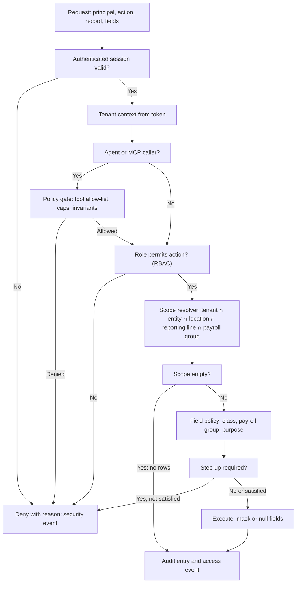
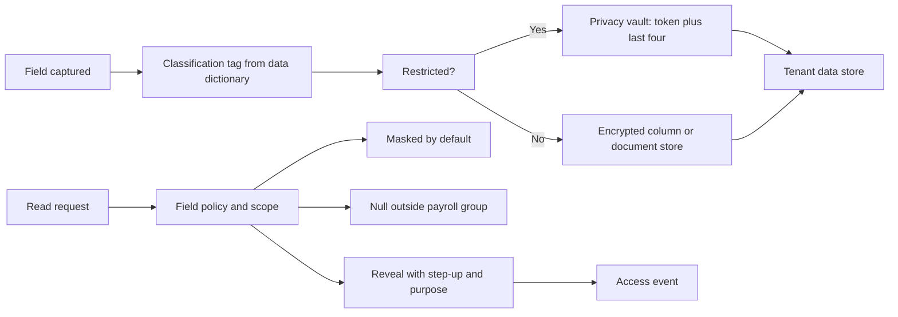

<picture>
  <source media="(prefers-color-scheme: dark)" srcset="../assets/MultipliersKraftLogoDark.png">
  
</picture>

# SEC-01 — Security, Privacy and Access Requirements

| Attribute | Value |
| :--- | :--- |
| Document ID | SEC-01 |
| Title | Security, Privacy and Access Requirements |
| Product | Nucleus Suite (Nucleus HRMS Suite) |
| Version | 1.0.0 |
| Status | Issued for approval |
| Owner (role) | Chief Information Security Officer (CISO), with the Data Protection Officer for privacy sections |
| Author | Dhanraj Dadhich |
| Reviewed by | *pending* |
| Approved by | Architecture Review Board and Data & AI Ethics Board — *pending* |
| Date | 2026-11-05 |
| Classification | Internal |
| CMMI practice areas | RDM, TS, VV |
| Related documents | SRS-01, NFR-01, OPS-01, GOV-10, GOV-11, BA-04, BA-06, FRS-PLT-00..11, DA-01, DA-05, IA-01, IA-03, AI-01, QA-03 |
| Quality & process-performance objectives | QPPO-01 (minimise defects reaching users), QPPO-05 (effective requirements reviews), QPPO-07 (fair and grounded AI) |
| Process performance baseline used | PPB-01 (review defect density), PPB-02 (review rate) |
| Peer review record | *pending* (PR-xxxx, QA-02) |
| Tailoring record | none |
| Traceability anchor | BG-06, BG-02 · BO-06.1, BO-06.2, BO-06.3, BO-02.3 · R-09 · PLT-02, PLT-06 · RL-001..RL-005, RL-540..RL-545 |

---

## 1. Purpose and Scope

This document states the testable security, privacy and access-control requirements for Nucleus Suite (`PLT-SEC-nnn`). It elaborates the system requirements in SRS-01 §11.2, §11.3, §11.6 and §11.14 and turns the principles of GOV-10 (data governance and privacy) and GOV-11 (responsible AI) into requirements an engineer can build and a tester can fail.

It covers authentication, sessions, the authorisation model (role × data scope), a role × capability matrix, field-level masking and tokenisation, tenant isolation, audit and the action ledger, data-principal rights, retention, encryption, secrets, security logging, AI and agent security, vulnerability management and security testing.

It applies to every domain, every channel (web, mobile, kiosk, voice, business messaging channel, API, MCP) and every environment. In the current **R0 stage** the prototype runs on local JSON with synthetic personas; client-side role gating in R0 is a user-interface convenience and is not evidence for any requirement here (GOV-01 C-02). Requirements become binding in the phase stated against each.

> **Legal status.** Statements about the DPDP Act 2023, GDPR, Aadhaar use and statutory retention are engineering summaries. Specific obligations, timelines and periods are **to be validated by Legal** before G1, as GOV-10 §1 records.

## 2. Conventions

Requirement rows use the SRS-01 §3.1 format: ID, statement (MUST / SHOULD / MAY), rationale, source / trace, priority (**M**ust, **S**hould, **C**ould), binding phase, verification (**T**est, **D**emonstration, **A**nalysis, **I**nspection) and acceptance criterion.

Data classes are those of GOV-10 §5: **Public**, **Internal**, **Confidential**, **Restricted**.

## 3. Security Context

### 3.1 Assets and threats

| Asset | Why it matters | Principal threats | Primary controls |
| :--- | :--- | :--- | :--- |
| Government identifiers (Aadhaar, PAN, passport, UAN) | Identity theft; regulatory exposure | Bulk exfiltration, insider browsing, leakage into logs or AI prompts | Tokenisation, masking, reveal with step-up, access events (§7) |
| Bank details and disbursement | Direct financial loss | Account substitution inside the payroll window, file tampering | Dual control, change alerts, signed files (§7, §12) |
| Salary and rate structures | Workplace harm; R-09 confidentiality | Scope bypass through reports, exports, API or agent tools | Payroll-group nulling at the scope resolver (§6) |
| Health, disability, religion, biometric data | Sensitive personal data | Profiling, discrimination, over-collection | HR-only visibility, suppression, AI exclusion (§7) |
| Audit trail and action ledger | Evidence for every decision | Tampering, deletion, selective omission | Append-only, hash chain, restricted readers (§9) |
| Tenant boundary | Contractual and legal obligation | Query defects, cache or index mixing, support misuse | Forced row-level security, partitioned stores, JIT support access (§8) |
| Agent tool surface | Agents can act | Prompt injection, privilege chaining, over-broad tools | Policy gate, tool scopes, dry runs, human decisions (§14) |

### 3.2 Authorisation decision flow

### 3.3 Data classification flow

## 4. Authentication

| ID | Requirement | Rationale | Source / trace | Pri | Phase | Ver | Acceptance criterion |
| :--- | :--- | :--- | :--- | :--- | :--- | :--- | :--- |
| PLT-SEC-001 | The system MUST support federated sign-in through OIDC and SAML 2.0, with more than one identity provider per tenant where legal entities use different directories. | Enterprises authenticate centrally; multi-entity groups often run separate directories. | SRS-01 SYS-011 · IA-03 SSO flow | M | P0 | T | Users from two configured identity providers sign in to the same tenant and receive their own scopes. |
| PLT-SEC-002 | The system MUST provision, update and deprovision users through SCIM 2.0 and MUST revoke all sessions and tokens of a deprovisioned user within 15 minutes. | Leavers must lose access promptly. | SYS-012 · PLT-PG-010 | M | P0 | T | 99th-percentile time from SCIM deactivation to refused API call is under 15 minutes across 100 test leavers. |
| PLT-SEC-003 | Where local credentials are used, the system MUST require passwords of at least 12 characters, check them against a breached-password list, store them only as salted memory-hard hashes, and apply progressive throttling with a 15-minute lockout after 5 consecutive failures. | Tenants without a directory and frontline fall-backs still need strong credentials. | OWASP ASVS V2 · SYS-013 | M | P1 | T | Weak or breached passwords are refused; stored credentials are hashes only; the sixth failed attempt within the window locks the account for 15 minutes. |
| PLT-SEC-004 | Multi-factor authentication MUST be mandatory for privileged roles (tenant admin, implementation consultant, payroll manager, plant payroll, finance, HR Head, director, compliance owner, DPO, auditor, support staff) using FIDO2 passkeys, TOTP or push approval; SMS one-time codes MAY be used only for non-privileged users. | Privileged accounts are the main target. | PLT-PG-001 · BG-06 | M | P0 | T | A privileged user without an enrolled second factor cannot complete sign-in. |
| PLT-SEC-005 | The system MUST require step-up re-authentication, valid for 5 minutes, before revealing a Restricted field, changing bank details, approving or locking payroll, releasing a disbursement file, changing roles or grants, exporting Restricted data, or changing agent policy. | Sensitive actions need fresh proof of presence. | PLT-PG-001 · GOV-10 PbD-04 | M | P1 | T | Each listed action prompts for step-up when the last strong authentication is older than 5 minutes and proceeds without prompt inside the window. |
| PLT-SEC-006 | Kiosk sign-in for frontline workers MUST use employee code with PIN plus a second factor configured by the tenant (device biometric match or card), and kiosk sessions MUST end after 60 seconds without input or immediately after a completed transaction. | Shared terminals are used by many people in sequence. | SYS-013, SYS-078 · PER-11 | M | P1 | D | A worker's session ends 60 seconds after last touch; the next person sees the sign-in screen. |
| PLT-SEC-007 | Mobile sign-in MUST bind the app installation to the user after first verification and use the device platform authenticator (FIDO2) for subsequent sign-ins. | Low-friction and phishing-resistant for daily use. | PER-07, PER-08, PER-11 | M | P1 | T | A copied session token does not work from an unbound device. |
| PLT-SEC-008 | Candidate identities (PER-12) MUST live in a separate identity realm that cannot hold workforce roles or reach workforce data. | External users must not drift into internal access. | PER-12 · GOV-10 §5 | M | P3 | T | Assigning a workforce role to a candidate identity is refused. |
| PLT-SEC-009 | Service principals (PER-16) MUST authenticate with OAuth 2.0 client credentials using private-key JWT or mutual TLS, hold only declared API scopes, and MUST NOT share credentials across integrations. | Machine credentials are long-lived and often over-privileged. | SYS-089 · IA-01 | M | P0 | T | A service principal calling an undeclared scope is refused; each integration shows a distinct principal in audit. |
| PLT-SEC-010 | Agent principals MUST authenticate as themselves, linked to their accountable human owner, and MUST NOT be able to sign in interactively. | Agents act with their own identity, never borrowed credentials. | RL-001, RL-540 · TC-P01, TC-A540 | M | P2 | T | Interactive sign-in for an agent principal fails; every agent call carries both agent and owner identifiers. |
| PLT-SEC-011 | Each tenant MUST have exactly two vaulted break-glass accounts protected by MFA; any use MUST alert the CISO and DPO immediately and be reviewed within 24 hours. | Emergency access must exist and be visible. | GOV-10 §9 | M | P1 | T | A test break-glass sign-in produces alerts to both roles and a review task due in 24 hours. |

## 5. Session Management

| ID | Requirement | Rationale | Source / trace | Pri | Phase | Ver | Acceptance criterion |
| :--- | :--- | :--- | :--- | :--- | :--- | :--- | :--- |
| PLT-SEC-012 | Sessions MUST time out after 15 minutes idle for privileged roles and 30 minutes idle for other web users, with an absolute lifetime of 12 hours. | Limit exposure on unattended screens. | OWASP ASVS V3 | M | P0 | T | Idle and absolute timeouts are observed per role in automated session tests. |
| PLT-SEC-013 | Access tokens MUST expire within 15 minutes and be bound to tenant and principal; refresh tokens MUST rotate on use with reuse detection that revokes the token family. | Stolen tokens must have short value. | OWASP ASVS V3 | M | P0 | T | Replaying a used refresh token revokes the whole family and raises a security event. |
| PLT-SEC-014 | Browser sessions MUST use Secure, HttpOnly, SameSite cookies with anti-CSRF protection, and tokens MUST NOT appear in URLs, browser storage or logs. | Common session-theft paths. | OWASP ASVS V3, V4 | M | P0 | T | Security scan finds no token in URL, storage or log output; cross-site requests without the anti-CSRF token are refused. |
| PLT-SEC-015 | Role, grant or credential changes MUST invalidate affected sessions within 60 seconds. | New restrictions must apply at once. | SYS-019 | M | P0 | T | Removing a payroll-group grant causes the next request within 60 seconds to return null compensation fields. |

## 6. Authorisation Model

### 6.1 Principles

- **Role × scope.** Roles (RBAC) define *what* a principal may do; grants (ABAC) define *which records*. Effective scope is the **intersection** of tenant, legal entity, location, reporting line and payroll group, computed per request by the scope resolver (`CMP-08`, RL-004).
- **Fail closed.** Resolution failure returns the empty set (PLT-02.4).
- **Plant users see time, not rate** (R-09, S-12). Scope for compensation is the **payroll processing location (payroll group)**, not the work location. This is why the Chennai plant-payroll role still cannot see E1056, who is paid at head office.
- **One enforcement point.** Screens, reports, exports, API reads, search, notifications, analytics and agent tools all read through the resolver.

### 6.2 Scope dimensions

| Dimension | Grant object | Values in demo tenant | Applies to |
| :--- | :--- | :--- | :--- |
| Tenant | Implicit from principal | Vindhya Precision Industries | Everything |
| Legal entity | `entity_grant` | LE-01, LE-02 | Entity-scoped records |
| Attendance location | `location_grant` with `can_edit_time` | LOC-CHN, LOC-PLA, LOC-BLR and others | Time records |
| Payroll processing location (payroll group) | `payroll_group_grant` | HO, PLANT-CHN | Compensation, rate, payroll results |
| Reporting line | Derived from assignment hierarchy, effective-dated | Own reportees, direct and indirect | Team views and approvals |
| Self | Implicit | Own record | Self-service |
| Establishment and state | Compliance grant | All factory establishments | Registers and returns |

### 6.3 Role × capability access matrix

Built from the persona model (Process workbook sheet 21_Roles_and_RACI) and the demo-tenant role and data-scope sheet (Demo Dataset sheet 43_Roles_and_Data_Scope). **Y** means permitted within the role's scope only; **N** means never; **Own** means the principal's own record only; **Grant** means only with a separate explicit grant.

| Persona (role code) | Scope | View attendance | Edit attendance | View salary structure | View rate structure | Run payroll | Approves | Configure tenant | Manage principals and grants | Read audit and ledger | Reveal Restricted fields |
| :--- | :--- | :--- | :--- | :--- | :--- | :--- | :--- | :--- | :--- | :--- | :--- |
| Employee / worker (R-EMPLOYEE) | Self | Own | N | Own | N | N | None | N | N | Own actions | Own, with step-up |
| Manager / supervisor (R-MANAGER) | Reporting subtree | Y | N | N | N | N | Leave, overtime, gate pass, regularisation | N | N | N | N |
| Plant HR / time office (R-PLANT-HR) | Location grant + `can_edit_time` | Y | Y | N (null) | N (null) | N | Attendance regularisation | N | N | N | N |
| HR operations | Entity grant | Y | Grant | Grant | N | N | Lifecycle and leave administration | N | N | N | Y, with step-up and purpose |
| HR Head (R-HRHEAD) | LE-01 and LE-02 | Y | Y | Y | N | N | Leave level 3, F&F, requisition | N | N | N | Y, with step-up and purpose |
| Payroll manager (R-PAYROLL) | Payroll group HO + entity | Y | N | Y | Y | Y | Payroll run, overtime run | N | N | Payroll audit flags | Bank and tax identifiers, with step-up |
| Plant payroll (R-PLANT-PAY) | Payroll group PLANT-CHN | Y | N | Y (own group only) | Y (own group only) | Y | Payroll run | N | N | Payroll audit flags | Bank and tax identifiers in own group, with step-up |
| Finance (R-FINANCE) | LE-01 and LE-02 | N | N | Y | N | N | Loan level 3, F&F release, GL posting | N | N | Journal drill-down | Bank details for disbursement, with step-up |
| Director (R-DIRECTOR) | LE-01 and LE-02 | Y | N | Y | Y | N | Loan special terms only | N | N | N | N |
| Compliance owner (R-COMPLIANCE) | Establishment + state | Y | N | N | N | N | Statutory filing sign-off | N | N | Rule-pack history | Statutory identifiers needed for returns, with step-up |
| Implementation consultant | Tenant configuration | N | N | N | N | N | None | Y | N | N | N |
| Tenant admin | Tenant | N | N | Grant | N | N | None | Y | Y | Access reviews | N |
| Director / approver (generic) | Items routed | Items routed | N | Items routed | Items routed | N | Items routed, with waived rules named | N | N | N | N |
| Auditor | Read-only, engagement-scoped | Y (read) | N | Reconciliation totals | N | N | None | N | N | Y | N |
| DPO | Privacy workspace | Metadata | N | Metadata | N | N | Rights requests | N | N | Y | Rights-request records only |
| Agent principal | Narrower than its owner | Through declared tools | Propose only | Never beyond RL-005 | Never beyond RL-005 | Never | Never; prepares only | N | N | Own ledger rows | Never |

Additional constraints from the persona model: managers never see compensation outside their line or any individual's wellbeing signals; HR operations does not see payroll computation unless separately granted; finance sees individual HR data only as far as the journal drills; compliance sees compensation only to the extent statute requires; implementation consultants do not see production personal data beyond what configuration requires; tenant admins do not see payroll amounts unless separately granted; auditors have no write access of any kind.

### 6.4 Authorisation requirements

| ID | Requirement | Rationale | Source / trace | Pri | Phase | Ver | Acceptance criterion |
| :--- | :--- | :--- | :--- | :--- | :--- | :--- | :--- |
| PLT-SEC-016 | Every request, export, report, search, notification and tool call MUST be authorised on the server, deny-by-default. | Client gating is convenience only. | GOV-01 C-02 · SYS-015 | M | P0 | T | For each "N" cell of the §6.3 matrix, a direct API attempt is refused. |
| PLT-SEC-017 | Effective scope MUST be the intersection of tenant, legal entity, location, reporting line and payroll group, and resolver failure MUST return the empty set. | Intersection, never union. | RL-004 · TC-P04 · SYS-016 | M | P0 | T | TC-P04 passes; injected resolver faults return zero rows. |
| PLT-SEC-018 | A principal MUST see entity-scoped data only for legal entities granted to it. | Multi-entity confidentiality. | RL-002 · TC-P02 | M | P0 | T | TC-P02 passes for LE-01-only and LE-02-only principals. |
| PLT-SEC-019 | A principal MUST see time data only for locations granted to it, and MUST edit time only where `can_edit_time` is set; entity-wide time visibility without a location grant MUST require an explicit flag. | Plant boundaries. | RL-003 · PLT-02.3 · TC-P03 | M | P0 | T | TC-P03 passes; Kalaivani Subramani (U-001) edits LOC-CHN time and cannot open LOC-PLA records. |
| PLT-SEC-020 | Compensation and rate fields MUST return null, not zero and not omitted, to any principal outside the record's payroll group grant, while time fields stay populated. | R-09. | RL-005 · BS:RL-24 · TC-P05 | M | P0 | T | TC-P05 passes on every build. |
| PLT-SEC-021 | The payroll-group restriction MUST hold identically in screens, reports, exports, the API, agent tools, search results, notifications, analytics projections, caches and AI-generated answers. | A leak in any one surface defeats R-09. | T-18 · BA-04 "Enforced in" | M | P0 | T | T-18 passes in all four named surfaces plus tool, search and analytics checks: E1056 is absent from the plant user's salary register and export, and his compensation fields are null in API and tool responses. |
| PLT-SEC-022 | Reporting-line scope MUST cover direct and indirect reportees as at the request date, and MUST change on the effective date of an organisation change, not on the date it is entered. | Managers see their team as it is. | SYS-019, SYS-021 · demo user U-003 | M | P1 | T | Nikhil Iyer (U-003) can select E1018, E1019, E1025, E1029, E1030 and E1032 and no one else for 01–15 September. |
| PLT-SEC-023 | The system MUST prevent self-approval and approval of any request that benefits the approver, including through delegation. | INV-SEC-02. | SYS-020 · GOV-11 §4 | M | P0 | T | A delegate who is also the requester cannot approve; the step reroutes per RL-012. |
| PLT-SEC-024 | The system MUST enforce a tenant-configurable segregation-of-duties matrix, with defaults: payroll preparer ≠ payroll approver; bank-detail changer ≠ disbursement releaser; grant requester ≠ grant approver; rule-pack author ≠ rule-pack deployer. | Prevent single-person fraud. | RL-544 · IA-03 bank flow | M | P1 | T | Each default conflict is blocked with a reason naming the conflicting duty. |
| PLT-SEC-025 | Grants MUST be effective-dated; future grants MUST activate on their effective date and expired grants MUST revoke automatically. | Movers change scope on a date. | FRS-PLT-05 grants | M | P0 | T | A grant ending 30 September gives no access on 1 October without manual action. |
| PLT-SEC-026 | Privileged elevation (for example a tenant admin needing payroll amounts) MUST be just-in-time, approved by a second authorised person, time-boxed to at most 8 hours and logged. | Standing privilege is a standing risk. | 21_Roles_and_RACI tenant admin constraint | M | P1 | T | An elevation expires at 8 hours and appears in the monthly access review. |
| PLT-SEC-027 | Support act-as MUST require a ticket reference and either user consent or a tenant-admin approval, MUST be read-only by default, MUST show a visible banner, and MUST record both identities. | Diagnosis without silent impersonation. | PLT-PG-005 · SYS-014 | M | P1 | T | Act-as without a ticket is refused; act-as writes need an explicit additional approval. |
| PLT-SEC-028 | Data owners MUST recertify privileged grants quarterly and all other grants semi-annually; grants not recertified within 30 days of the due date MUST be suspended. | Access accumulates unless reviewed. | GOV-10 R-AUD-04 | M | P2 | T | An overdue privileged grant is suspended on day 31 and its holder notified. |
| PLT-SEC-029 | Individual wellbeing signals MUST never be visible to managers or HR in identifiable form; they MUST be stored separately and reported only as aggregates. | Worker dignity. | BL-150 · GOV-11 AI-P9 · 21_Roles_and_RACI | M | P4 | T | No query path from a manager or HR principal returns an individual wellbeing value. |
| PLT-SEC-030 | Analytics, dashboards and natural-language query results MUST suppress any cell describing fewer than five people (k configurable upwards only). | Re-identification through small groups. | GOV-10 §13 | M | P2 | T | A query for a department of four returns a suppressed cell, not a value. |

## 7. Field-Level Masking and Tokenisation

### 7.1 Masked and restricted fields (Forms & Fields specification)

The Forms & Fields specification (sheet 02_Field_Spec) marks the following fields as masked, tokenised, encrypted or null outside a grant, or carries them as Restricted under GOV-10 §5. Treatment is binding for every surface.

| Form | Field (name) | Visibility in source | Class | Storage | Default display | Reveal |
| :--- | :--- | :--- | :--- | :--- | :--- | :--- |
| FRM-PPL-01 | Aadhaar (`aadhaar_token`) | HR + self, masked | Restricted | Vault token; Verhoeff-validated at capture | `XXXX XXXX 1234` | Never in full on screen; verification status only (to be validated by Legal) |
| FRM-PPL-01 | PAN (`pan_token`) | HR + self, masked | Restricted | Vault token | `XXXXX1234X` | HR, payroll, self with step-up and purpose |
| FRM-PPL-01 | Passport number (`passport_token`) | HR + self, masked | Restricted | Vault token | Last 3 characters | HR with step-up and purpose |
| FRM-PPL-01 | Account number (`account_token`) | HR + self, masked | Restricted | Vault token; last 4 held in clear | `XXXXXXXX1234` | Payroll and finance with step-up for disbursement exceptions |
| FRM-PPL-01 | Re-enter account number (`account_confirm`) | HR + self | Restricted | **Not stored** | Masked input | Not applicable |
| FRM-PPL-01 | UAN (`uan`), previous UAN (`experience.prev_uan`) | HR + self; HR, payroll | Restricted | Encrypted column | Last 4 | HR, payroll with purpose |
| FRM-PPL-01 | Name as per bank (`name_as_per_bank`) | HR, payroll | Confidential | Encrypted column | Shown in scope | — |
| FRM-PPL-01 | Religion (`religion`) | HR only | Restricted | Encrypted column; optional; suppressible per tenant | Hidden unless HR | HR only, statutory reporting purpose |
| FRM-PPL-01 | Disability type, percentage, certificate (`disability_type`, `disability_percent`, `disability_cert_ref`) | HR | Restricted | Encrypted column and encrypted document | Hidden outside HR | HR only |
| FRM-PPL-01 | Pre-employment medical date, next medical due (`medical_exam_date`, `next_medical_due`) | HR, EHS | Restricted | Encrypted column | Due status only outside HR and EHS | HR, EHS |
| FRM-PPL-01 | Biometric enrolment ID (`biometric_enrol_id`) | HR, IT | Restricted | Encrypted column; no template or image | Hidden outside HR and IT | HR, IT |
| FRM-PPL-01 | Dependant insured flag (`dependant.insured`) | HR | Confidential | Encrypted column | In scope | — |
| FRM-PPL-05 | Document file (`file_ref`) | Self, HR | Confidential or Restricted by document class | Encrypted at rest | Thumbnail suppressed for Restricted classes | Self, HR with purpose |
| FRM-PAY-05 | Health insurance declarations (`sec80d_self`, `sec80d_parents`) | Self | Restricted | Encrypted column | Self only | Payroll for verification |
| FRM-PAY-05 | Landlord PAN (`landlord_pan`), lender name and PAN (`lender_name`, `lender_pan`) | Self, payroll; self | Restricted (third-party identifiers) | Vault token | Masked | Payroll with purpose |
| FRM-TIM-04 | Rate, salary, OT amount (`salary_structure.*`) | NULL outside the payroll group grant | Restricted | Encrypted column | **Null** outside grant | Payroll-group members only |
| FRM-PLT-03 | Payroll group grant (`payroll_group_grant[]`) | Tenant admin | Confidential | Standard | In admin scope | — |
| FRM-PLT-01 | Entity PAN (`entity_pan`) | Tenant admin | Confidential (organisation identifier) | Encrypted column | In admin scope | — |
| FRM-PAY-07 | Bank return file (`return_file_ref`) | Finance | Restricted | Encrypted document | Finance only | Finance |

### 7.2 Masking requirements

| ID | Requirement | Rationale | Source / trace | Pri | Phase | Ver | Acceptance criterion |
| :--- | :--- | :--- | :--- | :--- | :--- | :--- | :--- |
| PLT-SEC-031 | Every attribute in every data model MUST carry a GOV-10 classification tag, and the build MUST fail for any untagged attribute. | Controls key off the tag. | GOV-10 R-CLS-01 · DA-01 | M | P0 | I, T | CI fails on a new column without a tag. |
| PLT-SEC-032 | Government identifiers and bank account numbers MUST be stored as tokens in a privacy vault, with application tables holding only the token and the last four characters. | Limits blast radius of any application-tier breach. | §7.1 · PLT-FX-005 | M | P1 | I, T | A database dump of application tables contains no full Aadhaar, PAN, passport or account number. |
| PLT-SEC-033 | Restricted fields MUST be masked by default in every surface using the display formats in §7.1. | Shoulder-surfing and screenshot leakage. | GOV-10 PbD-04 | M | P1 | T | Screen, report, export and API responses show only masked forms for a principal who has not revealed. |
| PLT-SEC-034 | Revealing a Restricted field MUST require the permission, a satisfied step-up, a purpose code, and MUST create an access event; the revealed value MUST re-mask after 60 seconds or on navigation. | Reveal is an accountable act. | GOV-10 R-AUD-01 | M | P1 | T | Each reveal produces exactly one access event with the purpose code; the value re-masks after 60 seconds. |
| PLT-SEC-035 | Aadhaar MUST be collected and retained only where a lawful requirement exists, MUST NOT be used as a sign-in identifier or search key, MUST NOT be sent to any LLM provider, and MUST be displayed only in masked form (to be validated by Legal). | Aadhaar use is specifically restricted. | GOV-10 R-CLS-03 | M | P1 | I, T | Inspection finds no index or search on Aadhaar; prompt capture tests show no Aadhaar value. |
| PLT-SEC-036 | The bank account confirmation field MUST NOT be persisted; a bank-detail change MUST be effective-dated, keep the prior account for reprints, require dual control, and raise an alert when made inside the payroll window (25th to 5th). | Account substitution is the classic payroll fraud. | FRM-PPL-01 notes · IA-03 bank flow | M | P1 | T | A change on the 27th is held for second approval and alerts payroll and the employee. |
| PLT-SEC-037 | Health, disability, medical and religion fields MUST be visible only to HR (and EHS for medical dates), MUST be optional where the source marks them optional, MUST be suppressible per tenant, and MUST be excluded from AI features and analytics except DAEB-approved fairness testing. | Sensitive personal data. | GOV-10 §5 · GOV-11 §4 item 5 | M | P1 | T | Model feature lists and analytics projections contain none of these fields. |
| PLT-SEC-038 | Raw biometric images MUST NOT be received or retained; templates MUST stay on the device or be stored encrypted, and MUST be deleted by cryptographic erasure on separation or consent withdrawal, with a supplier deletion certificate where a device supplier holds them. | Biometrics are high-risk and irrevocable. | GOV-10 R-CLS-04 · SYS-081 | M | P1 | I, T | A separated worker's template key is destroyed within the configured period and the certificate is filed. |
| PLT-SEC-039 | Masking MUST extend to logs, traces, error messages, notifications, analytics and AI prompts and responses; automated scrubbing tests MUST run on every build. | Leaks usually happen in side channels. | GOV-11 §9 · GOV-10 PbD-06 | M | P0 | T | Seeded test identifiers never appear in captured logs, traces or prompts. |
| PLT-SEC-040 | Exports containing Restricted data MUST require a recorded purpose, be encrypted, carry a visible watermark with user and timestamp, and expire within 24 hours. | Exports leave the system boundary. | GOV-10 §5 Restricted controls | M | P1 | T | An unwatermarked or unexpired-link export of Restricted data cannot be produced. |
| PLT-SEC-041 | Non-production environments MUST hold only synthetic or irreversibly masked data; copying production Restricted data to development or test MUST be technically blocked. | GOV-10 §13. | DC-15 · GOV-10 §16 metric | M | P0 | T | A pipeline attempting to restore a production backup into test is refused. |

## 8. Tenant Isolation

| ID | Requirement | Rationale | Source / trace | Pri | Phase | Ver | Acceptance criterion |
| :--- | :--- | :--- | :--- | :--- | :--- | :--- | :--- |
| PLT-SEC-042 | Every tenant-scoped table MUST carry `tenant_id` with a forced row-level security policy that also applies to table owners, and CI MUST fail any table without both. | Isolation in the data layer, not in application discipline. | BL-002 · R-TEN-01 · SYS-001 | M | P0 | T | Schema guard fails the build for a table missing either. |
| PLT-SEC-043 | Property test TC-PR09 MUST run on every build and show that no generated query, including one with a deliberate defect such as a missing filter, returns rows from another tenant. | Assume the code has bugs. | TC-PR09 · RL-004 | M | P0 | T | TC-PR09 passes over at least 10,000 generated queries per build. |
| PLT-SEC-044 | Tenant context MUST come from the authenticated token; a request referencing another tenant's identifier MUST receive a not-found response and raise a security event. | No enumeration across tenants. | SYS-002 | M | P0 | T | Cross-tenant identifiers in path, body and header all produce not-found and an event. |
| PLT-SEC-045 | Caches, search indexes, object-storage paths, event topics or partitions, analytics projections and retrieval indexes for AI MUST be partitioned or namespaced by tenant. | Isolation must hold outside the database too. | GOV-10 R-TEN-01 · GOV-11 §6.1 | M | P0 | I, T | Inspection shows tenant namespaces; retrieval for tenant A never returns a document of tenant B. |
| PLT-SEC-046 | Support access to tenant data MUST be just-in-time, tied to a ticket, time-boxed, logged and visible to the tenant admin. | Operators are insiders too. | OPS-01 · GOV-10 §9 | M | P2 | T | The tenant admin's access report lists each support session with ticket and duration. |

## 9. Audit and Action Ledger

| ID | Requirement | Rationale | Source / trace | Pri | Phase | Ver | Acceptance criterion |
| :--- | :--- | :--- | :--- | :--- | :--- | :--- | :--- |
| PLT-SEC-047 | Every write MUST produce an audit entry with actor, agent identifier where present, action, object, before and after values, IP or device, reason and UTC timestamp. | Accountability. | CMP-06 · BL-008 · SYS-032 | M | P0 | T | Audit completeness test over all write endpoints finds no write without an entry. |
| PLT-SEC-048 | Every view, reveal, export, print or API read of Restricted data MUST produce an access event with actor, role, tenant, purpose code, record reference, fields, timestamp, IP or device and channel (UI, API, voice, copilot). | GOV-10 R-AUD-01. | BO-06.1 · SYS-033 | M | P0 | T | 100% of Restricted access in the audit completeness suite produces an event. |
| PLT-SEC-049 | Audit entries and ledger rows MUST be append-only and hash-chained, with daily chain verification and periodic anchoring of the chain head outside the primary store. | Tamper evidence. | GOV-10 R-AUD-03 · PLT-FX-004 · SYS-034 | M | P0 | T | A modified or deleted row is detected by the next verification run and raises a Sev-1 security event. |
| PLT-SEC-050 | No API, role or administrative function, including super admin, MUST be able to update or delete audit entries; read access MUST be limited to Security, the DPO and auditors, plus each user's view of their own actions. | Evidence must outlive the people it records. | GOV-10 R-AUD-03 · PER-14, PER-15 | M | P0 | T | Attempts to update or delete audit rows through every interface fail. |
| PLT-SEC-051 | Every agent step MUST be written to the action ledger with request, interpreted intent, policy-gate decision, tool and parameters (Restricted values tokenised), confirmation or approval reference, result, model and prompt version, reversal handle, acting user and tenant. | GOV-11 §6 layer 4. | RL-545 · TC-A545 | M | P2 | T | TC-A545 passes and ledger rows contain no raw Restricted value. |
| PLT-SEC-052 | Monthly access-review reports MUST go to data owners, and anomalous access (bulk reads, off-hours volume spikes, repeated reveals) MUST alert the CISO within 15 minutes. | Detection of misuse. | GOV-10 R-AUD-04 | M | P2 | T | A simulated bulk read of 500 salary records at 02:00 raises an alert within 15 minutes. |

## 10. Data-Principal Rights

| ID | Requirement | Rationale | Source / trace | Pri | Phase | Ver | Acceptance criterion |
| :--- | :--- | :--- | :--- | :--- | :--- | :--- | :--- |
| PLT-SEC-053 | The system MUST present itemised, versioned privacy notices in the user's language at every collection point, and MUST capture, version and allow withdrawal of consent where consent is the basis, in a consent ledger. | Notice and consent principles. | GOV-10 P2, §10 · PLT-FX-005 | M | P1 | T | Each collection form shows the notice version; withdrawal stops the consent-based processing on the next request. |
| PLT-SEC-054 | Data principals MUST be able to obtain a summary of their personal data, purposes and recipients through a "My Data" export within the statutory timeline, with a median fulfilment of 7 days or less. | Right of access. | BO-06.2 · PLT-PG-009 | M | P1 | T | Rights-request report shows 100% within the legal period and median ≤ 7 days in pilot. |
| PLT-SEC-055 | Data principals MUST be able to correct data by self-service, with steward review for verified fields such as PAN and bank account. | Accuracy principle. | GOV-10 §10 | M | P1 | D | A PAN correction is held for steward verification before it takes effect. |
| PLT-SEC-056 | Erasure requests MUST be reconciled against statutory retention, after which identifiers MUST be removed or pseudonymised and the requester informed of any data retained and the reason. | Erasure with statutory carve-outs. | GOV-10 R-RET-03 · SYS-027 | M | P1 | T | An erasure for a separated employee leaves anonymised statutory payroll aggregates and an evidence record. |
| PLT-SEC-057 | The system MUST provide a grievance-redressal route and DPO contact, track requests to closure against an SLA, support nomination of a person to exercise rights, and verify the identity of every requester before fulfilment. | DPDP grievance and nomination provisions (to be validated by Legal). | GOV-10 §10 | M | P1 | T | A request from an unverified identity is not fulfilled; a nominee request succeeds after verification. |
| PLT-SEC-058 | Personal data of minors (dependants, nominees, legally employed young workers) MUST be classified Restricted, require verifiable guardian consent where the law requires it, and be excluded from AI profiling (to be validated by Legal). | Children's data protections. | GOV-10 §10 | M | P1 | T | A minor's record cannot be included in any model feature set or analytics cohort. |

## 11. Retention and Disposal

| ID | Requirement | Rationale | Source / trace | Pri | Phase | Ver | Acceptance criterion |
| :--- | :--- | :--- | :--- | :--- | :--- | :--- | :--- |
| PLT-SEC-059 | Retention periods MUST be configurable per tenant, jurisdiction and record category (GOV-10 §8), and a scheduled disposal service MUST enforce them with an evidence log. | Storage limitation. | GOV-10 R-RET-01 | M | P1 | T | Records past retention are disposed in the next run and each disposal is in the evidence log. |
| PLT-SEC-060 | A legal hold MUST suspend disposal for named records and persons until released by Legal. | Litigation and inspection. | GOV-10 R-RET-02 | M | P1 | T | Records under hold survive a disposal run that would otherwise remove them. |
| PLT-SEC-061 | Erasure and disposal MUST be re-applied automatically after any backup restore, and backups MUST expire on their rolling schedule. | Restores must not resurrect erased data. | GOV-10 §8 backups · OPS-01 | M | P1 | T | A restore drill followed by the re-apply job leaves no previously erased identifier. |

## 12. Encryption and Key Management

| ID | Requirement | Rationale | Source / trace | Pri | Phase | Ver | Acceptance criterion |
| :--- | :--- | :--- | :--- | :--- | :--- | :--- | :--- |
| PLT-SEC-062 | All external traffic MUST use TLS 1.2 or higher (TLS 1.3 preferred) with HSTS; service-to-service, device and site-agent traffic MUST use mutual TLS. | Confidentiality and integrity in transit. | SYS-088 | M | P0 | T | External TLS scan grades no weak protocol or cipher; an unauthenticated internal client is refused. |
| PLT-SEC-063 | All data at rest, including backups, object storage and replicas, MUST be encrypted with AES-256 or stronger, with additional field-level encryption for Restricted attributes. | Defence in depth. | GOV-10 §5 | M | P0 | I | Configuration inspection of every store shows encryption enabled with approved algorithms. |
| PLT-SEC-064 | Encryption keys MUST be held in a hardware-backed key management service in the tenant's region, with per-tenant data keys, at least annual rotation of key-encryption keys, and support for crypto-shredding; enterprise tenants SHOULD be able to bring their own keys. | Key control and erasure. | GOV-10 R-TEN-02 | M | P1 | T | Destroying a tenant's data key renders its encrypted test data unreadable. |
| PLT-SEC-065 | Bank disbursement files and statutory files MUST be integrity-protected with a signature or keyed checksum and encrypted in transit and at rest. | Irreversible outputs must not be tampered with. | IA-03 bank and statutory flows | M | P1 | T | A modified bank file fails verification before release. |

## 13. Secrets and Security Logging

| ID | Requirement | Rationale | Source / trace | Pri | Phase | Ver | Acceptance criterion |
| :--- | :--- | :--- | :--- | :--- | :--- | :--- | :--- |
| PLT-SEC-066 | Secrets MUST NOT appear in source code, documents, configuration files, client bundles or logs; secret scanning MUST block any commit or build that contains one. Demonstration credentials MUST be synthetic and confined to the local prototype. | DOC-01 §10; R0 discipline. | DC-14 | M | R0 | T | A seeded test secret is blocked at commit; the client bundle scan finds no credential. |
| PLT-SEC-067 | Runtime secrets MUST be retrieved from a managed secrets vault with least-privilege access, rotated at least every 90 days and immediately on suspected exposure. | Limit lifetime and reach of secrets. | OWASP ASVS V6 | M | P0 | T | Rotation reports show no secret older than 90 days. |
| PLT-SEC-068 | Security events (sign-in success and failure, MFA and step-up, grant and role changes, policy-gate denials, reveals, exports, break-glass, configuration changes) MUST be logged with synchronised UTC timestamps to a central, tamper-evident security log retained per GOV-10. | Detection and investigation. | GOV-10 §9 · OPS-01 | M | P0 | T | Each listed event type appears in the central log within 60 seconds of occurrence. |
| PLT-SEC-069 | Detection rules MUST cover credential stuffing, impossible travel, token reuse, mass export, repeated policy-gate denials and cross-tenant probing, routing alerts into the OPS-01 incident process with a mapped severity. | Logs are only useful if watched. | OPS-01 incident flow | M | P1 | T | Each scenario, simulated, raises an alert with the mapped severity. |

## 14. AI and Agent Security

| ID | Requirement | Rationale | Source / trace | Pri | Phase | Ver | Acceptance criterion |
| :--- | :--- | :--- | :--- | :--- | :--- | :--- | :--- |
| PLT-SEC-070 | Agents MUST reach data only through declared tools and MUST NOT hold database credentials, call internal functions or obtain secrets. | No non-tool path to data. | RL-541 · TC-A541 · SYS-072 | M | P2 | I, T | TC-A541 passes; credential inspection of agent runtimes finds none. |
| PLT-SEC-071 | The tool registry MUST declare, per tool, side-effect class (read, propose, write, irreversible), domain, data classification, reversibility and required permission; each agent MUST have a versioned allow-list, and adding a tool to an allow-list MUST be a change-controlled configuration change. | Tool permission scopes are the agent's privilege boundary. | AI-01 §2 · GOV-11 §6 layer 2 · CM-02 | M | P2 | I | Registry inspection shows every tool fully declared; allow-list changes carry a CR reference. |
| PLT-SEC-072 | A deterministic policy gate MUST evaluate every tool call against the invoking user's permissions and scope, tenant policy, value and blast-radius caps, rate limits, business invariants (INV-LEV-01, INV-SEC-02, INV-PAY-01), data classification and the GOV-11 prohibited-uses list; the model MUST NOT be able to override a denial. | The model is not a control. | RL-542 · TC-A542 · SYS-073 | M | P2 | T | Release red-team testing records zero gate bypasses; every denial is logged with a reason. |
| PLT-SEC-073 | Agents MUST act with the permissions of the authenticated user they serve, never elevated service rights, and MUST NOT invoke another agent to obtain capabilities they lack. | No chained privilege. | GOV-11 §6 · RL-540 | M | P2 | T | An agent serving a plant user receives null compensation fields exactly as the user would. |
| PLT-SEC-074 | Write tools MUST present a dry-run difference and obtain explicit user confirmation; writes affecting others, money, statutory data, bulk records or irreversible outcomes MUST route into the human approval workflow, and irreversible actions MUST NOT execute without a named human. | Human decision on consequential acts. | RL-543, RL-544 · BO-02.3 | M | P2 | T | Ledger reconciliation finds zero approval-requiring actions without a human decision. |
| PLT-SEC-075 | Retrieved documents, uploaded files and tool outputs MUST be treated as untrusted data, separated from instructions, screened by a prompt-injection classifier, and unable to alter agent configuration or tool allow-lists. | Indirect prompt injection (for example text hidden in a CV). | GOV-11 §9 | M | P2 | T | An injection corpus of at least 200 cases yields zero tool calls outside the user's request and zero configuration changes. |
| PLT-SEC-076 | Restricted fields MUST be redacted or tokenised before any model call, responses MUST be scanned for personal data before display, and provider terms MUST guarantee zero retention, no training on tenant data and processing in an approved region. | AI must not become a leakage channel. | GOV-11 §9, §12 · SYS-087 | M | P2 | T | Membership-inference and leakage tests show zero Restricted values in prompts or outputs. |
| PLT-SEC-077 | Per-agent and per-tenant kill-switches MUST take effect within 60 seconds and fall back to standard screens; per-user and per-agent rate and value caps MUST be tenant-configurable. | Containment of misbehaving agents. | GOV-11 §6 · SYS-076 | M | P2 | T | A kill-switch drill disables the Policy Assistant within 60 seconds; screens remain usable. |
| PLT-SEC-078 | External AI clients connecting through MCP MUST authenticate with tenant-approved OAuth clients, receive scopes no broader than the consenting user's, and pass the same policy gate and action ledger as internal agents. | One governance model for every AI caller. | SYS-075 · INT-FX-003 | M | P3 | T | An MCP client cannot call a tool absent from its approved scope; its calls appear in the ledger. |

## 15. Vulnerability Management and Secure Development

| ID | Requirement | Rationale | Source / trace | Pri | Phase | Ver | Acceptance criterion |
| :--- | :--- | :--- | :--- | :--- | :--- | :--- | :--- |
| PLT-SEC-079 | The system MUST meet OWASP ASVS Level 2 throughout, and Level 3 for identity, the scope resolver, payroll, bank and disbursement, audit and the policy gate. | A recognised, testable baseline. | NFR-01 Security · BO-06.3 | M | P0 | A, T | ASVS checklist evidence is complete per release for the declared levels. |
| PLT-SEC-080 | Every build MUST run static analysis, dependency and licence scanning, secret scanning and infrastructure-as-code scanning, and MUST fail on any critical or high finding without an approved, time-bound exception. | Zero critical or high vulnerabilities in production. | NFR-01 Security | M | P0 | T | Pipeline evidence shows the gate blocking a seeded high-severity dependency. |
| PLT-SEC-081 | Vulnerabilities MUST be remediated within: critical 72 hours, high 7 days, medium 30 days, low 90 days; no release with an open critical or high vulnerability MAY reach production. | Exposure windows must be bounded. | NFR-01 Security · BO-06.3 | M | P0 | T | Vulnerability ageing report shows no breach of these limits. |
| PLT-SEC-082 | Each release MUST publish a software bill of materials, and suppliers of components, devices and AI services MUST be assessed for security under the supplier agreement process. | Supply-chain visibility. | SAM-01 · GOV-11 §12 | M | P1 | I | The SBOM for each release is stored with the release record; supplier assessments are on file. |
| PLT-SEC-083 | Every new domain feature, integration and agent tool MUST have a recorded threat model reviewed by the security architect before build. | Design-time defect removal is cheapest. | QPPO-02 · QA-03 | M | P0 | I | Peer-review records show a threat model for each feature entering build. |

## 16. Security Testing

| ID | Requirement | Rationale | Source / trace | Pri | Phase | Ver | Acceptance criterion |
| :--- | :--- | :--- | :--- | :--- | :--- | :--- | :--- |
| PLT-SEC-084 | An authorisation regression suite generated from the §6.3 matrix MUST run on every build, including TC-P05 and, at each release, T-18 across screen, report, export and API. | The matrix is the contract. | TC-P05 · T-18 | M | P0 | T | Every matrix cell has at least one passing positive or negative test. |
| PLT-SEC-085 | Dynamic application security testing MUST run against staging on every release, and an independent penetration test MUST precede each G4 go-live and recur at least annually, with critical and high findings fixed and retested before go-live. | External verification. | NFR-01 Security · BO-06.3 | M | P1 | T | Penetration test report shows zero open critical or high findings at G4. |
| PLT-SEC-086 | AI red-team testing for harmful content, data leakage, jailbreaks, prompt injection and policy-gate bypass MUST precede each AI feature release, with zero critical findings open. | GOV-11 §8 safety threshold. | GOV-11 §8 · QPPO-07 | M | P2 | T | Red-team report attached to the DAEB approval shows zero open critical findings. |
| PLT-SEC-087 | The programme MUST operate an information security management system aligned to ISO/IEC 27001 and obtain a SOC 2 Type I attestation by month 12 of production operation. | Customer assurance. | NFR-01 Security · BL-146 | M | P3 | I | Attestation report issued; evidence collection started in month 1. |

## 17. Traceability

| Section | PLT-SEC range | SRS-01 | Business anchor | Rules / processes | Principal tests |
| :--- | :--- | :--- | :--- | :--- | :--- |
| Authentication | 001–011 | SYS-009..SYS-013 | BG-06 | PLT-02.1 · RL-001 | TC-P01, TC-A540 |
| Sessions | 012–015 | SYS-019 | BG-06 | — | Session test suite |
| Authorisation | 016–030 | SYS-015..SYS-020 | BG-06 · BO-06.1 · R-09 | RL-002..RL-005 · BS:RL-24 · PLT-02.2–02.5 | TC-P02..TC-P05, T-18 |
| Masking and tokenisation | 031–041 | SYS-033, SYS-081 | BG-06 · BO-06.1 | FRM-PPL-01, FRM-PAY-05, FRM-TIM-04 | Scrubbing and masking tests |
| Tenant isolation | 042–046 | SYS-001..SYS-003 | BG-06, BG-10 | RL-004 | TC-PR09 |
| Audit and ledger | 047–052 | SYS-032..SYS-035 | BG-06 · BO-06.1, BO-02.3 | PLT-06 · RL-545 | TC-A545, audit completeness |
| Data-principal rights | 053–058 | SYS-027 | BG-06 · BO-06.2 | PLT-PG-009 | Rights-request workflow tests |
| Retention | 059–061 | SYS-027 | BG-06 | GOV-10 R-RET-01..03 | Disposal tests |
| Encryption | 062–065 | SYS-088 | BG-06 | — | TLS and key tests |
| Secrets and logging | 066–069 | — | BG-06 | — | Secret scan, detection drills |
| AI and agent security | 070–078 | SYS-072..SYS-076, SYS-087 | BG-02, BG-06 · BO-02.3, BO-06.4 | RL-540..RL-545 | TC-A541..TC-A545, red team |
| Vulnerability management | 079–083 | — | BG-06 · BO-06.3 | — | Pipeline gates |
| Security testing | 084–087 | — | BG-06 · BO-06.3 | — | Pen test, red team, attestation |

## Approval & Sign-off

| Role | Name | Date | Decision | Conditions / comments |
| :--- | :--- | :--- | :--- | :--- |
| Author | Dhanraj Dadhich | 2026-11-05 | Submitted | |
| Peer review moderator | *pending* | | | PR-xxxx |
| PQA (process compliance) | *pending* | | | |
| Architecture Review Board and Data & AI Ethics Board | *pending* | | | |

## Measurement Data Captured

| Measure | Value | Unit | Notes |
| :--- | :--- | :--- | :--- |
| Size | 87 | requirements (PLT-SEC-001..PLT-SEC-087) | Plus a 16-row role × capability matrix and a 19-row masked-field register |
| Authoring effort | *to be recorded* | person-hours | |
| Review effort (preparation + meeting) | *pending review* | person-hours | From PR-xxxx |
| Review rate | *pending review* | items / hour | Compare with PPB-02 control limits |
| Requirement volatility | 0 | CRs since baseline | |

## Revision History

| Version | Date | Author | Change summary | CR ref | Approved by |
| :--- | :--- | :--- | :--- | :--- | :--- |
| 1.0.0 | 2026-11-05 | Dhanraj Dadhich | Consolidated release | CR-0001 | *pending* |
