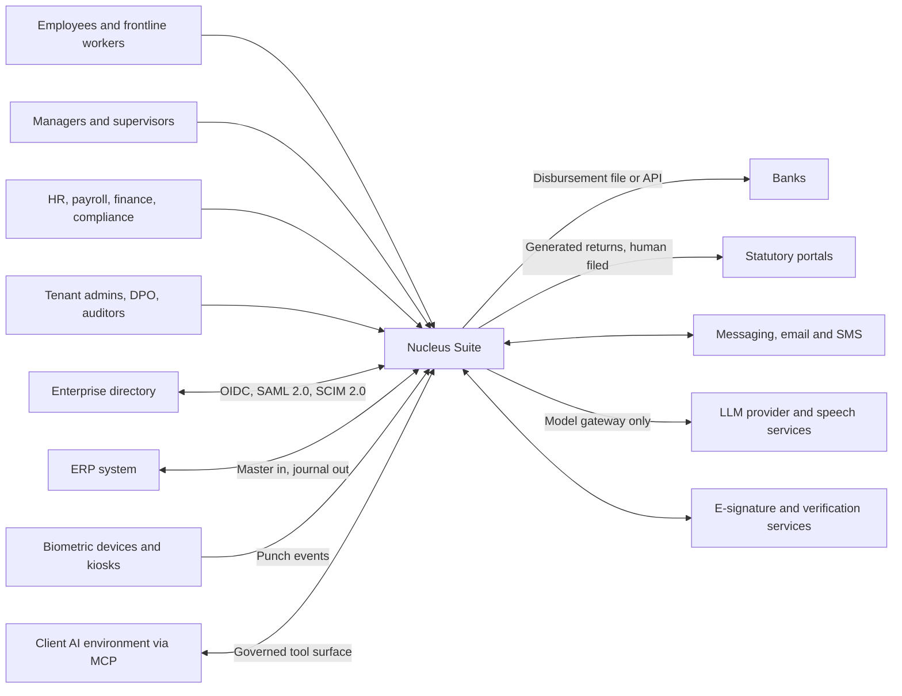
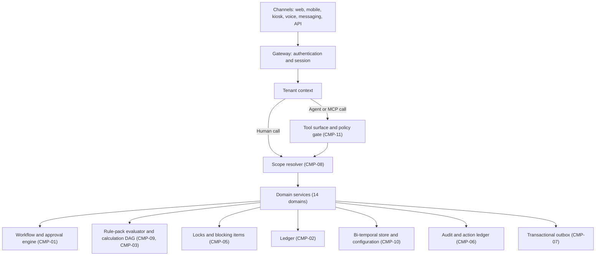
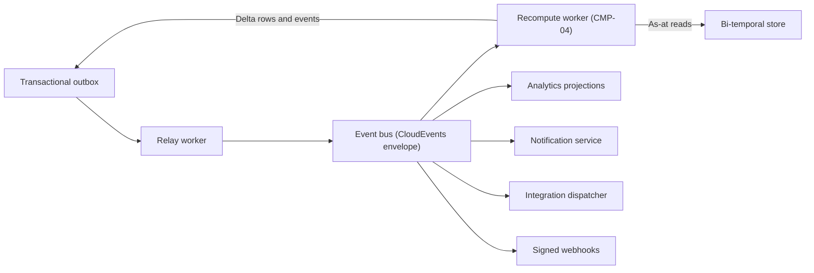
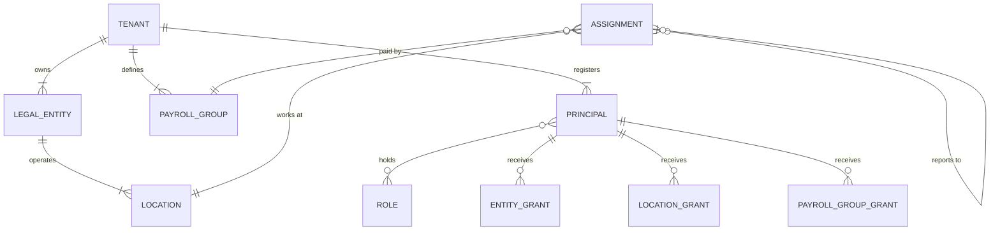
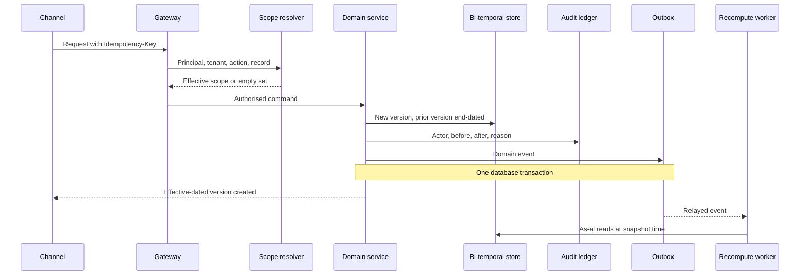
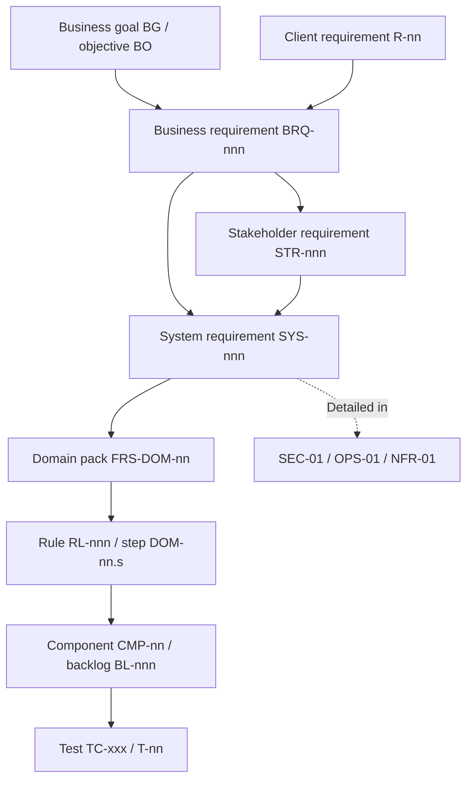

<picture>
  <source media="(prefers-color-scheme: dark)" srcset="../assets/MultipliersKraftLogoDark.png">
  
</picture>

# SRS-01 — Software Requirements Specification

| Attribute | Value |
| :--- | :--- |
| Document ID | SRS-01 |
| Title | Software Requirements Specification |
| Product | Nucleus Suite (Nucleus HRMS Suite) |
| Version | 1.0.0 |
| Status | Issued for approval |
| Owner (role) | Chief Architect |
| Author | Dhanraj Dadhich |
| Reviewed by | *pending* |
| Approved by | Architecture Review Board — *pending* |
| Date | 2026-11-05 |
| Classification | Internal |
| CMMI practice areas | RDM, TS, PI, VV |
| Related documents | GOV-01, GOV-10, GOV-11, BA-01, BA-04, BA-05, BA-06, FRS-00, FRS-PLT-00..11, DA-01..05, IA-01..03, AI-01, NFR-01, SEC-01, OPS-01, QA-03, REQ-02 |
| Quality & process-performance objectives | QPPO-05 (effective requirements reviews), QPPO-01 (minimise defects reaching users), QPPO-03 (exact payroll at go-live) |
| Process performance baseline used | PPB-01 (review defect density), PPB-02 (review rate) |
| Peer review record | *pending* (PR-xxxx, QA-02) |
| Tailoring record | none |
| Traceability anchor | BG-01, BG-02, BG-03, BG-04, BG-06, BG-07, BG-10 · R-09 · PLT-01–PLT-08 · CMP-01–CMP-11 |

---

## 1. Purpose

This Software Requirements Specification (SRS) is the master system-level specification for Nucleus Suite. It follows the structure of ISO/IEC/IEEE 29148 for a software requirements specification and does four things:

1. It describes the product as a whole: its context, its logical architecture, the functions each domain contributes, the people who use it and the environment it runs in.
2. It fixes the design and implementation constraints that every domain team inherits and may not relax locally.
3. It states the cross-cutting **system requirements** (`SYS-nnn`) that sit underneath the fourteen functional domain packs: tenancy, identity, data scope, effective dating, audit, workflow, rules, ledgers, events, offline capture, localisation, AI governance and APIs.
4. It sets out how those requirements are verified and how they trace upward to business requirements (`BRQ-nnn`, BRS-01), business goals and client requirements, and downward to the functional packs (`FRS-<DOM>-nn`).

Two companion specifications carry detail that would overload this document: **SEC-01** (security, privacy and access, `PLT-SEC-nnn`) and **OPS-01** (operational and support, `PLT-OPS-nnn`). Quality-attribute targets remain owned by **NFR-01**.

Intended readers are the Architecture Review Board, domain product owners, platform and domain engineering leads, QA and test leads, the security architect, the DPO and the implementation practice.

## 2. Scope

### 2.1 Product

Nucleus Suite is an AI-native Human Capital Management suite, India-first and ready for other jurisdictions. It covers the full value chain HIRE · ONBOARD · WORK · PAY · COMPLY · GROW · EXIT, with GOVERN spanning all stages, across fourteen domains (PLT, PPL, TIM, LVE, PAY, CMP, LCY, SSV, CMB, TAL, CTG, EXP, FIN, INT). It is delivered as a multi-tenant service built on our own platform, in which one shared set of components (BA-06, `CMP-01`..`CMP-11`) carries every domain.

### 2.2 What this SRS covers

| In this SRS | Where the detail lives |
| :--- | :--- |
| Cross-cutting platform behaviour every domain depends on | §11 (`SYS-001`..`SYS-076`) |
| External interfaces: users, hardware, software, communications | §12 (`SYS-077`..`SYS-089`) |
| Domain functions (process, rule, form, screen level) | FRS-00 and the fourteen packs `FRS-<DOM>-00..11` |
| Security, privacy and access control in testable detail | SEC-01 |
| Operations, support, continuity | OPS-01 |
| Quality-attribute targets and definition of done | NFR-01 |
| Data objects, picklists, enumerations, configuration | DA-01..DA-05 |
| APIs, tools, events, integration flows | IA-01..IA-03, AI-01 |

### 2.3 Delivery stage

The programme is in **R0 — UI-validation prototype on local JSON** (DEC-0002, GOV-01 C-01). R0 renders every domain screen from local JSON with in-memory mutations. Nothing in this SRS authorises live backend, database, external API, messaging or payroll disbursement work. Each `SYS` requirement carries the phase in which it first becomes binding (P0 Foundations onward); during R0 a requirement is verified only to the extent the prototype can demonstrate the intended behaviour (§14.4).

## 3. Conventions

### 3.1 Requirement statement format

Every requirement in §11 and §12 is a single testable statement using **MUST** (mandatory), **SHOULD** (expected unless a recorded decision in DAR-02 says otherwise) or **MAY** (permitted option). Each row carries:

| Column | Meaning |
| :--- | :--- |
| ID | `SYS-nnn`, never renumbered once baselined |
| Requirement | One statement |
| Rationale | Why the requirement exists |
| Source / trace | Business goal or objective (`BG`/`BO`), client requirement (`R-nn`), process step, rule (`RL-nnn`), shared component (`CMP-nn`), test (`TC-xxx`), and last the business requirements (`BRQ-nnn`, BRS-01) that the system requirement realises |
| Pri | MoSCoW: **M** Must, **S** Should, **C** Could |
| Phase | Phase in which the requirement becomes binding |
| Ver | Verification method: **T** Test, **D** Demonstration, **A** Analysis, **I** Inspection |
| Acceptance criterion | The observable result that closes verification |

### 3.2 Terms used in this document

| Term | Meaning in this SRS |
| :--- | :--- |
| Principal | Any acting identity: a user, an agent or a service (FRS-PLT-05 `principal`) |
| Scope | The set of records a principal may read or write, resolved per request by the scope resolver (`CMP-08`) |
| Valid time | When a fact is true in the business (`valid_from`, `valid_to`) |
| Recorded time | When the system learned the fact (`recorded_from`, `recorded_to`) |
| As-at read | A read that fixes both valid time and recorded time |
| Rule pack | A versioned, effective-dated, jurisdiction-scoped set of declarative rules with its own tests (`CMP-09`) |
| Projection | Derived state computed from immutable rows or events (balances, attendance days, analytics) |
| Tool surface | The governed set of operations that agents and external AI clients may call (`CMP-11`, AI-01) |
| Policy gate | The deterministic evaluator that permits or denies every tool call before execution |
| Minor units | The smallest currency unit, paise for INR |

GOV-06 holds the complete glossary.

## 4. References

| ID | Document | Use in this SRS |
| :--- | :--- | :--- |
| GOV-01 | [Vision and Scope](../00_Programme_Governance/02_Vision_and_Scope/GOV-01_Vision_and_Scope.md) | Business goals BG-01..BG-10, objectives BO-xx.y, constraints C-01..C-07, dependencies D-01..D-08 |
| BRS-01 | [Business Requirements Specification](../03_Business_Requirements/BRS-01_Business_Requirements_Specification.md) | Business requirements BRQ-001..BRQ-090 realised by the SYS requirements (§15.3, §15.4) |
| STRS-01 | [Stakeholder Requirements Specification](../04_Stakeholder_Requirements/STRS-01_Stakeholder_Requirements_Specification.md) | Stakeholder requirements STR-nnn that state the same needs from each persona's viewpoint |
| GOV-10 | [Data Governance and Privacy Framework](../00_Programme_Governance/05_Data_and_AI_Governance/GOV-10_Data_Governance_and_Privacy_Framework.md) | Classification, retention, tenant isolation, residency |
| GOV-11 | [Responsible AI Governance Framework](../00_Programme_Governance/05_Data_and_AI_Governance/GOV-11_Responsible_AI_Governance_Framework.md) | Risk tiers, agent guardrails, LLM controls |
| BA-01 | [Process Architecture and Value Chain](../03_Business_Requirements/BA-01_Process_Architecture_and_Value_Chain.md) | Domains and seams S-01..S-12 |
| BA-04 | [Roles, Personas and Data Scope](../03_Business_Requirements/BA-04_Roles_Personas_and_Data_Scope.md) | Personas and scope dimensions |
| BA-05 | [Approval Workflow Catalogue](../03_Business_Requirements/BA-05_Approval_Workflow_Catalogue.md) | Workflows W-nn on the shared engine |
| BA-06 | [Shared Component Reuse Register](../03_Business_Requirements/BA-06_Shared_Component_Reuse_Register.md) | Components CMP-01..CMP-11 |
| FRS-00 | [Functional Requirements index](../06_Functional_Requirements/README.md) | Domain packs FRS-&lt;DOM&gt;-00..11 |
| DA-01 | [Enterprise Data Dictionary](../07_Data_Architecture/DA-01_Enterprise_Data_Dictionary.md) | Object definitions |
| IA-01..03 | [API and Tool Surface](../08_Integration_and_API/IA-01_API_and_Tool_Surface_Catalogue.md), [Events](../08_Integration_and_API/IA-02_Event_Catalogue.md), [Integration Flows](../08_Integration_and_API/IA-03_Integration_Flows.md) | Interfaces |
| AI-01 | [Agent Catalogue and Tool Governance](../09_AI_and_Agents/AI-01_Agent_Catalogue_and_Tool_Governance.md) | Agents, tools, rules RL-540..RL-545 |
| NFR-01 | [Non-Functional Requirements and Definition of Done](NFR-01_Non_Functional_Requirements_and_Definition_of_Done.md) | Quality targets |
| SEC-01 | [Security, Privacy and Access Requirements](SEC-01_Security_Privacy_and_Access_Requirements.md) | `PLT-SEC-nnn` |
| OPS-01 | [Operational and Support Requirements](OPS-01_Operational_and_Support_Requirements.md) | `PLT-OPS-nnn` |
| QA-03 | [Verification and Validation Strategy](../10_Verification_and_Validation/QA-03_Verification_and_Validation_Strategy.md) | Test levels and exit criteria |
| REQ-02 | [Requirements Traceability Matrix](../11_Traceability/REQ-02_Requirements_Traceability_Matrix.md) | Bi-directional trace records |
| Source workbooks | Process Flows & Process Maps v1.0; Complete Forms & Fields Specification; HR Demo Points Build Sheet v1.0; HRMS Demo Dataset v1.1 | Process, rule, field, role and test identifiers cited here |

## 5. Product Perspective

### 5.1 System context

Nucleus Suite is the system of record for the worker, time, leave, payroll and statutory compliance. It is not the system of record for general ledger, cost-centre structure or vendor master, which belong to the tenant's ERP system and are synchronised under a field ownership map (BA-01 seam S-07).

| External party | Direction | What crosses the boundary | Governing interface requirement |
| :--- | :--- | :--- | :--- |
| Enterprise directory | Both | Users, groups, deprovisioning, federated sign-in | SYS-083 |
| ERP system | Both | Employee master, cost centres and projects in; balanced salary journal out; posting result back | SYS-084 |
| Banks | Out, with return files in | Disbursement instructions; bank return files | SYS-085 |
| Statutory portals (EPFO, ESIC, state PT/LWF, income-tax) | Out | Generated returns and challans filed by a person; acknowledgements captured | SYS-086 |
| Biometric devices and kiosks | In | Punch events with device ID and raw timestamp | SYS-080, SYS-081 |
| Business messaging channel, email, SMS | Both | Notifications, approvals, self-service requests | SYS-070, SYS-071 |
| LLM provider and speech services | Out, responses in | Minimised, redacted prompts and audio | SYS-087 |
| E-signature and background-verification services | Both | Documents for signature; consented verification requests | SYS-084 |
| Client AI environment | Both | Scoped tool calls through MCP | SYS-075 |

### 5.2 Logical architecture — request and control path

Every interactive request, API call and agent tool call follows the same path. The scope resolver and the policy gate are single components; no domain implements its own filter or its own approval table.

### 5.3 Logical architecture — asynchronous path

Domain writes never call another module synchronously for a side effect. They append to the outbox in the same transaction; the relay publishes; consumers are idempotent.

### 5.4 Architectural building blocks

| Block | Component | What it owns | Key rules | Built in |
| :--- | :--- | :--- | :--- | :--- |
| Tenancy | Platform core | Tenant record, region, isolation policy on every table | R-TEN-01, RL-004 | P0 |
| Identity | Platform core | Principals (user, agent, service), federation, provisioning | RL-001 | P0 |
| Scope resolver | CMP-08 | Tenant ∩ entity ∩ location ∩ reporting line ∩ payroll group at query time, with field-level nulling | RL-002..RL-005 | P0 |
| Effective-dated configuration and temporal read | CMP-10 | Bi-temporal versions, as-at reader, override-with-reason | RL-020, RL-021 | P0 |
| Workflow and approval engine | CMP-01 | Chain definition, approver resolution, SLA, escalation, delegation, versioning, HR override | RL-010..RL-015 | P0 |
| Audit and action ledger | CMP-06 | Append-only record of every write, sensitive read and agent action | RL-545 | P0 |
| Outbox and event bus | CMP-07 | Transactional outbox, relay, idempotent consumers | — | P0 |
| Ledger pattern | CMP-02 | Append-only credit, debit, reversal and lapse rows; balances as projections | RL-172, RL-195 | P1 |
| Calculation DAG and rule evaluator | CMP-03 | Node-by-node evaluation, intermediate capture, explanation trace | RL-251, RL-273 | P1 |
| Rule-pack interface | CMP-09 | Versioned statutory and policy packs with changelog and test suite | RL-360 | P1 |
| Derivation and recompute worker | CMP-04 | Idempotent projections over immutable events with as-at policy reads | RL-089, RL-150, RL-151 | P1 |
| Lock and blocking-item semantics | CMP-05 | Prerequisite gates with explicit waiver and reason | S-01, S-08 | P1 |
| Template renderer | CMP-03r | Letters, statutory forms, payslips, filing packs | — | P2 |
| Model gateway and policy gate | CMP-11 | Provider-neutral model calls, prompt versioning, tool registry, policy gate | RL-540..RL-545 | P2 |
| Analytics projections | INT | Scope-filtered, suppressed analytical views built from events | GOV-10 §13 | P2 |

### 5.5 Tenancy and scope model

Work location and payroll group are independent attributes of an assignment. This is what allows a plant user at LOC-CHN to record time for E1056 Anand Krishnan while every compensation field for E1056 returns null, because E1056 is paid by payroll group HO (R-09, BS:RL-24, TC-P05).

### 5.6 Write path

## 6. Product Functions

Each domain is specified in its own pack. The table gives the function summary and the pointer; FRS-00 holds counts of processes, rules, forms, fields, screens and tests per pack.

| Code | Domain | Product functions | Processes | First phase | Specification |
| :--- | :--- | :--- | ---: | :--- | :--- |
| PLT | Platform & Foundations | Tenant provisioning, identity and data-scope grants, configuration with effective dating, workflow definition and approval execution, audit and action ledger, event outbox, bi-temporal write and as-at read | 8 | P0 | FRS-PLT-00..11 |
| PPL | People Core | Person, assignment and employment records; positions and sanctioned strength; organisation units; worker classes; documents; directory and organisation chart | 8 | P1 | FRS-PPL-00..11 |
| TIM | Time & Attendance | Punch ingestion from devices, mobile and kiosks; attendance-day derivation including cross-midnight segments; shift inference; disposition; gate passes; overtime; regularisation; recompute | 10 | P1 | FRS-TIM-00..11 |
| LVE | Leave | Accrual and proration, leave ledger, application and validation, approval chain, early return, comp-off with expiry, year-end processing | 8 | P1 | FRS-LVE-00..11 |
| PAY | Payroll | Run types (regular, off-cycle overtime, full and final), snapshot, pre-payroll audit, gross-to-net calculation, statutory deductions, recoveries, disbursement, payslips, rollback | 14 | P1 | FRS-PAY-00..11 |
| CMP | Compliance | Rule packs, obligation calendar, statutory returns, Factories Act registers and forms, Code on Wages simulation, AI and data-protection governance evidence | 6 | P1 | FRS-CMP-00..11 |
| LCY | Lifecycle | Pre-boarding, joining, confirmation, promotion, transfer, resignation, clearance, F&F handover, assets | 8 | P1 | FRS-LCY-00..11 |
| SSV | Self-service & Helpdesk | Employee and manager self-service, helpdesk tickets, business messaging channel, grounded policy answers | 5 | P1 / P2 | FRS-SSV-00..11 |
| CMB | Compensation, Loans & Benefits | Salary structures and revisions, CTC exceptions, loan eligibility, guarantors, sanction and recovery, benefits, earned wage access | 6 | P2 | FRS-CMB-00..11 |
| TAL | Talent | Requisitions and position control, candidate pipeline, referrals, goals and reviews, calibration, skills and learning | 5 | P3 | FRS-TAL-00..11 |
| CTG | Contingent Workforce | Contractor engagement, sub-populations by worker class, gate attendance, invoice reconciliation | 3 | P3 | FRS-CTG-00..11 |
| EXP | Experience | Recognition, referral awards, announcements, HR letters and issue register | 3 | P3 | FRS-EXP-00..11 |
| FIN | Finance & ERP | Employee master inbound, GL mapping, salary journal, posting, reconciliation, bank file | 5 | P2 | FRS-FIN-00..11 |
| INT | Intelligence & Agents | Policy gate, tool surface, action ledger, people analytics, natural-language query, predictions, role consoles S1–S10, Nucleus Talk | 4 | R0 (voice navigation) / P2 | FRS-INT-00..11 |

## 7. User Classes and Characteristics

| Persona | User class | Console | Typical access device | Frequency and expertise | Data scope (BA-04) |
| :--- | :--- | :--- | :--- | :--- | :--- |
| PER-01 | CHRO / people strategy executive | S1 | Desktop, tablet | Weekly; strategic, low transaction volume | Aggregates, tenant-wide, suppressed below five people |
| PER-02 | HR business partner | S2 | Desktop | Daily; expert HR user | Entity grant |
| PER-03 | Plant supervisor / time office | S3 | Shared plant terminal, mobile | Many times a shift; operational, time-pressed | Location grant with `can_edit_time`; no compensation |
| PER-04 | Talent acquisition lead | S4 | Desktop | Daily | Requisitions and candidates in scope |
| PER-05 | Finance controller | S5 | Desktop | Per cycle | Entity; journal, mapping, reconciliation |
| PER-06 | Talent calibration lead | S6 | Desktop | Per review cycle | Calibration population |
| PER-07 | Line manager | S7 | Mobile, desktop | Daily, short sessions | Reporting subtree, direct and indirect |
| PER-08 | Employee (knowledge worker) | S8 | Mobile, desktop, voice, messaging (opt-in) | Weekly; casual | Self |
| PER-09 | Capability / L&D lead | S9 | Desktop | Weekly | Learning population |
| PER-10 | Super admin / platform admin | S10 | Desktop | As needed; expert | Tenant configuration; no payroll amounts unless granted |
| PER-11 | Contract / frontline worker | S8 Lite, kiosk | Kiosk, shared device, basic smartphone, voice | Daily punches; low digital literacy, many languages | Self |
| PER-12 | Candidate | Careers portal | Mobile web | Episodic | Own application only, separate identity realm |
| PER-13 | Payroll administrator | S5 | Desktop | Intensive from the 25th to the 5th | Payroll group + entity |
| PER-14 | DPO / compliance officer | S10 privacy workspace | Desktop | Weekly | Metadata, rights requests, logs |
| PER-15 | External or statutory auditor | Read-only audit workspace | Desktop | Periodic | Read-only, engagement-scoped |
| PER-16 | Integration or system user (non-human) | API only | — | Continuous | Declared API scopes |

Agent principals (AI-01) are a further, non-human user class: each acts on behalf of a human with a role narrower than its owner's.

## 8. Operating Environment

| Element | Requirement on the environment |
| :--- | :--- |
| Hosting | Multi-tenant cloud service in a cloud region in India for Indian tenants; a second region in India for disaster recovery (OPS-01). Region chosen per tenant at onboarding and recorded in the contract (GOV-10 R-RES-01). |
| Server runtime | Stateless application services, background workers (relay, recompute, payroll, disposal), relational data store with row-level security, object storage for documents, event bus. The specific runtime and hosting options are open decisions OD-01 and OD-02 (RB-02). |
| Web clients | Current and previous major version of evergreen desktop and mobile browsers; minimum viewport 360 px. |
| Mobile | One role-aware mobile application for employees and managers is the current lean (OD-03); mid-range smartphones on 3G networks are the design baseline. |
| Kiosks and shared terminals | Locked-down kiosk mode on plant terminals; touch-first; auto sign-out (SEC-01). |
| Devices | Biometric terminals and access-control devices from certified manufacturers, connected directly, by push webhook, or through a site agent that polls device buffers (IA-03). |
| Network | Plants may have intermittent WAN; offline buffering on devices, site agents and mobile is assumed (SYS-062..SYS-065). |
| Languages | 11 user languages: English, Hindi, Marathi, Tamil, Telugu, Bengali, Spanish, French, German, Japanese and Arabic (right-to-left). |
| Time | All timestamps stored in UTC; attendance and statutory periods evaluated in the location's local time zone. |
| R0 environment | Local developer workstation; local JSON fixtures; synthetic personas only; no external calls. |

## 9. Design and Implementation Constraints

| ID | Constraint | Consequence for design | Source |
| :--- | :--- | :--- | :--- |
| DC-01 | Current stage is R0. No live backend, database, external API, messaging, payment or production authentication is activated without a recorded decision in DAR-02. | Every `SYS` requirement names its binding phase; R0 verification is limited to demonstrable UI behaviour. | GOV-01 C-01, DEC-0002 |
| DC-02 | Indian tenant data resides in India, enforced at the infrastructure layer. | Primary, replica, backup, log and AI-processing locations for personal data are pinned to regions in India; cross-border transfer only per GOV-10 R-XBT-01. | NFR-01, GOV-10 §12 |
| DC-03 | Bi-temporal data model for every temporal fact (valid time and recorded time). | Every temporal table carries `valid_from`, `valid_to`, `recorded_from`, `recorded_to`; reads take `valid_at` and `recorded_at`. | RL-020, RL-021, GOV-10 §6 |
| DC-04 | End-date, never delete. Temporal facts are not updated in place or hard-deleted in normal operation. | CRUD "D" means end-dating; physical removal happens only in the retention and erasure service with evidence. | PLT-08, FRS-PLT-01 CRUD legend |
| DC-05 | Money is held as integer minor units (paise for INR) with an ISO 4217 currency code. | No floating-point arithmetic for money in storage, calculation or transport; rounding happens only at rule-pack-declared nodes. | QPPO-03, RL-273 |
| DC-06 | One engine per shared capability. | Approvals use CMP-01; balances use CMP-02; computations use CMP-03; derived rows use CMP-04; scope uses CMP-08. A module-specific re-implementation is a design defect. | BA-06 |
| DC-07 | Statutory and jurisdictional logic lives in rule packs, never in application branches. | Application code does not branch on state or country. | CMP-09, RL-360 |
| DC-08 | Authorisation is enforced on the server; client-side role checks are user-interface convenience only. | No security claim rests on a hidden button or menu. | GOV-01 C-02 |
| DC-09 | Agents reach data only through declared tools that pass the policy gate. | No agent holds database credentials or calls internal functions. | RL-541, GOV-11 §6 |
| DC-10 | AI never produces pay or statutory figures. | Numbers come from deterministic services; AI may classify, draft and explain. | GOV-11 §9, RL-261 |
| DC-11 | Open standards at the boundary. | OpenAPI 3.1 for REST, CloudEvents envelope for events, OIDC / SAML 2.0 / SCIM 2.0 for identity, MCP for the external tool surface, JSON Schema for payloads. | FRS-PLT-07 §5, IA-02 |
| DC-12 | All user-facing text is localisable; 11 languages including Arabic right-to-left. | No hard-coded user-facing strings; logical layout properties. | GOV-01 C-04 |
| DC-13 | No hard-coded visual styling; the user interface uses the design-token system. | Themes change without code change. | GOV-01 C-05 |
| DC-14 | No secrets, credentials or environment values in documents, source, client bundles or logs. | Secrets live in a managed vault (SEC-01). | DOC-01 §10 |
| DC-15 | Non-production environments use synthetic or irreversibly masked data. | Production Restricted data is never copied to development or test. | GOV-10 §13 |
| DC-16 | Every AI feature passes the Data & AI Ethics Board before production use. | Feature flags default off for Tier 3–4 AI until approval. | GOV-01 C-06, GOV-11 §5 |
| DC-17 | Master-data direction per tenant (Nucleus-owned, ERP-owned or co-owned) must be decided before People Core schema work. | OD-07 is a hard gate in P0; the field ownership map is a first-class configuration object. | OD-07, S-07 |

## 10. Assumptions and Dependencies

The assumptions A-01..A-08 and dependencies D-01..D-08 in GOV-01 §10–§12 apply. Those that most directly affect this SRS are: certified biometric devices expose documented interfaces (A-02, D-02); statutory rule changes are published with lead time sufficient to update rule packs (A-03); AI hosting can meet Indian data residency (A-04, D-05); hosting with an Indian region is procured (D-01); and the workflow engine and audit service are delivered before any approval-based domain (D-08). All are tracked in RSK-03.

## 11. System Requirements

### 11.1 Tenancy, entities and residency

| ID | Requirement | Rationale | Source / trace | Pri | Phase | Ver | Acceptance criterion |
| :--- | :--- | :--- | :--- | :--- | :--- | :--- | :--- |
| SYS-001 | Every persisted tenant-scoped record MUST carry `tenant_id`, and the data store MUST enforce a forced row-level isolation policy on every tenant-scoped table. | Isolation that depends on developers remembering a filter fails eventually. | BG-06, BG-10 · R-TEN-01 · RL-004 · BL-002 · TC-PR09 · BRQ-083 | M | P0 | T | A schema guard in CI fails the build for any table lacking `tenant_id` or an isolation policy; TC-PR09 passes on every build. |
| SYS-002 | The system MUST derive the tenant context of every request from the authenticated principal and MUST NOT accept a tenant identifier supplied by the client as authority. | Prevents tenant hopping by parameter tampering. | BG-06 · R-TEN-01 · BRQ-083 | M | P0 | T | Requests carrying a foreign tenant identifier in path, body or header return a not-found response and raise a security event. |
| SYS-003 | Cross-tenant data access MUST be limited to anonymised platform telemetry. | Tenant data belongs to the tenant controller. | GOV-10 R-TEN-01 · BRQ-073 | M | P0 | I | Inspection of every cross-tenant query path shows aggregate, non-identifying output only. |
| SYS-004 | The system MUST provision a new tenant (tenant record, region, default roles, default approval chain, reference rule packs, picklists, enumerations) automatically in under 30 minutes. | Implementation speed is a commercial requirement. | BG-10 · BO-10.1 · PLT-01 · NFR-01 Provisioning · BRQ-082 | M | P0 | T | Timed provisioning run per release completes in under 30 minutes with no manual step. |
| SYS-005 | The system MUST record each tenant's hosting region at provisioning and keep its primary data, replicas, backups and logs containing personal data within that region; Indian tenants MUST default to a cloud region in India. | Data residency obligation and customer contract. | BG-06 · GOV-10 R-RES-01 · NFR-01 Data residency · BRQ-073 | M | P0 | T | Infrastructure policy test per release proves no storage or processing location for a tenant outside its recorded region. |
| SYS-006 | The system MUST support multiple legal entities per tenant, with legal entity a scope dimension on every entity-scoped record. | Multi-entity is the norm; retrofitting entity scope into payroll and GL is costly. | BG-01 · FRS-PLT-05 `legal_entity` · demo tenant LE-01, LE-02 · BRQ-006, BRQ-067 | M | P0 | T | The demo tenant runs separate payroll runs and journals for LE-01 and LE-02 with no cross-entity leakage. |
| SYS-007 | Work location and payroll group MUST be independent attributes of an assignment, and neither MUST be derived from the other. | R-09 depends on a head-office-paid worker sitting at a plant. | R-09 · BS:RL-24 · S-12 · FRS-PLT-05 `location` · BRQ-071, BRQ-083 | M | P0 | T | E1056 is stored with location LOC-CHN and payroll group HO; changing one leaves the other unchanged. |
| SYS-008 | The system SHOULD provide a sandbox tenant for each production tenant and support promotion of configuration packages from sandbox to production with a reviewed difference report. | Configuration changes are tested before they affect pay. | BG-07 · PLT-PG-004 · BRQ-082, BRQ-084 | S | P2 | D | A leave-policy change is authored in sandbox, its difference report approved, and the package promoted unchanged. |

### 11.2 Identity and principals

| ID | Requirement | Rationale | Source / trace | Pri | Phase | Ver | Acceptance criterion |
| :--- | :--- | :--- | :--- | :--- | :--- | :--- | :--- |
| SYS-009 | The system MUST represent every acting identity as a principal of type user, agent or service with an immutable identifier. | One identity model lets audit, scope and policy treat humans and agents alike. | BG-02, BG-06 · PLT-02.1 · RL-540 · BRQ-086, BRQ-088 | M | P0 | T | Each audit entry and action-ledger row resolves to exactly one principal of a declared type. |
| SYS-010 | The system MUST reject creation of an agent principal that does not name an active accountable human owner. | Every agent action needs a human answerable for it. | RL-001 · TC-P01 · BRQ-088 | M | P0 | T | TC-P01: creating an agent without `owner_principal_id` fails; deactivating the owner suspends the agent. |
| SYS-011 | The system MUST support federated sign-in through OIDC and SAML 2.0 and account provisioning through SCIM 2.0, and MUST NOT store passwords for federated users. | Enterprises run identity centrally; Nucleus does not author authentication for them. | IA-03 SSO flow · BL-003 · PLT-PG-010 · BRQ-083 | M | P0 | T | SSO sign-in, SCIM create, update and deactivate work end to end against a reference identity provider. |
| SYS-012 | The system MUST keep joiner-mover-leaver parity between principals and assignment status, deactivating a user within 15 minutes of a directory deactivation or a separation effective date. | A leaver with access is a breach waiting to happen. | IA-03 · GOV-10 §9 · BRQ-006 | M | P0 | T | Measured deactivation latency over 100 test leavers is below 15 minutes at the 99th percentile. |
| SYS-013 | The system MUST authenticate frontline workers without directory accounts through a tenant-configured method (employee code with PIN, device biometric, or one-time code) defined in SEC-01. | PER-11 is a large share of manufacturing tenants and often has no corporate account. | BG-03 · PER-11 · SEC-01 · BRQ-018, BRQ-042 | M | P1 | D | A worker without a directory account signs in at a kiosk and on a basic smartphone using the configured methods. |
| SYS-014 | The system MUST support date-bounded delegation of approval authority and a support act-as mode, both recorded in audit under the acting and the represented identities. | Approvals must continue during absence; support needs controlled diagnosis. | PLT-PG-005 · RL-012 · BRQ-085, BRQ-086 | M | P1 | T | A delegated approval shows both identities in the audit entry; delegation lapses automatically at its end date. |

### 11.3 Authorisation and data scope

| ID | Requirement | Rationale | Source / trace | Pri | Phase | Ver | Acceptance criterion |
| :--- | :--- | :--- | :--- | :--- | :--- | :--- | :--- |
| SYS-015 | The system MUST enforce authorisation on the server for every request, tool call and export; client-side role gating MUST NOT be relied on as a control. | Hidden buttons are not security. | GOV-01 C-02 · BA-04 · BRQ-083 | M | P0 | T | Direct API calls for every forbidden capability in the SEC-01 matrix are refused regardless of user-interface state. |
| SYS-016 | A single scope resolver MUST compute effective scope per request as the intersection of tenant, legal entity, location, reporting line and payroll group, and MUST return an empty set when resolution fails. | Intersection, never union; failure must close, not open. | RL-004 · PLT-02.4 · CMP-08 · BL-004 · BRQ-015, BRQ-030, BRQ-078, BRQ-083 | M | P0 | T | TC-P04 passes; injected resolver faults return zero rows, never all rows. |
| SYS-017 | Every list, report, export, API read, search result, notification and agent tool call MUST obtain its data through the scope resolver. | Filtering in the user interface or per module creates leaks in the paths nobody tested. | CMP-08 anti-pattern · S-12 · BRQ-030, BRQ-031, BRQ-083, BRQ-090 | M | P0 | I, T | Code inspection finds no data path bypassing the resolver; the scope regression suite covers all five surfaces. |
| SYS-018 | Compensation and rate fields MUST return null, not zero and not omitted, to any principal outside the record's payroll group grant, while time fields remain populated. | R-09: plant users see time, not rate. | R-09 · RL-005 · BS:RL-24 · TC-P05 · T-18 · BRQ-083 | M | P0 | T | TC-P05 runs on every build and passes: for E1056 the plant user receives populated attendance and null compensation in screen, report, export, API and tool responses. |
| SYS-019 | The system MUST combine role-based permission sets (what a principal may do) with attribute-based scope (which records) and MUST evaluate both at query time against grants effective on the request date. | Static role checks cannot express plant, entity and payroll-group boundaries. | FRS-PLT-05 `role` · RL-002, RL-003 · BRQ-083 | M | P0 | T | A future-dated location grant has no effect before its effective date and full effect on it. |
| SYS-020 | The system MUST prevent any principal from approving a request it raised or that benefits it, in every workflow. | Self-approval defeats the control. | INV-SEC-02 · GOV-11 §4 item 9 · BRQ-055, BRQ-085 | M | P0 | T | Attempted self-approval through screen, API, messaging channel and agent tool is refused with a reason in all four. |

### 11.4 Effective dating and bi-temporal data

| ID | Requirement | Rationale | Source / trace | Pri | Phase | Ver | Acceptance criterion |
| :--- | :--- | :--- | :--- | :--- | :--- | :--- | :--- |
| SYS-021 | Every temporal fact MUST be stored with valid time (`valid_from`, `valid_to`) and recorded time (`recorded_from`, `recorded_to`). | The business asks both "what was true" and "what did we know then". | BG-01 · BO-01.2 · PLT-08 · RL-020 · BRQ-001, BRQ-016 | M | P0 | T | BL-005 acceptance: "what did we believe on 3 June about her grade effective 1 April" is answered by one as-at query. |
| SYS-022 | A change to a temporal fact MUST write a new version and end-date the superseded version's recorded time; the system MUST NOT update a temporal fact in place or delete it. | History is evidence for payroll, disputes and audit. | RL-020 · PLT-08.1–08.2 · TC-P20 · BRQ-002, BRQ-006, BRQ-016, BRQ-037 | M | P0 | T | TC-P20: after any update the prior version remains readable with its original values and a closed `recorded_to`. |
| SYS-023 | The system MUST provide an as-at read that takes `valid_at` and `recorded_at`, defaulting `recorded_at` to the current time only for interactive reads. | One reader for every temporal question. | RL-021 · PLT-08.3 · TC-P21 · BRQ-001, BRQ-015, BRQ-016 | M | P0 | T | TC-P21 passes for every temporal object listed in DA-01. |
| SYS-024 | Payroll runs, attendance recompute and any other derived computation MUST read all inputs as at the run or recompute snapshot timestamp, never as at the current time. | A recompute must reproduce what was decided, not what is true today. | RL-021 · RL-151 · TC-T151 · BRQ-050, BRQ-056 | M | P1 | T | Re-running a closed payroll from its snapshot after later master changes reproduces identical results (TC-PR03). |
| SYS-025 | A retroactive change to an input MUST queue recompute for the affected range and, where a closed pay period is affected, raise an arrears request into the next open run. | Retro changes are normal; silent divergence is not. | RL-042 · `payroll.arrears.requested` · S-01 · BRQ-029, BRQ-056 | M | P1 | T | A back-dated grade change raises `time.recompute.requested` and `payroll.arrears.requested` with the correct range. |
| SYS-026 | Configuration objects (worker class, shift, rule sets, leave policy, calendars, GL mapping, approval chains, ownership map) MUST be effective-dated and read as at the date being computed. | Reading today's configuration for a past date produces wrong answers. | CMP-10 · BL-007 · BRQ-011, BRQ-012, BRQ-014, BRQ-016, BRQ-024, BRQ-056, BRQ-065, BRQ-066, BRQ-069, BRQ-084 | M | P0 | T | Computing a June attendance day after a July policy change uses the June policy. |
| SYS-027 | Physical removal of personal data MUST occur only through the retention and erasure service, which records evidence of what was removed, when and under which rule. | End-dating keeps history; erasure must still be possible and provable. | DC-04 · GOV-10 R-RET-01, R-RET-03 · BRQ-017, BRQ-073 | M | P1 | T | An erasure request removes or pseudonymises identifiers and produces an evidence record; statutory payroll aggregates remain. |

### 11.5 Money and calculation integrity

| ID | Requirement | Rationale | Source / trace | Pri | Phase | Ver | Acceptance criterion |
| :--- | :--- | :--- | :--- | :--- | :--- | :--- | :--- |
| SYS-028 | Monetary amounts MUST be stored, computed and transported as signed 64-bit integers in minor units together with an ISO 4217 currency code. | Floating-point money produces paisa drift that fails reconciliation. | DC-05 · QPPO-03 · BO-07.2 · BRQ-052, BRQ-068 | M | P1 | I, T | Schema inspection finds no floating-point money column; property tests confirm sums of payslip lines equal run totals to the paisa. |
| SYS-029 | Rounding MUST occur only at nodes declared by the rule pack, with the rounding mode recorded on the node. | Statutory rounding differs by component; ad-hoc rounding cannot be audited. | CMP-03 · RL-273 · BRQ-052 | M | P1 | T | Every rounded payslip line references its node and rounding mode; no other rounding exists in the calculation trace. |
| SYS-030 | Every computed payroll line MUST store the calculation node, its inputs, its output and the rule-pack version that produced it. | Explainability and reproducibility of pay. | RL-273 · TC-Y273 · BRQ-052, BRQ-054, BRQ-057 | M | P1 | T | TC-Y273 passes; the payslip explanation view shows the full trace for any line. |
| SYS-031 | A payroll snapshot MUST hash its inputs, rule-pack versions and configuration so the run can be recomputed and matched to the paisa. | Proof that a run is what was approved. | RL-251 · TC-Y251 · TC-PR03 · BRQ-050 | M | P1 | T | Recompute from the snapshot yields a byte-identical result set and the same hash. |

### 11.6 Audit and action ledger

| ID | Requirement | Rationale | Source / trace | Pri | Phase | Ver | Acceptance criterion |
| :--- | :--- | :--- | :--- | :--- | :--- | :--- | :--- |
| SYS-032 | Every write MUST append an audit entry containing actor principal, agent identifier where present, action, object type and identifier, before and after values, source IP or device, reason and timestamp. | Accountability for every change. | BG-06 · BO-06.1 · CMP-06 · BL-008 · BRQ-011, BRQ-086 | M | P0 | T | For a sample of every write API, the audit entry exists with all fields populated. |
| SYS-033 | Every read, reveal, export or print of a Restricted field MUST append an access event with purpose code, fields accessed and channel. | Sensitive reads are as material as writes. | GOV-10 R-AUD-01 · SEC-01 · BRQ-017, BRQ-073, BRQ-086 | M | P0 | T | Revealing an Aadhaar token, exporting bank details and an API read of salary each produce an access event. |
| SYS-034 | Audit entries and action-ledger rows MUST be append-only and tamper-evident through hash chaining, with chain verification at least daily. | Evidence that cannot be altered unnoticed. | GOV-10 R-AUD-03 · PLT-FX-004 · BRQ-086 | M | P0 | T | Altering a stored row in a test environment is detected by the next verification run. |
| SYS-035 | Agent actions MUST be recorded in the same audit model with the agent identity as a dimension, plus an action-ledger row holding plan, simulation result, approval reference, outcome and reversal handle. | One trail for humans and agents. | RL-545 · PLT-06 · S-11 · BRQ-004, BRQ-074 | M | P2 | T | TC-A545 passes; an agent-submitted leave shows both the audit entry and the ledger row linked by identifier. |
| SYS-036 | Any override of a computed value, workflow state or blocking item MUST require a reason and record the overriding actor, the previous state and the reason. | Overrides are legitimate but must be explained. | RL-015 · PLT-05.6 · CMP-05 · BRQ-012, BRQ-022, BRQ-028, BRQ-036, BRQ-051, BRQ-061 | M | P0 | T | An override submitted without a reason is rejected by the service; one with a reason appears in audit with the previous state. |

### 11.7 Workflow and approvals

| ID | Requirement | Rationale | Source / trace | Pri | Phase | Ver | Acceptance criterion |
| :--- | :--- | :--- | :--- | :--- | :--- | :--- | :--- |
| SYS-037 | All approvable requests (leave, gate pass, overtime, regularisation, loan, guarantor acceptance, requisition, letters, recognition, clearance, assignment change, payroll approval, agent approval) MUST execute on the single workflow and approval engine. | Thirteen consumers, one engine. | RL-010 · PLT-05 · CMP-01 · BL-006 · BRQ-002, BRQ-005, BRQ-007, BRQ-009, BRQ-011, BRQ-022, BRQ-027, BRQ-028, BRQ-043, BRQ-048, BRQ-060, BRQ-064, BRQ-075, BRQ-085 | M | P0 | I, T | Leave and loan chains run on the engine unchanged (BL-006 definition of done); no module-specific approval table exists. |
| SYS-038 | The engine MUST resolve the chain by tenant, request type, worker class, location and amount band, and route to the tenant default chain with a configuration warning when no chain matches. | Every request must have a route. | RL-010 · PLT-05.1 · TC-P10 · BRQ-003, BRQ-061, BRQ-085 | M | P0 | T | TC-P10 passes; an unmatched request reaches the default chain and a warning appears in the configuration console. |
| SYS-039 | Each step MUST resolve its approver by role, position or named person, start an SLA clock, and reroute to the successor and then the role holder when the approver is inactive or has left. | Items must never be orphaned. | RL-011, RL-012 · TC-P11, TC-P12 · BRQ-085 | M | P0 | T | An item queued on a leaver reroutes within one scheduler cycle; none remains assigned to an inactive principal. |
| SYS-040 | A decision MUST record actor, timestamp and channel, and a reason MUST be mandatory on reject or return. | Decisions are evidence. | RL-013 · TC-P13 · BRQ-085 | M | P0 | T | TC-P13 passes; rejection without a reason is refused in every channel. |
| SYS-041 | Steps MUST execute sequentially and be mandatory unless the definition marks a step optional or parallel. | Predictable chains (Supervisor → HOD → HR Head). | RL-014 · TC-L14 · BRQ-022, BRQ-036, BRQ-079, BRQ-080, BRQ-085 | M | P0 | T | TC-L14 passes. |
| SYS-042 | Workflow definitions MUST be versioned, and in-flight instances MUST complete on the version under which they started. | Changing a chain must not rewrite open requests. | PLT-04 · BL-006 · BRQ-085 | M | P0 | T | Publishing version 2 of the leave chain leaves 20 open version-1 instances on version 1 to completion. |
| SYS-043 | SLA breaches MUST escalate per step configuration (tenant default: reminder at 48 hours, escalation to the skip-level approver at 72 hours) and MUST be counted rather than silently extended. | Approval latency is a measured service level. | PLT-05.5 · BA-05 · BRQ-036, BRQ-085 | M | P0 | T | A breached step produces a reminder, an escalation and an SLA-breach count in the approvals report. |
| SYS-044 | Tenant administrators SHOULD author, simulate and publish approval chains, conditions and SLAs in a no-code designer on the same engine. | Workflow change without a vendor release. | BO-07.3 · PLT-PG-003 · DT-10 · BRQ-085 | S | P4 | D | An administrator adds an amount-band step to the loan chain, simulates it against three historical requests and publishes it. |

### 11.8 Rules, ledgers and locks

| ID | Requirement | Rationale | Source / trace | Pri | Phase | Ver | Acceptance criterion |
| :--- | :--- | :--- | :--- | :--- | :--- | :--- | :--- |
| SYS-045 | Statutory and jurisdictional logic (PF, ESI, PT, LWF, TDS, gratuity, bonus, overtime multipliers, leave statutory minima, form applicability) MUST be expressed in versioned, effective-dated, jurisdiction-scoped rule packs carrying a changelog that cites the source notification. | State-specific branching in code is unmaintainable and unauditable. | RL-360 · CMP-09 · TC-C360 · BRQ-008, BRQ-021, BRQ-052, BRQ-053, BRQ-070, BRQ-071, BRQ-072 | M | P1 | I, T | Code inspection finds no branch on state or country in domain services; TC-C360 passes. |
| SYS-046 | A rule pack MUST NOT be deployable unless its own test suite and the statutory golden cases pass. | 100% of statutory rules are covered by golden cases (NFR-01). | NFR-01 Test coverage · BL-110 · BRQ-072 | M | P1 | T | A pack with one failing golden case is rejected by the deployment pipeline. |
| SYS-047 | Every computation (gross-to-net, wage-base simulation, F&F, arrears, overtime, gratuity, encashment) MUST run as nodes of the calculation DAG with intermediate values captured. | One evaluator, explainable everywhere. | CMP-03 · BRQ-013, BRQ-021, BRQ-052, BRQ-054, BRQ-059, BRQ-062, BRQ-081 | M | P1 | I | Inspection finds no formula outside the DAG in domain code. |
| SYS-048 | The system MUST offer a simulation mode for any computation that returns results and differences without mutating state. | What-if before commit; agents need dry runs. | `simulate_payroll` · RL-543 · BRQ-039, BRQ-053, BRQ-064 | M | P1 | T | A simulated payroll leaves every table unchanged and returns a difference against the last run. |
| SYS-049 | Balances (leave, comp-off, loan outstanding, gate-pass minutes, earned wage access, late instances) MUST be projections over append-only ledger rows of type credit, debit, reversal and lapse; no running-balance column MAY exist. | Running balances drift and cannot be explained. | CMP-02 · RL-191, RL-195 · BRQ-025, BRQ-027, BRQ-032, BRQ-033, BRQ-037, BRQ-038, BRQ-040, BRQ-058, BRQ-062, BRQ-063 | M | P1 | I, T | Schema inspection finds no stored balance column; projected balances match golden ledger cases. |
| SYS-050 | Ledger postings and scheduled jobs (accrual, expiry, lapse) MUST be idempotent on a declared key, so a re-run produces no second effect. | Schedulers retry; money and leave must not double. | RL-172 · TC-PR08 · TC-L172 · BRQ-025, BRQ-032, BRQ-038, BRQ-039, BRQ-067 | M | P1 | T | TC-PR08 passes on every build. |
| SYS-051 | A lock with named blocking prerequisites (payroll input lock, clearance before F&F, GL mapping before approval, critical audit flag, guarantor lock) MUST hold the operation until every prerequisite is cleared or waived with a reason. | Five features, one mechanism. | CMP-05 · S-08 · RL-544 · BRQ-003, BRQ-009, BRQ-010, BRQ-049, BRQ-051, BRQ-058, BRQ-060, BRQ-066, BRQ-080, BRQ-081 | M | P1 | T | F&F for E1042 is held at two open blocking clearance lines and released only after both clear (demo point 16). |
| SYS-052 | A change that affects an input after `payroll.inputs.locked` MUST raise an exception to the payroll owner and MUST NOT alter the locked run. | Locked runs are commitments. | S-01 · RL-154 · BRQ-029 | M | P1 | T | A late regularisation after lock produces an exception record; the locked run's snapshot hash is unchanged. |

### 11.9 Events, outbox and recompute

| ID | Requirement | Rationale | Source / trace | Pri | Phase | Ver | Acceptance criterion |
| :--- | :--- | :--- | :--- | :--- | :--- | :--- | :--- |
| SYS-053 | Every domain write that other modules depend on MUST append its event to a transactional outbox in the same transaction as the write, and a relay MUST publish it. | No lost or phantom events. | PLT-07 · CMP-07 · BL-009 · BRQ-005, BRQ-006, BRQ-007, BRQ-010, BRQ-039, BRQ-062, BRQ-075, BRQ-076, BRQ-079, BRQ-087 | M | P0 | T | Fault injection between commit and publish loses no event and publishes none for a rolled-back write. |
| SYS-054 | Events MUST use the CloudEvents-shaped envelope with `tenant_id`, `entity_id`, `location_id`, actor, `agent_id` where present, `occurred_at` and `schema_version`, and each event type MUST declare its idempotency key. | Uniform routing, scoping and replay. | IA-02 envelope · BRQ-087 | M | P0 | I, T | Schema validation of all events in IA-02 passes in CI. |
| SYS-055 | Consumers MUST be idempotent under at-least-once delivery and full replay. | The bus redelivers. | BL-009 definition of done · BRQ-087 | M | P0 | T | Replaying a day of events produces no duplicate rows, notifications or postings. |
| SYS-056 | Modules MUST NOT call another module synchronously to cause a side effect; side effects travel by event. | Coupling and partial failure. | CMP-07 anti-pattern · BRQ-087 | M | P0 | I | Dependency-graph test in CI (BL-001) fails on a cross-module write call. |
| SYS-057 | Recompute MUST run in an isolated worker from queue items carrying person, date range and reason, read inputs as at the recompute snapshot, and write an audit delta; recomputing an unchanged day MUST produce an identical row and no delta. | Recompute is the most frequent derived operation and must be quiet when nothing changed. | CMP-04 · RL-089, RL-150, RL-151 · TC-PR06 · BRQ-020, BRQ-023, BRQ-029, BRQ-041 | M | P1 | T | TC-PR06 and TC-T150 pass; recompute load does not breach interactive latency targets (NFR-01). |
| SYS-058 | Event schemas MUST be versioned in a schema registry, and changes within a major version MUST be backward compatible. | Producers and consumers deploy independently. | IA-02 · DC-11 · BRQ-087 | M | P0 | T | A compatibility check in CI rejects a breaking change without a major-version increment. |

### 11.10 Configuration, extensibility and data load

| ID | Requirement | Rationale | Source / trace | Pri | Phase | Ver | Acceptance criterion |
| :--- | :--- | :--- | :--- | :--- | :--- | :--- | :--- |
| SYS-059 | Client policy parameters (leave types, accrual rules, shifts, grace and late rules, gate-pass quotas, overtime eligibility, loan limits) MUST be configurable without code change. | If a client rule needs a developer, it is a product gap. | PLT-03 · BL-007 · R-03..R-08, R-12, R-13 · BRQ-012, BRQ-013, BRQ-014, BRQ-021, BRQ-023, BRQ-024, BRQ-025, BRQ-026, BRQ-027, BRQ-032, BRQ-033, BRQ-034, BRQ-035, BRQ-041, BRQ-046, BRQ-058, BRQ-059, BRQ-084 | M | P0 | D | A new leave type with grade-based monthly accrual is configured and used without a developer (BL-007). |
| SYS-060 | Tenant administrators SHOULD add custom fields to core objects, each with type, validation, classification tag and scope behaviour. | Tenants differ; classification must not be skipped for custom data. | PLT-PG-007 · GOV-10 R-CLS-01 · BRQ-084 | S | P4 | T | A custom field without a classification tag cannot be published. |
| SYS-061 | The system MUST load any master or transaction object in bulk from file or API with row-level validation, a pre-commit report and all-or-nothing rollback per batch. | Implementation and migration at scale. | PLT-PG-006, PLT-PG-008 · BRQ-047 | M | P1 | T | A 5,000-row employee load with 3 invalid rows reports those rows and commits nothing until corrected. |

### 11.11 Frontline capture and offline operation

| ID | Requirement | Rationale | Source / trace | Pri | Phase | Ver | Acceptance criterion |
| :--- | :--- | :--- | :--- | :--- | :--- | :--- | :--- |
| SYS-062 | The system MUST ingest punch events from devices, site agents, mobile and kiosks, retaining the raw device timestamp alongside any clock-drift correction. | Disputes are settled with raw evidence. | BG-03 · TIM-01 · IA-03 devices · BRQ-018, BRQ-020 | M | P1 | T | A punch from a device with 4 minutes drift stores both raw and corrected times. |
| SYS-063 | Punch ingestion MUST be idempotent on the event identifier, so offline catch-up and retries create no duplicate punches. | Devices and agents resend. | `time.punch.ingested` idempotency key · BRQ-018 | M | P1 | T | Re-sending a 24-hour device buffer twice yields one punch per original event. |
| SYS-064 | Mobile and kiosk clients MUST capture punches, leave requests and gate-pass requests offline and synchronise them with conflict-safe, tamper-evident sync. | Plants lose connectivity; workers must not lose transactions. | BG-03 · BO-03.4 · DT-07 · BRQ-042 | M | P3 | T | Sync reconciliation over a pilot month shows at least 99.9% successful sync and zero silent loss. |
| SYS-065 | Offline-captured records MUST carry device time, capture location where consented, and a device signature, and MUST pass the same server-side validation on sync as online records. | Offline is not a bypass. | DT-07 · GOV-10 PbD-05 · BRQ-034, BRQ-040 | M | P3 | T | An offline leave request exceeding balance is rejected on sync with the same message as online. |

### 11.12 Localisation and accessibility

| ID | Requirement | Rationale | Source / trace | Pri | Phase | Ver | Acceptance criterion |
| :--- | :--- | :--- | :--- | :--- | :--- | :--- | :--- |
| SYS-066 | All user-facing text MUST be externalised and rendered in the user's chosen language from the 11 supported languages, with right-to-left layout for Arabic. | Frontline users work in their own language. | BG-03 · BO-03.3 · DC-12 · BRQ-089 | M | R0 / P1 | I, T | Copy-verification check finds no hard-coded user-facing literal; Arabic screens render mirrored. |
| SYS-067 | Dates, numbers and money MUST be formatted per locale, with INR shown in Indian digit grouping (₹ 1,00,000) and dates stored in ISO 8601. | Misread amounts and dates cause errors. | DOC-01 §10 · BRQ-089 | M | R0 / P1 | T | Locale tests render the same payslip correctly in all 11 locales. |
| SYS-068 | Attendance days, shift boundaries and statutory periods MUST be evaluated in the location's time zone, with a cross-midnight shift day assigned by the date of its IN punch. | A night shift must not split into two days. | R-01 · TIM rules · BRQ-019, BRQ-026 | M | P1 | T | Ravi Kulkarni's 08 September shows two segments, 19h20m gate to gate, 45-minute break and 7h20m overtime (demo user U-010). |
| SYS-069 | Employee-facing surfaces MUST meet WCAG 2.2 AA. | Inclusion and statutory expectation. | NFR-01 Accessibility · BRQ-042 | M | P1 | T | Automated plus manual audit per release reports no AA failure on employee-facing screens. |

### 11.13 Notifications and channels

| ID | Requirement | Rationale | Source / trace | Pri | Phase | Ver | Acceptance criterion |
| :--- | :--- | :--- | :--- | :--- | :--- | :--- | :--- |
| SYS-070 | The system MUST deliver workflow and system notifications through a configurable channel matrix (in-app, email, SMS, push, business messaging channel) with a user preference centre, and MUST NOT send Restricted data through messaging or SMS channels. | Reach users where they are without leaking sensitive data. | PLT-PG-002 · GOV-11 §6.1 · BRQ-044, BRQ-076 | M | P2 | T | Payslip availability over the messaging channel carries an authenticated deep link, never amounts. |
| SYS-071 | Every channel (web, mobile, kiosk, voice, messaging) MUST invoke the same server-side services and rules; no channel MAY have its own rule path. | Channel-specific rules diverge. | IA-03 messaging flow · BRQ-018, BRQ-034, BRQ-044 | M | P2 | T | Action-parity tests per channel give identical outcomes for apply-leave and approve-leave. |

### 11.14 AI governance and tool surface

| ID | Requirement | Rationale | Source / trace | Pri | Phase | Ver | Acceptance criterion |
| :--- | :--- | :--- | :--- | :--- | :--- | :--- | :--- |
| SYS-072 | Agents MUST reach data and actions only through declared tools in the tool registry, each declaring side-effect class (read, propose, write, irreversible), domain, data classification, reversibility and required permission. | No non-tool path to data. | RL-541 · AI-01 §2 · GOV-11 §6 layer 2 · BRQ-045, BRQ-088, BRQ-090 | M | P2 | I, T | TC-A541 passes; inspection finds no agent runtime with database credentials. |
| SYS-073 | A deterministic policy gate, not the model, MUST evaluate every tool call against the acting persona's permissions and scope, tenant policy, value and blast-radius caps, business invariants and the prohibited-uses list, and MUST refuse with a reason on denial. | The model cannot be the control. | RL-542 · GOV-11 §6 layer 1 · TC-A542 · BRQ-004, BRQ-088 | M | P2 | T | Release red-team tests record zero policy-gate bypasses. |
| SYS-074 | Tools classified write or above MUST produce a dry-run difference before execution, and irreversible actions (disbursement, termination, offer release, statutory filing, loan sanction) MUST NOT execute without a named human decision. | Humans decide consequential actions. | RL-543, RL-544 · BO-02.3 · BRQ-004, BRQ-055, BRQ-074, BRQ-077, BRQ-088 | M | P2 | T | Reconciliation of the action ledger against approval records finds zero irreversible actions without a human decision. |
| SYS-075 | The tool surface MUST be built once and exposed both to internal agents and to external AI clients through an MCP server, with the same policy gate and action ledger. | One governance model for all AI callers. | FRS-PLT-07 §5 · IA-03 MCP flow · INT-FX-003 · BRQ-088 | M | P3 | T | An external MCP client calling `apply_leave` is subject to the same confirmation, gate and ledger entry as the Policy Assistant. |
| SYS-076 | All model calls MUST pass through a provider-neutral model gateway that pins model versions, versions prompts, attributes cost per tenant, pins processing region, and supports a per-agent and per-tenant kill-switch. | Replaceable providers and controlled change. | CMP-11 · GOV-11 §9, §12 · BRQ-045, BRQ-074 | M | P2 | T | Disabling an agent by kill-switch takes effect within 60 seconds and the user falls back to standard screens. |

## 12. External Interface Requirements

### 12.1 User interfaces

| ID | Requirement | Rationale | Source / trace | Pri | Phase | Ver | Acceptance criterion |
| :--- | :--- | :--- | :--- | :--- | :--- | :--- | :--- |
| SYS-077 | The system MUST present role-aware consoles S1–S10 and domain workspaces whose navigation is generated from a single navigation catalogue, with breadcrumbs that reflect the active domain and module. | One navigation truth across consoles, voice and permissions. | GOV-08 consoles · INT · BRQ-042, BRQ-090 | M | R0 | D | In R0 each of the five demo roles reaches only its permitted consoles; breadcrumbs change with location. |
| SYS-078 | The system MUST provide a kiosk and shared-device mode (S8 Lite) with large touch targets, icon-plus-text labels in the worker's language, and no display of Restricted data. | PER-11 uses shared plant terminals. | PER-11 · BG-03 · BRQ-042 | M | P1 | D | A worker completes punch review and a leave request on a kiosk in Tamil without seeing any masked identifier. |
| SYS-079 | Nucleus Talk MUST accept voice and chat commands in supported languages and execute them through the same tools and confirmations as screen actions. | Voice is a channel, not a back door. | BO-02.1 · DT-02 · GOV-11 §6.1 · BRQ-018, BRQ-089 | M | R0 (navigation) / P2 (transactions) | D, T | "Apply for leave" by voice opens the same leave dialog and, from P2, produces the same confirmation preview and ledger row. |

### 12.2 Hardware interfaces

| ID | Requirement | Rationale | Source / trace | Pri | Phase | Ver | Acceptance criterion |
| :--- | :--- | :--- | :--- | :--- | :--- | :--- | :--- |
| SYS-080 | The system MUST accept punches from biometric and access-control devices through a device SDK, a signed push webhook, or a site agent polling the device buffer, recording device identifier, raw timestamp and direction where provided. | Device estates are mixed. | IA-03 devices · D-02 · BRQ-018 | M | P1 | T | Device simulators for all three mechanisms deliver punches that pair correctly in TIM. |
| SYS-081 | The system MUST NOT receive or store raw biometric images; only device-held templates or encrypted templates MAY be processed, under explicit notice. | Biometric data is Restricted and high risk. | GOV-10 R-CLS-04 · BRQ-073 | M | P1 | I, T | Interface inspection shows no image payload field; a payload containing an image is rejected. |
| SYS-082 | The system MUST monitor device health by comparing expected and received events per device per shift and alert the site owner when a device falls silent. | Missing punches become disputed pay. | IA-03 reconciliation · OPS-01 · BRQ-028 | M | P1 | T | A device stopped for 15 minutes after shift start raises an alert to the plant supervisor console. |

### 12.3 Software interfaces

| ID | Requirement | Rationale | Source / trace | Pri | Phase | Ver | Acceptance criterion |
| :--- | :--- | :--- | :--- | :--- | :--- | :--- | :--- |
| SYS-083 | The enterprise directory interface MUST support OIDC and SAML 2.0 sign-in and SCIM 2.0 provisioning, including group-to-role mapping that never grants data scope by group alone. | Scope grants are explicit and audited. | IA-03 SSO flow · PLT-02 · BRQ-083 | M | P0 | T | A directory group maps to a role; data scope still requires an entity, location or payroll-group grant. |
| SYS-084 | ERP and partner interfaces (employee master, cost centre and project master, salary journal, e-signature, background verification) MUST be idempotent on external code or payload hash, honour the field ownership map, hold conflicts for review rather than overwrite, and write posting results back. | Never last-write-wins across systems. | R-15, R-16 · RL-513 · S-06, S-07 · IA-03 · BRQ-047, BRQ-048, BRQ-065, BRQ-067 | M | P1 / P2 | T | A repeated master payload is rejected by hash; a conflicting field raises `integration.sync.conflict`; a posted journal records the ERP document number. |
| SYS-085 | The bank interface MUST support direct API submission and a file fallback, with dual control, out-of-band total verification and an alert on any bank-detail change inside the payroll window. | Disbursement is irreversible. | IA-03 bank flow · RL-544 · BRQ-048, BRQ-055, BRQ-068 | M | P1 | T | Bank file total equals journal net equals the sum of payslip nets; a bank-detail change on the 27th raises an alert. |
| SYS-086 | Statutory outputs (ECR, ESI contribution, PT, LWF, 24Q, Factories Act registers and forms) MUST be generated only from posted records, filed by a person, and their acknowledgements captured as evidence. | Filing is a human, accountable act. | R-18, R-27 · IA-03 statutory flow · RL-544 · BRQ-008, BRQ-069, BRQ-070 | M | P1 | T | Statutory liability in the journal equals the challan amount; the acknowledgement is attached to the obligation. |
| SYS-087 | LLM and speech services MUST be called only through the model gateway, with Restricted fields redacted or tokenised before the call, zero-retention and no-training terms, and processing pinned to an approved region. | Personal data protection in AI processing. | GOV-11 §9, §12 · A-04 · D-05 · BRQ-073, BRQ-074 | M | P2 | T | Prompt capture in test shows no Aadhaar, PAN, bank or salary value leaving the gateway. |

### 12.4 Communications interfaces

| ID | Requirement | Rationale | Source / trace | Pri | Phase | Ver | Acceptance criterion |
| :--- | :--- | :--- | :--- | :--- | :--- | :--- | :--- |
| SYS-088 | All external communication MUST use TLS 1.2 or higher (TLS 1.3 preferred); site agents, devices and server-to-server partners SHOULD use mutual TLS; outbound webhooks MUST be signed, retried with exponential back-off and recorded in an inspectable delivery log. | Integrity and confidentiality in transit. | `/v1/webhooks` · FRS-PLT-07 · SEC-01 · BRQ-087 | M | P0 | T | TLS scan rejects older protocols; a webhook receiver verifies the signature; failed deliveries appear in the log with retry history. |
| SYS-089 | The public REST API MUST be described in OpenAPI 3.1, versioned in the path, accept an `Idempotency-Key` on every write, return the effective-dated version created, and apply rate limits per tenant, client and agent; each partner MUST receive a sandbox tenant. | Predictable, safe integration. | BG-07 · BO-07.1 · FRS-PLT-07 §5 · IA-01 · BRQ-087 | M | P0 | T | Contract tests generated from the OpenAPI document pass; a repeated write with the same key returns the original result without a second effect. |

## 13. Quality Attributes Summary

Quality targets are owned by NFR-01 and tied to ISO/IEC 25010 characteristics below. SEC-01 and OPS-01 elaborate the security and operational characteristics.

| ISO/IEC 25010 characteristic | Target (NFR-01 unless stated) | Elaborated in |
| :--- | :--- | :--- |
| Performance efficiency — time behaviour | Interactive API reads p95 under 300 ms and p99 under 800 ms; mobile cold start under 2.5 s on a mid-range smartphone on 3G | NFR-01 |
| Performance efficiency — capacity | Payroll: 10,000 employees gross-to-net in under 120 s. Attendance: 500 events per second sustained per tenant at shift change. Recompute: a full month for 5,000 employees in under 10 minutes without degrading interactive latency | NFR-01, SYS-057, OPS-01 |
| Reliability — availability | 99.9% monthly; 99.95% for payroll services from the 25th to the 5th; maintenance outside Indian business hours | NFR-01, OPS-01 |
| Reliability — recoverability | RPO 5 minutes, RTO 1 hour, proven by quarterly restore drill | NFR-01, OPS-01 |
| Functional suitability — correctness | Zero payroll calculation defects reaching disbursement; zero attendance disposition defects reaching payroll | NFR-01, SYS-028..SYS-031 |
| Security | Zero critical or high vulnerabilities in production; SOC 2 Type I attestation by month 12 | NFR-01, SEC-01 |
| Security — accountability | 100% of sensitive access logged, immutable (BO-06.1) | SYS-032..SYS-035, SEC-01 |
| Usability — accessibility | WCAG 2.2 AA on employee-facing surfaces | SYS-069 |
| Maintainability — testability | 85%+ coverage on payroll, attendance and compliance; 70% overall; 100% of statutory rules covered by golden cases | NFR-01, SYS-046 |
| Portability — installability | New tenant provisioned in under 30 minutes; standard configuration live in under 4 weeks for a 500-person client | SYS-004, NFR-01 |
| Compatibility — interoperability | All core objects exposed via versioned APIs and events (BO-07.1) | SYS-053..SYS-058, SYS-089 |
| AI trustworthiness | Agent reversal rate under 2%; fairness and grounding thresholds per GOV-11 §8 | NFR-01, GOV-11, SEC-01 |

## 14. Verification Approach

### 14.1 Methods

| Method | Used for | Evidence |
| :--- | :--- | :--- |
| Test (T) | Behaviour observable by executing the system: scope, temporal reads, idempotency, workflow, ledger, events | Automated test results in CI, linked to `TC-xxx` in VV-01 |
| Demonstration (D) | User-visible capability where pass/fail is judged by observation | Recorded walkthrough against `T-nn` acceptance tests (VV-02) |
| Analysis (A) | Properties established by modelling or calculation, such as capacity headroom | Analysis report reviewed by ARB |
| Inspection (I) | Structural properties: schema, dependency graph, absence of forbidden patterns | Inspection checklist and automated static checks |

### 14.2 Test assets that carry system requirements

| Asset | Requirements verified | Cadence |
| :--- | :--- | :--- |
| TC-P05 plant-user golden test | SYS-016..SYS-018 | Every build |
| TC-PR09 tenant-escape property test | SYS-001, SYS-002 | Every build |
| TC-PR03, TC-PR06, TC-PR08 idempotency properties | SYS-024, SYS-031, SYS-050, SYS-057 | Every build |
| TC-P10..TC-P13, TC-L14, TC-L15 workflow cases | SYS-037..SYS-041, SYS-036 | Every build |
| TC-P20, TC-P21 temporal cases | SYS-021..SYS-023 | Every build |
| TC-A540..TC-A545 agent cases | SYS-010, SYS-072..SYS-074 | Every build from P2 |
| Golden-case library (300 payroll, 120 attendance; BL-110) | SYS-028..SYS-031, SYS-045, SYS-046 | Every build; a single mismatch fails the build |
| Shadow payroll and shadow attendance (BL-111) | SYS-024, SYS-031, SYS-052 | Two full cycles reconciled to the rupee before go-live |
| Schema and dependency guards (BL-001, BL-002) | SYS-001, SYS-028, SYS-049, SYS-056 | Every build |
| T-18 four-surface acceptance test | SYS-018 | Each release and at G4 |

### 14.3 Levels and gates

Unit, component, contract, integration, system, performance, security and acceptance testing follow QA-03. A `SYS` requirement is closed at the G3 gate of its binding phase when its acceptance criterion is evidenced and linked in REQ-02; G4 requires all Must requirements of the phase closed.

### 14.4 Verification during R0

R0 runs on local JSON with in-memory state. Requirements whose binding phase is R0 (SYS-066, SYS-067, SYS-077, SYS-079 navigation) are verified by demonstration in the prototype. For all others, R0 may demonstrate intended behaviour (for example the plant-user masking of R-09 rendered from fixtures), but such demonstrations do not close the requirement; closure needs the server-side evidence named in the acceptance criterion.

## 15. Traceability

### 15.1 Trace chain

### 15.2 SYS → business anchor → functional allocation

| SYS range | Capability | Business anchor | Client requirement | Process / rule anchor | Allocated to functional packs | Principal tests |
| :--- | :--- | :--- | :--- | :--- | :--- | :--- |
| SYS-001..008 | Tenancy, entities, residency | BG-06, BG-10 · BO-10.1 | R-09 | PLT-01 · RL-004 | FRS-PLT-01, FRS-PLT-05, FRS-PPL-05 | TC-PR09 |
| SYS-009..014 | Identity and principals | BG-02, BG-06 | — | PLT-02.1 · RL-001 · RL-540 | FRS-PLT-01, FRS-PLT-07, FRS-INT-07 | TC-P01, TC-A540 |
| SYS-015..020 | Authorisation and data scope | BG-06 · BO-06.1 | R-09 | PLT-02.2–02.5 · RL-002..RL-005 · BS:RL-24 | FRS-PLT-02, FRS-PLT-04, all `FRS-<DOM>-04` permission scopes | TC-P02..TC-P05, T-18 |
| SYS-021..027 | Effective dating and bi-temporal data | BG-01 · BO-01.2 | R-06, R-07, R-08, R-13 | PLT-08 · RL-020, RL-021, RL-042, RL-151 | FRS-PLT-05, FRS-PPL-05, FRS-TIM-01, FRS-PAY-01 | TC-P20, TC-P21, TC-T151 |
| SYS-028..031 | Money and calculation integrity | BG-04 · BO-04.1 | R-10, R-11, R-17 | RL-251, RL-273 | FRS-PAY-02, FRS-PAY-05, FRS-CMB-02 | TC-Y251, TC-Y273, TC-PR01..PR04 |
| SYS-032..036 | Audit and action ledger | BG-06 · BO-06.1, BO-02.3 | R-06 | PLT-06 · RL-015, RL-545 | FRS-PLT-05, FRS-INT-07 | TC-L15, TC-A545 |
| SYS-037..044 | Workflow and approvals | BG-07 · BO-07.3 | R-06, R-10, R-12, R-17 | PLT-04, PLT-05 · RL-010..RL-015 | FRS-PLT-01, FRS-LVE-01, FRS-TIM-01, FRS-CMB-01, FRS-LCY-01, FRS-TAL-01 | TC-P10..P13, TC-L14 |
| SYS-045..052 | Rules, ledgers, locks | BG-04 · BO-04.1, BO-03.2 | R-07, R-10, R-17, R-18 | RL-172, RL-191, RL-195, RL-360 · S-01, S-08 | FRS-CMP-02, FRS-LVE-02, FRS-PAY-02, FRS-LCY-02 | TC-C360, TC-PR08, TC-L172 |
| SYS-053..058 | Events, outbox, recompute | BG-07 · BO-07.1 | R-01, R-13, R-14 | PLT-07 · TIM-09 · RL-089, RL-150 | FRS-PLT-06, all `FRS-<DOM>-06`, FRS-TIM-01 | TC-PR06, TC-T150 |
| SYS-059..061 | Configuration and data load | BG-07, BG-10 | R-03, R-04, R-05, R-08, R-12, R-13 | PLT-03 · CMP-10 | FRS-PLT-11, all `FRS-<DOM>-11` | Configuration golden data (VV-03) |
| SYS-062..065 | Frontline capture and offline | BG-03 · BO-03.1, BO-03.4 | R-01, R-14 | TIM-01 · DT-07 | FRS-TIM-01, FRS-TIM-07, FRS-SSV-04 | TIM golden cases |
| SYS-066..069 | Localisation and accessibility | BG-03 · BO-03.3 | — | GOV-01 C-04 | All `FRS-<DOM>-04` | Locale and accessibility audits |
| SYS-070..071 | Notifications and channels | BG-02, BG-03 | R-21 | IA-03 messaging flow | FRS-SSV-07, FRS-EXP-07 | Channel parity tests |
| SYS-072..076 | AI governance and tool surface | BG-02, BG-06 · BO-02.1, BO-02.3, BO-06.4 | — | INT-01 · RL-540..RL-545 | FRS-INT-01, FRS-INT-07, AI-01 | TC-A541..TC-A545 |
| SYS-077..089 | External interfaces | BG-03, BG-07 · BO-07.1, BO-07.2 | R-01, R-14, R-15, R-16, R-18, R-27 | IA-01..IA-03 flows | FRS-TIM-07, FRS-FIN-07, FRS-PAY-07, FRS-CMP-07, FRS-PLT-07 | TC-F513, integration contract tests |

Each row is held at item level in REQ-02. The item-level links from each SYS requirement to the business requirements it realises are in §15.3, and the reverse check from each business requirement to its realising SYS requirements is in §15.4; REQ-02 records both directions in its "Business requirement" and "System requirement" columns so that the chain BG → BRQ → SYS → FRS is navigable either way.

### 15.3 SYS → BRQ → business goal

Each SYS requirement realises one or more business requirements of BRS-01. The business goals in the last column are the goals of those business requirements (BRS-01 §14.1), so this table also shows which goals each platform behaviour serves.

| SYS | Short title | Realises BRQ | Business goals |
| :--- | :--- | :--- | :--- |
| SYS-001 | Row-level tenant isolation | BRQ-083 | BG-06 |
| SYS-002 | Tenant context from principal | BRQ-083 | BG-06 |
| SYS-003 | Cross-tenant access limited to telemetry | BRQ-073 | BG-06 |
| SYS-004 | Automated tenant provisioning | BRQ-082 | BG-10 |
| SYS-005 | Regional data residency | BRQ-073 | BG-06 |
| SYS-006 | Multiple legal entities per tenant | BRQ-006, BRQ-067 | BG-01, BG-07 |
| SYS-007 | Location independent of payroll group | BRQ-071, BRQ-083 | BG-04, BG-06 |
| SYS-008 | Sandbox tenant and configuration promotion | BRQ-082, BRQ-084 | BG-07, BG-10 |
| SYS-009 | Principals: user, agent, service | BRQ-086, BRQ-088 | BG-02, BG-06 |
| SYS-010 | Agent needs accountable human owner | BRQ-088 | BG-02, BG-06 |
| SYS-011 | Federated sign-in and provisioning | BRQ-083 | BG-06 |
| SYS-012 | Joiner-mover-leaver parity | BRQ-006 | BG-01 |
| SYS-013 | Frontline authentication | BRQ-018, BRQ-042 | BG-02, BG-03 |
| SYS-014 | Delegation and support act-as | BRQ-085, BRQ-086 | BG-06, BG-07 |
| SYS-015 | Server-side authorisation | BRQ-083 | BG-06 |
| SYS-016 | Scope resolver intersection | BRQ-015, BRQ-030, BRQ-078, BRQ-083 | BG-01, BG-03, BG-05, BG-06 |
| SYS-017 | All reads through scope resolver | BRQ-030, BRQ-031, BRQ-083, BRQ-090 | BG-03, BG-06, BG-08 |
| SYS-018 | Rate fields null outside payroll group | BRQ-083 | BG-06 |
| SYS-019 | Role plus attribute-based scope | BRQ-083 | BG-06 |
| SYS-020 | No self-approval | BRQ-055, BRQ-085 | BG-04, BG-06, BG-07 |
| SYS-021 | Valid and recorded time | BRQ-001, BRQ-016 | BG-01 |
| SYS-022 | Versioned temporal changes | BRQ-002, BRQ-006, BRQ-016, BRQ-037 | BG-01, BG-04 |
| SYS-023 | As-at read | BRQ-001, BRQ-015, BRQ-016 | BG-01 |
| SYS-024 | Derived computations read as at snapshot | BRQ-050, BRQ-056 | BG-04 |
| SYS-025 | Retro change queues recompute and arrears | BRQ-029, BRQ-056 | BG-04 |
| SYS-026 | Effective-dated configuration | BRQ-011, BRQ-012, BRQ-014, BRQ-016, BRQ-024, BRQ-056, BRQ-065, BRQ-066, BRQ-069, BRQ-084 | BG-01, BG-03, BG-04, BG-06, BG-07 |
| SYS-027 | Governed erasure with evidence | BRQ-017, BRQ-073 | BG-06 |
| SYS-028 | Integer minor-unit money | BRQ-052, BRQ-068 | BG-04, BG-07 |
| SYS-029 | Declared rounding nodes | BRQ-052 | BG-04 |
| SYS-030 | Stored calculation lineage | BRQ-052, BRQ-054, BRQ-057 | BG-04 |
| SYS-031 | Hashed payroll snapshot | BRQ-050 | BG-04 |
| SYS-032 | Audit entry on every write | BRQ-011, BRQ-086 | BG-01, BG-06 |
| SYS-033 | Access event on sensitive reads | BRQ-017, BRQ-073, BRQ-086 | BG-06 |
| SYS-034 | Hash-chained audit | BRQ-086 | BG-06 |
| SYS-035 | Agent actions in audit and ledger | BRQ-004, BRQ-074 | BG-05, BG-06 |
| SYS-036 | Overrides need reason | BRQ-012, BRQ-022, BRQ-028, BRQ-036, BRQ-051, BRQ-061 | BG-01, BG-03, BG-04, BG-06 |
| SYS-037 | One workflow engine | BRQ-002, BRQ-005, BRQ-007, BRQ-009, BRQ-011, BRQ-022, BRQ-027, BRQ-028, BRQ-043, BRQ-048, BRQ-060, BRQ-064, BRQ-075, BRQ-085 | BG-01, BG-02, BG-03, BG-04, BG-05, BG-06, BG-07 |
| SYS-038 | Chain resolution and default route | BRQ-003, BRQ-061, BRQ-085 | BG-01, BG-04, BG-06, BG-07 |
| SYS-039 | Approver resolution and SLA rerouting | BRQ-085 | BG-06, BG-07 |
| SYS-040 | Decision record and reject reason | BRQ-085 | BG-06, BG-07 |
| SYS-041 | Sequential, optional and parallel steps | BRQ-022, BRQ-036, BRQ-079, BRQ-080, BRQ-085 | BG-01, BG-04, BG-06, BG-07 |
| SYS-042 | Versioned workflow definitions | BRQ-085 | BG-06, BG-07 |
| SYS-043 | SLA reminder and escalation | BRQ-036, BRQ-085 | BG-01, BG-06, BG-07 |
| SYS-044 | No-code workflow designer | BRQ-085 | BG-06, BG-07 |
| SYS-045 | Statutory logic in rule packs | BRQ-008, BRQ-021, BRQ-052, BRQ-053, BRQ-070, BRQ-071, BRQ-072 | BG-03, BG-04 |
| SYS-046 | Rule pack deploy gate | BRQ-072 | BG-04 |
| SYS-047 | Calculation DAG for every computation | BRQ-013, BRQ-021, BRQ-052, BRQ-054, BRQ-059, BRQ-062, BRQ-081 | BG-01, BG-03, BG-04 |
| SYS-048 | Simulation mode | BRQ-039, BRQ-053, BRQ-064 | BG-04, BG-05 |
| SYS-049 | Balances as ledger projections | BRQ-025, BRQ-027, BRQ-032, BRQ-033, BRQ-037, BRQ-038, BRQ-040, BRQ-058, BRQ-062, BRQ-063 | BG-01, BG-03, BG-04 |
| SYS-050 | Idempotent postings and jobs | BRQ-025, BRQ-032, BRQ-038, BRQ-039, BRQ-067 | BG-01, BG-03, BG-04, BG-07 |
| SYS-051 | Locks with blocking prerequisites | BRQ-003, BRQ-009, BRQ-010, BRQ-049, BRQ-051, BRQ-058, BRQ-060, BRQ-066, BRQ-080, BRQ-081 | BG-01, BG-04, BG-07 |
| SYS-052 | Post-lock changes raise exceptions | BRQ-029 | BG-04 |
| SYS-053 | Transactional outbox | BRQ-005, BRQ-006, BRQ-007, BRQ-010, BRQ-039, BRQ-062, BRQ-075, BRQ-076, BRQ-079, BRQ-087 | BG-01, BG-04, BG-05, BG-07 |
| SYS-054 | Standard event envelope | BRQ-087 | BG-07 |
| SYS-055 | Idempotent consumers | BRQ-087 | BG-07 |
| SYS-056 | Side effects by event only | BRQ-087 | BG-07 |
| SYS-057 | Isolated recompute worker | BRQ-020, BRQ-023, BRQ-029, BRQ-041 | BG-03, BG-04 |
| SYS-058 | Versioned event schemas | BRQ-087 | BG-07 |
| SYS-059 | Client policy as configuration | BRQ-012, BRQ-013, BRQ-014, BRQ-021, BRQ-023, BRQ-024, BRQ-025, BRQ-026, BRQ-027, BRQ-032, BRQ-033, BRQ-034, BRQ-035, BRQ-041, BRQ-046, BRQ-058, BRQ-059, BRQ-084 | BG-01, BG-03, BG-04, BG-07 |
| SYS-060 | Classified custom fields | BRQ-084 | BG-07 |
| SYS-061 | Validated bulk load | BRQ-047 | BG-03 |
| SYS-062 | Raw punch ingestion | BRQ-018, BRQ-020 | BG-03 |
| SYS-063 | Idempotent punch ingestion | BRQ-018 | BG-03 |
| SYS-064 | Offline capture and sync | BRQ-042 | BG-02, BG-03 |
| SYS-065 | Offline records revalidated | BRQ-034, BRQ-040 | BG-01 |
| SYS-066 | Externalised text, 11 languages | BRQ-089 | BG-02, BG-03 |
| SYS-067 | Locale formatting | BRQ-089 | BG-02, BG-03 |
| SYS-068 | Location time zone and shift day | BRQ-019, BRQ-026 | BG-03 |
| SYS-069 | WCAG 2.2 AA | BRQ-042 | BG-02, BG-03 |
| SYS-070 | Notification channel matrix | BRQ-044, BRQ-076 | BG-03, BG-05 |
| SYS-071 | Channel parity | BRQ-018, BRQ-034, BRQ-044 | BG-01, BG-03 |
| SYS-072 | Tools only through registry | BRQ-045, BRQ-088, BRQ-090 | BG-02, BG-06, BG-08 |
| SYS-073 | Deterministic policy gate | BRQ-004, BRQ-088 | BG-02, BG-05, BG-06 |
| SYS-074 | Dry run and human approval | BRQ-004, BRQ-055, BRQ-074, BRQ-077, BRQ-088 | BG-02, BG-04, BG-05, BG-06 |
| SYS-075 | Shared tool surface over MCP | BRQ-088 | BG-02, BG-06 |
| SYS-076 | Model gateway | BRQ-045, BRQ-074 | BG-02, BG-06 |
| SYS-077 | Role consoles and navigation catalogue | BRQ-042, BRQ-090 | BG-02, BG-03, BG-08 |
| SYS-078 | Kiosk and shared-device mode | BRQ-042 | BG-02, BG-03 |
| SYS-079 | Nucleus Talk voice and chat | BRQ-018, BRQ-089 | BG-02, BG-03 |
| SYS-080 | Device punch interfaces | BRQ-018 | BG-03 |
| SYS-081 | No raw biometric images | BRQ-073 | BG-06 |
| SYS-082 | Device health monitoring | BRQ-028 | BG-03 |
| SYS-083 | Enterprise directory interface | BRQ-083 | BG-06 |
| SYS-084 | ERP and partner interfaces | BRQ-047, BRQ-048, BRQ-065, BRQ-067 | BG-03, BG-04, BG-07 |
| SYS-085 | Bank interface with dual control | BRQ-048, BRQ-055, BRQ-068 | BG-04, BG-06, BG-07 |
| SYS-086 | Statutory outputs from posted records | BRQ-008, BRQ-069, BRQ-070 | BG-03, BG-04, BG-06 |
| SYS-087 | Model and speech calls via gateway | BRQ-073, BRQ-074 | BG-06 |
| SYS-088 | Transport security and signed webhooks | BRQ-087 | BG-07 |
| SYS-089 | Public REST API contract | BRQ-087 | BG-07 |

### 15.4 BRQ realisation check

Every business requirement in BRS-01 is realised by at least one SYS requirement. Domain-specific business rules (for example grade-based accrual or shift-length thresholds) are realised by the platform mechanism that holds them as configuration or ledgers, and their detailed behaviour is specified in the domain pack named in BRS-01 §14.1.

| Check | Result |
| :--- | :--- |
| Must business requirements realised by at least one SYS | 79 of 79 |
| Should business requirements realised by at least one SYS | 10 of 10 |
| Could business requirements realised by at least one SYS | 1 of 1 |
| SYS requirements realising at least one BRQ | 89 of 89 |

| BRQ | Priority | Realised by SYS |
| :--- | :--- | :--- |
| BRQ-001 | Must | SYS-021, SYS-023 |
| BRQ-002 | Must | SYS-022, SYS-037 |
| BRQ-003 | Must | SYS-038, SYS-051 |
| BRQ-004 | Must | SYS-035, SYS-073, SYS-074 |
| BRQ-005 | Must | SYS-037, SYS-053 |
| BRQ-006 | Must | SYS-006, SYS-012, SYS-022, SYS-053 |
| BRQ-007 | Should | SYS-037, SYS-053 |
| BRQ-008 | Must | SYS-045, SYS-086 |
| BRQ-009 | Must | SYS-037, SYS-051 |
| BRQ-010 | Must | SYS-051, SYS-053 |
| BRQ-011 | Must | SYS-026, SYS-032, SYS-037 |
| BRQ-012 | Must | SYS-026, SYS-036, SYS-059 |
| BRQ-013 | Must | SYS-047, SYS-059 |
| BRQ-014 | Must | SYS-026, SYS-059 |
| BRQ-015 | Must | SYS-016, SYS-023 |
| BRQ-016 | Must | SYS-021, SYS-022, SYS-023, SYS-026 |
| BRQ-017 | Should | SYS-027, SYS-033 |
| BRQ-018 | Must | SYS-013, SYS-062, SYS-063, SYS-071, SYS-079, SYS-080 |
| BRQ-019 | Must | SYS-068 |
| BRQ-020 | Must | SYS-057, SYS-062 |
| BRQ-021 | Must | SYS-045, SYS-047, SYS-059 |
| BRQ-022 | Must | SYS-036, SYS-037, SYS-041 |
| BRQ-023 | Must | SYS-057, SYS-059 |
| BRQ-024 | Must | SYS-026, SYS-059 |
| BRQ-025 | Must | SYS-049, SYS-050, SYS-059 |
| BRQ-026 | Must | SYS-059, SYS-068 |
| BRQ-027 | Must | SYS-037, SYS-049, SYS-059 |
| BRQ-028 | Must | SYS-036, SYS-037, SYS-082 |
| BRQ-029 | Must | SYS-025, SYS-052, SYS-057 |
| BRQ-030 | Must | SYS-016, SYS-017 |
| BRQ-031 | Should | SYS-017 |
| BRQ-032 | Must | SYS-049, SYS-050, SYS-059 |
| BRQ-033 | Must | SYS-049, SYS-059 |
| BRQ-034 | Must | SYS-059, SYS-065, SYS-071 |
| BRQ-035 | Should | SYS-059 |
| BRQ-036 | Must | SYS-036, SYS-041, SYS-043 |
| BRQ-037 | Must | SYS-022, SYS-049 |
| BRQ-038 | Must | SYS-049, SYS-050 |
| BRQ-039 | Must | SYS-048, SYS-050, SYS-053 |
| BRQ-040 | Must | SYS-049, SYS-065 |
| BRQ-041 | Must | SYS-057, SYS-059 |
| BRQ-042 | Must | SYS-013, SYS-064, SYS-069, SYS-077, SYS-078 |
| BRQ-043 | Must | SYS-037 |
| BRQ-044 | Should | SYS-070, SYS-071 |
| BRQ-045 | Must | SYS-072, SYS-076 |
| BRQ-046 | Must | SYS-059 |
| BRQ-047 | Should | SYS-061, SYS-084 |
| BRQ-048 | Must | SYS-037, SYS-084, SYS-085 |
| BRQ-049 | Must | SYS-051 |
| BRQ-050 | Must | SYS-024, SYS-031 |
| BRQ-051 | Must | SYS-036, SYS-051 |
| BRQ-052 | Must | SYS-028, SYS-029, SYS-030, SYS-045, SYS-047 |
| BRQ-053 | Must | SYS-045, SYS-048 |
| BRQ-054 | Must | SYS-030, SYS-047 |
| BRQ-055 | Must | SYS-020, SYS-074, SYS-085 |
| BRQ-056 | Must | SYS-024, SYS-025, SYS-026 |
| BRQ-057 | Must | SYS-030 |
| BRQ-058 | Must | SYS-049, SYS-051, SYS-059 |
| BRQ-059 | Must | SYS-047, SYS-059 |
| BRQ-060 | Must | SYS-037, SYS-051 |
| BRQ-061 | Must | SYS-036, SYS-038 |
| BRQ-062 | Must | SYS-047, SYS-049, SYS-053 |
| BRQ-063 | Could | SYS-049 |
| BRQ-064 | Should | SYS-037, SYS-048 |
| BRQ-065 | Must | SYS-026, SYS-084 |
| BRQ-066 | Must | SYS-026, SYS-051 |
| BRQ-067 | Must | SYS-006, SYS-050, SYS-084 |
| BRQ-068 | Must | SYS-028, SYS-085 |
| BRQ-069 | Must | SYS-026, SYS-086 |
| BRQ-070 | Must | SYS-045, SYS-086 |
| BRQ-071 | Must | SYS-007, SYS-045 |
| BRQ-072 | Must | SYS-045, SYS-046 |
| BRQ-073 | Must | SYS-003, SYS-005, SYS-027, SYS-033, SYS-081, SYS-087 |
| BRQ-074 | Must | SYS-035, SYS-074, SYS-076, SYS-087 |
| BRQ-075 | Must | SYS-037, SYS-053 |
| BRQ-076 | Must | SYS-053, SYS-070 |
| BRQ-077 | Should | SYS-074 |
| BRQ-078 | Should | SYS-016 |
| BRQ-079 | Must | SYS-041, SYS-053 |
| BRQ-080 | Must | SYS-041, SYS-051 |
| BRQ-081 | Must | SYS-047, SYS-051 |
| BRQ-082 | Should | SYS-004, SYS-008 |
| BRQ-083 | Must | SYS-001, SYS-002, SYS-007, SYS-011, SYS-015, SYS-016, SYS-017, SYS-018, SYS-019, SYS-083 |
| BRQ-084 | Must | SYS-008, SYS-026, SYS-059, SYS-060 |
| BRQ-085 | Must | SYS-014, SYS-020, SYS-037, SYS-038, SYS-039, SYS-040, SYS-041, SYS-042, SYS-043, SYS-044 |
| BRQ-086 | Must | SYS-009, SYS-014, SYS-032, SYS-033, SYS-034 |
| BRQ-087 | Must | SYS-053, SYS-054, SYS-055, SYS-056, SYS-058, SYS-088, SYS-089 |
| BRQ-088 | Must | SYS-009, SYS-010, SYS-072, SYS-073, SYS-074, SYS-075 |
| BRQ-089 | Must | SYS-066, SYS-067, SYS-079 |
| BRQ-090 | Must | SYS-017, SYS-072, SYS-077 |

## Approval & Sign-off

| Role | Name | Date | Decision | Conditions / comments |
| :--- | :--- | :--- | :--- | :--- |
| Author | Dhanraj Dadhich | 2026-11-05 | Submitted | |
| Peer review moderator | *pending* | | | PR-xxxx |
| PQA (process compliance) | *pending* | | | |
| Architecture Review Board | *pending* | | | |

## Measurement Data Captured

| Measure | Value | Unit | Notes |
| :--- | :--- | :--- | :--- |
| Size | 89 | requirements (SYS-001..SYS-089) | Plus 17 design constraints DC-01..DC-17 and 16 sections |
| Authoring effort | *to be recorded* | person-hours | |
| Review effort (preparation + meeting) | *pending review* | person-hours | From PR-xxxx |
| Review rate | *pending review* | items / hour | Compare with PPB-02 control limits |
| Requirement volatility | 0 | CRs since baseline | |

## Revision History

| Version | Date | Author | Change summary | CR ref | Approved by |
| :--- | :--- | :--- | :--- | :--- | :--- |
| 1.0.0 | 2026-11-05 | Dhanraj Dadhich | Consolidated release | CR-0001 | *pending* |
