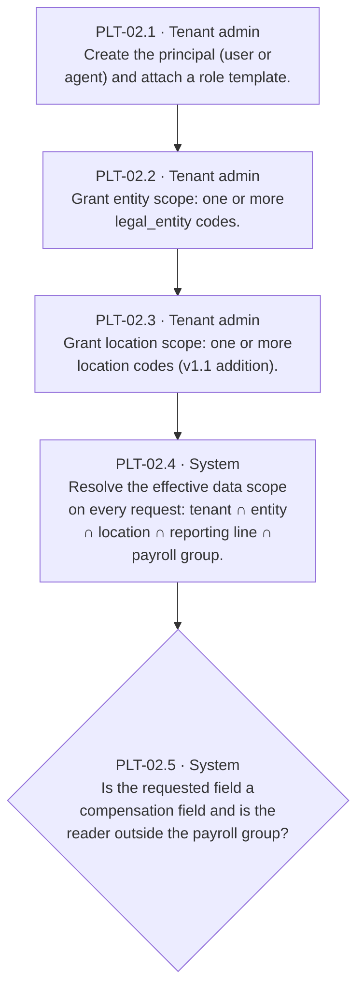
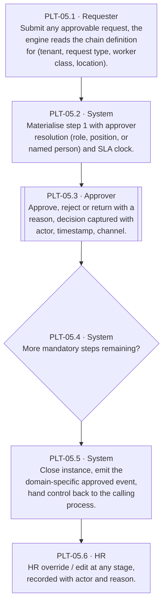
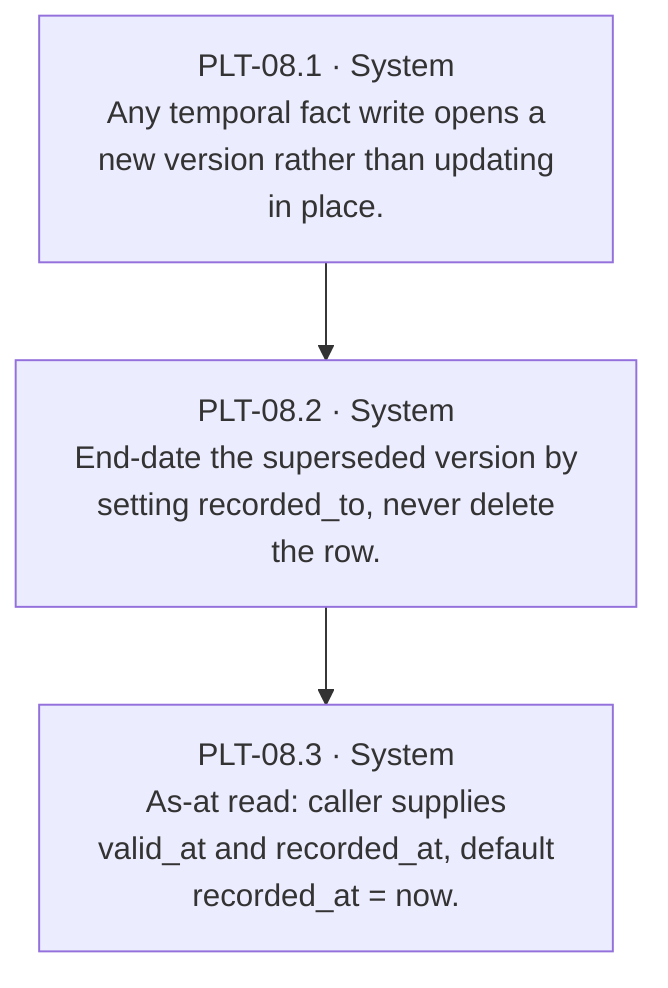

<picture>
  <source media="(prefers-color-scheme: dark)" srcset="../../assets/MultipliersKraftLogoDark.png">
  
</picture>

# FRS-PLT-01 — Platform & Foundations — Process Specifications

| Attribute | Value |
| :--- | :--- |
| Document ID | FRS-PLT-01 |
| Title | Platform & Foundations — Process Specifications |
| Product | Nucleus Suite (Nucleus HRMS Suite) |
| Version | 1.0.0 |
| Status | Issued for approval |
| Owner (role) | Domain Product Owner — Platform & Foundations |
| Author | Dhanraj Dadhich |
| Reviewed by | *pending* |
| Approved by | Product Council — *pending* |
| Date | 2026-11-05 |
| Classification | Internal |
| CMMI practice areas | RDM, TS |
| Related documents | FRS-PLT-00, FRS-PLT-01, FRS-PLT-02, FRS-PLT-03, FRS-PLT-04, FRS-PLT-05, FRS-PLT-06, FRS-PLT-07, FRS-PLT-08, FRS-PLT-09, FRS-PLT-10, FRS-PLT-11, FRS-PLT-12, FRS-PLT-13, BRS-01, SRS-01, REQ-01, REQ-02 |
| Quality & process-performance objectives | QPPO-05 (effective requirements reviews), QPPO-01 (escaped defects) — MPM-01 |
| Process performance baseline used | PPB-01 (review defect density), PPB-02 (review rate) — MPM-01 |
| Peer review record | *pending* (PR-xxxx, QA-02) |
| Tailoring record | none |
| Traceability anchor | BG-06, BG-07, BG-10 · R-09 · processes PLT-01–PLT-08 |
| Source of record | Nucleus — Process Flows & Process Maps v1.0 — sheet(s) 03_Process_Inventory, 04_Process_Steps, 05_Swimlane_Maps Nucleus HR Demo Points Build Sheet v1.0 — sheet(s) 07_Approval_Workflows Nucleus HRMS Demo Dataset v1.1 — sheet(s) 64_Approval_Workflows |

> **Source of record.** Requirements in this document are taken from the source workbook(s) named above and keep their workbook IDs, which are never renumbered. Changes are made through a change request (CM-02) against the source workbook. Sections marked **Authored** are original additions that are not present in the source workbooks.

Step types: TASK (human) · SYS (system, unattended) · DEC (decision) · APPR (approval gate) · INT (integration call) · WAIT (timer or external event) · AGENT (agent-executed, governed). CRUD: C create · R read · U update · D delete-by-end-dating (temporal facts are never hard-deleted). In the flow diagrams decisions are diamonds, approvals are double-bordered boxes and integration, wait and agent steps are rounded.

## 1. Process inventory

| Process ID | Process | Trigger | Primary actor | Frequency | Criticality | Blueprint module | Phase | Reuses | Demo pts | Note |
| :--- | :--- | :--- | :--- | :--- | :--- | :--- | :--- | :--- | :--- | :--- |
| PLT-01 | Tenant provisioning | Signed order / demo request | Implementation consultant | Per client | High | Platform | P0 | CMP-09 |  | Target: fully provisioned in under 30 minutes, automated (NFR). |
| PLT-02 | Identity, role and data-scope grant | User created or moved | Tenant admin | Continuous | Critical | Platform §8 | P0 | CMP-08 | 8 | Entity + reporting line + LOCATION. Location scope is the v1.1 gap; retrofitting a permission model is unsafe. |
| PLT-03 | Configuration authoring and effective dating | Policy change or implementation | Implementation consultant | Continuous | Critical | Platform | P0 | CMP-09, CMP-10 | 2,3,4,7,12 | If a client rule needs a developer, it is a product gap (blueprint §15). |
| PLT-04 | Workflow definition and versioning | New or changed process | Implementation consultant | Occasional | High | Module 5 | P0 | CMP-01 | 5,16 | In-flight instances finish on the version they started under. |
| PLT-05 | Approval chain execution | Any approvable request | Approvers | Continuous | Critical | Module 5 | P0 | CMP-01 | 5,9,16,24 | ONE engine. Leave, gate pass, loan, requisition, OT, regularisation, letters all consume it. |
| PLT-06 | Audit and action ledger write | Any write or sensitive read | System | Continuous | Critical | Platform §6.2, §8 | P0 | CMP-06 |  | Append-only. Agent identity is a dimension, not a separate log. |
| PLT-07 | Event publish and outbox relay | Any domain write | System | Continuous | Critical | Platform §7.5 | P0 | CMP-07 |  | Transactional outbox. Transport is swappable without touching producers. |
| PLT-08 | Bi-temporal write and as-at read | Any temporal fact change | System | Continuous | Critical | Platform §7.4 | P0 | CMP-10 | 5,7,12 | valid_from/to + recorded_from/to. Payroll and attendance recompute both depend on as-at reads. |

## 2. Step-level specifications

### PLT-01 — Tenant provisioning

**Trigger:** Signed order / demo request · **Primary actor:** Implementation consultant · **Frequency:** Per client · **Criticality:** High · **Phase:** P0 · **Reuses:** CMP-09

The source workbook specifies this process at inventory level only. Its complete flow is specified in use case PLT-UC-001 (FRS-PLT-12).

### PLT-02 — Identity, role and data-scope grant

**Trigger:** User created or moved · **Primary actor:** Tenant admin · **Frequency:** Continuous · **Criticality:** Critical · **Phase:** P0 · **Reuses:** CMP-08

| Step | Step ID | Lane / actor | Type | Action or decision | Rule ID(s) | Objects touched (CRUD) | Key fields | Screen | Event emitted | Exception / note | Reuses | Demo pts | Phase |
| :--- | :--- | :--- | :--- | :--- | :--- | :--- | :--- | :--- | :--- | :--- | :--- | :--- | :--- |
| 1 | PLT-02.1 | Tenant admin | TASK | Create the principal (user or agent) and attach a role template. | RL-001 | principal C; role R | principal_id, display_name, principal_type(user\|agent\|service), owner_principal_id | SCR-005 | platform.principal.created | Agent principals require a named human owner or creation fails. | CMP-08 | 8 | P0 |
| 2 | PLT-02.2 | Tenant admin | TASK | Grant entity scope: one or more legal_entity codes. | RL-002 | entity_grant C | principal_id, legal_entity_id, granted_by, effective_from | SCR-005 | platform.scope.granted |  |  | 8 | P0 |
| 3 | PLT-02.3 | Tenant admin | TASK | Grant location scope: one or more location codes (v1.1 addition). | RL-003 | location_grant C | principal_id, location_id, can_edit_time(Y/N), granted_by, effective_from | SCR-005 | platform.scope.granted | A principal with no location grant defaults to entity-wide time visibility only if explicitly flagged. | CMP-08 | 8 | P0 |
| 4 | PLT-02.4 | System | SYS | Resolve the effective data scope on every request: tenant ∩ entity ∩ location ∩ reporting line ∩ payroll group. | RL-004 | scope_resolution R | tenant_id, entity set, location set, reporting subtree, payroll_group set | — |  | Scope resolution failure returns empty set, never a full set. | CMP-08 | 8 | P0 |
| 5 | PLT-02.5 | System | DEC | Is the requested field a compensation field and is the reader outside the payroll group? | RL-005 | salary_structure R | basic, da, hra, daily_rate, gross, ctc | — |  | Yes → return null for those fields, attendance fields still populated. Assert in CI on every build. | CMP-08 | 8 | P0 |

### PLT-03 — Configuration authoring and effective dating

**Trigger:** Policy change or implementation · **Primary actor:** Implementation consultant · **Frequency:** Continuous · **Criticality:** Critical · **Phase:** P0 · **Reuses:** CMP-09, CMP-10

The source workbook specifies this process at inventory level only. Its complete flow is specified in use case PLT-UC-003 (FRS-PLT-12).

### PLT-04 — Workflow definition and versioning

**Trigger:** New or changed process · **Primary actor:** Implementation consultant · **Frequency:** Occasional · **Criticality:** High · **Phase:** P0 · **Reuses:** CMP-01

The source workbook specifies this process at inventory level only. Its complete flow is specified in use case PLT-UC-004 (FRS-PLT-12).

### PLT-05 — Approval chain execution

**Trigger:** Any approvable request · **Primary actor:** Approvers · **Frequency:** Continuous · **Criticality:** Critical · **Phase:** P0 · **Reuses:** CMP-01

| Step | Step ID | Lane / actor | Type | Action or decision | Rule ID(s) | Objects touched (CRUD) | Key fields | Screen | Event emitted | Exception / note | Reuses | Demo pts | Phase |
| :--- | :--- | :--- | :--- | :--- | :--- | :--- | :--- | :--- | :--- | :--- | :--- | :--- | :--- |
| 1 | PLT-05.1 | Requester | TASK | Submit any approvable request; the engine reads the chain definition for (tenant, request type, worker class, location). | RL-010 | approval_chain R; approval_instance C | chain_id, request_type, request_id, step_count | varies | platform.approval.started | No chain configured → route to tenant default chain and raise a config warning. | CMP-01 | 5,9,16,24 | P0 |
| 2 | PLT-05.2 | System | SYS | Materialise step 1 with approver resolution (role, position, or named person) and SLA clock. | RL-011 | approval_step C | step_no, approver_principal_id, resolution_mode, sla_hours, due_at | — | platform.approval.step_opened | Approver is inactive or has left → reroute by RL-012, never leave the item orphaned. | CMP-01 | 5,9,16,24 | P0 |
| 3 | PLT-05.3 | Approver | APPR | Approve, reject or return with a reason; decision captured with actor, timestamp, channel. | RL-013 | approval_step U | decision, decided_by, decided_at, reason, channel(app\|web\|business messaging) | SCR-040 | platform.approval.step_decided | Rejection ends the instance and notifies the requester with the reason text. | CMP-01 | 5,9,16,24 | P0 |
| 4 | PLT-05.4 | System | DEC | More mandatory steps remaining? | RL-010 | approval_instance R | current_step, total_steps | — |  | Yes → open next step sequentially. No → close instance. | CMP-01 | 5,9,16,24 | P0 |
| 5 | PLT-05.5 | System | SYS | Close instance, emit the domain-specific approved event, hand control back to the calling process. | RL-014 | approval_instance U | final_state, closed_at | — | platform.approval.completed | SLA breach escalates per step configuration and is counted, not silently extended. | CMP-01 | 5,9,16,24 | P0 |
| 6 | PLT-05.6 | HR | TASK | HR override / edit at any stage, recorded with actor and reason. | RL-015 | approval_step U; audit_entry C | override_by, override_reason, previous_state | SCR-040 | platform.approval.overridden | Override without a reason is rejected by the service. | CMP-06 | 5,9,16,24 | P0 |

### PLT-06 — Audit and action ledger write

**Trigger:** Any write or sensitive read · **Primary actor:** System · **Frequency:** Continuous · **Criticality:** Critical · **Phase:** P0 · **Reuses:** CMP-06

The source workbook specifies this process at inventory level only. Its complete flow is specified in use case PLT-UC-006 (FRS-PLT-12).

### PLT-07 — Event publish and outbox relay

**Trigger:** Any domain write · **Primary actor:** System · **Frequency:** Continuous · **Criticality:** Critical · **Phase:** P0 · **Reuses:** CMP-07

The source workbook specifies this process at inventory level only. Its complete flow is specified in use case PLT-UC-007 (FRS-PLT-12).

### PLT-08 — Bi-temporal write and as-at read

**Trigger:** Any temporal fact change · **Primary actor:** System · **Frequency:** Continuous · **Criticality:** Critical · **Phase:** P0 · **Reuses:** CMP-10

| Step | Step ID | Lane / actor | Type | Action or decision | Rule ID(s) | Objects touched (CRUD) | Key fields | Screen | Event emitted | Exception / note | Reuses | Demo pts | Phase |
| :--- | :--- | :--- | :--- | :--- | :--- | :--- | :--- | :--- | :--- | :--- | :--- | :--- | :--- |
| 1 | PLT-08.1 | System | SYS | Any temporal fact write opens a new version rather than updating in place. | RL-020 | <temporal table> C | valid_from, valid_to, recorded_from, recorded_to, changed_by, change_reason | — | platform.record.versioned |  |  | 5,7,12 | P0 |
| 2 | PLT-08.2 | System | SYS | End-date the superseded version by setting recorded_to; never delete the row. | RL-020 | <temporal table> U | recorded_to | — |  |  |  | 5,7,12 | P0 |
| 3 | PLT-08.3 | System | SYS | As-at read: caller supplies valid_at and recorded_at; default recorded_at = now. | RL-021 | <temporal table> R | valid_at, recorded_at | — |  | Payroll and attendance recompute MUST pass the run/recompute snapshot timestamp, not now. | CMP-10 | 5,7,12 | P0 |

## 4. Approval workflows

_No entries in source for this scope._

### Workflow behaviour

_No entries in source for this scope._

## Approval & Sign-off

| Role | Name | Date | Decision | Conditions / comments |
| :--- | :--- | :--- | :--- | :--- |
| Author | Dhanraj Dadhich | 2026-11-05 | Submitted | |
| Peer review moderator | *pending* | | | PR-xxxx |
| PQA (process compliance) | *pending* | | | |
| Approval authority (DOC-01 §7) | *pending* | | | |

## Measurement Data Captured

| Measure | Value | Unit | Notes |
| :--- | :--- | :--- | :--- |
| Size | 22 | specified items (table rows) | Counted automatically at generation |
| Authoring effort | *to be recorded* | person-hours | |
| Review effort (preparation + meeting) | *pending review* | person-hours | From PR-xxxx |
| Rework effort | *pending review* | person-hours | |
| Review rate | *pending review* | items / hour | Compare with PPB control limits |
| Requirement volatility (changes since baseline) | 0 | CRs touching this artefact | Not yet baselined (CM-03) |

**Defects found, by detection phase and severity**

| Detection phase | Major | Minor | Editorial | Injected in phase (major) |
| :--- | :--- | :--- | :--- | :--- |
| Author self-check | 0 | 0 | 0 | — |
| Peer review | *pending* | | | |
| Design / build | | | | |
| System / integration test | | | | |
| UAT | | | | |
| Production (escaped) | | | | each escaped major opens a CAR record (CAR-01) |

Within control limits of the review-rate PPB? *To be assessed at peer review.*

## Revision History

| Version | Date | Author | Change summary | CR ref | Approved by |
| :--- | :--- | :--- | :--- | :--- | :--- |
| 1.0.0 | 2026-11-05 | Dhanraj Dadhich | Consolidated release | CR-0001 | *pending* |
