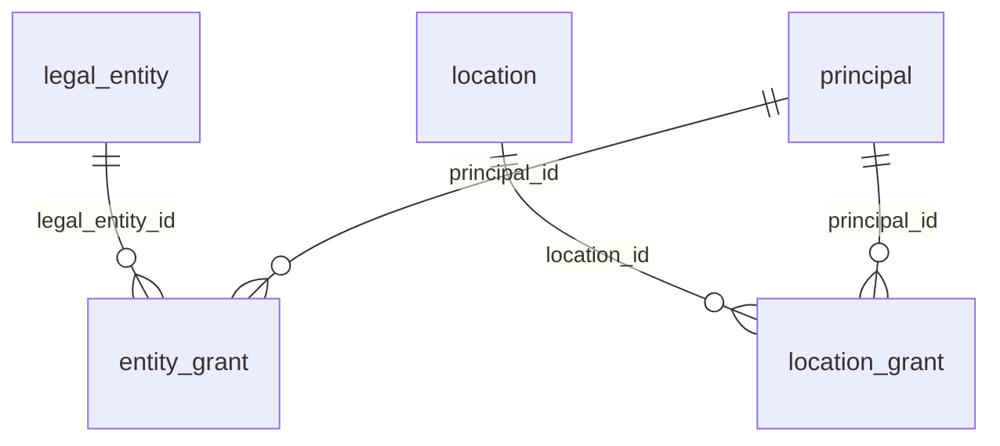

<picture>
  <source media="(prefers-color-scheme: dark)" srcset="../../assets/MultipliersKraftLogoDark.png">
  
</picture>

# FRS-PLT-05 — Platform & Foundations — Data Model

| Attribute | Value |
| :--- | :--- |
| Document ID | FRS-PLT-05 |
| Title | Platform & Foundations — Data Model |
| Product | Nucleus Suite (Nucleus HRMS Suite) |
| Version | 1.0.0 |
| Status | Issued for approval |
| Owner (role) | Domain Product Owner — Platform & Foundations |
| Author | Dhanraj Dadhich |
| Reviewed by | *pending* |
| Approved by | Product Council — *pending* |
| Date | 2026-11-05 |
| Classification | Internal |
| CMMI practice areas | TS, RDM |
| Related documents | FRS-PLT-00, FRS-PLT-01, FRS-PLT-02, FRS-PLT-03, FRS-PLT-04, FRS-PLT-05, FRS-PLT-06, FRS-PLT-07, FRS-PLT-08, FRS-PLT-09, FRS-PLT-10, FRS-PLT-11, FRS-PLT-12, FRS-PLT-13, BRS-01, SRS-01, REQ-01, REQ-02 |
| Quality & process-performance objectives | QPPO-05 (effective requirements reviews), QPPO-01 (escaped defects) — MPM-01 |
| Process performance baseline used | PPB-01 (review defect density), PPB-02 (review rate) — MPM-01 |
| Peer review record | *pending* (PR-xxxx, QA-02) |
| Tailoring record | none |
| Traceability anchor | BG-06, BG-07, BG-10 · R-09 · processes PLT-01–PLT-08 |
| Source of record | Nucleus — Process Flows & Process Maps v1.0 — sheet(s) 06_Data_Dictionary Nucleus HR Demo Points Build Sheet v1.0 — sheet(s) 06_Enum_Values Nucleus HRMS Demo Dataset v1.1 — sheet(s) 65_Enum_Seed_Values |

> **Source of record.** Requirements in this document are taken from the source workbook(s) named above and keep their workbook IDs, which are never renumbered. Changes are made through a change request (CM-02) against the source workbook. Sections marked **Authored** are original additions that are not present in the source workbooks.

Every object carries the platform envelope (`tenant_id`, `entity_id`), effective dating (`effective_from`, `effective_to`) where temporal, and audit columns. Sensitivity classes follow GOV-10.

## 1. Entity relationships

Relationships are derived from the identifier fields in the data dictionary; the tenant envelope is omitted for legibility.

## 2. Data objects

| Object | Fields | Type | Required | Owner / source | Temporal | Sensitivity | Notes | Dataset ref |
| :--- | :--- | :--- | :--- | :--- | :--- | :--- | :--- | :--- |
| tenant | tenant_id | uuid | Y | System | No | — | On every tenant-scoped table without exception; RLS forced. |  |
| tenant | name, region, data_residency | text | Y | Config | No | — | Indian tenant data resides in India, enforced at the infrastructure layer. |  |
| legal_entity | entity_code, registered_name, cin_llpin, pan, gstin, registered_office, pf_code, financial_year, status | text | Y | Config | Yes | Confidential | Multi-entity is the norm; retrofitting entity scope into payroll and GL is one of the worst refactors available. | 02_Legal_Entities |
| location | location_code, name, entity_code, city, state, state_code, establishment_type, pin, factory_licence, pt_slab_set, lwf_set, payroll_group_default, factory_act_applies | text | Y | Config | Yes | — | Payroll group and location are INDEPENDENT. Do not derive one from the other. | 03_Locations |
| principal | principal_id, display_name, principal_type(user\|agent\|service), owner_principal_id, status | text | Y | Admin | Yes | — | Agent principals must name a human owner. |  |
| entity_grant | principal_id, legal_entity_id, granted_by, effective_from, effective_to | ref | Y | Admin | Yes | — |  |  |
| location_grant | principal_id, location_id, can_edit_time, granted_by, effective_from, effective_to | ref | Y | Admin | Yes | — | v1.1 addition. This is what lets a plant user record time without seeing rate. |  |
| role | role_code, name, permission_set[], scope_dimensions[] | text/json | Y | Config | Yes | — | RBAC for shape, ABAC for data scope, evaluated at query time. |  |
| approval_chain | chain_id, request_type, applies_to(worker_class, location, amount band), steps[] | json | Y | Config | Yes | — | One engine for every approvable object in the product. |  |
| approval_step | step_no, approver_principal_id, resolution_mode(role\|position\|named), mandatory, sla_hours, decision, decided_by, decided_at, reason, channel | mixed | Y | System | No | — | Decision channel matters: business messaging approvals are first class. |  |
| workflow_definition | workflow_id, name, version, steps[], branches[], sla[] | json | Y | Config | Yes | — | In-flight instances finish on the version they started under. |  |
| audit_entry | entry_id, actor_principal_id, agent_id, action, object_type, object_id, before, after, ip, reason, occurred_at | json | Y | System | Restricted | Append-only. Covers every write and every read of a sensitive field. |  |  |
| action_ledger | action_id, agent_id, human_principal_id, tool, inputs, plan, simulation_result, approval_ref, outcome, reversal_handle, occurred_at | json | Y | System | Restricted | The ledger is the product. Reversal rate is the number a prospect will ask for. |  |  |
| outbox | outbox_id, aggregate, event_type, payload, created_at, relayed_at | json | Y | System | No | — | Written in the same transaction as the domain write. |  |

### Additional objects and attributes (Authored)

| Object | Fields | Type | Required | Owner / source | Temporal | Sensitivity | Notes | Defined in |
| :--- | :--- | :--- | :--- | :--- | :--- | :--- | :--- | :--- |
| tenant | verified_domains[], provisioning_mode(worker_driven\|directory_driven), step_up_acr | mixed | Y | Admin | Yes | — | Sign-in email must fall in a verified domain; provisioning mode A (Nucleus to directory) is the default; step-up context gates payroll approval, bank release and salary view. | ICD-01 §15 |
| principal | idp_subject_id, identity_provider, scim_external_id, link_status(linked\|awaiting_linkage), account_source(federated\|scim\|local) | mixed | N | Identity provider / Admin | Yes | Personal | A subject identifier links to exactly one principal; SCIM creates in mode B wait for linkage; no password is stored for federated tenants. | ICD-01 §15.2, PLT-INT-003.01, PLT-INT-004.03 |
| location | pt_registration_no, lwf_registration_no | text | N | Config | Yes | Confidential | Registration carried on professional-tax and labour-welfare returns; the form set follows the plant's registration (RL-380). | ICD-01 §12.2 (CMP-INT-003) |
| action_ledger | idempotency_key | text | N | System | No | Restricted | Caller key for write tools over MCP; a repeat from the same principal within 24 hours returns the original result and action_id. | ICD-01 §17.2, §17.4 |
| integration_log | log_id, message_id, tenant_id, interface_id, direction, counterparty, business_key, payload_hash, size_bytes, outcome, latency_ms, retry_count, occurred_at | mixed | Y | System | No | Confidential | One row per exchange on every interface; Personal and Restricted payload bodies are never written, only hashes and business keys (PLT-INT-108). | ICD-01 §5.9 |
| idempotency_record | idempotency_key, client_id, principal_id, endpoint, request_hash, first_response, created_at, expires_at | mixed | Y | System | No | Confidential | Kept 24 hours; a repeat returns the first response unchanged (PLT-INT-103). | ICD-01 §5.4, §18.3 |
| dead_letter_entry | entry_id, interface_id, message_id, business_key, attempts, last_error, dead_lettered_at, incident_ref, replay_status, replayed_at | mixed | Y | System | No | Confidential | Created after the sixth failed attempt; visible on the owning monitor screen with a replay action (PLT-INT-105). | ICD-01 §5.5, §19.4 |
| integration_credential | credential_ref, counterparty, interface_id, environment, credential_type(oauth_client\|mtls_certificate\|hmac_secret\|sftp_key\|openpgp_key), vault_path, rotated_at, expires_at, next_rotation_due | mixed | Y | Integration administrator | Yes | Restricted | Metadata only; the secret itself lives in the tenant secrets vault and never in configuration, logs, events or LLM prompts; distinct per environment (PLT-INT-111). | ICD-01 §5.1, §5.2, §5.10 |
| webhook_subscription | subscription_id, client_id, endpoint_url, event_types[], scope(entity, location), secret_ref, mtls_enabled, status(active\|paused), failing_since, created_by | mixed | Y | Partner via /v1/webhooks | Yes | Confidential | Scoped no wider than the subscribing client's grants; paused after 72 hours of continuous failure and the owner notified. | ICD-01 §19 |
| webhook_delivery_log | delivery_id, subscription_id, event_id, nucleus_idempotency_key, attempt_no, http_status, latency_ms, outcome(delivered\|retried\|dead_lettered), attempted_at | mixed | Y | System | No | — | Inspectable and replayable by event id within the event's retention class (PLT-INT-002.04). | ICD-01 §19.4 |
| provisioning_operation | operation_id, external_id, assignment_id, version, operation(create\|update\|deactivate), target, status, attempts, last_error, completed_at | mixed | Y | System | No | Personal | Keyed on assignment_id + version so replays reach the same end state; a leaver deactivation still failing after attempt 3 raises a security incident. | ICD-01 §15.1, §15.4 |
| migration_provenance | legacy_key, migration_batch_id | text | Y | Migration load service | No | — | Column set carried on every record loaded with treatment M, H or O so each reconciliation query traces back to source (PLT-MIG-004). | MIG-01 §3 |
| migration_batch | migration_batch_id, tenant_id, rehearsal(mock_1\|mock_2\|mock_3\|cut_over), wave(W0..W8), extract_ref, extract_signature_verified, cross_reference_version, started_at, completed_at, records_extracted, records_loaded, records_rejected, records_excluded, wave_check_status, status | mixed | Y | Migration Lead | No | Confidential | A wave is refused until its predecessors pass their wave checks (PLT-MIG-015, PLT-MIG-016). | MIG-01 §6, §10 |
| migration_reconciliation | migration_batch_id, level(L1\|L2\|L3\|L4\|L5), object, scope(entity, location, worker_class, payroll_group), check, expected, actual, variance, tolerance, status, drill_ref | mixed | Y | System | No | Confidential | Persisted as reconciliation_report rows of the migration batch and shown on the migration reconciliation screen with drill-down; amounts masked unless the viewer may see compensation. | MIG-01 §4, §9, PLT-MIG-056 |
| migration_cross_reference | xref_type(employee_key\|department\|grade\|employment_type\|leave_code\|pay_head\|location_payroll_group\|shift), legacy_value, nucleus_value, version, used_in_mock, approved_by | mixed | Y | Migration Lead | Yes | — | Versioned and applied by the load service, never by editing extracts (PLT-MIG-012). | MIG-01 §5.2 |
| migration_mapping_spec | target_object, target_field, source_system, source_field, extraction_filter, rule(direct\|lookup\|transform\|default\|derived), mandatory, owner(ERP\|Nucleus), validation, sample_evidence, signed_by | mixed | Y | Data owner | Yes | — | One specification per target object under configuration management; zero unmapped mandatory fields before Mock 2 (PLT-MIG-011). | MIG-01 §5.1 |
| migration_scope_register | object, treatment(M\|H\|O\|C\|D\|N), history_depth, demo_dataset_ref, legacy_source, data_owner_role, signed_by | mixed | Y | Migration Lead | No | — | Covers every DA-01 object before Mock 1 (PLT-MIG-007). | MIG-01 §4 |
| migration_load_error | error_id, migration_batch_id, object, legacy_key, field, rule_id, reason, status, resolved_by | mixed | N | Migration load service | No | Confidential | Error queue; Restricted values appear only as tokens or masked (PLT-MIG-020). | MIG-01 §7 |
| migration_correction_log | correction_id, object, legacy_key, field, legacy_value_masked, corrected_value_masked, reason, approved_by, approved_at | mixed | N | Data owner | No | Confidential | Cleansing is never done silently in an extract (PLT-MIG-028). | MIG-01 §7 |
| migration_defect | defect_id, mock, classification(extract\|mapping\|transformation\|product\|legacy_data), severity, object, owner, status | mixed | N | Migration Lead | No | — | No open blocking defect at any mock exit (PLT-MIG-043). | MIG-01 §10 |
| data_quality_result | migration_batch_id, dimension(completeness\|validity\|accuracy\|uniqueness\|consistency\|integrity\|timeliness), object_scope, threshold, measured_value, blocking, status | mixed | Y | Migration Lead | No | — | Measured on every mock and trended; a blocking breach stops cut-over (PLT-MIG-051, PLT-MIG-052). | MIG-01 §13 |
| parallel_payroll_variance | cycle_period, person_id, component_code, legacy_amount, nucleus_amount, variance, classification(legacy_defect\|nucleus_defect\|agreed_rule_difference), resolved_by, signed_off_by | mixed | Y | Client Payroll Head | No | Restricted | Final cycle must show zero unexplained variance to the paisa (PLT-MIG-038). | MIG-01 §9 |
| cutover_freeze_item | item_id, legacy_key, change_type(joiner\|leaver\|change), captured_on, captured_by, applied_on, status | mixed | N | Client HR Head | No | Personal | Applied in Nucleus within one working day of go-live (PLT-MIG-046). | MIG-01 §11.2 |
| legacy_archive_inventory | data_set, legacy_system, archived_on, retention_until, custodian, access_roles[] | mixed | Y | Client IT | No | Confidential | Legacy audit trails, GL history and bank-file history are archived read-only, never migrated as live data (PLT-MIG-010). | MIG-01 §4 |

## 3. Enumerations

| Enum code | Enum name | Module | System or Config | Complete value set | Requirement |
| :--- | :--- | :--- | :--- | :--- | :--- |
| EN_SCOPE_DIMENSION | Data scope dimension | SEC | Config | Attendance location · Payroll processing location · Department · Legal entity | R-09 |

### Enumeration seed values and tenant defaults

| Enum code | Enum name | Module | System or Config | Complete value set | Default in this tenant | Requirement |
| :--- | :--- | :--- | :--- | :--- | :--- | :--- |
| EN_SCOPE_DIMENSION | Data scope dimension | SEC | Config | Attendance location · Payroll processing location · Department · Legal entity | Attendance location | R-09 |

## Approval & Sign-off

| Role | Name | Date | Decision | Conditions / comments |
| :--- | :--- | :--- | :--- | :--- |
| Author | Dhanraj Dadhich | 2026-11-05 | Submitted | |
| Peer review moderator | *pending* | | | PR-xxxx |
| PQA (process compliance) | *pending* | | | |
| Approval authority (DOC-01 §7) | *pending* | | | |

## Measurement Data Captured

| Measure | Value | Unit | Notes |
| :--- | :--- | :--- | :--- |
| Size | 40 | specified items (table rows) | Counted automatically at generation |
| Authoring effort | *to be recorded* | person-hours | |
| Review effort (preparation + meeting) | *pending review* | person-hours | From PR-xxxx |
| Rework effort | *pending review* | person-hours | |
| Review rate | *pending review* | items / hour | Compare with PPB control limits |
| Requirement volatility (changes since baseline) | 0 | CRs touching this artefact | Not yet baselined (CM-03) |

**Defects found, by detection phase and severity**

| Detection phase | Major | Minor | Editorial | Injected in phase (major) |
| :--- | :--- | :--- | :--- | :--- |
| Author self-check | 0 | 0 | 0 | — |
| Peer review | *pending* | | | |
| Design / build | | | | |
| System / integration test | | | | |
| UAT | | | | |
| Production (escaped) | | | | each escaped major opens a CAR record (CAR-01) |

Within control limits of the review-rate PPB? *To be assessed at peer review.*

## Revision History

| Version | Date | Author | Change summary | CR ref | Approved by |
| :--- | :--- | :--- | :--- | :--- | :--- |
| 1.0.0 | 2026-11-05 | Dhanraj Dadhich | Consolidated release | CR-0001 | *pending* |
