<p align="right">
<picture>
  <source media="(prefers-color-scheme: dark)" srcset="../../assets/MultipliersKraftLogoDark.png">
  
</picture>
</p>

# FRS-PLT-12 — Platform & Foundations — Use Case Specifications

| Attribute | Value |
| :--- | :--- |
| Document ID | FRS-PLT-12 |
| Title | Platform & Foundations — Use Case Specifications |
| Product | Nucleus Suite (Nucleus HRMS Suite) |
| Version | 1.0.0 |
| Status | Issued for approval |
| Owner (role) | Domain Product Owner — Platform & Foundations |
| Author | Dhanraj Dadhich |
| Reviewed by | *pending* |
| Approved by | Product Council — *pending* |
| Date | 2026-11-05 |
| Classification | Internal |
| CMMI practice areas | RDM, VV |
| Related documents | FRS-PLT-00, FRS-PLT-01, FRS-PLT-02, FRS-PLT-03, FRS-PLT-04, FRS-PLT-05, FRS-PLT-06, FRS-PLT-07, FRS-PLT-08, FRS-PLT-09, FRS-PLT-10, FRS-PLT-11, FRS-PLT-12, FRS-PLT-13, BRS-01, SRS-01, REQ-01, REQ-02 |
| Quality & process-performance objectives | QPPO-05 (effective requirements reviews), QPPO-01 (escaped defects) — MPM-01 |
| Process performance baseline used | PPB-01 (review defect density), PPB-02 (review rate) — MPM-01 |
| Peer review record | *pending* (PR-xxxx, QA-02) |
| Tailoring record | none |
| Traceability anchor | BG-06, BG-07, BG-10 · R-09 · processes PLT-01–PLT-08 |
| Source of record | Nucleus — Process Flows & Process Maps v1.0 — sheet(s) 03_Process_Inventory, 04_Process_Steps, 07_Screens, 09_Business_Rules<br>Authored use cases (marked per use case) |

> **Source of record.** Requirements in this document are taken from the source workbook(s) named above and keep their workbook IDs, which are never renumbered. Changes are made through a change request (CM-02) against the source workbook. Sections marked **Authored** are original additions that are not present in the source workbooks.

This document specifies 25 use cases for Platform & Foundations: 3 follow the step-level flows of the source workbook and 22 are authored (processes without step-level detail in the source, and capability gaps). User stories derived from each use case are in FRS-PLT-13.

## 1. Use case index

| ID | Use case | Primary actor | Realises | Source | Phase | Criticality |
| :--- | :--- | :--- | :--- | :--- | :--- | :--- |
| [PLT-UC-001](#plt-uc-001) | Provision a new client tenant | Implementation consultant | PLT-01 | Authored | P0 | High |
| [PLT-UC-002](#plt-uc-002) | Grant identity, role and data scope | Tenant admin | PLT-02 | Source workbook | P0 | Critical |
| [PLT-UC-003](#plt-uc-003) | Author and effective-date configuration | Implementation consultant | PLT-03 | Authored | P0 | Critical |
| [PLT-UC-004](#plt-uc-004) | Define and version an approval workflow | Implementation consultant | PLT-04 | Authored | P0 | High |
| [PLT-UC-005](#plt-uc-005) | Execute an approval chain | Employee / worker | PLT-05 | Source workbook | P0 | Critical |
| [PLT-UC-006](#plt-uc-006) | Write the audit and action ledger | Nucleus platform | PLT-06 | Authored | P0 | Critical |
| [PLT-UC-007](#plt-uc-007) | Publish domain events through the outbox relay | Nucleus platform | PLT-07 | Authored | P0 | Critical |
| [PLT-UC-008](#plt-uc-008) | Write bi-temporal versions and read as at a point in time | Nucleus platform | PLT-08 | Source workbook | P0 | Critical |
| [PLT-UC-009](#plt-uc-009) | Enforce adaptive MFA and step-up authentication | Payroll manager | PLT-CG-001 | Authored | P0 | Critical |
| [PLT-UC-010](#plt-uc-010) | Deliver notifications through a channel matrix and preference centre | Tenant admin | PLT-CG-002 | Authored | P1 | High |
| [PLT-UC-011](#plt-uc-011) | Design approval processes without code | Tenant admin | PLT-CG-003 | Authored | P2 | High |
| [PLT-UC-012](#plt-uc-012) | Promote configuration from sandbox to production | Implementation consultant | PLT-CG-004 | Authored | P2 | Medium |
| [PLT-UC-013](#plt-uc-013) | Delegate approval authority and act as a user | Manager / supervisor | PLT-CG-005 | Authored | P1 | High |
| [PLT-UC-014](#plt-uc-014) | Load data in bulk with validation and rollback | HR operations | PLT-CG-006 | Authored | P1 | High |
| [PLT-UC-015](#plt-uc-015) | Add custom fields and custom objects | Tenant admin | PLT-CG-007 | Authored | P3 | Medium |
| [PLT-UC-016](#plt-uc-016) | Migrate data from a legacy HRMS and payroll system | Implementation consultant | PLT-CG-008 | Authored | P1 | High |
| [PLT-UC-017](#plt-uc-017) | Handle a data-principal rights request | Employee / worker | PLT-CG-009 | Authored | P1 | High |
| [PLT-UC-018](#plt-uc-018) | Provision identities to the enterprise directory | Nucleus platform | PLT-CG-010 | Authored | P2 | High |
| [PLT-UC-019](#plt-uc-019) | View any record, report or chart as at a past date | HR operations | PLT-CG-011 | Authored | P2 | High |
| [PLT-UC-020](#plt-uc-020) | Publish a policy change through automated regression | Implementation consultant | PLT-CG-012 | Authored | P2 | High |
| [PLT-UC-021](#plt-uc-021) | Publish and install a governed extension | Tenant admin | PLT-CG-013 | Authored | P4 | Medium |
| [PLT-UC-022](#plt-uc-022) | Consolidate multi-entity reporting across currencies | Finance | PLT-CG-014 | Authored | P3 | High |
| [PLT-UC-023](#plt-uc-023) | Classify, extract and confirm employee documents | HR operations | PLT-CG-015 | Authored | P2 | High |
| [PLT-UC-024](#plt-uc-024) | Register visitors and control gate entry and exit | Plant HR / time office | PLT-CG-016 | Authored | P3 | Medium |
| [PLT-UC-025](#plt-uc-025) | Enable an additional Indian language for a tenant | Tenant admin | PLT-CG-017 | Authored | P2 | Medium |

## 2. Use case diagrams

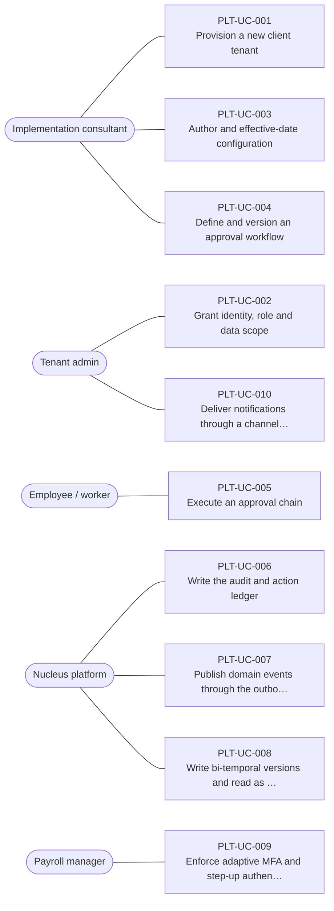

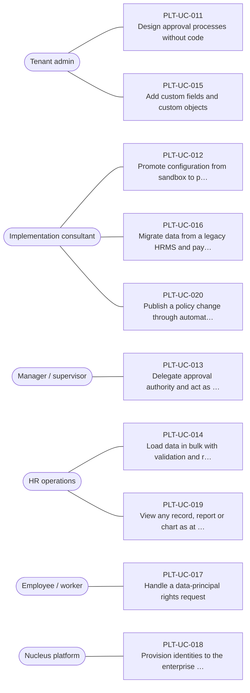

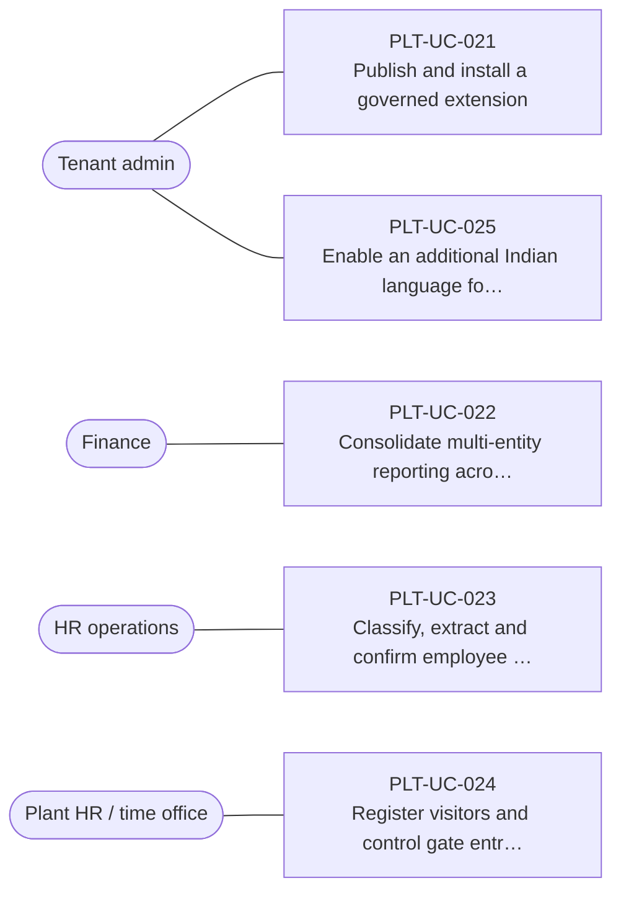

## 3. Use case specifications

### PLT-UC-001

**Provision a new client tenant** — Stand up an isolated, fully seeded and health-checked tenant for a signed client or approved demo request in under 30 minutes without manual database work.

| Attribute | Value |
| :--- | :--- |
| Realises | PLT-01 |
| Source | Authored |
| Level | Summary |
| Primary actor | Implementation consultant |
| Secondary actors | Nucleus platform, Tenant admin |
| Trigger | A signed client order or an approved demo request is assigned to the implementation consultant. |
| Frequency | Per client |
| Criticality | High |
| Phase | P0 |
| Client requirements | — |
| Business rules | RL-004 |
| Screens | — |
| Data objects (CRUD) | tenant (C), legal_entity (C), location (C), role_template (C), approval_chain (C), principal (C), audit_entry (C) |
| Events | platform.principal.created |
| Acceptance tests | TC-PR09 |
| System requirements | SYS-001, SYS-003, SYS-004, SYS-005, SYS-006, SYS-009 |

**Stakeholders and interests**

| Stakeholder | Interest |
| :--- | :--- |
| Tenant admin | Receives a working tenant with a first administrator account and safe default roles on day one. |
| Auditor | Can prove when, by whom and with what baseline configuration the tenant was created. |
| Implementation consultant | Starts configuration immediately instead of waiting on infrastructure tickets. |

**Preconditions**

- The implementation consultant is authenticated and holds the tenant-provisioning permission.
- The client's legal name, intended tenant code, edition and data-residency choice (cloud region in India by default) are recorded on the order.

**Main success scenario**

| # | Actor | Action | Ref |
| ---: | :--- | :--- | :--- |
| 1 | Implementation consultant | Opens a provisioning request with client legal name, tenant code, edition, data-residency region and planned go-live date. |  |
| 2 | Nucleus platform | Validates that the tenant code is unique and well-formed, then allocates an isolated tenant partition keyed on tenant_id. |  |
| 3 | Nucleus platform | Seeds baseline data: statutory picklists, role templates, notification templates and a tenant default approval chain. |  |
| 4 | Implementation consultant | Records the client's legal entities and locations with state codes, for example LE-01 with LOC-BLR and LOC-PLA. |  |
| 5 | Nucleus platform | Creates the first tenant admin principal with the tenant-admin role template and issues a time-limited activation link. |  |
| 6 | Nucleus platform | Runs the post-provisioning health check: cross-tenant isolation probe, default chain resolvable, audit write and event relay round trip. |  |
| 7 | Nucleus platform | Marks the tenant Ready, records elapsed time and check results in the audit ledger and notifies the consultant. |  |
| 8 | Tenant admin | Activates the account through the link, enrols multi-factor authentication and confirms first sign-in. |  |

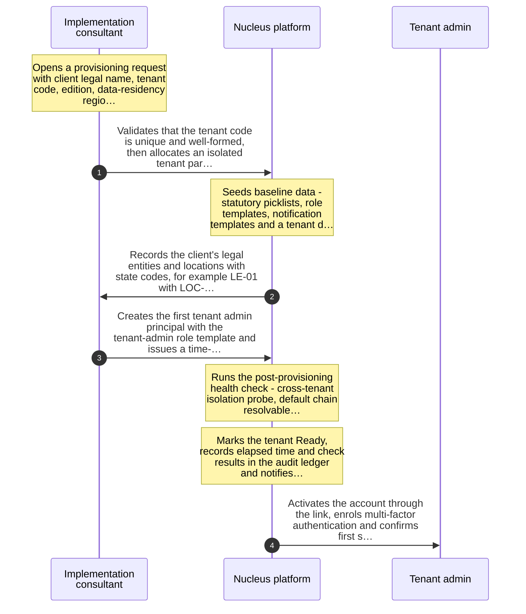

**Alternate flows**

| ID | At step | Condition | Steps | Rejoins |
| :--- | ---: | :--- | :--- | :--- |
| A1 | 3 | The request is a demo request rather than a signed order. | Nucleus platform seeds the synthetic Vindhya Precision Industries Pvt Ltd dataset in place of an empty tenant. → Nucleus platform sets an expiry date on the demo tenant and labels every screen as demonstration data. | Returns to step 5 |
| A2 | 4 | The consultant chooses to start from a previously approved configuration package. | Implementation consultant selects the package and reviews the list of objects it will create. → Nucleus platform applies the package as effective-dated configuration versions. | Returns to step 5 |

**Exception flows**

| ID | At step | Condition | Handling | Rule |
| :--- | ---: | :--- | :--- | :--- |
| E1 | 2 | The requested tenant code already exists or contains disallowed characters. | Nucleus platform rejects the request with the reason and suggests an available code; nothing is allocated. |  |
| E2 | 6 | Any health check fails, including a query that returns rows from another tenant. | Nucleus platform rolls back the whole run, sets status Failed with the failing check named and raises an operations alert. | RL-004 |
| E3 | 7 | Elapsed provisioning time exceeds 30 minutes. | The tenant is still completed if checks pass, but the run is flagged as an NFR breach and counted on the operations dashboard. |  |

**Postconditions — success**

- A tenant exists with its own isolation key, and every table query is filtered by that key.
- Baseline reference data, default role templates and a tenant default approval chain are seeded.
- A first tenant admin principal exists in Pending activation state and an activation link has been issued.
- The provisioning run is recorded in the audit ledger with duration and health-check results.

**Postconditions — failure**

- No partially created tenant remains; every artefact of the failed run is rolled back.
- The provisioning request shows status Failed with the failing check named, and the consultant is notified.

**Quality requirements**

- A tenant is fully provisioned, seeded and health-checked in under 30 minutes, end to end, with no manual step.
- The isolation probe in the health check runs against every tenant-scoped table and must return zero foreign rows.

### PLT-UC-002

**Grant identity, role and data scope** — Create a user or agent principal and grant it the narrowest entity, location and payroll-group scope its job needs, enforced on every request.

| Attribute | Value |
| :--- | :--- |
| Realises | PLT-02 |
| Source | Source workbook |
| Level | User goal |
| Primary actor | Tenant admin |
| Secondary actors | Nucleus platform, Plant HR / time office, Agent principal |
| Trigger | A user is created or moves role, entity or location, or a new agent is registered. |
| Frequency | Continuous |
| Criticality | Critical |
| Phase | P0 |
| Client requirements | R-09 |
| Business rules | RL-001, RL-002, RL-003, RL-004, RL-005, BS:RL-24 |
| Screens | SCR-005, SCR-022 |
| Data objects (CRUD) | principal (C), role (R), entity_grant (C), location_grant (C), scope_resolution (R), salary_structure (R) |
| Events | platform.principal.created, platform.scope.granted |
| Acceptance tests | TC-P01, TC-P02, TC-P03, TC-P04, TC-P05, TC-PR09, T-18 |
| System requirements | SYS-002, SYS-009, SYS-015, SYS-016, SYS-018, SYS-019 |

**Stakeholders and interests**

| Stakeholder | Interest |
| :--- | :--- |
| Payroll manager | Salary and rate structure of head-office-payrolled staff stay invisible to plant users. |
| Plant HR / time office | Sees and edits attendance for every worker at the site, including head-office-payrolled staff. |
| Auditor | Every grant names who granted it and from when it applies. |
| Compliance owner | Personal data access follows least privilege as expected under the DPDP Act 2023 (to be validated by Legal). |

**Preconditions**

- The tenant admin is authenticated with a recent step-up and holds the principal-administration permission.
- The legal entities, locations and payroll groups to be granted exist in the tenant.

**Main success scenario**

| # | Actor | Action | Ref |
| ---: | :--- | :--- | :--- |
| 1 | Tenant admin | Creates the principal (user, agent or service) on the scope grant screen and attaches a role template. | PLT-02.1 |
| 2 | Tenant admin | Grants entity scope by selecting one or more legal entity codes with an effective-from date. | PLT-02.2 |
| 3 | Tenant admin | Grants location scope by selecting one or more location codes and setting can_edit_time to Y or N. | PLT-02.3 |
| 4 | Nucleus platform | On every request, resolves effective scope as tenant ∩ entity ∩ location ∩ reporting subtree ∩ payroll group. | PLT-02.4 |
| 5 | Nucleus platform | Checks whether each requested field is a compensation field and whether the reader is outside the record's payroll group. | PLT-02.5 |

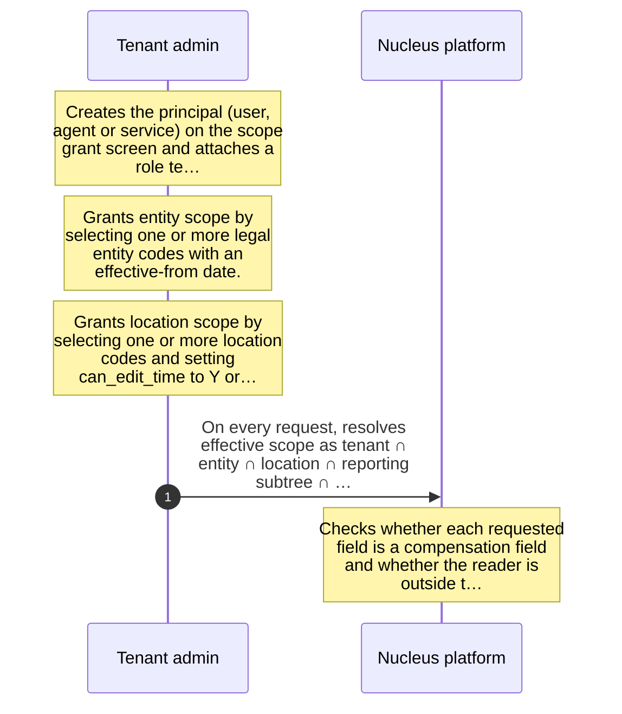

**Alternate flows**

| ID | At step | Condition | Steps | Rejoins |
| :--- | ---: | :--- | :--- | :--- |
| A1 | 5 | The field is not a compensation field, or the reader belongs to the record's payroll group. | Nucleus platform returns the field value unchanged within the resolved scope. | Ends the use case |
| A2 | 3 | The principal needs entity-wide time visibility and has no location grant. | Tenant admin sets the explicit entity-wide time visibility flag with a reason. → Nucleus platform records the flag as a grant with granted_by and effective_from. | Returns to step 4 |

**Exception flows**

| ID | At step | Condition | Handling | Rule |
| :--- | ---: | :--- | :--- | :--- |
| E1 | 1 | An agent principal is submitted without a named human owner. | Creation fails with the reason that an accountable owner is mandatory; nothing is persisted. | RL-001 |
| E2 | 3 | A principal has no location grant and no entity-wide time flag. | The principal sees no time data for any location until a location grant is added. | RL-003 |
| E3 | 4 | Scope resolution fails because a grant, reporting line or payroll group cannot be read. | Nucleus platform returns an empty set and logs the failure; it never falls back to a wider scope. | RL-004 |
| E4 | 5 | The reader is outside the record's payroll group and the field is basic, da, hra, daily_rate, gross or ctc. | The field is returned as null on screens, reports, exports and the API while attendance fields stay populated; the check runs in every build. | RL-005 |

**Postconditions — success**

- The principal exists with a role template, entity grants and location grants, each with granted_by and effective_from.
- Every subsequent request by the principal is filtered by the intersection of tenant, entity, location, reporting line and payroll group.
- Compensation fields of records outside the principal's payroll group are returned as null on every surface.

**Postconditions — failure**

- No principal or grant is persisted when a validation fails.
- A principal whose scope cannot be resolved receives an empty result set, never a full one.

**Quality requirements**

- Scope resolution adds no more than 20 ms at p95 to any read request.
- The compensation-nulling golden test runs on every build and blocks release on failure.

### PLT-UC-003

**Author and effective-date configuration** — Change a client policy as a versioned, effective-dated, simulated and approved configuration object rather than as code.

| Attribute | Value |
| :--- | :--- |
| Realises | PLT-03 |
| Source | Authored |
| Level | User goal |
| Primary actor | Implementation consultant |
| Secondary actors | Nucleus platform, Director / approver, HR operations |
| Trigger | A client policy changes or an implementation requires a new rule set. |
| Frequency | Continuous |
| Criticality | Critical |
| Phase | P0 |
| Client requirements | — |
| Business rules | RL-020, RL-021 |
| Screens | SCR-032 |
| Data objects (CRUD) | configuration_version (C), configuration_version (U), simulation_run (C), approval_instance (C), audit_entry (C) |
| Events | platform.record.versioned |
| Acceptance tests | TC-P20, TC-P21 |
| System requirements | SYS-026, SYS-032, SYS-037, SYS-048, SYS-053, SYS-059 |

**Stakeholders and interests**

| Stakeholder | Interest |
| :--- | :--- |
| HR operations | Policy changes take effect on the agreed date and old periods keep the old rules. |
| Payroll manager | A rerun of a past period uses the configuration that applied then. |
| Auditor | Every configuration version shows who changed it, why and when it applies. |

**Preconditions**

- The implementation consultant holds the implementation role for the tenant.
- The configuration object type (for example a leave policy) exists in the tenant.

**Main success scenario**

| # | Actor | Action | Ref |
| ---: | :--- | :--- | :--- |
| 1 | Implementation consultant | Opens the configuration object, for example a leave policy on the leave policy configuration screen, and creates a draft version. |  |
| 2 | Implementation consultant | Edits the parameters and enters the effective-from date and a change reason. |  |
| 3 | Nucleus platform | Validates the draft against its schema and dependent objects, such as leave types referenced by accrual rules. |  |
| 4 | Implementation consultant | Runs a simulation on a sample population and reviews per-employee before-and-after results. |  |
| 5 | Implementation consultant | Submits the draft for approval with the simulation summary attached. |  |
| 6 | Director / approver | Approves the configuration change through the shared approval engine. |  |
| 7 | Nucleus platform | Publishes the draft as a new version from the effective date and end-dates the superseded version without deleting it. |  |
| 8 | Nucleus platform | Writes an audit entry and emits a versioning event for downstream caches and consumers. |  |

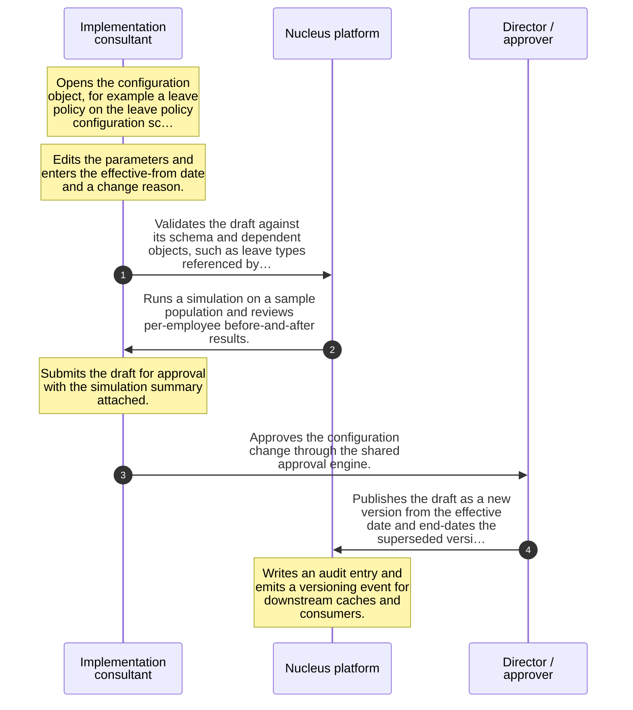

**Alternate flows**

| ID | At step | Condition | Steps | Rejoins |
| :--- | ---: | :--- | :--- | :--- |
| A1 | 2 | The effective date falls in a past period. | Nucleus platform lists the closed payroll and attendance periods the change would touch. → Implementation consultant confirms the retro change explicitly before the draft can be submitted. | Returns to step 3 |
| A2 | 2 | The client rule cannot be expressed with the available configuration parameters. | Implementation consultant records the rule as a product gap with the client's worked example. → The draft is saved but not submitted until the gap is resolved. | Ends the use case |

**Exception flows**

| ID | At step | Condition | Handling | Rule |
| :--- | ---: | :--- | :--- | :--- |
| E1 | 3 | Another published or pending version already starts on the same effective date. | Validation fails and names the conflicting version; the consultant must change the date or withdraw the other draft. | RL-020 |
| E2 | 4 | The simulation reports errors such as a negative leave balance for any employee. | Submission is disabled until the errors are resolved or each is acknowledged with a reason. |  |
| E3 | 6 | The approver rejects the change. | The draft returns to the consultant with the reason; the active version is unchanged. |  |

**Postconditions — success**

- A new configuration version exists with valid_from, change reason and approver, and the prior version is end-dated, not deleted.
- Computations dated before valid_from continue to read the prior version.

**Postconditions — failure**

- The draft remains unpublished and the active version is unchanged.

**Quality requirements**

- A simulation over 5,000 employees completes in under 60 seconds.
- Configuration version history is retained for the life of the tenant.

### PLT-UC-004

**Define and version an approval workflow** — Publish a new or changed approval chain definition as a version so that new requests use it while in-flight requests finish on the version they started under.

| Attribute | Value |
| :--- | :--- |
| Realises | PLT-04 |
| Source | Authored |
| Level | User goal |
| Primary actor | Implementation consultant |
| Secondary actors | Nucleus platform, Tenant admin |
| Trigger | A new approvable process is introduced or an existing chain must change. |
| Frequency | Occasional |
| Criticality | High |
| Phase | P0 |
| Client requirements | — |
| Business rules | RL-010, RL-011, RL-012 |
| Screens | — |
| Data objects (CRUD) | approval_chain (C), approval_chain_step (C), approval_instance (R), audit_entry (C) |
| Events | — |
| Acceptance tests | TC-P10, TC-P11, TC-P12 |
| System requirements | SYS-038, SYS-039, SYS-041, SYS-042, SYS-043 |

**Stakeholders and interests**

| Stakeholder | Interest |
| :--- | :--- |
| Manager / supervisor | Pending items in the inbox do not change approver or step count midway. |
| Employee / worker | A request submitted yesterday is decided under the rules that applied when it was submitted. |
| HR operations | Chains can change when the organisation changes, without a code release. |

**Preconditions**

- The request type exists and is wired to the shared approval engine.
- A tenant default chain exists for fallback routing.

**Main success scenario**

| # | Actor | Action | Ref |
| ---: | :--- | :--- | :--- |
| 1 | Implementation consultant | Selects a request type, for example leave application, and creates a draft chain version. |  |
| 2 | Implementation consultant | Sets the resolution keys the chain applies to: worker class, location and amount band. |  |
| 3 | Implementation consultant | Adds ordered steps, each with approver resolution mode (role, position or named person) and SLA hours. |  |
| 4 | Implementation consultant | Sets the reroute policy for departed approvers and the escalation target for SLA breach on each step. |  |
| 5 | Nucleus platform | Validates that every step can resolve an approver and that the keys do not overlap another active chain. |  |
| 6 | Implementation consultant | Simulates sample requests and reviews the approver resolved at each step. |  |
| 7 | Implementation consultant | Publishes the version with an effective-from date and a change reason. |  |
| 8 | Nucleus platform | Binds new submissions to the new version and leaves in-flight instances pinned to their starting version. |  |

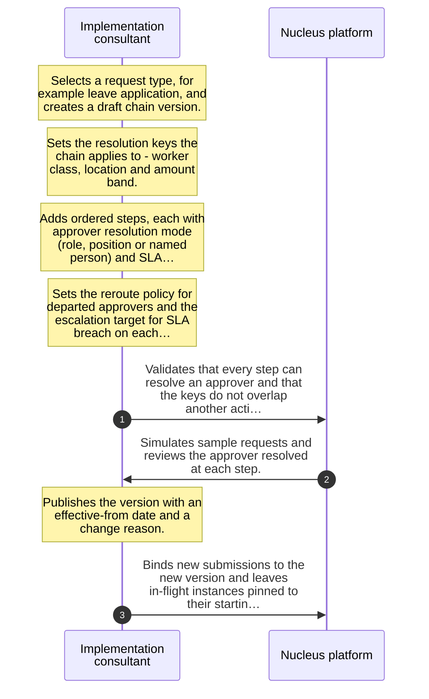

**Alternate flows**

| ID | At step | Condition | Steps | Rejoins |
| :--- | ---: | :--- | :--- | :--- |
| A1 | 7 | The consultant schedules the version for a future date. | Nucleus platform keeps the current version active until the effective date. → At the effective date, new submissions start binding to the new version. | Returns to step 8 |

**Exception flows**

| ID | At step | Condition | Handling | Rule |
| :--- | ---: | :--- | :--- | :--- |
| E1 | 5 | A step's role or position has no current holder in some location covered by the keys. | Validation fails and lists the uncovered locations; publication is blocked. | RL-011 |
| E2 | 5 | No reroute policy is set for a step resolved by named person. | Validation fails because a departed approver would leave items orphaned. | RL-012 |
| E3 | 5 | Two active chains match the same request type, worker class, location and amount band. | Validation fails and names the overlapping chain, since each request must resolve to exactly one chain. | RL-010 |

**Postconditions — success**

- A new chain version exists with effective_from, keys (request type, worker class, location, amount band), steps and SLA hours.
- Instances started before publication continue on their original version; new submissions bind to the new version.

**Postconditions — failure**

- The previous chain version remains in force and the draft stays unpublished.

**Quality requirements**

- Publishing a chain version never alters the step count or approvers of an in-flight instance.
- Chain resolution for a submitted request completes in under 100 ms at p95.

### PLT-UC-005

**Execute an approval chain** — Route any approvable request through its configured chain to a recorded final decision, with SLA tracking, rerouting and auditable HR override.

| Attribute | Value |
| :--- | :--- |
| Realises | PLT-05 |
| Source | Source workbook |
| Level | User goal |
| Primary actor | Employee / worker |
| Secondary actors | Nucleus platform, Manager / supervisor, Director / approver, HR operations |
| Trigger | A requester submits any approvable request: leave, gate pass, loan, requisition, overtime, regularisation or letter. |
| Frequency | Continuous |
| Criticality | Critical |
| Phase | P0 |
| Client requirements | — |
| Business rules | RL-010, RL-011, RL-012, RL-013, RL-014, RL-015 |
| Screens | SCR-040 |
| Data objects (CRUD) | approval_chain (R), approval_instance (C), approval_instance (U), approval_step (C), approval_step (U), audit_entry (C) |
| Events | platform.approval.started, platform.approval.step_opened, platform.approval.step_decided, platform.approval.completed, platform.approval.overridden |
| Acceptance tests | TC-P10, TC-P11, TC-P12, TC-P13, TC-L15 |
| System requirements | SYS-036, SYS-037, SYS-038, SYS-039, SYS-040, SYS-064 |

**Stakeholders and interests**

| Stakeholder | Interest |
| :--- | :--- |
| Employee / worker | Gets a timely decision and the reason for any rejection. |
| Manager / supervisor | Sees every pending item from every module in one inbox with the rule context. |
| HR operations | Can correct or close a request at any stage with the change on record. |
| Auditor | Each decision records actor, time, channel and reason. |

**Preconditions**

- The requester is authenticated and the request has passed its own form validation.
- A chain is configured for the request or a tenant default chain exists.

**Main success scenario**

| # | Actor | Action | Ref |
| ---: | :--- | :--- | :--- |
| 1 | Employee / worker | Submits an approvable request; the engine reads the chain for tenant, request type, worker class and location and opens an instance. | PLT-05.1 |
| 2 | Nucleus platform | Materialises the current step, resolves the approver by role, position or named person, and starts the SLA clock. | PLT-05.2 |
| 3 | Manager / supervisor | Approves, rejects or returns the item from the unified approval inbox; actor, timestamp, channel and reason are captured. | PLT-05.3 |
| 4 | Nucleus platform | Checks whether any mandatory steps remain in the chain. | PLT-05.4 |
| 5 | Nucleus platform | Closes the instance, emits the domain-specific approved event and hands control back to the calling process. | PLT-05.5 |
| 6 | HR operations | Overrides or edits the request at any stage when needed, recording actor and reason. | PLT-05.6 |

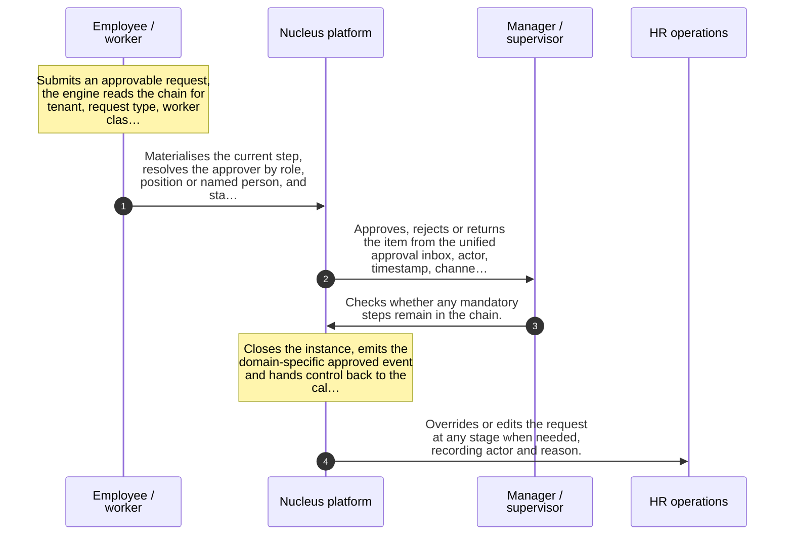

**Alternate flows**

| ID | At step | Condition | Steps | Rejoins |
| :--- | ---: | :--- | :--- | :--- |
| A1 | 4 | One or more mandatory steps remain. | Nucleus platform opens the next step sequentially and resolves its approver. → The next approver receives the item in the unified approval inbox. | Returns to step 3 |
| A2 | 3 | The approver returns the request for correction instead of deciding. | Nucleus platform sends the request back to the requester with the return reason. → Employee / worker amends and resubmits; the instance resumes at the same step. | Returns to step 3 |
| A3 | 3 | The approver decides from the business messaging channel or mobile app while offline. | The decision is queued on the device and synchronised when connectivity returns. → Nucleus platform records the channel and the original decision time. | Returns to step 4 |

**Exception flows**

| ID | At step | Condition | Handling | Rule |
| :--- | ---: | :--- | :--- | :--- |
| E1 | 1 | No chain is configured for the request's type, worker class and location. | The request routes to the tenant default chain and a configuration warning is raised to the implementation consultant. | RL-010 |
| E2 | 2 | The resolved approver is inactive or has left. | The step reroutes to the successor, then to the role holder; the item is never left orphaned. | RL-012 |
| E3 | 2 | The resolved approver is the requester. | Self-approval is not permitted; the step resolves to the next approver in the reporting line. | RL-011 |
| E4 | 3 | The approver rejects or returns without entering a reason. | The decision is refused until a reason is entered; on rejection the instance ends and the requester is notified with the reason text. | RL-013 |
| E5 | 5 | A step's SLA expires before a decision. | The item escalates per the step configuration and the breach is counted; the SLA is never silently extended. | RL-014 |
| E6 | 6 | HR submits an override without a reason. | The service rejects the override; the request state is unchanged. | RL-015 |

**Postconditions — success**

- The approval instance is closed with final state, closed_at and every step decision recorded.
- The domain-specific approved event is emitted and control returns to the calling process.

**Postconditions — failure**

- On rejection the instance ends, the requester is notified with the reason, and the calling process receives the rejection.
- No item is left without an active approver.

**Quality requirements**

- A decision recorded in the inbox is reflected in the calling module within 5 seconds at p95.
- Decisions queued offline are synchronised within 60 seconds of reconnection without duplication.

### PLT-UC-006

**Write the audit and action ledger** — Record every write and every sensitive read in one append-only ledger that names the real actor, including agent identity and its human owner.

| Attribute | Value |
| :--- | :--- |
| Realises | PLT-06 |
| Source | Authored |
| Level | Subfunction |
| Primary actor | Nucleus platform |
| Secondary actors | Auditor, Agent principal, Compliance owner |
| Trigger | Any service commits a write or serves a read of a field classified as sensitive. |
| Frequency | Continuous |
| Criticality | Critical |
| Phase | P0 |
| Client requirements | — |
| Business rules | RL-001, RL-015 |
| Screens | SCR-110 |
| Data objects (CRUD) | audit_entry (C), audit_entry (R), access_event (C) |
| Events | — |
| Acceptance tests | TC-L15 |
| System requirements | SYS-014, SYS-032, SYS-033, SYS-034, SYS-035 |

**Stakeholders and interests**

| Stakeholder | Interest |
| :--- | :--- |
| Auditor | Can reconstruct who did what, on whose behalf and through which channel. |
| Compliance owner | Access to PAN, Aadhaar, bank and salary data is evidenced for privacy obligations (to be validated by Legal). |
| Tenant admin | Agent actions are traceable to their accountable owner. |

**Preconditions**

- The acting principal has been authenticated and its scope resolved.
- Field security classifications are configured for sensitive fields.

**Main success scenario**

| # | Actor | Action | Ref |
| ---: | :--- | :--- | :--- |
| 1 | Nucleus platform | Intercepts a committed write or a read that returns a field classified as sensitive. |  |
| 2 | Nucleus platform | Builds the entry: tenant, actor principal, real actor if delegated or act-as, agent owner, action and object reference. |  |
| 3 | Nucleus platform | Adds a before-and-after digest for writes, or the sensitive field classes revealed for reads, plus channel and source IP. |  |
| 4 | Nucleus platform | Appends the entry in the same transaction as the business write, chained to the previous entry's hash. |  |
| 5 | Auditor | Queries the ledger read-only by object, actor, agent or date range within the auditor's scope. |  |
| 6 | Nucleus platform | Verifies hash-chain integrity nightly and reports the result to the auditor dashboard. |  |

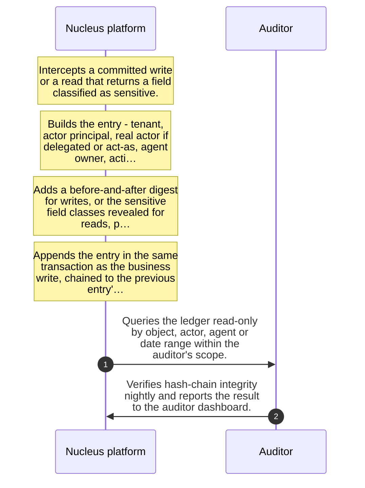

**Alternate flows**

| ID | At step | Condition | Steps | Rejoins |
| :--- | ---: | :--- | :--- | :--- |
| A1 | 2 | The actor is an agent principal. | Nucleus platform records the agent principal as actor and its owner_principal_id as accountable owner on the same entry. → The entry is stored in the same ledger, with agent identity as a dimension. | Returns to step 3 |

**Exception flows**

| ID | At step | Condition | Handling | Rule |
| :--- | ---: | :--- | :--- | :--- |
| E1 | 4 | The ledger append fails. | The business transaction is rolled back and the caller receives a retriable error. |  |
| E2 | 5 | Any principal attempts to update or delete a ledger entry. | The operation is refused and the attempt is itself recorded as a ledger entry. |  |
| E3 | 6 | The nightly integrity check finds a broken hash link. | A security incident is raised to the tenant admin and auditor with the first broken entry identified. |  |
| E4 | 2 | An HR override arrives without a reason. | The override is rejected before reaching the ledger, so no unexplained override is recorded as accepted. | RL-015 |

**Postconditions — success**

- An immutable ledger entry exists with tenant, actor, on-behalf-of, agent owner where applicable, action, object, change digest, channel, IP and timestamp.
- The entry is linked to the previous entry so tampering is detectable.

**Postconditions — failure**

- If the ledger entry cannot be written, the business write is rolled back; no unaudited write persists.

**Quality requirements**

- Ledger append adds no more than 10 ms at p95 to a write transaction.
- Ledger entries are retained for at least 8 years and cannot be altered by any role, including tenant admin.

### PLT-UC-007

**Publish domain events through the outbox relay** — Guarantee that every committed domain write publishes its event exactly once to consumers, and that no event is published for a write that rolled back.

| Attribute | Value |
| :--- | :--- |
| Realises | PLT-07 |
| Source | Authored |
| Level | Subfunction |
| Primary actor | Nucleus platform |
| Secondary actors | ERP system, Business messaging channel |
| Trigger | Any domain service commits a write that produces an event. |
| Frequency | Continuous |
| Criticality | Critical |
| Phase | P0 |
| Client requirements | — |
| Business rules | — |
| Screens | — |
| Data objects (CRUD) | outbox_message (C), outbox_message (U), dead_letter_message (C) |
| Events | platform.principal.created, platform.approval.completed, platform.record.versioned |
| Acceptance tests | — |
| System requirements | SYS-053, SYS-054, SYS-055, SYS-058 |

**Stakeholders and interests**

| Stakeholder | Interest |
| :--- | :--- |
| Finance | Payroll and journal events reach the ERP system once, never twice and never lost. |
| Implementation consultant | Event transport can change without modifying producing services. |
| Auditor | Events can be replayed for dispute investigation. |

**Preconditions**

- The producing service writes its outbox row through the shared outbox library.
- Each event type has a declared idempotency key.

**Main success scenario**

| # | Actor | Action | Ref |
| ---: | :--- | :--- | :--- |
| 1 | Nucleus platform | Writes the business change and an outbox row in the same database transaction. |  |
| 2 | Nucleus platform | Populates the outbox row with a CloudEvents envelope: id, type, source, tenant, subject, time and idempotency key. |  |
| 3 | Nucleus platform | Relay reads unpublished outbox rows per tenant in commit order. |  |
| 4 | Nucleus platform | Relay publishes each event to the configured transport and waits for acknowledgement. |  |
| 5 | Nucleus platform | Marks the outbox row published with the acknowledgement timestamp. |  |
| 6 | ERP system | Receives the event, checks the idempotency key and processes it once. |  |

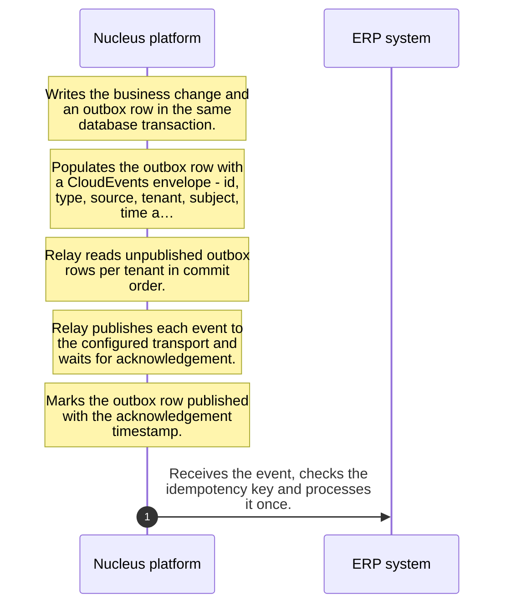

**Alternate flows**

| ID | At step | Condition | Steps | Rejoins |
| :--- | ---: | :--- | :--- | :--- |
| A1 | 4 | The operations team switches the event transport. | The relay is reconfigured to the new transport adapter. → Producers continue writing outbox rows unchanged; the relay resumes from the oldest unpublished row. | Returns to step 5 |

**Exception flows**

| ID | At step | Condition | Handling | Rule |
| :--- | ---: | :--- | :--- | :--- |
| E1 | 1 | The business transaction rolls back. | The outbox row rolls back with it, so no event is ever published for an uncommitted change. |  |
| E2 | 4 | The transport is unavailable. | Rows stay unpublished and are retried with exponential backoff; none is dropped. |  |
| E3 | 4 | An event fails 8 consecutive publish attempts. | The row is moved to the dead-letter store, later events for other subjects continue, and an operations alert is raised. |  |
| E4 | 6 | A consumer receives an event whose idempotency key it has already processed. | The consumer acknowledges and discards the duplicate without side effects. |  |

**Postconditions — success**

- The outbox row is marked published with a timestamp, and every subscribed consumer has processed the event once.

**Postconditions — failure**

- Unpublished rows remain in the outbox and are retried; repeatedly failing rows are moved to a dead-letter store and an alert is raised.

**Quality requirements**

- An event is published within 5 seconds of commit at p95 under 1,000 writes per second per tenant.
- Zero event loss across relay restarts, verified by commit-count to publish-count reconciliation.

### PLT-UC-008

**Write bi-temporal versions and read as at a point in time** — Keep every temporal fact as non-destructive versions on valid and recorded time so that any past state can be reproduced exactly.

| Attribute | Value |
| :--- | :--- |
| Realises | PLT-08 |
| Source | Source workbook |
| Level | Subfunction |
| Primary actor | Nucleus platform |
| Secondary actors | Payroll manager, Plant HR / time office, Auditor |
| Trigger | Any change to a temporal fact such as an assignment, salary structure or policy attribute, or any as-at read request. |
| Frequency | Continuous |
| Criticality | Critical |
| Phase | P0 |
| Client requirements | — |
| Business rules | RL-020, RL-021 |
| Screens | — |
| Data objects (CRUD) | temporal_record (C), temporal_record (U), temporal_record (R) |
| Events | platform.record.versioned |
| Acceptance tests | TC-P20, TC-P21 |
| System requirements | SYS-021, SYS-022, SYS-023, SYS-024 |

**Stakeholders and interests**

| Stakeholder | Interest |
| :--- | :--- |
| Payroll manager | Rerunning a past period reproduces the same result from the same snapshot. |
| Plant HR / time office | Attendance recompute uses the facts known at the recompute snapshot. |
| Auditor | Can see both what was true and what was known at any moment. |

**Preconditions**

- The table is declared temporal with valid_from, valid_to, recorded_from and recorded_to columns.

**Main success scenario**

| # | Actor | Action | Ref |
| ---: | :--- | :--- | :--- |
| 1 | Nucleus platform | Opens a new version for the temporal fact with valid_from, valid_to, recorded_from, changed_by and change_reason. | PLT-08.1 |
| 2 | Nucleus platform | End-dates the superseded version by setting recorded_to; the row is never deleted. | PLT-08.2 |
| 3 | Nucleus platform | Serves as-at reads using caller-supplied valid_at and recorded_at, defaulting recorded_at to now. | PLT-08.3 |

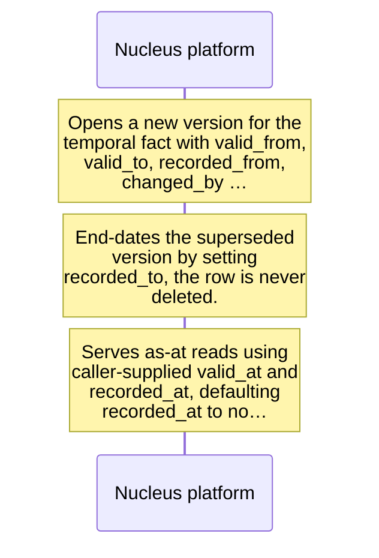

**Alternate flows**

| ID | At step | Condition | Steps | Rejoins |
| :--- | ---: | :--- | :--- | :--- |
| A1 | 1 | The change corrects a past fact rather than recording a future change. | Nucleus platform writes a version with the original valid_from and a new recorded_from. → Reads with recorded_at before the correction still return the uncorrected value. | Returns to step 2 |

**Exception flows**

| ID | At step | Condition | Handling | Rule |
| :--- | ---: | :--- | :--- | :--- |
| E1 | 1 | A service attempts to update a temporal row in place. | The data layer rejects the update; only versioned writes are accepted. | RL-020 |
| E2 | 3 | A payroll run or attendance recompute calls the as-at read without its snapshot timestamp. | The read is rejected for derived work; the caller must pass the run or recompute snapshot timestamp. | RL-021 |
| E3 | 2 | A delete is requested on a temporal row. | The delete is refused; a closing version is written instead. | RL-020 |

**Postconditions — success**

- A new version row exists; the superseded version carries recorded_to; no row has been deleted or updated in place.
- As-at reads return the version valid at valid_at as known at recorded_at.

**Postconditions — failure**

- The write is rejected and the existing versions are unchanged.

**Quality requirements**

- An as-at read for a single record returns in under 50 ms at p95.
- A payroll rerun with the same snapshot timestamp produces byte-identical results.

### PLT-UC-009

**Enforce adaptive MFA and step-up authentication** — Require multi-factor authentication for privileged roles and fresh re-authentication before high-risk actions.

| Attribute | Value |
| :--- | :--- |
| Realises | PLT-CG-001 |
| Source | Authored |
| Level | User goal |
| Primary actor | Payroll manager |
| Secondary actors | Nucleus platform, Identity provider, Tenant admin |
| Trigger | A privileged user signs in, or any user starts a protected action: unmask an identifier, change bank details, approve payroll or grant a role. |
| Frequency | Continuous |
| Criticality | Critical |
| Phase | P0 |
| Client requirements | — |
| Business rules | — |
| Screens | SCR-005 |
| Data objects (CRUD) | mfa_policy (C), authenticator_enrolment (R), auth_session (U), audit_entry (C) |
| Events | — |
| Acceptance tests | PLT-TC-001, PLT-TC-002, PLT-TC-003, PLT-TC-004, PLT-TC-005, PLT-TC-006 |
| System requirements | SYS-011, SYS-015, SYS-032, SYS-083 |

**Stakeholders and interests**

| Stakeholder | Interest |
| :--- | :--- |
| Tenant admin | Privileged accounts cannot be used with a stolen password alone. |
| Employee / worker | Bank details cannot be changed by someone holding a session left open. |
| Auditor | Each high-risk action records the authentication strength used. |

**Preconditions**

- The tenant admin has configured the MFA policy, the list of privileged roles and the step-up window.
- The user has at least one enrolled factor: TOTP, push approval or FIDO2 passkey.

**Main success scenario**

| # | Actor | Action | Ref |
| ---: | :--- | :--- | :--- |
| 1 | Tenant admin | Configures the MFA policy: privileged roles, allowed factors (TOTP, push, FIDO2 passkey) and a step-up window of 5 minutes. |  |
| 2 | Payroll manager | Signs in through the identity provider using OIDC or SAML 2.0, or with local credentials. |  |
| 3 | Nucleus platform | Detects a privileged role and evaluates risk signals such as a new device or unusual location. |  |
| 4 | Payroll manager | Completes the requested second factor. |  |
| 5 | Payroll manager | Starts a protected action, for example approving the October 2026 payroll for payroll group HO. |  |
| 6 | Nucleus platform | Checks the time since the last strong authentication and requests step-up when it exceeds the configured window. |  |
| 7 | Payroll manager | Re-authenticates with an enrolled factor. |  |
| 8 | Nucleus platform | Executes the action and records factor type and authentication time in the audit ledger. |  |

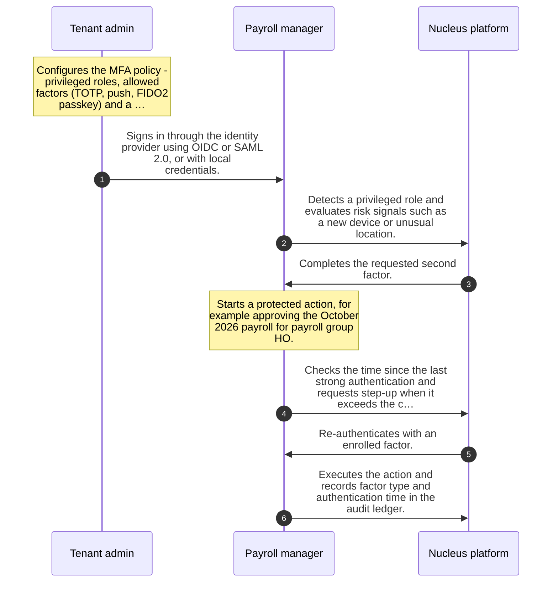

**Alternate flows**

| ID | At step | Condition | Steps | Rejoins |
| :--- | ---: | :--- | :--- | :--- |
| A1 | 6 | The last strong authentication is within the step-up window. | Nucleus platform proceeds without a new challenge. | Returns to step 8 |
| A2 | 3 | The identity provider asserts that MFA was already completed with an accepted method. | Nucleus platform accepts the assertion and records the asserted method. | Returns to step 5 |

**Exception flows**

| ID | At step | Condition | Handling | Rule |
| :--- | ---: | :--- | :--- | :--- |
| E1 | 4 | The user fails the factor 5 times in a row. | The factor is locked for 15 minutes, the session is ended and the tenant admin is alerted. |  |
| E2 | 3 | A privileged user has no enrolled factor. | Privileged functions are blocked and the user is taken to factor enrolment before continuing. |  |
| E3 | 7 | The user cancels the step-up challenge. | The protected action is abandoned and nothing is changed. |  |

**Postconditions — success**

- The protected action executes and the audit entry records the factor type and time of the last strong authentication.

**Postconditions — failure**

- The protected action is not executed; repeated failures lock the factor and alert the tenant admin.

**Quality requirements**

- Step-up challenge and verification complete in under 3 seconds at p95 excluding user think time.
- Authentication flows conform to OWASP ASVS level 2 controls for authentication and session management.

### PLT-UC-010

**Deliver notifications through a channel matrix and preference centre** — Deliver each workflow and system notification on the right channels, in the recipient's language and time preferences, with an auditable delivery log.

| Attribute | Value |
| :--- | :--- |
| Realises | PLT-CG-002 |
| Source | Authored |
| Level | User goal |
| Primary actor | Tenant admin |
| Secondary actors | Nucleus platform, Employee / worker, Business messaging channel |
| Trigger | A domain event occurs that the notification matrix maps to one or more recipients. |
| Frequency | Continuous |
| Criticality | High |
| Phase | P1 |
| Client requirements | — |
| Business rules | — |
| Screens | SCR-040 |
| Data objects (CRUD) | notification_matrix (C), notification_preference (U), notification (C), delivery_log (C) |
| Events | platform.approval.step_opened, platform.approval.completed |
| Acceptance tests | PLT-TC-007, PLT-TC-008, PLT-TC-009, PLT-TC-010, PLT-TC-011, PLT-TC-012 |
| System requirements | SYS-017, SYS-055, SYS-066, SYS-070 |

**Stakeholders and interests**

| Stakeholder | Interest |
| :--- | :--- |
| Manager / supervisor | Receives approval prompts promptly without a flood of low-value alerts. |
| Employee / worker | Hears from the system in their language and not during rest hours. |
| Compliance owner | Can prove that a mandatory notice was delivered. |

**Preconditions**

- The notification matrix maps event types to recipient roles, channels and a mandatory flag.
- Templates exist for each mapped event in each enabled language.

**Main success scenario**

| # | Actor | Action | Ref |
| ---: | :--- | :--- | :--- |
| 1 | Tenant admin | Configures the matrix: event type × recipient role × channels (in-app, email, push, SMS, business messaging) and a mandatory flag. |  |
| 2 | Employee / worker | Sets personal preferences in the preference centre: language, quiet hours and daily digest for non-urgent items. |  |
| 3 | Nucleus platform | Receives a domain event, for example an approval step opened, and resolves recipients from the matrix. |  |
| 4 | Nucleus platform | Applies quiet hours and digest preferences unless the notification is flagged mandatory. |  |
| 5 | Nucleus platform | Renders the template in the recipient's language with the event's data. |  |
| 6 | Nucleus platform | Dispatches on each resolved channel and records each attempt with status in the delivery log. |  |
| 7 | Compliance owner | Searches the delivery log by recipient, event or date to evidence delivery. |  |

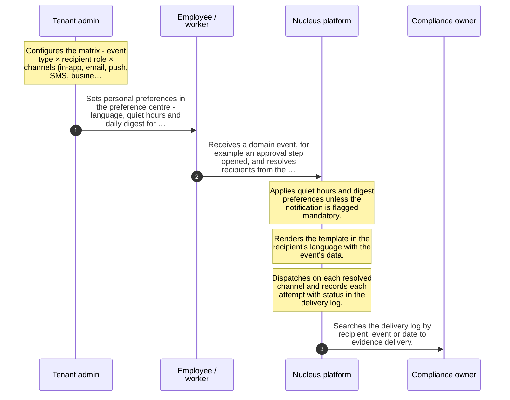

**Alternate flows**

| ID | At step | Condition | Steps | Rejoins |
| :--- | ---: | :--- | :--- | :--- |
| A1 | 4 | The notification falls in the recipient's quiet hours and is not mandatory. | Nucleus platform holds the notification and adds it to the next digest or releases it when quiet hours end. | Returns to step 5 |
| A2 | 5 | No template exists in the recipient's language. | Nucleus platform renders the tenant default language and records the fallback in the delivery log. | Returns to step 6 |

**Exception flows**

| ID | At step | Condition | Handling | Rule |
| :--- | ---: | :--- | :--- | :--- |
| E1 | 6 | The primary channel reports a delivery failure. | The notification is retried once, then sent on the configured fallback channel; the in-app copy always remains. |  |
| E2 | 2 | An employee tries to opt out of a mandatory notification type. | The opt-out is refused with an explanation that the notice is mandatory. |  |

**Postconditions — success**

- Each recipient receives the notification on the resolved channels, and each attempt is in the delivery log with status.

**Postconditions — failure**

- Undeliverable notifications are retried on the fallback channel and remain visible in-app; failures are logged with reason.

**Quality requirements**

- Urgent notifications are dispatched within 30 seconds of the triggering event at p95.
- Delivery log entries are retained for 3 years and searchable within 5 seconds.

### PLT-UC-011

**Design approval processes without code** — Let tenant administrators author, simulate, publish and revert approval chains, conditions and SLAs on the shared approval engine without a code release.

| Attribute | Value |
| :--- | :--- |
| Realises | PLT-CG-003 |
| Source | Authored |
| Level | User goal |
| Primary actor | Tenant admin |
| Secondary actors | Nucleus platform, Implementation consultant |
| Trigger | The client needs a new approval process or a change to conditions, steps or SLAs. |
| Frequency | Occasional |
| Criticality | High |
| Phase | P2 |
| Client requirements | — |
| Business rules | RL-010, RL-011, RL-012 |
| Screens | — |
| Data objects (CRUD) | approval_chain (C), approval_chain (U), simulation_run (C), audit_entry (C) |
| Events | — |
| Acceptance tests | TC-P10, TC-P11, TC-P12, PLT-TC-013, PLT-TC-014, PLT-TC-015, PLT-TC-016 |
| System requirements | SYS-039, SYS-042, SYS-044, SYS-048, SYS-069 |

**Stakeholders and interests**

| Stakeholder | Interest |
| :--- | :--- |
| HR operations | Process changes after a reorganisation take days, not a release cycle. |
| Director / approver | Amount-based thresholds route only material items to directors. |
| Auditor | Every published version is effective-dated and reversible with history. |

**Preconditions**

- The tenant admin holds the process-designer permission.
- The request type is registered with the shared approval engine and exposes its condition fields (for example amount and worker class).

**Main success scenario**

| # | Actor | Action | Ref |
| ---: | :--- | :--- | :--- |
| 1 | Tenant admin | Opens the visual designer for a request type and starts a draft from the active chain version. |  |
| 2 | Tenant admin | Adds or reorders steps and sets each step's approver resolution mode and SLA hours. |  |
| 3 | Tenant admin | Adds conditions, for example a director step only when loan amount exceeds ₹2,00,000. |  |
| 4 | Nucleus platform | Validates that every path resolves an approver, has a reroute policy and ends in a terminal state. |  |
| 5 | Tenant admin | Runs a simulation with sample requests and reviews the path and approvers each one would take. |  |
| 6 | Tenant admin | Publishes the draft with an effective-from date and change reason. |  |
| 7 | Nucleus platform | Activates the version for new submissions from the effective date; in-flight instances stay on their starting version. |  |

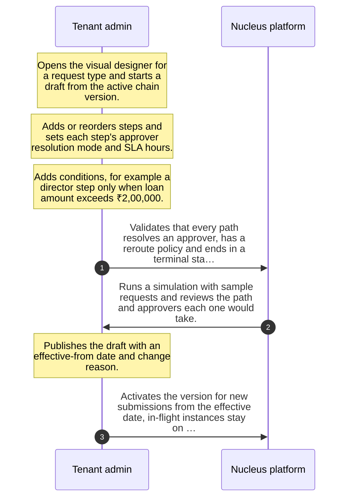

**Alternate flows**

| ID | At step | Condition | Steps | Rejoins |
| :--- | ---: | :--- | :--- | :--- |
| A1 | 6 | A published version needs to be reverted. | Tenant admin selects the prior version and publishes it as a new version with a reversal reason. → Nucleus platform applies it to new submissions from the chosen date. | Returns to step 7 |

**Exception flows**

| ID | At step | Condition | Handling | Rule |
| :--- | ---: | :--- | :--- | :--- |
| E1 | 4 | A condition branch has no approver or no terminal state. | Validation fails and highlights the incomplete branch on the canvas. | RL-011 |
| E2 | 4 | A step is resolved by named person without a reroute policy. | Validation fails until a successor or role fallback is set. | RL-012 |
| E3 | 6 | The new version overlaps the keys of another active chain. | Publication is blocked and the overlapping chain is named. | RL-010 |

**Postconditions — success**

- A new effective-dated chain version is live and the previous version is retained for reversal.

**Postconditions — failure**

- The draft is unpublished and the active version is unchanged.

**Quality requirements**

- The designer canvas remains responsive with up to 25 steps and 10 condition branches.
- The designer meets WCAG 2.2 AA, including keyboard-only editing of steps.

### PLT-UC-012

**Promote configuration from sandbox to production** — Build and test configuration in a sandbox tenant and promote it to production as a reviewed, approved and reversible package.

| Attribute | Value |
| :--- | :--- |
| Realises | PLT-CG-004 |
| Source | Authored |
| Level | User goal |
| Primary actor | Implementation consultant |
| Secondary actors | Tenant admin, Nucleus platform |
| Trigger | A configuration change is ready for testing or for promotion to production. |
| Frequency | Occasional |
| Criticality | Medium |
| Phase | P2 |
| Client requirements | — |
| Business rules | RL-020 |
| Screens | — |
| Data objects (CRUD) | config_package (C), config_diff (C), configuration_version (C), rollback_point (C) |
| Events | platform.record.versioned |
| Acceptance tests | PLT-TC-017, PLT-TC-018, PLT-TC-019, PLT-TC-020 |
| System requirements | SYS-008, SYS-022, SYS-026, SYS-037 |

**Stakeholders and interests**

| Stakeholder | Interest |
| :--- | :--- |
| Tenant admin | Nothing reaches production without a visible diff and approval. |
| Payroll manager | Rule changes are tested on realistic data before a live run. |
| Auditor | Each promotion is traceable to its package, approver and rollback point. |

**Preconditions**

- A sandbox tenant is linked to the production tenant.
- Sandbox data containing personal information is masked or synthetic.

**Main success scenario**

| # | Actor | Action | Ref |
| ---: | :--- | :--- | :--- |
| 1 | Implementation consultant | Refreshes the sandbox from production configuration with personal data masked. |  |
| 2 | Implementation consultant | Authors and tests changes to rules, picklists, workflows and rule packs in the sandbox. |  |
| 3 | Implementation consultant | Assembles the changed objects into a configuration package with a description. |  |
| 4 | Nucleus platform | Produces an object-by-object diff of the package against the production tenant and flags dependency gaps. |  |
| 5 | Tenant admin | Reviews the diff and approves or rejects the promotion. |  |
| 6 | Nucleus platform | Records a rollback point and applies the package to production as new configuration versions. |  |
| 7 | Nucleus platform | Runs post-promotion smoke checks and records the result against the package. |  |

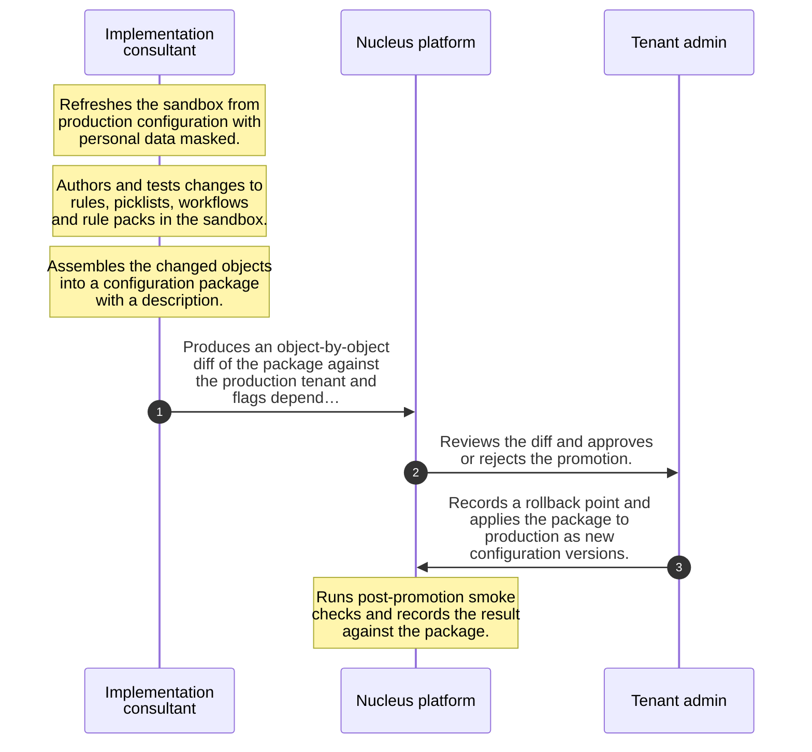

**Alternate flows**

| ID | At step | Condition | Steps | Rejoins |
| :--- | ---: | :--- | :--- | :--- |
| A1 | 7 | Smoke checks pass but the client later asks to undo the promotion. | Tenant admin selects the package and requests rollback with a reason. → Nucleus platform writes new versions restoring the rollback-point configuration. | Ends the use case |

**Exception flows**

| ID | At step | Condition | Handling | Rule |
| :--- | ---: | :--- | :--- | :--- |
| E1 | 4 | The package references an object missing in production, such as a picklist value. | Promotion is blocked until the dependency is added to the package. |  |
| E2 | 7 | A smoke check fails. | The platform restores the rollback point automatically and marks the promotion Failed. | RL-020 |
| E3 | 6 | Production changed the same object after the diff was produced. | Promotion stops and a fresh diff is required. |  |

**Postconditions — success**

- Production holds the promoted configuration as new effective-dated versions, with a recorded rollback point.

**Postconditions — failure**

- Production configuration is unchanged, or restored to the rollback point.

**Quality requirements**

- A package of 200 objects is diffed in under 30 seconds and applied in under 2 minutes.
- Sandbox refresh never copies unmasked Aadhaar, PAN or bank values.

### PLT-UC-013

**Delegate approval authority and act as a user** — Allow time-boxed, reason-coded delegation of approvals and audited act-as sessions, with the real actor always recorded.

| Attribute | Value |
| :--- | :--- |
| Realises | PLT-CG-005 |
| Source | Authored |
| Level | User goal |
| Primary actor | Manager / supervisor |
| Secondary actors | Nucleus platform, Tenant admin, Director / approver |
| Trigger | An approver plans an absence, or a support engineer needs to reproduce a user's problem. |
| Frequency | Weekly |
| Criticality | High |
| Phase | P1 |
| Client requirements | — |
| Business rules | RL-011, RL-012, RL-013 |
| Screens | SCR-040, SCR-005 |
| Data objects (CRUD) | delegation (C), delegation (U), act_as_session (C), approval_step (U), audit_entry (C) |
| Events | platform.approval.step_decided |
| Acceptance tests | TC-P12, TC-P13, PLT-TC-021, PLT-TC-022, PLT-TC-023, PLT-TC-024, PLT-TC-025, PLT-TC-026 |
| System requirements | SYS-014, SYS-020, SYS-032, SYS-039 |

**Stakeholders and interests**

| Stakeholder | Interest |
| :--- | :--- |
| Employee / worker | Requests are decided while the usual approver is away. |
| Tenant admin | Support staff can diagnose issues as the user without sharing passwords. |
| Auditor | Delegated and act-as actions name the real person who acted. |

**Preconditions**

- The delegate holds a role that can view the delegated request types within the delegator's scope.
- Act-as is enabled by the tenant admin for named support principals only.

**Main success scenario**

| # | Actor | Action | Ref |
| ---: | :--- | :--- | :--- |
| 1 | Manager / supervisor | Creates a delegation naming the delegate, request types, start and end dates and a reason code. |  |
| 2 | Nucleus platform | Validates that the delegate is active, is not the requester on any delegated item, and has the scope to see the items. |  |
| 3 | Nucleus platform | From the start date, resolves steps owned by the delegator to the delegate and moves open items to the delegate's inbox. |  |
| 4 | Director / approver | As delegate, approves or rejects items; the decision records the delegate as actor and the delegator as on-behalf-of. |  |
| 5 | Nucleus platform | Ends the delegation at the end date and returns open items to the delegator's inbox. |  |

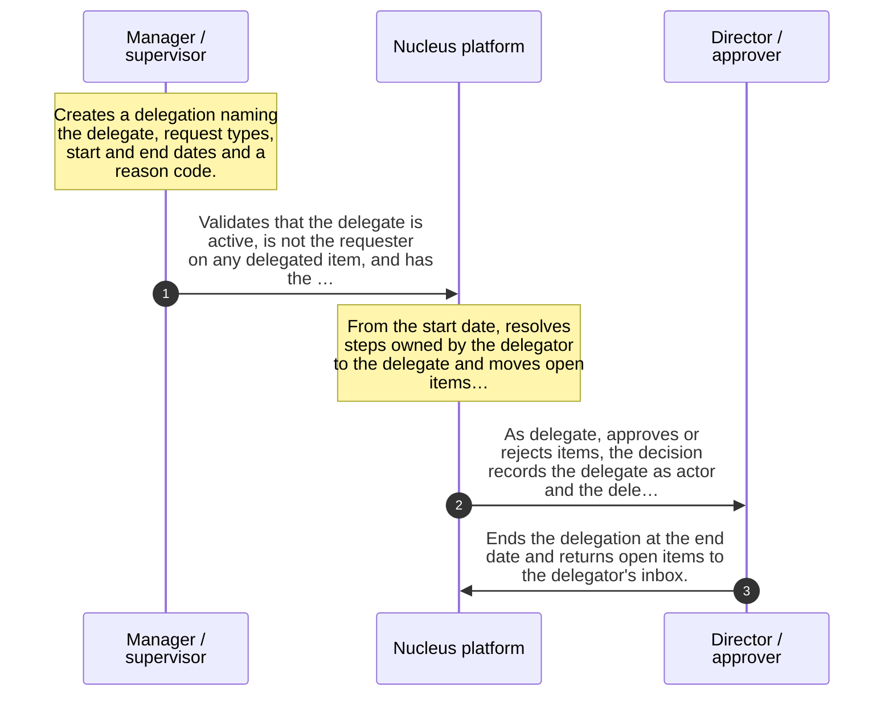

**Alternate flows**

| ID | At step | Condition | Steps | Rejoins |
| :--- | ---: | :--- | :--- | :--- |
| A1 | 1 | A support engineer needs to act as a user to diagnose a problem. | A support engineer requests an act-as session for a user with a ticket reference and a duration up to 60 minutes. → Tenant admin approves the session; Nucleus platform shows a persistent act-as banner and records every action with the real actor. → The session ends automatically at expiry. | Ends the use case |
| A2 | 5 | The delegator returns early. | Manager / supervisor ends the delegation before its end date. → Nucleus platform returns open items to the delegator immediately. | Ends the use case |

**Exception flows**

| ID | At step | Condition | Handling | Rule |
| :--- | ---: | :--- | :--- | :--- |
| E1 | 2 | The delegate has left or is inactive during the window. | The delegation is suspended and items reroute to the successor or role holder. | RL-012 |
| E2 | 4 | The delegated item was raised by the delegate. | The item skips the delegate and resolves to the next approver in the line. | RL-011 |
| E3 | 1 | An act-as session attempts to approve payroll or grant roles. | The action is blocked in act-as sessions and the attempt is logged. |  |

**Postconditions — success**

- During the window, items route to the delegate, and every action records both delegate and delegator.
- The delegation or act-as session ends automatically at its end time.

**Postconditions — failure**

- No delegation is created and items continue to route to the original approver.

**Quality requirements**

- Open items move to the delegate's inbox within 1 minute of the delegation start time.
- Act-as sessions cannot exceed 60 minutes and cannot be extended without a new approval.

### PLT-UC-014

**Load data in bulk with validation and rollback** — Import master or transaction records in bulk, validated row by row with the same rules as the forms, with dry-run, partial-commit control and batch rollback.

| Attribute | Value |
| :--- | :--- |
| Realises | PLT-CG-006 |
| Source | Authored |
| Level | User goal |
| Primary actor | HR operations |
| Secondary actors | Nucleus platform, Implementation consultant |
| Trigger | HR operations needs to create or update many records of one object type from a spreadsheet, CSV file or API call. |
| Frequency | Weekly |
| Criticality | High |
| Phase | P1 |
| Client requirements | — |
| Business rules | RL-004, RL-020 |
| Screens | — |
| Data objects (CRUD) | load_batch (C), load_row_result (C), temporal_record (C), audit_entry (C) |
| Events | platform.record.versioned |
| Acceptance tests | PLT-TC-027, PLT-TC-028, PLT-TC-029, PLT-TC-030, PLT-TC-031, PLT-TC-032 |
| System requirements | SYS-017, SYS-022, SYS-032, SYS-061, SYS-070 |

**Stakeholders and interests**

| Stakeholder | Interest |
| :--- | :--- |
| HR operations | Large changes such as annual increments load in minutes, not days of manual entry. |
| Payroll manager | Bad rows never reach payroll inputs. |
| Auditor | Each load batch is identifiable and reversible. |

**Preconditions**

- The user holds create or update permission for the object within the target entity and location scope.
- A load template exists for the object.

**Main success scenario**

| # | Actor | Action | Ref |
| ---: | :--- | :--- | :--- |
| 1 | HR operations | Selects the object type, for example assignment changes, and downloads the load template. |  |
| 2 | HR operations | Uploads the completed file or submits the API payload and chooses dry-run. |  |
| 3 | Nucleus platform | Validates every row with the same rules as the form, including scope checks, and builds a row-level report. |  |
| 4 | HR operations | Reviews the dry-run report and corrects rejected rows or accepts them as excluded. |  |
| 5 | HR operations | Chooses all-or-nothing or partial commit and confirms the load. |  |
| 6 | Nucleus platform | Commits rows as versioned writes tagged with the batch ID and stores the final load report. |  |
| 7 | Nucleus platform | Notifies HR operations with counts of committed, rejected and skipped rows. |  |

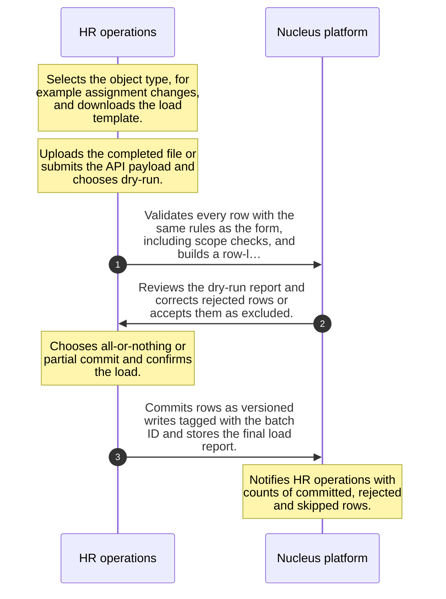

**Alternate flows**

| ID | At step | Condition | Steps | Rejoins |
| :--- | ---: | :--- | :--- | :--- |
| A1 | 7 | HR operations discovers after commit that the batch was wrong. | HR operations requests rollback of the batch with a reason. → Nucleus platform writes reversing versions for every row in the batch and marks the batch Rolled back. | Ends the use case |

**Exception flows**

| ID | At step | Condition | Handling | Rule |
| :--- | ---: | :--- | :--- | :--- |
| E1 | 3 | A row targets a record outside the user's entity or location scope. | The row is rejected with a scope error; the user never learns whether the record exists. | RL-004 |
| E2 | 3 | The file's column headers do not match the template. | The whole file is rejected before row validation with the mismatched columns listed. |  |
| E3 | 6 | All-or-nothing mode and any row fails at commit time. | The whole batch is rolled back and the failing row is reported. | RL-020 |

**Postconditions — success**

- Valid rows are committed under one batch ID, each as a versioned write, and a load report is stored.

**Postconditions — failure**

- No rows are committed in all-or-nothing mode; in partial mode only valid rows are committed and rejected rows are reported.

**Quality requirements**

- A dry-run of 10,000 rows completes in under 2 minutes.
- Rollback of a 10,000-row batch completes in under 5 minutes and leaves no partial state.

### PLT-UC-015

**Add custom fields and custom objects** — Let tenant administrators extend core objects with typed, validated, security-classified fields and objects without a schema release.

| Attribute | Value |
| :--- | :--- |
| Realises | PLT-CG-007 |
| Source | Authored |
| Level | User goal |
| Primary actor | Tenant admin |
| Secondary actors | Nucleus platform, HR operations |
| Trigger | The client needs to capture data that the standard object model does not hold. |
| Frequency | Occasional |
| Criticality | Medium |
| Phase | P3 |
| Client requirements | — |
| Business rules | RL-005 |
| Screens | — |
| Data objects (CRUD) | custom_field_definition (C), custom_object_definition (C), custom_field_value (C) |
| Events | — |
| Acceptance tests | PLT-TC-033, PLT-TC-034, PLT-TC-035, PLT-TC-036 |
| System requirements | SYS-017, SYS-018, SYS-026, SYS-060 |

**Stakeholders and interests**

| Stakeholder | Interest |
| :--- | :--- |
| HR operations | Can capture client-specific data such as safety induction batch on the record. |
| Payroll manager | A custom field classified as compensation is protected like other salary fields. |
| Auditor | Custom field definitions are versioned and their changes audited. |

**Preconditions**

- The tenant admin holds the extension-administration permission.
- The target core object supports extensions.

**Main success scenario**

| # | Actor | Action | Ref |
| ---: | :--- | :--- | :--- |
| 1 | Tenant admin | Selects the core object, for example assignment, and adds a field with name, type and validation. |  |
| 2 | Tenant admin | Sets the security classification: general, personal, sensitive personal or compensation. |  |
| 3 | Tenant admin | Chooses reporting and API exposure and the forms on which the field appears. |  |
| 4 | Nucleus platform | Validates name uniqueness, type and that compensation fields follow payroll-group visibility. |  |
| 5 | Tenant admin | Publishes the definition with an effective-from date. |  |
| 6 | Nucleus platform | Renders the field on the chosen forms and applies the classification on every read path. |  |

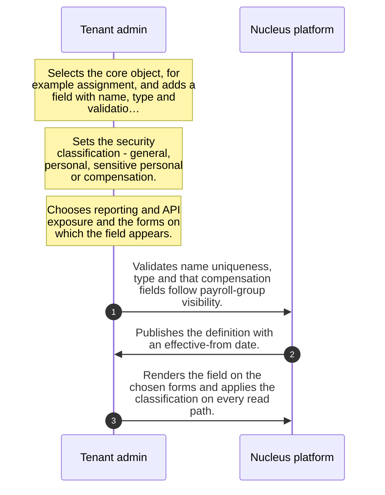

**Alternate flows**

| ID | At step | Condition | Steps | Rejoins |
| :--- | ---: | :--- | :--- | :--- |
| A1 | 1 | The data needs its own record type, such as a safety training register. | Tenant admin defines a custom object with fields and a relationship to person or assignment. → Nucleus platform creates list and detail views for the object within entity and location scope. | Returns to step 4 |

**Exception flows**

| ID | At step | Condition | Handling | Rule |
| :--- | ---: | :--- | :--- | :--- |
| E1 | 4 | The field name collides with a standard or existing custom field. | Publication is blocked with the conflicting name shown. |  |
| E2 | 6 | A reader outside the record's payroll group requests a field classified as compensation. | The field is returned as null, exactly as standard compensation fields are. | RL-005 |

**Postconditions — success**

- The custom field or object is available on forms, in reports and through the API according to its security classification.

**Postconditions — failure**

- No definition is published and existing forms are unchanged.

**Quality requirements**

- Adding up to 50 custom fields to an object adds no more than 10% to form load time.
- Custom fields are available in reports within 5 minutes of publication.

### PLT-UC-016

**Migrate data from a legacy HRMS and payroll system** — Move master data, balances and year-to-date values from a legacy HRMS or payroll system with mapping, sequenced loads and reconciliation sign-off.

| Attribute | Value |
| :--- | :--- |
| Realises | PLT-CG-008 |
| Source | Authored |
| Level | Summary |
| Primary actor | Implementation consultant |
| Secondary actors | Nucleus platform, Payroll manager, Finance, HR operations |
| Trigger | A client goes live and its history must be moved from the legacy system. |
| Frequency | Per client |
| Criticality | High |
| Phase | P1 |
| Client requirements | — |
| Business rules | RL-020 |
| Screens | — |
| Data objects (CRUD) | migration_mapping (C), load_batch (C), reconciliation_report (C), person (C), assignment (C), leave_balance (C) |
| Events | — |
| Acceptance tests | PLT-TC-037, PLT-TC-038, PLT-TC-039, PLT-TC-040, PLT-TC-041, PLT-TC-042 |
| System requirements | SYS-022, SYS-028, SYS-049, SYS-061 |

**Stakeholders and interests**

| Stakeholder | Interest |
| :--- | :--- |
| Payroll manager | Year-to-date earnings and deductions carry over exactly so the first live run is correct. |
| HR operations | Leave balances and service history are preserved for every employee. |
| Finance | Migrated totals reconcile to the legacy system's closing figures. |

**Preconditions**

- The tenant is provisioned and core configuration (entities, locations, worker classes, pay components) is published.
- Legacy extracts for the cut-over date are available.

**Main success scenario**

| # | Actor | Action | Ref |
| ---: | :--- | :--- | :--- |
| 1 | Implementation consultant | Selects the mapping template for the legacy source and maps each source field to a Nucleus field. |  |
| 2 | Implementation consultant | Defines transformation rules, such as legacy grade codes to designation and band. |  |
| 3 | Nucleus platform | Orders loads by dependency: org units, positions, persons, employments, assignments, salary, balances, then YTD values. |  |
| 4 | Nucleus platform | Runs each load as a dry-run batch with row-level validation and reports errors. |  |
| 5 | Implementation consultant | Corrects errors and commits each batch in sequence. |  |
| 6 | Nucleus platform | Produces reconciliation reports: record counts, leave balances and YTD earnings and deductions per employee and in total. |  |
| 7 | Payroll manager | Reviews reconciliation against legacy closing figures and signs off or raises discrepancies. |  |

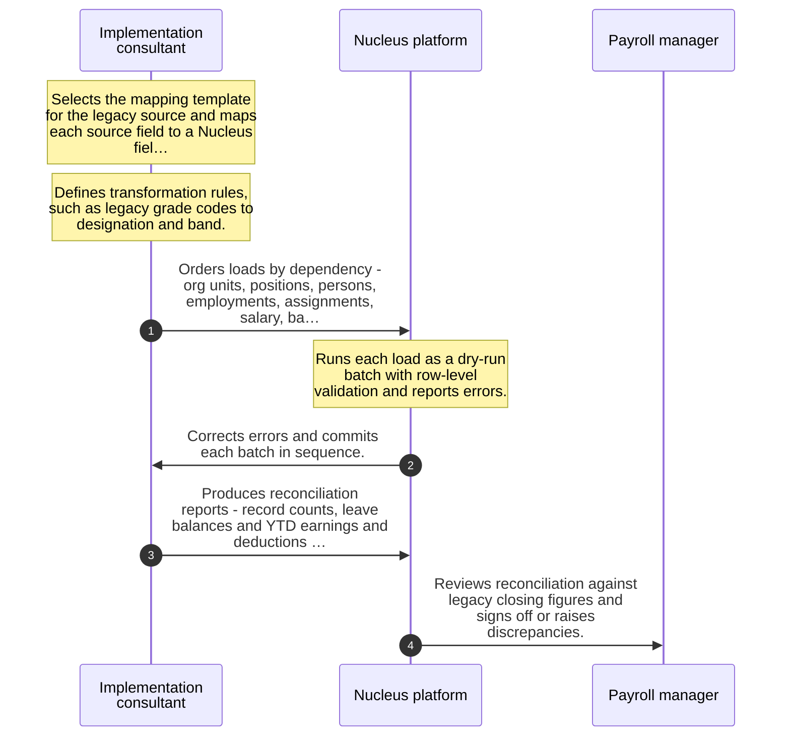

**Alternate flows**

| ID | At step | Condition | Steps | Rejoins |
| :--- | ---: | :--- | :--- | :--- |
| A1 | 7 | Discrepancies exceed tolerance for some employees. | Payroll manager lists the discrepant employees with expected values. → Implementation consultant corrects the mapping or source and reloads only the affected batch. | Returns to step 6 |

**Exception flows**

| ID | At step | Condition | Handling | Rule |
| :--- | ---: | :--- | :--- | :--- |
| E1 | 3 | A load references a parent that has not been loaded, such as an assignment for a missing position. | The batch is held until its dependency loads successfully. |  |
| E2 | 7 | Sign-off is refused at cut-over. | All migration batches are rolled back in reverse order and go-live is postponed. | RL-020 |

**Postconditions — success**

- All in-scope records are loaded, reconciliation reports match within agreed tolerances, and the payroll manager has signed off.

**Postconditions — failure**

- Loaded batches are rolled back and the tenant returns to its pre-migration state.

**Quality requirements**

- A 10,000-employee migration with 3 years of history completes all loads within an 8-hour cut-over window.
- Total YTD gross and statutory deductions reconcile to the legacy figures with zero variance.

### PLT-UC-017

**Handle a data-principal rights request** — Receive, verify, track and fulfil access, correction, erasure and grievance requests from data principals, anonymising personal data while retaining statutory payroll records.

| Attribute | Value |
| :--- | :--- |
| Realises | PLT-CG-009 |
| Source | Authored |
| Level | User goal |
| Primary actor | Employee / worker |
| Secondary actors | Compliance owner, HR operations, Nucleus platform |
| Trigger | A current or former employee, or a candidate, submits a data-principal request. |
| Frequency | Occasional |
| Criticality | High |
| Phase | P1 |
| Client requirements | — |
| Business rules | RL-010, RL-014, RL-020 |
| Screens | — |
| Data objects (CRUD) | data_principal_request (C), data_principal_request (U), personal_data_export (C), erasure_report (C), audit_entry (C) |
| Events | platform.approval.completed |
| Acceptance tests | PLT-TC-043, PLT-TC-044, PLT-TC-045, PLT-TC-046, PLT-TC-047, PLT-TC-048 |
| System requirements | SYS-027, SYS-032, SYS-033, SYS-039, SYS-070 |

**Stakeholders and interests**

| Stakeholder | Interest |
| :--- | :--- |
| Employee / worker | Can see, correct or remove their personal data and complain if unhappy. |
| Compliance owner | Requests are handled within the configured timeline and evidenced for the DPDP Act 2023 (to be validated by Legal). |
| Payroll manager | Statutory payroll records needed for tax and audit survive erasure in anonymised form. |

**Preconditions**

- The requester can be identified from an active account or through offline verification.
- Retention periods per record class are configured by the Compliance owner.

**Main success scenario**

| # | Actor | Action | Ref |
| ---: | :--- | :--- | :--- |
| 1 | Employee / worker | Submits a request choosing access, correction, erasure or grievance, with details. |  |
| 2 | Nucleus platform | Verifies identity with a step-up challenge, or routes to HR operations for offline verification for former employees. |  |
| 3 | Nucleus platform | Registers the request, starts the configured SLA clock and assigns it to the Compliance owner. |  |
| 4 | Compliance owner | Triages the request and confirms the records and systems in scope. |  |
| 5 | Nucleus platform | For access, compiles the requester's personal data into a downloadable export. |  |
| 6 | Compliance owner | Approves fulfilment and sends the response through the requester's channel. |  |
| 7 | Nucleus platform | Closes the request and records outcome and timeline in the audit ledger. |  |

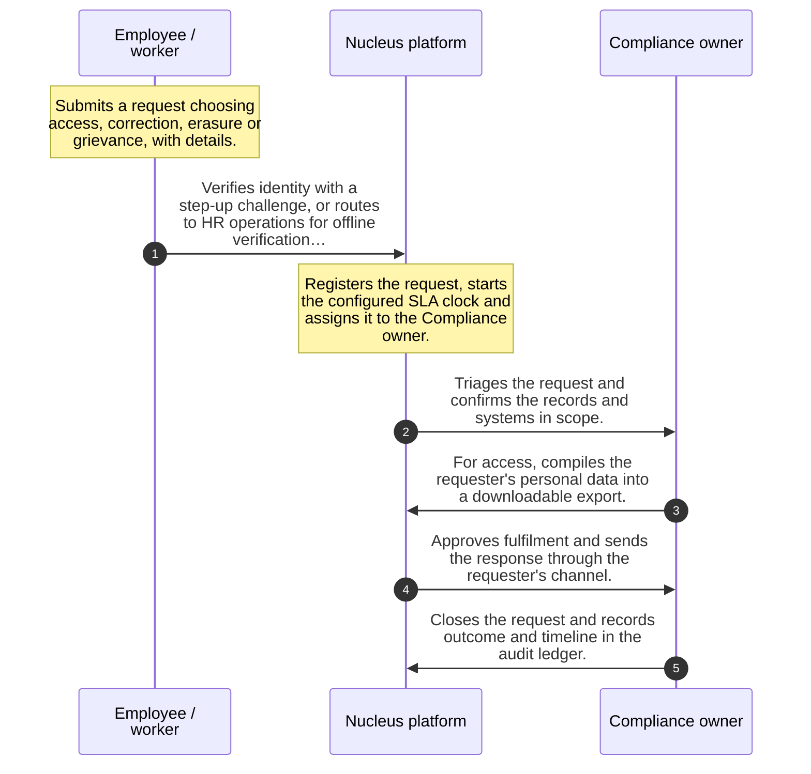

**Alternate flows**

| ID | At step | Condition | Steps | Rejoins |
| :--- | ---: | :--- | :--- | :--- |
| A1 | 5 | The request is a correction. | Nucleus platform routes the correction through the approval chain for that field. → On approval, the correction is written as a new version with the request reference as reason. | Returns to step 6 |
| A2 | 5 | The request is an erasure. | Nucleus platform identifies records under a retention obligation, such as payroll registers and tax deductions. → It anonymises personal identifiers in all other records and replaces identity in retained payroll records with a pseudonymous key. → Compliance owner reviews the erasure report listing retained records and the reason for each. | Returns to step 6 |

**Exception flows**

| ID | At step | Condition | Handling | Rule |
| :--- | ---: | :--- | :--- | :--- |
| E1 | 2 | Identity verification fails. | The request is held as Unverified and no data is disclosed or changed. |  |
| E2 | 3 | The SLA is about to expire. | The request escalates to the Compliance owner's manager at 80% of the SLA and the breach is counted if it expires. | RL-014 |

**Postconditions — success**

- The request is fulfilled and closed with a response to the requester, and every step is in the audit ledger.

**Postconditions — failure**

- The request is closed as refused or partly fulfilled with the reason and the grievance route communicated.

**Quality requirements**

- An access export for one person is generated within 10 minutes.
- Erasure leaves no personal identifier in searchable indexes, caches or analytics stores, verified by an automated scan.

### PLT-UC-018

**Provision identities to the enterprise directory** — Create, update and disable user identities in downstream directories through SCIM 2.0 within 15 minutes of hire, transfer and exit events.

| Attribute | Value |
| :--- | :--- |
| Realises | PLT-CG-010 |
| Source | Authored |
| Level | Subfunction |
| Primary actor | Nucleus platform |
| Secondary actors | Enterprise directory, Tenant admin, HR operations |
| Trigger | A hire, transfer or exit becomes effective in People Core. |
| Frequency | Continuous |
| Criticality | High |
| Phase | P2 |
| Client requirements | — |
| Business rules | RL-004 |
| Screens | SCR-005 |
| Data objects (CRUD) | directory_link (C), provisioning_item (C), provisioning_item (U), audit_entry (C) |
| Events | — |
| Acceptance tests | PLT-TC-049, PLT-TC-050, PLT-TC-051, PLT-TC-052, PLT-TC-053, PLT-TC-054 |
| System requirements | SYS-012, SYS-032, SYS-055, SYS-083 |

**Stakeholders and interests**

| Stakeholder | Interest |
| :--- | :--- |
| Employee / worker | Has working accounts on the first day. |
| Tenant admin | Leavers lose access promptly and nobody keeps orphaned accounts. |
| Auditor | Every provisioning call and result is logged. |

**Preconditions**

- The tenant admin has configured a SCIM 2.0 connection to the enterprise directory and the attribute mapping.
- The worker's assignment carries the attributes the directory needs, such as department and manager.

**Main success scenario**

| # | Actor | Action | Ref |
| ---: | :--- | :--- | :--- |
| 1 | Nucleus platform | Consumes a hire, assignment-change or exit event when it becomes effective. |  |
| 2 | Nucleus platform | Maps worker attributes to directory attributes: user name, display name, department, manager, location and active flag. |  |
| 3 | Nucleus platform | Sends the SCIM 2.0 create, update or deactivate request to the enterprise directory. |  |
| 4 | Enterprise directory | Applies the change and returns the result with the directory's identifier. |  |
| 5 | Nucleus platform | Stores the directory identifier and logs the call, payload digest and result. |  |
| 6 | Tenant admin | Monitors the provisioning dashboard for pending, failed and completed items. |  |

```mermaid
sequenceDiagram
    autonumber
    participant P0 as Nucleus platform
    participant P1 as Enterprise<br/>directory
    participant P2 as Tenant admin
    Note over P0: Consumes a hire,<br/>assignment-change or exit<br/>event when it becomes<br/>effective.
    Note over P0: Maps worker attributes to<br/>directory attributes - user<br/>name, display name,<br/>department, manager, l…
    Note over P0: Sends the SCIM 2.0 create,<br/>update or deactivate request<br/>to the enterprise directory.
    P0->>P1: Applies the change and returns<br/>the result with the<br/>directory's identifier.
    P1->>P0: Stores the directory<br/>identifier and logs the call,<br/>payload digest and result.
    P0->>P2: Monitors the provisioning<br/>dashboard for pending, failed<br/>and completed items.
```

**Alternate flows**

| ID | At step | Condition | Steps | Rejoins |
| :--- | ---: | :--- | :--- | :--- |
| A1 | 1 | The event is an exit. | Nucleus platform sends a deactivate request at the end of the last working day. → It also revokes Nucleus grants for the principal so access ends in both systems. | Returns to step 4 |
| A2 | 1 | A hire is effective in the future. | Nucleus platform schedules the create request for the start of the joining date, or earlier if pre-boarding access is configured. | Returns to step 2 |

**Exception flows**

| ID | At step | Condition | Handling | Rule |
| :--- | ---: | :--- | :--- | :--- |
| E1 | 4 | The directory returns a conflict because the user name exists. | The item is held and raised to the tenant admin to confirm a link or a new user name. |  |
| E2 | 3 | The directory is unreachable. | The request is retried with backoff; if not completed within 15 minutes the item is flagged as an SLA breach. |  |

**Postconditions — success**

- The directory account matches the worker's current state, and the call result is logged within 15 minutes of the effective event.

**Postconditions — failure**

- The provisioning item is retried and, if still failing, raised to the tenant admin with the directory's error.

**Quality requirements**

- 95% of provisioning changes complete within 15 minutes of the effective event, measured monthly.
- Deactivation on exit completes within 15 minutes of the end of the last working day.

### PLT-UC-019

**View any record, report or chart as at a past date** — Let an authorised user see a record, report or organisation chart as it was known on a chosen recorded date and as effective on a chosen valid date, with the differences highlighted.

| Attribute | Value |
| :--- | :--- |
| Realises | PLT-CG-011 |
| Source | Authored |
| Level | User goal |
| Primary actor | HR operations |
| Secondary actors | Nucleus platform, Auditor, Payroll manager |
| Trigger | A user opens the time-travel control on a record, report or organisation chart and selects two dates. |
| Frequency | Several times a day |
| Criticality | High |
| Phase | P2 |
| Client requirements | — |
| Business rules | RL-004, RL-005, RL-020, RL-021 |
| Screens | SCR-110 |
| Data objects (CRUD) | temporal_version (R), assignment (R), org_unit (R), audit_event (C) |
| Events | platform.asat.queried |
| Acceptance tests | PLT-TC-055, PLT-TC-056, PLT-TC-057, PLT-TC-058, PLT-TC-059, PLT-TC-060 |
| System requirements | SYS-016, SYS-021, SYS-023, SYS-032 |

**Stakeholders and interests**

| Stakeholder | Interest |
| :--- | :--- |
| Auditor | Can reconstruct exactly what the organisation knew when a decision or payroll run was made. |
| Payroll manager | Can explain why a closed run used a value that has since been corrected. |
| Employee / worker | Historical views never expose more of their record than the viewer's current scope allows. |

**Preconditions**

- All temporal facts are written as new versions with valid and recorded intervals; none are updated in place (RL-020).
- The user holds a grant covering the entity, location and payroll group of the data requested (RL-004).

**Main success scenario**

| # | Actor | Action | Ref |
| ---: | :--- | :--- | :--- |
| 1 | HR operations | Opens the record of E1020 Arjun Bhat and selects the time-travel control. |  |
| 2 | HR operations | Chooses a recorded-at date of 2026-09-05 and a valid-at date of 2026-09-04, and a comparison point of today. |  |
| 3 | Nucleus platform | Resolves the viewer's effective scope as the intersection of tenant, entity, location, line and payroll group. |  |
| 4 | Nucleus platform | Reads every attribute version where valid_at and recorded_at fall inside the stored intervals. |  |
| 5 | Nucleus platform | Renders both views side by side and highlights attributes that differ, naming the change request or event that wrote each. |  |
| 6 | HR operations | Drills from a highlighted attribute to its version chain to see who recorded it and when. |  |
| 7 | HR operations | Switches the same dates onto the Peenya Works organisation chart or a headcount report. |  |
| 8 | Nucleus platform | Records the as-at query, both dates and the viewer in the audit ledger. |  |

```mermaid
sequenceDiagram
    autonumber
    participant P0 as HR operations
    participant P1 as Nucleus platform
    Note over P0: Opens the record of E1020<br/>Arjun Bhat and selects the<br/>time-travel control.
    Note over P0: Chooses a recorded-at date of<br/>2026-09-05 and a valid-at date<br/>of 2026-09-04, and a<br/>comparison po…
    P0->>P1: Resolves the viewer's<br/>effective scope as the<br/>intersection of tenant,<br/>entity, location, line and…
    Note over P1: Reads every attribute version<br/>where valid_at and recorded_at<br/>fall inside the stored<br/>intervals.
    Note over P1: Renders both views side by<br/>side and highlights attributes<br/>that differ, naming the change<br/>reques…
    P1->>P0: Drills from a highlighted<br/>attribute to its version chain<br/>to see who recorded it and<br/>when.
    Note over P0: Switches the same dates onto<br/>the Peenya Works organisation<br/>chart or a headcount report.
    P0->>P1: Records the as-at query, both<br/>dates and the viewer in the<br/>audit ledger.
```

**Alternate flows**

| ID | At step | Condition | Steps | Rejoins |
| :--- | ---: | :--- | :--- | :--- |
| A1 | 2 | The user selects only a valid-at date. | The platform defaults recorded-at to now, showing the latest knowledge about that effective date. | Returns to step 3 |
| A2 | 7 | The view is a payroll report for a closed run. | The platform defaults both dates to the run's snapshot timestamp so the report matches the run exactly (RL-021). | Returns to step 8 |

**Exception flows**

| ID | At step | Condition | Handling | Rule |
| :--- | ---: | :--- | :--- | :--- |
| E1 | 3 | The record was in a payroll group outside the viewer's grant on the chosen date. | Compensation attributes return null for the whole history and the view states that they are outside scope. | RL-005 |
| E2 | 4 | The chosen recorded-at date precedes the tenant's data migration date. | The platform shows the migrated baseline version and labels it as the earliest available knowledge. | RL-020 |

**Postconditions — success**

- The user sees the view as at the chosen recorded and valid dates, with every changed attribute marked and its change source shown.
- The as-at query, its two dates and the viewer are written to the audit ledger.

**Postconditions — failure**

- No historical data outside the viewer's present scope is returned and the reason is stated on screen.

**Quality requirements**

- An as-at read of one person record returns in under 1 s at p95.
- An as-at organisation chart for 5,000 positions renders in under 4 s.

### PLT-UC-020

**Publish a policy change through automated regression** — Store every configurable leave, attendance, payroll and eligibility policy as a versioned, testable definition and block publication until the golden test suite shows no unexplained difference.

| Attribute | Value |
| :--- | :--- |
| Realises | PLT-CG-012 |
| Source | Authored |
| Level | User goal |
| Primary actor | Implementation consultant |
| Secondary actors | Nucleus platform, HR operations, Payroll manager, Director / approver |
| Trigger | A consultant saves a draft change to a policy definition, such as the late-mark grace for the PLANT12 shift group. |
| Frequency | Several times a month |
| Criticality | High |
| Phase | P2 |
| Client requirements | — |
| Business rules | RL-010, RL-013, RL-020, RL-021 |
| Screens | SCR-032, SCR-040 |
| Data objects (CRUD) | policy_definition (C/U), policy_version (C), golden_case (R/C), test_run (C), recompute_queue (C) |
| Events | platform.policy.tested, platform.policy.published |
| Acceptance tests | PLT-TC-061, PLT-TC-062, PLT-TC-063, PLT-TC-064, PLT-TC-065, PLT-TC-066 |
| System requirements | SYS-022, SYS-026, SYS-037, SYS-046, SYS-057 |

**Stakeholders and interests**

| Stakeholder | Interest |
| :--- | :--- |
| Payroll manager | No policy edit silently changes a payslip figure. |
| HR operations | Policy changes go live on the intended effective date with evidence of testing. |
| Auditor | Every published policy version carries its test result and approver. |

**Preconditions**

- The policy exists as a versioned definition with an effective date (RL-020).
- A golden test suite with expected outcomes exists for the policy family.
- A publication approval chain is configured for policy changes (RL-010).

**Main success scenario**

| # | Actor | Action | Ref |
| ---: | :--- | :--- | :--- |
| 1 | Implementation consultant | Opens the policy in the configuration workspace and edits a parameter, for example grace from 15 to 10 minutes. |  |
| 2 | Implementation consultant | Sets the effective date and saves the draft as a new version. |  |
| 3 | Nucleus platform | Runs the golden suite for the policy family against the current and draft versions on identical inputs. |  |
| 4 | Nucleus platform | Lists every case whose outcome changed, with before and after values and the employees and days affected. |  |
| 5 | Implementation consultant | Marks each expected difference as explained with a reason linked to the change request. |  |
| 6 | Nucleus platform | Confirms no unexplained difference remains and submits the draft to the approval chain. |  |
| 7 | Director / approver | Reviews the difference summary and approves publication. |  |
| 8 | Nucleus platform | Publishes the version, end-dates the prior one and queues recompute for affected periods. |  |

```mermaid
sequenceDiagram
    autonumber
    participant P0 as Implementation<br/>consultant
    participant P1 as Nucleus platform
    participant P2 as Director /<br/>approver
    Note over P0: Opens the policy in the<br/>configuration workspace and<br/>edits a parameter, for example<br/>grace from 1…
    Note over P0: Sets the effective date and<br/>saves the draft as a new<br/>version.
    P0->>P1: Runs the golden suite for the<br/>policy family against the<br/>current and draft versions on<br/>identical…
    Note over P1: Lists every case whose outcome<br/>changed, with before and after<br/>values and the employees and<br/>days…
    P1->>P0: Marks each expected difference<br/>as explained with a reason<br/>linked to the change request.
    P0->>P1: Confirms no unexplained<br/>difference remains and submits<br/>the draft to the approval<br/>chain.
    P1->>P2: Reviews the difference summary<br/>and approves publication.
    P2->>P1: Publishes the version,<br/>end-dates the prior one and<br/>queues recompute for affected<br/>periods.
```

**Alternate flows**

| ID | At step | Condition | Steps | Rejoins |
| :--- | ---: | :--- | :--- | :--- |
| A1 | 5 | The consultant wants to add new golden cases for the changed behaviour. | The consultant adds cases with expected outcomes; the platform reruns the suite. | Returns to step 4 |
| A2 | 7 | The approver returns the change with a comment. | The draft returns to the consultant with the reason recorded. | Returns to step 1 |

**Exception flows**

| ID | At step | Condition | Handling | Rule |
| :--- | ---: | :--- | :--- | :--- |
| E1 | 6 | At least one difference is unexplained. | Publication is blocked; the submit action stays disabled and the unexplained cases are listed. |  |
| E2 | 8 | The effective date falls inside a locked payroll period. | Publication is refused for that date and the consultant must choose the next open period. | RL-021 |

**Postconditions — success**

- The new policy version is published with its effective date, test run identifier, explained differences and approver recorded.
- Affected attendance or payroll periods after the effective date are queued for recompute.

**Postconditions — failure**

- The draft remains unpublished; the live version is unchanged and the failing cases are listed.

**Quality requirements**

- A golden suite of 2,000 cases for one policy family completes in under 5 minutes.
- Every published policy version can be traced to its test run and approver in one click.

### PLT-UC-021

**Publish and install a governed extension** — Allow a tenant or partner to package a custom screen, workflow or tool with declared permissions and data scopes, pass automated security review and be installed into a tenant without widening any user's access.

| Attribute | Value |
| :--- | :--- |
| Realises | PLT-CG-013 |
| Source | Authored |
| Level | User goal |
| Primary actor | Tenant admin |
| Secondary actors | Implementation consultant, Nucleus platform, Auditor |
| Trigger | A consultant submits an extension package, for example a canteen coupon screen for Peenya Works, to the tenant catalogue. |
| Frequency | Occasional |
| Criticality | Medium |
| Phase | P4 |
| Client requirements | — |
| Business rules | RL-001, RL-002, RL-003, RL-004, RL-005 |
| Screens | SCR-005, SCR-110 |
| Data objects (CRUD) | extension_package (C), extension_review (C), extension_installation (C/U), principal (C), action_ledger_entry (C) |
| Events | platform.extension.reviewed, platform.extension.installed |
| Acceptance tests | PLT-TC-067, PLT-TC-068, PLT-TC-069, PLT-TC-070, PLT-TC-071, PLT-TC-072 |
| System requirements | SYS-009, SYS-016, SYS-032, SYS-072, SYS-073 |

**Stakeholders and interests**

| Stakeholder | Interest |
| :--- | :--- |
| Tenant admin | Extensions cannot read data beyond what is declared and approved. |
| Implementation consultant | Client-specific needs can be met without changing the core product. |
| Auditor | Every installed extension, its permissions and its actions are on record. |

**Preconditions**

- The extension is built against the published extension interface and declares its screens, tools, events and data scopes.
- The tenant admin holds the extension-installation permission.

**Main success scenario**

| # | Actor | Action | Ref |
| ---: | :--- | :--- | :--- |
| 1 | Implementation consultant | Uploads the extension package with its manifest of screens, tools, events and requested data scopes. |  |
| 2 | Nucleus platform | Runs automated review: manifest schema, dependency scan, static checks and a sandboxed test against synthetic data. |  |
| 3 | Nucleus platform | Produces a review report listing requested scopes, any finding and a pass or fail verdict. |  |
| 4 | Tenant admin | Reviews the report and the requested scopes, and narrows them where broader than needed. |  |
| 5 | Tenant admin | Approves installation for chosen entities and locations, for example LE-01 at LOC-PLA only. |  |
| 6 | Nucleus platform | Creates a service principal for the extension owned by a named human and limited to the approved scopes. |  |
| 7 | Nucleus platform | Installs the pinned version and records the installation in the audit ledger. |  |
| 8 | Employee / worker | Uses the extension screen; each call passes through the policy gate and is logged. |  |

```mermaid
sequenceDiagram
    autonumber
    participant P0 as Implementation<br/>consultant
    participant P1 as Nucleus platform
    participant P2 as Tenant admin
    participant P3 as Employee /<br/>worker
    Note over P0: Uploads the extension package<br/>with its manifest of screens,<br/>tools, events and requested<br/>data sc…
    P0->>P1: Runs automated review -<br/>manifest schema, dependency<br/>scan, static checks and a<br/>sandboxed test aga…
    Note over P1: Produces a review report<br/>listing requested scopes, any<br/>finding and a pass or fail<br/>verdict.
    P1->>P2: Reviews the report and the<br/>requested scopes, and narrows<br/>them where broader than<br/>needed.
    Note over P2: Approves installation for<br/>chosen entities and locations,<br/>for example LE-01 at LOC-PLA<br/>only.
    P2->>P1: Creates a service principal<br/>for the extension owned by a<br/>named human and limited to the<br/>approve…
    Note over P1: Installs the pinned version<br/>and records the installation<br/>in the audit ledger.
    P1->>P3: Uses the extension screen,<br/>each call passes through the<br/>policy gate and is logged.
```

**Alternate flows**

| ID | At step | Condition | Steps | Rejoins |
| :--- | ---: | :--- | :--- | :--- |
| A1 | 7 | A new version of an installed extension is submitted. | The platform reruns review and shows scope changes compared with the installed version; the tenant admin approves or declines the upgrade. | Returns to step 7 |
| A2 | 5 | The admin wants a trial first. | The extension is installed only in the sandbox tenant for evaluation. | Ends |

**Exception flows**

| ID | At step | Condition | Handling | Rule |
| :--- | ---: | :--- | :--- | :--- |
| E1 | 3 | Automated review finds a critical vulnerability or an undeclared outbound call. | The package is rejected with findings and cannot be installed. |  |
| E2 | 6 | No accountable human owner is named for the extension principal. | Installation is blocked until an owner is named. | RL-001 |
| E3 | 8 | The extension requests a compensation field outside the user's payroll group. | The policy gate returns null for the field and logs the attempt. | RL-005 |

**Postconditions — success**

- The extension is installed at a pinned version with only its declared, approved scopes; all its actions write to the action ledger.

**Postconditions — failure**

- The package is rejected or left uninstalled, and no permission or data scope is granted.

**Quality requirements**

- Automated review of a package completes in under 15 minutes.
- An installed extension adds no more than 50 ms at p95 to the screen it extends.

### PLT-UC-022

**Consolidate multi-entity reporting across currencies** — Support several legal entities and currencies in one tenant and produce consolidated workforce cost reports converted at dated exchange rates.

| Attribute | Value |
| :--- | :--- |
| Realises | PLT-CG-014 |
| Source | Authored |
| Level | User goal |
| Primary actor | Finance |
| Secondary actors | Nucleus platform, Payroll manager, Director / approver |
| Trigger | Finance requests the group workforce cost report for a period. |
| Frequency | Monthly |
| Criticality | High |
| Phase | P3 |
| Client requirements | — |
| Business rules | RL-002, RL-004, RL-020 |
| Screens | — |
| Data objects (CRUD) | legal_entity (R), exchange_rate (R), payroll_result (R), consolidation_report (C) |
| Events | platform.consolidation.generated |
| Acceptance tests | PLT-TC-073, PLT-TC-074, PLT-TC-075, PLT-TC-076, PLT-TC-077, PLT-TC-078 |
| System requirements | SYS-006, SYS-026, SYS-028, SYS-029 |

**Stakeholders and interests**

| Stakeholder | Interest |
| :--- | :--- |
| Director / approver | Sees group workforce cost in one reporting currency. |
| Finance | Conversions use the correct rate for the date of each transaction and are reproducible. |
| Payroll manager | Entity payroll stays in its own functional currency. |

**Preconditions**

- Legal entities LE-01 and LE-02 are configured with a functional currency, and a reporting currency is set for the tenant.
- Exchange rates with effective dates are loaded for every currency pair used in the period.
- The requesting user holds grants for all entities included (RL-002).

**Main success scenario**

| # | Actor | Action | Ref |
| ---: | :--- | :--- | :--- |
| 1 | Finance | Selects the period, entities LE-01 and LE-02, the reporting currency and the rate type (month-average or period-end). |  |
| 2 | Nucleus platform | Reads posted payroll results and cost lines per entity in each entity's functional currency. |  |
| 3 | Nucleus platform | Looks up the exchange rate effective for each line's date and rate type. |  |
| 4 | Nucleus platform | Converts amounts using integer minor units and records rate, rate date and rounding per line. |  |
| 5 | Nucleus platform | Eliminates inter-entity recharges flagged for elimination and totals by entity, site and cost centre. |  |
| 6 | Finance | Reviews the consolidated view and drills to any entity or line. |  |
| 7 | Finance | Exports the report; the export is logged with the rate set version used. |  |

```mermaid
sequenceDiagram
    autonumber
    participant P0 as Finance
    participant P1 as Nucleus platform
    Note over P0: Selects the period, entities<br/>LE-01 and LE-02, the reporting<br/>currency and the rate type<br/>(month-a…
    P0->>P1: Reads posted payroll results<br/>and cost lines per entity in<br/>each entity's functional<br/>currency.
    Note over P1: Looks up the exchange rate<br/>effective for each line's date<br/>and rate type.
    Note over P1: Converts amounts using integer<br/>minor units and records rate,<br/>rate date and rounding per<br/>line.
    Note over P1: Eliminates inter-entity<br/>recharges flagged for<br/>elimination and totals by<br/>entity, site and cost c…
    P1->>P0: Reviews the consolidated view<br/>and drills to any entity or<br/>line.
    Note over P0: Exports the report, the export<br/>is logged with the rate set<br/>version used.
```

**Alternate flows**

| ID | At step | Condition | Steps | Rejoins |
| :--- | ---: | :--- | :--- | :--- |
| A1 | 1 | All entities share one currency. | Conversion is skipped and the report states that no conversion applied. | Returns to step 5 |
| A2 | 6 | Finance wants to compare with a different rate type. | The platform recomputes the conversion with the chosen rate type and shows both side by side. | Returns to step 6 |

**Exception flows**

| ID | At step | Condition | Handling | Rule |
| :--- | ---: | :--- | :--- | :--- |
| E1 | 3 | No rate exists for a currency pair on a line's date. | Those lines are listed as unconverted and the report is marked incomplete until a rate is loaded. |  |
| E2 | 1 | The user lacks a grant for one selected entity. | That entity is excluded and the report header states the exclusion. | RL-002 |

**Postconditions — success**

- A consolidated report is produced with entity amounts in functional currency, converted amounts in reporting currency and the rate and rate date used per line.

**Postconditions — failure**

- The report is not produced for lines with a missing rate; the missing pairs and dates are listed.

**Quality requirements**

- A consolidated report for two entities and 12 months completes in under 30 s.
- Reproducing a report with the same rate set version yields identical figures to the minor unit.

### PLT-UC-023

**Classify, extract and confirm employee documents** — Store employee documents with type classification, expiry tracking and extraction of key fields that a human confirms before anything is written to the record.

| Attribute | Value |
| :--- | :--- |
| Realises | PLT-CG-015 |
| Source | Authored |
| Level | User goal |
| Primary actor | HR operations |
| Secondary actors | Nucleus platform, Agent (governed), Employee / worker |
| Trigger | An employee or HR uploads a document such as a PAN card, driving licence or educational certificate. |
| Frequency | Daily |
| Criticality | High |
| Phase | P2 |
| Client requirements | — |
| Business rules | RL-004, RL-020 |
| Screens | — |
| Data objects (CRUD) | document (C), extraction_result (C), verification_task (C/U), person (U), reminder_schedule (C) |
| Events | platform.document.uploaded, platform.document.confirmed |
| Acceptance tests | PLT-TC-079, PLT-TC-080, PLT-TC-081, PLT-TC-082, PLT-TC-083, PLT-TC-084 |
| System requirements | SYS-022, SYS-070, SYS-074, SYS-087 |

**Stakeholders and interests**

| Stakeholder | Interest |
| :--- | :--- |
| Employee / worker | Documents are kept securely and their details are recorded correctly. |
| HR operations | Less manual keying, with control over what is written to the record. |
| Compliance owner | Expiring statutory and identity documents are renewed on time. |

**Preconditions**

- Document classes with expiry applicability and reminder intervals are configured.
- The uploader has access to the person record within their scope (RL-004).

**Main success scenario**

| # | Actor | Action | Ref |
| ---: | :--- | :--- | :--- |
| 1 | Employee / worker | Uploads a scan of a driving licence from the self-service document area. |  |
| 2 | Nucleus platform | Stores the file encrypted, scans it for malware and records the uploader and timestamp. |  |
| 3 | Agent (governed) | Classifies the document type and extracts name, number, issue date and expiry date with a confidence per field. |  |
| 4 | Nucleus platform | Compares extracted values with the current record and shows matches, differences and low-confidence fields. |  |
| 5 | HR operations | Reviews each field, corrects any errors and confirms the values to be written. |  |
| 6 | Nucleus platform | Writes confirmed values as new record versions citing the document and the confirmer. |  |
| 7 | Nucleus platform | Schedules expiry reminders for the document and its owner. |  |
| 8 | Notification service | Sends reminders to the employee and HR before the expiry date. |  |

```mermaid
sequenceDiagram
    autonumber
    participant P0 as Employee /<br/>worker
    participant P1 as Nucleus platform
    participant P2 as Agent (governed)
    participant P3 as HR operations
    participant P4 as Notification<br/>service
    Note over P0: Uploads a scan of a driving<br/>licence from the self-service<br/>document area.
    P0->>P1: Stores the file encrypted,<br/>scans it for malware and<br/>records the uploader and<br/>timestamp.
    P1->>P2: Classifies the document type<br/>and extracts name, number,<br/>issue date and expiry date<br/>with a confi…
    P2->>P1: Compares extracted values with<br/>the current record and shows<br/>matches, differences and<br/>low-confid…
    P1->>P3: Reviews each field, corrects<br/>any errors and confirms the<br/>values to be written.
    P3->>P1: Writes confirmed values as new<br/>record versions citing the<br/>document and the confirmer.
    Note over P1: Schedules expiry reminders for<br/>the document and its owner.
    P1->>P4: Sends reminders to the<br/>employee and HR before the<br/>expiry date.
```

**Alternate flows**

| ID | At step | Condition | Steps | Rejoins |
| :--- | ---: | :--- | :--- | :--- |
| A1 | 3 | The document type is not recognised. | The document is classed as unclassified and HR chooses the class manually. | Returns to step 4 |
| A2 | 5 | HR rejects the document as illegible. | The employee is asked to upload a clearer copy; nothing is written. | Returns to step 1 |

**Exception flows**

| ID | At step | Condition | Handling | Rule |
| :--- | ---: | :--- | :--- | :--- |
| E1 | 4 | An extracted value differs from a previously verified value. | The verified value is kept; the difference is shown and can only be changed by explicit HR confirmation. | RL-020 |
| E2 | 2 | The malware scan flags the file. | The file is quarantined, not shown to any reviewer and the uploader is told to re-upload. |  |

**Postconditions — success**

- The document is stored with class, confidence and expiry; confirmed field values are written as new record versions with source and confirmer recorded.

**Postconditions — failure**

- The document is stored but no field is written to the record; unconfirmed items remain in the verification queue.

**Quality requirements**

- Classification and extraction complete in under 20 s for a two-page scan.
- No extracted value reaches the person record without a recorded human confirmation.

### PLT-UC-024

**Register visitors and control gate entry and exit** — Register visitors at a site, issue time-bound passes, record entry and exit at the gate and link each visit to its host employee for safety and security audit.

| Attribute | Value |
| :--- | :--- |
| Realises | PLT-CG-016 |
| Source | Authored |
| Level | User goal |
| Primary actor | Plant HR / time office |
| Secondary actors | Nucleus platform, Manager / supervisor, Employee / worker, Notification service |
| Trigger | A host employee pre-registers a visitor, or a visitor arrives at the gate without pre-registration. |
| Frequency | Daily |
| Criticality | Medium |
| Phase | P3 |
| Client requirements | — |
| Business rules | RL-003, RL-011, RL-012 |
| Screens | — |
| Data objects (CRUD) | visitor (C/U), visit (C/U), visitor_pass (C), gate_event (C), on_site_register (U) |
| Events | site.visitor.entered, site.visitor.exited |
| Acceptance tests | PLT-TC-085, PLT-TC-086, PLT-TC-087, PLT-TC-088, PLT-TC-089, PLT-TC-090 |
| System requirements | SYS-032, SYS-053, SYS-070, SYS-078 |

**Stakeholders and interests**

| Stakeholder | Interest |
| :--- | :--- |
| Plant HR / time office | Knows who is on site at any moment for safety and evacuation. |
| Employee / worker | Can pre-register visitors quickly and is told when they arrive. |
| Compliance owner | Safety induction and identity checks are recorded for every visitor. |

**Preconditions**

- The site has gates configured with gate points and pass validity rules.
- The host is an active employee at the site.

**Main success scenario**

| # | Actor | Action | Ref |
| ---: | :--- | :--- | :--- |
| 1 | Employee / worker | Pre-registers a supplier visitor for 2026-11-12 10:00–13:00 at Peenya Works with purpose and areas to be visited. |  |
| 2 | Nucleus platform | Creates the visit, issues a time-bound pass code and sends it to the visitor. |  |
| 3 | Plant HR / time office | At the gate, scans the pass and verifies the visitor's photo identity. |  |
| 4 | Nucleus platform | Shows the site safety induction; the visitor acknowledges it and the acknowledgement is recorded. |  |
| 5 | Nucleus platform | Records entry time and gate point and notifies the host that the visitor has arrived. |  |
| 6 | Plant HR / time office | Records exit at the gate when the visitor leaves. |  |
| 7 | Nucleus platform | Closes the visit and updates the live on-site register. |  |

```mermaid
sequenceDiagram
    autonumber
    participant P0 as Employee /<br/>worker
    participant P1 as Nucleus platform
    participant P2 as Plant HR / time<br/>office
    Note over P0: Pre-registers a supplier<br/>visitor for 2026-11-12 10<br/>-00–13 -00 at Peenya Works<br/>with purpose and ar…
    P0->>P1: Creates the visit, issues a<br/>time-bound pass code and sends<br/>it to the visitor.
    P1->>P2: At the gate, scans the pass<br/>and verifies the visitor's<br/>photo identity.
    P2->>P1: Shows the site safety<br/>induction, the visitor<br/>acknowledges it and the<br/>acknowledgement is recorde…
    Note over P1: Records entry time and gate<br/>point and notifies the host<br/>that the visitor has arrived.
    P1->>P2: Records exit at the gate when<br/>the visitor leaves.
    P2->>P1: Closes the visit and updates<br/>the live on-site register.
```

**Alternate flows**

| ID | At step | Condition | Steps | Rejoins |
| :--- | ---: | :--- | :--- | :--- |
| A1 | 1 | The visitor arrives without pre-registration. | Gate staff register the visitor at the kiosk and the host approves entry from a notification. | Returns to step 4 |
| A2 | 6 | The pass expires while the visitor is still on site. | The platform alerts the host and gate staff; the host extends the pass or escorts the visitor out. | Returns to step 6 |

**Exception flows**

| ID | At step | Condition | Handling | Rule |
| :--- | ---: | :--- | :--- | :--- |
| E1 | 3 | The pass is outside its validity window or already used for exit. | Entry is refused and the attempt is recorded against the visit. |  |
| E2 | 5 | The host does not respond within 10 minutes for an unregistered visitor. | The request routes to the host's manager and entry stays on hold. | RL-012 |

**Postconditions — success**

- The visit is recorded with visitor identity, host, pass validity, entry and exit times and safety induction acknowledgement.

**Postconditions — failure**

- Entry is refused or the pass is closed, and the reason is recorded against the visit.

**Quality requirements**

- Pass verification at the gate completes in under 3 s.
- The on-site register reflects entries and exits within 30 s for evacuation use.

### PLT-UC-025

**Enable an additional Indian language for a tenant** — Make the screens, notifications, letters and Nucleus Talk voice available in the language spoken at each site, with every translation reviewed before workers see it.

| Attribute | Value |
| :--- | :--- |
| Realises | PLT-CG-017 |
| Source | Authored |
| Level | User goal |
| Primary actor | Tenant admin |
| Secondary actors | Nucleus platform, Language reviewer, HR administrator |
| Trigger | A tenant admin requests a new interface language for one or more sites, for example Kannada for the two Karnataka sites of Vindhya Precision Industries. |
| Frequency | Occasional — per tenant onboarding or site addition |
| Criticality | Medium |
| Phase | P2 |
| Client requirements | — |
| Business rules | — |
| Screens | — |
| Data objects (CRUD) | tenant_language_setting (C, U), translation_string (C, U), audit_event (C) |
| Events | — |
| Acceptance tests | PLT-TC-091, PLT-TC-092, PLT-TC-093, PLT-TC-094 |
| System requirements | SYS-032, SYS-037, SYS-066, SYS-067, SYS-087 |

**Stakeholders and interests**

| Stakeholder | Interest |
| :--- | :--- |
| Employee / worker | Reads payslips, leave balances and safety notices in the language they understand best. |
| Plant HR | Fewer helpdesk visits caused by misunderstood screens or letters at Peenya Works and the Bengaluru Corporate Office. |
| Compliance officer | Statutory notices displayed in the local language where the site's rules require it (to be validated by Legal). |

**Preconditions**

- The language pack (interface strings, number and date formats, voice model, letter phrasing) is published by the platform for the requested language.
- The tenant admin holds the platform configuration scope for the tenant.
- At least one language reviewer is assigned for the language.

**Main success scenario**

| # | Actor | Action | Ref |
| ---: | :--- | :--- | :--- |
| 1 | Tenant admin | Opens language settings, selects Kannada and chooses the sites LOC-PLA and LOC-BLR where it should be offered. |  |
| 2 | Nucleus platform | Checks the language pack coverage: interface strings, notification and letter templates, number and date formats, and voice support. |  |
| 3 | Nucleus platform | Lists tenant-specific texts (custom picklist values, letter clauses, announcements) that have no Kannada version yet. |  |
| 4 | Tenant admin | Requests machine-assisted draft translations for the missing tenant texts and assigns them to the language reviewer. |  |
| 5 | Language reviewer | Reviews each draft in context on the preview screens, corrects wording and approves the set. |  |
| 6 | Tenant admin | Submits the enablement for approval through the approval engine. |  |
| 7 | HR administrator | Approves the enablement after checking the preview of payslip, leave and safety-notice screens. |  |
| 8 | Nucleus platform | Enables the language for the selected sites, records the pack version and reviewer sign-off, and notifies site users that Kannada is available. |  |

```mermaid
sequenceDiagram
    autonumber
    participant P0 as Tenant admin
    participant P1 as Nucleus platform
    participant P2 as Language<br/>reviewer
    participant P3 as HR administrator
    Note over P0: Opens language settings,<br/>selects Kannada and chooses<br/>the sites LOC-PLA and LOC-BLR<br/>where it sho…
    P0->>P1: Checks the language pack<br/>coverage - interface strings,<br/>notification and letter<br/>templates, number…
    Note over P1: Lists tenant-specific texts<br/>(custom picklist values,<br/>letter clauses, announcements)<br/>that have n…
    P1->>P0: Requests machine-assisted<br/>draft translations for the<br/>missing tenant texts and<br/>assigns them to t…
    P0->>P2: Reviews each draft in context<br/>on the preview screens,<br/>corrects wording and approves<br/>the set.
    P2->>P0: Submits the enablement for<br/>approval through the approval<br/>engine.
    P0->>P3: Approves the enablement after<br/>checking the preview of<br/>payslip, leave and<br/>safety-notice screens.
    P3->>P1: Enables the language for the<br/>selected sites, records the<br/>pack version and reviewer<br/>sign-off, an…
```

**Alternate flows**

| ID | At step | Condition | Steps | Rejoins |
| :--- | ---: | :--- | :--- | :--- |
| A1 | 2 | Voice support for the language is not yet available in the published pack. | The platform enables text interfaces only and marks Nucleus Talk for the language as unavailable. → Users choosing the language are told that voice continues in their second preferred language. | Returns to step 3 |
| A2 | 5 | The reviewer rejects a draft translation of a statutory or payroll term. | The reviewer records the approved glossary term. → The platform reapplies the glossary to every affected string and returns them for review. | Returns to step 5 |

**Exception flows**

| ID | At step | Condition | Handling | Rule |
| :--- | ---: | :--- | :--- | :--- |
| E1 | 2 | Interface string coverage for the language is below 100%. | Enablement is blocked; the admin sees the coverage percentage and the missing string keys. |  |
| E2 | 7 | The approver rejects the enablement. | The language stays disabled and the rejection reason is sent to the tenant admin. |  |

**Postconditions — success**

- The language is enabled for the selected sites and appears in each eligible user's language selector.
- Notifications, letters and Nucleus Talk respond in the user's chosen language, with English as the fallback for any untranslated string.
- The enablement, the reviewer sign-off and the pack version are recorded in the audit trail.

**Postconditions — failure**

- The language stays disabled and no user sees partially translated screens.
- The admin receives the list of strings or templates that failed review.

**Quality requirements**

- Switching the interface language takes effect on the next screen load within 1 second at p95.
- No released screen in an enabled language shows an untranslated key; English fallback is logged as a defect.

## Approval & Sign-off

| Role | Name | Date | Decision | Conditions / comments |
| :--- | :--- | :--- | :--- | :--- |
| Author | Dhanraj Dadhich | 2026-11-05 | Submitted | |
| Peer review moderator | *pending* | | | PR-xxxx |
| PQA (process compliance) | *pending* | | | |
| Approval authority (DOC-01 §7) | *pending* | | | |

## Measurement Data Captured

| Measure | Value | Unit | Notes |
| :--- | :--- | :--- | :--- |
| Size | 785 | specified items (table rows) | Counted automatically at generation |
| Authoring effort | *to be recorded* | person-hours | |
| Review effort (preparation + meeting) | *pending review* | person-hours | From PR-xxxx |
| Rework effort | *pending review* | person-hours | |
| Review rate | *pending review* | items / hour | Compare with PPB control limits |
| Requirement volatility (changes since baseline) | 0 | CRs touching this artefact | Not yet baselined (CM-03) |

**Defects found, by detection phase and severity**

| Detection phase | Major | Minor | Editorial | Injected in phase (major) |
| :--- | :--- | :--- | :--- | :--- |
| Author self-check | 0 | 0 | 0 | — |
| Peer review | *pending* | | | |
| Design / build | | | | |
| System / integration test | | | | |
| UAT | | | | |
| Production (escaped) | | | | each escaped major opens a CAR record (CAR-01) |

Within control limits of the review-rate PPB? *To be assessed at peer review.*

## Revision History

| Version | Date | Author | Change summary | CR ref | Approved by |
| :--- | :--- | :--- | :--- | :--- | :--- |
| 1.0.0 | 2026-11-05 | Dhanraj Dadhich | Consolidated release | CR-0001 | *pending* |
