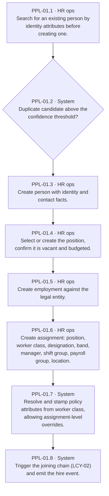
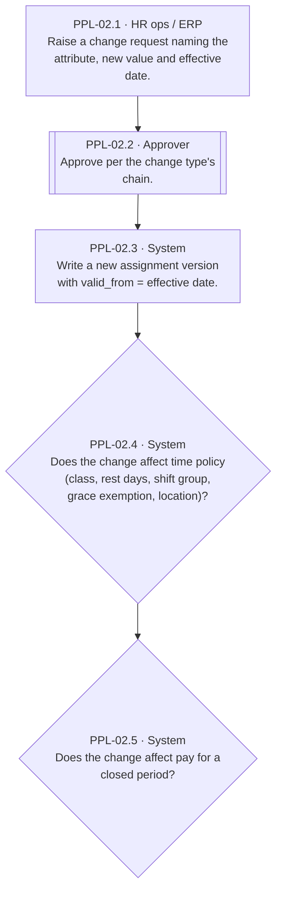
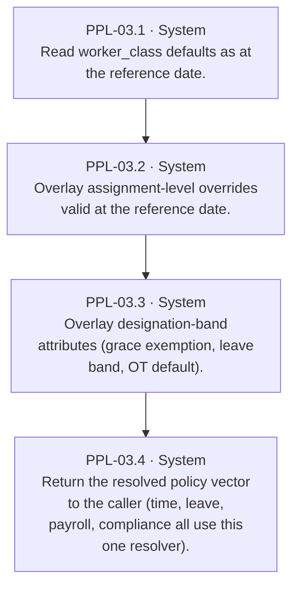
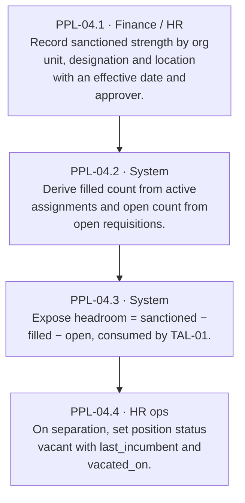
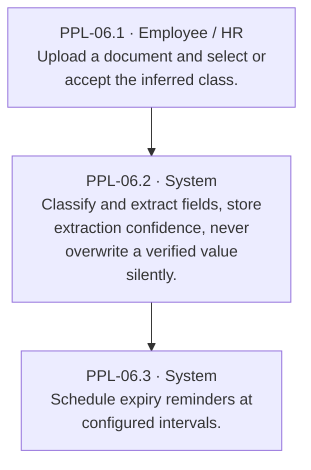

<picture>
  <source media="(prefers-color-scheme: dark)" srcset="../../assets/MultipliersKraftLogoDark.png">
  
</picture>

# FRS-PPL-01 — People Core — Process Specifications

| Attribute | Value |
| :--- | :--- |
| Document ID | FRS-PPL-01 |
| Title | People Core — Process Specifications |
| Product | Nucleus Suite (Nucleus HRMS Suite) |
| Version | 1.0.0 |
| Status | Issued for approval |
| Owner (role) | Domain Product Owner — People Core |
| Author | Dhanraj Dadhich |
| Reviewed by | *pending* |
| Approved by | Product Council — *pending* |
| Date | 2026-11-05 |
| Classification | Internal |
| CMMI practice areas | RDM, TS |
| Related documents | FRS-PPL-00, FRS-PPL-01, FRS-PPL-02, FRS-PPL-03, FRS-PPL-04, FRS-PPL-05, FRS-PPL-06, FRS-PPL-07, FRS-PPL-08, FRS-PPL-09, FRS-PPL-10, FRS-PPL-11, FRS-PPL-12, FRS-PPL-13, BRS-01, SRS-01, REQ-01, REQ-02 |
| Quality & process-performance objectives | QPPO-05 (effective requirements reviews), QPPO-01 (escaped defects) — MPM-01 |
| Process performance baseline used | PPB-01 (review defect density), PPB-02 (review rate) — MPM-01 |
| Peer review record | *pending* (PR-xxxx, QA-02) |
| Tailoring record | none |
| Traceability anchor | BG-01 · R-03, R-04, R-05, R-23 · processes PPL-01–PPL-08 |
| Source of record | Nucleus — Process Flows & Process Maps v1.0 — sheet(s) 03_Process_Inventory, 04_Process_Steps, 05_Swimlane_Maps Nucleus HR Demo Points Build Sheet v1.0 — sheet(s) 07_Approval_Workflows Nucleus HRMS Demo Dataset v1.1 — sheet(s) 64_Approval_Workflows |

> **Source of record.** Requirements in this document are taken from the source workbook(s) named above and keep their workbook IDs, which are never renumbered. Changes are made through a change request (CM-02) against the source workbook. Sections marked **Authored** are original additions that are not present in the source workbooks.

Step types: TASK (human) · SYS (system, unattended) · DEC (decision) · APPR (approval gate) · INT (integration call) · WAIT (timer or external event) · AGENT (agent-executed, governed). CRUD: C create · R read · U update · D delete-by-end-dating (temporal facts are never hard-deleted). In the flow diagrams decisions are diamonds, approvals are double-bordered boxes and integration, wait and agent steps are rounded.

## 1. Process inventory

| Process ID | Process | Trigger | Primary actor | Frequency | Criticality | Blueprint module | Phase | Reuses | Demo pts | Note |
| :--- | :--- | :--- | :--- | :--- | :--- | :--- | :--- | :--- | :--- | :--- |
| PPL-01 | Create person, position and assignment | Offer accepted or data load | HR ops | Daily | Critical | Module 1 | P1 | CMP-10, CMP-08 | 22 | person survives rehire and entity transfer; assignment is what everything else references. |
| PPL-02 | Assignment change (effective-dated, retro-capable) | Grade, manager, location, cost centre, class change | HR ops | Weekly | Critical | Module 1 | P1 | CMP-10, CMP-01 |  | Retro changes after a closed payroll produce arrears, never a rewrite. |
| PPL-03 | Worker class and policy attribute resolution | Any time or pay computation | System | Continuous | Critical | Module 1 | P1 | CMP-10 | 2,3,4 | Class supplies the default; the assignment may override with a reason and a date. |
| PPL-04 | Position control and sanctioned strength | Budget approval or vacancy | HR / Finance | Monthly | High | Module 1 | P3 | CMP-10 | 24,25 | Actual, open and sanctioned are three readings of one structure. |
| PPL-05 | Org unit change and reorganisation | Restructure | HR ops | Occasional | Medium | Module 1 | P1 | CMP-10 | 22 | Effective-dated, so history survives the reorganisation. |
| PPL-06 | Document capture, classification and expiry | Upload | Employee / HR | Continuous | Medium | Module 1 | P1 | CMP-08 | 26 | Expiry tracking drives compliance nudges; storage is encrypted and tokenised. |
| PPL-07 | Rehire, entity transfer and class change | Rejoin or transfer | HR ops | Occasional | High | Module 1 | P2 | CMP-10 | 3 | Tenure and gratuity continuity decided by rule, not by hand. |
| PPL-08 | Duplicate person detection | Onboarding or ERP sync | System / HR | Per hire | High | Module 1 | P2 | CMP-11 | 14 | Two people, same name and DOB, same site is routine in manufacturing. |

## 2. Step-level specifications

### PPL-01 — Create person, position and assignment

**Trigger:** Offer accepted or data load · **Primary actor:** HR ops · **Frequency:** Daily · **Criticality:** Critical · **Phase:** P1 · **Reuses:** CMP-10, CMP-08

| Step | Step ID | Lane / actor | Type | Action or decision | Rule ID(s) | Objects touched (CRUD) | Key fields | Screen | Event emitted | Exception / note | Reuses | Demo pts | Phase |
| :--- | :--- | :--- | :--- | :--- | :--- | :--- | :--- | :--- | :--- | :--- | :--- | :--- | :--- |
| 1 | PPL-01.1 | HR ops | TASK | Search for an existing person by identity attributes before creating one. | RL-030 | person R | full_name, date_of_birth, aadhaar_token, pan_token, mobile | SCR-010 |  | Match found → route to rehire (PPL-07) instead of create. | CMP-11 | 22 | P1 |
| 2 | PPL-01.2 | System | DEC | Duplicate candidate above the confidence threshold? | RL-031 | person R | match_score, matched_person_id | SCR-010 | people.person.duplicate_suspected | Two people with the same name, DOB and site is routine — present both records, let HR decide, log the decision. | CMP-11 | 22 | P1 |
| 3 | PPL-01.3 | HR ops | TASK | Create person with identity and contact facts. | RL-032 | person C | person_id, full_name, gender, date_of_birth, nationality, mobile, personal_email, aadhaar_token, pan_token, uan | SCR-010 | people.person.created | Aadhaar/PAN mismatch does NOT block joining; it raises a payroll-blocking flag (RL-033). | CMP-10 | 22 | P1 |
| 4 | PPL-01.4 | HR ops | TASK | Select or create the position; confirm it is vacant and budgeted. | RL-034 | position R/U | position_code, org_unit, location, grade, cost_centre, status | SCR-012 | people.position.filled | Position already filled → block; frozen or abolished → block with reason. |  | 22 | P1 |
| 5 | PPL-01.5 | HR ops | TASK | Create employment against the legal entity. | RL-035 | employment C | employment_id, person_id, legal_entity_id, employment_start, probation_months, notice_days | SCR-010 | people.employment.started |  |  | 22 | P1 |
| 6 | PPL-01.6 | HR ops | TASK | Create assignment: position, worker class, designation, band, manager, shift group, payroll group, location. | RL-036 | assignment C | assignment_id, employment_id, position_code, worker_class, designation_code, band, manager_assignment_id, shift_group, default_shift, payroll_group, location_id, cost_centre, effective_from | SCR-011 | people.assignment.started | Payroll group and location are independent — do not default one from the other (demo point 8). | CMP-10 | 22 | P1 |
| 7 | PPL-01.7 | System | SYS | Resolve and stamp policy attributes from worker class, allowing assignment-level overrides. | RL-037 | assignment U | has_rest_days, rest_day_pattern, wage_type, ot_eligibility, grace_exempt, leave_policy_ref, statutory_applicability | SCR-011 | people.assignment.policy_resolved | Override requires reason + effective date; both are temporal. | CMP-10 | 22 | P1 |
| 8 | PPL-01.8 | System | SYS | Trigger the joining chain (LCY-02) and emit the hire event. | RL-038 | workflow_instance C | chain_id, person_id, assignment_id | — | people.worker.hired |  |  | 22 | P1 |

### PPL-02 — Assignment change (effective-dated, retro-capable)

**Trigger:** Grade, manager, location, cost centre, class change · **Primary actor:** HR ops · **Frequency:** Weekly · **Criticality:** Critical · **Phase:** P1 · **Reuses:** CMP-10, CMP-01

| Step | Step ID | Lane / actor | Type | Action or decision | Rule ID(s) | Objects touched (CRUD) | Key fields | Screen | Event emitted | Exception / note | Reuses | Demo pts | Phase |
| :--- | :--- | :--- | :--- | :--- | :--- | :--- | :--- | :--- | :--- | :--- | :--- | :--- | :--- |
| 1 | PPL-02.1 | HR ops / ERP | TASK | Raise a change request naming the attribute, new value and effective date. | RL-040 | assignment_change_request C | field, old_value, new_value, effective_from, reason | SCR-011 |  | Effective date in a closed payroll period → flag as retro (RL-041). |  |  | P1 |
| 2 | PPL-02.2 | Approver | APPR | Approve per the change type's chain. | RL-010 | approval_instance C | chain_id, decision | SCR-040 | platform.approval.completed |  | CMP-01 |  | P1 |
| 3 | PPL-02.3 | System | SYS | Write a new assignment version with valid_from = effective date. | RL-020 | assignment C/U | all policy-carrying fields, valid_from, recorded_from | — | people.assignment.changed |  | CMP-10 |  | P1 |
| 4 | PPL-02.4 | System | DEC | Does the change affect time policy (class, rest days, shift group, grace exemption, location)? | RL-042 | attendance_day R | affected_date_range | — | time.recompute.requested | Yes → queue attendance recompute for the affected range (TIM-09). | CMP-04 |  | P1 |
| 5 | PPL-02.5 | System | DEC | Does the change affect pay for a closed period? | RL-041 | payroll_run R | period, run_state | — | payroll.arrears.requested | Yes → queue arrears in the next open run (PAY-11). Never rewrite a closed run. |  |  | P1 |

### PPL-03 — Worker class and policy attribute resolution

**Trigger:** Any time or pay computation · **Primary actor:** System · **Frequency:** Continuous · **Criticality:** Critical · **Phase:** P1 · **Reuses:** CMP-10

| Step | Step ID | Lane / actor | Type | Action or decision | Rule ID(s) | Objects touched (CRUD) | Key fields | Screen | Event emitted | Exception / note | Reuses | Demo pts | Phase |
| :--- | :--- | :--- | :--- | :--- | :--- | :--- | :--- | :--- | :--- | :--- | :--- | :--- | :--- |
| 1 | PPL-03.1 | System | SYS | Read worker_class defaults as at the reference date. | RL-050 | worker_class R | has_rest_days, rest_day_pattern, wage_type, ot_eligibility, leave_eligible, statutory_set, obligation_party | — |  |  | CMP-10 | 2,3,4 | P1 |
| 2 | PPL-03.2 | System | SYS | Overlay assignment-level overrides valid at the reference date. | RL-051 | assignment R | override fields + override_reason | — |  | An override with no reason fails validation at write time, not read time. | CMP-10 | 2,3,4 | P1 |
| 3 | PPL-03.3 | System | SYS | Overlay designation-band attributes (grace exemption, leave band, OT default). | RL-052 | designation R | band, grace_exempt, leave_band, ot_default, notice_days | — |  |  |  | 2,3,4 | P1 |
| 4 | PPL-03.4 | System | SYS | Return the resolved policy vector to the caller (time, leave, payroll, compliance all use this one resolver). | RL-053 | — | resolved policy vector | — |  | Resolution for a date before the assignment start returns 'not employed', not defaults. | CMP-10 | 2,3,4 | P1 |

### PPL-04 — Position control and sanctioned strength

**Trigger:** Budget approval or vacancy · **Primary actor:** HR / Finance · **Frequency:** Monthly · **Criticality:** High · **Phase:** P3 · **Reuses:** CMP-10

| Step | Step ID | Lane / actor | Type | Action or decision | Rule ID(s) | Objects touched (CRUD) | Key fields | Screen | Event emitted | Exception / note | Reuses | Demo pts | Phase |
| :--- | :--- | :--- | :--- | :--- | :--- | :--- | :--- | :--- | :--- | :--- | :--- | :--- | :--- |
| 1 | PPL-04.1 | Finance / HR | TASK | Record sanctioned strength by org unit, designation and location with an effective date and approver. | RL-055 | sanctioned_position C | org_unit, designation_code, location_id, sanctioned_count, effective_from, approved_by | SCR-013 | people.sanction.set |  |  | 24,25 | P3 |
| 2 | PPL-04.2 | System | SYS | Derive filled count from active assignments and open count from open requisitions. | RL-056 | assignment R; requisition R | filled_count, open_req_count | SCR-013 |  | Three readings of one structure — never store filled_count as a column. |  | 24,25 | P3 |
| 3 | PPL-04.3 | System | SYS | Expose headroom = sanctioned − filled − open, consumed by TAL-01. | RL-057 | — | headroom | SCR-013 |  | Negative headroom is legal only with a recorded override. |  | 24,25 | P3 |
| 4 | PPL-04.4 | HR ops | TASK | On separation, set position status vacant with last_incumbent and vacated_on. | RL-058 | position U | status, last_incumbent_id, vacated_on | SCR-012 | people.position.vacated | This row is what a replacement requisition points at (demo point 24). |  | 24,25 | P3 |

### PPL-05 — Org unit change and reorganisation

**Trigger:** Restructure · **Primary actor:** HR ops · **Frequency:** Occasional · **Criticality:** Medium · **Phase:** P1 · **Reuses:** CMP-10

The source workbook specifies this process at inventory level only. Its complete flow is specified in use case PPL-UC-005 (FRS-PPL-12).

### PPL-06 — Document capture, classification and expiry

**Trigger:** Upload · **Primary actor:** Employee / HR · **Frequency:** Continuous · **Criticality:** Medium · **Phase:** P1 · **Reuses:** CMP-08

| Step | Step ID | Lane / actor | Type | Action or decision | Rule ID(s) | Objects touched (CRUD) | Key fields | Screen | Event emitted | Exception / note | Reuses | Demo pts | Phase |
| :--- | :--- | :--- | :--- | :--- | :--- | :--- | :--- | :--- | :--- | :--- | :--- | :--- | :--- |
| 1 | PPL-06.1 | Employee / HR | TASK | Upload a document and select or accept the inferred class. | RL-060 | document C | document_id, person_id, class, file_ref, issued_on, expires_on, verified_by | SCR-014 | people.document.uploaded |  |  | 26 | P1 |
| 2 | PPL-06.2 | System | SYS | Classify and extract fields; store extraction confidence; never overwrite a verified value silently. | RL-061 | document U | extracted_fields, confidence | SCR-014 | people.document.classified | Low confidence routes to HR verification queue. | CMP-11 | 26 | P1 |
| 3 | PPL-06.3 | System | SYS | Schedule expiry reminders at configured intervals. | RL-062 | notification C | expires_on, remind_at[] | — | people.document.expiring |  |  | 26 | P1 |

### PPL-07 — Rehire, entity transfer and class change

**Trigger:** Rejoin or transfer · **Primary actor:** HR ops · **Frequency:** Occasional · **Criticality:** High · **Phase:** P2 · **Reuses:** CMP-10

The source workbook specifies this process at inventory level only. Its complete flow is specified in use case PPL-UC-007 (FRS-PPL-12).

### PPL-08 — Duplicate person detection

**Trigger:** Onboarding or ERP sync · **Primary actor:** System / HR · **Frequency:** Per hire · **Criticality:** High · **Phase:** P2 · **Reuses:** CMP-11

The source workbook specifies this process at inventory level only. Its complete flow is specified in use case PPL-UC-008 (FRS-PPL-12).

## 4. Approval workflows

_No entries in source for this scope._

### Workflow behaviour

_No entries in source for this scope._

## Approval & Sign-off

| Role | Name | Date | Decision | Conditions / comments |
| :--- | :--- | :--- | :--- | :--- |
| Author | Dhanraj Dadhich | 2026-11-05 | Submitted | |
| Peer review moderator | *pending* | | | PR-xxxx |
| PQA (process compliance) | *pending* | | | |
| Approval authority (DOC-01 §7) | *pending* | | | |

## Measurement Data Captured

| Measure | Value | Unit | Notes |
| :--- | :--- | :--- | :--- |
| Size | 32 | specified items (table rows) | Counted automatically at generation |
| Authoring effort | *to be recorded* | person-hours | |
| Review effort (preparation + meeting) | *pending review* | person-hours | From PR-xxxx |
| Rework effort | *pending review* | person-hours | |
| Review rate | *pending review* | items / hour | Compare with PPB control limits |
| Requirement volatility (changes since baseline) | 0 | CRs touching this artefact | Not yet baselined (CM-03) |

**Defects found, by detection phase and severity**

| Detection phase | Major | Minor | Editorial | Injected in phase (major) |
| :--- | :--- | :--- | :--- | :--- |
| Author self-check | 0 | 0 | 0 | — |
| Peer review | *pending* | | | |
| Design / build | | | | |
| System / integration test | | | | |
| UAT | | | | |
| Production (escaped) | | | | each escaped major opens a CAR record (CAR-01) |

Within control limits of the review-rate PPB? *To be assessed at peer review.*

## Revision History

| Version | Date | Author | Change summary | CR ref | Approved by |
| :--- | :--- | :--- | :--- | :--- | :--- |
| 1.0.0 | 2026-11-05 | Dhanraj Dadhich | Consolidated release | CR-0001 | *pending* |
