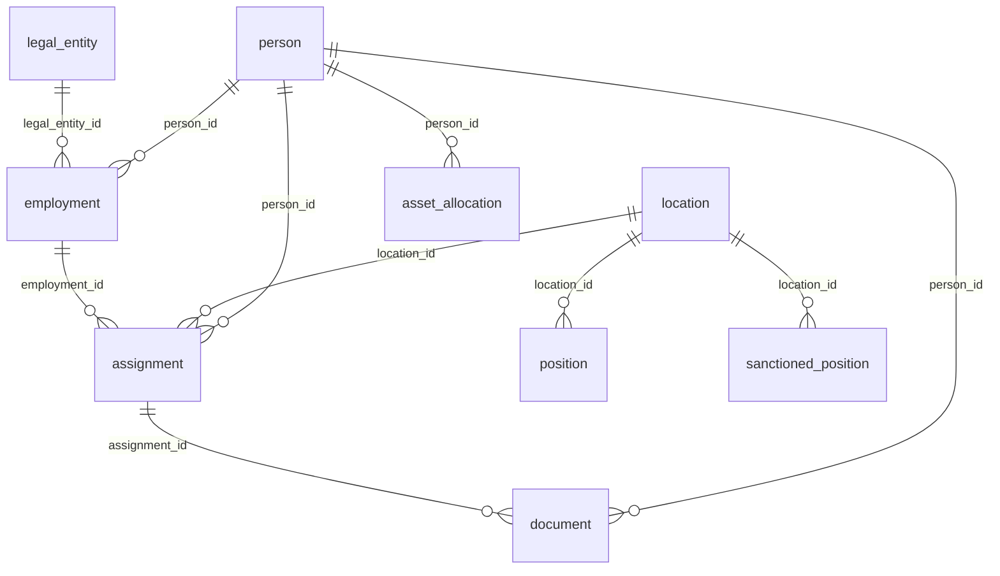

<picture>
  <source media="(prefers-color-scheme: dark)" srcset="../../assets/MultipliersKraftLogoDark.png">
  
</picture>

# FRS-PPL-05 — People Core — Data Model

| Attribute | Value |
| :--- | :--- |
| Document ID | FRS-PPL-05 |
| Title | People Core — Data Model |
| Product | Nucleus Suite (Nucleus HRMS Suite) |
| Version | 1.0.0 |
| Status | Issued for approval |
| Owner (role) | Domain Product Owner — People Core |
| Author | Dhanraj Dadhich |
| Reviewed by | *pending* |
| Approved by | Product Council — *pending* |
| Date | 2026-11-05 |
| Classification | Internal |
| CMMI practice areas | TS, RDM |
| Related documents | FRS-PPL-00, FRS-PPL-01, FRS-PPL-02, FRS-PPL-03, FRS-PPL-04, FRS-PPL-05, FRS-PPL-06, FRS-PPL-07, FRS-PPL-08, FRS-PPL-09, FRS-PPL-10, FRS-PPL-11, FRS-PPL-12, FRS-PPL-13, BRS-01, SRS-01, REQ-01, REQ-02 |
| Quality & process-performance objectives | QPPO-05 (effective requirements reviews), QPPO-01 (escaped defects) — MPM-01 |
| Process performance baseline used | PPB-01 (review defect density), PPB-02 (review rate) — MPM-01 |
| Peer review record | *pending* (PR-xxxx, QA-02) |
| Tailoring record | none |
| Traceability anchor | BG-01 · R-03, R-04, R-05, R-23 · processes PPL-01–PPL-08 |
| Source of record | Nucleus — Process Flows & Process Maps v1.0 — sheet(s) 06_Data_Dictionary Nucleus HR Demo Points Build Sheet v1.0 — sheet(s) 06_Enum_Values Nucleus HRMS Demo Dataset v1.1 — sheet(s) 65_Enum_Seed_Values |

> **Source of record.** Requirements in this document are taken from the source workbook(s) named above and keep their workbook IDs, which are never renumbered. Changes are made through a change request (CM-02) against the source workbook. Sections marked **Authored** are original additions that are not present in the source workbooks.

Every object carries the platform envelope (`tenant_id`, `entity_id`), effective dating (`effective_from`, `effective_to`) where temporal, and audit columns. Sensitivity classes follow GOV-10.

## 1. Entity relationships

Relationships are derived from the identifier fields in the data dictionary; the tenant envelope is omitted for legibility.

## 2. Data objects

| Object | Fields | Type | Required | Owner / source | Temporal | Sensitivity | Notes | Dataset ref |
| :--- | :--- | :--- | :--- | :--- | :--- | :--- | :--- | :--- |
| person | person_id | uuid | Y | Nucleus or ERP | No | — | Survives rehire, contract-to-permanent conversion and entity transfer. | 12_Employees |
| person | full_name, gender, date_of_birth, blood_group, marital_status | text/date | Y | ERP (co-owned) | Yes | Personal | Name and DOB are the duplicate-detection keys. | 12_Employees |
| person | mobile, personal_email, permanent_address, present_address, emergency_contact | text | Y | Employee | Yes | Personal |  |  |
| person | aadhaar_token, pan_token, passport_token, uan, esi_ip | token | N | Employee | Yes | Restricted | Tokenised. Raw values live in a separate vault table with its own access policy. Never in logs, events or an LLM prompt. | 12_Employees |
| person | photo_ref, nominee[] | ref/json | N | Employee | Yes | Personal |  |  |
| employment | employment_id, person_id, legal_entity_id, employment_start, employment_end, probation_months, confirmation_date, notice_days, tenure_continuity_ref | mixed | Y | Nucleus | Yes | — | Tenure and gratuity continuity on rehire or transfer is decided by rule here. |  |
| position | position_code, title, org_unit, location_id, grade, cost_centre, status(filled\|vacant\|frozen\|abolished), current_incumbent_id, last_incumbent_id, vacated_on, sanctioned_ref | mixed | Y | Nucleus | Yes | — | A budgeted seat that exists with or without a person in it. | 11_Positions |
| assignment | assignment_id, employment_id, person_id, position_code, org_unit, designation_code, band, worker_class, manager_assignment_id, shift_group, default_shift, payroll_group, location_id, cost_centre, project_ref, vendor_id, effective_from, effective_to | mixed | Y | Nucleus | Yes | — | The unit everything else references. | 12_Employees |
| assignment | override_has_rest_days, override_rest_day_pattern, override_wage_type, override_ot_eligibility, override_grace_exempt, override_leave_policy_ref, override_reason | mixed | N | HR | Yes | — | Class supplies the default; the individual may differ. Override without a reason fails validation. | 06_Worker_Classes |
| org_unit | org_unit_code, name, parent, level, type, primary_location, cost_centre | text | Y | ERP (co-owned) | Yes | — | Effective-dated so reorganisations are history, not destruction. | 04_Org_Units |
| designation | designation_code, title, band, grace_exempt, leave_band, ot_default, notice_days | mixed | Y | Config | Yes | — | Grace exemption lives on the band, never as a hardcoded grade string. | 05_Designations |
| worker_class | class_code, label, has_rest_days, rest_day_pattern, wage_type, ot_eligibility, leave_eligible, leave_policy_ref, statutory_set, obligation_party | mixed | Y | Config | Yes | — | Nine classes in the demo tenant. Every attribute overridable per assignment. | 06_Worker_Classes |
| sanctioned_position | record_id, org_unit, designation_code, location_id, sanctioned_count, effective_from, approved_by | mixed | Y | Finance/HR | Yes | — | Filled and open counts are derived, never stored. | 10_Sanctioned_Manpower |
| document | document_id, person_id, assignment_id, class, file_ref, issued_on, expires_on, verified_by, extracted_fields, confidence | mixed | N | Employee/HR | Yes | Personal | Encrypted at rest, expiry-tracked. |  |
| asset | asset_code, type, description, serial, status, condition | text | N | Admin | Yes | — |  | 33_Assets |
| asset_allocation | allocation_id, asset_code, person_id, issued_on, returned_on, condition, clearance_item_ref | mixed | N | Admin | Yes | — | Allocation at joining; return is a blocking clearance item at exit. | 33_Assets |

### Additional objects and attributes (Authored)

| Object | Fields | Type | Required | Owner / source | Temporal | Sensitivity | Notes | Defined in |
| :--- | :--- | :--- | :--- | :--- | :--- | :--- | :--- | :--- |
| person | erp_employee_key, official_email, preferred_language | text | N | ERP / Nucleus | Yes | Personal | erp_employee_key holds the ERP key (for example VPI-1018) so the mapping survives a code change on either side; official_email feeds the SCIM userName and the sign-in email claim; preferred_language selects the message template language. | ICD-01 §6.2, §11.2, §15.2; MIG-01 §5.2 |
| person | bank_account_token, bank_ifsc, bank_account_holder_name, bank_verification_status, bank_verified_by, bank_verified_on | token | N | Employee (HR-verified) | Yes | Restricted | Account number detokenised only inside the bank file builder; a change inside a payroll window raises an alert (RL-393); unverified accounts are excluded from the bank file. | ICD-01 §9.2; MIG-01 PLT-MIG-027 |
| person | pf_membership_date, eps_eligible, vpf_rate_pct, esi_coverage_status, esi_coverage_period | mixed | N | Payroll | Yes | Confidential | Carried at migration so PF and ESI files continue correctly; coverage is re-evaluated when cut-over opens a new ESI contribution period. | MIG-01 §8.3 |
| employment | continuous_service_start, recognised_prior_service_months, prior_service_basis | mixed | N | HR | Yes | Confidential | Gratuity eligibility and the 6x loan ceiling compute from these facts (PLT-MIG-035). | MIG-01 §8.3 |
| employment_category | category_code, sub_category_code, label, worker_class_code | text | Y | Config | Yes | — | Worker class resolves from category, sub-category and employee-level overrides, never from a legacy grade string (PLT-MIG-014). | MIG-01 §4, §5.2 |

## 3. Enumerations

| Enum code | Enum name | Module | System or Config | Complete value set | Requirement |
| :--- | :--- | :--- | :--- | :--- | :--- |
| EN_EMPLOYMENT_CATEGORY | Employment category | EMP | Config | Permanent · Probation · Contractual · Third party · Trainee · Retainer | R-03, R-04 |
| EN_EMPLOYMENT_SUBCATEGORY | Employment sub-category | EMP | Config | Employee · Helper · Supervisor · Skilled · Semi-skilled · Unskilled | R-04 |
| EN_WAGE_BASIS | Wage basis | EMP | System | Monthly · Daily · Hourly · Piece rate | R-03 |
| EN_OT_ELIGIBILITY_BASIS | OT eligibility basis | EMP | Config | All days · Rest days and holidays only · Holidays only · Not eligible | R-05 |
| EN_TRAINEE_TYPE | Trainee type | EMP | Config | DET · GET · Apprentice · Intern | R-08 |

### Enumeration seed values and tenant defaults

| Enum code | Enum name | Module | System or Config | Complete value set | Default in this tenant | Requirement |
| :--- | :--- | :--- | :--- | :--- | :--- | :--- |
| EN_EMPLOYMENT_CATEGORY | Employment category | EMP | Config | Permanent · Probation · Contractual · Third party · Trainee · Retainer | Permanent | R-03, R-04 |
| EN_EMPLOYMENT_SUBCATEGORY | Employment sub-category | EMP | Config | Employee · Helper · Supervisor · Skilled · Semi-skilled · Unskilled |  | R-04 |
| EN_WAGE_BASIS | Wage basis | EMP | System | Monthly · Daily · Hourly · Piece rate | Monthly | R-03 |
| EN_OT_ELIGIBILITY_BASIS | OT eligibility basis | EMP | Config | All days · Rest days and holidays only · Holidays only · Not eligible | All days | R-05 |
| EN_TRAINEE_TYPE | Trainee type | EMP | Config | DET · GET · Apprentice · Intern |  | R-08 |

## Approval & Sign-off

| Role | Name | Date | Decision | Conditions / comments |
| :--- | :--- | :--- | :--- | :--- |
| Author | Dhanraj Dadhich | 2026-11-05 | Submitted | |
| Peer review moderator | *pending* | | | PR-xxxx |
| PQA (process compliance) | *pending* | | | |
| Approval authority (DOC-01 §7) | *pending* | | | |

## Measurement Data Captured

| Measure | Value | Unit | Notes |
| :--- | :--- | :--- | :--- |
| Size | 31 | specified items (table rows) | Counted automatically at generation |
| Authoring effort | *to be recorded* | person-hours | |
| Review effort (preparation + meeting) | *pending review* | person-hours | From PR-xxxx |
| Rework effort | *pending review* | person-hours | |
| Review rate | *pending review* | items / hour | Compare with PPB control limits |
| Requirement volatility (changes since baseline) | 0 | CRs touching this artefact | Not yet baselined (CM-03) |

**Defects found, by detection phase and severity**

| Detection phase | Major | Minor | Editorial | Injected in phase (major) |
| :--- | :--- | :--- | :--- | :--- |
| Author self-check | 0 | 0 | 0 | — |
| Peer review | *pending* | | | |
| Design / build | | | | |
| System / integration test | | | | |
| UAT | | | | |
| Production (escaped) | | | | each escaped major opens a CAR record (CAR-01) |

Within control limits of the review-rate PPB? *To be assessed at peer review.*

## Revision History

| Version | Date | Author | Change summary | CR ref | Approved by |
| :--- | :--- | :--- | :--- | :--- | :--- |
| 1.0.0 | 2026-11-05 | Dhanraj Dadhich | Consolidated release | CR-0001 | *pending* |
