

<picture>
  <source media="(prefers-color-scheme: dark)" srcset="../../assets/MultipliersKraftLogoDark.png">
  
</picture>

# FRS-PPL-12 — People Core — Use Case Specifications

| Attribute | Value |
| :--- | :--- |
| Document ID | FRS-PPL-12 |
| Title | People Core — Use Case Specifications |
| Product | Nucleus Suite (Nucleus HRMS Suite) |
| Version | 1.0.0 |
| Status | Issued for approval |
| Owner (role) | Domain Product Owner — People Core |
| Author | Dhanraj Dadhich |
| Reviewed by | *pending* |
| Approved by | Product Council — *pending* |
| Date | 2026-11-05 |
| Classification | Internal |
| CMMI practice areas | RDM, VV |
| Related documents | FRS-PPL-00, FRS-PPL-01, FRS-PPL-02, FRS-PPL-03, FRS-PPL-04, FRS-PPL-05, FRS-PPL-06, FRS-PPL-07, FRS-PPL-08, FRS-PPL-09, FRS-PPL-10, FRS-PPL-11, FRS-PPL-12, FRS-PPL-13, BRS-01, SRS-01, REQ-01, REQ-02 |
| Quality & process-performance objectives | QPPO-05 (effective requirements reviews), QPPO-01 (escaped defects) — MPM-01 |
| Process performance baseline used | PPB-01 (review defect density), PPB-02 (review rate) — MPM-01 |
| Peer review record | *pending* (PR-xxxx, QA-02) |
| Tailoring record | none |
| Traceability anchor | BG-01 · R-03, R-04, R-05, R-23 · processes PPL-01–PPL-08 |
| Source of record | Nucleus — Process Flows & Process Maps v1.0 — sheet(s) 03_Process_Inventory, 04_Process_Steps, 07_Screens, 09_Business_Rules Authored use cases (marked per use case) |

> **Source of record.** Requirements in this document are taken from the source workbook(s) named above and keep their workbook IDs, which are never renumbered. Changes are made through a change request (CM-02) against the source workbook. Sections marked **Authored** are original additions that are not present in the source workbooks.

This document specifies 18 use cases for People Core: 5 follow the step-level flows of the source workbook and 13 are authored (processes without step-level detail in the source, and capability gaps). User stories derived from each use case are in FRS-PPL-13.

## 1. Use case index

| ID | Use case | Primary actor | Realises | Source | Phase | Criticality |
| :--- | :--- | :--- | :--- | :--- | :--- | :--- |
| [PPL-UC-001](#ppl-uc-001) | Create person, position and assignment | HR operations | PPL-01 | Source workbook | P1 | Critical |
| [PPL-UC-002](#ppl-uc-002) | Change an assignment with an effective date | HR operations | PPL-02 | Source workbook | P1 | Critical |
| [PPL-UC-003](#ppl-uc-003) | Resolve worker class and policy attributes | Nucleus platform | PPL-03 | Source workbook | P1 | Critical |
| [PPL-UC-004](#ppl-uc-004) | Control positions and sanctioned strength | Finance | PPL-04 | Source workbook | P3 | High |
| [PPL-UC-005](#ppl-uc-005) | Change an org unit or reorganise | HR operations | PPL-05 | Authored | P1 | Medium |
| [PPL-UC-006](#ppl-uc-006) | Capture, classify and track documents | Employee / worker | PPL-06 | Source workbook | P1 | Medium |
| [PPL-UC-007](#ppl-uc-007) | Rehire, transfer between entities or change worker class | HR operations | PPL-07 | Authored | P2 | High |
| [PPL-UC-008](#ppl-uc-008) | Detect duplicate persons | Nucleus platform | PPL-08 | Authored | P2 | High |
| [PPL-UC-009](#ppl-uc-009) | Maintain job architecture | HR operations | PPL-CG-001 | Authored | P1 | Medium |
| [PPL-UC-010](#ppl-uc-010) | Maintain multiple and matrix hierarchies | HR operations | PPL-CG-002 | Authored | P1 | High |
| [PPL-UC-011](#ppl-uc-011) | Manage global and expatriate assignments | HR operations | PPL-CG-003 | Authored | P4 | Medium |
| [PPL-UC-012](#ppl-uc-012) | Record dependants, nominees and emergency contacts | Employee / worker | PPL-CG-004 | Authored | P1 | High |
| [PPL-UC-013](#ppl-uc-013) | Stage and commit a mass reorganisation | HR operations | PPL-CG-005 | Authored | P2 | High |
| [PPL-UC-014](#ppl-uc-014) | Explore the interactive organisation chart | Manager / supervisor | PPL-CG-006 | Authored | P1 | Medium |
| [PPL-UC-015](#ppl-uc-015) | Hold concurrent assignments for one person | HR operations | PPL-CG-007 | Authored | P2 | High |
| [PPL-UC-016](#ppl-uc-016) | Plan headcount and positions against sanctioned strength | HR operations | PPL-CG-008 | Authored | P3 | High |
| [PPL-UC-017](#ppl-uc-017) | Present a digital ID and download verifiable employment letters | Employee / worker | PPL-CG-009 | Authored | P2 | Medium |
| [PPL-UC-018](#ppl-uc-018) | Monitor organisation health metrics by unit | Manager / supervisor | PPL-CG-010 | Authored | P3 | Medium |

## 2. Use case diagrams

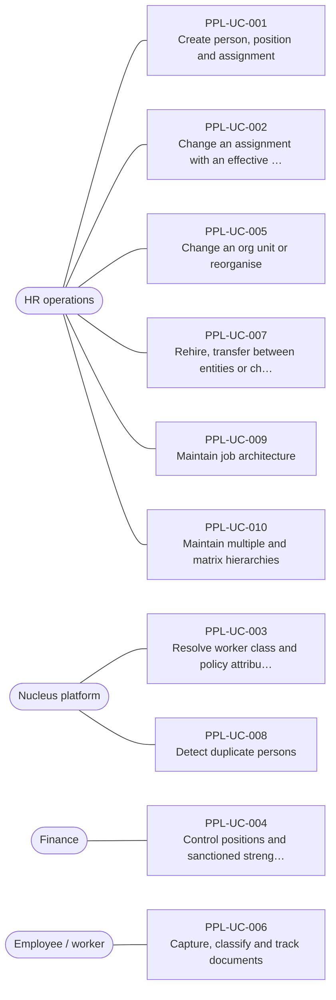

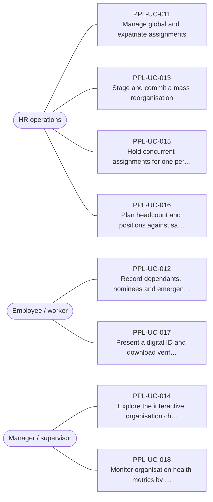

## 3. Use case specifications

### PPL-UC-001

**Create person, position and assignment** — Bring a new worker onto the record as one durable person with an employment and an assignment against a vacant position, with policy attributes resolved and the joining chain started.

| Attribute | Value |
| :--- | :--- |
| Realises | PPL-01 |
| Source | Source workbook |
| Level | User goal |
| Primary actor | HR operations |
| Secondary actors | Nucleus platform, Payroll manager, Plant HR / time office |
| Trigger | An offer is accepted or a data load presents a new worker. |
| Frequency | Daily |
| Criticality | Critical |
| Phase | P1 |
| Client requirements | — |
| Business rules | RL-030, RL-031, RL-032, RL-033, RL-034, RL-035, RL-036, RL-037, RL-038, RL-005 |
| Screens | SCR-010, SCR-011, SCR-012 |
| Data objects (CRUD) | person (C), position (U), employment (C), assignment (C), assignment (U), workflow_instance (C) |
| Events | people.person.duplicate_suspected, people.person.created, people.position.filled, people.employment.started, people.assignment.started, people.assignment.policy_resolved, people.worker.hired |
| Acceptance tests | TC-H30, TC-H31, TC-H32, TC-H33, TC-H34, TC-H35, TC-H36, TC-H37, TC-H38, TC-P05 |
| System requirements | SYS-006, SYS-007, SYS-022, SYS-033, SYS-053 |

**Stakeholders and interests**

| Stakeholder | Interest |
| :--- | :--- |
| Payroll manager | Payroll group is set explicitly and identity mismatches block pay, not joining. |
| Plant HR / time office | The new worker's shift group, default shift and location are ready before the first punch. |
| Employee / worker | Joins on the planned date even if a statutory identifier needs correction. |
| Auditor | Duplicate decisions and policy overrides are recorded with a reason. |

**Preconditions**

- HR operations holds entity scope for the hiring legal entity.
- The target position exists in the position register.
- Worker classes, designations and payroll groups are configured.

**Main success scenario**

| # | Actor | Action | Ref |
| ---: | :--- | :--- | :--- |
| 1 | HR operations | Searches for an existing person by name, date of birth, Aadhaar token, PAN token and mobile before creating one. | PPL-01.1 |
| 2 | Nucleus platform | Scores candidate matches and checks whether any is above the 0.85 confidence threshold. | PPL-01.2 |
| 3 | HR operations | Creates the person with identity and contact facts: name, gender, date of birth, nationality, mobile, email, Aadhaar, PAN and UAN. | PPL-01.3 |
| 4 | HR operations | Selects or creates the position and confirms it is vacant and budgeted. | PPL-01.4 |
| 5 | HR operations | Creates the employment against the legal entity with start date, probation months and notice days. | PPL-01.5 |
| 6 | HR operations | Creates the assignment: position, worker class, designation, band, manager, shift group, payroll group and location. | PPL-01.6 |
| 7 | Nucleus platform | Resolves policy attributes from the worker class and stamps them on the assignment, keeping any reasoned overrides. | PPL-01.7 |
| 8 | Nucleus platform | Starts the joining chain and emits the hire event. | PPL-01.8 |

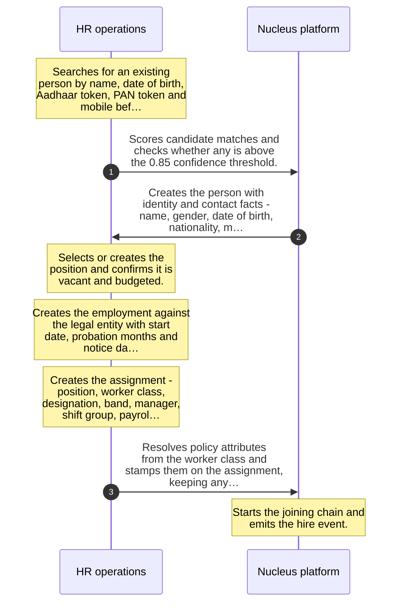

**Alternate flows**

| ID | At step | Condition | Steps | Rejoins |
| :--- | ---: | :--- | :--- | :--- |
| A1 | 2 | A candidate scores at or above 0.85. | Nucleus platform shows the existing record and the new entry side by side and emits people.person.duplicate_suspected. → HR operations decides Same person or Different person and the decision is logged with actor and reason. → If Different person, creation continues; same name, date of birth and site is routine and is not a reason to block. | Returns to step 3 |
| A2 | 1 | The search finds the person as a former worker. | HR operations routes the case to rehire instead of creating a new person. | Ends the use case (continues in PPL-UC-007) |
| A3 | 7 | HR operations needs a policy value different from the worker class default. | HR operations enters the override value, a reason and an effective date on the assignment screen. → Nucleus platform stores the override as a temporal fact. | Returns to step 8 |

**Exception flows**

| ID | At step | Condition | Handling | Rule |
| :--- | ---: | :--- | :--- | :--- |
| E1 | 3 | Aadhaar or PAN details do not match the verification source. | Joining proceeds; a payroll-blocking flag is raised so the worker is held out of pay until corrected. | RL-033 |
| E2 | 4 | The selected position is filled, frozen or abolished. | The assignment is blocked with the position status and reason shown. | RL-034 |
| E3 | 6 | Payroll group or location is left blank on the assumption that one will default from the other. | Save is refused until both are chosen explicitly; neither defaults from the other. | RL-036 |
| E4 | 7 | An override is entered without a reason or effective date. | Validation fails at write time and the override is not saved. | RL-037 |

**Postconditions — success**

- One person, one employment under the legal entity and one assignment exist, with payroll group and location set independently.
- The resolved policy vector is stamped on the assignment and the joining chain is running.
- people.worker.hired is emitted with person_id, assignment_id, worker_class, location_id and doj.

**Postconditions — failure**

- No assignment is created against a filled, frozen or abolished position.
- Where a likely duplicate exists, no new person is created until HR records a decision.

**Quality requirements**

- Duplicate search returns candidates in under 1 second at p95 for a tenant of 50,000 persons.
- Aadhaar and PAN are stored only as tokens and are masked on every screen by default.

### PPL-UC-002

**Change an assignment with an effective date** — Apply an approved change to an assignment attribute from a stated effective date, triggering attendance recompute or payroll arrears where the change reaches back into past periods.

| Attribute | Value |
| :--- | :--- |
| Realises | PPL-02 |
| Source | Source workbook |
| Level | User goal |
| Primary actor | HR operations |
| Secondary actors | Director / approver, Nucleus platform, ERP system, Payroll manager, Plant HR / time office |
| Trigger | A grade, manager, location, cost centre or worker class change is needed. |
| Frequency | Weekly |
| Criticality | Critical |
| Phase | P1 |
| Client requirements | — |
| Business rules | RL-010, RL-020, RL-040, RL-041, RL-042 |
| Screens | SCR-011, SCR-040 |
| Data objects (CRUD) | assignment_change_request (C), approval_instance (C), assignment (C), assignment (U), attendance_day (R), payroll_run (R) |
| Events | platform.approval.completed, people.assignment.changed, time.recompute.requested, payroll.arrears.requested |
| Acceptance tests | TC-H40, TC-Y41, TC-T42, TC-P20 |
| System requirements | SYS-022, SYS-025, SYS-037, SYS-053, SYS-057 |

**Stakeholders and interests**

| Stakeholder | Interest |
| :--- | :--- |
| Payroll manager | Closed payroll runs are never rewritten; retro effects arrive as arrears. |
| Plant HR / time office | Attendance is recomputed when a change affects time policy. |
| Manager / supervisor | Reporting-line changes route approvals to the right person from the right date. |

**Preconditions**

- The worker has an active assignment within HR operations' entity scope.
- An approval chain exists for the change type.

**Main success scenario**

| # | Actor | Action | Ref |
| ---: | :--- | :--- | :--- |
| 1 | HR operations | Raises a change request naming the attribute, the new value, the effective date and the reason. | PPL-02.1 |
| 2 | Director / approver | Approves the change per the change type's approval chain. | PPL-02.2 |
| 3 | Nucleus platform | Writes a new assignment version with valid_from set to the effective date. | PPL-02.3 |
| 4 | Nucleus platform | Checks whether the change affects time policy: class, rest days, shift group, grace exemption or location. | PPL-02.4 |
| 5 | Nucleus platform | Checks whether the change affects pay for a closed payroll period. | PPL-02.5 |

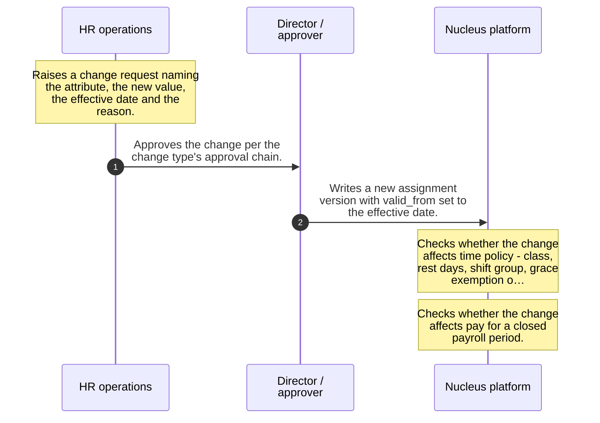

**Alternate flows**

| ID | At step | Condition | Steps | Rejoins |
| :--- | ---: | :--- | :--- | :--- |
| A1 | 4 | The change affects time policy. | Nucleus platform queues an attendance recompute for the affected date range and emits time.recompute.requested. | Returns to step 5 |
| A2 | 5 | The change affects pay in a closed period. | Nucleus platform queues arrears in the next open run and emits payroll.arrears.requested. → The closed run remains exactly as paid. | Ends the use case |
| A3 | 1 | The change originates from the ERP system's employee master. | Nucleus platform receives the inbound change and creates the change request with the ERP system as source. → The request follows the same chain as a manual change. | Returns to step 2 |

**Exception flows**

| ID | At step | Condition | Handling | Rule |
| :--- | ---: | :--- | :--- | :--- |
| E1 | 1 | The effective date or reason is missing. | The request is rejected at submission with the missing field named. | RL-040 |
| E2 | 1 | The effective date falls inside a closed payroll period. | The request is flagged as retro and the approver sees the flag and affected periods. | RL-041 |
| E3 | 2 | The approver rejects the change. | No version is written; HR operations is notified with the reason. | RL-010 |
| E4 | 5 | Any process attempts to update a closed payroll run for the change. | The update is refused; only arrears in the next open run are permitted. | RL-041 |

**Postconditions — success**

- A new assignment version exists with valid_from equal to the effective date and the prior version end-dated.
- Attendance recompute and payroll arrears are queued where required.

**Postconditions — failure**

- On rejection, the assignment is unchanged and the requester is told the reason.

**Quality requirements**

- The new assignment version is visible to time, leave and payroll within 1 minute of approval.
- An attendance recompute for a 90-day range for one worker completes within 2 minutes.

### PPL-UC-003

**Resolve worker class and policy attributes** — Give every time, leave, payroll and compliance computation one authoritative policy vector for a worker on a given date, built from class defaults, assignment overrides and designation-band attributes.

| Attribute | Value |
| :--- | :--- |
| Realises | PPL-03 |
| Source | Source workbook |
| Level | Subfunction |
| Primary actor | Nucleus platform |
| Secondary actors | Plant HR / time office, Payroll manager, Implementation consultant |
| Trigger | Any time, leave, payroll or compliance computation requests the policy for a worker on a reference date. |
| Frequency | Continuous |
| Criticality | Critical |
| Phase | P1 |
| Client requirements | R-03, R-04, R-05 |
| Business rules | RL-037, RL-050, RL-051, RL-052, RL-053, RL-101, RL-102, RL-130, RL-132, RL-290, RL-291, BS:RL-05, BS:RL-26 |
| Screens | SCR-011 |
| Data objects (CRUD) | worker_class (R), assignment (R), designation (R) |
| Events | — |
| Acceptance tests | TC-H37, TC-H50, TC-H51, TC-T52, TC-H53, TC-T101, TC-T102, TC-T130, TC-T132, TC-Y290, T-04, T-06, T-07 |
| System requirements | SYS-023, SYS-026, SYS-059, SYS-071 |

**Stakeholders and interests**

| Stakeholder | Interest |
| :--- | :--- |
| Plant HR / time office | Contractual workers get no weekly off and third-party helpers differ from third-party employees without code changes. |
| Payroll manager | Daily-wage workers are paid on days present and OT follows each worker's eligibility basis. |
| Implementation consultant | Client policy differences are configured on class, sub-category, designation or assignment rather than coded. |

**Preconditions**

- Worker classes, designations and employment categories and sub-categories are configured with effective dates.

**Main success scenario**

| # | Actor | Action | Ref |
| ---: | :--- | :--- | :--- |
| 1 | Nucleus platform | Reads worker class defaults as at the reference date: rest days, wage type, OT eligibility, leave eligibility and statutory set. | PPL-03.1 |
| 2 | Nucleus platform | Overlays assignment-level overrides valid at the reference date, each carrying its override reason. | PPL-03.2 |
| 3 | Nucleus platform | Overlays designation-band attributes: grace exemption, leave band, OT default and notice days. | PPL-03.3 |
| 4 | Nucleus platform | Returns the resolved policy vector to the calling time, leave, payroll or compliance engine. | PPL-03.4 |

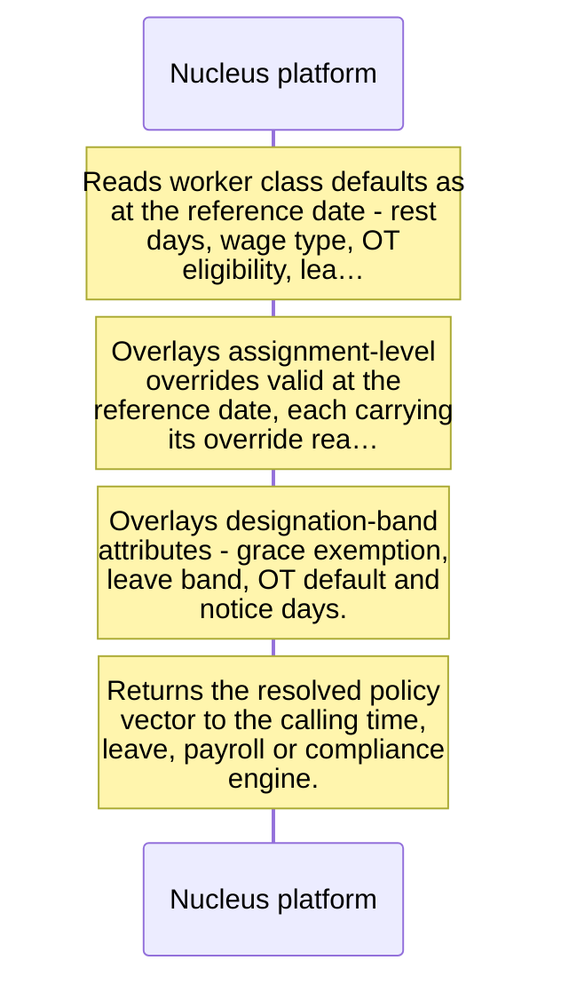

**Alternate flows**

| ID | At step | Condition | Steps | Rejoins |
| :--- | ---: | :--- | :--- | :--- |
| A1 | 2 | Rest-day applicability is being resolved. | Nucleus platform takes the value on the employee record if present. → Otherwise it takes the employment sub-category default, then the employment category default; the first non-empty value wins. | Returns to step 3 |
| A2 | 1 | The class wage type is Daily. | Nucleus platform marks the vector so payroll pays on days present and attendance generates no weekly off. | Returns to step 2 |

**Exception flows**

| ID | At step | Condition | Handling | Rule |
| :--- | ---: | :--- | :--- | :--- |
| E1 | 1 | A caller passes today instead of the reference date for a past computation. | The resolver uses the supplied reference date only; class values are never read as at today for a past date. | RL-050 |
| E2 | 2 | An override without a reason is found. | Such an override cannot exist because it fails validation at write time; resolution does not compensate at read time. | RL-051 |
| E3 | 4 | The reference date is before the assignment start or after its end. | The resolver returns 'not employed', never class defaults. | RL-053 |

**Postconditions — success**

- The caller receives a resolved policy vector valid at the reference date, or 'not employed' when the date is outside the assignment span.

**Postconditions — failure**

- No defaults are returned for a date on which the worker had no assignment.

**Quality requirements**

- Policy resolution returns in under 5 ms at p95 per worker-date, and under 30 seconds for 5,000 workers over a 31-day month.
- Time, leave, payroll and compliance call the same resolver; no module holds its own copy of policy logic.

### PPL-UC-004

**Control positions and sanctioned strength** — Maintain approved manpower by org unit, designation and location and expose filled, open and headroom figures derived from live assignments and requisitions.

| Attribute | Value |
| :--- | :--- |
| Realises | PPL-04 |
| Source | Source workbook |
| Level | User goal |
| Primary actor | Finance |
| Secondary actors | HR operations, Nucleus platform, Manager / supervisor |
| Trigger | A manpower budget is approved or a vacancy arises. |
| Frequency | Monthly |
| Criticality | High |
| Phase | P3 |
| Client requirements | — |
| Business rules | RL-055, RL-056, RL-057, RL-058, RL-461, RL-462 |
| Screens | SCR-012, SCR-013 |
| Data objects (CRUD) | sanctioned_position (C), assignment (R), requisition (R), position (U) |
| Events | people.sanction.set, people.position.vacated |
| Acceptance tests | TC-R55, TC-R56, TC-R57, TC-R58, TC-R461, TC-R462 |
| System requirements | SYS-016, SYS-022, SYS-023, SYS-053 |

**Stakeholders and interests**

| Stakeholder | Interest |
| :--- | :--- |
| Finance | Hiring stays within approved manpower and budget. |
| Manager / supervisor | Can see headroom before raising a requisition. |
| HR operations | Replacement hiring points at the exact vacated position. |

**Preconditions**

- Org units, designations and locations exist.
- The user holds entity and location scope for the units concerned.

**Main success scenario**

| # | Actor | Action | Ref |
| ---: | :--- | :--- | :--- |
| 1 | Finance | Records sanctioned strength by org unit, designation and location with effective date and approver. | PPL-04.1 |
| 2 | Nucleus platform | Derives the filled count from active assignments and the open count from open requisitions. | PPL-04.2 |
| 3 | Nucleus platform | Exposes headroom as sanctioned minus filled minus open for requisition checks. | PPL-04.3 |
| 4 | HR operations | On separation, sets the position to vacant with last incumbent and vacated date. | PPL-04.4 |

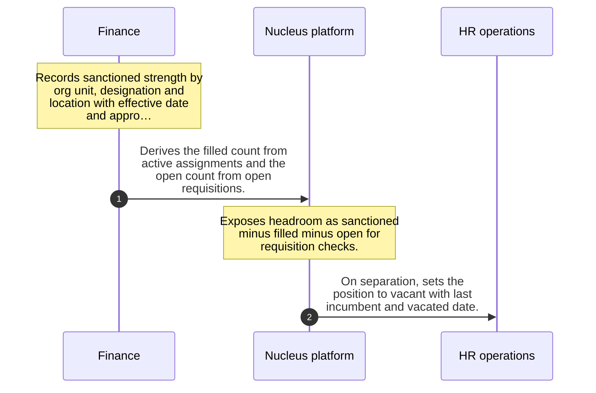

**Alternate flows**

| ID | At step | Condition | Steps | Rejoins |
| :--- | ---: | :--- | :--- | :--- |
| A1 | 3 | Headroom would become negative because a hire is needed above sanction. | Finance records an override with reason and approver. → Nucleus platform shows the negative headroom with the override reference on the strength board. | Returns to step 4 |

**Exception flows**

| ID | At step | Condition | Handling | Rule |
| :--- | ---: | :--- | :--- | :--- |
| E1 | 1 | The sanction has no effective date or approver. | The sanction is rejected with the missing field named. | RL-055 |
| E2 | 2 | A user tries to edit filled or open counts directly. | The counts are read-only; they are always derived from assignments and requisitions. | RL-056 |
| E3 | 3 | A requisition would take headroom below zero without a recorded override. | The requisition is blocked and the headroom shortfall is shown. | RL-057 |

**Postconditions — success**

- Sanctioned strength is recorded with effective date and approver, and the strength board shows sanctioned, filled, open and headroom.

**Postconditions — failure**

- No sanction change is saved without an effective date and approver.

**Quality requirements**

- The strength board for an entity of 5,000 positions loads in under 3 seconds.
- Filled and open figures reflect a new assignment or requisition within 1 minute.

### PPL-UC-005

**Change an org unit or reorganise** — Rename, re-parent, merge or split organisation units with an effective date so that the hierarchy changes going forward while history remains intact.

| Attribute | Value |
| :--- | :--- |
| Realises | PPL-05 |
| Source | Authored |
| Level | User goal |
| Primary actor | HR operations |
| Secondary actors | Director / approver, Nucleus platform, Finance |
| Trigger | A restructure is approved by management. |
| Frequency | Occasional |
| Criticality | Medium |
| Phase | P1 |
| Client requirements | R-23 |
| Business rules | RL-010, RL-020, RL-055, RL-056, RL-057 |
| Screens | SCR-012, SCR-013 |
| Data objects (CRUD) | org_unit (C), org_unit (U), position (U), sanctioned_position (U), approval_instance (C) |
| Events | platform.approval.completed |
| Acceptance tests | TC-H35, TC-R56, T-37 |
| System requirements | SYS-022, SYS-023, SYS-037, SYS-038, SYS-048 |

**Stakeholders and interests**

| Stakeholder | Interest |
| :--- | :--- |
| Manager / supervisor | The organisation chart and their team view reflect the new structure from the effective date. |
| Finance | Cost centre changes align with the new structure and sanctioned strength moves with the unit. |
| Auditor | The structure on any past date can be reproduced. |

**Preconditions**

- HR operations holds entity scope over every unit affected.
- The org units involved exist in the current hierarchy.

**Main success scenario**

| # | Actor | Action | Ref |
| ---: | :--- | :--- | :--- |
| 1 | HR operations | Selects an org unit, for example OU-113 Quality Assurance, and chooses rename, re-parent, merge or split. |  |
| 2 | HR operations | Enters the new structure, cost centre where it changes, the effective date and the reason. |  |
| 3 | Nucleus platform | Previews the impact: positions, assignments, approval routes and sanctioned strength rows that move. |  |
| 4 | HR operations | Submits the change for approval with the impact preview attached. |  |
| 5 | Director / approver | Approves the reorganisation through the approval chain. |  |
| 6 | Nucleus platform | Writes new effective-dated versions of the org units and moves positions and sanctioned strength rows with them. |  |
| 7 | Nucleus platform | Rebuilds the organisation chart and department views from the effective date from reporting relationships. |  |

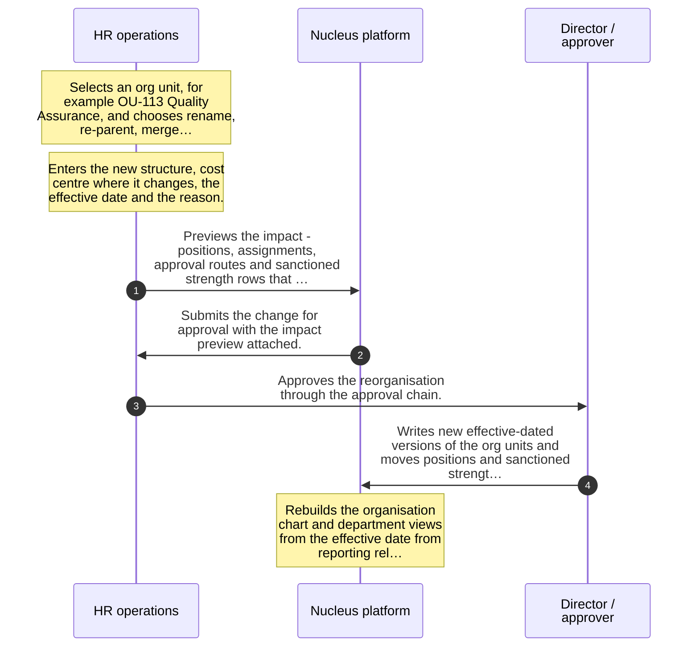

**Alternate flows**

| ID | At step | Condition | Steps | Rejoins |
| :--- | ---: | :--- | :--- | :--- |
| A1 | 1 | The change involves several units and many people at once. | HR operations stages the change as a mass reorganisation change set. | Ends the use case (continues in PPL-UC-013) |

**Exception flows**

| ID | At step | Condition | Handling | Rule |
| :--- | ---: | :--- | :--- | :--- |
| E1 | 2 | The new parent would create a cycle in the hierarchy. | The change is rejected and the cycle path is shown. |  |
| E2 | 2 | The effective date or reason is missing. | The change cannot be submitted until both are entered. | RL-020 |
| E3 | 6 | Merging units would give derived filled counts above the combined sanction. | Nucleus platform flags the negative headroom for Finance to resolve with an override or a new sanction. | RL-057 |

**Postconditions — success**

- New effective-dated versions of the affected org units, and of positions where needed, are written; earlier versions remain readable.
- The organisation chart shows the new structure from the effective date.

**Postconditions — failure**

- The hierarchy is unchanged.

**Quality requirements**

- A reorganisation affecting 500 positions is applied in under 2 minutes after approval.
- Reading the hierarchy as at any past date returns the structure in force on that date.

### PPL-UC-006

**Capture, classify and track documents** — Store a worker's documents with class, extracted fields and expiry so that verification is controlled and expiries trigger timely reminders.

| Attribute | Value |
| :--- | :--- |
| Realises | PPL-06 |
| Source | Source workbook |
| Level | User goal |
| Primary actor | Employee / worker |
| Secondary actors | HR operations, Nucleus platform, Compliance owner |
| Trigger | An employee or HR uploads a document. |
| Frequency | Continuous |
| Criticality | Medium |
| Phase | P1 |
| Client requirements | — |
| Business rules | RL-060, RL-061, RL-062 |
| Screens | SCR-014 |
| Data objects (CRUD) | document (C), document (U), notification (C) |
| Events | people.document.uploaded, people.document.classified, people.document.expiring |
| Acceptance tests | TC-H60, TC-H61, TC-H62 |
| System requirements | SYS-033, SYS-070, SYS-087 |

**Stakeholders and interests**

| Stakeholder | Interest |
| :--- | :--- |
| Compliance owner | Expiring licences and permits are renewed before they lapse. |
| HR operations | Only low-confidence extractions need manual verification. |
| Employee / worker | Can upload from a phone, even offline, and is reminded before a document expires. |

**Preconditions**

- Document classes and their expiry requirements are configured.
- The uploader has access to the person's document vault within scope.

**Main success scenario**

| # | Actor | Action | Ref |
| ---: | :--- | :--- | :--- |
| 1 | Employee / worker | Uploads a document in the document vault and selects or accepts the inferred class. | PPL-06.1 |
| 2 | Nucleus platform | Classifies the document, extracts fields and stores extraction confidence without overwriting any verified value. | PPL-06.2 |
| 3 | Nucleus platform | Schedules expiry reminders at the configured intervals of 60, 30 and 7 days. | PPL-06.3 |

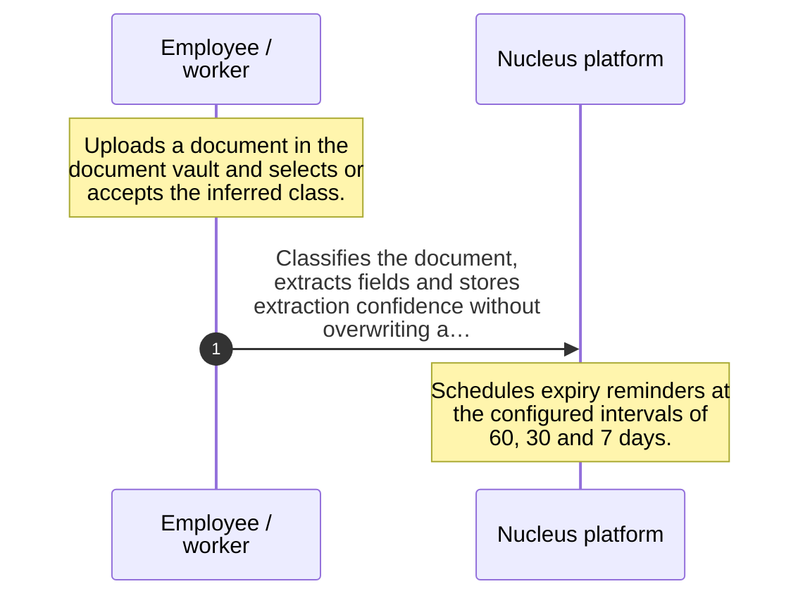

**Alternate flows**

| ID | At step | Condition | Steps | Rejoins |
| :--- | ---: | :--- | :--- | :--- |
| A1 | 1 | HR operations uploads on the worker's behalf. | HR operations uploads within its scope and the document records HR as uploader. | Returns to step 2 |
| A2 | 2 | Extraction confidence is below 0.80. | Nucleus platform routes the document to the HR verification queue. → HR operations confirms or corrects the fields and records verified_by. | Returns to step 3 |
| A3 | 1 | The worker uploads from the mobile app without connectivity. | The upload is queued on the device and sent when connectivity returns. | Returns to step 2 |

**Exception flows**

| ID | At step | Condition | Handling | Rule |
| :--- | ---: | :--- | :--- | :--- |
| E1 | 1 | No class is selected, or an expiring class has no expiry date. | The upload is rejected with the missing field named. | RL-060 |
| E2 | 2 | An extracted value differs from a value already verified. | The verified value is kept and the difference is sent to the verification queue. | RL-061 |

**Postconditions — success**

- The document is stored encrypted with class, extracted fields, confidence and expiry, and reminders are scheduled.

**Postconditions — failure**

- The document is not saved without a class, and verified values are never overwritten.

**Quality requirements**

- Classification and extraction complete within 30 seconds of upload for files up to 10 MB.
- Documents are encrypted at rest and identifiers in them are tokenised.

### PPL-UC-007

**Rehire, transfer between entities or change worker class** — Move a worker into a new employment or assignment while keeping one person record and deciding tenure and gratuity continuity by rule.

| Attribute | Value |
| :--- | :--- |
| Realises | PPL-07 |
| Source | Authored |
| Level | User goal |
| Primary actor | HR operations |
| Secondary actors | Nucleus platform, Payroll manager, Director / approver |
| Trigger | A former worker rejoins, a worker transfers between legal entities, or a worker converts to another class. |
| Frequency | Occasional |
| Criticality | High |
| Phase | P2 |
| Client requirements | — |
| Business rules | RL-030, RL-032, RL-034, RL-035, RL-037, RL-038 |
| Screens | SCR-010, SCR-011 |
| Data objects (CRUD) | person (R), employment (C), employment (U), assignment (C), assignment (U), workflow_instance (C) |
| Events | people.employment.started, people.assignment.started, people.worker.hired |
| Acceptance tests | TC-H32, TC-H34, TC-H38 |
| System requirements | SYS-006, SYS-022, SYS-053, SYS-059 |

**Stakeholders and interests**

| Stakeholder | Interest |
| :--- | :--- |
| Employee / worker | Prior service is recognised where the rules say it should be. |
| Payroll manager | The old employment is closed cleanly and the new one starts on the right payroll group. |
| Compliance owner | Statutory identifiers such as UAN carry over to the same person (to be validated by Legal). |

**Preconditions**

- The person record exists.
- Continuity rules for tenure and gratuity are configured per scenario.

**Main success scenario**

| # | Actor | Action | Ref |
| ---: | :--- | :--- | :--- |
| 1 | HR operations | Searches for the person and opens the existing record found by identity attributes. |  |
| 2 | HR operations | Chooses the scenario: rehire, entity transfer or class change, with the effective date. |  |
| 3 | Nucleus platform | Shows prior employments and assignments with dates, entity, class and separation reason. |  |
| 4 | Nucleus platform | Applies the configured continuity rule and proposes tenure start and gratuity service start dates. |  |
| 5 | HR operations | Creates the new employment, or for a class change a new assignment, against a vacant position. |  |
| 6 | Nucleus platform | For a transfer, ends the old employment the day before the new one starts in the other entity. |  |
| 7 | Nucleus platform | Re-resolves policy attributes for the new class and assignment, then starts the joining chain. |  |

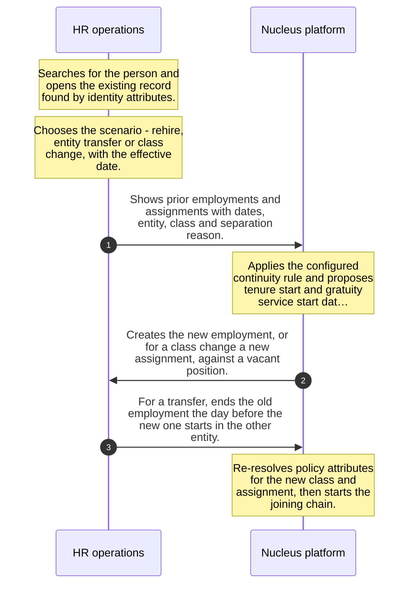

**Alternate flows**

| ID | At step | Condition | Steps | Rejoins |
| :--- | ---: | :--- | :--- | :--- |
| A1 | 4 | HR operations needs a continuity outcome different from the rule's proposal. | HR operations enters the override with a reason. → The override is routed to the Director / approver for approval before it applies. | Returns to step 5 |

**Exception flows**

| ID | At step | Condition | Handling | Rule |
| :--- | ---: | :--- | :--- | :--- |
| E1 | 5 | The target position is filled, frozen or abolished. | Creation is blocked with the position status shown. | RL-034 |
| E2 | 2 | The person has an open payroll-blocking identity flag. | The move proceeds but the flag carries to the new employment and continues to block pay. | RL-033 |

**Postconditions — success**

- The same person holds a new employment or assignment; the previous one is closed with an end date; continuity outcome is recorded with the rule applied.

**Postconditions — failure**

- No new employment or assignment is created and the current one is unchanged.

**Quality requirements**

- Continuity proposal is computed in under 2 seconds from full employment history.
- No scenario creates a second person record for the same individual.

### PPL-UC-008

**Detect duplicate persons** — Catch likely duplicate person records at onboarding and on ERP synchronisation, and let HR decide each case, never merging or rejecting automatically.

| Attribute | Value |
| :--- | :--- |
| Realises | PPL-08 |
| Source | Authored |
| Level | Subfunction |
| Primary actor | Nucleus platform |
| Secondary actors | HR operations, ERP system |
| Trigger | A person is created during onboarding or arrives from the ERP system's employee master. |
| Frequency | Per hire |
| Criticality | High |
| Phase | P2 |
| Client requirements | — |
| Business rules | RL-030, RL-031, RL-032 |
| Screens | SCR-010 |
| Data objects (CRUD) | person (R), duplicate_case (C), duplicate_case (U), audit_entry (C) |
| Events | people.person.duplicate_suspected |
| Acceptance tests | TC-H30, TC-H31 |
| System requirements | SYS-032, SYS-033, SYS-053, SYS-084 |

**Stakeholders and interests**

| Stakeholder | Interest |
| :--- | :--- |
| HR operations | Sees credible duplicates only and decides with both records in view. |
| Payroll manager | No person is paid twice under two records. |
| Plant HR / time office | Two genuine workers with the same name and birth date at one site are not merged. |

**Preconditions**

- The match threshold is configured (default 0.85).
- Identity tokens for Aadhaar and PAN are available where captured.

**Main success scenario**

| # | Actor | Action | Ref |
| ---: | :--- | :--- | :--- |
| 1 | Nucleus platform | Receives a candidate person from onboarding or from the ERP system's inbound employee master. |  |
| 2 | Nucleus platform | Scores the candidate against existing persons on name, date of birth, mobile, PAN token, Aadhaar token and site. |  |
| 3 | Nucleus platform | Raises a suspected duplicate for any score at or above the threshold and emits people.person.duplicate_suspected. |  |
| 4 | HR operations | Reviews both records side by side with the attributes that matched and those that differ. |  |
| 5 | HR operations | Decides Same person or Different person with a reason. |  |
| 6 | Nucleus platform | Applies the decision and logs it; a Different person pair is remembered so it is not raised again. |  |

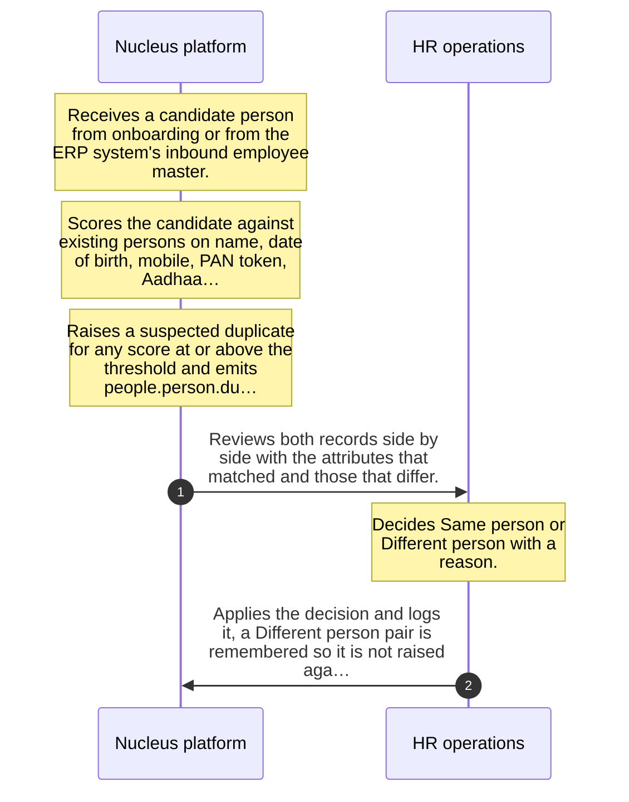

**Alternate flows**

| ID | At step | Condition | Steps | Rejoins |
| :--- | ---: | :--- | :--- | :--- |
| A1 | 5 | HR decides Same person. | Nucleus platform links the candidate to the existing person and routes the case to rehire or record update. → No second person record is created. | Returns to step 6 |
| A2 | 3 | The score is below the threshold. | Nucleus platform proceeds with creation without raising a case. | Ends the use case |

**Exception flows**

| ID | At step | Condition | Handling | Rule |
| :--- | ---: | :--- | :--- | :--- |
| E1 | 2 | An inbound ERP record matches an existing person on name and birth date but carries a different PAN token. | The inbound record is held, the case is raised to HR and the ERP integration log shows the hold. | RL-031 |
| E2 | 6 | Any process attempts to merge or reject a candidate without an HR decision. | The action is refused; duplicates above the threshold are always decided by HR. | RL-031 |

**Postconditions — success**

- Each suspected duplicate has a recorded HR decision; confirmed-distinct pairs are not flagged again.

**Postconditions — failure**

- An inbound ERP record held as a suspected duplicate is not applied until decided.

**Quality requirements**

- Matching runs in under 1 second per candidate against 50,000 persons.
- Precision of raised cases is monitored monthly; a confirmed-distinct pair is never raised twice.

### PPL-UC-009

**Maintain job architecture** — Define job families, job profiles, grades and bands, and competency requirements as effective-dated objects that positions and assignments reference.

| Attribute | Value |
| :--- | :--- |
| Realises | PPL-CG-001 |
| Source | Authored |
| Level | User goal |
| Primary actor | HR operations |
| Secondary actors | Nucleus platform, Implementation consultant, Director / approver |
| Trigger | A new role type is introduced or the grading structure changes. |
| Frequency | Occasional |
| Criticality | Medium |
| Phase | P1 |
| Client requirements | — |
| Business rules | RL-020, RL-052 |
| Screens | SCR-012 |
| Data objects (CRUD) | job_family (C), job_profile (C), grade_band (R), competency_requirement (C), position (U) |
| Events | — |
| Acceptance tests | PPL-TC-001, PPL-TC-002, PPL-TC-003, PPL-TC-004 |
| System requirements | SYS-022, SYS-023, SYS-037 |

**Stakeholders and interests**

| Stakeholder | Interest |
| :--- | :--- |
| Manager / supervisor | Positions describe what the role needs, which guides hiring and development. |
| Payroll manager | Grades and bands drive pay ranges consistently. |
| Implementation consultant | Client grading structures are configured, not coded. |

**Preconditions**

- HR operations holds the job-architecture permission for the tenant.

**Main success scenario**

| # | Actor | Action | Ref |
| ---: | :--- | :--- | :--- |
| 1 | HR operations | Creates or edits a job family, for example Manufacturing Engineering, with an effective date. |  |
| 2 | HR operations | Defines a job profile, for example Senior Engineer — Machining, with purpose, grade or band and required competencies. |  |
| 3 | Nucleus platform | Validates that the grade or band exists and that competency levels are within the defined scale. |  |
| 4 | HR operations | Links positions to the profile, for example POS-2214 and POS-2216. |  |
| 5 | Director / approver | Approves the new or changed profile. |  |
| 6 | Nucleus platform | Publishes the profile as a new version; linked positions read the version valid at each date. |  |

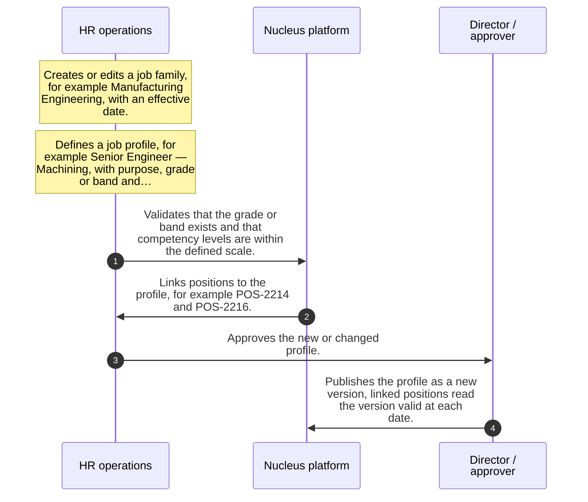

**Alternate flows**

| ID | At step | Condition | Steps | Rejoins |
| :--- | ---: | :--- | :--- | :--- |
| A1 | 1 | A profile is to be retired. | HR operations sets an end date on the profile. → Nucleus platform checks that no active position references it after that date. | Returns to step 5 |

**Exception flows**

| ID | At step | Condition | Handling | Rule |
| :--- | ---: | :--- | :--- | :--- |
| E1 | 1 | A retirement is requested while active positions still reference the profile. | The retirement is blocked and the referencing positions are listed. |  |
| E2 | 6 | A change is attempted as an in-place edit. | A new version is written and the prior version is end-dated. | RL-020 |

**Postconditions — success**

- Job family, profile, grade or band versions exist with effective dates and are linked to positions.

**Postconditions — failure**

- The architecture is unchanged.

**Quality requirements**

- Profiles support at least 30 competency requirements each without degrading position screen load beyond 2 seconds.

### PPL-UC-010

**Maintain multiple and matrix hierarchies** — Hold supervisory, cost-centre, location, legal-entity, project and dotted-line hierarchies side by side, each effective-dated and usable for approval routing and data scope.

| Attribute | Value |
| :--- | :--- |
| Realises | PPL-CG-002 |
| Source | Authored |
| Level | User goal |
| Primary actor | HR operations |
| Secondary actors | Nucleus platform, Implementation consultant, Manager / supervisor |
| Trigger | An organisation needs a relationship other than the solid reporting line for routing, reporting or scope. |
| Frequency | Weekly |
| Criticality | High |
| Phase | P1 |
| Client requirements | — |
| Business rules | RL-004, RL-005, RL-010, RL-020 |
| Screens | SCR-011 |
| Data objects (CRUD) | hierarchy_type (R), hierarchy_relationship (C), approval_chain (U) |
| Events | people.assignment.changed |
| Acceptance tests | PPL-TC-005, PPL-TC-006, PPL-TC-007, PPL-TC-008 |
| System requirements | SYS-016, SYS-022, SYS-038, SYS-039 |

**Stakeholders and interests**

| Stakeholder | Interest |
| :--- | :--- |
| Manager / supervisor | Project leads approve project-related items without becoming line managers. |
| Tenant admin | Data scope follows the right hierarchy for each role. |
| Finance | Cost-centre roll-ups follow the cost hierarchy, not the reporting line. |

**Preconditions**

- Hierarchy types are enabled by the implementation consultant.

**Main success scenario**

| # | Actor | Action | Ref |
| ---: | :--- | :--- | :--- |
| 1 | Implementation consultant | Enables hierarchy types: supervisory, cost-centre, location, legal-entity, project and dotted-line. |  |
| 2 | HR operations | Assigns a dotted-line manager to a worker for a project with start and end dates. |  |
| 3 | Nucleus platform | Validates there is no cycle and that the dotted-line manager is active in the period. |  |
| 4 | Implementation consultant | Configures an approval chain step to resolve its approver from the project hierarchy. |  |
| 5 | Nucleus platform | Routes matching requests to the dotted-line manager while the relationship is valid. |  |
| 6 | Nucleus platform | Keeps data scope on the solid reporting line unless a role is explicitly scoped to another hierarchy. |  |

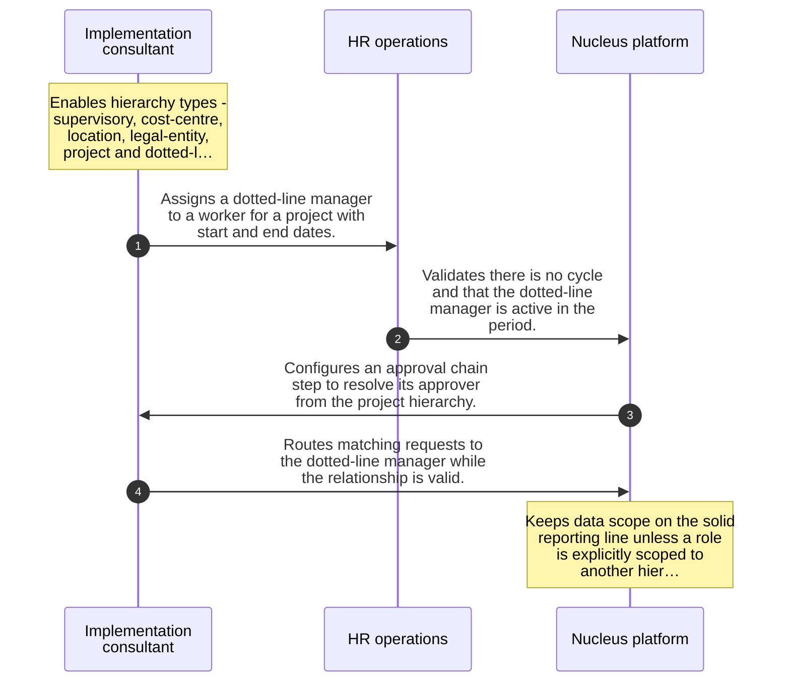

**Alternate flows**

| ID | At step | Condition | Steps | Rejoins |
| :--- | ---: | :--- | :--- | :--- |
| A1 | 5 | The dotted-line relationship has ended. | Nucleus platform resolves the step to the solid-line manager instead. | Returns to step 6 |

**Exception flows**

| ID | At step | Condition | Handling | Rule |
| :--- | ---: | :--- | :--- | :--- |
| E1 | 3 | The new relationship would create a cycle in that hierarchy. | The relationship is rejected and the cycle is shown. |  |
| E2 | 6 | A dotted-line manager attempts to read compensation of a worker outside their payroll group. | Compensation fields return null as for any reader outside the payroll group. | RL-005 |

**Postconditions — success**

- The worker holds effective-dated relationships in each relevant hierarchy, and chains and scopes reference the chosen hierarchy type.

**Postconditions — failure**

- No relationship is saved and existing routing is unchanged.

**Quality requirements**

- Approver resolution across any hierarchy type completes in under 100 ms at p95.

### PPL-UC-011

**Manage global and expatriate assignments** — Record host and home assignments with split and shadow payroll indicators, assignment allowances and visa or permit expiry tracking.

| Attribute | Value |
| :--- | :--- |
| Realises | PPL-CG-003 |
| Source | Authored |
| Level | User goal |
| Primary actor | HR operations |
| Secondary actors | Payroll manager, Nucleus platform, Employee / worker |
| Trigger | A worker is posted to another country or entity for a defined period. |
| Frequency | Occasional |
| Criticality | Medium |
| Phase | P4 |
| Client requirements | — |
| Business rules | RL-020, RL-060, RL-062 |
| Screens | SCR-011, SCR-014 |
| Data objects (CRUD) | host_assignment (C), assignment_allowance (C), document (C), notification (C) |
| Events | people.document.expiring |
| Acceptance tests | TC-H62, PPL-TC-009, PPL-TC-010, PPL-TC-011, PPL-TC-012 |
| System requirements | SYS-006, SYS-007, SYS-028, SYS-070 |

**Stakeholders and interests**

| Stakeholder | Interest |
| :--- | :--- |
| Payroll manager | Knows which country pays what, and when a shadow calculation is needed. |
| Compliance owner | Visas and permits never lapse during an assignment. |
| Employee / worker | Allowances and dates of the posting are clear and correct. |

**Preconditions**

- The host entity exists in the tenant or is registered as an external host.
- Assignment allowance types are configured.

**Main success scenario**

| # | Actor | Action | Ref |
| ---: | :--- | :--- | :--- |
| 1 | HR operations | Creates a host assignment linked to the worker's home employment with start and planned end dates. |  |
| 2 | HR operations | Sets payroll indicators: home-paid, host-paid or split, and whether shadow payroll is required. |  |
| 3 | HR operations | Adds assignment allowances such as housing and cost-of-living with currency and frequency. |  |
| 4 | Employee / worker | Uploads visa and work permit documents with their expiry dates. |  |
| 5 | Nucleus platform | Schedules permit expiry reminders and shows the expiry on the assignment. |  |
| 6 | Payroll manager | Reviews the indicators and allowances and confirms payroll set-up for the posting. |  |

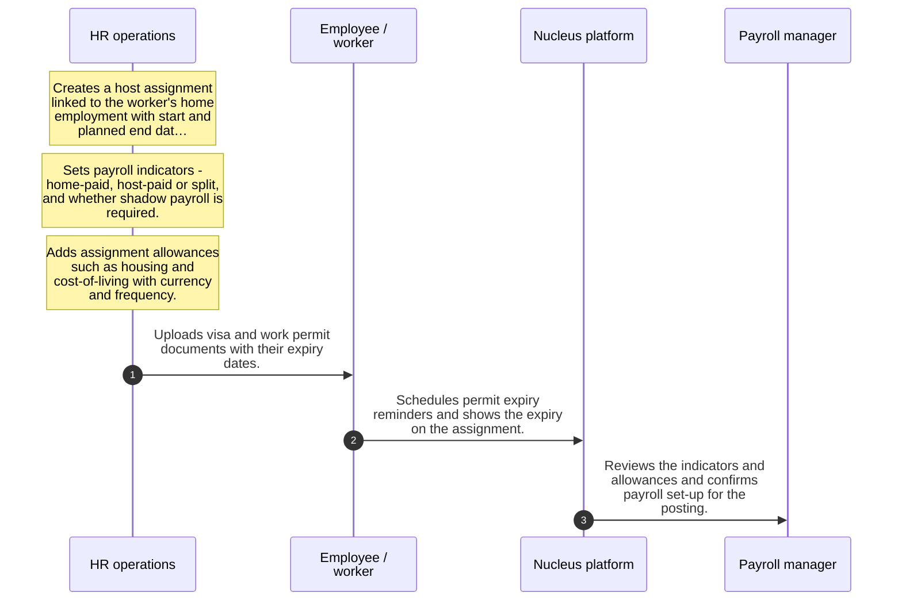

**Alternate flows**

| ID | At step | Condition | Steps | Rejoins |
| :--- | ---: | :--- | :--- | :--- |
| A1 | 1 | The posting is extended. | HR operations changes the planned end date with a reason and effective date. → Nucleus platform checks that permits cover the new end date. | Returns to step 5 |

**Exception flows**

| ID | At step | Condition | Handling | Rule |
| :--- | ---: | :--- | :--- | :--- |
| E1 | 5 | A permit expires before the planned assignment end date. | A compliance alert is raised to HR operations and the Compliance owner immediately. | RL-062 |
| E2 | 2 | Split payroll is selected without the share for each country. | Save is refused until shares are entered. |  |

**Postconditions — success**

- A host assignment exists linked to the home employment, with payroll indicators, allowances and permit expiry tracked.

**Postconditions — failure**

- No host assignment is created and the home assignment is unchanged.

**Quality requirements**

- Permit expiry alerts fire on the configured day with no misses, verified by monthly reconciliation.

### PPL-UC-012

**Record dependants, nominees and emergency contacts** — Hold a worker's dependants, emergency contacts and nominations for PF, gratuity Form F and insurance, with shares that total exactly 100% per nomination type.

| Attribute | Value |
| :--- | :--- |
| Realises | PPL-CG-004 |
| Source | Authored |
| Level | User goal |
| Primary actor | Employee / worker |
| Secondary actors | HR operations, Nucleus platform, Compliance owner |
| Trigger | A worker joins, has a family event, or chooses to update nominations. |
| Frequency | Occasional |
| Criticality | High |
| Phase | P1 |
| Client requirements | — |
| Business rules | RL-010, RL-020, RL-060 |
| Screens | SCR-010, SCR-014 |
| Data objects (CRUD) | dependant (C), emergency_contact (C), nomination (C), nominee_share (C), document (C) |
| Events | people.document.uploaded |
| Acceptance tests | PPL-TC-013, PPL-TC-014, PPL-TC-015, PPL-TC-016, PPL-TC-017, PPL-TC-018 |
| System requirements | SYS-017, SYS-022, SYS-033, SYS-037 |

**Stakeholders and interests**

| Stakeholder | Interest |
| :--- | :--- |
| Employee / worker | Their family receives benefits as they intend. |
| Compliance owner | Gratuity Form F and PF nominations are complete and current (to be validated by Legal). |
| HR operations | Emergency contacts are reachable during an incident. |

**Preconditions**

- Nomination types and the relationships allowed for each are configured.

**Main success scenario**

| # | Actor | Action | Ref |
| ---: | :--- | :--- | :--- |
| 1 | Employee / worker | Adds dependants with name, relationship and date of birth, and at least one emergency contact. |  |
| 2 | Employee / worker | Selects a nomination type (PF, gratuity Form F or insurance) and adds nominees from dependants. |  |
| 3 | Employee / worker | Enters a share percentage for each nominee. |  |
| 4 | Nucleus platform | Validates that shares for the nomination type total exactly 100% and that each nominee's relationship is allowed. |  |
| 5 | Employee / worker | Submits the nomination with supporting documents where required. |  |
| 6 | HR operations | Verifies and approves the nomination through the approval chain. |  |
| 7 | Nucleus platform | Saves the nomination as a new version effective from approval and retains the prior version. |  |

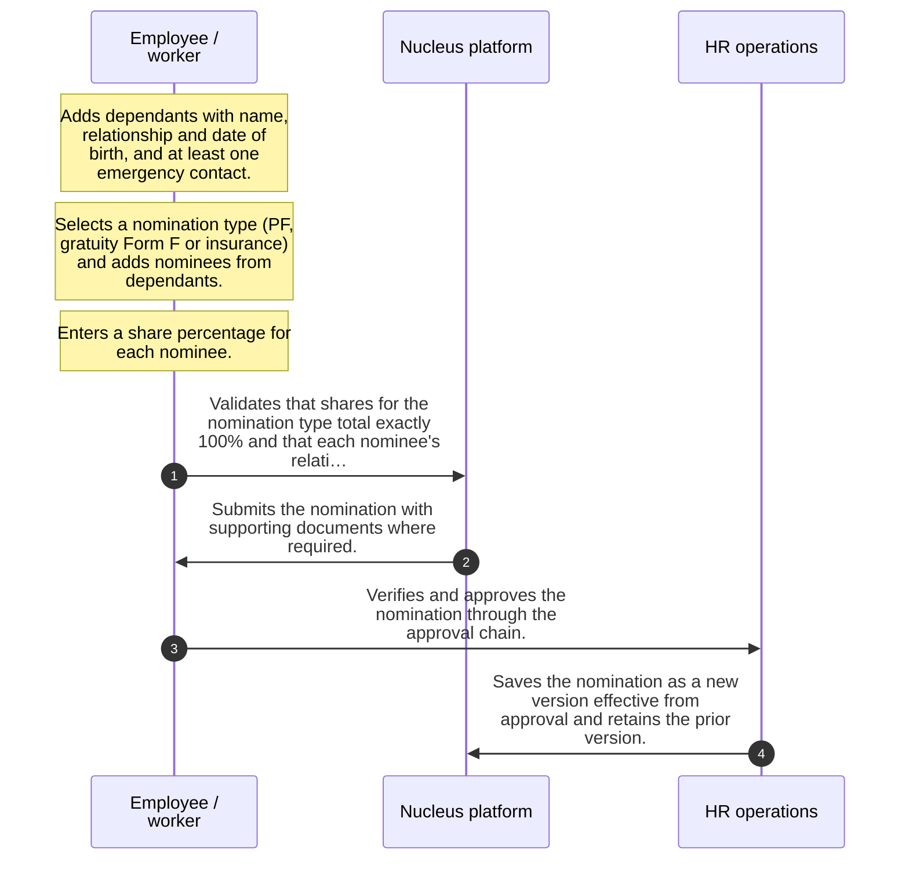

**Alternate flows**

| ID | At step | Condition | Steps | Rejoins |
| :--- | ---: | :--- | :--- | :--- |
| A1 | 1 | HR operations captures the details on behalf of a worker without app access. | HR operations enters dependants and nominations and attaches the signed form. | Returns to step 4 |

**Exception flows**

| ID | At step | Condition | Handling | Rule |
| :--- | ---: | :--- | :--- | :--- |
| E1 | 4 | Shares for a nomination type total other than 100%. | Submit is disabled and the running total is shown against the 100% target. |  |
| E2 | 6 | HR rejects the nomination. | The worker is notified with the reason and the previous nomination remains in force. | RL-010 |

**Postconditions — success**

- Dependants and contacts are saved; each nomination type has nominees whose shares total 100%, versioned and approved.

**Postconditions — failure**

- No nomination with shares not totalling 100% is saved; the prior nomination remains in force.

**Quality requirements**

- Share validation responds as the user types, within 200 ms.
- Nominee identity details are masked for all roles except HR operations within scope.

### PPL-UC-013

**Stage and commit a mass reorganisation** — Prepare moves of org units, positions and people as one effective-dated change set, preview routing and security impact, and commit it atomically.

| Attribute | Value |
| :--- | :--- |
| Realises | PPL-CG-005 |
| Source | Authored |
| Level | User goal |
| Primary actor | HR operations |
| Secondary actors | Director / approver, Nucleus platform, Tenant admin |
| Trigger | A restructure moving many units, positions or people is approved. |
| Frequency | Occasional |
| Criticality | High |
| Phase | P2 |
| Client requirements | — |
| Business rules | RL-004, RL-010, RL-020, RL-034, RL-042 |
| Screens | SCR-011, SCR-012 |
| Data objects (CRUD) | change_set (C), org_unit (U), position (U), assignment (C), approval_instance (C) |
| Events | people.assignment.changed, time.recompute.requested |
| Acceptance tests | TC-T42, PPL-TC-019, PPL-TC-020, PPL-TC-021, PPL-TC-022 |
| System requirements | SYS-016, SYS-022, SYS-037, SYS-048, SYS-053, SYS-057 |

**Stakeholders and interests**

| Stakeholder | Interest |
| :--- | :--- |
| Manager / supervisor | On the effective date their team, inbox and data access change together. |
| Tenant admin | Security impact is visible before commit, not discovered afterwards. |
| Plant HR / time office | Attendance recompute is triggered where time policy changes. |

**Preconditions**

- HR operations holds entity scope for every unit in the change set.

**Main success scenario**

| # | Actor | Action | Ref |
| ---: | :--- | :--- | :--- |
| 1 | HR operations | Creates a change set with an effective date and reason. |  |
| 2 | HR operations | Adds moves of org units, positions and people to the set, singly or by upload. |  |
| 3 | Nucleus platform | Previews impact: new approvers for open and future requests, scope changes per principal, and headroom changes. |  |
| 4 | HR operations | Reviews the preview and adjusts the set until the impact is as intended. |  |
| 5 | Director / approver | Approves the change set with the preview attached. |  |
| 6 | Nucleus platform | Commits every change in one transaction as effective-dated versions. |  |
| 7 | Nucleus platform | Emits assignment change events and queues attendance recompute for workers whose time policy changed. |  |

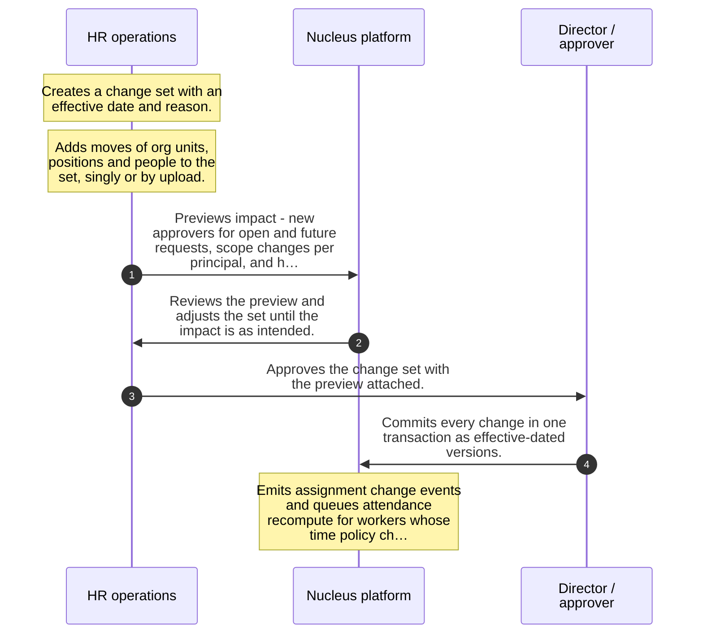

**Alternate flows**

| ID | At step | Condition | Steps | Rejoins |
| :--- | ---: | :--- | :--- | :--- |
| A1 | 6 | The change set must be withdrawn before its effective date. | HR operations requests withdrawal with a reason. → Nucleus platform writes closing versions so the structure on and after the effective date is restored. | Ends the use case |

**Exception flows**

| ID | At step | Condition | Handling | Rule |
| :--- | ---: | :--- | :--- | :--- |
| E1 | 6 | Any single change fails validation during commit. | The whole set rolls back and the failing item is reported. | RL-020 |
| E2 | 3 | A move would leave an open approval without an approver. | The preview flags it and commit is blocked until a reroute target exists. | RL-010 |
| E3 | 3 | A move would place a position into a filled state conflict. | The preview flags the conflicting position and commit is blocked. | RL-034 |

**Postconditions — success**

- All changes in the set are written as effective-dated versions in one transaction, and downstream recompute and events follow.

**Postconditions — failure**

- None of the changes in the set are applied.

**Quality requirements**

- A change set of 2,000 moves previews in under 60 seconds and commits in under 5 minutes.
- Commit is atomic: either every change is applied or none is.

### PPL-UC-014

**Explore the interactive organisation chart** — Show an interactive organisation chart built from reporting relationships, with drill-down, vacancies, headcount and span of control, filtered by the viewer's scope.

| Attribute | Value |
| :--- | :--- |
| Realises | PPL-CG-006 |
| Source | Authored |
| Level | User goal |
| Primary actor | Manager / supervisor |
| Secondary actors | Nucleus platform, HR operations |
| Trigger | A user opens the organisation chart. |
| Frequency | Daily |
| Criticality | Medium |
| Phase | P1 |
| Client requirements | R-23 |
| Business rules | RL-003, RL-004, RL-056, RL-058 |
| Screens | SCR-012, SCR-013 |
| Data objects (CRUD) | assignment (R), position (R), org_unit (R) |
| Events | — |
| Acceptance tests | T-37, TC-R56, PPL-TC-023, PPL-TC-024, PPL-TC-025, PPL-TC-026, PPL-TC-027, PPL-TC-028 |
| System requirements | SYS-016, SYS-017, SYS-069 |

**Stakeholders and interests**

| Stakeholder | Interest |
| :--- | :--- |
| Manager / supervisor | Sees their team, vacancies and spans at a glance. |
| HR operations | Uses the chart to spot over-wide spans and long-open vacancies. |
| Employee / worker | Finds who leads which team. |

**Preconditions**

- Reporting relationships exist on assignments.
- The viewer's entity and location scope are resolved.

**Main success scenario**

| # | Actor | Action | Ref |
| ---: | :--- | :--- | :--- |
| 1 | Manager / supervisor | Opens the organisation chart, which centres on their own node. |  |
| 2 | Nucleus platform | Builds the chart from reporting relationships on current assignments, filtered by the viewer's resolved scope. |  |
| 3 | Nucleus platform | Shows each node's headcount and span of control, and vacant positions as distinct vacancy nodes. |  |
| 4 | Manager / supervisor | Drills down to a sub-team or up to the manager's manager. |  |
| 5 | Manager / supervisor | Filters by legal entity or location, or switches to the department-wise view. |  |
| 6 | Nucleus platform | Re-renders the chart and offers an export of the visible view within scope. |  |

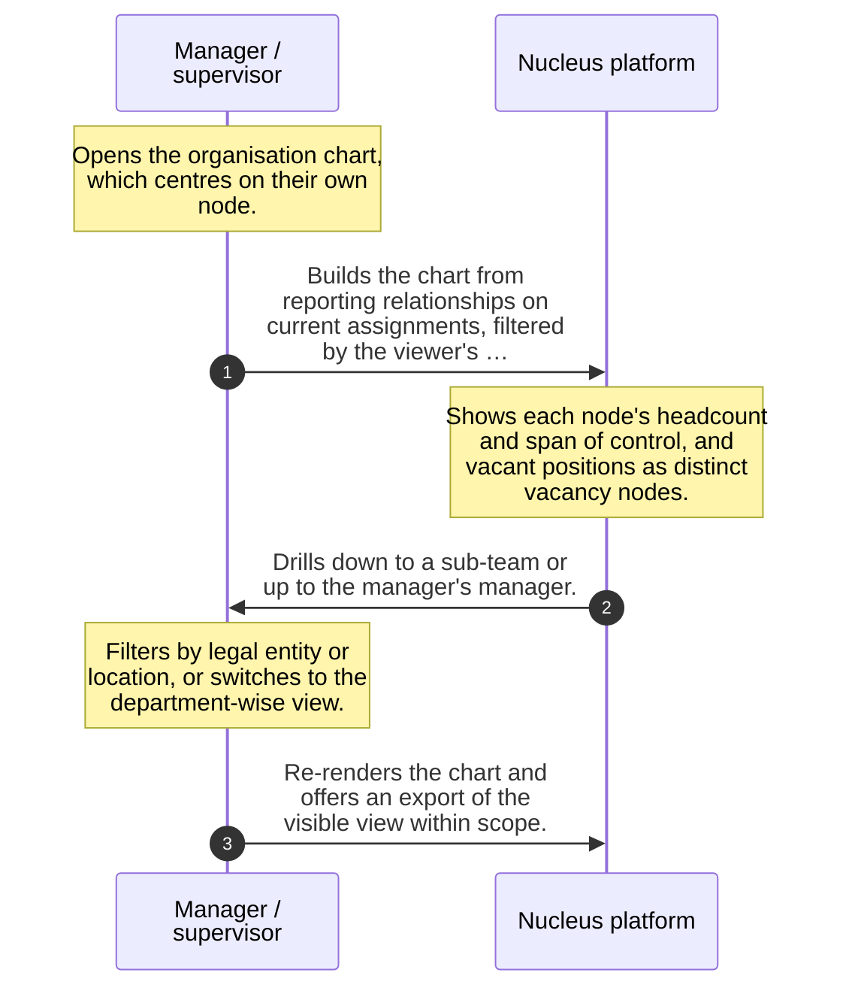

**Alternate flows**

| ID | At step | Condition | Steps | Rejoins |
| :--- | ---: | :--- | :--- | :--- |
| A1 | 5 | The viewer selects an as-at date in the past. | Nucleus platform rebuilds the chart from relationships valid on that date. | Returns to step 6 |

**Exception flows**

| ID | At step | Condition | Handling | Rule |
| :--- | ---: | :--- | :--- | :--- |
| E1 | 2 | Scope resolution fails for the viewer. | The chart shows only the viewer's own node and a message that the wider chart is unavailable. | RL-004 |
| E2 | 5 | The viewer selects a location outside their grant. | The location is not offered in the filter list. | RL-003 |

**Postconditions — success**

- The chart shows only nodes within the viewer's scope, with headcount, span of control and vacancies.

**Postconditions — failure**

- No node outside the viewer's scope is shown.

**Quality requirements**

- A chart of 5,000 nodes renders the first level in under 2 seconds and expands any node in under 500 ms.
- The chart is navigable by keyboard and screen reader to WCAG 2.2 AA.

### PPL-UC-015

**Hold concurrent assignments for one person** — Let one person hold more than one concurrent assignment in a different entity, position or worker class, each with its own pay, time and security treatment.

| Attribute | Value |
| :--- | :--- |
| Realises | PPL-CG-007 |
| Source | Authored |
| Level | User goal |
| Primary actor | HR operations |
| Secondary actors | Nucleus platform, Payroll manager, Plant HR / time office, Director / approver |
| Trigger | HR needs a person already employed in one entity to take an additional concurrent role, for example a quality engineer at Peenya Works also serving as part-time trainer for LE-02. |
| Frequency | Occasional |
| Criticality | High |
| Phase | P2 |
| Client requirements | — |
| Business rules | RL-005, RL-010, RL-032, RL-034, RL-037, RL-042 |
| Screens | SCR-010, SCR-011 |
| Data objects (CRUD) | person (R), assignment (C), position (U), recompute_queue (C) |
| Events | people.assignment.created |
| Acceptance tests | PPL-TC-029, PPL-TC-030, PPL-TC-031, PPL-TC-032, PPL-TC-033, PPL-TC-034 |
| System requirements | SYS-006, SYS-007, SYS-037, SYS-045, SYS-057 |

**Stakeholders and interests**

| Stakeholder | Interest |
| :--- | :--- |
| Employee / worker | Is paid correctly for each role and sees each assignment separately in self-service. |
| Payroll manager | Each assignment lands in the right payroll group with no double counting of statutory ceilings. |
| Compliance owner | Statutory identifiers such as UAN stay unique to the person across assignments. |

**Preconditions**

- The person exists once with a primary assignment (RL-032).
- A vacant, non-frozen position exists for the additional assignment (RL-034).
- Concurrent employment is enabled for the tenant and the combination of worker classes is permitted.

**Main success scenario**

| # | Actor | Action | Ref |
| ---: | :--- | :--- | :--- |
| 1 | HR operations | Searches for the person and opens the record of E1069 Meera Prabhu. |  |
| 2 | HR operations | Chooses to add a concurrent assignment and selects entity LE-02, position and worker class. |  |
| 3 | Nucleus platform | Checks that the position is vacant and that the worker-class combination is allowed for concurrent employment. |  |
| 4 | Nucleus platform | Applies worker-class defaults for the new assignment and shows fields HR may override with a reason. |  |
| 5 | HR operations | Sets effective date, working-hours share, pay basis and which assignment is primary. |  |
| 6 | Nucleus platform | Routes the change through the approval chain for both entities. |  |
| 7 | Director / approver | Approves the additional assignment. |  |
| 8 | Nucleus platform | Writes the new assignment version, links it to the same person and payroll groups, and queues attendance recompute. |  |
| 9 | Nucleus platform | Notifies payroll of both groups that statutory ceilings must be shared across assignments. |  |

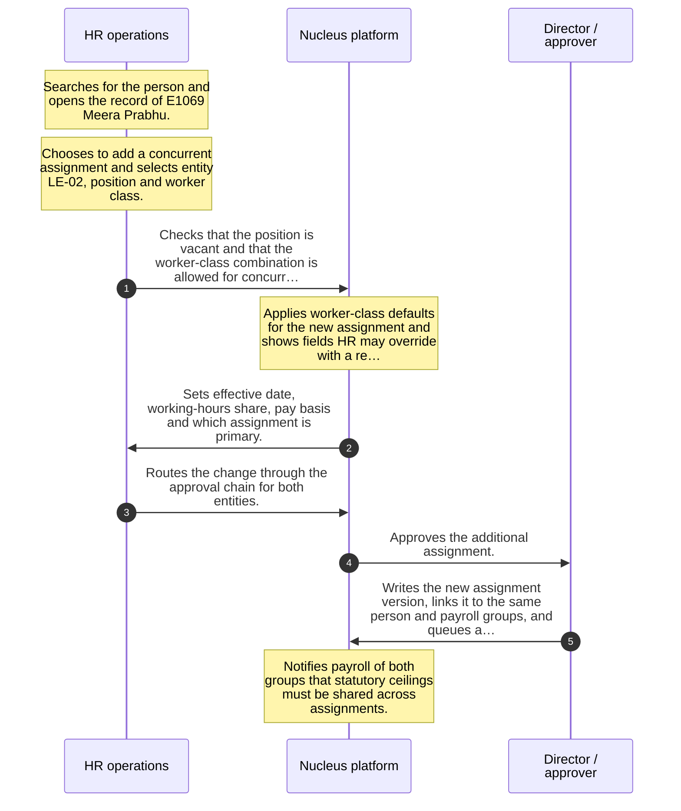

**Alternate flows**

| ID | At step | Condition | Steps | Rejoins |
| :--- | ---: | :--- | :--- | :--- |
| A1 | 2 | The additional role is within the same entity. | The platform keeps one payroll group and splits cost centres by working-hours share. | Returns to step 5 |
| A2 | 7 | The approver rejects the change. | The rejection reason is recorded and HR is notified; no assignment is written. | Ends |

**Exception flows**

| ID | At step | Condition | Handling | Rule |
| :--- | ---: | :--- | :--- | :--- |
| E1 | 3 | The target position is filled or frozen. | The assignment cannot be created and the position status is shown. | RL-034 |
| E2 | 8 | The two assignments' scheduled hours overlap on the same day. | The platform warns HR and requires a shift arrangement before activation. | RL-042 |
| E3 | 4 | A user in one payroll group opens the record. | Compensation fields of the other assignment return null. | RL-005 |

**Postconditions — success**

- The person holds two active assignments with distinct payroll group, shift group, worker class defaults and approver chains; one is marked primary.

**Postconditions — failure**

- No second assignment is created and the person's existing assignment is unchanged.

**Quality requirements**

- A person record with up to five concurrent assignments opens in under 1.5 s.
- Statutory identifiers remain unique per person regardless of assignment count.

### PPL-UC-016

**Plan headcount and positions against sanctioned strength** — Allow HR and finance to plan positions and headcount by period, site and cost centre against sanctioned strength, with approval and variance tracking.

| Attribute | Value |
| :--- | :--- |
| Realises | PPL-CG-008 |
| Source | Authored |
| Level | User goal |
| Primary actor | HR operations |
| Secondary actors | Finance, Nucleus platform, Director / approver, Manager / supervisor |
| Trigger | The annual operating plan cycle opens, or a manager proposes a mid-year change to the plan. |
| Frequency | Annual with monthly tracking |
| Criticality | High |
| Phase | P3 |
| Client requirements | — |
| Business rules | RL-010, RL-055, RL-056, RL-057, RL-461, RL-462 |
| Screens | SCR-012, SCR-013 |
| Data objects (CRUD) | headcount_plan (C/U), sanctioned_strength (C), position (R), requisition (R), variance_snapshot (C) |
| Events | people.headcount_plan.approved |
| Acceptance tests | PPL-TC-035, PPL-TC-036, PPL-TC-037, PPL-TC-038, PPL-TC-039, PPL-TC-040 |
| System requirements | SYS-017, SYS-022, SYS-028, SYS-037 |

**Stakeholders and interests**

| Stakeholder | Interest |
| :--- | :--- |
| Director / approver | Headcount growth stays within an approved plan and budget. |
| Finance | Planned cost per cost centre is visible before positions are opened. |
| Manager / supervisor | Can request the people needed for production volumes. |

**Preconditions**

- Sanctioned strength is recorded by org unit, designation and location with effective dates (RL-055).
- Filled and open counts are derived from assignments and requisitions (RL-056).
- Average cost per designation band is available for planning.

**Main success scenario**

| # | Actor | Action | Ref |
| ---: | :--- | :--- | :--- |
| 1 | HR operations | Opens a headcount plan for FY 2027-28 and seeds it with current sanctioned, filled and open counts. |  |
| 2 | Manager / supervisor | Proposes changes per quarter, for example +6 machinists for Chakan Works Machining from Q2. |  |
| 3 | Nucleus platform | Computes planned headcount, headroom and planned cost per site and cost centre. |  |
| 4 | Finance | Reviews planned cost against budget and adjusts or comments. |  |
| 5 | HR operations | Submits the consolidated plan for approval. |  |
| 6 | Director / approver | Approves the plan, or approves with adjustments. |  |
| 7 | Nucleus platform | Writes approved additions as new sanctioned-strength versions effective from their planned dates. |  |
| 8 | Nucleus platform | Tracks monthly variance of actual filled and open counts against the plan. |  |

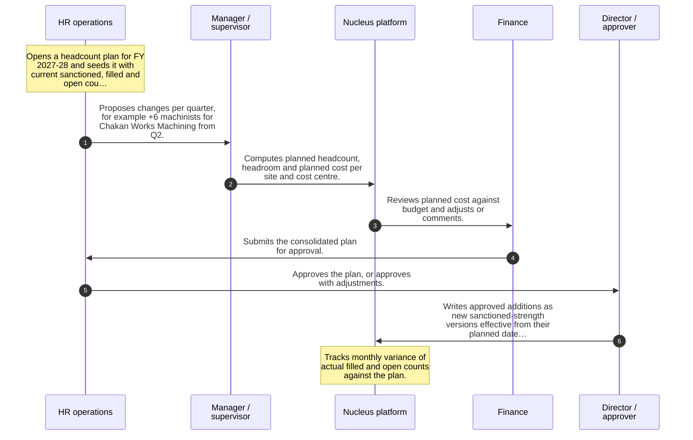

**Alternate flows**

| ID | At step | Condition | Steps | Rejoins |
| :--- | ---: | :--- | :--- | :--- |
| A1 | 2 | A position is proposed as a replacement. | The proposal names the vacated position code and consumes no new sanctioned strength. | Returns to step 3 |
| A2 | 6 | The approver returns the plan. | Comments are attached and the plan returns to HR in draft. | Returns to step 2 |

**Exception flows**

| ID | At step | Condition | Handling | Rule |
| :--- | ---: | :--- | :--- | :--- |
| E1 | 7 | A requisition would exceed approved sanctioned strength. | The requisition is blocked at approval and the variance is shown. | RL-462 |
| E2 | 3 | No cost rate exists for a designation band. | The line is flagged as unpriced and the plan cannot be submitted until a rate is set. |  |

**Postconditions — success**

- An approved headcount plan exists per period, site and cost centre; approved additions update sanctioned strength from their effective dates.

**Postconditions — failure**

- The plan stays in draft and sanctioned strength is unchanged.

**Quality requirements**

- A plan for 5 sites and 200 org-unit and designation lines recalculates in under 3 s after each edit.
- Variance figures are derived on read and never stored as editable values.

### PPL-UC-017

**Present a digital ID and download verifiable employment letters** — Give employees a digital ID card and on-demand employment and salary certificates that third parties can verify.

| Attribute | Value |
| :--- | :--- |
| Realises | PPL-CG-009 |
| Source | Authored |
| Level | User goal |
| Primary actor | Employee / worker |
| Secondary actors | Nucleus platform, HR operations |
| Trigger | An employee opens the digital ID or requests an employment or salary certificate. |
| Frequency | Daily |
| Criticality | Medium |
| Phase | P2 |
| Client requirements | — |
| Business rules | RL-005, RL-032 |
| Screens | SCR-010 |
| Data objects (CRUD) | person (R), assignment (R), payroll_result (R), certificate (C), verification_log (C) |
| Events | people.certificate.issued, people.certificate.verified |
| Acceptance tests | PPL-TC-041, PPL-TC-042, PPL-TC-043, PPL-TC-044, PPL-TC-045, PPL-TC-046 |
| System requirements | SYS-017, SYS-032, SYS-033, SYS-088 |

**Stakeholders and interests**

| Stakeholder | Interest |
| :--- | :--- |
| Employee / worker | Gets a certificate for a bank loan or visa without waiting for HR. |
| HR operations | Fewer manual letter requests and no forged letters in circulation. |
| Plant HR / time office | Gate staff can check a digital ID quickly. |

**Preconditions**

- The employee has an active assignment and a verified photograph on record.
- Certificate templates and signing keys are configured per legal entity.

**Main success scenario**

| # | Actor | Action | Ref |
| ---: | :--- | :--- | :--- |
| 1 | Employee / worker | Opens the digital ID card in the mobile app, showing photo, name, employee code, entity and site. |  |
| 2 | Employee / worker | Requests a salary certificate for the last 3 months for a bank loan application. |  |
| 3 | Nucleus platform | Reads assignment and posted payroll results for the period from the record. |  |
| 4 | Nucleus platform | Generates the certificate from the entity template, signs it with the entity key and adds a verification code. |  |
| 5 | Employee / worker | Downloads the certificate or shares its verification link with the bank. |  |
| 6 | Nucleus platform | On verification, confirms authenticity, issue date and certificate contents only. |  |
| 7 | Nucleus platform | Logs issue and every verification against the employee's record. |  |

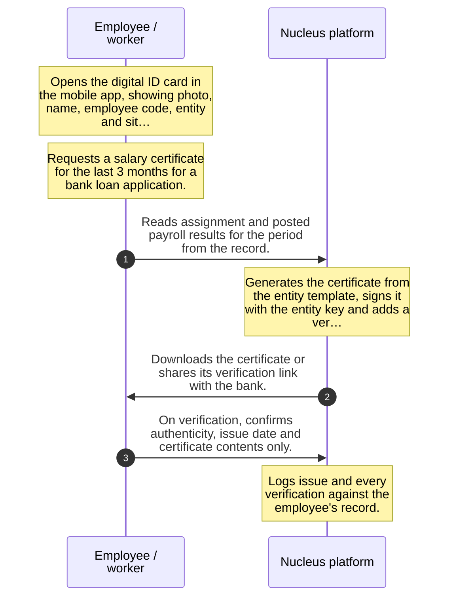

**Alternate flows**

| ID | At step | Condition | Steps | Rejoins |
| :--- | ---: | :--- | :--- | :--- |
| A1 | 2 | The certificate needs custom wording, such as a visa-purpose letter. | The request routes to HR operations, who approve the wording before generation. | Returns to step 4 |
| A2 | 6 | The employee has since separated. | Verification confirms the certificate was valid on issue and states the separation date. | Returns to step 7 |

**Exception flows**

| ID | At step | Condition | Handling | Rule |
| :--- | ---: | :--- | :--- | :--- |
| E1 | 3 | A requested month has no posted payroll result. | That month is excluded and the employee is told which months are included. |  |
| E2 | 1 | The assignment is suspended or ended. | The digital ID is shown as inactive and cannot be presented as valid. |  |

**Postconditions — success**

- The employee holds a signed certificate with a verification code; any verifier can confirm authenticity without seeing more than the certificate states.

**Postconditions — failure**

- No certificate is issued and the reason is shown to the employee.

**Quality requirements**

- A certificate is generated in under 10 s.
- Verification works without the verifier holding an account and reveals nothing beyond the certificate.

### PPL-UC-018

**Monitor organisation health metrics by unit** — Show managers and HR span of control, layers, vacancy age, tenure mix and flight-risk concentration per organisation unit.

| Attribute | Value |
| :--- | :--- |
| Realises | PPL-CG-010 |
| Source | Authored |
| Level | User goal |
| Primary actor | Manager / supervisor |
| Secondary actors | HR operations, Nucleus platform, Agent (governed) |
| Trigger | A manager or HR user opens the organisation health view for a unit. |
| Frequency | Weekly |
| Criticality | Medium |
| Phase | P3 |
| Client requirements | — |
| Business rules | RL-004, RL-056, RL-057, RL-058 |
| Screens | SCR-012, SCR-013 |
| Data objects (CRUD) | position (R), assignment (R), org_unit (R), org_health_snapshot (C) |
| Events | people.org_health.viewed |
| Acceptance tests | PPL-TC-047, PPL-TC-048, PPL-TC-049, PPL-TC-050, PPL-TC-051, PPL-TC-052 |
| System requirements | SYS-016, SYS-017, SYS-077 |

**Stakeholders and interests**

| Stakeholder | Interest |
| :--- | :--- |
| HR operations | Can spot structural problems such as very wide spans or long-open vacancies early. |
| Employee / worker | Flight-risk signals are never shown for identifiable individuals below the aggregation threshold. |
| Director / approver | Can compare site organisation health on consistent definitions. |

**Preconditions**

- Assignments, positions and the reporting hierarchy are current.
- Metric definitions and the minimum group size for risk aggregation are configured.

**Main success scenario**

| # | Actor | Action | Ref |
| ---: | :--- | :--- | :--- |
| 1 | Manager / supervisor | Opens organisation health for their unit, for example Peenya Works Assembly. |  |
| 2 | Nucleus platform | Resolves the reporting subtree within the user's scope at query time. |  |
| 3 | Nucleus platform | Derives span of control, layers, vacancy age, tenure mix and headcount from positions and assignments. |  |
| 4 | Agent (governed) | Computes flight-risk concentration per unit from approved signals and returns only aggregated bands. |  |
| 5 | Nucleus platform | Displays each metric with its definition, 12-month trend and a threshold indicator. |  |
| 6 | Manager / supervisor | Drills into a long-open vacancy or a manager with a wide span. |  |
| 7 | HR operations | Compares the same metrics across all five sites and records an action, such as splitting a team. |  |

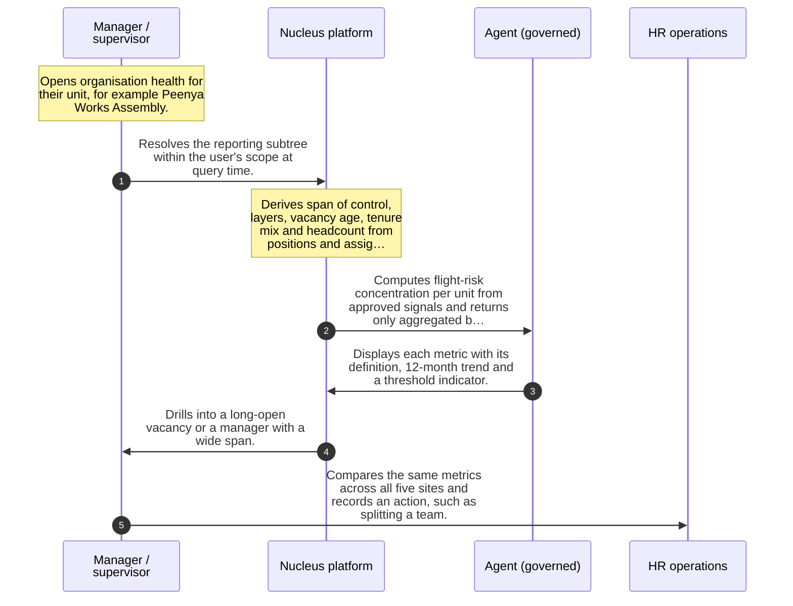

**Alternate flows**

| ID | At step | Condition | Steps | Rejoins |
| :--- | ---: | :--- | :--- | :--- |
| A1 | 7 | HR exports the comparison. | The export contains aggregated metrics only and is logged. | Ends |

**Exception flows**

| ID | At step | Condition | Handling | Rule |
| :--- | ---: | :--- | :--- | :--- |
| E1 | 4 | A unit has fewer people than the minimum group size. | Flight-risk concentration is suppressed for that unit and marked as below threshold. |  |
| E2 | 2 | The user requests a unit outside their reporting line. | The unit is not returned and the view states it is outside scope. | RL-004 |

**Postconditions — success**

- The user sees metrics for units within their scope, with definitions, trend and drill-down limited to their grants.

**Postconditions — failure**

- Metrics for units outside scope or below the group-size threshold are suppressed with a stated reason.

**Quality requirements**

- Metrics for a 1,000-person subtree load in under 3 s.
- No flight-risk value is shown for any group smaller than the configured minimum size.

## Approval & Sign-off

| Role | Name | Date | Decision | Conditions / comments |
| :--- | :--- | :--- | :--- | :--- |
| Author | Dhanraj Dadhich | 2026-11-05 | Submitted | |
| Peer review moderator | *pending* | | | PR-xxxx |
| PQA (process compliance) | *pending* | | | |
| Approval authority (DOC-01 §7) | *pending* | | | |

## Measurement Data Captured

| Measure | Value | Unit | Notes |
| :--- | :--- | :--- | :--- |
| Size | 548 | specified items (table rows) | Counted automatically at generation |
| Authoring effort | *to be recorded* | person-hours | |
| Review effort (preparation + meeting) | *pending review* | person-hours | From PR-xxxx |
| Rework effort | *pending review* | person-hours | |
| Review rate | *pending review* | items / hour | Compare with PPB control limits |
| Requirement volatility (changes since baseline) | 0 | CRs touching this artefact | Not yet baselined (CM-03) |

**Defects found, by detection phase and severity**

| Detection phase | Major | Minor | Editorial | Injected in phase (major) |
| :--- | :--- | :--- | :--- | :--- |
| Author self-check | 0 | 0 | 0 | — |
| Peer review | *pending* | | | |
| Design / build | | | | |
| System / integration test | | | | |
| UAT | | | | |
| Production (escaped) | | | | each escaped major opens a CAR record (CAR-01) |

Within control limits of the review-rate PPB? *To be assessed at peer review.*

## Revision History

| Version | Date | Author | Change summary | CR ref | Approved by |
| :--- | :--- | :--- | :--- | :--- | :--- |
| 1.0.0 | 2026-11-05 | Dhanraj Dadhich | Consolidated release | CR-0001 | *pending* |
