

<picture>
  <source media="(prefers-color-scheme: dark)" srcset="../../assets/MultipliersKraftLogoDark.png">
  
</picture>

# FRS-TIM-01 — Time & Attendance — Process Specifications

| Attribute | Value |
| :--- | :--- |
| Document ID | FRS-TIM-01 |
| Title | Time & Attendance — Process Specifications |
| Product | Nucleus Suite (Nucleus HRMS Suite) |
| Version | 1.0.0 |
| Status | Issued for approval |
| Owner (role) | Domain Product Owner — Time & Attendance |
| Author | Dhanraj Dadhich |
| Reviewed by | *pending* |
| Approved by | Product Council — *pending* |
| Date | 2026-11-05 |
| Classification | Internal |
| CMMI practice areas | RDM, TS |
| Related documents | FRS-TIM-00, FRS-TIM-01, FRS-TIM-02, FRS-TIM-03, FRS-TIM-04, FRS-TIM-05, FRS-TIM-06, FRS-TIM-07, FRS-TIM-08, FRS-TIM-09, FRS-TIM-10, FRS-TIM-11, FRS-TIM-12, FRS-TIM-13, BRS-01, SRS-01, REQ-01, REQ-02 |
| Quality & process-performance objectives | QPPO-05 (effective requirements reviews), QPPO-01 (escaped defects) — MPM-01 |
| Process performance baseline used | PPB-01 (review defect density), PPB-02 (review rate) — MPM-01 |
| Peer review record | *pending* (PR-xxxx, QA-02) |
| Tailoring record | none |
| Traceability anchor | BG-03 · R-01, R-02, R-11, R-12, R-13, R-14 · processes TIM-01–TIM-10 |
| Source of record | Nucleus — Process Flows & Process Maps v1.0 — sheet(s) 03_Process_Inventory, 04_Process_Steps, 05_Swimlane_Maps Nucleus HR Demo Points Build Sheet v1.0 — sheet(s) 07_Approval_Workflows Nucleus HRMS Demo Dataset v1.1 — sheet(s) 64_Approval_Workflows |

> **Source of record.** Requirements in this document are taken from the source workbook(s) named above and keep their workbook IDs, which are never renumbered. Changes are made through a change request (CM-02) against the source workbook. Sections marked **Authored** are original additions that are not present in the source workbooks.

Step types: TASK (human) · SYS (system, unattended) · DEC (decision) · APPR (approval gate) · INT (integration call) · WAIT (timer or external event) · AGENT (agent-executed, governed). CRUD: C create · R read · U update · D delete-by-end-dating (temporal facts are never hard-deleted). In the flow diagrams decisions are diamonds, approvals are double-bordered boxes and integration, wait and agent steps are rounded.

## 1. Process inventory

| Process ID | Process | Trigger | Primary actor | Frequency | Criticality | Blueprint module | Phase | Reuses | Demo pts | Note |
| :--- | :--- | :--- | :--- | :--- | :--- | :--- | :--- | :--- | :--- | :--- |
| TIM-01 | Punch ingestion from all sources | Punch at device, app, business messaging, kiosk, web, gate | Worker | Continuous (500/s peak) | Critical | Module 2 | P1 | CMP-07 | 1 | Raw events immutable. Offline buffering and catch-up are the normal case, not the exception. |
| TIM-02 | Attendance day derivation | Punch landed, or recompute demand | System | Nightly + on demand | Critical | Module 2 | P1 | CMP-04, CMP-10 | 1 | Keyed on the date the SHIFT started. Pairing, segments, breaks, gross/net/OT. |
| TIM-03 | Shift inference from in-punch | First in-punch of a day | System | Per day | High | Module 2 | P1 | CMP-04 | 13 | Adopt the shift actually punched into; record assigned vs inferred; never silent. |
| TIM-04 | Day type resolution | Before disposition | System | Per day | Critical | Module 2 | P1 | CMP-10 | 2,3 | Rest day and holiday resolve FIRST, from worker class and location calendar. |
| TIM-05 | Disposition — grace, lates, half-day, absent, relief | After totals computed | System | Per day | Critical | Module 2 | P1 | CMP-04, CMP-10 | 12 | Thresholds by shift length are configuration rows, not code. |
| TIM-06 | Gate pass request, approval and credit | Employee request | Employee | Weekly | High | Module 2 | P1 | CMP-01, CMP-02 | 11 | Ceiling enforced in the service, not the form, because business messaging uses the same rule. |
| TIM-07 | Overtime computation and approval | Attendance day computed | Manager | Daily | Critical | Module 2 | P1 | CMP-01, CMP-04 | 1,4,10 | Eligibility by class; basis (gross vs net) is tenant configuration. |
| TIM-08 | Exception queue and regularisation | Unpaired punch, device failure, dispute | Manager / HR | Daily | High | Module 2 | P1 | CMP-01, CMP-04 | 1 | First agent surface with real volume (Attendance Steward). |
| TIM-09 | Attendance recompute | Late punch, approved regularisation, rule change, roster republish | System | Continuous | Critical | Module 2 | P1 | CMP-04 | 12 | Isolated worker. A month for 5,000 people in under 10 minutes. |
| TIM-10 | Team history and operational time reports | Manager query | Manager | Daily | High | Module 4 / 11 | P1 | CMP-08 | 1 | A scoped view over attendance_day, not a report builder. Must work on a phone. |

## 2. Step-level specifications

### TIM-01 — Punch ingestion from all sources

**Trigger:** Punch at device, app, business messaging, kiosk, web, gate · **Primary actor:** Worker · **Frequency:** Continuous (500/s peak) · **Criticality:** Critical · **Phase:** P1 · **Reuses:** CMP-07

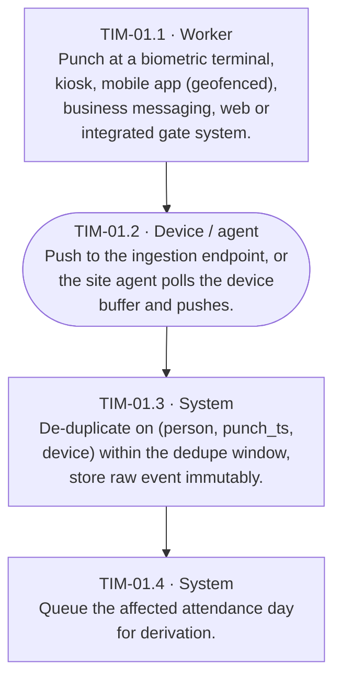

| Step | Step ID | Lane / actor | Type | Action or decision | Rule ID(s) | Objects touched (CRUD) | Key fields | Screen | Event emitted | Exception / note | Reuses | Demo pts | Phase |
| :--- | :--- | :--- | :--- | :--- | :--- | :--- | :--- | :--- | :--- | :--- | :--- | :--- | :--- |
| 1 | TIM-01.1 | Worker | TASK | Punch at a biometric terminal, kiosk, mobile app (geofenced), business messaging, web or integrated gate system. | RL-070 | attendance_event C | event_id, person_id, punch_ts, direction(IN\|OUT\|AUTO), source, device_id, geo_lat, geo_lng, selfie_ref | SCR-020 | time.punch.received | Offline → queue locally with a signed timestamp and replay on reconnect. |  | 1 | P1 |
| 2 | TIM-01.2 | Device / agent | INT | Push to the ingestion endpoint, or the site agent polls the device buffer and pushes. | RL-071 | attendance_event C | device_batch_id, received_at | — | time.punch.ingested | Device clock drift corrected by RL-072 using the device's last sync offset; correction recorded, raw value retained. |  | 1 | P1 |
| 3 | TIM-01.3 | System | SYS | De-duplicate on (person, punch_ts, device) within the dedupe window; store raw event immutably. | RL-073 | attendance_event C | dedupe_key, is_duplicate | — |  | Duplicate punches inside 60s are marked, not discarded — the count is a device health signal. | CMP-07 | 1 | P1 |
| 4 | TIM-01.4 | System | SYS | Queue the affected attendance day for derivation. | RL-074 | recompute_queue C | person_id, attendance_date, reason(new_punch) | — | time.recompute.requested | A punch arriving after the payroll input lock raises an exception (RL-075) instead of silently changing a locked day. | CMP-04 | 1 | P1 |

### TIM-02 — Attendance day derivation

**Trigger:** Punch landed, or recompute demand · **Primary actor:** System · **Frequency:** Nightly + on demand · **Criticality:** Critical · **Phase:** P1 · **Reuses:** CMP-04, CMP-10

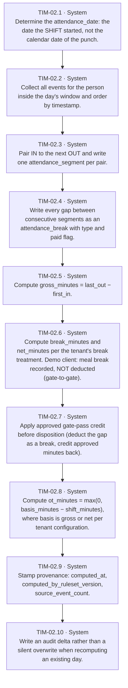

| Step | Step ID | Lane / actor | Type | Action or decision | Rule ID(s) | Objects touched (CRUD) | Key fields | Screen | Event emitted | Exception / note | Reuses | Demo pts | Phase |
| :--- | :--- | :--- | :--- | :--- | :--- | :--- | :--- | :--- | :--- | :--- | :--- | :--- | :--- |
| 1 | TIM-02.1 | System | SYS | Determine the attendance_date: the date the SHIFT started, not the calendar date of the punch. | RL-080 | attendance_day C | person_id, attendance_date | — |  | Splitting a cross-midnight shift across two calendar dates corrupts OT, disposition and pay in one move. | CMP-04 | 1 | P1 |
| 2 | TIM-02.2 | System | SYS | Collect all events for the person inside the day's window and order by timestamp. | RL-081 | attendance_event R | punch_ts, direction | — |  |  |  | 1 | P1 |
| 3 | TIM-02.3 | System | SYS | Pair IN to the next OUT and write one attendance_segment per pair. | RL-082 | attendance_segment C | segment_no, in_event_id, out_event_id, start_ts, end_ts, minutes | — |  | Unpaired event raises an exception to TIM-08; it is never silently discarded. | CMP-04 | 1 | P1 |
| 4 | TIM-02.4 | System | SYS | Write every gap between consecutive segments as an attendance_break with type and paid flag. | RL-083 | attendance_break C | break_no, start_ts, end_ts, minutes, break_type(meal\|gate_pass\|other), is_paid | — |  | Breaks are first-class rows precisely so the break report exists without a special query (demo point 1). |  | 1 | P1 |
| 5 | TIM-02.5 | System | SYS | Compute gross_minutes = last_out − first_in. | RL-084 | attendance_day U | first_in, last_out, gross_minutes | — |  |  |  | 1 | P1 |
| 6 | TIM-02.6 | System | SYS | Compute break_minutes and net_minutes per the tenant's break treatment. Demo client: meal break recorded, NOT deducted (gate-to-gate). | RL-085 | attendance_day U | break_minutes_recorded, break_minutes_deducted, net_minutes | — |  | Getting this wrong turns a 19h20m day into 18h35m and the OT figure with it. Config, not code. | CMP-10 | 1 | P1 |
| 7 | TIM-02.7 | System | SYS | Apply approved gate-pass credit before disposition (deduct the gap as a break, credit approved minutes back). | RL-086 | gate_pass R; attendance_day U | gate_pass_minutes_deducted, gate_pass_minutes_credited | — |  | Unapproved pass minutes stay deducted. | CMP-04 | 1 | P1 |
| 8 | TIM-02.8 | System | SYS | Compute ot_minutes = max(0, basis_minutes − shift_minutes), where basis is gross or net per tenant configuration. | RL-087 | attendance_day U | shift_minutes, ot_basis, ot_minutes_raw | — |  | Demo client computes OT against the GROSS span. Both are legitimate; only one is right per client. | CMP-10 | 1 | P1 |
| 9 | TIM-02.9 | System | SYS | Stamp provenance: computed_at, computed_by_ruleset_version, source_event_count. | RL-088 | attendance_day U | computed_at, computed_by_ruleset_version, input_hash | — | time.attendance_day.computed | Without the ruleset version nobody can explain why a March recomputation differs from the original. | CMP-04 | 1 | P1 |
| 10 | TIM-02.10 | System | SYS | Write an audit delta rather than a silent overwrite when recomputing an existing day. | RL-089 | attendance_day_delta C | field, old_value, new_value, reason | — | time.attendance_day.recomputed | Idempotent: recomputing an unchanged day produces an identical row and no delta. | CMP-04 | 1 | P1 |

### TIM-03 — Shift inference from in-punch

**Trigger:** First in-punch of a day · **Primary actor:** System · **Frequency:** Per day · **Criticality:** High · **Phase:** P1 · **Reuses:** CMP-04

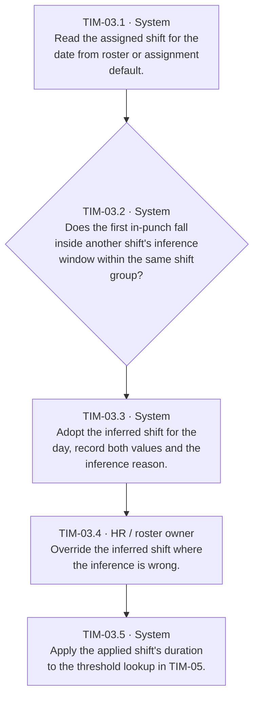

| Step | Step ID | Lane / actor | Type | Action or decision | Rule ID(s) | Objects touched (CRUD) | Key fields | Screen | Event emitted | Exception / note | Reuses | Demo pts | Phase |
| :--- | :--- | :--- | :--- | :--- | :--- | :--- | :--- | :--- | :--- | :--- | :--- | :--- | :--- |
| 1 | TIM-03.1 | System | SYS | Read the assigned shift for the date from roster or assignment default. | RL-090 | roster R; assignment R | shift_id_assigned | — |  |  |  | 13 | P1 |
| 2 | TIM-03.2 | System | DEC | Does the first in-punch fall inside another shift's inference window within the same shift group? | RL-091 | shift_window R | earliest_in, latest_in, shift_group | — |  | Windows must not overlap inside a group; overlapping configuration fails validation at save. | CMP-10 | 13 | P1 |
| 3 | TIM-03.3 | System | SYS | Adopt the inferred shift for the day; record both values and the inference reason. | RL-092 | attendance_day U | shift_id_assigned, shift_id_applied, inference_reason | SCR-022 | time.shift.inferred | Inference is never silent — the roster owner sees that coverage did not match the plan. |  | 13 | P1 |
| 4 | TIM-03.4 | HR / roster owner | TASK | Override the inferred shift where the inference is wrong. | RL-093 | attendance_day U; audit_entry C | override_by, override_reason | SCR-022 | time.shift.overridden |  |  | 13 | P1 |
| 5 | TIM-03.5 | System | SYS | Apply the applied shift's duration to the threshold lookup in TIM-05. | RL-094 | attendance_rule_set R | shift_hours | — |  |  |  | 13 | P1 |

### TIM-04 — Day type resolution

**Trigger:** Before disposition · **Primary actor:** System · **Frequency:** Per day · **Criticality:** Critical · **Phase:** P1 · **Reuses:** CMP-10

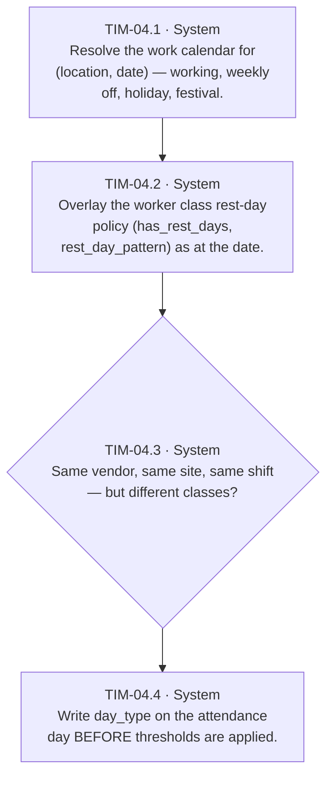

| Step | Step ID | Lane / actor | Type | Action or decision | Rule ID(s) | Objects touched (CRUD) | Key fields | Screen | Event emitted | Exception / note | Reuses | Demo pts | Phase |
| :--- | :--- | :--- | :--- | :--- | :--- | :--- | :--- | :--- | :--- | :--- | :--- | :--- | :--- |
| 1 | TIM-04.1 | System | SYS | Resolve the work calendar for (location, date) — working, weekly off, holiday, festival. | RL-100 | work_calendar R; holiday_calendar R | date, location_id, day_type | — |  | Multi-plant operations do not share one holiday list. |  | 2,3 | P1 |
| 2 | TIM-04.2 | System | SYS | Overlay the worker class rest-day policy (has_rest_days, rest_day_pattern) as at the date. | RL-101 | worker_class R; assignment R | has_rest_days, rest_day_pattern | — |  | Contractual daily-wage workers show Sunday as Working, not Weekly Off (demo point 2). | CMP-10 | 2,3 | P1 |
| 3 | TIM-04.3 | System | DEC | Same vendor, same site, same shift — but different classes? | RL-102 | worker_class R | class_code | — |  | Third-party employees get rest days; helpers do not. Policy attaches to class, never to the contract (demo point 3). |  | 2,3 | P1 |
| 4 | TIM-04.4 | System | SYS | Write day_type on the attendance day BEFORE thresholds are applied. | RL-103 | attendance_day U | day_type | — |  | Resolving after thresholds marks a rest-day volunteer as half-day — the classic defect. | CMP-04 | 2,3 | P1 |

### TIM-05 — Disposition — grace, lates, half-day, absent, relief

**Trigger:** After totals computed · **Primary actor:** System · **Frequency:** Per day · **Criticality:** Critical · **Phase:** P1 · **Reuses:** CMP-04, CMP-10

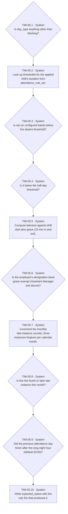

| Step | Step ID | Lane / actor | Type | Action or decision | Rule ID(s) | Objects touched (CRUD) | Key fields | Screen | Event emitted | Exception / note | Reuses | Demo pts | Phase |
| :--- | :--- | :--- | :--- | :--- | :--- | :--- | :--- | :--- | :--- | :--- | :--- | :--- | :--- |
| 1 | TIM-05.1 | System | DEC | Is day_type anything other than Working? | RL-110 | attendance_day R | day_type, gross_minutes | — |  | Yes → status = day_type (or 'day_type — worked'), skip thresholds, go to OT eligibility. | CMP-04 | 12 | P1 |
| 2 | TIM-05.2 | System | SYS | Look up thresholds for the applied shift's duration from attendance_rule_set. | RL-111 | attendance_rule_set R | shift_hours, half_day_below_min, absent_below_min, grace_in_min, grace_out_min, late_allowance_per_month | — |  | Threshold table is data. A different shift length is a new row, not a release. | CMP-10 | 12 | P1 |
| 3 | TIM-05.3 | System | DEC | Is net (or configured basis) below the absent threshold? | RL-112 | attendance_day U | net_minutes | — |  | Yes → Absent. 12h shift: below 6:30. 10h: below 6:00. 9h: 5:00. 8h: 4:30. | CMP-04 | 12 | P1 |
| 4 | TIM-05.4 | System | DEC | Is it below the half-day threshold? | RL-113 | attendance_day U | net_minutes | — |  | Yes → Half Day. 12h: below 11:30. 10h: 9:30. 9h: 8:30. 8h: 7:30. | CMP-04 | 12 | P1 |
| 5 | TIM-05.5 | System | SYS | Compute lateness against shift start plus grace (15 min in and out). | RL-114 | attendance_day U | late_by_minutes, grace_in_min | — |  |  |  | 12 | P1 |
| 6 | TIM-05.6 | System | DEC | Is the employee's designation band grace-exempt (Assistant Manager and above)? | RL-115 | designation R | grace_exempt | — |  | Yes → no late instance recorded, no deduction. Expressed on the band, never a hardcoded grade string. |  | 12 | P1 |
| 7 | TIM-05.7 | System | SYS | Increment the monthly late-instance counter; three instances forgiven per calendar month. | RL-116 | late_counter U | person_id, month, instance_count | SCR-021 | time.late.counted | Counter resets monthly and its value is visible to the employee — a rule that penalises silently generates tickets. |  | 12 | P1 |
| 8 | TIM-05.8 | System | DEC | Is this the fourth or later late instance this month? | RL-117 | attendance_day U | late_beyond_allowance | — |  | Yes → status becomes Half Day even where hours qualify as Present. | CMP-04 | 12 | P1 |
| 9 | TIM-05.9 | System | DEC | Did the previous attendance day finish after the long-night hour (default 03:00)? | RL-118 | attendance_day R (prior day) | prior_last_out, long_night_after | — |  | Yes → allow arrival up to the relief window (default 09:30) with a full day credited. |  | 12 | P1 |
| 10 | TIM-05.10 | System | SYS | Write expected_status with the rule IDs that produced it. | RL-119 | attendance_day U | status, applied_rule_ids[] | SCR-021 | time.attendance_day.disposed | Status without its rule trail is unarguable in a dispute. | CMP-06 | 12 | P1 |

### TIM-06 — Gate pass request, approval and credit

**Trigger:** Employee request · **Primary actor:** Employee · **Frequency:** Weekly · **Criticality:** High · **Phase:** P1 · **Reuses:** CMP-01, CMP-02

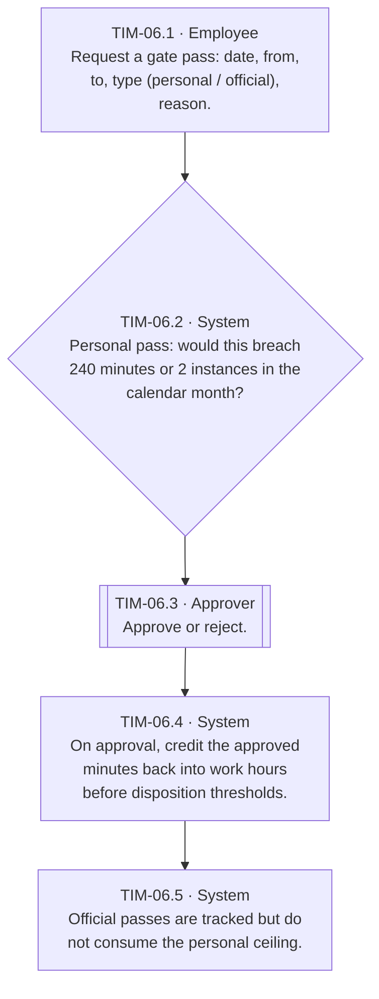

| Step | Step ID | Lane / actor | Type | Action or decision | Rule ID(s) | Objects touched (CRUD) | Key fields | Screen | Event emitted | Exception / note | Reuses | Demo pts | Phase |
| :--- | :--- | :--- | :--- | :--- | :--- | :--- | :--- | :--- | :--- | :--- | :--- | :--- | :--- |
| 1 | TIM-06.1 | Employee | TASK | Request a gate pass: date, from, to, type (personal \| official), reason. | RL-120 | gate_pass C | gate_pass_id, person_id, date, from_ts, to_ts, minutes, pass_type, reason | SCR-023 | time.gate_pass.requested | Request may arrive over the business messaging channel — the ceiling is enforced in the service, not the form. | CMP-02 | 11 | P1 |
| 2 | TIM-06.2 | System | DEC | Personal pass: would this breach 240 minutes or 2 instances in the calendar month? | RL-121 | gate_pass R | minutes_used_this_month, instances_this_month | SCR-023 |  | Yes → reject at validation with the reason text naming the ceiling (demo point 11). |  | 11 | P1 |
| 3 | TIM-06.3 | Approver | APPR | Approve or reject. | RL-010 | gate_pass U | status, approver, decided_at | SCR-040 | time.gate_pass.approved |  | CMP-01 | 11 | P1 |
| 4 | TIM-06.4 | System | SYS | On approval, credit the approved minutes back into work hours before disposition thresholds. | RL-122 | attendance_day U | gate_pass_minutes_credited | — | time.recompute.requested | Net hours are unchanged by an approved pass; an unapproved absence stays deducted. | CMP-04 | 11 | P1 |
| 5 | TIM-06.5 | System | SYS | Official passes are tracked but do not consume the personal ceiling. | RL-123 | gate_pass R | pass_type | SCR-023 |  |  |  | 11 | P1 |

### TIM-07 — Overtime computation and approval

**Trigger:** Attendance day computed · **Primary actor:** Manager · **Frequency:** Daily · **Criticality:** Critical · **Phase:** P1 · **Reuses:** CMP-01, CMP-04

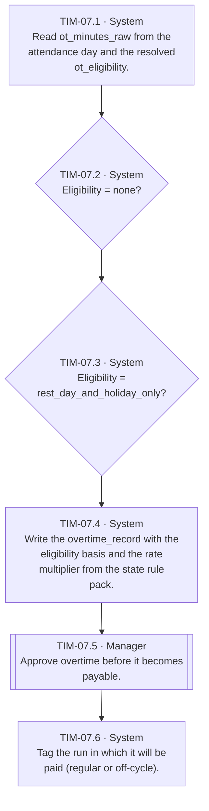

| Step | Step ID | Lane / actor | Type | Action or decision | Rule ID(s) | Objects touched (CRUD) | Key fields | Screen | Event emitted | Exception / note | Reuses | Demo pts | Phase |
| :--- | :--- | :--- | :--- | :--- | :--- | :--- | :--- | :--- | :--- | :--- | :--- | :--- | :--- |
| 1 | TIM-07.1 | System | SYS | Read ot_minutes_raw from the attendance day and the resolved ot_eligibility. | RL-130 | attendance_day R; assignment R | ot_minutes_raw, ot_eligibility | — |  |  |  | 1,4,10 | P1 |
| 2 | TIM-07.2 | System | DEC | Eligibility = none? | RL-131 | — | ot_eligibility | — |  | Yes → ot_payable = 0, retain raw for reporting. |  | 1,4,10 | P1 |
| 3 | TIM-07.3 | System | DEC | Eligibility = rest_day_and_holiday_only? | RL-132 | attendance_day R | day_type | — |  | Working day → 0 despite a 12h+ span. Rest day or holiday → the whole span is payable OT (demo point 4). | CMP-04 | 1,4,10 | P1 |
| 4 | TIM-07.4 | System | SYS | Write the overtime_record with the eligibility basis and the rate multiplier from the state rule pack. | RL-133 | overtime_record C | ot_record_id, person_id, date, ot_minutes, rate_multiplier, eligibility_basis, day_type | SCR-024 | time.overtime.computed | Statutory weekly limit exceeded → warn the approver; never silently pay past a limit. | CMP-09 | 1,4,10 | P1 |
| 5 | TIM-07.5 | Manager | APPR | Approve overtime before it becomes payable. | RL-010 | overtime_record U | approved_by, approved_on | SCR-040 | time.overtime.approved |  | CMP-01 | 1,4,10 | P1 |
| 6 | TIM-07.6 | System | SYS | Tag the run in which it will be paid (regular or off-cycle). | RL-134 | overtime_record U | pay_in_run_id | SCR-024 |  | Demo client: computed with the cycle, disbursed in the off-cycle run (demo point 10). |  | 1,4,10 | P1 |

### TIM-08 — Exception queue and regularisation

**Trigger:** Unpaired punch, device failure, dispute · **Primary actor:** Manager / HR · **Frequency:** Daily · **Criticality:** High · **Phase:** P1 · **Reuses:** CMP-01, CMP-04

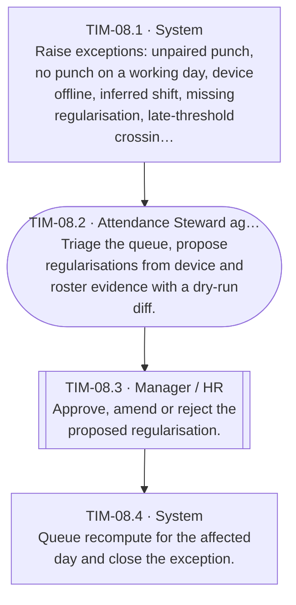

| Step | Step ID | Lane / actor | Type | Action or decision | Rule ID(s) | Objects touched (CRUD) | Key fields | Screen | Event emitted | Exception / note | Reuses | Demo pts | Phase |
| :--- | :--- | :--- | :--- | :--- | :--- | :--- | :--- | :--- | :--- | :--- | :--- | :--- | :--- |
| 1 | TIM-08.1 | System | SYS | Raise exceptions: unpaired punch, no punch on a working day, device offline, inferred shift, missing regularisation, late-threshold crossing. | RL-140 | attendance_exception C | exception_id, type, person_id, date, severity, evidence_ref | SCR-025 | time.exception.raised |  |  | 1 | P1 |
| 2 | TIM-08.2 | Attendance Steward agent | AGENT | Triage the queue; propose regularisations from device and roster evidence with a dry-run diff. | RL-141 | attendance_exception U; action_ledger C | proposed_change, simulation_result, confidence | SCR-025 | agent.action.proposed | Propose-only by default; auto-resolve permitted under the tenant's configured threshold. | CMP-11 | 1 | P1 |
| 3 | TIM-08.3 | Manager / HR | APPR | Approve, amend or reject the proposed regularisation. | RL-010 | regularisation C | regularisation_id, date, requested_change, reason, approver | SCR-025 | time.regularisation.approved |  | CMP-01 | 1 | P1 |
| 4 | TIM-08.4 | System | SYS | Queue recompute for the affected day and close the exception. | RL-142 | recompute_queue C; attendance_exception U | reason(regularisation) | — | time.recompute.requested |  | CMP-04 | 1 | P1 |

### TIM-09 — Attendance recompute

**Trigger:** Late punch, approved regularisation, rule change, roster republish · **Primary actor:** System · **Frequency:** Continuous · **Criticality:** Critical · **Phase:** P1 · **Reuses:** CMP-04

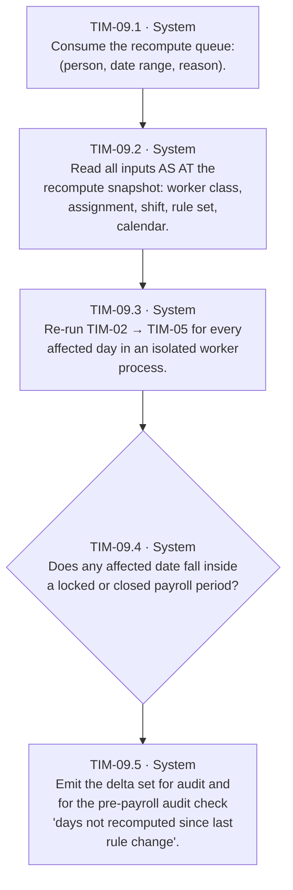

| Step | Step ID | Lane / actor | Type | Action or decision | Rule ID(s) | Objects touched (CRUD) | Key fields | Screen | Event emitted | Exception / note | Reuses | Demo pts | Phase |
| :--- | :--- | :--- | :--- | :--- | :--- | :--- | :--- | :--- | :--- | :--- | :--- | :--- | :--- |
| 1 | TIM-09.1 | System | SYS | Consume the recompute queue: (person, date range, reason). | RL-150 | recompute_queue R | person_id, date_from, date_to, reason | — |  | Reasons: late punch, regularisation, rule change, roster republish, policy/class change, gate pass, leave reversal. | CMP-04 | 12 | P1 |
| 2 | TIM-09.2 | System | SYS | Read all inputs AS AT the recompute snapshot: worker class, assignment, shift, rule set, calendar. | RL-151 | <temporal reads> | valid_at, recorded_at | — |  | Reading today's policy for a past date is the defect this step exists to prevent. | CMP-10 | 12 | P1 |
| 3 | TIM-09.3 | System | SYS | Re-run TIM-02 → TIM-05 for every affected day in an isolated worker process. | RL-152 | attendance_day U | all derived fields | — | time.attendance_day.recomputed | Must not contend with the interactive application. 5,000 people × 1 month in under 10 minutes. | CMP-04 | 12 | P1 |
| 4 | TIM-09.4 | System | DEC | Does any affected date fall inside a locked or closed payroll period? | RL-153 | payroll_run R | period, run_state | — | payroll.input.stale | Yes → do not alter the locked run; raise an arrears item for the next open run and notify payroll. |  | 12 | P1 |
| 5 | TIM-09.5 | System | SYS | Emit the delta set for audit and for the pre-payroll audit check 'days not recomputed since last rule change'. | RL-154 | attendance_day_delta C | delta set | SCR-026 |  |  | CMP-06 | 12 | P1 |

### TIM-10 — Team history and operational time reports

**Trigger:** Manager query · **Primary actor:** Manager · **Frequency:** Daily · **Criticality:** High · **Phase:** P1 · **Reuses:** CMP-08

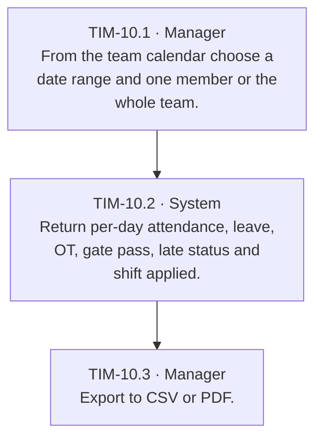

| Step | Step ID | Lane / actor | Type | Action or decision | Rule ID(s) | Objects touched (CRUD) | Key fields | Screen | Event emitted | Exception / note | Reuses | Demo pts | Phase |
| :--- | :--- | :--- | :--- | :--- | :--- | :--- | :--- | :--- | :--- | :--- | :--- | :--- | :--- |
| 1 | TIM-10.1 | Manager | TASK | From the team calendar choose a date range and one member or the whole team. | RL-160 | attendance_day R | date_from, date_to, person_scope | SCR-027 |  | Scoped by the manager's reporting line, evaluated at query time — not filtered in the UI. | CMP-08 | 1 | P1 |
| 2 | TIM-10.2 | System | SYS | Return per-day attendance, leave, OT, gate pass, late status and shift applied. | RL-161 | attendance_day R; leave_request R; overtime_record R; gate_pass R | status, net_minutes, ot_minutes, gate_pass_minutes, late_by_minutes, shift_applied | SCR-027 |  | Must work on a phone, on a weak network. |  | 1 | P1 |
| 3 | TIM-10.3 | Manager | TASK | Export to CSV or PDF. | RL-162 | report_export C | format, generated_by, scope | SCR-027 | report.exported | Export is logged; it contains personal data. | CMP-06 | 1 | P1 |

## 3. Swimlane maps

### SM-1 — ATTENDANCE DAY — punch to disposition to payroll input (demo points 1, 12, 13)

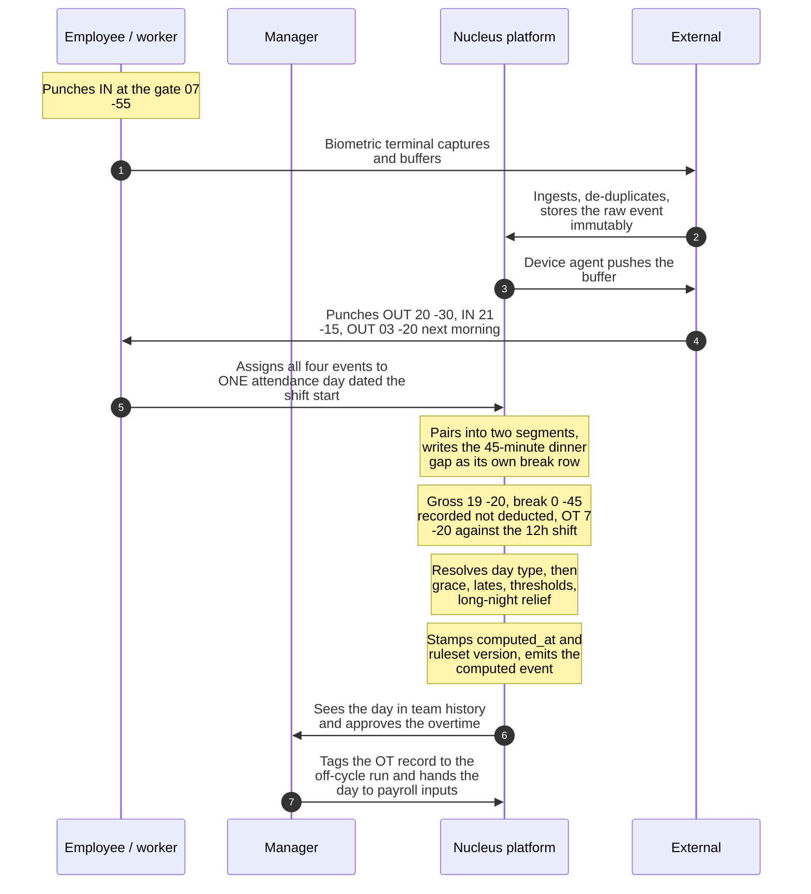

| Step | Employee / worker | Manager | HR / admin | System (Nucleus) | Agent | External | Note |
| :--- | :--- | :--- | :--- | :--- | :--- | :--- | :--- |
| 1 | Punches IN at the gate 07:55 |  |  |  |  | Biometric terminal captures and buffers |  |
| 2 |  |  |  | Ingests, de-duplicates, stores the raw event immutably |  | Device agent pushes the buffer | Clock drift corrected; raw value retained |
| 3 | Punches OUT 20:30, IN 21:15, OUT 03:20 next morning |  |  |  |  |  |  |
| 4 |  |  |  | Assigns all four events to ONE attendance day dated the shift start |  |  | The single most common error in this domain |
| 5 |  |  |  | Pairs into two segments; writes the 45-minute dinner gap as its own break row |  |  | Break report exists because breaks are rows |
| 6 |  |  |  | Gross 19:20; break 0:45 recorded not deducted; OT 7:20 against the 12h shift |  |  | Gate-to-gate for this client — configuration |
| 7 |  |  |  | Resolves day type, then grace, lates, thresholds, long-night relief |  |  | Day type FIRST, always |
| 8 |  |  |  | Stamps computed_at and ruleset version, emits the computed event |  |  |  |
| 9 |  | Sees the day in team history and approves the overtime |  |  |  |  |  |
| 10 |  |  |  | Tags the OT record to the off-cycle run and hands the day to payroll inputs |  |  |  |

### SM-2 — EXCEPTION AND REGULARISATION (demo point 1, agent pattern)

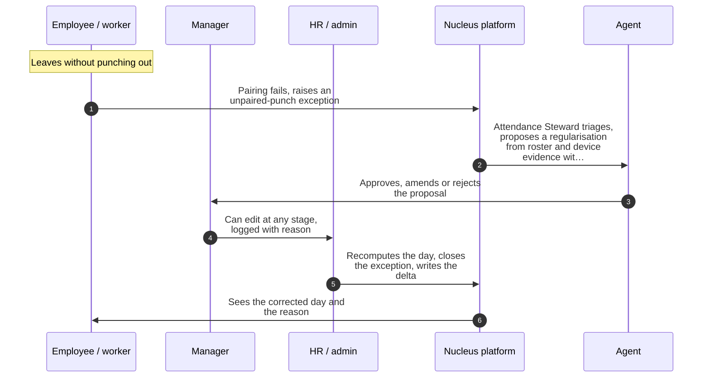

| Step | Employee / worker | Manager | HR / admin | System (Nucleus) | Agent | External | Note |
| :--- | :--- | :--- | :--- | :--- | :--- | :--- | :--- |
| 1 | Leaves without punching out |  |  |  |  |  |  |
| 2 |  |  |  | Pairing fails; raises an unpaired-punch exception |  |  | Never silently discarded |
| 3 |  |  |  |  | Attendance Steward triages, proposes a regularisation from roster and device evidence with a dry-run diff |  |  |
| 4 |  | Approves, amends or rejects the proposal |  |  |  |  | Auto-resolve only under the tenant threshold |
| 5 |  |  | Can edit at any stage, logged with reason |  |  |  |  |
| 6 |  |  |  | Recomputes the day, closes the exception, writes the delta |  |  |  |
| 7 | Sees the corrected day and the reason |  |  |  |  |  |  |

### SM-4 — GATE PASS (demo point 11)

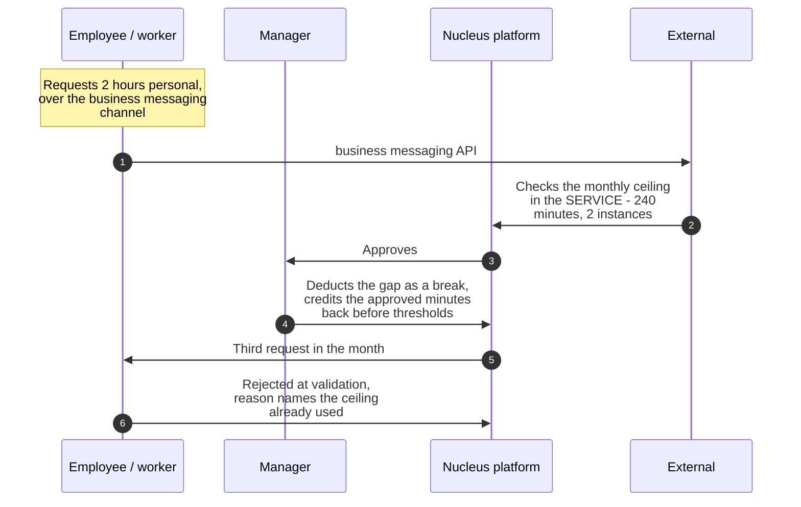

| Step | Employee / worker | Manager | HR / admin | System (Nucleus) | Agent | External | Note |
| :--- | :--- | :--- | :--- | :--- | :--- | :--- | :--- |
| 1 | Requests 2 hours personal, over the business messaging channel |  |  |  |  | business messaging API |  |
| 2 |  |  |  | Checks the monthly ceiling in the SERVICE: 240 minutes, 2 instances |  |  | Same rule whichever channel it arrives on |
| 3 |  | Approves |  |  |  |  |  |
| 4 |  |  |  | Deducts the gap as a break, credits the approved minutes back before thresholds |  |  | Net hours unchanged by an approved pass |
| 5 | Third request in the month |  |  |  |  |  |  |
| 6 |  |  |  | Rejected at validation, reason names the ceiling already used |  |  |  |

## 4. Approval workflows

| Workflow ID | Workflow | Form ID | Requirement | Approval chain | How it behaves | What must hold |
| :--- | :--- | :--- | :--- | :--- | :--- | :--- |
| W-03 | Overtime | F-OTM-01 | R-01, R-11 | Supervisor → HOD | OT is approved against computed hours; an approver may reduce but not increase them. | Approval must complete before the OT payment run picks the record up. |
| W-04 | Gate pass | F-GPS-01 | R-12 | Reporting manager | Only an approved pass credits work hours. | The entitlement check runs at submission and again at approval, since another pass may have been approved in between. |

### Workflow behaviour

| Workflow | Name | Form | Chain | Sequential or parallel | Recorded per level | Escalation | Delegation allowed | Return to applicant | Live demo record | Demo point |
| :--- | :--- | :--- | :--- | :--- | :--- | :--- | :--- | :--- | :--- | :--- |
| W-03 | Overtime | F-OTM-01 | Supervisor → HOD | Sequential | Actor, decision, timestamp, hours approved | After 2 days | Y | Y | OT-2026-0912 — E1017 approved 7h20m on 09 Sep | Points 1, 10 |
| W-04 | Gate pass | F-GPS-01 | Reporting manager | Single level | Actor, decision, timestamp | None | Y | N | GP-2026-0163 rejected by E1024 on the monthly ceiling. The entitlement is checked at submission and again at approval, because another pass may have been approved in between. | Point 11 |

## Approval & Sign-off

| Role | Name | Date | Decision | Conditions / comments |
| :--- | :--- | :--- | :--- | :--- |
| Author | Dhanraj Dadhich | 2026-11-05 | Submitted | |
| Peer review moderator | *pending* | | | PR-xxxx |
| PQA (process compliance) | *pending* | | | |
| Approval authority (DOC-01 §7) | *pending* | | | |

## Measurement Data Captured

| Measure | Value | Unit | Notes |
| :--- | :--- | :--- | :--- |
| Size | 93 | specified items (table rows) | Counted automatically at generation |
| Authoring effort | *to be recorded* | person-hours | |
| Review effort (preparation + meeting) | *pending review* | person-hours | From PR-xxxx |
| Rework effort | *pending review* | person-hours | |
| Review rate | *pending review* | items / hour | Compare with PPB control limits |
| Requirement volatility (changes since baseline) | 0 | CRs touching this artefact | Not yet baselined (CM-03) |

**Defects found, by detection phase and severity**

| Detection phase | Major | Minor | Editorial | Injected in phase (major) |
| :--- | :--- | :--- | :--- | :--- |
| Author self-check | 0 | 0 | 0 | — |
| Peer review | *pending* | | | |
| Design / build | | | | |
| System / integration test | | | | |
| UAT | | | | |
| Production (escaped) | | | | each escaped major opens a CAR record (CAR-01) |

Within control limits of the review-rate PPB? *To be assessed at peer review.*

## Revision History

| Version | Date | Author | Change summary | CR ref | Approved by |
| :--- | :--- | :--- | :--- | :--- | :--- |
| 1.0.0 | 2026-11-05 | Dhanraj Dadhich | Consolidated release | CR-0001 | *pending* |
