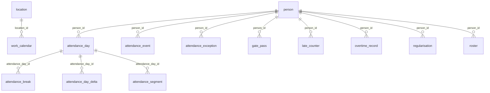

<picture>
  <source media="(prefers-color-scheme: dark)" srcset="../../assets/MultipliersKraftLogoDark.png">
  
</picture>

# FRS-TIM-05 — Time & Attendance — Data Model

| Attribute | Value |
| :--- | :--- |
| Document ID | FRS-TIM-05 |
| Title | Time & Attendance — Data Model |
| Product | Nucleus Suite (Nucleus HRMS Suite) |
| Version | 1.0.0 |
| Status | Issued for approval |
| Owner (role) | Domain Product Owner — Time & Attendance |
| Author | Dhanraj Dadhich |
| Reviewed by | *pending* |
| Approved by | Product Council — *pending* |
| Date | 2026-11-05 |
| Classification | Internal |
| CMMI practice areas | TS, RDM |
| Related documents | FRS-TIM-00, FRS-TIM-01, FRS-TIM-02, FRS-TIM-03, FRS-TIM-04, FRS-TIM-05, FRS-TIM-06, FRS-TIM-07, FRS-TIM-08, FRS-TIM-09, FRS-TIM-10, FRS-TIM-11, FRS-TIM-12, FRS-TIM-13, BRS-01, SRS-01, REQ-01, REQ-02 |
| Quality & process-performance objectives | QPPO-05 (effective requirements reviews), QPPO-01 (escaped defects) — MPM-01 |
| Process performance baseline used | PPB-01 (review defect density), PPB-02 (review rate) — MPM-01 |
| Peer review record | *pending* (PR-xxxx, QA-02) |
| Tailoring record | none |
| Traceability anchor | BG-03 · R-01, R-02, R-11, R-12, R-13, R-14 · processes TIM-01–TIM-10 |
| Source of record | Nucleus — Process Flows & Process Maps v1.0 — sheet(s) 06_Data_Dictionary Nucleus HR Demo Points Build Sheet v1.0 — sheet(s) 06_Enum_Values Nucleus HRMS Demo Dataset v1.1 — sheet(s) 65_Enum_Seed_Values |

> **Source of record.** Requirements in this document are taken from the source workbook(s) named above and keep their workbook IDs, which are never renumbered. Changes are made through a change request (CM-02) against the source workbook. Sections marked **Authored** are original additions that are not present in the source workbooks.

Every object carries the platform envelope (`tenant_id`, `entity_id`), effective dating (`effective_from`, `effective_to`) where temporal, and audit columns. Sensitivity classes follow GOV-10.

## 1. Entity relationships

Relationships are derived from the identifier fields in the data dictionary; the tenant envelope is omitted for legibility.

## 2. Data objects

| Object | Fields | Type | Required | Owner / source | Temporal | Sensitivity | Notes | Dataset ref |
| :--- | :--- | :--- | :--- | :--- | :--- | :--- | :--- | :--- |
| attendance_event | event_id, person_id, punch_ts, direction, source, device_id, geo_lat, geo_lng, selfie_ref, received_at, is_duplicate, drift_correction_ms | mixed | Y | Device | No | Personal | IMMUTABLE. Never edited, never deleted. | 20_Punch_Events |
| attendance_segment | segment_id, attendance_day_id, segment_no, in_event_id, out_event_id, start_ts, end_ts, minutes | mixed | Y | System | No | — | One row per paired in/out. | 20_Punch_Events |
| attendance_break | break_id, attendance_day_id, break_no, start_ts, end_ts, minutes, break_type(meal\|gate_pass\|other), is_paid, is_deducted | mixed | Y | System | No | — | First-class rows are why the break report exists without a special query. | 21_Expected_Attendance |
| attendance_day | attendance_day_id, person_id, attendance_date, shift_id_assigned, shift_id_applied, inference_reason, shift_minutes, day_type | mixed | Y | System | No | — | DERIVED and recomputable. Keyed on the date the shift started. | 21_Expected_Attendance |
| attendance_day | first_in, last_out, gross_minutes, break_minutes_recorded, break_minutes_deducted, gate_pass_minutes_deducted, gate_pass_minutes_credited, net_minutes | mixed | Y | System | No | — | Demo client: breaks recorded not deducted (gate-to-gate). | 21_Expected_Attendance |
| attendance_day | ot_basis(gross\|net), ot_minutes_raw, ot_minutes_payable, ot_eligibility_applied | mixed | Y | System | No | — | Basis is tenant configuration and must be stated, never assumed. | 21_Expected_Attendance |
| attendance_day | late_by_minutes, late_instance_no, late_beyond_allowance, grace_exempt_applied, long_night_relief | mixed | Y | System | No | — |  |  |
| attendance_day | status(Present\|Half Day\|Absent\|Weekly Off\|Holiday\|Leave\|…), applied_rule_ids[], computed_at, computed_by_ruleset_version, input_hash | mixed | Y | System | No | — | Provenance is what makes a March recomputation explainable in September. | 21_Expected_Attendance |
| attendance_day_delta | delta_id, attendance_day_id, field, old_value, new_value, reason, recomputed_at | mixed | N | System | No | — | Audit delta, never a silent overwrite. |  |
| shift | shift_code, name, shift_group, start_time, end_time, duration_min, break_recorded_min, break_deducted_min, crosses_midnight | mixed | Y | Config | Yes | — |  | 07_Shifts |
| shift_window | shift_code, earliest_in, latest_in | time | Y | Config | Yes | — | Must not overlap inside a shift group; overlap fails validation at save. | 07_Shifts |
| roster | roster_id, person_id, date, shift_code, published_at, published_by | mixed | N | Supervisor | Yes | — | Republishing a roster queues recompute. |  |
| work_calendar | calendar_id, location_id, date, day_type(working\|weekly_off\|holiday\|festival) | mixed | Y | Config | Yes | — | Multi-plant operations do not share one holiday list. | 09_Holiday_Calendar |
| holiday_calendar | date, holiday_name, applicable_locations[], type(National\|Statutory\|Festival) | mixed | Y | Config | Yes | — |  | 09_Holiday_Calendar |
| attendance_rule_set | ruleset_id, version, shift_hours, half_day_below_min, absent_below_min, grace_in_min, grace_out_min, late_allowance_per_month, long_night_after, next_day_relief_until, effective_from | mixed | Y | Config | Yes | — | The whole disposition rule is four data rows. A new shift length is a row, not a release. | 08_Attendance_Rules |
| gate_pass | gate_pass_id, person_id, date, from_ts, to_ts, minutes, pass_type(personal\|official), reason, status, approver, minutes_used_this_month, instances_this_month | mixed | N | Employee | No | — | Ceiling enforced in the service so business messaging obeys the same rule. | 22_Gate_Pass |
| overtime_record | ot_record_id, person_id, date, day_type, ot_minutes, rate_multiplier, eligibility_basis, approved_by, approved_on, pay_in_run_id | mixed | N | System | No | — | Every minute must reconcile to the attendance day. | 23_Overtime_Register |
| regularisation | regularisation_id, person_id, date, requested_change, reason, evidence_ref, approver, decided_at | mixed | N | Employee/Mgr | No | — | Regularisation rate per 100 employees is a product health metric. |  |
| attendance_exception | exception_id, type, person_id, date, severity, evidence_ref, state, resolved_by | mixed | N | System | No | — | The Attendance Steward's queue. |  |
| late_counter | person_id, month, instance_count, reset_at | mixed | Y | System | No | — | Visible to the employee — a rule that penalises silently generates tickets. |  |

### Additional objects and attributes (Authored)

| Object | Fields | Type | Required | Owner / source | Temporal | Sensitivity | Notes | Defined in |
| :--- | :--- | :--- | :--- | :--- | :--- | :--- | :--- | :--- |
| attendance_event | device_event_id, agent_batch_id, punch_ts_device, verification_mode(FINGER\|FACE\|CARD\|PIN), offline_queued, signed_ts | mixed | N | Device | No | Personal | Raw device timestamp kept beside the corrected punch_ts; offline events need a signed timestamp and are accepted up to 7 days old (RL-071). | ICD-01 §10.2 |
| attendance_device | device_id, location_id, agent_id, device_type(BIOMETRIC\|ACCESS_CONTROL\|KIOSK), status, last_heartbeat_at, buffer_depth, clock_offset_ms | mixed | Y | Plant IT | Yes | — | Registered terminal at the agent's location; feeds the per-shift device health report. | ICD-01 §10.2, §10.4 |
| site_agent | agent_id, location_id, client_id, certificate_ref, certificate_expires_on, software_version, schema_version, status | mixed | Y | Plant IT | Yes | Confidential | Enrolled with a per-agent certificate and bound to a location grant; signs each batch. | ICD-01 §10.1 |
| device_enrolment | device_id, enrolment_no, person_id, effective_from, effective_to | mixed | Y | Nucleus (HR / Plant HR) | Yes | Personal | Resolves a terminal enrolment number to exactly one active person; biometric templates are never transmitted or stored. | ICD-01 §10.2, §10.4 |
| attendance_event_quarantine | quarantine_id, agent_batch_id, device_id, device_event_id, enrolment_no, punch_ts_device, reason(unknown_device\|unknown_enrolment), exception_id, resolved_by, resolved_at | mixed | N | System | No | Personal | Unresolvable punches are landed here and raise an exception on SCR-025, never discarded. | ICD-01 §10.4 |

## 3. Enumerations

| Enum code | Enum name | Module | System or Config | Complete value set | Requirement |
| :--- | :--- | :--- | :--- | :--- | :--- |
| EN_DAY_STATUS | Day status | ATT | System | Present · Half day · Absent · Weekly off · Holiday · On leave · On gate pass · Not processed | R-13 |
| EN_DAY_TYPE | Day type | ATT | System | Working day · Rest day · Holiday · National holiday | R-05 |
| EN_BREAK_TYPE | Break type | ATT | Config | Meal · Personal · Gate pass · Shift break · Unclassified | R-01 |
| EN_LATE_CONSEQUENCE | Late mark consequence | ATT | Config | Half day · Leave deduction · Warning only · No action | R-13 |
| EN_COUNTER_RESET | Counter reset basis | ATT | Config | Calendar month · Payroll month · Quarter · Year | R-13 |
| EN_GATEPASS_TYPE | Gate pass type | GPS | Config | Personal · Official · Medical · Emergency | R-12 |

### Enumeration seed values and tenant defaults

| Enum code | Enum name | Module | System or Config | Complete value set | Default in this tenant | Requirement |
| :--- | :--- | :--- | :--- | :--- | :--- | :--- |
| EN_DAY_STATUS | Day status | ATT | System | Present · Half day · Absent · Weekly off · Holiday · On leave · On gate pass · Not processed |  | R-13 |
| EN_DAY_TYPE | Day type | ATT | System | Working day · Rest day · Holiday · National holiday | Working day | R-05 |
| EN_BREAK_TYPE | Break type | ATT | Config | Meal · Personal · Gate pass · Shift break · Unclassified | Unclassified | R-01 |
| EN_LATE_CONSEQUENCE | Late mark consequence | ATT | Config | Half day · Leave deduction · Warning only · No action | Half day | R-13 |
| EN_COUNTER_RESET | Counter reset basis | ATT | Config | Calendar month · Payroll month · Quarter · Year | Calendar month | R-13 |
| EN_GATEPASS_TYPE | Gate pass type | GPS | Config | Personal · Official · Medical · Emergency | Personal | R-12 |

## Approval & Sign-off

| Role | Name | Date | Decision | Conditions / comments |
| :--- | :--- | :--- | :--- | :--- |
| Author | Dhanraj Dadhich | 2026-11-05 | Submitted | |
| Peer review moderator | *pending* | | | PR-xxxx |
| PQA (process compliance) | *pending* | | | |
| Approval authority (DOC-01 §7) | *pending* | | | |

## Measurement Data Captured

| Measure | Value | Unit | Notes |
| :--- | :--- | :--- | :--- |
| Size | 37 | specified items (table rows) | Counted automatically at generation |
| Authoring effort | *to be recorded* | person-hours | |
| Review effort (preparation + meeting) | *pending review* | person-hours | From PR-xxxx |
| Rework effort | *pending review* | person-hours | |
| Review rate | *pending review* | items / hour | Compare with PPB control limits |
| Requirement volatility (changes since baseline) | 0 | CRs touching this artefact | Not yet baselined (CM-03) |

**Defects found, by detection phase and severity**

| Detection phase | Major | Minor | Editorial | Injected in phase (major) |
| :--- | :--- | :--- | :--- | :--- |
| Author self-check | 0 | 0 | 0 | — |
| Peer review | *pending* | | | |
| Design / build | | | | |
| System / integration test | | | | |
| UAT | | | | |
| Production (escaped) | | | | each escaped major opens a CAR record (CAR-01) |

Within control limits of the review-rate PPB? *To be assessed at peer review.*

## Revision History

| Version | Date | Author | Change summary | CR ref | Approved by |
| :--- | :--- | :--- | :--- | :--- | :--- |
| 1.0.0 | 2026-11-05 | Dhanraj Dadhich | Consolidated release | CR-0001 | *pending* |
