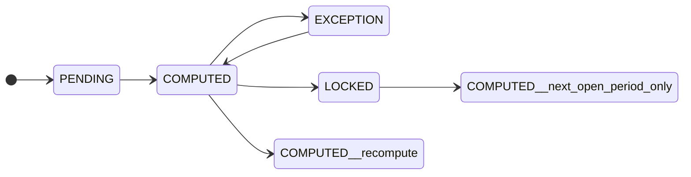

<picture>
  <source media="(prefers-color-scheme: dark)" srcset="../../assets/MultipliersKraftLogoDark.png">
  
</picture>

# FRS-TIM-06 — Time & Attendance — State Machines and Events

| Attribute | Value |
| :--- | :--- |
| Document ID | FRS-TIM-06 |
| Title | Time & Attendance — State Machines and Events |
| Product | Nucleus Suite (Nucleus HRMS Suite) |
| Version | 1.0.0 |
| Status | Issued for approval |
| Owner (role) | Domain Product Owner — Time & Attendance |
| Author | Dhanraj Dadhich |
| Reviewed by | *pending* |
| Approved by | Product Council — *pending* |
| Date | 2026-11-05 |
| Classification | Internal |
| CMMI practice areas | TS, VV |
| Related documents | FRS-TIM-00, FRS-TIM-01, FRS-TIM-02, FRS-TIM-03, FRS-TIM-04, FRS-TIM-05, FRS-TIM-06, FRS-TIM-07, FRS-TIM-08, FRS-TIM-09, FRS-TIM-10, FRS-TIM-11, FRS-TIM-12, FRS-TIM-13, BRS-01, SRS-01, REQ-01, REQ-02 |
| Quality & process-performance objectives | QPPO-05 (effective requirements reviews), QPPO-01 (escaped defects) — MPM-01 |
| Process performance baseline used | PPB-01 (review defect density), PPB-02 (review rate) — MPM-01 |
| Peer review record | *pending* (PR-xxxx, QA-02) |
| Tailoring record | none |
| Traceability anchor | BG-03 · R-01, R-02, R-11, R-12, R-13, R-14 · processes TIM-01–TIM-10 |
| Source of record | Nucleus — Process Flows & Process Maps v1.0 — sheet(s) 11_State_Machines, 12_Events |

> **Source of record.** Requirements in this document are taken from the source workbook(s) named above and keep their workbook IDs, which are never renumbered. Changes are made through a change request (CM-02) against the source workbook. Sections marked **Authored** are original additions that are not present in the source workbooks.

## 1. State machines

### `attendance_day`

| State | Meaning | Entered by | Allowed next states | Guard | Reversible | Event |
| :--- | :--- | :--- | :--- | :--- | :--- | :--- |
| PENDING | Queued for derivation | TIM-01 | COMPUTED | — | n/a — derived | time.recompute.requested |
| COMPUTED | Totals and disposition written with provenance | TIM-02/05 | EXCEPTION, LOCKED, COMPUTED (recompute) | — | Recomputable by definition | time.attendance_day.computed |
| EXCEPTION | Unpaired punch or missing data | TIM-08 | COMPUTED | Regularisation approved | Yes | time.exception.raised |
| LOCKED | Inside a locked payroll period | PAY-02 | COMPUTED (next open period only) | Recompute raises arrears instead of changing the day | No | payroll.inputs.locked |

## 2. Domain events

Event names follow `domain.object.verb` in the past tense. Every event carries the envelope defined in IA-02.

| Event | Emitted by | Payload (beyond envelope) | Consumers | Idempotency key | Retention |
| :--- | :--- | :--- | :--- | :--- | :--- |
| time.punch.ingested | TIM-01 | event_id, person_id, punch_ts, source, device_id | Derivation queue, device health | event_id | Medium |
| time.recompute.requested | TIM-01/09 | person_id, date_from, date_to, reason | Recompute worker | person + range + reason + requested_at | Short |
| time.attendance_day.computed | TIM-02 | attendance_day_id, status, net_minutes, ot_minutes, ruleset_version | Payroll inputs, analytics, manager views | attendance_day_id + computed_at | Long |
| time.attendance_day.recomputed | TIM-09 | attendance_day_id, delta[], reason | Payroll staleness check, audit | attendance_day_id + computed_at | Long |
| time.shift.inferred | TIM-03 | attendance_day_id, assigned, applied, reason | Roster owner alert, analytics | attendance_day_id | Medium |
| time.exception.raised | TIM-08 | exception_id, type, person_id, date | Attendance Steward, supervisor queue | exception_id | Medium |
| time.gate_pass.approved | TIM-06 | gate_pass_id, minutes, date | Recompute, payroll input | gate_pass_id | Medium |
| time.overtime.approved | TIM-07 | ot_record_id, minutes, multiplier, pay_in_run_id | Payroll, statutory register (Form 28) | ot_record_id | Long |

## Approval & Sign-off

| Role | Name | Date | Decision | Conditions / comments |
| :--- | :--- | :--- | :--- | :--- |
| Author | Dhanraj Dadhich | 2026-11-05 | Submitted | |
| Peer review moderator | *pending* | | | PR-xxxx |
| PQA (process compliance) | *pending* | | | |
| Approval authority (DOC-01 §7) | *pending* | | | |

## Measurement Data Captured

| Measure | Value | Unit | Notes |
| :--- | :--- | :--- | :--- |
| Size | 12 | specified items (table rows) | Counted automatically at generation |
| Authoring effort | *to be recorded* | person-hours | |
| Review effort (preparation + meeting) | *pending review* | person-hours | From PR-xxxx |
| Rework effort | *pending review* | person-hours | |
| Review rate | *pending review* | items / hour | Compare with PPB control limits |
| Requirement volatility (changes since baseline) | 0 | CRs touching this artefact | Not yet baselined (CM-03) |

**Defects found, by detection phase and severity**

| Detection phase | Major | Minor | Editorial | Injected in phase (major) |
| :--- | :--- | :--- | :--- | :--- |
| Author self-check | 0 | 0 | 0 | — |
| Peer review | *pending* | | | |
| Design / build | | | | |
| System / integration test | | | | |
| UAT | | | | |
| Production (escaped) | | | | each escaped major opens a CAR record (CAR-01) |

Within control limits of the review-rate PPB? *To be assessed at peer review.*

## Revision History

| Version | Date | Author | Change summary | CR ref | Approved by |
| :--- | :--- | :--- | :--- | :--- | :--- |
| 1.0.0 | 2026-11-05 | Dhanraj Dadhich | Consolidated release | CR-0001 | *pending* |
