<p align="right">
<picture>
  <source media="(prefers-color-scheme: dark)" srcset="../../assets/MultipliersKraftLogoDark.png">
  
</picture>
</p>

# FRS-TIM-12 — Time & Attendance — Use Case Specifications

| Attribute | Value |
| :--- | :--- |
| Document ID | FRS-TIM-12 |
| Title | Time & Attendance — Use Case Specifications |
| Product | Nucleus Suite (Nucleus HRMS Suite) |
| Version | 1.0.0 |
| Status | Issued for approval |
| Owner (role) | Domain Product Owner — Time & Attendance |
| Author | Dhanraj Dadhich |
| Reviewed by | *pending* |
| Approved by | Product Council — *pending* |
| Date | 2026-11-05 |
| Classification | Internal |
| CMMI practice areas | RDM, VV |
| Related documents | FRS-TIM-00, FRS-TIM-01, FRS-TIM-02, FRS-TIM-03, FRS-TIM-04, FRS-TIM-05, FRS-TIM-06, FRS-TIM-07, FRS-TIM-08, FRS-TIM-09, FRS-TIM-10, FRS-TIM-11, FRS-TIM-12, FRS-TIM-13, BRS-01, SRS-01, REQ-01, REQ-02 |
| Quality & process-performance objectives | QPPO-05 (effective requirements reviews), QPPO-01 (escaped defects) — MPM-01 |
| Process performance baseline used | PPB-01 (review defect density), PPB-02 (review rate) — MPM-01 |
| Peer review record | *pending* (PR-xxxx, QA-02) |
| Tailoring record | none |
| Traceability anchor | BG-03 · R-01, R-02, R-11, R-12, R-13, R-14 · processes TIM-01–TIM-10 |
| Source of record | Nucleus — Process Flows & Process Maps v1.0 — sheet(s) 03_Process_Inventory, 04_Process_Steps, 07_Screens, 09_Business_Rules<br>Authored use cases (marked per use case) |

> **Source of record.** Requirements in this document are taken from the source workbook(s) named above and keep their workbook IDs, which are never renumbered. Changes are made through a change request (CM-02) against the source workbook. Sections marked **Authored** are original additions that are not present in the source workbooks.

This document specifies 19 use cases for Time & Attendance: 10 follow the step-level flows of the source workbook and 9 are authored (processes without step-level detail in the source, and capability gaps). User stories derived from each use case are in FRS-TIM-13.

## 1. Use case index

| ID | Use case | Primary actor | Realises | Source | Phase | Criticality |
| :--- | :--- | :--- | :--- | :--- | :--- | :--- |
| [TIM-UC-001](#tim-uc-001) | Ingest punches from every enrolled source | Employee / worker | TIM-01 | Source workbook | P1 | Critical |
| [TIM-UC-002](#tim-uc-002) | Derive the attendance day from paired punches | Nucleus platform | TIM-02 | Source workbook | P1 | Critical |
| [TIM-UC-003](#tim-uc-003) | Infer the applied shift from the first in-punch | Nucleus platform | TIM-03 | Source workbook | P1 | High |
| [TIM-UC-004](#tim-uc-004) | Resolve the day type before disposition | Nucleus platform | TIM-04 | Source workbook | P1 | Critical |
| [TIM-UC-005](#tim-uc-005) | Dispose the attendance day against shift thresholds and late rules | Nucleus platform | TIM-05 | Source workbook | P1 | Critical |
| [TIM-UC-006](#tim-uc-006) | Request, approve and credit a gate pass | Employee / worker | TIM-06 | Source workbook | P1 | High |
| [TIM-UC-007](#tim-uc-007) | Compute and approve overtime | Manager / supervisor | TIM-07 | Source workbook | P1 | Critical |
| [TIM-UC-008](#tim-uc-008) | Resolve attendance exceptions through regularisation | Manager / supervisor | TIM-08 | Source workbook | P1 | High |
| [TIM-UC-009](#tim-uc-009) | Recompute attendance after a change | Nucleus platform | TIM-09 | Source workbook | P1 | Critical |
| [TIM-UC-010](#tim-uc-010) | View and export team attendance history | Manager / supervisor | TIM-10 | Source workbook | P1 | High |
| [TIM-UC-011](#tim-uc-011) | Log and approve project and task timesheets | Employee / worker | TIM-CG-001 | Authored | P3 | Medium |
| [TIM-UC-012](#tim-uc-012) | Punch from mobile inside a geofence with a live selfie | Employee / worker | TIM-CG-002 | Authored | P1 | High |
| [TIM-UC-013](#tim-uc-013) | Swap shifts and claim open shifts | Employee / worker | TIM-CG-003 | Authored | P3 | Medium |
| [TIM-UC-014](#tim-uc-014) | Work flexi-time and manage a time bank | Employee / worker | TIM-CG-004 | Authored | P3 | Medium |
| [TIM-UC-015](#tim-uc-015) | Generate rosters from forecast labour demand | Plant HR / time office | TIM-CG-005 | Authored | P4 | Medium |
| [TIM-UC-016](#tim-uc-016) | Pre-approve overtime against a line budget | Manager / supervisor | TIM-CG-006 | Authored | P1 | High |
| [TIM-UC-017](#tim-uc-017) | Reconcile canteen and transport usage with attendance | Plant HR / time office | TIM-CG-007 | Authored | P3 | Medium |
| [TIM-UC-018](#tim-uc-018) | Declare work location and book a desk | Employee / worker | TIM-CG-008 | Authored | P3 | Medium |
| [TIM-UC-019](#tim-uc-019) | Accept opt-in presence signals from wearables or beacons | Employee / worker | TIM-CG-009 | Authored | P4 | Low |

## 2. Use case diagrams

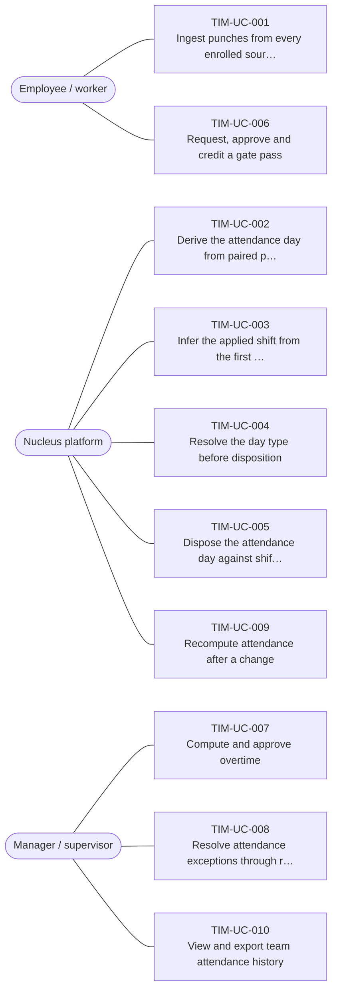

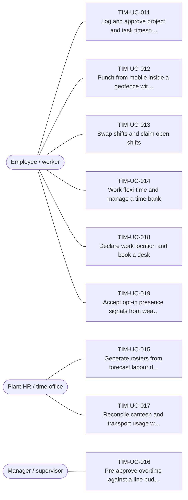

## 3. Use case specifications

### TIM-UC-001

**Ingest punches from every enrolled source** — Capture every attendance punch from any enrolled source exactly once, store it immutably and queue the affected attendance day for derivation.

| Attribute | Value |
| :--- | :--- |
| Realises | TIM-01 |
| Source | Source workbook |
| Level | User goal |
| Primary actor | Employee / worker |
| Secondary actors | Biometric terminal, Business messaging channel, Nucleus platform, Plant HR / time office |
| Trigger | A worker punches at a biometric terminal, kiosk, geofenced mobile app, business messaging channel, web page or integrated gate system. |
| Frequency | Continuous (500/s peak) |
| Criticality | Critical |
| Phase | P1 |
| Client requirements | R-01 |
| Business rules | RL-070, RL-071, RL-072, RL-073, RL-074, RL-075 |
| Screens | SCR-020 |
| Data objects (CRUD) | attendance_event (C), recompute_queue (C), attendance_exception (C) |
| Events | time.punch.received, time.punch.ingested, time.recompute.requested |
| Acceptance tests | TC-T70, TC-T71, TC-T72, TC-T73, TC-T74, TC-T75, T-01 |
| System requirements | SYS-057, SYS-062, SYS-063, SYS-064, SYS-080, SYS-082 |

**Stakeholders and interests**

| Stakeholder | Interest |
| :--- | :--- |
| Plant HR / time office | Every punch reaches the platform, including those taken while a terminal or phone was offline, so daily attendance needs no manual reconstruction. |
| Payroll manager | Locked payroll inputs are never changed silently by a punch that arrives late. |
| Auditor | Raw punches and any clock corrections are retained side by side and can be traced to the device that produced them. |

**Preconditions**

- The worker holds an active assignment and is enrolled on the source used to punch.
- The terminal or kiosk is registered to a location and has completed at least one clock sync with the platform.
- The set of enabled punch sources is configured for the tenant (RL-070).

**Main success scenario**

| # | Actor | Action | Ref |
| ---: | :--- | :--- | :--- |
| 1 | Employee / worker | Punches IN or OUT at an enrolled source, which captures person, time, direction, device and, on mobile, location and selfie reference. | TIM-01.1 |
| 2 | Biometric terminal | Pushes the punch batch to the ingestion endpoint, or the site agent polls the device buffer and pushes it; received_at is stamped. | TIM-01.2 |
| 3 | Nucleus platform | De-duplicates on person, punch time and device within the 60-second window and stores the raw event immutably. | TIM-01.3 |
| 4 | Nucleus platform | Queues the person's affected attendance date for derivation with reason new_punch and emits time.recompute.requested. | TIM-01.4 |

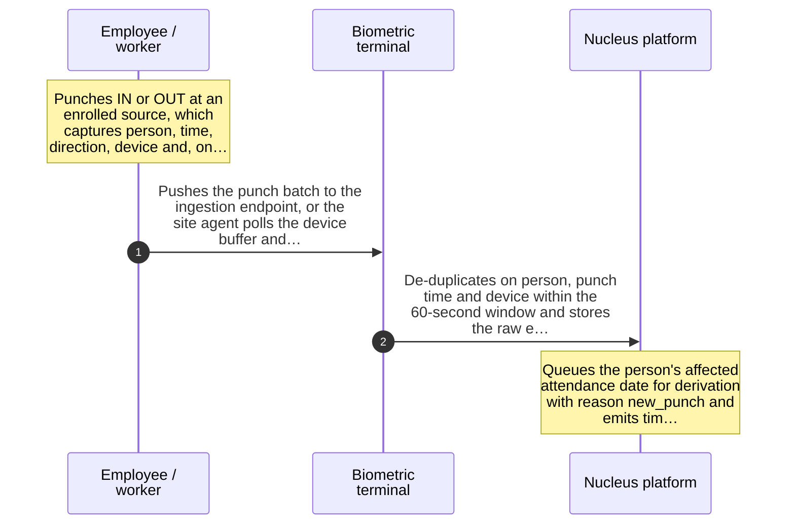

**Alternate flows**

| ID | At step | Condition | Steps | Rejoins |
| :--- | ---: | :--- | :--- | :--- |
| A1 | 1 | The terminal, kiosk or phone has no connection to the platform when the worker punches. | The source queues the punch locally with a signed timestamp. → On reconnect the source replays queued punches in order, keeping the original punch time and adding the actual received_at. | Returns to step 2 |
| A2 | 2 | The terminal clock has drifted from platform time. | The platform corrects punch time using the device's last sync offset, within the configured maximum of plus or minus 120,000 ms. → The correction is recorded and the raw device value is retained beside it. | Returns to step 3 |
| A3 | 1 | The worker punches through the business messaging channel instead of a terminal or app. | The channel relays the punch with the worker's verified identity and message timestamp to the same ingestion service. | Returns to step 2 |

**Exception flows**

| ID | At step | Condition | Handling | Rule |
| :--- | ---: | :--- | :--- | :--- |
| E1 | 3 | A second punch from the same person and device arrives inside the 60-second dedupe window. | The event is stored with is_duplicate set, excluded from pairing and counted towards the device health signal; it is never discarded. | RL-073 |
| E2 | 4 | The punch belongs to a date inside a locked payroll period. | The attendance day is not re-queued; an attendance exception is raised for time office and payroll review instead of changing the locked day. | RL-075 |
| E3 | 1 | A locally queued punch is older than the 7-day queue limit when connectivity returns. | The punch is not replayed automatically; the worker or supervisor recovers the time through a regularisation in the exception queue. | RL-071 |

**Postconditions — success**

- One immutable attendance_event exists with person, punch time, direction, source and device, and time.punch.received and time.punch.ingested have been emitted.
- Repeat punches inside the 60-second dedupe window are stored and marked as duplicates rather than dropped.
- The affected attendance date is in the recompute queue (attendance_day state PENDING) and time.recompute.requested has been emitted.

**Postconditions — failure**

- A punch for a date inside a locked payroll period is stored and raised as an exception; the locked attendance day is unchanged.
- A punch held offline beyond the 7-day queue limit is not replayed and must be recovered through regularisation (TIM-08).

**Quality requirements**

- Sustains a peak of 500 punches per second per tenant without loss or reordering of a person's events.
- Offline sources retain queued punches with signed timestamps for at least 7 days.
- Raw attendance events are append-only; corrections are stored as additional values, never as overwrites.

### TIM-UC-002

**Derive the attendance day from paired punches** — Turn a person's punches into one attendance day keyed on the shift start date, with segments, breaks, gross, net and raw overtime, stamped with provenance.

| Attribute | Value |
| :--- | :--- |
| Realises | TIM-02 |
| Source | Source workbook |
| Level | Subfunction |
| Primary actor | Nucleus platform |
| Secondary actors | Plant HR / time office, Payroll manager, Auditor |
| Trigger | A punch lands for the day (TIM-01) or a recompute is requested for it (TIM-09). |
| Frequency | Nightly and on demand |
| Criticality | Critical |
| Phase | P1 |
| Client requirements | R-01, R-12 |
| Business rules | RL-080, RL-081, RL-082, RL-083, RL-084, RL-085, RL-086, RL-087, RL-088, RL-089, BS:RL-01, BS:RL-02, BS:RL-03 |
| Screens | SCR-022, SCR-021 |
| Data objects (CRUD) | attendance_event (R), attendance_day (C/U), attendance_segment (C), attendance_break (C), gate_pass (R), attendance_day_delta (C) |
| Events | time.attendance_day.computed, time.attendance_day.recomputed |
| Acceptance tests | TC-T80, TC-T81, TC-T82, TC-T83, TC-T84, TC-T85, TC-T86, TC-T87, TC-T88, TC-T89, TC-PR06, TC-PR07, T-01, T-02, T-03 |
| System requirements | SYS-024, SYS-026, SYS-047, SYS-059, SYS-068 |

**Stakeholders and interests**

| Stakeholder | Interest |
| :--- | :--- |
| Employee / worker | A night that runs past midnight counts as one working day and the next day is not marked absent. |
| Plant HR / time office | Breaks such as the dinner gap are reportable on their own without a special query. |
| Payroll manager | Gross, net and overtime figures follow the client's configured break and overtime basis, so pay inputs are correct. |
| Auditor | Every computed day carries the ruleset version and every recomputation leaves a field-level delta. |

**Preconditions**

- The attendance date is queued for derivation (attendance_day state PENDING).
- The applied shift and the tenant's break-deduction and overtime-basis settings are effective for the date.
- Gate passes for the date, if any, are recorded with their approval status.

**Main success scenario**

| # | Actor | Action | Ref |
| ---: | :--- | :--- | :--- |
| 1 | Nucleus platform | Sets attendance_date to the date the shift started, so a shift that runs past midnight stays on one day. | TIM-02.1 |
| 2 | Nucleus platform | Collects all of the person's events inside the 30-hour day window and orders them by timestamp. | TIM-02.2 |
| 3 | Nucleus platform | Pairs each IN with the next OUT and writes one attendance_segment per pair. | TIM-02.3 |
| 4 | Nucleus platform | Writes each gap between consecutive segments as an attendance_break with a break type (meal, gate_pass, other) and a paid flag. | TIM-02.4 |
| 5 | Nucleus platform | Computes gross_minutes as last OUT minus first IN. | TIM-02.5 |
| 6 | Nucleus platform | Computes recorded and deducted break minutes and net_minutes per the tenant's break treatment; the demo client records breaks without deducting them. | TIM-02.6 |
| 7 | Nucleus platform | Deducts gate-pass gaps as breaks and credits back the minutes of approved gate passes before disposition. | TIM-02.7 |
| 8 | Nucleus platform | Computes ot_minutes_raw as the greater of zero and basis minus shift minutes, using gross or net as configured (gross for the demo client). | TIM-02.8 |
| 9 | Nucleus platform | Stamps computed_at, ruleset version and input hash, and emits time.attendance_day.computed. | TIM-02.9 |
| 10 | Nucleus platform | When recomputing an existing day, writes an attendance_day_delta per changed field instead of overwriting silently. | TIM-02.10 |

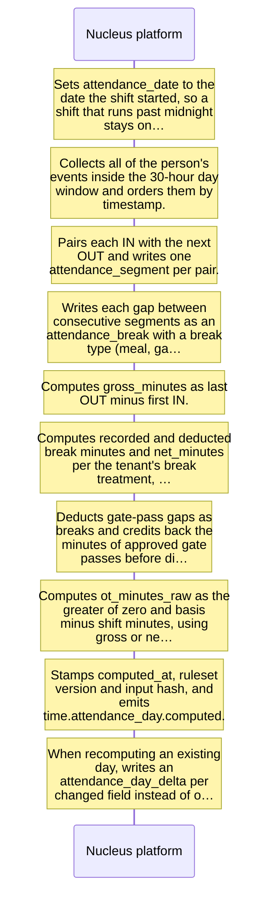

**Alternate flows**

| ID | At step | Condition | Steps | Rejoins |
| :--- | ---: | :--- | :--- | :--- |
| A1 | 6 | The tenant is configured to deduct recorded breaks from net time. | Break minutes are written as both recorded and deducted. → net_minutes is gross minus deducted breaks, so a 19h20m span with a 45-minute break gives 18h35m. | Returns to step 7 |
| A2 | 8 | The tenant's overtime basis is net rather than gross. | ot_minutes_raw is computed from net_minutes against shift minutes. | Returns to step 9 |
| A3 | 10 | The recomputed day is identical to the stored day. | The stored row is left as it is and no delta or recomputed event is written. | Use case ends |

**Exception flows**

| ID | At step | Condition | Handling | Rule |
| :--- | ---: | :--- | :--- | :--- |
| E1 | 3 | An IN has no following OUT, or an OUT has no preceding IN, inside the day window. | No segment is written for the event, the event is retained, the day enters EXCEPTION state and an unpaired-punch exception is raised to the queue. | RL-082 |
| E2 | 7 | A gate-pass gap exists but the pass is pending or rejected. | The gap stays deducted as a gate_pass break and no minutes are credited until approval triggers a recompute. | RL-086 |

**Postconditions — success**

- attendance_day is COMPUTED with first_in, last_out, gross, recorded and deducted break minutes, net minutes and ot_minutes_raw.
- One attendance_segment exists per IN/OUT pair and one attendance_break per gap between segments.
- computed_at, ruleset version and input hash are stamped and time.attendance_day.computed is emitted; a recompute that changed values has written attendance_day_delta rows.

**Postconditions — failure**

- Where an event cannot be paired, the day is in EXCEPTION state, the event is retained and an exception is raised to the queue (TIM-08).

**Quality requirements**

- Derivation is deterministic: identical inputs and ruleset version always produce an identical attendance_day row (property TC-PR06).
- For every day, segment minutes plus break minutes equal gross minutes (property TC-PR07).
- Break treatment and overtime basis are tenant configuration; changing them requires no release.

### TIM-UC-003

**Infer the applied shift from the first in-punch** — Apply the shift a worker actually punched into, record it against the rostered shift and let the roster owner correct it.

| Attribute | Value |
| :--- | :--- |
| Realises | TIM-03 |
| Source | Source workbook |
| Level | Subfunction |
| Primary actor | Nucleus platform |
| Secondary actors | Plant HR / time office, Manager / supervisor, Implementation consultant |
| Trigger | The first in-punch of a person's day is derived. |
| Frequency | Per day |
| Criticality | High |
| Phase | P1 |
| Client requirements | R-14 |
| Business rules | RL-090, RL-091, RL-092, RL-093, RL-094, BS:RL-19 |
| Screens | SCR-022 |
| Data objects (CRUD) | roster (R), assignment (R), shift_window (R), attendance_day (U), audit_entry (C), attendance_rule_set (R) |
| Events | time.shift.inferred, time.shift.overridden |
| Acceptance tests | TC-T90, TC-T91, TC-T92, TC-T93, TC-T94, T-27 |
| System requirements | SYS-026, SYS-036, SYS-059, SYS-068 |

**Stakeholders and interests**

| Stakeholder | Interest |
| :--- | :--- |
| Manager / supervisor | Sees when actual coverage departed from the published roster. |
| Employee / worker | Is judged against the thresholds of the shift actually worked, not the one rostered. |
| Auditor | Every override of an inferred shift names who changed it and why. |

**Preconditions**

- A published roster or an assignment default shift exists for the date.
- Each shift in the shift group has a non-overlapping inference window (earliest_in, latest_in).

**Main success scenario**

| # | Actor | Action | Ref |
| ---: | :--- | :--- | :--- |
| 1 | Nucleus platform | Reads the assigned shift for the date from the published roster, falling back to the assignment default. | TIM-03.1 |
| 2 | Nucleus platform | Checks whether the first in-punch falls inside another shift's inference window within the same shift group. | TIM-03.2 |
| 3 | Nucleus platform | Adopts the inferred shift for the day, records assigned shift, applied shift and inference reason, and emits time.shift.inferred. | TIM-03.3 |
| 4 | Plant HR / time office | Reviews the inferred shift on the attendance day detail and overrides it, with a reason, where the inference is wrong. | TIM-03.4 |
| 5 | Nucleus platform | Passes the applied shift's duration to the disposition threshold lookup (TIM-05). | TIM-03.5 |

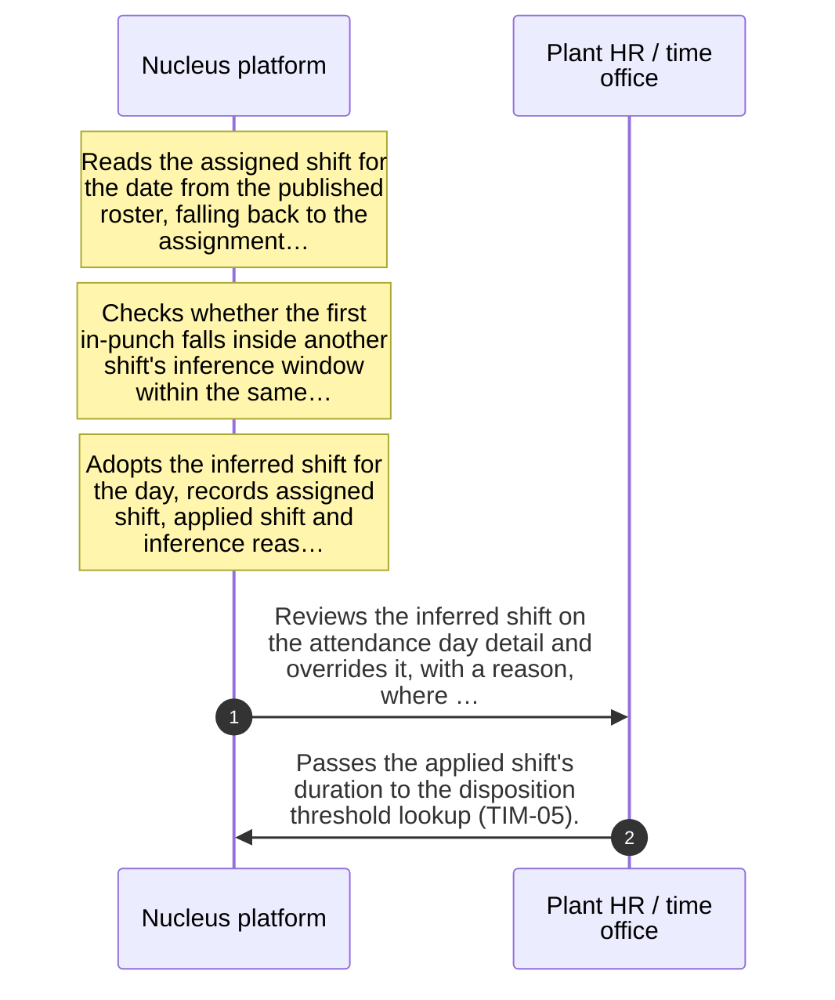

**Alternate flows**

| ID | At step | Condition | Steps | Rejoins |
| :--- | ---: | :--- | :--- | :--- |
| A1 | 2 | The first in-punch falls inside the assigned shift's own window. | The assigned shift is recorded as the applied shift and no inference event is emitted. | Returns to step 5 |
| A2 | 4 | The roster owner agrees with the inferred shift. | No override is recorded and the inferred shift stands. | Returns to step 5 |

**Exception flows**

| ID | At step | Condition | Handling | Rule |
| :--- | ---: | :--- | :--- | :--- |
| E1 | 2 | While configuring the shift group, a window is saved that overlaps another shift's window in the same group. | The save fails validation and names both shifts and the overlapping interval; no ambiguous inference can occur at run time. | RL-091 |
| E2 | 2 | The first in-punch falls outside every inference window in the group. | The assigned shift is applied and an inferred-shift exception is raised to the attendance exception queue for review. | RL-140 |
| E3 | 4 | An override is submitted without a reason. | The override is rejected; actor and reason are mandatory for the audit entry. | RL-093 |

**Postconditions — success**

- attendance_day records shift_id_assigned and shift_id_applied, and the inference reason where they differ.
- time.shift.inferred (and time.shift.overridden after a correction) has been emitted.
- Disposition thresholds are looked up using the applied shift's duration.

**Postconditions — failure**

- Where no inference window matches, the assigned shift is applied and an exception is raised for review.

**Quality requirements**

- Inference is never silent: every day where applied differs from assigned is visible to the roster owner on the attendance day detail.
- Inference windows are configuration rows validated at save time.

### TIM-UC-004

**Resolve the day type before disposition** — Decide whether each attendance day is a working day, weekly off, holiday or festival for that worker, from the location calendar and the worker's class, before any threshold is applied.

| Attribute | Value |
| :--- | :--- |
| Realises | TIM-04 |
| Source | Source workbook |
| Level | Subfunction |
| Primary actor | Nucleus platform |
| Secondary actors | Plant HR / time office, HR operations, Implementation consultant |
| Trigger | An attendance day reaches the point before disposition. |
| Frequency | Per day |
| Criticality | Critical |
| Phase | P1 |
| Client requirements | — |
| Business rules | RL-100, RL-101, RL-102, RL-103 |
| Screens | SCR-021, SCR-011 |
| Data objects (CRUD) | work_calendar (R), holiday_calendar (R), worker_class (R), assignment (R), attendance_day (U) |
| Events | — |
| Acceptance tests | TC-T100, TC-T101, TC-T102, TC-T103 |
| System requirements | SYS-007, SYS-023, SYS-026, SYS-068 |

**Stakeholders and interests**

| Stakeholder | Interest |
| :--- | :--- |
| Employee / worker | Working on a rest day is never mistaken for a short working day. |
| HR operations | Policy follows the worker class, so two classes under one contractor are treated correctly. |
| Payroll manager | Rest-day and holiday working feed overtime eligibility correctly (TIM-07). |

**Preconditions**

- A work calendar and holiday calendar are published for the worker's location and year.
- The worker's assignment carries a worker class effective on the date, with has_rest_days and rest_day_pattern set.

**Main success scenario**

| # | Actor | Action | Ref |
| ---: | :--- | :--- | :--- |
| 1 | Nucleus platform | Resolves the day type for the location and date from its work and holiday calendars: working, weekly off, holiday or festival. | TIM-04.1 |
| 2 | Nucleus platform | Overlays the worker class's rest-day policy (has_rest_days, rest_day_pattern) as effective on that date. | TIM-04.2 |
| 3 | Nucleus platform | Where workers share vendor, site and shift but differ in class, resolves each worker by their own class policy. | TIM-04.3 |
| 4 | Nucleus platform | Writes day_type on the attendance day before disposition thresholds are applied. | TIM-04.4 |

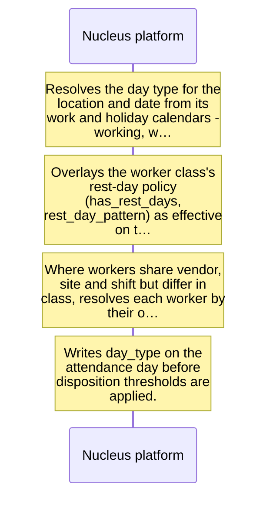

**Alternate flows**

| ID | At step | Condition | Steps | Rejoins |
| :--- | ---: | :--- | :--- | :--- |
| A1 | 2 | The worker's class has no rest days, as for daily-wage contractual workers. | A calendar weekly off such as Sunday resolves to Working for this worker. | Returns to step 3 |
| A2 | 3 | All workers in the vendor, site and shift group belong to the same class. | The single class policy is applied to every worker in the group. | Returns to step 4 |

**Exception flows**

| ID | At step | Condition | Handling | Rule |
| :--- | ---: | :--- | :--- | :--- |
| E1 | 4 | Disposition is requested for a day whose day_type has not yet been written. | Disposition is refused and the day is re-queued so that day type resolves first; a rest-day volunteer can never be marked Half Day. | RL-103 |
| E2 | 1 | No published calendar exists for the worker's location and date. | The day is held undisposed and a missing-data exception is raised to the attendance exception queue for the time office. | RL-100 |

**Postconditions — success**

- attendance_day.day_type is written before any disposition threshold is applied.
- Workers of different classes at the same vendor, site and shift carry day types from their own class policy.

**Postconditions — failure**

- Where the calendar or class cannot be resolved, the day is not disposed and a missing-data exception is raised.

**Quality requirements**

- Calendars are held per location, so plants in different states never share one holiday list.
- Rest-day policy is read as effective on the attendance date, not as at today.

### TIM-UC-005

**Dispose the attendance day against shift thresholds and late rules** — Assign Present, Half Day, Absent or a non-working status to each day using thresholds for the applied shift's length, grace, the monthly late allowance, designation exemption and long-night relief, with the rule trail stored.

| Attribute | Value |
| :--- | :--- |
| Realises | TIM-05 |
| Source | Source workbook |
| Level | Subfunction |
| Primary actor | Nucleus platform |
| Secondary actors | Employee / worker, Plant HR / time office, Implementation consultant |
| Trigger | Totals for the attendance day have been computed (TIM-02) and the day type resolved (TIM-04). |
| Frequency | Per day |
| Criticality | Critical |
| Phase | P1 |
| Client requirements | R-13 |
| Business rules | RL-052, RL-094, RL-110, RL-111, RL-112, RL-113, RL-114, RL-115, RL-116, RL-117, RL-118, RL-119, BS:RL-16, BS:RL-17, BS:RL-18 |
| Screens | SCR-021, SCR-022 |
| Data objects (CRUD) | attendance_day (R/U), attendance_rule_set (R), designation (R), late_counter (U) |
| Events | time.late.counted, time.attendance_day.disposed |
| Acceptance tests | TC-T52, TC-T94, TC-T110, TC-T111, TC-T112, TC-T113, TC-T114, TC-T115, TC-T116, TC-T117, TC-T118, TC-T119, T-24, T-25, T-26 |
| System requirements | SYS-026, SYS-049, SYS-059, SYS-068 |

**Stakeholders and interests**

| Stakeholder | Interest |
| :--- | :--- |
| Employee / worker | Sees the late counter and the rules behind every status, so penalties are never silent. |
| Plant HR / time office | Can defend any disputed status from its stored rule trail. |
| Payroll manager | Half-day and absent statuses that drive loss-of-pay are correct before the payroll cut-off. |

**Preconditions**

- attendance_day holds net (or configured basis) minutes, the applied shift and day_type.
- attendance_rule_set has a threshold row for the applied shift's duration (12h, 10h, 9h or 8h for the demo client).
- The employee's designation band carries the grace_exempt attribute.

**Main success scenario**

| # | Actor | Action | Ref |
| ---: | :--- | :--- | :--- |
| 1 | Nucleus platform | Checks whether the day type is anything other than Working. | TIM-05.1 |
| 2 | Nucleus platform | Looks up absent, half-day and grace thresholds for the applied shift's duration from attendance_rule_set. | TIM-05.2 |
| 3 | Nucleus platform | Checks whether net (or configured basis) minutes fall below the absent threshold, for example 6:30 on a 12-hour shift. | TIM-05.3 |
| 4 | Nucleus platform | Checks whether they fall below the half-day threshold, for example 11:30 on a 12-hour shift. | TIM-05.4 |
| 5 | Nucleus platform | Computes late_by_minutes against shift start plus 15 minutes of grace, with grace applied to both the in and the out punch. | TIM-05.5 |
| 6 | Nucleus platform | Checks whether the employee's designation band is grace-exempt (Assistant Manager and above for the demo client). | TIM-05.6 |
| 7 | Nucleus platform | Increments the monthly late-instance counter, visible to the employee; three instances per calendar month are forgiven. | TIM-05.7 |
| 8 | Nucleus platform | Checks whether this is the fourth or later late instance in the calendar month. | TIM-05.8 |
| 9 | Nucleus platform | Checks whether the previous attendance day ended after the long-night hour (03:00), allowing arrival up to 09:30. | TIM-05.9 |
| 10 | Nucleus platform | Writes the status with the IDs of the rules that produced it and emits time.attendance_day.disposed. | TIM-05.10 |

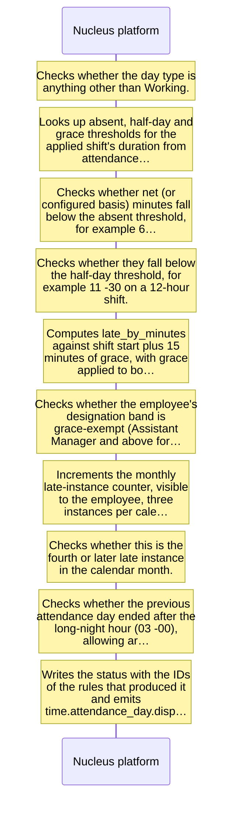

**Alternate flows**

| ID | At step | Condition | Steps | Rejoins |
| :--- | ---: | :--- | :--- | :--- |
| A1 | 1 | The day type is weekly off, holiday or festival. | Status is set to the day type, or to 'day type - worked' where punches exist. → Thresholds and late rules are skipped and the day passes to overtime eligibility (TIM-07). | Returns to step 10 |
| A2 | 3 | Basis minutes are below the absent threshold (390/360/300/270 for 12h/10h/9h/8h shifts). | Status is set to Absent with RL-112 recorded. | Returns to step 10 |
| A3 | 4 | Basis minutes are below the half-day threshold (690/570/510/450 for 12h/10h/9h/8h shifts). | Status is set to Half Day with RL-113 recorded. | Returns to step 10 |
| A4 | 6 | The designation band is grace-exempt. | No late instance is recorded and no late deduction applies. | Returns to step 10 |
| A5 | 8 | The arrival is the fourth or later late instance this month. | Status becomes Half Day even where hours qualify as Present, with RL-117 recorded. | Returns to step 9 |
| A6 | 9 | The previous day's last OUT was after 03:00, today's arrival is no later than 09:30 and work continues until at least 20:00. | The arrival is not treated as late, the late instance from step 7 is withdrawn and a full day is credited with RL-118 recorded. | Returns to step 10 |

**Exception flows**

| ID | At step | Condition | Handling | Rule |
| :--- | ---: | :--- | :--- | :--- |
| E1 | 2 | No threshold row exists for the applied shift's duration. | The day is not disposed; an exception is raised so the implementation consultant adds the threshold row as configuration, then the day is recomputed. | RL-111 |
| E2 | 5 | A working day has no punches at all. | A no-punch exception is raised to the attendance exception queue and the day awaits regularisation or leave before final status. | RL-140 |

**Postconditions — success**

- attendance_day.status is written with applied_rule_ids and time.attendance_day.disposed is emitted.
- late_by_minutes and the monthly late counter are updated and visible to the employee (time.late.counted).

**Postconditions — failure**

- Where no threshold row exists for the applied shift duration, the day is left undisposed and an exception is raised for configuration.

**Quality requirements**

- A new shift length is supported by adding a threshold row, with no release.
- My attendance shows the last 60 days and the current late count even when the phone is offline.
- Every status is explainable from its stored applied_rule_ids without re-running the rules.

### TIM-UC-006

**Request, approve and credit a gate pass** — Let an employee step out during a shift on an approved gate pass, enforce the personal monthly ceiling in the service and credit approved minutes back into work hours.

| Attribute | Value |
| :--- | :--- |
| Realises | TIM-06 |
| Source | Source workbook |
| Level | User goal |
| Primary actor | Employee / worker |
| Secondary actors | Manager / supervisor, Nucleus platform, Business messaging channel |
| Trigger | An employee requests a gate pass. |
| Frequency | Weekly |
| Criticality | High |
| Phase | P1 |
| Client requirements | R-12 |
| Business rules | RL-010, RL-086, RL-120, RL-121, RL-122, RL-123, BS:RL-20 |
| Screens | SCR-023, SCR-040, SCR-021 |
| Data objects (CRUD) | gate_pass (C/R/U), attendance_day (U) |
| Events | time.gate_pass.requested, time.gate_pass.approved, time.recompute.requested |
| Acceptance tests | TC-P10, TC-T86, TC-T120, TC-T121, TC-T122, TC-T123, T-23 |
| System requirements | SYS-037, SYS-049, SYS-057, SYS-059, SYS-071 |

**Stakeholders and interests**

| Stakeholder | Interest |
| :--- | :--- |
| Manager / supervisor | Approves only passes that are within entitlement and sees the remaining allowance. |
| Plant HR / time office | The ceiling is applied identically on every channel, so no pass slips through the messaging route. |
| Payroll manager | Approved pass minutes do not reduce net hours; unapproved absence does. |

**Preconditions**

- The employee holds an active assignment with a gate-pass entitlement of 240 minutes and 2 personal instances per calendar month.
- An approval chain for gate passes is defined for the employee's class and location (RL-010).

**Main success scenario**

| # | Actor | Action | Ref |
| ---: | :--- | :--- | :--- |
| 1 | Employee / worker | Requests a gate pass with date, from and to times, type (personal or official) and reason. | TIM-06.1 |
| 2 | Nucleus platform | For a personal pass, checks whether it would exceed 240 minutes or 2 instances in the calendar month. | TIM-06.2 |
| 3 | Manager / supervisor | Approves or rejects the pass in the approvals inbox, on the chain resolved for the request type, class and location. | TIM-06.3 |
| 4 | Nucleus platform | On approval, credits the approved minutes back into work hours before disposition thresholds and requests recompute of the day. | TIM-06.4 |
| 5 | Nucleus platform | Tracks official passes on the employee's record without counting them against the personal ceiling. | TIM-06.5 |

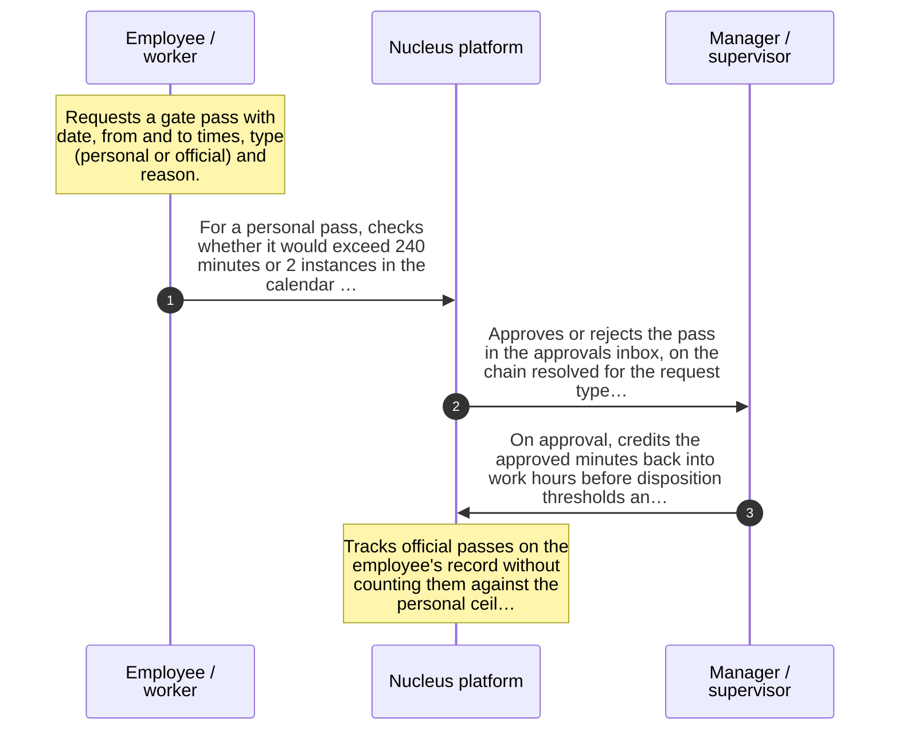

**Alternate flows**

| ID | At step | Condition | Steps | Rejoins |
| :--- | ---: | :--- | :--- | :--- |
| A1 | 1 | The employee raises the request through the business messaging channel. | The channel passes the request to the same gate-pass service, which applies the same validation as the web and app forms. | Returns to step 2 |
| A2 | 2 | The pass type is official. | The personal ceiling check is skipped and the pass is routed for approval. | Returns to step 3 |
| A3 | 3 | The approver rejects the pass. | The pass is closed as rejected with the approver's reason. → The time away stays deducted as a gate_pass break when the day is derived. | Use case ends |

**Exception flows**

| ID | At step | Condition | Handling | Rule |
| :--- | ---: | :--- | :--- | :--- |
| E1 | 2 | The personal pass would take the month beyond 240 minutes or beyond 2 instances. | The request is rejected at validation with reason text naming the ceiling and the amount already used; it is not routed to the approver. | RL-121 |
| E2 | 4 | The day is derived while the pass is still pending. | No minutes are credited; the gap stays deducted until approval triggers a recompute. | RL-122 |

**Postconditions — success**

- gate_pass is approved, time.gate_pass.approved is emitted and the day is queued for recompute.
- The approved minutes are credited back into work hours before disposition, so net hours are unchanged by the pass.

**Postconditions — failure**

- A personal pass that would breach the ceiling is rejected at validation with the ceiling named; nothing reaches the approver.
- A rejected or pending pass credits nothing and the absence stays deducted.

**Quality requirements**

- The ceiling is enforced in the gate-pass service, so every channel returns the same decision for the same request.
- Remaining personal minutes and instances for the month are shown to the employee before submission.

### TIM-UC-007

**Compute and approve overtime** — Turn raw overtime minutes into an approved, payable overtime record that respects class eligibility, the state multiplier and the run in which it will be paid.

| Attribute | Value |
| :--- | :--- |
| Realises | TIM-07 |
| Source | Source workbook |
| Level | User goal |
| Primary actor | Manager / supervisor |
| Secondary actors | Nucleus platform, Payroll manager, Compliance owner |
| Trigger | An attendance day is computed with ot_minutes_raw greater than zero or is worked on a rest day or holiday. |
| Frequency | Daily |
| Criticality | Critical |
| Phase | P1 |
| Client requirements | R-01, R-11 |
| Business rules | RL-010, RL-130, RL-131, RL-132, RL-133, RL-134, BS:RL-04, BS:RL-23 |
| Screens | SCR-024, SCR-040 |
| Data objects (CRUD) | attendance_day (R), assignment (R), overtime_record (C/U) |
| Events | time.overtime.computed, time.overtime.approved |
| Acceptance tests | TC-T130, TC-T131, TC-T132, TC-T133, TC-Y134, T-03, T-22 |
| System requirements | SYS-037, SYS-045, SYS-059, SYS-086 |

**Stakeholders and interests**

| Stakeholder | Interest |
| :--- | :--- |
| Employee / worker | Eligible overtime is recorded at the right rate and paid in the expected run. |
| Payroll manager | Only approved overtime reaches the pay run, and overtime cannot be pulled into the salary run. |
| Compliance owner | Approved overtime feeds the statutory overtime register and statutory limits are flagged before approval. |

**Preconditions**

- attendance_day is COMPUTED with ot_minutes_raw and day_type.
- The person's ot_eligibility (always, rest_day_and_holiday_only or none) is resolved from class and assignment.
- The state rule pack provides the overtime multiplier and weekly limit (2.0 multiplier for the demo client).

**Main success scenario**

| # | Actor | Action | Ref |
| ---: | :--- | :--- | :--- |
| 1 | Nucleus platform | Reads ot_minutes_raw from the attendance day and the person's resolved overtime eligibility. | TIM-07.1 |
| 2 | Nucleus platform | Checks whether overtime eligibility is none. | TIM-07.2 |
| 3 | Nucleus platform | Checks whether eligibility is rest-day-and-holiday-only and applies it against the resolved day type. | TIM-07.3 |
| 4 | Nucleus platform | Writes the overtime_record with eligibility basis, day type and state rule-pack multiplier, and emits time.overtime.computed. | TIM-07.4 |
| 5 | Manager / supervisor | Reviews the overtime in the approvals inbox and approves it before it becomes payable. | TIM-07.5 |
| 6 | Nucleus platform | Tags the approved overtime with the run that will pay it, regular or off-cycle (off-cycle after salary for the demo client). | TIM-07.6 |

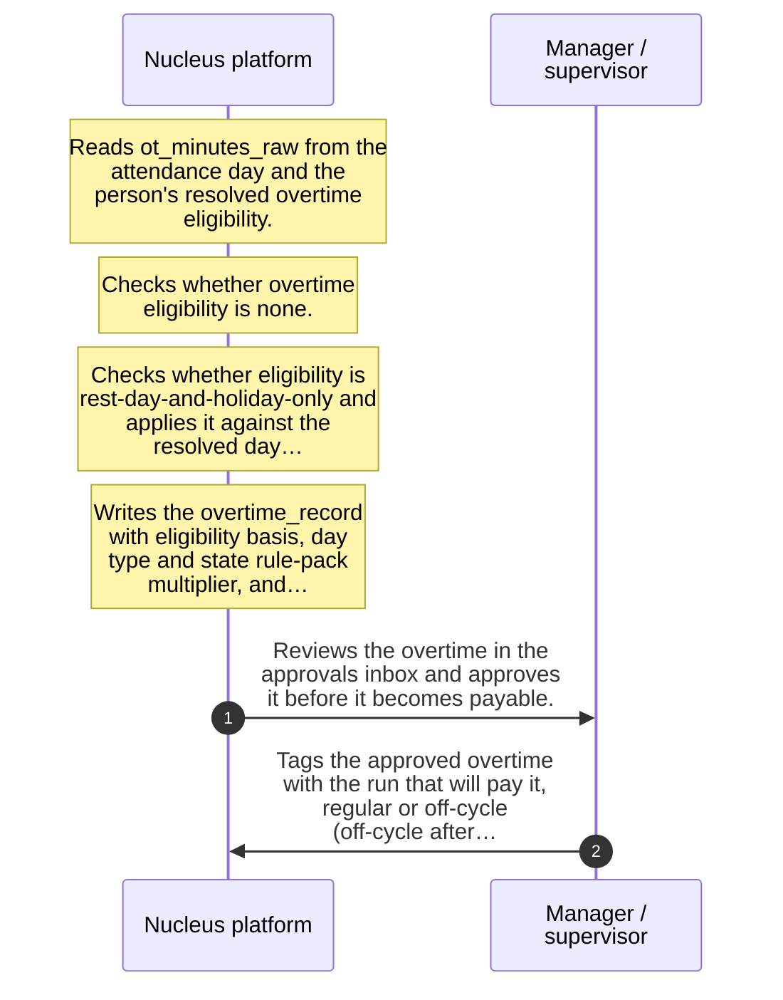

**Alternate flows**

| ID | At step | Condition | Steps | Rejoins |
| :--- | ---: | :--- | :--- | :--- |
| A1 | 2 | Eligibility is none. | Payable overtime is set to zero and the raw minutes are kept on the record for reporting. → No approval task is created. | Use case ends |
| A2 | 3 | Eligibility is rest-day-and-holiday-only. | On a working day payable overtime is zero despite a span above shift length. → On a rest day or holiday the whole worked span is payable overtime. | Returns to step 4 |
| A3 | 5 | The manager rejects the overtime. | The record is marked rejected with the reason; payable minutes are zero and raw minutes remain for reporting. | Use case ends |

**Exception flows**

| ID | At step | Condition | Handling | Rule |
| :--- | ---: | :--- | :--- | :--- |
| E1 | 4 | Approving the overtime would exceed the statutory weekly limit in the state rule pack (to be validated by Legal). | The approver sees a warning naming the limit and the excess minutes; overtime is never paid past a limit silently. | RL-133 |
| E2 | 6 | An overtime payment run is started before the linked salary run is closed. | The run is blocked; after the salary run closes the overtime run executes and posts separately. | RL-134 |

**Postconditions — success**

- overtime_record exists with minutes, eligibility basis, day type and multiplier, approved by the manager (time.overtime.approved).
- The record is tagged with the run that will pay it; for the demo client this is the off-cycle run after salary.

**Postconditions — failure**

- Ineligible or rejected overtime has zero payable minutes; raw minutes are retained for reporting.

**Quality requirements**

- Approved overtime records are retained long-term as the source for the statutory overtime register.
- Overtime eligibility and multiplier are configuration (class and state rule pack), not code.

### TIM-UC-008

**Resolve attendance exceptions through regularisation** — Raise attendance exceptions, let the governed attendance agent propose evidence-based regularisations and have a manager or HR decide them so the day can be recomputed.

| Attribute | Value |
| :--- | :--- |
| Realises | TIM-08 |
| Source | Source workbook |
| Level | User goal |
| Primary actor | Manager / supervisor |
| Secondary actors | Agent (governed), Plant HR / time office, Nucleus platform, Employee / worker |
| Trigger | An unpaired punch, missing punch on a working day, offline device, inferred shift, missing regularisation or late-threshold crossing is detected. |
| Frequency | Daily |
| Criticality | High |
| Phase | P1 |
| Client requirements | — |
| Business rules | RL-010, RL-140, RL-141, RL-142 |
| Screens | SCR-025 |
| Data objects (CRUD) | attendance_exception (C/U), action_ledger (C), regularisation (C), recompute_queue (C) |
| Events | time.exception.raised, agent.action.proposed, time.regularisation.approved, time.recompute.requested |
| Acceptance tests | TC-T140, TC-A141, TC-T142 |
| System requirements | SYS-035, SYS-037, SYS-057, SYS-072, SYS-074, SYS-082 |

**Stakeholders and interests**

| Stakeholder | Interest |
| :--- | :--- |
| Employee / worker | A missed punch is corrected quickly from evidence, without a paper form. |
| Plant HR / time office | The daily queue is triaged before it reaches people, with low-risk fixes handled within policy. |
| Auditor | Every agent proposal and decision is in the action ledger with its evidence and simulation. |

**Preconditions**

- The attendance day has been derived and the condition detected.
- The tenant's auto-resolve threshold for the agent is configured (120 minutes illustrative).

**Main success scenario**

| # | Actor | Action | Ref |
| ---: | :--- | :--- | :--- |
| 1 | Nucleus platform | Raises exceptions for unpaired punch, no punch on a working day, device offline, inferred shift, missing regularisation or late-threshold crossing. | TIM-08.1 |
| 2 | Agent (governed) | Triages the queue and proposes a regularisation from device and roster evidence, with a dry-run diff and confidence, logged to the ledger. | TIM-08.2 |
| 3 | Manager / supervisor | Approves, amends or rejects the proposed regularisation, recording a reason. | TIM-08.3 |
| 4 | Nucleus platform | Queues recompute for the affected day and closes the exception. | TIM-08.4 |

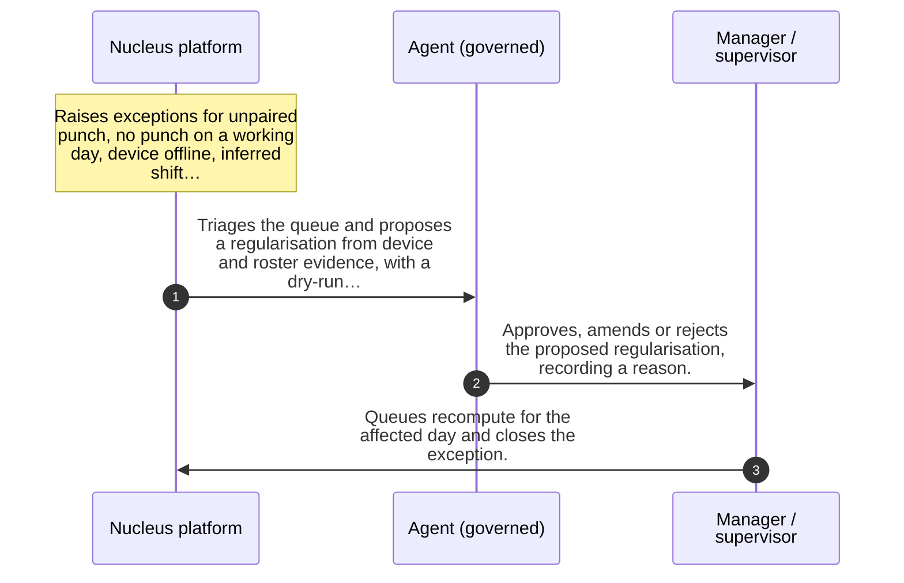

**Alternate flows**

| ID | At step | Condition | Steps | Rejoins |
| :--- | ---: | :--- | :--- | :--- |
| A1 | 2 | The proposed change is within the tenant's auto-resolve threshold and auto-resolve is enabled. | The agent applies the regularisation under its scoped role and records it in the action ledger as auto-resolved. | Returns to step 4 |
| A2 | 3 | The approver amends the proposal, for example a different OUT time. | The approver edits the proposed values and sees a refreshed dry-run diff before approving. | Returns to step 4 |
| A3 | 2 | No device or roster evidence supports a proposal. | The agent leaves the exception unproposed and flags it for manual regularisation by the manager or time office. | Returns to step 3 |

**Exception flows**

| ID | At step | Condition | Handling | Rule |
| :--- | ---: | :--- | :--- | :--- |
| E1 | 2 | The proposed change exceeds the auto-resolve threshold. | The agent may only propose; the change waits for a human decision. | RL-141 |
| E2 | 3 | The approver rejects the proposal. | The exception stays open with the rejection reason and the employee is asked for evidence or a leave request. | RL-010 |
| E3 | 4 | The regularised date lies in a locked payroll period. | The locked day is not changed; recompute raises an arrears item for the next open run. | RL-153 |

**Postconditions — success**

- A regularisation is approved (time.regularisation.approved), the day is queued for recompute and the exception is closed.
- Agent proposals and decisions are recorded in the action ledger.

**Postconditions — failure**

- A rejected proposal leaves the exception open with the rejection reason, and the attendance day stays in EXCEPTION state.

**Quality requirements**

- The agent acts only through declared tools under a role narrower than its human owner, and every action is ledgered.
- Each proposal carries its evidence reference and dry-run result so an approver can decide without opening another screen.

### TIM-UC-009

**Recompute attendance after a change** — Re-derive every affected attendance day after a late punch, regularisation, rule change, roster republish or policy change, using inputs as at the snapshot and never altering a locked payroll period.

| Attribute | Value |
| :--- | :--- |
| Realises | TIM-09 |
| Source | Source workbook |
| Level | Subfunction |
| Primary actor | Nucleus platform |
| Secondary actors | Payroll manager, HR operations, Plant HR / time office |
| Trigger | A recompute request lands for a late punch, regularisation, rule change, roster republish, policy or class change, gate pass or leave reversal. |
| Frequency | Continuous |
| Criticality | Critical |
| Phase | P1 |
| Client requirements | — |
| Business rules | RL-021, RL-042, RL-075, RL-150, RL-151, RL-152, RL-153, RL-154 |
| Screens | SCR-026 |
| Data objects (CRUD) | recompute_queue (R), attendance_day (U), attendance_day_delta (C), payroll_run (R) |
| Events | time.attendance_day.recomputed, payroll.input.stale, payroll.arrears.requested |
| Acceptance tests | TC-P21, TC-T42, TC-T75, TC-T150, TC-T151, TC-N152, TC-Y153, TC-Y154 |
| System requirements | SYS-024, SYS-025, SYS-052, SYS-055, SYS-057 |

**Stakeholders and interests**

| Stakeholder | Interest |
| :--- | :--- |
| Payroll manager | Locked periods stay locked; corrections arrive as arrears in the next open run. |
| HR operations | A policy change dated in the future does not rewrite the past. |
| Employee / worker | Corrections reach attendance and pay without anyone re-entering data. |

**Preconditions**

- The recompute queue holds person, date range and reason for each request.
- Effective-dated history exists for worker class, assignment, shift, rule set and calendar.

**Main success scenario**

| # | Actor | Action | Ref |
| ---: | :--- | :--- | :--- |
| 1 | Nucleus platform | Consumes recompute queue entries of person, date range and reason, such as late punch, regularisation, rule change or roster republish. | TIM-09.1 |
| 2 | Nucleus platform | Reads worker class, assignment, shift, rule set and calendar as at the recompute snapshot, never as at today. | TIM-09.2 |
| 3 | Nucleus platform | Re-runs derivation, shift inference, day type and disposition for every affected day in an isolated worker process. | TIM-09.3 |
| 4 | Nucleus platform | Checks whether any affected date falls inside a locked or closed payroll period. | TIM-09.4 |
| 5 | Nucleus platform | Emits the delta set for audit and for the pre-payroll check on days not recomputed since the last rule change. | TIM-09.5 |

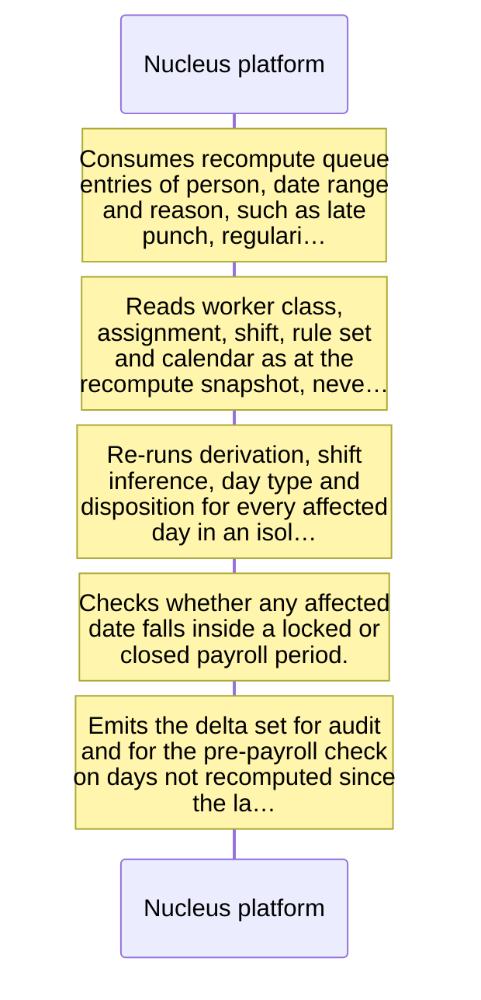

**Alternate flows**

| ID | At step | Condition | Steps | Rejoins |
| :--- | ---: | :--- | :--- | :--- |
| A1 | 1 | The reason is a change to class, rest days, shift group, grace exemption or location. | The platform derives the affected population and date range from the change's effective date and queues them automatically. | Returns to step 2 |
| A2 | 3 | A recomputed day is identical to the stored day. | No delta is written for that day. | Returns to step 4 |

**Exception flows**

| ID | At step | Condition | Handling | Rule |
| :--- | ---: | :--- | :--- | :--- |
| E1 | 4 | An affected date lies inside a locked or closed payroll period. | The locked day is not altered; an arrears item is raised for the next open run, payroll.input.stale and payroll.arrears.requested are emitted and payroll is notified. | RL-153 |
| E2 | 3 | A recomputed day still contains an unpaired event. | The day stays in EXCEPTION state and the exception remains in the queue for regularisation. | RL-082 |

**Postconditions — success**

- Every affected day in open periods is recomputed, deltas are written and time.attendance_day.recomputed is emitted.
- Days in locked or closed payroll periods are unchanged and an arrears item exists for the next open run.

**Postconditions — failure**

- Days that still cannot be paired remain in EXCEPTION state in the exception queue.

**Quality requirements**

- Recomputes one month for 5,000 people in under 10 minutes.
- Runs in an isolated worker and does not degrade interactive response times while running.
- All derived reads pass the snapshot timestamp (valid_at, recorded_at), never the current time.

### TIM-UC-010

**View and export team attendance history** — Give a manager a date-range history of attendance, leave, overtime, gate pass, late status and applied shift for their own team, on a phone, with a logged export.

| Attribute | Value |
| :--- | :--- |
| Realises | TIM-10 |
| Source | Source workbook |
| Level | User goal |
| Primary actor | Manager / supervisor |
| Secondary actors | Nucleus platform |
| Trigger | A manager needs the history of a team member or the whole team for a date range. |
| Frequency | Daily |
| Criticality | High |
| Phase | P1 |
| Client requirements | R-02 |
| Business rules | RL-160, RL-161, RL-162 |
| Screens | SCR-027 |
| Data objects (CRUD) | attendance_day (R), leave_request (R), overtime_record (R), gate_pass (R), report_export (C) |
| Events | report.exported |
| Acceptance tests | TC-T160, TC-T161, TC-C162, T-05 |
| System requirements | SYS-016, SYS-017, SYS-033 |

**Stakeholders and interests**

| Stakeholder | Interest |
| :--- | :--- |
| Employee / worker | Only their own reporting manager can see their day-by-day history. |
| Compliance owner | Exports of personal data are logged with who, what scope and when. |
| Plant HR / time office | Supervisors answer their own team history questions without raising requests. |

**Preconditions**

- The manager holds an active reporting line to at least one person.
- Attendance days for the range have been computed.

**Main success scenario**

| # | Actor | Action | Ref |
| ---: | :--- | :--- | :--- |
| 1 | Manager / supervisor | Opens the team calendar, chooses a from and to date and selects one reportee or the whole team. | TIM-10.1 |
| 2 | Nucleus platform | Returns per-day attendance status, leave, overtime, gate pass, late status and applied shift, scoped to the reporting line at query time. | TIM-10.2 |
| 3 | Manager / supervisor | Exports the result to CSV or PDF; the export is logged because it contains personal data. | TIM-10.3 |

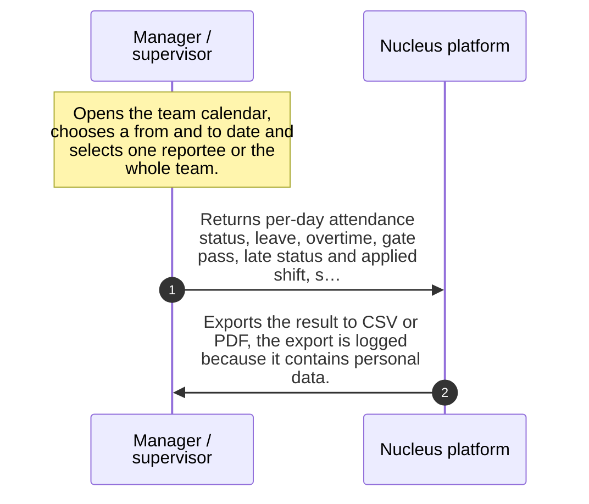

**Alternate flows**

| ID | At step | Condition | Steps | Rejoins |
| :--- | ---: | :--- | :--- | :--- |
| A1 | 1 | The manager selects the whole team instead of one member. | The platform returns one row per person per day for all current reportees. | Returns to step 2 |
| A2 | 3 | The manager only needs to view the history. | No export is generated and nothing is logged as an export. | Use case ends |

**Exception flows**

| ID | At step | Condition | Handling | Rule |
| :--- | ---: | :--- | :--- | :--- |
| E1 | 1 | A request names a person outside the manager's reporting line, for example through an edited link. | The server returns no data for that person; scope is enforced at query time, not by hiding the option. | RL-160 |
| E2 | 2 | The phone is on a weak network. | Results load in pages per person so the first member's history renders before the rest arrive. | RL-161 |

**Postconditions — success**

- Per-day history for the selected scope and range is shown, and any export is recorded with format, generator and scope (report.exported).

**Postconditions — failure**

- No data is returned for anyone outside the manager's reporting line at query time.

**Quality requirements**

- Usable on a phone over a weak network, with the first page of results rendered before the full range loads.
- Every export of personal data is logged with generator, scope and format.

### TIM-UC-011

**Log and approve project and task timesheets** — Let knowledge workers record time against projects, tasks and cost centres, have it approved and pass approved cost to Finance.

| Attribute | Value |
| :--- | :--- |
| Realises | TIM-CG-001 |
| Source | Authored |
| Level | User goal |
| Primary actor | Employee / worker |
| Secondary actors | Manager / supervisor, Finance, Nucleus platform, ERP system |
| Trigger | A knowledge worker records the week's effort, usually at week end. |
| Frequency | Weekly |
| Criticality | Medium |
| Phase | P3 |
| Client requirements | — |
| Business rules | RL-010 |
| Screens | SCR-040 |
| Data objects (CRUD) | timesheet (C/U), timesheet_line (C/U), attendance_day (R), project_cost_allocation (C) |
| Events | — |
| Acceptance tests | TIM-TC-001, TIM-TC-002, TIM-TC-003, TIM-TC-004, TIM-TC-005, TIM-TC-006 |
| System requirements | SYS-026, SYS-028, SYS-037, SYS-038, SYS-084 |

**Stakeholders and interests**

| Stakeholder | Interest |
| :--- | :--- |
| Finance | Approved time is costed to the right cost centre and project for allocation. |
| Manager / supervisor | Reviews logged effort against attendance before approving. |
| Employee / worker | Logs time quickly, starting from hours already known from attendance. |

**Preconditions**

- The employee is assigned to at least one active project with tasks and a cost centre.
- An approval chain for timesheets is defined for the employee's class and location (RL-010).
- Attendance days for the week have been computed.

**Main success scenario**

| # | Actor | Action | Ref |
| ---: | :--- | :--- | :--- |
| 1 | Employee / worker | Opens the weekly timesheet, prefilled with each day's net attendance hours and the projects assigned to them. |  |
| 2 | Employee / worker | Logs hours per day against project, task and cost centre, adding a short note per line. |  |
| 3 | Nucleus platform | Compares each day's logged hours with net attendance hours and flags days where logged time exceeds attendance. |  |
| 4 | Employee / worker | Submits the week for approval. |  |
| 5 | Nucleus platform | Resolves the approval chain for the request type, class and location and routes the timesheet to the approver. |  |
| 6 | Manager / supervisor | Approves the timesheet, or returns individual lines with a comment. |  |
| 7 | Nucleus platform | Costs each approved line at the cost-centre rate effective on the day and makes it available to Finance. |  |
| 8 | Finance | Reviews project cost allocation for the period and releases the allocation journal to the ERP system. |  |

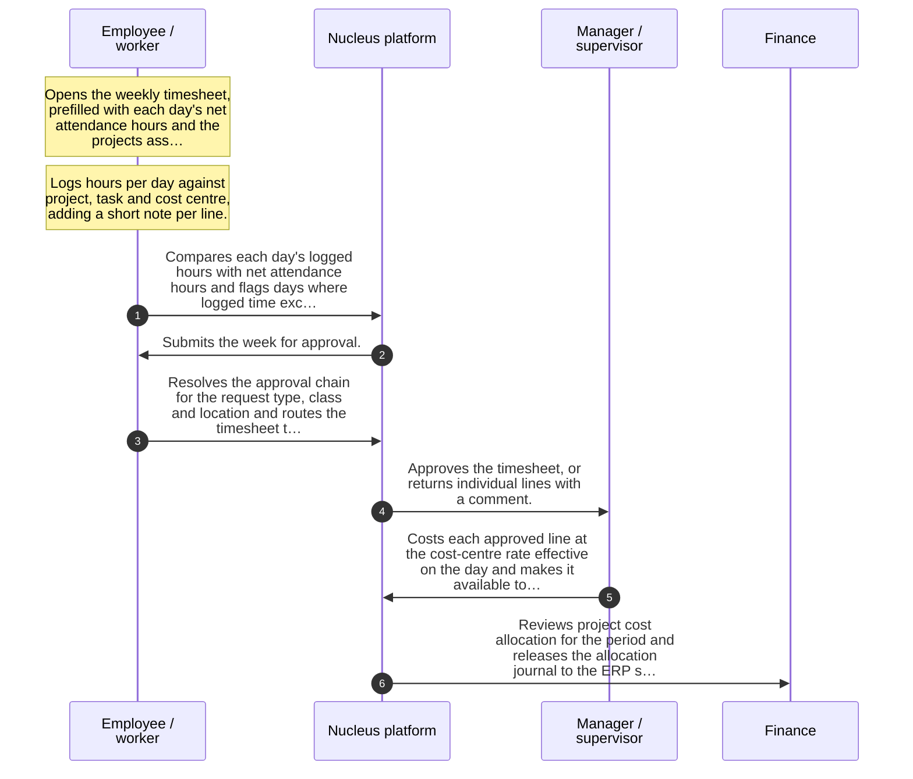

**Alternate flows**

| ID | At step | Condition | Steps | Rejoins |
| :--- | ---: | :--- | :--- | :--- |
| A1 | 6 | The approver returns some lines. | Returned lines reopen for the employee with the comment; approved lines stay approved. → The employee corrects and resubmits only the returned lines. | Returns to step 5 |
| A2 | 2 | The employee copies last week's project and task lines. | Lines are copied with zero hours so only the hours need entering. | Returns to step 3 |

**Exception flows**

| ID | At step | Condition | Handling | Rule |
| :--- | ---: | :--- | :--- | :--- |
| E1 | 3 | Logged hours on a day exceed net attendance hours. | Submission is blocked and the days are listed until hours are corrected or attendance is regularised. |  |
| E2 | 8 | The costing period is already closed in Finance. | Late-approved lines are costed into the next open period as adjustments and shown as such. |  |

**Postconditions — success**

- An approved timesheet exists with lines per project, task, cost centre and day.
- Costed lines are available to Finance for allocation and journal export to the ERP system.

**Postconditions — failure**

- A returned or rejected timesheet stays editable by the employee with the approver's comments, and nothing is costed.

**Quality requirements**

- A week with 10 lines can be entered and submitted on a phone in under 3 minutes.
- Costing uses the rate effective on the worked date, not the approval date.

### TIM-UC-012

**Punch from mobile inside a geofence with a live selfie** — Let field and remote workers punch from a phone only inside a configured geofence and with a liveness-checked selfie, keeping biometric templates on the device unless consented.

| Attribute | Value |
| :--- | :--- |
| Realises | TIM-CG-002 |
| Source | Authored |
| Level | User goal |
| Primary actor | Employee / worker |
| Secondary actors | Nucleus platform, Plant HR / time office, Tenant admin |
| Trigger | A field or remote worker opens the check-in screen on the mobile app. |
| Frequency | Continuous |
| Criticality | High |
| Phase | P1 |
| Client requirements | — |
| Business rules | RL-070, RL-071, RL-073, RL-074, RL-140 |
| Screens | SCR-020, SCR-025 |
| Data objects (CRUD) | attendance_event (C), geofence (R), consent_record (R), attendance_exception (C) |
| Events | time.punch.received, time.punch.ingested, time.recompute.requested |
| Acceptance tests | TC-T70, TC-T71, TC-T73, TIM-TC-007, TIM-TC-008, TIM-TC-009, TIM-TC-010, TIM-TC-011, TIM-TC-012, TIM-TC-013, TIM-TC-014 |
| System requirements | SYS-062, SYS-063, SYS-064, SYS-065, SYS-081 |

**Stakeholders and interests**

| Stakeholder | Interest |
| :--- | :--- |
| Plant HR / time office | Mobile punches are trustworthy and suspect ones are visible for review. |
| Compliance owner | Biometric data is minimised and handled only with consent, in line with the DPDP Act 2023 (to be validated by Legal). |
| Employee / worker | Can record attendance from a site or client location without a terminal. |

**Preconditions**

- Mobile is an enabled punch source for the worker (RL-070) and at least one geofence is configured for the worker's location or assignment.
- The worker has enrolled their face on the device; any consent to share the template is recorded.
- The app has location permission.

**Main success scenario**

| # | Actor | Action | Ref |
| ---: | :--- | :--- | :--- |
| 1 | Employee / worker | Opens the check-in screen on the mobile app. |  |
| 2 | Nucleus platform | Reads the device location and confirms it lies within a geofence configured for the worker's location or assignment. |  |
| 3 | Employee / worker | Takes a selfie when prompted. |  |
| 4 | Nucleus platform | Runs the liveness check and face match on the device against the locally held template. |  |
| 5 | Employee / worker | Confirms the punch direction, IN or OUT. |  |
| 6 | Nucleus platform | Records the punch with signed timestamp, geo_lat, geo_lng and selfie reference, sending only the match result, not the template. |  |
| 7 | Nucleus platform | Ingests the event through the standard punch path, de-duplicates it and queues the day for derivation. |  |
| 8 | Plant HR / time office | Reviews refused or suspect mobile punches raised on the attendance exception queue. |  |

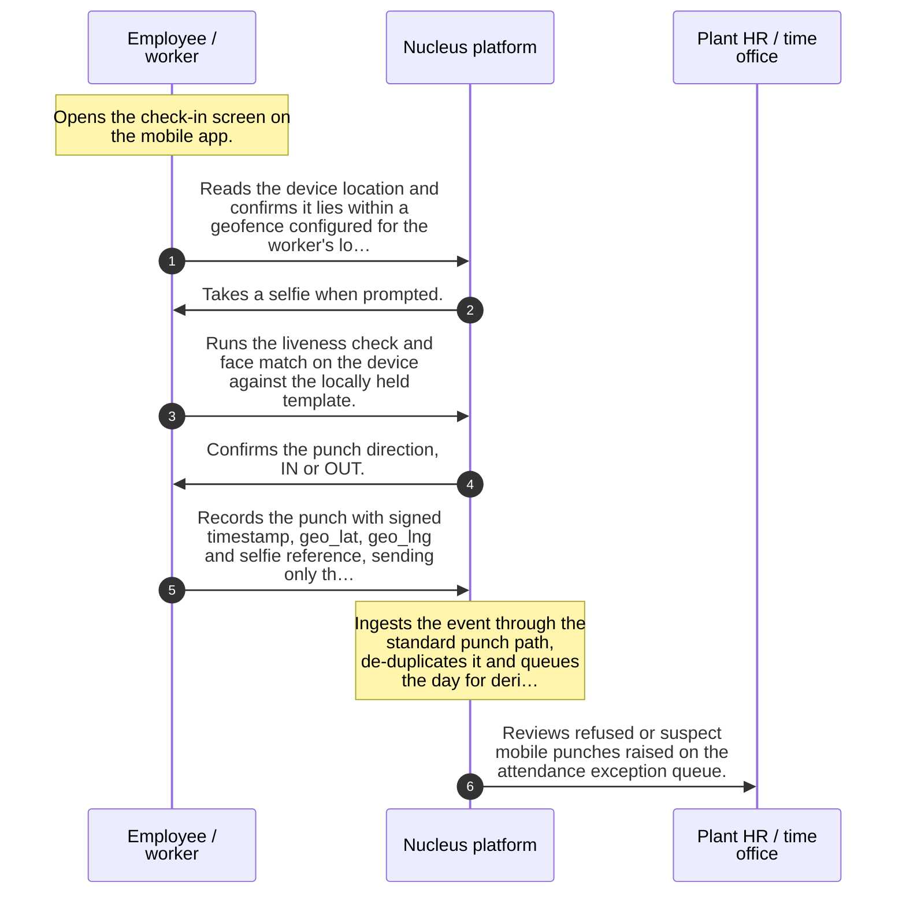

**Alternate flows**

| ID | At step | Condition | Steps | Rejoins |
| :--- | ---: | :--- | :--- | :--- |
| A1 | 6 | The phone has no network. | The punch is queued on the device with a signed timestamp, location and liveness result, and replayed on reconnect. | Returns to step 7 |
| A2 | 4 | The worker has recorded consent for server-side matching. | The template is transmitted under the consent record for server-side verification and the consent reference is stored with the event. | Returns to step 5 |

**Exception flows**

| ID | At step | Condition | Handling | Rule |
| :--- | ---: | :--- | :--- | :--- |
| E1 | 2 | The device location is outside every configured geofence. | The punch is refused with the distance to the nearest geofence shown; the attempt is logged and the worker can seek regularisation. | RL-140 |
| E2 | 4 | The liveness check fails. | The worker may retry up to the tenant's configured limit; after that the punch is refused and an exception is raised for the time office. | RL-140 |
| E3 | 2 | Location permission is denied on the phone. | No punch can be recorded; the app explains that location is required for mobile attendance. |  |

**Postconditions — success**

- An attendance_event with source mobile, location and selfie reference is ingested through the standard punch path and the day is queued for derivation.
- No biometric template has left the device unless a recorded consent allows it.

**Postconditions — failure**

- A punch outside the geofence or failing liveness is refused, and the attempt is visible to the time office.

**Quality requirements**

- Biometric templates never leave the device without a recorded consent.
- The geofence and liveness checks complete within 3 seconds on a mid-range phone.
- Queued offline mobile punches are retained for at least 7 days.

### TIM-UC-013

**Swap shifts and claim open shifts** — Let workers swap shifts with colleagues or claim open shifts, subject to qualification, rest-period and overtime rules, with supervisor approval and an updated roster.

| Attribute | Value |
| :--- | :--- |
| Realises | TIM-CG-003 |
| Source | Authored |
| Level | User goal |
| Primary actor | Employee / worker |
| Secondary actors | Manager / supervisor, Nucleus platform, Plant HR / time office |
| Trigger | A worker requests a swap with a colleague or claims an open shift. |
| Frequency | Weekly |
| Criticality | Medium |
| Phase | P3 |
| Client requirements | — |
| Business rules | RL-010, RL-090, RL-101, RL-133, RL-150 |
| Screens | SCR-040 |
| Data objects (CRUD) | shift_swap_request (C/U), open_shift (U), roster (U), recompute_queue (C) |
| Events | time.recompute.requested |
| Acceptance tests | TIM-TC-015, TIM-TC-016, TIM-TC-017, TIM-TC-018, TIM-TC-019, TIM-TC-020 |
| System requirements | SYS-037, SYS-038, SYS-057, SYS-059 |

**Stakeholders and interests**

| Stakeholder | Interest |
| :--- | :--- |
| Manager / supervisor | Coverage changes stay within skills and statutory limits and are approved before they take effect. |
| Plant HR / time office | The published roster matches what will be worked, reducing inferred-shift exceptions. |
| Employee / worker | Can arrange cover for personal commitments without informal swaps. |

**Preconditions**

- A published roster exists for the period and open shifts, if any, are posted with required qualifications.
- An approval chain for roster changes is defined (RL-010).

**Main success scenario**

| # | Actor | Action | Ref |
| ---: | :--- | :--- | :--- |
| 1 | Employee / worker | Views their rostered shifts and the open shifts posted at their site. |  |
| 2 | Employee / worker | Requests a swap of a named shift with a colleague, or claims an open shift. |  |
| 3 | Employee / worker | For a swap, the named colleague accepts the exchange. |  |
| 4 | Nucleus platform | Checks qualifications, minimum rest between shifts, rest-day policy of the worker class and weekly overtime limits for both workers. |  |
| 5 | Nucleus platform | Routes the request to the supervisor through the approval chain resolved for type, class and location. |  |
| 6 | Manager / supervisor | Approves or rejects the swap or claim. |  |
| 7 | Nucleus platform | Republishes the roster with the new assigned shifts and queues recompute for the affected dates. |  |

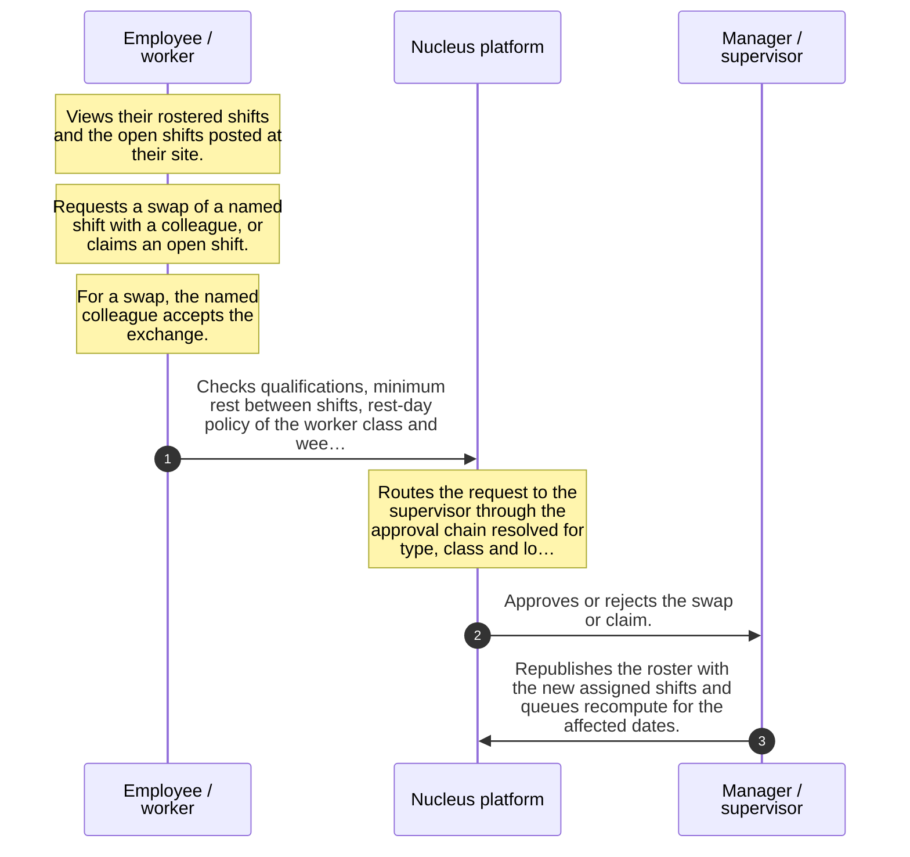

**Alternate flows**

| ID | At step | Condition | Steps | Rejoins |
| :--- | ---: | :--- | :--- | :--- |
| A1 | 2 | Several workers claim the same open shift. | All valid claims are shown to the supervisor in claim order with each claimant's weekly hours. → The supervisor picks one; the other claims are declined automatically. | Returns to step 7 |
| A2 | 3 | The colleague declines the swap. | The request closes as declined and the requester is notified. | Use case ends |

**Exception flows**

| ID | At step | Condition | Handling | Rule |
| :--- | ---: | :--- | :--- | :--- |
| E1 | 4 | Either worker lacks the qualification required for the shift. | The request is refused, naming the missing qualification. |  |
| E2 | 4 | The change would breach the statutory weekly overtime limit in the state rule pack. | The request is refused with the limit and excess named; it never reaches approval silently. | RL-133 |
| E3 | 4 | The change would place a worker on a day their class treats as a rest day. | The supervisor is warned that the shift falls on a rest day and that rest-day rules will apply. | RL-101 |

**Postconditions — success**

- The roster is republished with the swapped or claimed shifts and affected days are queued for recompute.

**Postconditions — failure**

- A swap or claim that breaks a rule is refused with the rule named and the roster is unchanged.

**Quality requirements**

- Rule checks for a swap request complete within 2 seconds.
- The republished roster is the source for the assigned shift used in shift inference.

### TIM-UC-014

**Work flexi-time and manage a time bank** — Support core-hours flexi-time with a time bank that records daily credits and debits and converts surplus to leave or overtime under policy.

| Attribute | Value |
| :--- | :--- |
| Realises | TIM-CG-004 |
| Source | Authored |
| Level | User goal |
| Primary actor | Employee / worker |
| Secondary actors | Manager / supervisor, Implementation consultant, Nucleus platform |
| Trigger | A flexi-time worker's attendance day is computed, or the worker requests a conversion of banked time. |
| Frequency | Daily |
| Criticality | Medium |
| Phase | P3 |
| Client requirements | — |
| Business rules | RL-010, RL-084, RL-111, RL-114, RL-130, RL-131 |
| Screens | SCR-021, SCR-040 |
| Data objects (CRUD) | flexi_policy (R), time_bank_ledger (C), attendance_day (R), overtime_record (C), leave_balance (U) |
| Events | time.overtime.computed |
| Acceptance tests | TIM-TC-021, TIM-TC-022, TIM-TC-023, TIM-TC-024, TIM-TC-025, TIM-TC-026 |
| System requirements | SYS-037, SYS-049, SYS-050, SYS-059 |

**Stakeholders and interests**

| Stakeholder | Interest |
| :--- | :--- |
| Employee / worker | Balances long and short days within the rules and sees the balance at any time. |
| Manager / supervisor | Core hours are covered and conversions are approved. |
| Payroll manager | Conversions to overtime follow the same eligibility and approval path as ordinary overtime. |

**Preconditions**

- A flexi policy with core hours, flexible band, daily target, bank cap and conversion rules applies to the worker's class.
- The worker's attendance day has been computed (TIM-02).

**Main success scenario**

| # | Actor | Action | Ref |
| ---: | :--- | :--- | :--- |
| 1 | Implementation consultant | Configures core hours, flexible band, daily target, bank cap and conversion ratios per worker class. |  |
| 2 | Employee / worker | Punches in and out within the flexible band on a working day. |  |
| 3 | Nucleus platform | Checks presence across the whole core-hours window using the day's segments. |  |
| 4 | Nucleus platform | Posts the day's net minutes above or below the daily target to the time bank as a credit or debit. |  |
| 5 | Employee / worker | Views the time-bank balance and its daily postings on My attendance. |  |
| 6 | Employee / worker | Requests conversion of banked credit to leave or to overtime. |  |
| 7 | Manager / supervisor | Approves or rejects the conversion. |  |
| 8 | Nucleus platform | Debits the bank and posts a leave credit or creates an overtime record for approval and payment. |  |

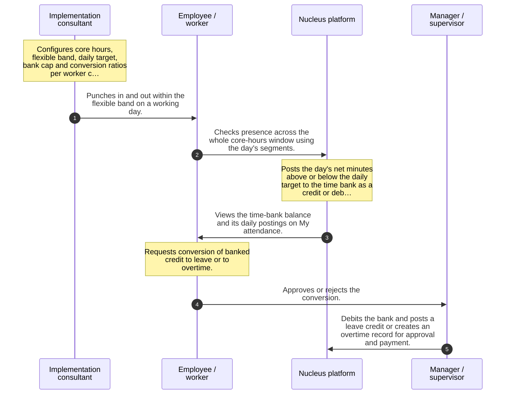

**Alternate flows**

| ID | At step | Condition | Steps | Rejoins |
| :--- | ---: | :--- | :--- | :--- |
| A1 | 6 | The worker chooses conversion to overtime. | The platform checks the worker's overtime eligibility before routing the request. | Returns to step 7 |
| A2 | 4 | Posting a credit would take the balance above the bank cap. | Only the amount up to the cap is credited; the excess is shown as not banked. | Returns to step 5 |

**Exception flows**

| ID | At step | Condition | Handling | Rule |
| :--- | ---: | :--- | :--- | :--- |
| E1 | 3 | The worker is absent for part of core hours. | The day is flagged as a core-hours breach and treated as a late arrival or early departure under the disposition rules. | RL-114 |
| E2 | 6 | The requested conversion exceeds the available balance. | The request is refused and the available balance is shown. |  |
| E3 | 8 | The worker's overtime eligibility is none. | Conversion to overtime is refused; conversion to leave remains available. | RL-131 |

**Postconditions — success**

- The day's surplus or deficit against target is posted to the time bank and the balance is visible to the worker.
- An approved conversion is posted as leave credit or as an overtime record.

**Postconditions — failure**

- A conversion beyond the available balance or policy limit is refused and the bank is unchanged.

**Quality requirements**

- Every time-bank posting is traceable to the attendance day and ruleset version that produced it.
- Flexi policy parameters are configuration per worker class, with no release needed to change them.

### TIM-UC-015

**Generate rosters from forecast labour demand** — Generate a draft roster per line and site from forecast labour demand that honours skills, statutory limits, class rest days and worker preferences, then publish it after review.

| Attribute | Value |
| :--- | :--- |
| Realises | TIM-CG-005 |
| Source | Authored |
| Level | User goal |
| Primary actor | Plant HR / time office |
| Secondary actors | Nucleus platform, Manager / supervisor, Implementation consultant |
| Trigger | The roster owner starts roster planning for the next period. |
| Frequency | Per roster period |
| Criticality | Medium |
| Phase | P4 |
| Client requirements | — |
| Business rules | RL-090, RL-091, RL-101, RL-133, RL-150 |
| Screens | — |
| Data objects (CRUD) | labour_demand_forecast (C/R), roster (C/U), assignment (R), leave_request (R), recompute_queue (C) |
| Events | time.recompute.requested |
| Acceptance tests | TIM-TC-027, TIM-TC-028, TIM-TC-029, TIM-TC-030, TIM-TC-031, TIM-TC-032 |
| System requirements | SYS-045, SYS-057, SYS-059, SYS-070 |

**Stakeholders and interests**

| Stakeholder | Interest |
| :--- | :--- |
| Manager / supervisor | Each line has the required skills on every shift. |
| Employee / worker | Rosters respect rest days and stated preferences where possible. |
| Compliance owner | Generated rosters never plan work beyond statutory weekly limits (to be validated by Legal). |

**Preconditions**

- A demand forecast of headcount by line, shift and skill exists for the period.
- Worker skills, class rest-day policies, approved leave and preferences are recorded.
- Shift definitions with non-overlapping inference windows exist for the site (RL-091).

**Main success scenario**

| # | Actor | Action | Ref |
| ---: | :--- | :--- | :--- |
| 1 | Plant HR / time office | Loads or confirms the labour demand forecast by line, shift and skill for the roster period. |  |
| 2 | Nucleus platform | Reads available workers with skills, class rest-day policy, approved leave and stated preferences. |  |
| 3 | Nucleus platform | Generates a draft roster that fills demand within rest-day patterns and statutory weekly limits, favouring stated preferences. |  |
| 4 | Nucleus platform | Shows coverage per line and shift, unfilled demand, projected overtime and rule warnings for the draft. |  |
| 5 | Plant HR / time office | Adjusts individual assignments, with rules rechecked on each change. |  |
| 6 | Manager / supervisor | Reviews coverage for their lines and confirms or comments. |  |
| 7 | Plant HR / time office | Publishes the roster so its shifts become the assigned shifts for the period. |  |
| 8 | Nucleus platform | Queues recompute for any affected dates already worked and notifies workers of their shifts. |  |

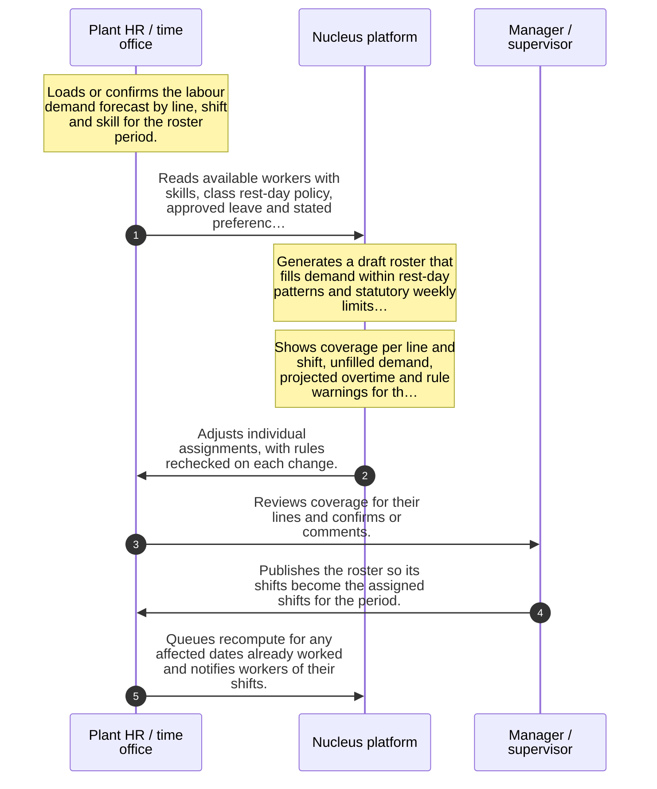

**Alternate flows**

| ID | At step | Condition | Steps | Rejoins |
| :--- | ---: | :--- | :--- | :--- |
| A1 | 6 | The supervisor requests changes. | Comments return to the roster owner, who adjusts the draft. | Returns to step 5 |
| A2 | 1 | No forecast is available for a line. | The roster owner copies the previous period's demand for that line as the forecast. | Returns to step 2 |

**Exception flows**

| ID | At step | Condition | Handling | Rule |
| :--- | ---: | :--- | :--- | :--- |
| E1 | 3 | Demand cannot be met without breaching a weekly limit or a rest day. | The draft leaves the demand unfilled and reports the shortfall by line and shift; no worker is planned beyond the limit. | RL-133 |
| E2 | 5 | A manual change places a worker on their class's rest day. | The change is allowed only with a warning naming the rest-day rule, which is recorded on the assignment. | RL-101 |

**Postconditions — success**

- A published roster exists for the period, assigned shifts take effect and any already-worked dates affected are queued for recompute.

**Postconditions — failure**

- Where demand cannot be met within the rules, the shortfall is reported and no worker is planned beyond a limit.

**Quality requirements**

- A draft roster for one site of 1,000 workers over 4 weeks is generated in under 2 minutes.
- Every generated assignment can show the demand line and rule checks that justified it.

### TIM-UC-016

**Pre-approve overtime against a line budget** — Require overtime above configured thresholds to be pre-approved against a line or cost-centre overtime budget, and flag unapproved overtime before payroll lock.

| Attribute | Value |
| :--- | :--- |
| Realises | TIM-CG-006 |
| Source | Authored |
| Level | User goal |
| Primary actor | Manager / supervisor |
| Secondary actors | Plant HR / time office, Director / approver, Payroll manager, Nucleus platform |
| Trigger | A supervisor plans overtime for a line, for example to meet a rush order at Peenya Machining. |
| Frequency | Daily |
| Criticality | High |
| Phase | P1 |
| Client requirements | — |
| Business rules | RL-010, RL-130, RL-131, RL-132, RL-133, RL-134 |
| Screens | SCR-024, SCR-040 |
| Data objects (CRUD) | ot_budget (R/U), ot_preapproval (C/U), overtime_record (R/U), payroll_input (C) |
| Events | time.overtime.preapproved, time.overtime.unapproved_flagged |
| Acceptance tests | TIM-TC-033, TIM-TC-034, TIM-TC-035, TIM-TC-036, TIM-TC-037, TIM-TC-038 |
| System requirements | SYS-028, SYS-037, SYS-045, SYS-051 |

**Stakeholders and interests**

| Stakeholder | Interest |
| :--- | :--- |
| Director / approver | Overtime spend stays within the approved budget per line. |
| Employee / worker | Overtime worked with approval is paid correctly and on time. |
| Compliance owner | Planned overtime never exceeds statutory weekly limits. |

**Preconditions**

- An overtime budget in hours and amount exists per line or cost centre per month.
- Overtime eligibility is resolved per worker from class and assignment (RL-130).
- Thresholds requiring pre-approval are configured, for example more than 2 hours per worker per day.

**Main success scenario**

| # | Actor | Action | Ref |
| ---: | :--- | :--- | :--- |
| 1 | Manager / supervisor | Requests pre-approval for 4 hours of overtime for 6 operators on shift A at Peenya Machining on 2026-11-14. |  |
| 2 | Nucleus platform | Checks each worker's overtime eligibility and projected weekly hours against the state limit. |  |
| 3 | Nucleus platform | Shows the line's remaining budget and the projected cost of the request at the state multiplier. |  |
| 4 | Director / approver | Approves the pre-approval, reserving 24 hours against the November budget. |  |
| 5 | Biometric terminal | Records actual punches; the attendance engine derives overtime minutes for each worker. |  |
| 6 | Nucleus platform | Matches actual overtime to the pre-approval and releases any unused reserved budget. |  |
| 7 | Nucleus platform | Before payroll lock, lists overtime above threshold with no matching pre-approval. |  |
| 8 | Plant HR / time office | Resolves each flagged item by obtaining retrospective approval or marking it non-payable with a reason. |  |
| 9 | Nucleus platform | Tags approved overtime to the run that will pay it. |  |

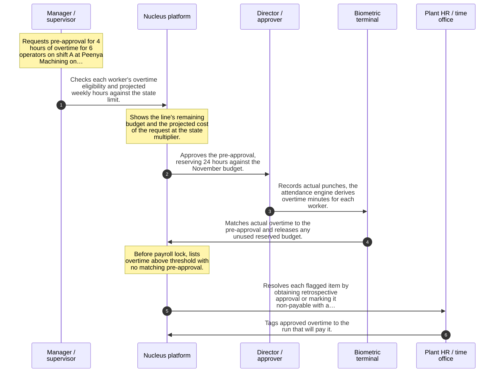

**Alternate flows**

| ID | At step | Condition | Steps | Rejoins |
| :--- | ---: | :--- | :--- | :--- |
| A1 | 4 | The request exceeds remaining budget. | The request routes to the next approval level with the overspend shown. | Returns to step 4 |
| A2 | 6 | Actual overtime exceeds the pre-approved hours. | The excess is flagged as unapproved and handled at step 7. | Returns to step 7 |

**Exception flows**

| ID | At step | Condition | Handling | Rule |
| :--- | ---: | :--- | :--- | :--- |
| E1 | 2 | The request would take a worker beyond the statutory weekly limit. | The approver is warned with the limit named; approval requires a recorded reason. | RL-133 |
| E2 | 2 | A worker's eligibility is none. | The worker is excluded from payable overtime; raw minutes are retained for reporting. | RL-131 |

**Postconditions — success**

- Approved pre-approvals reserve budget; actual overtime is matched to them and payable overtime flows to the run that will pay it.

**Postconditions — failure**

- Unapproved overtime is flagged before payroll lock and is not paid until approved or rejected.

**Quality requirements**

- The budget check returns within 1 s.
- The unapproved-overtime list for a site of 2,000 workers is produced in under 30 s.

### TIM-UC-017

**Reconcile canteen and transport usage with attendance** — Reconcile canteen consumption and company transport usage with attendance at plant sites for subsidy, deduction and roster planning.

| Attribute | Value |
| :--- | :--- |
| Realises | TIM-CG-007 |
| Source | Authored |
| Level | User goal |
| Primary actor | Plant HR / time office |
| Secondary actors | Nucleus platform, Payroll manager, Finance, Employee / worker |
| Trigger | The canteen or transport vendor feed for a day is received, or the monthly reconciliation is due. |
| Frequency | Daily with monthly settlement |
| Criticality | Medium |
| Phase | P3 |
| Client requirements | — |
| Business rules | RL-160, RL-162 |
| Screens | SCR-021, SCR-027 |
| Data objects (CRUD) | canteen_usage (C), transport_usage (C), attendance_day (R), usage_reconciliation (C/U), payroll_input (C) |
| Events | time.usage.reconciled |
| Acceptance tests | TIM-TC-039, TIM-TC-040, TIM-TC-041, TIM-TC-042, TIM-TC-043, TIM-TC-044 |
| System requirements | SYS-017, SYS-028, SYS-053, SYS-084 |

**Stakeholders and interests**

| Stakeholder | Interest |
| :--- | :--- |
| Finance | Subsidies are paid only for meals and trips actually used by eligible workers. |
| Employee / worker | Deductions are accurate and can be checked. |
| Plant HR / time office | Canteen and bus capacity match shift rosters. |

**Preconditions**

- Canteen and transport feeds identify the worker by badge or employee code.
- Subsidy and deduction rules by worker class and meal or route are configured.

**Main success scenario**

| # | Actor | Action | Ref |
| ---: | :--- | :--- | :--- |
| 1 | Nucleus platform | Receives the canteen and transport feeds for Peenya Works for 2026-11-04. |  |
| 2 | Nucleus platform | Matches each meal and bus boarding to the worker's attendance day and shift. |  |
| 3 | Nucleus platform | Flags mismatches, such as a meal claimed on an absent day or boarding without a shift. |  |
| 4 | Plant HR / time office | Reviews mismatches and marks each as valid, vendor error or recoverable. |  |
| 5 | Nucleus platform | At month end, computes deductions per worker and the subsidy per vendor by worker class. |  |
| 6 | Payroll manager | Receives deductions as payroll inputs for the month. |  |
| 7 | Finance | Receives the subsidy summary per vendor and cost centre for payment. |  |
| 8 | Plant HR / time office | Reviews usage against roster for next month's canteen and bus capacity. |  |

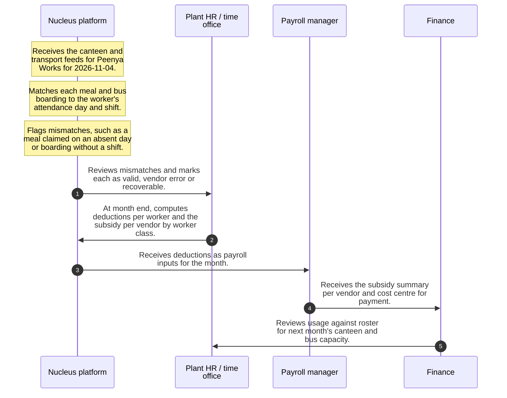

**Alternate flows**

| ID | At step | Condition | Steps | Rejoins |
| :--- | ---: | :--- | :--- | :--- |
| A1 | 1 | A vendor feed is late. | Reconciliation for that day is deferred and flagged; deductions wait for the feed or a manual upload. | Returns to step 2 |

**Exception flows**

| ID | At step | Condition | Handling | Rule |
| :--- | ---: | :--- | :--- | :--- |
| E1 | 2 | A badge in the feed does not map to any active worker. | The entry is quarantined and reported to the vendor; no deduction is made. |  |
| E2 | 5 | A deduction would take net pay below the protected floor. | The deduction is capped and the remainder carried forward, flagged for payroll. |  |

**Postconditions — success**

- Usage is reconciled with attendance, mismatches are resolved, deductions are passed to payroll and subsidies to finance.

**Postconditions — failure**

- Unresolved mismatches are excluded from deductions and listed for follow-up.

**Quality requirements**

- A day's feed for 2,000 workers reconciles in under 2 minutes.
- Employees can view their own usage and deductions in self-service.

### TIM-UC-018

**Declare work location and book a desk** — Let office employees declare their work location, book desks and see team presence, with location feeding attendance rules.

| Attribute | Value |
| :--- | :--- |
| Realises | TIM-CG-008 |
| Source | Authored |
| Level | User goal |
| Primary actor | Employee / worker |
| Secondary actors | Manager / supervisor, Nucleus platform, HR operations |
| Trigger | An employee plans the week or arrives at the office. |
| Frequency | Daily |
| Criticality | Medium |
| Phase | P3 |
| Client requirements | — |
| Business rules | RL-010, RL-140, RL-160 |
| Screens | SCR-021, SCR-027 |
| Data objects (CRUD) | location_declaration (C/U), desk_booking (C/U), attendance_day (U) |
| Events | time.location.declared, time.desk.booked |
| Acceptance tests | TIM-TC-045, TIM-TC-046, TIM-TC-047, TIM-TC-048, TIM-TC-049, TIM-TC-050 |
| System requirements | SYS-017, SYS-059, SYS-062 |

**Stakeholders and interests**

| Stakeholder | Interest |
| :--- | :--- |
| Employee / worker | Can plan office days and find a desk near the team. |
| Manager / supervisor | Knows who is where and can plan team days. |
| HR operations | Work-from-home limits and attendance rules apply correctly. |

**Preconditions**

- The hybrid policy for the employee's group is configured, for example 3 office days a week for Bengaluru Corporate Office staff.
- Desk layouts per floor are configured for the location.

**Main success scenario**

| # | Actor | Action | Ref |
| ---: | :--- | :--- | :--- |
| 1 | Employee / worker | Opens the week planner and declares office on Monday, Wednesday and Thursday and home on the other days. |  |
| 2 | Nucleus platform | Checks the declaration against the hybrid policy and shows remaining home days for the month. |  |
| 3 | Employee / worker | Books a desk on floor 3 near the team for each office day. |  |
| 4 | Manager / supervisor | Views team presence for the week and sees which days most of the team is in. |  |
| 5 | Employee / worker | On an office day, punches in at the Bengaluru Corporate Office entry. |  |
| 6 | Nucleus platform | Matches the punch to the declared location and confirms the desk booking. |  |
| 7 | Nucleus platform | Derives the attendance day using the rules for office or home working as declared. |  |

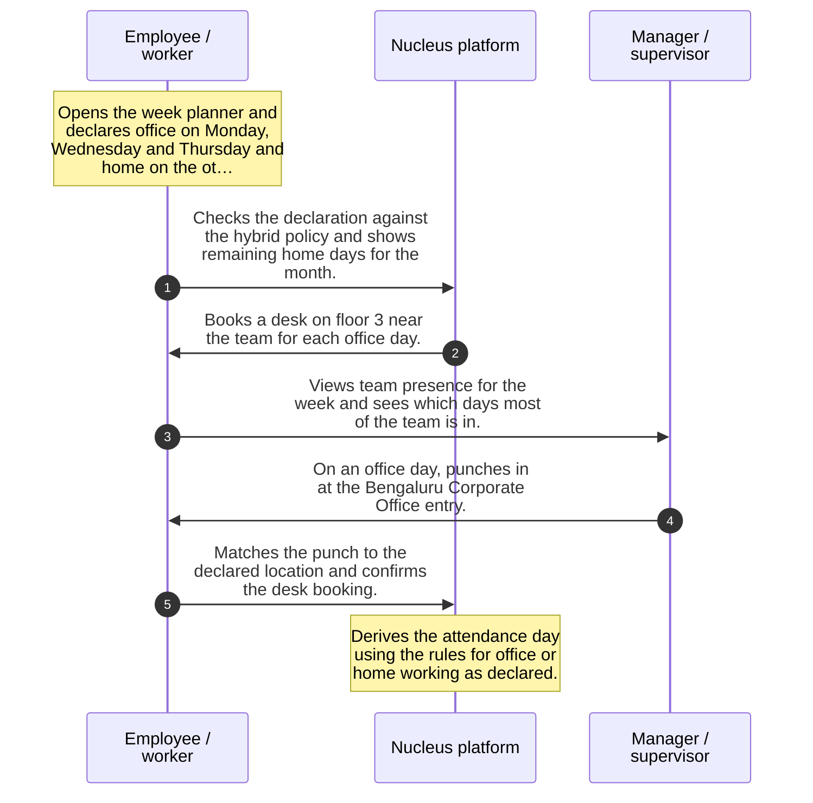

**Alternate flows**

| ID | At step | Condition | Steps | Rejoins |
| :--- | ---: | :--- | :--- | :--- |
| A1 | 1 | The employee declares a client site. | The employee names the client site and the day is attended as on-duty with the manager notified. | Returns to step 7 |
| A2 | 5 | The employee does not arrive by 11:30. | The desk is released for others to book. | Returns to step 7 |

**Exception flows**

| ID | At step | Condition | Handling | Rule |
| :--- | ---: | :--- | :--- | :--- |
| E1 | 2 | The declaration exceeds the monthly home-working limit. | The extra home day is routed to the manager for approval. | RL-010 |
| E2 | 6 | The employee declared home but punched in at the office. | The day is derived as office presence and the declaration is updated with a note. | RL-140 |

**Postconditions — success**

- Declared location and desk booking are recorded and the attendance day is derived under the rules for that location.

**Postconditions — failure**

- A declaration that breaches policy is held for manager approval and attendance is not credited as office presence.

**Quality requirements**

- The team presence view for 50 people loads in under 2 s.
- Only the declared location category is shown to colleagues, never precise location.

### TIM-UC-019

**Accept opt-in presence signals from wearables or beacons** — Allow a site to accept presence signals from approved wearables or access beacons only with recorded consent and without continuous location tracking.

| Attribute | Value |
| :--- | :--- |
| Realises | TIM-CG-009 |
| Source | Authored |
| Level | User goal |
| Primary actor | Employee / worker |
| Secondary actors | Plant HR / time office, Nucleus platform, Compliance owner |
| Trigger | A site enables beacon-based presence and invites workers to opt in. |
| Frequency | Continuous |
| Criticality | Low |
| Phase | P4 |
| Client requirements | — |
| Business rules | RL-070, RL-073, RL-074 |
| Screens | SCR-020 |
| Data objects (CRUD) | consent_record (C/U), beacon (R), punch_event (C) |
| Events | time.punch.received, time.presence_consent.changed |
| Acceptance tests | TIM-TC-051, TIM-TC-052, TIM-TC-053, TIM-TC-054, TIM-TC-055, TIM-TC-056 |
| System requirements | SYS-027, SYS-062, SYS-063, SYS-080 |

**Stakeholders and interests**

| Stakeholder | Interest |
| :--- | :--- |
| Employee / worker | Participation is voluntary, revocable and limited to presence at defined points. |
| Plant HR / time office | Fewer missed punches in large plant areas. |
| Compliance owner | Consent and purpose limitation meet the DPDP Act 2023 (to be validated by Legal). |

**Preconditions**

- Approved beacons are registered at defined points such as plant gates and shop-floor entry.
- A consent notice for this purpose is published in the worker's language.

**Main success scenario**

| # | Actor | Action | Ref |
| ---: | :--- | :--- | :--- |
| 1 | Plant HR / time office | Enables beacon presence at Chakan Works gates and shop-floor entry points. |  |
| 2 | Employee / worker | Reads the consent notice in Marathi and opts in from the mobile app. |  |
| 3 | Nucleus platform | Records the consent with purpose, scope, timestamp and notice version. |  |
| 4 | Employee / worker | Passes a gate beacon with the paired wearable at 16:52. |  |
| 5 | Nucleus platform | Records a single presence event for that point and time as a punch, linked to the consent. |  |
| 6 | Nucleus platform | Discards any signal not at a defined point and stores no movement trail. |  |
| 7 | Nucleus platform | Derives the attendance day using these punches like any other enrolled source. |  |

```mermaid
sequenceDiagram
    autonumber
    participant P0 as Plant HR / time<br/>office
    participant P1 as Employee /<br/>worker
    participant P2 as Nucleus platform
    Note over P0: Enables beacon presence at<br/>Chakan Works gates and<br/>shop-floor entry points.
    P0->>P1: Reads the consent notice in<br/>Marathi and opts in from the<br/>mobile app.
    P1->>P2: Records the consent with<br/>purpose, scope, timestamp and<br/>notice version.
    P2->>P1: Passes a gate beacon with the<br/>paired wearable at 16 -52.
    P1->>P2: Records a single presence<br/>event for that point and time<br/>as a punch, linked to the<br/>consent.
    Note over P2: Discards any signal not at a<br/>defined point and stores no<br/>movement trail.
    Note over P2: Derives the attendance day<br/>using these punches like any<br/>other enrolled source.
```

**Alternate flows**

| ID | At step | Condition | Steps | Rejoins |
| :--- | ---: | :--- | :--- | :--- |
| A1 | 2 | The worker declines. | The worker continues to use the biometric terminal; nothing is recorded about the decision beyond the consent status. | Ends |
| A2 | 7 | The worker withdraws consent. | Beacon presence stops immediately and future days use other sources. | Ends |

**Exception flows**

| ID | At step | Condition | Handling | Rule |
| :--- | ---: | :--- | :--- | :--- |
| E1 | 5 | A signal arrives from a wearable with no active consent. | The signal is dropped without storage. | RL-070 |
| E2 | 5 | Two beacon events at the same point within the dedupe window. | The second is marked duplicate and retained, not discarded. | RL-073 |

**Postconditions — success**

- Presence events from consenting workers are stored as punches at defined points only, with the consent reference.

**Postconditions — failure**

- No signal from a non-consenting worker or outside defined points is stored.

**Quality requirements**

- No stored record contains a location trail between defined points.
- Consent withdrawal takes effect within 1 minute.

## Approval & Sign-off

| Role | Name | Date | Decision | Conditions / comments |
| :--- | :--- | :--- | :--- | :--- |
| Author | Dhanraj Dadhich | 2026-11-05 | Submitted | |
| Peer review moderator | *pending* | | | PR-xxxx |
| PQA (process compliance) | *pending* | | | |
| Approval authority (DOC-01 §7) | *pending* | | | |

## Measurement Data Captured

| Measure | Value | Unit | Notes |
| :--- | :--- | :--- | :--- |
| Size | 597 | specified items (table rows) | Counted automatically at generation |
| Authoring effort | *to be recorded* | person-hours | |
| Review effort (preparation + meeting) | *pending review* | person-hours | From PR-xxxx |
| Rework effort | *pending review* | person-hours | |
| Review rate | *pending review* | items / hour | Compare with PPB control limits |
| Requirement volatility (changes since baseline) | 0 | CRs touching this artefact | Not yet baselined (CM-03) |

**Defects found, by detection phase and severity**

| Detection phase | Major | Minor | Editorial | Injected in phase (major) |
| :--- | :--- | :--- | :--- | :--- |
| Author self-check | 0 | 0 | 0 | — |
| Peer review | *pending* | | | |
| Design / build | | | | |
| System / integration test | | | | |
| UAT | | | | |
| Production (escaped) | | | | each escaped major opens a CAR record (CAR-01) |

Within control limits of the review-rate PPB? *To be assessed at peer review.*

## Revision History

| Version | Date | Author | Change summary | CR ref | Approved by |
| :--- | :--- | :--- | :--- | :--- | :--- |
| 1.0.0 | 2026-11-05 | Dhanraj Dadhich | Consolidated release | CR-0001 | *pending* |
