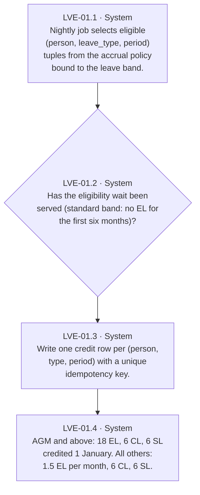
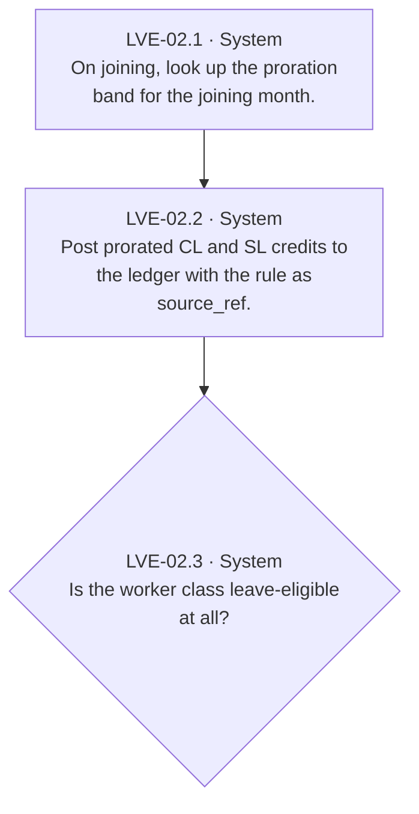
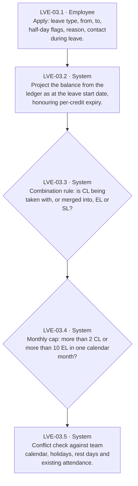
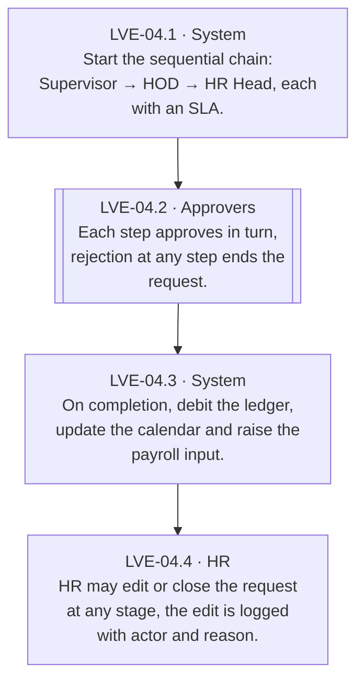
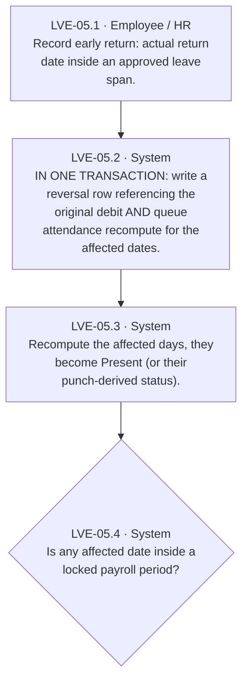
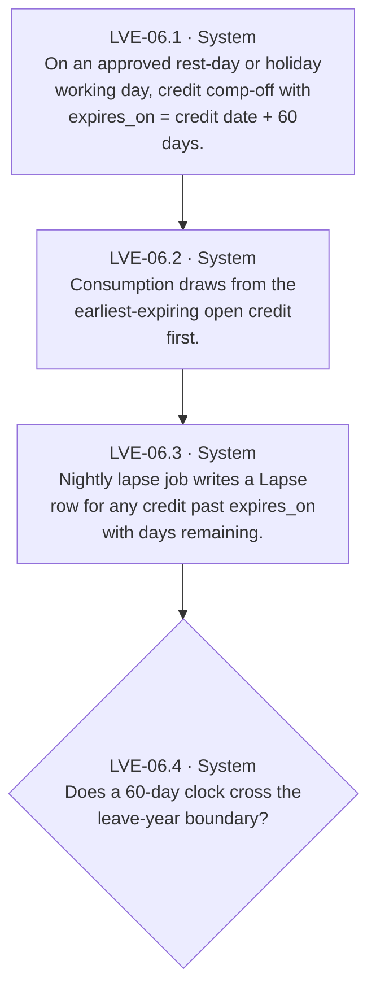
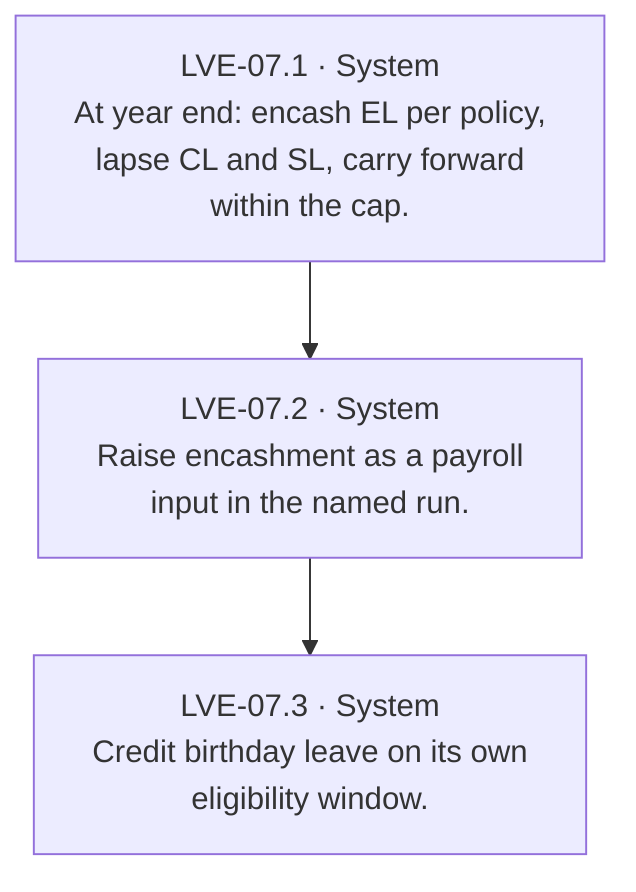
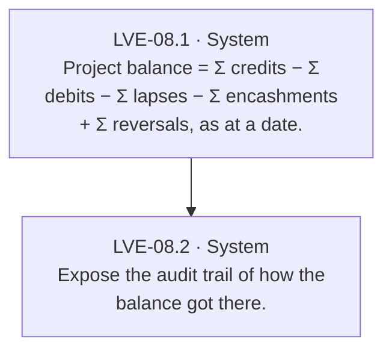
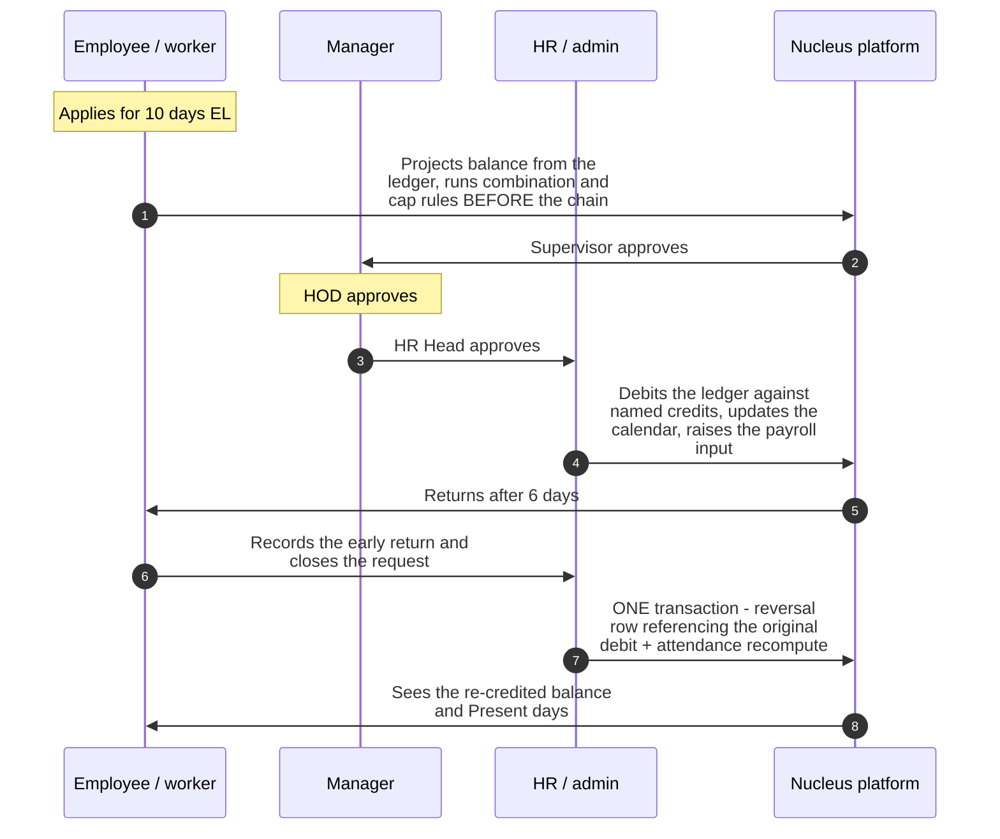

<picture>
  <source media="(prefers-color-scheme: dark)" srcset="../../assets/MultipliersKraftLogoDark.png">
  
</picture>

# FRS-LVE-01 — Leave — Process Specifications

| Attribute | Value |
| :--- | :--- |
| Document ID | FRS-LVE-01 |
| Title | Leave — Process Specifications |
| Product | Nucleus Suite (Nucleus HRMS Suite) |
| Version | 1.0.0 |
| Status | Issued for approval |
| Owner (role) | Domain Product Owner — Leave |
| Author | Dhanraj Dadhich |
| Reviewed by | *pending* |
| Approved by | Product Council — *pending* |
| Date | 2026-11-05 |
| Classification | Internal |
| CMMI practice areas | RDM, TS |
| Related documents | FRS-LVE-00, FRS-LVE-01, FRS-LVE-02, FRS-LVE-03, FRS-LVE-04, FRS-LVE-05, FRS-LVE-06, FRS-LVE-07, FRS-LVE-08, FRS-LVE-09, FRS-LVE-10, FRS-LVE-11, FRS-LVE-12, FRS-LVE-13, BRS-01, SRS-01, REQ-01, REQ-02 |
| Quality & process-performance objectives | QPPO-05 (effective requirements reviews), QPPO-01 (escaped defects) — MPM-01 |
| Process performance baseline used | PPB-01 (review defect density), PPB-02 (review rate) — MPM-01 |
| Peer review record | *pending* (PR-xxxx, QA-02) |
| Tailoring record | none |
| Traceability anchor | BG-01, BG-03 · R-06, R-07, R-08 · processes LVE-01–LVE-08 |
| Source of record | Nucleus — Process Flows & Process Maps v1.0 — sheet(s) 03_Process_Inventory, 04_Process_Steps, 05_Swimlane_Maps Nucleus HR Demo Points Build Sheet v1.0 — sheet(s) 07_Approval_Workflows Nucleus HRMS Demo Dataset v1.1 — sheet(s) 64_Approval_Workflows |

> **Source of record.** Requirements in this document are taken from the source workbook(s) named above and keep their workbook IDs, which are never renumbered. Changes are made through a change request (CM-02) against the source workbook. Sections marked **Authored** are original additions that are not present in the source workbooks.

Step types: TASK (human) · SYS (system, unattended) · DEC (decision) · APPR (approval gate) · INT (integration call) · WAIT (timer or external event) · AGENT (agent-executed, governed). CRUD: C create · R read · U update · D delete-by-end-dating (temporal facts are never hard-deleted). In the flow diagrams decisions are diamonds, approvals are double-bordered boxes and integration, wait and agent steps are rounded.

## 1. Process inventory

| Process ID | Process | Trigger | Primary actor | Frequency | Criticality | Blueprint module | Phase | Reuses | Demo pts | Note |
| :--- | :--- | :--- | :--- | :--- | :--- | :--- | :--- | :--- | :--- | :--- |
| LVE-01 | Leave accrual run | Nightly job / 1 January / completion date | System | Nightly | Critical | Module 2 | P1 | CMP-02, CMP-10 | 7 | Idempotent per person/type/period/transaction. Double-credit must be impossible, not unlikely. |
| LVE-02 | Joining-month proration | New joiner | System | Per hire | High | Module 2 | P1 | CMP-02, CMP-10 | 7 | Proration table is data (16_Leave_Proration in the dataset). |
| LVE-03 | Leave request validation | Employee applies | System | Continuous | High | Module 2 | P1 | CMP-02 | 7 | Combination and cap rules run BEFORE the approval chain, with a message naming the rule. |
| LVE-04 | Leave approval chain | Validated request | Supervisor, HOD, HR Head | Continuous | High | Module 2 | P1 | CMP-01 | 5 | Sequential, SLA per step, HR edit right logged with actor and reason. |
| LVE-05 | Early return and re-credit | Employee returns early | HR | Occasional | Critical | Module 2 | P1 | CMP-02, CMP-04 | 5 | Reversal row + attendance recompute in ONE transaction, or the payslip disagrees with the ledger. |
| LVE-06 | Comp-off credit and expiry | Rest-day or holiday working | System | Nightly | High | Module 2 | P1 | CMP-02 | 6 | Per-credit 60-day clock. A single balance-level expiry is wrong. |
| LVE-07 | Year-end encashment, lapse and birthday leave | 31 December / birthday | System | Annual | High | Module 2 | P1 | CMP-02 | 7 | EL encashes, CL and SL lapse. Encashment is a payroll input. |
| LVE-08 | Balance projection from the ledger | Any balance read | System | Continuous | Critical | Module 2 | P1 | CMP-02 | 5,6,7 | Balance is a projection, never a stored column. |

## 2. Step-level specifications

### LVE-01 — Leave accrual run

**Trigger:** Nightly job / 1 January / completion date · **Primary actor:** System · **Frequency:** Nightly · **Criticality:** Critical · **Phase:** P1 · **Reuses:** CMP-02, CMP-10

| Step | Step ID | Lane / actor | Type | Action or decision | Rule ID(s) | Objects touched (CRUD) | Key fields | Screen | Event emitted | Exception / note | Reuses | Demo pts | Phase |
| :--- | :--- | :--- | :--- | :--- | :--- | :--- | :--- | :--- | :--- | :--- | :--- | :--- | :--- |
| 1 | LVE-01.1 | System | SYS | Nightly job selects eligible (person, leave_type, period) tuples from the accrual policy bound to the leave band. | RL-170 | leave_accrual_policy R; assignment R | leave_band, leave_type, accrual_frequency, days_per_period, eligibility_wait_months | — |  |  |  | 7 | P1 |
| 2 | LVE-01.2 | System | DEC | Has the eligibility wait been served (standard band: no EL for the first six months)? | RL-171 | employment R | employment_start, months_completed | — |  | Not served → no credit. On completion → a single 9-day EL credit, then 1.5 days monthly. | CMP-02 | 7 | P1 |
| 3 | LVE-01.3 | System | SYS | Write one credit row per (person, type, period) with a unique idempotency key. | RL-172 | leave_ledger C | ledger_id, person_id, leave_type, txn_type(Credit), days, effective_date, expires_on, source_ref, idempotency_key | — | leave.credit.posted | Double-crediting must be impossible, not unlikely. Both accrual and expiry jobs must be safely re-runnable. | CMP-02 | 7 | P1 |
| 4 | LVE-01.4 | System | SYS | AGM and above: 18 EL, 6 CL, 6 SL credited 1 January. All others: 1.5 EL per month, 6 CL, 6 SL. | RL-173 | leave_ledger C | days, effective_date | — |  | Bands and values are configuration rows (10_Config_Tables), carried from the client's stated policy. | CMP-10 | 7 | P1 |

### LVE-02 — Joining-month proration

**Trigger:** New joiner · **Primary actor:** System · **Frequency:** Per hire · **Criticality:** High · **Phase:** P1 · **Reuses:** CMP-02, CMP-10

| Step | Step ID | Lane / actor | Type | Action or decision | Rule ID(s) | Objects touched (CRUD) | Key fields | Screen | Event emitted | Exception / note | Reuses | Demo pts | Phase |
| :--- | :--- | :--- | :--- | :--- | :--- | :--- | :--- | :--- | :--- | :--- | :--- | :--- | :--- |
| 1 | LVE-02.1 | System | SYS | On joining, look up the proration band for the joining month. | RL-180 | leave_proration_rule R | joining_month_from, joining_month_to, cl_days, sl_days | — |  | Jan 6 · Feb-Mar 5 · Apr-May 4 · Jun-Jul 3 · Aug-Sep 2 · Oct-4 Dec 1. | CMP-10 | 7 | P1 |
| 2 | LVE-02.2 | System | SYS | Post prorated CL and SL credits to the ledger with the rule as source_ref. | RL-181 | leave_ledger C | days, source_ref(PR-nn) | — | leave.credit.posted |  | CMP-02 | 7 | P1 |
| 3 | LVE-02.3 | System | DEC | Is the worker class leave-eligible at all? | RL-182 | worker_class R | leave_eligible | — |  | Contract, third-party, consultant and gig classes take no credit. Trainees follow their band's policy. |  | 7 | P1 |

### LVE-03 — Leave request validation

**Trigger:** Employee applies · **Primary actor:** System · **Frequency:** Continuous · **Criticality:** High · **Phase:** P1 · **Reuses:** CMP-02

| Step | Step ID | Lane / actor | Type | Action or decision | Rule ID(s) | Objects touched (CRUD) | Key fields | Screen | Event emitted | Exception / note | Reuses | Demo pts | Phase |
| :--- | :--- | :--- | :--- | :--- | :--- | :--- | :--- | :--- | :--- | :--- | :--- | :--- | :--- |
| 1 | LVE-03.1 | Employee | TASK | Apply: leave type, from, to, half-day flags, reason, contact during leave. | RL-190 | leave_request C | request_id, person_id, leave_type, date_from, date_to, days_applied, is_half_day_start/end, reason | SCR-030 | leave.request.created |  |  | 7 | P1 |
| 2 | LVE-03.2 | System | SYS | Project the balance from the ledger as at the leave start date, honouring per-credit expiry. | RL-191 | leave_ledger R | projected_balance, expiring_credits | SCR-030 |  | Balance is never a stored column. | CMP-02 | 7 | P1 |
| 3 | LVE-03.3 | System | DEC | Combination rule: is CL being taken with, or merged into, EL or SL? | RL-192 | leave_combination_rule R | excluded_pairs | SCR-030 | leave.request.rejected_by_rule | Yes → reject at validation, before the chain starts, with a message naming the rule (demo point 7). | CMP-02 | 7 | P1 |
| 4 | LVE-03.4 | System | DEC | Monthly cap: more than 2 CL or more than 10 EL in one calendar month? | RL-193 | leave_type R | max_per_month | SCR-030 | leave.request.rejected_by_rule | Yes → reject at validation with the cap named. | CMP-02 | 7 | P1 |
| 5 | LVE-03.5 | System | SYS | Conflict check against team calendar, holidays, rest days and existing attendance. | RL-194 | attendance_day R; work_calendar R | conflicts[] | SCR-030 |  | Marked present by biometric and on leave by request is a conflict, surfaced not silently resolved. |  | 7 | P1 |

### LVE-04 — Leave approval chain

**Trigger:** Validated request · **Primary actor:** Supervisor, HOD, HR Head · **Frequency:** Continuous · **Criticality:** High · **Phase:** P1 · **Reuses:** CMP-01

| Step | Step ID | Lane / actor | Type | Action or decision | Rule ID(s) | Objects touched (CRUD) | Key fields | Screen | Event emitted | Exception / note | Reuses | Demo pts | Phase |
| :--- | :--- | :--- | :--- | :--- | :--- | :--- | :--- | :--- | :--- | :--- | :--- | :--- | :--- |
| 1 | LVE-04.1 | System | SYS | Start the sequential chain: Supervisor → HOD → HR Head, each with an SLA. | RL-010 | approval_instance C | chain_id, steps[] | SCR-040 | platform.approval.started |  | CMP-01 | 5 | P1 |
| 2 | LVE-04.2 | Approvers | APPR | Each step approves in turn; rejection at any step ends the request. | RL-013 | approval_step U | decision, decided_by, decided_at | SCR-040 | platform.approval.step_decided |  | CMP-01 | 5 | P1 |
| 3 | LVE-04.3 | System | SYS | On completion, debit the ledger, update the calendar and raise the payroll input. | RL-195 | leave_ledger C; attendance_day U | txn_type(Debit), days, effective_date, source_ref(request_id) | — | leave.request.approved | Debit references the specific credits consumed, so a later reversal knows where to put days back. | CMP-02 | 5 | P1 |
| 4 | LVE-04.4 | HR | TASK | HR may edit or close the request at any stage; the edit is logged with actor and reason. | RL-015 | leave_request U; audit_entry C | edited_by, edit_reason | SCR-030 | leave.request.edited |  | CMP-06 | 5 | P1 |

### LVE-05 — Early return and re-credit

**Trigger:** Employee returns early · **Primary actor:** HR · **Frequency:** Occasional · **Criticality:** Critical · **Phase:** P1 · **Reuses:** CMP-02, CMP-04

| Step | Step ID | Lane / actor | Type | Action or decision | Rule ID(s) | Objects touched (CRUD) | Key fields | Screen | Event emitted | Exception / note | Reuses | Demo pts | Phase |
| :--- | :--- | :--- | :--- | :--- | :--- | :--- | :--- | :--- | :--- | :--- | :--- | :--- | :--- |
| 1 | LVE-05.1 | Employee / HR | TASK | Record early return: actual return date inside an approved leave span. | RL-200 | leave_request U | days_availed, actual_return_date | SCR-030 | leave.early_return.recorded | Applied 10, returned after 6 → 3 unused days (demo point 5 uses 7 availed of 10). |  | 5 | P1 |
| 2 | LVE-05.2 | System | SYS | IN ONE TRANSACTION: write a reversal row referencing the original debit AND queue attendance recompute for the affected dates. | RL-201 | leave_ledger C; recompute_queue C | txn_type(Reversal), days, source_ref(original ledger_id) | — | leave.credit.reversed | Splitting them makes the balance and the attendance record disagree — a defect that surfaces only in the payslip. | CMP-02 | 5 | P1 |
| 3 | LVE-05.3 | System | SYS | Recompute the affected days; they become Present (or their punch-derived status). | RL-202 | attendance_day U | status | — | time.attendance_day.recomputed |  | CMP-04 | 5 | P1 |
| 4 | LVE-05.4 | System | DEC | Is any affected date inside a locked payroll period? | RL-203 | payroll_run R | run_state | — | payroll.arrears.requested | Yes → arrears in the next open run; the closed run stands. |  | 5 | P1 |

### LVE-06 — Comp-off credit and expiry

**Trigger:** Rest-day or holiday working · **Primary actor:** System · **Frequency:** Nightly · **Criticality:** High · **Phase:** P1 · **Reuses:** CMP-02

| Step | Step ID | Lane / actor | Type | Action or decision | Rule ID(s) | Objects touched (CRUD) | Key fields | Screen | Event emitted | Exception / note | Reuses | Demo pts | Phase |
| :--- | :--- | :--- | :--- | :--- | :--- | :--- | :--- | :--- | :--- | :--- | :--- | :--- | :--- |
| 1 | LVE-06.1 | System | SYS | On an approved rest-day or holiday working day, credit comp-off with expires_on = credit date + 60 days. | RL-210 | leave_ledger C | leave_type(COMPOFF), days, effective_date, expires_on | — | leave.compoff.credited | Each credit carries its OWN clock (demo point 6). | CMP-02 | 6 | P1 |
| 2 | LVE-06.2 | System | SYS | Consumption draws from the earliest-expiring open credit first. | RL-211 | leave_ledger C | txn_type(Debit), source_ref(credit ledger_id) | — | leave.compoff.consumed |  |  | 6 | P1 |
| 3 | LVE-06.3 | System | SYS | Nightly lapse job writes a Lapse row for any credit past expires_on with days remaining. | RL-212 | leave_ledger C | txn_type(Lapse), days, effective_date | — | leave.compoff.lapsed | Idempotent per (person, credit, date). A single balance-level expiry over- or under-credits everyone. | CMP-02 | 6 | P1 |
| 4 | LVE-06.4 | System | DEC | Does a 60-day clock cross the leave-year boundary? | RL-213 | leave_ledger R | expires_on, leave_year | — |  | It may. The clock is per credit and ignores the year end. |  | 6 | P1 |

### LVE-07 — Year-end encashment, lapse and birthday leave

**Trigger:** 31 December / birthday · **Primary actor:** System · **Frequency:** Annual · **Criticality:** High · **Phase:** P1 · **Reuses:** CMP-02

| Step | Step ID | Lane / actor | Type | Action or decision | Rule ID(s) | Objects touched (CRUD) | Key fields | Screen | Event emitted | Exception / note | Reuses | Demo pts | Phase |
| :--- | :--- | :--- | :--- | :--- | :--- | :--- | :--- | :--- | :--- | :--- | :--- | :--- | :--- |
| 1 | LVE-07.1 | System | SYS | At year end: encash EL per policy, lapse CL and SL, carry forward within the cap. | RL-220 | leave_ledger C | txn_type(Encash\|Lapse\|CarryForward), days | — | leave.yearend.processed | EL carry forward up to 45 days for this client; the balance above it encashes. | CMP-02 | 7 | P1 |
| 2 | LVE-07.2 | System | SYS | Raise encashment as a payroll input in the named run. | RL-221 | payroll_input C | component(leave_encashment), amount, run_id | — | payroll.input.raised | Encashment amount uses the statutory wage base, not gross. |  | 7 | P1 |
| 3 | LVE-07.3 | System | SYS | Credit birthday leave on its own eligibility window. | RL-222 | leave_ledger C | leave_type(BIRTHDAY), effective_date, expires_on | — | leave.credit.posted |  |  | 7 | P1 |

### LVE-08 — Balance projection from the ledger

**Trigger:** Any balance read · **Primary actor:** System · **Frequency:** Continuous · **Criticality:** Critical · **Phase:** P1 · **Reuses:** CMP-02

| Step | Step ID | Lane / actor | Type | Action or decision | Rule ID(s) | Objects touched (CRUD) | Key fields | Screen | Event emitted | Exception / note | Reuses | Demo pts | Phase |
| :--- | :--- | :--- | :--- | :--- | :--- | :--- | :--- | :--- | :--- | :--- | :--- | :--- | :--- |
| 1 | LVE-08.1 | System | SYS | Project balance = Σ credits − Σ debits − Σ lapses − Σ encashments + Σ reversals, as at a date. | RL-230 | leave_ledger R | projected_balance, as_at_date | SCR-031 |  | One projection function, used by the apply screen, the assistant, the payslip and the F&F. | CMP-02 | 5,6,7 | P1 |
| 2 | LVE-08.2 | System | SYS | Expose the audit trail of how the balance got there. | RL-231 | leave_ledger R | transaction list | SCR-031 |  | 'Why is my balance 6.5' is answerable without a spreadsheet. |  | 5,6,7 | P1 |

## 3. Swimlane maps

### SM-3 — LEAVE — apply, validate, approve, early return (demo points 5, 7)

| Step | Employee / worker | Manager | HR / admin | System (Nucleus) | Agent | External | Note |
| :--- | :--- | :--- | :--- | :--- | :--- | :--- | :--- |
| 1 | Applies for 10 days EL |  |  |  |  |  |  |
| 2 |  |  |  | Projects balance from the ledger; runs combination and cap rules BEFORE the chain |  |  | CL+EL blocked here, with the rule named |
| 3 |  | Supervisor approves |  |  |  |  |  |
| 4 |  | HOD approves |  |  |  |  | Sequential, each with an SLA |
| 5 |  |  | HR Head approves |  |  |  |  |
| 6 |  |  |  | Debits the ledger against named credits; updates the calendar; raises the payroll input |  |  |  |
| 7 | Returns after 6 days |  |  |  |  |  |  |
| 8 |  |  | Records the early return and closes the request |  |  |  | HR edit right, logged with actor and reason |
| 9 |  |  |  | ONE transaction: reversal row referencing the original debit + attendance recompute |  |  | Split them and the payslip disagrees with the ledger |
| 10 | Sees the re-credited balance and Present days |  |  |  |  |  |  |

## 4. Approval workflows

| Workflow ID | Workflow | Form ID | Requirement | Approval chain | How it behaves | What must hold |
| :--- | :--- | :--- | :--- | :--- | :--- | :--- |
| W-01 | Leave application | F-LVE-03 | R-06 | Supervisor → HOD → HR Head | Each level records the actor and the timestamp. HR Head may return to the applicant with a reason. | HR can update an approved leave; the update is recorded against the HR user, not the original approver. |
| W-02 | Leave early return | F-LVE-04 | R-06 | HR Head | Single level, because the leave was already approved and this only releases unused days. | The attendance correction and the ledger credit must commit together or not at all. |

### Workflow behaviour

| Workflow | Name | Form | Chain | Sequential or parallel | Recorded per level | Escalation | Delegation allowed | Return to applicant | Live demo record | Demo point |
| :--- | :--- | :--- | :--- | :--- | :--- | :--- | :--- | :--- | :--- | :--- |
| W-01 | Leave application | F-LVE-03 / FRM-LVE-02 | Supervisor → HOD → HR Head | Sequential | Actor, decision, timestamp, comment | After 3 days to the next level | Y | HR Head only, with a reason | LV-2026-0774 — E1039, then E1039 as HOD, then E1004 on 06 Sep | Point 5 |
| W-02 | Leave early return | F-LVE-04 | HR Head | Single level | Actor, decision, timestamp, days released | None | N | N | LV-2026-0774 closed by E1006 on 14 Sep with 3 days credited back, and RG-2026-0214 written in the same commit | Point 5 |

## Approval & Sign-off

| Role | Name | Date | Decision | Conditions / comments |
| :--- | :--- | :--- | :--- | :--- |
| Author | Dhanraj Dadhich | 2026-11-05 | Submitted | |
| Peer review moderator | *pending* | | | PR-xxxx |
| PQA (process compliance) | *pending* | | | |
| Approval authority (DOC-01 §7) | *pending* | | | |

## Measurement Data Captured

| Measure | Value | Unit | Notes |
| :--- | :--- | :--- | :--- |
| Size | 51 | specified items (table rows) | Counted automatically at generation |
| Authoring effort | *to be recorded* | person-hours | |
| Review effort (preparation + meeting) | *pending review* | person-hours | From PR-xxxx |
| Rework effort | *pending review* | person-hours | |
| Review rate | *pending review* | items / hour | Compare with PPB control limits |
| Requirement volatility (changes since baseline) | 0 | CRs touching this artefact | Not yet baselined (CM-03) |

**Defects found, by detection phase and severity**

| Detection phase | Major | Minor | Editorial | Injected in phase (major) |
| :--- | :--- | :--- | :--- | :--- |
| Author self-check | 0 | 0 | 0 | — |
| Peer review | *pending* | | | |
| Design / build | | | | |
| System / integration test | | | | |
| UAT | | | | |
| Production (escaped) | | | | each escaped major opens a CAR record (CAR-01) |

Within control limits of the review-rate PPB? *To be assessed at peer review.*

## Revision History

| Version | Date | Author | Change summary | CR ref | Approved by |
| :--- | :--- | :--- | :--- | :--- | :--- |
| 1.0.0 | 2026-11-05 | Dhanraj Dadhich | Consolidated release | CR-0001 | *pending* |
