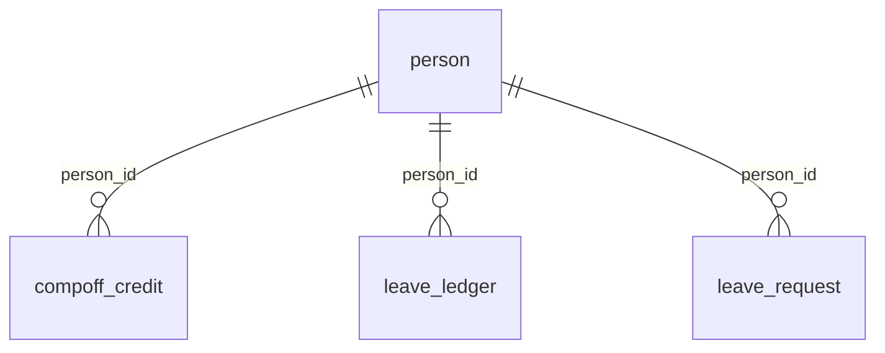

<picture>
  <source media="(prefers-color-scheme: dark)" srcset="../../assets/MultipliersKraftLogoDark.png">
  
</picture>

# FRS-LVE-05 — Leave — Data Model

| Attribute | Value |
| :--- | :--- |
| Document ID | FRS-LVE-05 |
| Title | Leave — Data Model |
| Product | Nucleus Suite (Nucleus HRMS Suite) |
| Version | 1.0.0 |
| Status | Issued for approval |
| Owner (role) | Domain Product Owner — Leave |
| Author | Dhanraj Dadhich |
| Reviewed by | *pending* |
| Approved by | Product Council — *pending* |
| Date | 2026-11-05 |
| Classification | Internal |
| CMMI practice areas | TS, RDM |
| Related documents | FRS-LVE-00, FRS-LVE-01, FRS-LVE-02, FRS-LVE-03, FRS-LVE-04, FRS-LVE-05, FRS-LVE-06, FRS-LVE-07, FRS-LVE-08, FRS-LVE-09, FRS-LVE-10, FRS-LVE-11, FRS-LVE-12, FRS-LVE-13, BRS-01, SRS-01, REQ-01, REQ-02 |
| Quality & process-performance objectives | QPPO-05 (effective requirements reviews), QPPO-01 (escaped defects) — MPM-01 |
| Process performance baseline used | PPB-01 (review defect density), PPB-02 (review rate) — MPM-01 |
| Peer review record | *pending* (PR-xxxx, QA-02) |
| Tailoring record | none |
| Traceability anchor | BG-01, BG-03 · R-06, R-07, R-08 · processes LVE-01–LVE-08 |
| Source of record | Nucleus — Process Flows & Process Maps v1.0 — sheet(s) 06_Data_Dictionary Nucleus HR Demo Points Build Sheet v1.0 — sheet(s) 06_Enum_Values Nucleus HRMS Demo Dataset v1.1 — sheet(s) 65_Enum_Seed_Values |

> **Source of record.** Requirements in this document are taken from the source workbook(s) named above and keep their workbook IDs, which are never renumbered. Changes are made through a change request (CM-02) against the source workbook. Sections marked **Authored** are original additions that are not present in the source workbooks.

Every object carries the platform envelope (`tenant_id`, `entity_id`), effective dating (`effective_from`, `effective_to`) where temporal, and audit columns. Sensitivity classes follow GOV-10.

## 1. Entity relationships

Relationships are derived from the identifier fields in the data dictionary; the tenant envelope is omitted for legibility.

## 2. Data objects

| Object | Fields | Type | Required | Owner / source | Temporal | Sensitivity | Notes | Dataset ref |
| :--- | :--- | :--- | :--- | :--- | :--- | :--- | :--- | :--- |
| leave_type | leave_type, name, unit, accrual, carry_forward, year_end_action, max_per_month, excluded_with[], expiry_rule, applies_to_bands[] | mixed | Y | Config | Yes | — |  | 14_Leave_Types |
| leave_accrual_policy | policy_code, leave_band, leave_type, annual_days, accrual_frequency, days_per_period, eligibility_wait_months, credit_on_completion, credit_date | mixed | Y | Config | Yes | — |  | 15_Leave_Accrual_Policy |
| leave_proration_rule | rule_code, joining_month_from, joining_month_to, cl_days, sl_days | mixed | Y | Config | Yes | — |  | 16_Leave_Proration |
| leave_combination_rule | rule_id, leave_type, excluded_with[], max_per_month, message | mixed | Y | Config | Yes | — | Evaluated before the approval chain starts; message names the rule. | 14_Leave_Types |
| leave_ledger | ledger_id, person_id, leave_type, txn_type(Credit\|Debit\|Lapse\|Encash\|Reversal), days, effective_date, expires_on, source_ref, narration, idempotency_key, created_at | mixed | Y | System | No | — | REPLACES the v1.0 balance column. Balance is a projection over this table. | 17_Leave_Ledger |
| leave_request | request_id, person_id, leave_type, date_from, date_to, days_applied, days_availed, is_half_day_start, is_half_day_end, reason, status, actual_return_date, hr_edit_note | mixed | N | Employee | No | — |  | 18_Leave_Requests |
| compoff_credit | credit_id, person_id, earned_on, reason, days, expires_on, status, consumed_on, days_remaining | mixed | N | System | No | — | Implemented as leave_ledger rows; this is the reporting view. 60-day clock PER CREDIT. | 19_CompOff_Ledger |

### Additional objects and attributes (Authored)

| Object | Fields | Type | Required | Owner / source | Temporal | Sensitivity | Notes | Defined in |
| :--- | :--- | :--- | :--- | :--- | :--- | :--- | :--- | :--- |
| leave_accrual_state | person_id, leave_type, policy_code, months_accrued, eligibility_wait_served_months, completion_credit_due, as_of_date | mixed | N | System (migrated) | Yes | — | Migrated so the first Nucleus accrual and any completion credit are neither lost nor duplicated (PLT-MIG-032). | MIG-01 §8.3 |

## 3. Enumerations

| Enum code | Enum name | Module | System or Config | Complete value set | Requirement |
| :--- | :--- | :--- | :--- | :--- | :--- |
| EN_LEAVE_APPROVAL_LEVEL | Leave approval level | LVE | Config | Supervisor · HOD · HR Head · Director | R-06 |
| EN_ACCRUAL_FREQUENCY | Accrual frequency | LVE | Config | Annual · Half yearly · Quarterly · Monthly · On earning | R-08 |
| EN_YEAR_END_TREATMENT | Year end treatment | LVE | Config | Encash · Carry forward · Lapse · Carry forward with cap | R-08 |
| EN_LEAVE_DISPLAY_UNIT | Leave display unit | LVE | Config | Days · Months | R-08 |
| EN_COFF_STATUS | COFF status | LVE | System | Available · Availed · Lapsed · Encashed | R-07 |
| EN_EARLY_RETURN_ACTION | Early return attendance action | LVE | Config | Mark present · Leave unchanged · Mark as on duty | R-06 |
| EN_RUN_MODE | Processing run mode | LVE | Config | Preview · Commit · Rollback | R-08 |

### Enumeration seed values and tenant defaults

| Enum code | Enum name | Module | System or Config | Complete value set | Default in this tenant | Requirement |
| :--- | :--- | :--- | :--- | :--- | :--- | :--- |
| EN_LEAVE_APPROVAL_LEVEL | Leave approval level | LVE | Config | Supervisor · HOD · HR Head · Director | Supervisor | R-06 |
| EN_ACCRUAL_FREQUENCY | Accrual frequency | LVE | Config | Annual · Half yearly · Quarterly · Monthly · On earning | Annual | R-08 |
| EN_YEAR_END_TREATMENT | Year end treatment | LVE | Config | Encash · Carry forward · Lapse · Carry forward with cap |  | R-08 |
| EN_LEAVE_DISPLAY_UNIT | Leave display unit | LVE | Config | Days · Months | Days | R-08 |
| EN_COFF_STATUS | COFF status | LVE | System | Available · Availed · Lapsed · Encashed | Available | R-07 |
| EN_EARLY_RETURN_ACTION | Early return attendance action | LVE | Config | Mark present · Leave unchanged · Mark as on duty | Mark present | R-06 |
| EN_RUN_MODE | Processing run mode | LVE | Config | Preview · Commit · Rollback | Preview | R-08 |

## Approval & Sign-off

| Role | Name | Date | Decision | Conditions / comments |
| :--- | :--- | :--- | :--- | :--- |
| Author | Dhanraj Dadhich | 2026-11-05 | Submitted | |
| Peer review moderator | *pending* | | | PR-xxxx |
| PQA (process compliance) | *pending* | | | |
| Approval authority (DOC-01 §7) | *pending* | | | |

## Measurement Data Captured

| Measure | Value | Unit | Notes |
| :--- | :--- | :--- | :--- |
| Size | 22 | specified items (table rows) | Counted automatically at generation |
| Authoring effort | *to be recorded* | person-hours | |
| Review effort (preparation + meeting) | *pending review* | person-hours | From PR-xxxx |
| Rework effort | *pending review* | person-hours | |
| Review rate | *pending review* | items / hour | Compare with PPB control limits |
| Requirement volatility (changes since baseline) | 0 | CRs touching this artefact | Not yet baselined (CM-03) |

**Defects found, by detection phase and severity**

| Detection phase | Major | Minor | Editorial | Injected in phase (major) |
| :--- | :--- | :--- | :--- | :--- |
| Author self-check | 0 | 0 | 0 | — |
| Peer review | *pending* | | | |
| Design / build | | | | |
| System / integration test | | | | |
| UAT | | | | |
| Production (escaped) | | | | each escaped major opens a CAR record (CAR-01) |

Within control limits of the review-rate PPB? *To be assessed at peer review.*

## Revision History

| Version | Date | Author | Change summary | CR ref | Approved by |
| :--- | :--- | :--- | :--- | :--- | :--- |
| 1.0.0 | 2026-11-05 | Dhanraj Dadhich | Consolidated release | CR-0001 | *pending* |
