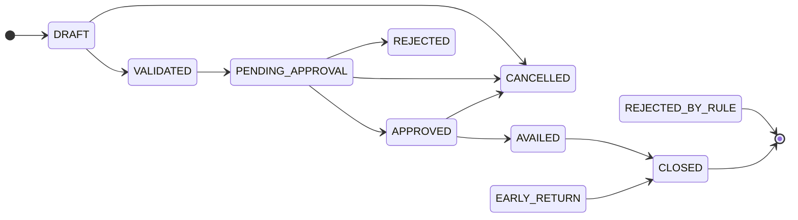

<picture>
  <source media="(prefers-color-scheme: dark)" srcset="../../assets/MultipliersKraftLogoDark.png">
  
</picture>

# FRS-LVE-06 — Leave — State Machines and Events

| Attribute | Value |
| :--- | :--- |
| Document ID | FRS-LVE-06 |
| Title | Leave — State Machines and Events |
| Product | Nucleus Suite (Nucleus HRMS Suite) |
| Version | 1.0.0 |
| Status | Issued for approval |
| Owner (role) | Domain Product Owner — Leave |
| Author | Dhanraj Dadhich |
| Reviewed by | *pending* |
| Approved by | Product Council — *pending* |
| Date | 2026-11-05 |
| Classification | Internal |
| CMMI practice areas | TS, VV |
| Related documents | FRS-LVE-00, FRS-LVE-01, FRS-LVE-02, FRS-LVE-03, FRS-LVE-04, FRS-LVE-05, FRS-LVE-06, FRS-LVE-07, FRS-LVE-08, FRS-LVE-09, FRS-LVE-10, FRS-LVE-11, FRS-LVE-12, FRS-LVE-13, BRS-01, SRS-01, REQ-01, REQ-02 |
| Quality & process-performance objectives | QPPO-05 (effective requirements reviews), QPPO-01 (escaped defects) — MPM-01 |
| Process performance baseline used | PPB-01 (review defect density), PPB-02 (review rate) — MPM-01 |
| Peer review record | *pending* (PR-xxxx, QA-02) |
| Tailoring record | none |
| Traceability anchor | BG-01, BG-03 · R-06, R-07, R-08 · processes LVE-01–LVE-08 |
| Source of record | Nucleus — Process Flows & Process Maps v1.0 — sheet(s) 11_State_Machines, 12_Events |

> **Source of record.** Requirements in this document are taken from the source workbook(s) named above and keep their workbook IDs, which are never renumbered. Changes are made through a change request (CM-02) against the source workbook. Sections marked **Authored** are original additions that are not present in the source workbooks.

## 1. State machines

### `leave_request`

| State | Meaning | Entered by | Allowed next states | Guard | Reversible | Event |
| :--- | :--- | :--- | :--- | :--- | :--- | :--- |
| DRAFT | Being entered | LVE-03 | VALIDATED, CANCELLED | — | Yes | leave.request.created |
| REJECTED_BY_RULE | Blocked at validation before the chain | LVE-03 | — | Combination or cap rule fired | Yes — reapply | leave.request.rejected_by_rule |
| VALIDATED | Passed balance, combination, cap and conflict checks | LVE-03 | PENDING_APPROVAL | — | Yes | — |
| PENDING_APPROVAL | In the sequential chain | LVE-04 | APPROVED, REJECTED, CANCELLED | Each step in order | Yes | platform.approval.started |
| APPROVED | Ledger debited, calendar updated, payroll input raised | LVE-04 | AVAILED, CANCELLED | — | Cancellation reverses the debit | leave.request.approved |
| AVAILED | Leave taken in full | LVE | CLOSED | — | No | — |
| EARLY_RETURN | Returned before the applied end date | LVE-05 | CLOSED | Reversal row and recompute in one transaction | No | leave.early_return.recorded |
| CLOSED | Settled | LVE | — | Ledger and attendance agree | No | — |

## 2. Domain events

Event names follow `domain.object.verb` in the past tense. Every event carries the envelope defined in IA-02.

| Event | Emitted by | Payload (beyond envelope) | Consumers | Idempotency key | Retention |
| :--- | :--- | :--- | :--- | :--- | :--- |
| leave.credit.posted | LVE-01/02 | ledger_id, person_id, leave_type, days, expires_on | Balance projection, notifications | idempotency_key | Long |
| leave.request.approved | LVE-04 | request_id, dates, days, leave_type | Attendance, payroll, team calendar | request_id + version | Long |
| leave.credit.reversed | LVE-05 | ledger_id, original_ref, days | Balance projection, recompute | ledger_id | Long |
| leave.compoff.lapsed | LVE-06 | ledger_id, days, expired_on | Balance projection, employee notice | ledger_id | Long |

## Approval & Sign-off

| Role | Name | Date | Decision | Conditions / comments |
| :--- | :--- | :--- | :--- | :--- |
| Author | Dhanraj Dadhich | 2026-11-05 | Submitted | |
| Peer review moderator | *pending* | | | PR-xxxx |
| PQA (process compliance) | *pending* | | | |
| Approval authority (DOC-01 §7) | *pending* | | | |

## Measurement Data Captured

| Measure | Value | Unit | Notes |
| :--- | :--- | :--- | :--- |
| Size | 12 | specified items (table rows) | Counted automatically at generation |
| Authoring effort | *to be recorded* | person-hours | |
| Review effort (preparation + meeting) | *pending review* | person-hours | From PR-xxxx |
| Rework effort | *pending review* | person-hours | |
| Review rate | *pending review* | items / hour | Compare with PPB control limits |
| Requirement volatility (changes since baseline) | 0 | CRs touching this artefact | Not yet baselined (CM-03) |

**Defects found, by detection phase and severity**

| Detection phase | Major | Minor | Editorial | Injected in phase (major) |
| :--- | :--- | :--- | :--- | :--- |
| Author self-check | 0 | 0 | 0 | — |
| Peer review | *pending* | | | |
| Design / build | | | | |
| System / integration test | | | | |
| UAT | | | | |
| Production (escaped) | | | | each escaped major opens a CAR record (CAR-01) |

Within control limits of the review-rate PPB? *To be assessed at peer review.*

## Revision History

| Version | Date | Author | Change summary | CR ref | Approved by |
| :--- | :--- | :--- | :--- | :--- | :--- |
| 1.0.0 | 2026-11-05 | Dhanraj Dadhich | Consolidated release | CR-0001 | *pending* |
