

<picture>
  <source media="(prefers-color-scheme: dark)" srcset="../../assets/MultipliersKraftLogoDark.png">
  
</picture>

# FRS-LVE-12 — Leave — Use Case Specifications

| Attribute | Value |
| :--- | :--- |
| Document ID | FRS-LVE-12 |
| Title | Leave — Use Case Specifications |
| Product | Nucleus Suite (Nucleus HRMS Suite) |
| Version | 1.0.0 |
| Status | Issued for approval |
| Owner (role) | Domain Product Owner — Leave |
| Author | Dhanraj Dadhich |
| Reviewed by | *pending* |
| Approved by | Product Council — *pending* |
| Date | 2026-11-05 |
| Classification | Internal |
| CMMI practice areas | RDM, VV |
| Related documents | FRS-LVE-00, FRS-LVE-01, FRS-LVE-02, FRS-LVE-03, FRS-LVE-04, FRS-LVE-05, FRS-LVE-06, FRS-LVE-07, FRS-LVE-08, FRS-LVE-09, FRS-LVE-10, FRS-LVE-11, FRS-LVE-12, FRS-LVE-13, BRS-01, SRS-01, REQ-01, REQ-02 |
| Quality & process-performance objectives | QPPO-05 (effective requirements reviews), QPPO-01 (escaped defects) — MPM-01 |
| Process performance baseline used | PPB-01 (review defect density), PPB-02 (review rate) — MPM-01 |
| Peer review record | *pending* (PR-xxxx, QA-02) |
| Tailoring record | none |
| Traceability anchor | BG-01, BG-03 · R-06, R-07, R-08 · processes LVE-01–LVE-08 |
| Source of record | Nucleus — Process Flows & Process Maps v1.0 — sheet(s) 03_Process_Inventory, 04_Process_Steps, 07_Screens, 09_Business_Rules Authored use cases (marked per use case) |

> **Source of record.** Requirements in this document are taken from the source workbook(s) named above and keep their workbook IDs, which are never renumbered. Changes are made through a change request (CM-02) against the source workbook. Sections marked **Authored** are original additions that are not present in the source workbooks.

This document specifies 15 use cases for Leave: 8 follow the step-level flows of the source workbook and 7 are authored (processes without step-level detail in the source, and capability gaps). User stories derived from each use case are in FRS-LVE-13.

## 1. Use case index

| ID | Use case | Primary actor | Realises | Source | Phase | Criticality |
| :--- | :--- | :--- | :--- | :--- | :--- | :--- |
| [LVE-UC-001](#lve-uc-001) | Run the leave accrual job | Nucleus platform | LVE-01 | Source workbook | P1 | Critical |
| [LVE-UC-002](#lve-uc-002) | Prorate casual and sick leave for a new joiner | Nucleus platform | LVE-02 | Source workbook | P1 | High |
| [LVE-UC-003](#lve-uc-003) | Apply for leave with rule validation | Employee / worker | LVE-03 | Source workbook | P1 | High |
| [LVE-UC-004](#lve-uc-004) | Approve leave through the three-level chain | Manager / supervisor | LVE-04 | Source workbook | P1 | High |
| [LVE-UC-005](#lve-uc-005) | Record early return and re-credit unused leave | HR operations | LVE-05 | Source workbook | P1 | Critical |
| [LVE-UC-006](#lve-uc-006) | Credit, consume and lapse compensatory off | Nucleus platform | LVE-06 | Source workbook | P1 | High |
| [LVE-UC-007](#lve-uc-007) | Process leave year end and birthday leave | Nucleus platform | LVE-07 | Source workbook | P1 | High |
| [LVE-UC-008](#lve-uc-008) | View projected leave balance and its ledger trail | Employee / worker | LVE-08 | Source workbook | P1 | Critical |
| [LVE-UC-009](#lve-uc-009) | Manage maternity and paternity leave | Employee / worker | LVE-CG-001 | Authored | P1 | High |
| [LVE-UC-010](#lve-uc-010) | Grant and close a leave of absence | Employee / worker | LVE-CG-002 | Authored | P2 | High |
| [LVE-UC-011](#lve-uc-011) | Donate earned leave to a colleague or shared bank | Employee / worker | LVE-CG-003 | Authored | P3 | Low |
| [LVE-UC-012](#lve-uc-012) | Publish approved leave to the corporate calendar | Nucleus platform | LVE-CG-004 | Authored | P2 | Medium |
| [LVE-UC-013](#lve-uc-013) | Choose optional and restricted holidays | Employee / worker | LVE-CG-005 | Authored | P1 | High |
| [LVE-UC-014](#lve-uc-014) | Simulate a leave policy change before publishing | HR operations | LVE-CG-006 | Authored | P2 | High |
| [LVE-UC-015](#lve-uc-015) | Flag leave requests that breach team coverage | Manager / supervisor | LVE-CG-007 | Authored | P2 | High |

## 2. Use case diagrams

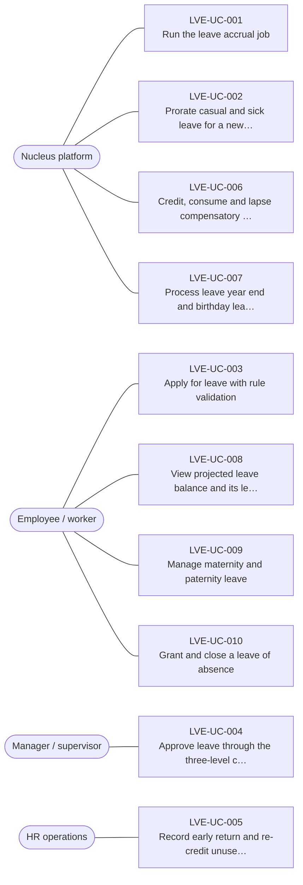

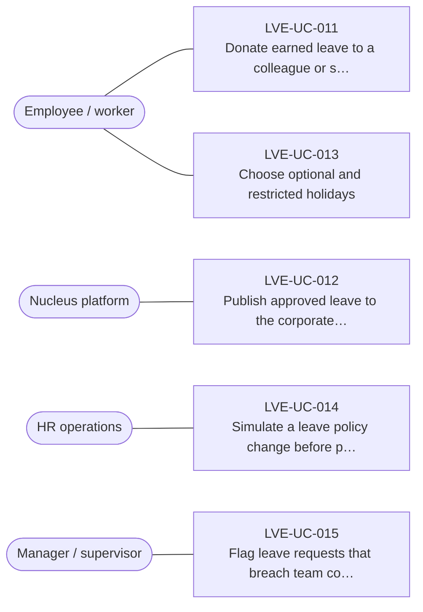

## 3. Use case specifications

### LVE-UC-001

**Run the leave accrual job** — Credit every eligible employee's leave entitlement for the period exactly once, as defined by the accrual policy bound to the employee's leave band.

| Attribute | Value |
| :--- | :--- |
| Realises | LVE-01 |
| Source | Source workbook |
| Level | Subfunction |
| Primary actor | Nucleus platform |
| Secondary actors | HR operations, Implementation consultant, Payroll manager |
| Trigger | Nightly scheduler; the 1 January annual credit date; an employee reaching the end of the EL eligibility wait. |
| Frequency | Nightly, plus the 1 January annual credit |
| Criticality | Critical |
| Phase | P1 |
| Client requirements | R-08 |
| Business rules | RL-170, RL-171, RL-172, RL-173, BS:RL-07, BS:RL-08, BS:RL-09, BS:RL-13 |
| Screens | SCR-032 |
| Data objects (CRUD) | leave_accrual_policy (R), assignment (R), employment (R), leave_ledger (C) |
| Events | leave.credit.posted |
| Acceptance tests | TC-L170, TC-L171, TC-L172, TC-L173, TC-PR08, T-11, T-12, T-13 |
| System requirements | SYS-026, SYS-049, SYS-050, SYS-053, SYS-059 |

**Stakeholders and interests**

| Stakeholder | Interest |
| :--- | :--- |
| Employee / worker | Sees the correct entitlement on the day it falls due, without raising a ticket. |
| HR operations | Avoids manual credits and the year-end clean-up that double credits cause. |
| Payroll manager | Encashment, loss-of-pay and F&F figures depend on balances that are never overstated. |
| Auditor | Every credit traces to a policy version, a run and an idempotency key. |

**Preconditions**

- An accrual policy (client set LP-01 to LP-12) is published and bound to each leave band (RL-170).
- Each active assignment carries a leave band, a worker class and an employment start date.
- The leave ledger enforces a unique index on the idempotency key (person, leave type, period, transaction type).

**Main success scenario**

| # | Actor | Action | Ref |
| ---: | :--- | :--- | :--- |
| 1 | Nucleus platform | Select eligible (person, leave type, period) tuples from the accrual policy bound to each employee's leave band. | LVE-01.1 |
| 2 | Nucleus platform | Check whether the band's EL eligibility wait has been served (standard band: no EL in the first six months of service). | LVE-01.2 |
| 3 | Nucleus platform | Write one credit row per person, type and period with a unique idempotency key and emit leave.credit.posted. | LVE-01.3 |
| 4 | Nucleus platform | Apply band values: AGM and above get 18 EL, 6 CL and 6 SL on 1 January; others 1.5 EL monthly plus 6 CL and 6 SL in January. | LVE-01.4 |

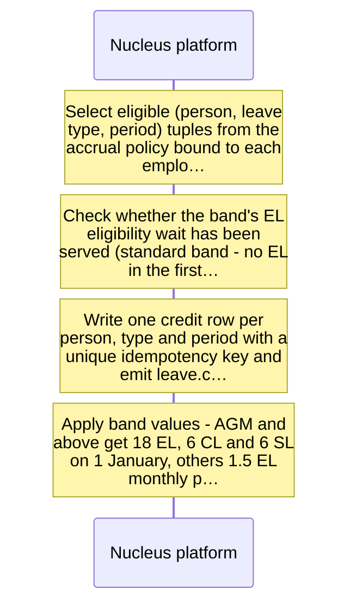

**Alternate flows**

| ID | At step | Condition | Steps | Rejoins |
| :--- | ---: | :--- | :--- | :--- |
| A1 | 2 | The employee is in the standard band and has not completed six months of service. | The platform posts no EL credit for the tuple and records the reason 'eligibility wait not served'. → CL and SL tuples for the same person continue to be processed. | Returns to step 3 for the remaining tuples |
| A2 | 2 | The employee completes six months of service on the run date. | The platform posts a single 9-day EL catch-up credit instead of six monthly accruals (RL-171). → From the next monthly run the employee receives the standard 1.5 EL accrual. | Returns to step 3 |
| A3 | 4 | The employee is a trainee. | The platform reads the trainee type from the employee record. → DET and GET trainees receive CL on the trainee scheme; other trainee types receive no CL unless the scheme states otherwise (BS:RL-13). | Returns to step 4 for the remaining leave types |

**Exception flows**

| ID | At step | Condition | Handling | Rule |
| :--- | ---: | :--- | :--- | :--- |
| E1 | 3 | The job is re-run for a period already credited (restart or manual re-trigger). | The unique idempotency key rejects the duplicate insert; the tuple is logged as already posted and no second credit is written. | RL-172 |
| E2 | 1 | An active employee has no leave band or the band has no bound accrual policy. | The tuple is skipped, no default credit is posted, and an HR operations task is raised naming the employee and the missing binding. | RL-170 |
| E3 | 3 | A storage failure interrupts the batch. | The per-person transaction rolls back; the next run resumes from the failed tuple and the idempotency key prevents duplicates. | RL-172 |

**Postconditions — success**

- Exactly one credit row exists per person, leave type and period, carrying source_ref to the policy and the run.
- leave.credit.posted has been emitted for each new row and the projected balance reflects it.
- The run log records counts of tuples selected, credited, skipped as not eligible and skipped as already posted.

**Postconditions — failure**

- No partial credit for a person and period is committed; the failed tuples are listed in the run log.
- A re-run of the same period creates only the missing rows and never a second credit.

**Quality requirements**

- The nightly accrual for 10,000 active employees completes within 15 minutes.
- Three consecutive re-runs of the same period leave the ledger row count unchanged (property test TC-PR08).
- Every credit row is attributable to a policy version and run identifier, retained for the life of the employment record plus the statutory retention period.

### LVE-UC-002

**Prorate casual and sick leave for a new joiner** — Give each leave-eligible new joiner CL and SL credits proportional to the joining month, posted to the ledger with the proration rule as the source.

| Attribute | Value |
| :--- | :--- |
| Realises | LVE-02 |
| Source | Source workbook |
| Level | Subfunction |
| Primary actor | Nucleus platform |
| Secondary actors | HR operations, Implementation consultant |
| Trigger | A hire is completed and the employee's assignment becomes active. |
| Frequency | Per hire |
| Criticality | High |
| Phase | P1 |
| Client requirements | R-08 |
| Business rules | RL-180, RL-181, RL-182, BS:RL-10, BS:RL-13 |
| Screens | SCR-032 |
| Data objects (CRUD) | leave_proration_rule (R), worker_class (R), leave_ledger (C) |
| Events | leave.credit.posted |
| Acceptance tests | TC-L180, TC-L181, TC-L182, T-14 |
| System requirements | SYS-049, SYS-053, SYS-056, SYS-059 |

**Stakeholders and interests**

| Stakeholder | Interest |
| :--- | :--- |
| Employee / worker | Has usable CL and SL from the first week of employment. |
| HR operations | Does not compute proration by hand for every hire. |
| Implementation consultant | Maintains the proration table as data rather than code. |

**Preconditions**

- The proration table (dataset sheet 16_Leave_Proration) is configured on the leave scheme.
- The hire record carries the joining date and the worker class.

**Main success scenario**

| # | Actor | Action | Ref |
| ---: | :--- | :--- | :--- |
| 1 | Nucleus platform | On activation of the new joiner's assignment, look up the CL and SL proration band for the joining month. | LVE-02.1 |
| 2 | Nucleus platform | Prepare the prorated CL and SL credits with the proration rule as source_ref, for posting with leave.credit.posted. | LVE-02.2 |
| 3 | Nucleus platform | Confirm the worker class is leave-eligible before commit; contract, third-party, consultant and gig classes receive no credit. | LVE-02.3 |

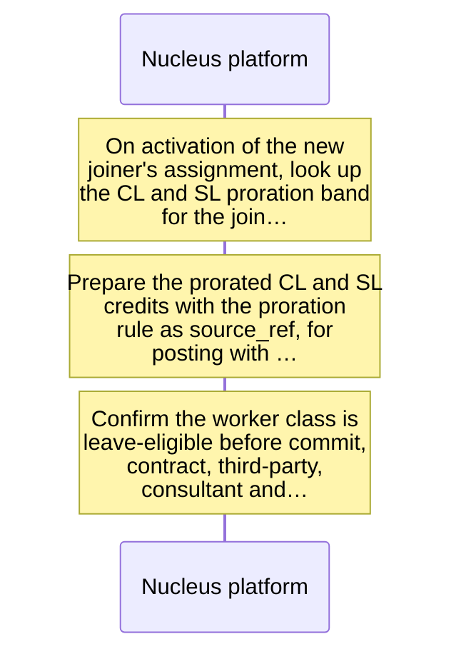

**Alternate flows**

| ID | At step | Condition | Steps | Rejoins |
| :--- | ---: | :--- | :--- | :--- |
| A1 | 3 | The worker class is not leave-eligible. | The platform discards the prepared credits; nothing is written to the ledger. → The hire record shows 'Not leave-eligible by worker class' on the leave tab. | Use case ends |
| A2 | 3 | The joiner is a trainee. | The platform applies the trainee band's policy; DET and GET trainees receive CL, other trainee types do not unless the scheme says so (BS:RL-13). | Use case ends with the trainee credits committed |

**Exception flows**

| ID | At step | Condition | Handling | Rule |
| :--- | ---: | :--- | :--- | :--- |
| E1 | 1 | The joining date is after 4 December, for which the proration table holds no row. | No CL or SL credit is posted; an HR operations task cites the missing row. The entitlement follows the client's answer to the open question recorded against T-14 and is loaded as a table row before go-live. | RL-180 |
| E2 | 2 | The hire activation event is delivered twice. | The idempotency key on (person, type, period, transaction type) rejects the second credit. | RL-181 |

**Postconditions — success**

- Prorated CL and SL credits are posted with source_ref citing the proration rule (RL-181).
- leave.credit.posted is emitted and the joiner's projected balance shows the credits.

**Postconditions — failure**

- No credit is committed for an ineligible worker class or a joining date without a proration row.
- An HR operations task explains why no credit was posted.

**Quality requirements**

- Proration credits are visible to the joiner within 5 minutes of assignment activation.
- Proration values are held only in configuration; a table change needs no code release.

### LVE-UC-003

**Apply for leave with rule validation** — Let an employee apply for leave and receive an immediate, rule-named decision on whether the request can enter the approval chain.

| Attribute | Value |
| :--- | :--- |
| Realises | LVE-03 |
| Source | Source workbook |
| Level | User goal |
| Primary actor | Employee / worker |
| Secondary actors | Nucleus platform, Manager / supervisor |
| Trigger | The employee opens Apply for leave (SCR-030) on mobile, web or the business messaging channel and submits a request. |
| Frequency | Continuous |
| Criticality | High |
| Phase | P1 |
| Client requirements | R-08 |
| Business rules | RL-190, RL-191, RL-192, RL-193, RL-194, BS:RL-11, BS:RL-12 |
| Screens | SCR-030 |
| Data objects (CRUD) | leave_request (C), leave_ledger (R), leave_combination_rule (R), leave_type (R), attendance_day (R), work_calendar (R) |
| Events | leave.request.created, leave.request.rejected_by_rule |
| Acceptance tests | TC-L190, TC-L191, TC-L192, TC-L193, TC-L194, T-15, T-16 |
| System requirements | SYS-023, SYS-049, SYS-059, SYS-066, SYS-071 |

**Stakeholders and interests**

| Stakeholder | Interest |
| :--- | :--- |
| Employee / worker | Learns at the time of applying, not days later, whether the request breaks a rule. |
| Manager / supervisor | Receives only requests that already satisfy balance, combination and cap rules. |
| HR operations | Policy is enforced consistently and the blocking rule is named in every rejection. |

**Preconditions**

- The employee holds an active assignment with a leave-eligible worker class.
- Leave types, combination rules and monthly caps are configured on the leave scheme.

**Main success scenario**

| # | Actor | Action | Ref |
| ---: | :--- | :--- | :--- |
| 1 | Employee / worker | Enter leave type, from and to dates, half-day flags, reason and contact during leave, then submit. | LVE-03.1 |
| 2 | Nucleus platform | Project the balance from the ledger as at the leave start date, honouring per-credit expiry, and show it with expiry warnings. | LVE-03.2 |
| 3 | Nucleus platform | Check the combination rule: is CL being taken with, or merged into, EL or SL across the contiguous absence? | LVE-03.3 |
| 4 | Nucleus platform | Check monthly caps: would the request exceed 2 CL or 10 EL in a calendar month, counting days already approved? | LVE-03.4 |
| 5 | Nucleus platform | Check conflicts with team calendar, holidays, rest days and existing attendance, then set the request to VALIDATED. | LVE-03.5 |

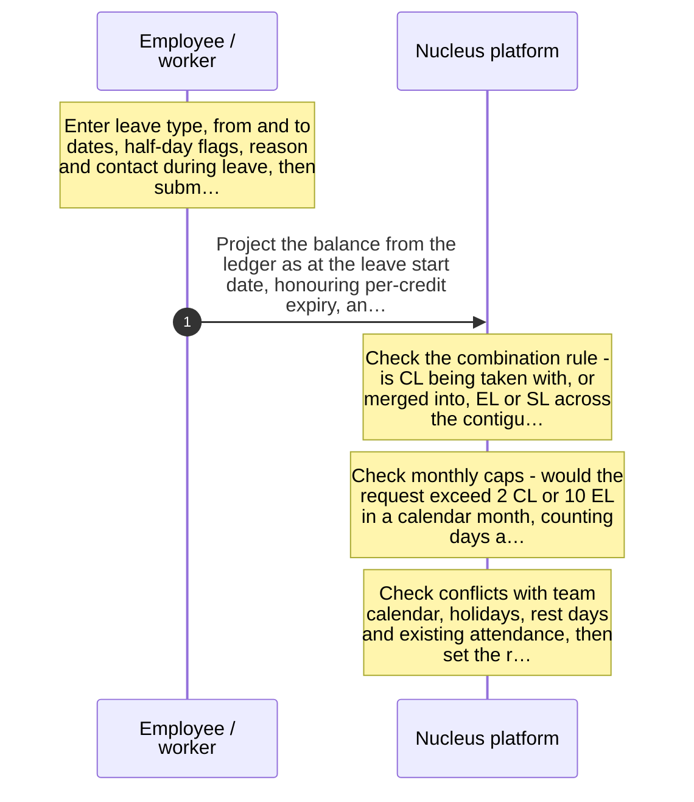

**Alternate flows**

| ID | At step | Condition | Steps | Rejoins |
| :--- | ---: | :--- | :--- | :--- |
| A1 | 1 | The employee applies without connectivity on mobile. | The app queues the request locally and shows it as 'Queued'. → On reconnection the request is submitted and validation runs against the ledger at that moment. | Returns to step 2 |
| A2 | 5 | The conflict check finds a biometric Present status on a requested date. | The platform shows the conflicting attendance record rather than resolving it silently. → The employee amends the dates, or proceeds and the conflict is carried to the approver as a visible flag. | Returns to step 5 or proceeds to the approval chain |

**Exception flows**

| ID | At step | Condition | Handling | Rule |
| :--- | ---: | :--- | :--- | :--- |
| E1 | 2 | The projected balance at the start date is lower than the days requested. | Submission is blocked with the projected balance and any credits expiring before the start date shown. | RL-191 |
| E2 | 3 | CL is contiguous with EL or SL, including where they were applied for separately. | The request moves to REJECTED_BY_RULE before the chain starts; the message names the combination rule. | RL-192 |
| E3 | 4 | The request would exceed the monthly cap of 2 CL or 10 EL. | The request moves to REJECTED_BY_RULE; the message names the cap and the days already counted in that month. | RL-193 |

**Postconditions — success**

- The leave_request is in VALIDATED state and is handed to the approval chain (LVE-04).
- leave.request.created has been emitted.

**Postconditions — failure**

- The request is in REJECTED_BY_RULE with leave.request.rejected_by_rule emitted and the blocking rule named to the employee.
- No approval instance is created and no ledger row is written.

**Quality requirements**

- Validation result is returned within 1.5 s at p95 on mobile and web.
- Rejection messages name the rule in the employee's selected language.

### LVE-UC-004

**Approve leave through the three-level chain** — Route a validated leave request through Supervisor, HOD and HR Head in strict order and, on approval, debit the ledger against the specific credits consumed.

| Attribute | Value |
| :--- | :--- |
| Realises | LVE-04 |
| Source | Source workbook |
| Level | User goal |
| Primary actor | Manager / supervisor |
| Secondary actors | Director / approver, HR operations, Nucleus platform |
| Trigger | A leave request reaches VALIDATED state. |
| Frequency | Continuous |
| Criticality | High |
| Phase | P1 |
| Client requirements | R-06 |
| Business rules | RL-010, RL-013, RL-014, RL-015, RL-195 |
| Screens | SCR-040, SCR-030 |
| Data objects (CRUD) | approval_instance (C), approval_step (U), leave_ledger (C), attendance_day (U), leave_request (U), audit_entry (C) |
| Events | platform.approval.started, platform.approval.step_decided, leave.request.approved, leave.request.edited |
| Acceptance tests | TC-P10, TC-L14, TC-L15, TC-L195, T-09 |
| System requirements | SYS-020, SYS-036, SYS-037, SYS-039, SYS-040, SYS-041 |

**Stakeholders and interests**

| Stakeholder | Interest |
| :--- | :--- |
| Employee / worker | Gets a timely decision and sees who approved at each level. |
| Manager / supervisor | Acts only on requests in their own subtree, in turn. |
| Payroll manager | Receives a payroll input for approved leave that affects pay. |
| Auditor | Each step is recorded with actor, decision and timestamp. |

**Preconditions**

- A chain definition for leave exists, resolved by request type, worker class and location (RL-010).
- Supervisor, HOD and HR Head are resolvable for the applicant's reporting line.

**Main success scenario**

| # | Actor | Action | Ref |
| ---: | :--- | :--- | :--- |
| 1 | Nucleus platform | Start the sequential chain Supervisor, HOD, HR Head, each with its SLA, and set the request to PENDING_APPROVAL. | LVE-04.1 |
| 2 | Approvers (Supervisor, HOD, HR Head) | Each approver decides in turn on the approvals inbox; a rejection at any step ends the request. | LVE-04.2 |
| 3 | Nucleus platform | On final approval, debit the ledger against the credits consumed, update calendar and attendance, and raise the payroll input. | LVE-04.3 |
| 4 | HR operations | Where needed, edit or close the request at any stage with a mandatory reason; the change is logged with actor and time. | LVE-04.4 |

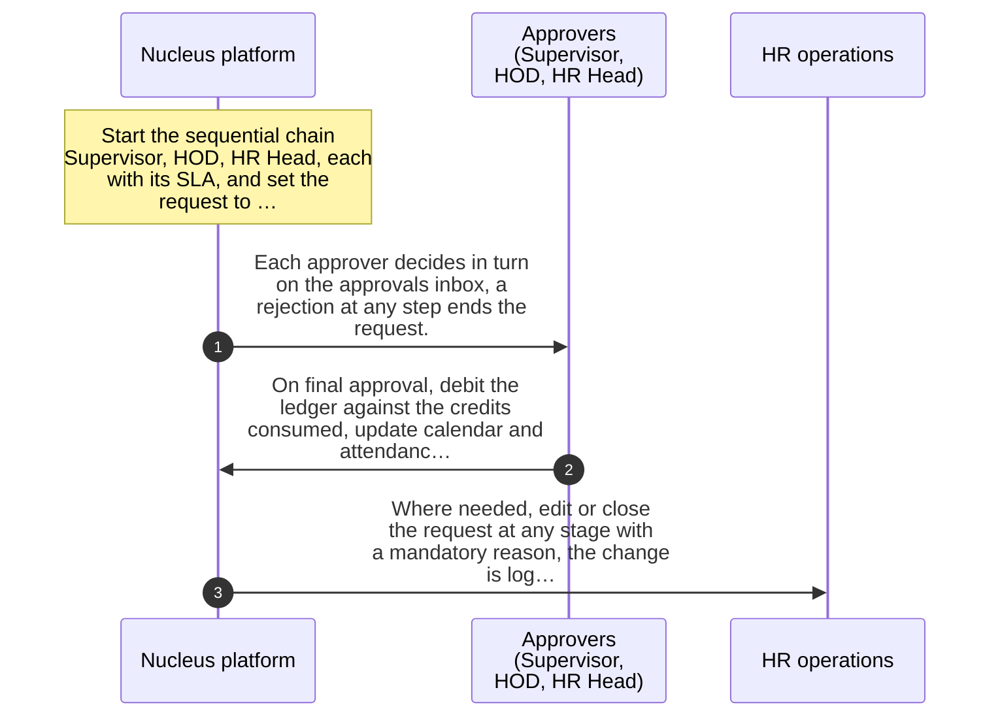

**Alternate flows**

| ID | At step | Condition | Steps | Rejoins |
| :--- | ---: | :--- | :--- | :--- |
| A1 | 2 | An approver rejects the request. | The platform sets the request to REJECTED and closes the remaining steps. → The employee is notified with the approver's comment; no ledger row is written. | Use case ends |
| A2 | 2 | A step's SLA elapses without a decision. | The platform reminds the approver and escalates as defined in the chain definition. → The request stays at the same step; later steps do not open early. | Returns to step 2 |
| A3 | 2 | The employee cancels while the request is pending. | The platform sets the request to CANCELLED and withdraws open approval tasks. | Use case ends |

**Exception flows**

| ID | At step | Condition | Handling | Rule |
| :--- | ---: | :--- | :--- | :--- |
| E1 | 2 | The HR Head or HOD attempts to approve before the preceding step has decided. | The action is blocked; the inbox shows which step is pending. | RL-014 |
| E2 | 2 | The resolved approver is the applicant. | The step is not offered to the applicant; it is routed to the next authority in the chain definition. | RL-010 |
| E3 | 3 | The credits referenced at validation were consumed or lapsed before final approval. | The balance is re-projected; if insufficient, the debit is not written and the request returns to HR operations with the shortfall shown. | RL-195 |

**Postconditions — success**

- The request is APPROVED; the ledger debit references the credits consumed (RL-195).
- Attendance and team calendar show the leave and a payroll input is raised; leave.request.approved is emitted.

**Postconditions — failure**

- On rejection the request is REJECTED with no ledger movement and the employee is notified with the approver's comment.

**Quality requirements**

- An approval decision is reflected in the next approver's inbox within 5 s.
- Approval history for a request is retained and viewable for at least the statutory retention period.

### LVE-UC-005

**Record early return and re-credit unused leave** — Release the unused days of an approved leave when the employee returns early, crediting the balance and correcting attendance in one atomic change.

| Attribute | Value |
| :--- | :--- |
| Realises | LVE-05 |
| Source | Source workbook |
| Level | User goal |
| Primary actor | HR operations |
| Secondary actors | Employee / worker, Nucleus platform, Payroll manager |
| Trigger | An employee on approved leave reports back for work before the approved end date. |
| Frequency | Occasional |
| Criticality | Critical |
| Phase | P1 |
| Client requirements | R-06 |
| Business rules | RL-200, RL-201, RL-202, RL-203, RL-195, BS:RL-15 |
| Screens | SCR-030 |
| Data objects (CRUD) | leave_request (U), leave_ledger (C), recompute_queue (C), attendance_day (U), payroll_run (R) |
| Events | leave.early_return.recorded, leave.credit.reversed, time.attendance_day.recomputed, payroll.arrears.requested |
| Acceptance tests | TC-L200, TC-L201, TC-L202, TC-Y203, T-08 |
| System requirements | SYS-025, SYS-049, SYS-052, SYS-053, SYS-057 |

**Stakeholders and interests**

| Stakeholder | Interest |
| :--- | :--- |
| Employee / worker | Gets unused days back and is paid for the days actually worked. |
| Payroll manager | The payslip, attendance and leave ledger agree; closed runs are not rewritten. |
| Auditor | The reversal references the original debit. |

**Preconditions**

- The leave request is APPROVED and the ledger debit references the credits consumed (RL-195).
- The actual return date lies within the approved span.

**Main success scenario**

| # | Actor | Action | Ref |
| ---: | :--- | :--- | :--- |
| 1 | Employee / worker or HR operations | Record the actual return date inside the approved leave span on Apply for leave and emit leave.early_return.recorded. | LVE-05.1 |
| 2 | Nucleus platform | In one transaction, write a reversal row referencing the original debit and queue attendance recompute for the released dates. | LVE-05.2 |
| 3 | Nucleus platform | Recompute the released dates so they become Present or their punch-derived status; emit time.attendance_day.recomputed. | LVE-05.3 |
| 4 | Nucleus platform | Check whether any released date falls inside a locked payroll period. | LVE-05.4 |

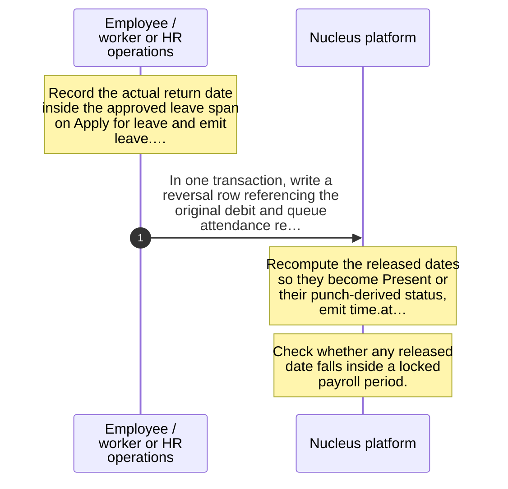

**Alternate flows**

| ID | At step | Condition | Steps | Rejoins |
| :--- | ---: | :--- | :--- | :--- |
| A1 | 4 | A released date lies in a payroll period whose inputs are locked or whose run has closed. | The platform raises payroll.arrears.requested for the next open run with the person, period and reason. → The closed run is left unchanged. | Use case ends |
| A2 | 3 | A released date has no punch and is not a rest day. | The day takes its punch-derived status (for example Absent) rather than Present, and the employee is notified to regularise it. | Returns to step 4 |

**Exception flows**

| ID | At step | Condition | Handling | Rule |
| :--- | ---: | :--- | :--- | :--- |
| E1 | 1 | The entered return date is before the leave start or after the approved end date. | The entry is refused with the approved span shown. | RL-200 |
| E2 | 2 | Either the reversal write or the recompute enqueue fails. | Both are rolled back; no reversal exists without its recompute, and the user is asked to retry. | RL-201 |
| E3 | 1 | The request is still pending approval. | Early return is not offered; the user is directed to amend or cancel the pending request. | RL-200 |

**Postconditions — success**

- The request is in EARLY_RETURN; a reversal row references the original debit and leave.credit.reversed is emitted.
- Released days are recomputed to Present or their punch-derived status.
- Where a released date sits in a locked payroll period, an arrears request exists for the next open run.

**Postconditions — failure**

- Neither the reversal nor the recompute is committed; the request remains APPROVED and the user sees the failure.

**Quality requirements**

- Reversal and recompute complete within 60 s of recording the return for a 30-day span.
- The reversal and recompute enqueue are atomic; fault-injection tests show no state where one exists without the other.

### LVE-UC-006

**Credit, consume and lapse compensatory off** — Grant comp-off for approved rest-day or holiday working with its own 60-day clock, consume it earliest-expiring first and lapse whatever remains on its own expiry date.

| Attribute | Value |
| :--- | :--- |
| Realises | LVE-06 |
| Source | Source workbook |
| Level | Subfunction |
| Primary actor | Nucleus platform |
| Secondary actors | Employee / worker, Manager / supervisor, Plant HR / time office |
| Trigger | Approval of rest-day or holiday working; a comp-off availing; the nightly lapse job. |
| Frequency | Nightly lapse; per event for credit and consumption |
| Criticality | High |
| Phase | P1 |
| Client requirements | R-07 |
| Business rules | RL-172, RL-210, RL-211, RL-212, RL-213, BS:RL-06 |
| Screens | SCR-031 |
| Data objects (CRUD) | leave_ledger (C), leave_type (R), employee (R) |
| Events | leave.compoff.credited, leave.compoff.consumed, leave.compoff.lapsed |
| Acceptance tests | TC-L210, TC-L211, TC-L212, TC-L213, TC-PR08, T-10 |
| System requirements | SYS-049, SYS-050, SYS-059, SYS-070 |

**Stakeholders and interests**

| Stakeholder | Interest |
| :--- | :--- |
| Employee / worker | Knows exactly when each comp-off day expires and loses none early. |
| Plant HR / time office | Comp-off liability is accurate per credit, not estimated at balance level. |
| Auditor | Each lapse row names the run that wrote it. |

**Preconditions**

- The comp-off leave type carries expiry_days (client value 60), with any employee-level lapse window held on the employee or scheme (BS:RL-06).
- Rest-day or holiday working has been approved through the time module.

**Main success scenario**

| # | Actor | Action | Ref |
| ---: | :--- | :--- | :--- |
| 1 | Nucleus platform | On approved rest-day or holiday working, credit comp-off with expires_on = credit date + 60 days; emit leave.compoff.credited. | LVE-06.1 |
| 2 | Nucleus platform | When comp-off is availed, draw from the earliest-expiring open credit first; emit leave.compoff.consumed. | LVE-06.2 |
| 3 | Nucleus platform | Nightly, write a Lapse row for each credit past expires_on with days remaining; emit leave.compoff.lapsed. | LVE-06.3 |
| 4 | Nucleus platform | Keep each credit's clock running across the leave-year boundary; the year end never truncates it. | LVE-06.4 |

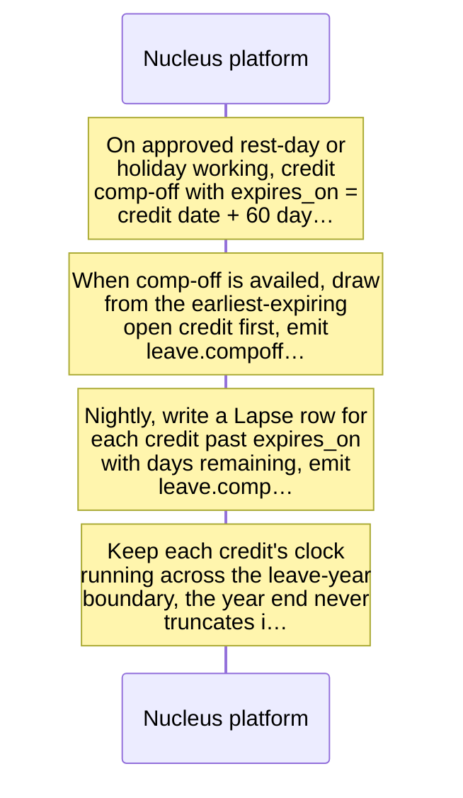

**Alternate flows**

| ID | At step | Condition | Steps | Rejoins |
| :--- | ---: | :--- | :--- | :--- |
| A1 | 2 | The days availed exceed the earliest open credit. | The platform consumes that credit fully and takes the remainder from the next-earliest credit, writing one consumption row per credit. | Returns to step 3 |
| A2 | 1 | The employee record holds its own lapse window. | The platform uses the employee-level lapse days instead of the leave-type default when setting expires_on. | Returns to step 2 |

**Exception flows**

| ID | At step | Condition | Handling | Rule |
| :--- | ---: | :--- | :--- | :--- |
| E1 | 3 | The lapse job runs twice for the same date. | The idempotency key per person, credit and date prevents a second Lapse row. | RL-172 |
| E2 | 2 | A comp-off request exceeds the open credits projected at its start date. | Validation blocks the request with the expiring credits listed. | RL-211 |
| E3 | 4 | Year-end processing attempts to lapse open comp-off credits. | Comp-off is excluded from year-end lapse; each credit lapses only on its own date. | RL-213 |

**Postconditions — success**

- Each credit carries expires_on = credit date + lapse days; consumption references the earliest-expiring open credit.
- Unconsumed days are lapsed by one Lapse row per credit on its own expiry date, with leave.compoff.lapsed emitted.

**Postconditions — failure**

- A failed lapse run writes nothing for the affected credit; the next nightly run lapses it with the original expiry date.

**Quality requirements**

- The nightly lapse job processes 50,000 open credits within 10 minutes.
- An employee notice is sent 7 days before any comp-off credit lapses.

### LVE-UC-007

**Process leave year end and birthday leave** — At year end carry forward, encash or lapse each leave type as the scheme defines, raise encashment as a payroll input, and credit birthday leave in its own window.

| Attribute | Value |
| :--- | :--- |
| Realises | LVE-07 |
| Source | Source workbook |
| Level | Subfunction |
| Primary actor | Nucleus platform |
| Secondary actors | HR operations, Payroll manager |
| Trigger | 31 December year-end schedule; an employee's birthday eligibility window opening. |
| Frequency | Annual; birthday credit per employee |
| Criticality | High |
| Phase | P1 |
| Client requirements | R-08 |
| Business rules | RL-220, RL-221, RL-222, RL-172, BS:RL-14 |
| Screens | SCR-031 |
| Data objects (CRUD) | leave_ledger (C), leave_type (R), payroll_input (C) |
| Events | leave.yearend.processed, payroll.input.raised, leave.credit.posted |
| Acceptance tests | TC-L220, TC-Y221, TC-L222, T-17 |
| System requirements | SYS-028, SYS-045, SYS-048, SYS-049, SYS-050 |

**Stakeholders and interests**

| Stakeholder | Interest |
| :--- | :--- |
| Employee / worker | Receives the correct encashment and understands which days lapsed. |
| Payroll manager | Receives encashment as an input computed on the statutory wage base. |
| HR operations | Can preview year-end figures before they are written. |

**Preconditions**

- Year-end treatment per leave type is configured (EL carry-forward cap; CL and SL lapse).
- The target payroll run for encashment exists for the period (PAY-01).

**Main success scenario**

| # | Actor | Action | Ref |
| ---: | :--- | :--- | :--- |
| 1 | Nucleus platform | At year end, carry EL forward up to the carry-forward cap, encash the excess, and lapse CL and SL; emit leave.yearend.processed. | LVE-07.1 |
| 2 | Nucleus platform | Raise the encashment as a payroll input in the named run, valued on the statutory wage base; emit payroll.input.raised. | LVE-07.2 |
| 3 | Nucleus platform | Credit birthday leave within its own eligibility window; emit leave.credit.posted. | LVE-07.3 |

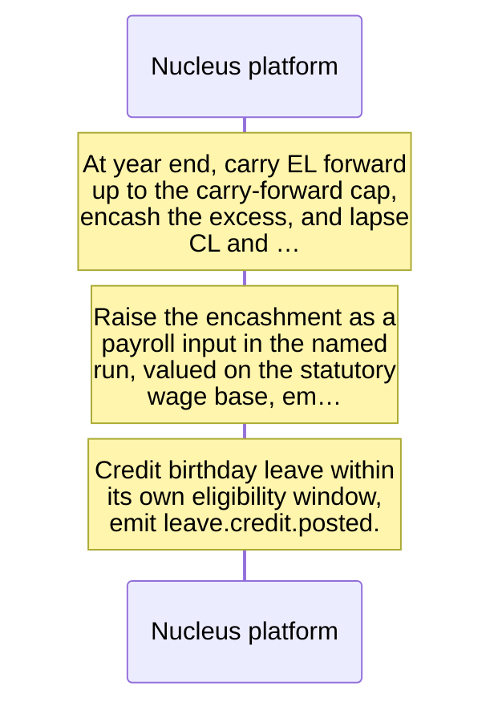

**Alternate flows**

| ID | At step | Condition | Steps | Rejoins |
| :--- | ---: | :--- | :--- | :--- |
| A1 | 1 | HR operations runs year end in Preview mode first. | The platform computes carry-forward, encashment and lapse per employee without writing. → HR operations reviews the preview and selects Commit; the committed figures equal the preview. | Returns to step 1 in commit mode |
| A2 | 1 | The scheme's EL carry-forward cap is configured as 0, as in the client's acceptance test. | All closing EL is encashed; nothing is carried forward. | Returns to step 2 |

**Exception flows**

| ID | At step | Condition | Handling | Rule |
| :--- | ---: | :--- | :--- | :--- |
| E1 | 2 | The named payroll run has already locked its inputs. | The input is not added to the locked run; it is raised to the next open regular run and HR operations is notified. | RL-221 |
| E2 | 1 | The year-end job is re-run after a partial failure. | Idempotency keys prevent a second encashment or lapse row for any employee already processed. | RL-172 |
| E3 | 3 | The employee's separation date falls before the birthday window opens. | No birthday credit is posted. | RL-222 |

**Postconditions — success**

- EL within the cap is carried forward, the excess encashed; CL and SL closing balances are lapsed; leave.yearend.processed is emitted.
- An encashment payroll input exists in the named run; birthday leave credits are posted with their own window.

**Postconditions — failure**

- A failed commit writes no year-end rows for the affected employee; a re-run produces the same figures as the preview.

**Quality requirements**

- Preview and Commit for 10,000 employees each complete within 20 minutes.
- Preview and Commit figures match to the half day and to the paisa for every employee.

### LVE-UC-008

**View projected leave balance and its ledger trail** — Give employees and HR a balance computed from the ledger as at any date, together with the transactions that produced it.

| Attribute | Value |
| :--- | :--- |
| Realises | LVE-08 |
| Source | Source workbook |
| Level | User goal |
| Primary actor | Employee / worker |
| Secondary actors | HR operations, Nucleus platform, Agent principal |
| Trigger | Any read of a leave balance: the balance screen, the apply screen, the assistant, the payslip or the F&F. |
| Frequency | Continuous |
| Criticality | Critical |
| Phase | P1 |
| Client requirements | R-07 |
| Business rules | RL-191, RL-230, RL-231 |
| Screens | SCR-031 |
| Data objects (CRUD) | leave_ledger (R) |
| Events | — |
| Acceptance tests | TC-L191, TC-L230, TC-L231 |
| System requirements | SYS-023, SYS-049, SYS-071 |

**Stakeholders and interests**

| Stakeholder | Interest |
| :--- | :--- |
| Employee / worker | Can answer 'why is my balance 6.5' without raising a ticket. |
| HR operations | Uses one projection for the apply screen, the assistant, the payslip and the F&F. |
| Auditor | Balance is reproducible from ledger rows alone. |

**Preconditions**

- The requester is the employee, or HR within scope, or an agent with a declared balance tool.

**Main success scenario**

| # | Actor | Action | Ref |
| ---: | :--- | :--- | :--- |
| 1 | Nucleus platform | Project balance = credits − debits − lapses − encashments + reversals, as at the requested date. | LVE-08.1 |
| 2 | Nucleus platform | Show on the balance and ledger screen the transactions behind the balance, each with date, type, days and source reference. | LVE-08.2 |

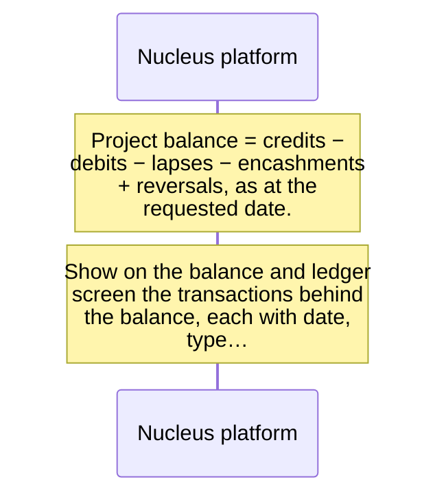

**Alternate flows**

| ID | At step | Condition | Steps | Rejoins |
| :--- | ---: | :--- | :--- | :--- |
| A1 | 1 | The requested date is in the future. | The projection excludes credits whose expires_on falls before that date and includes scheduled accruals already posted. | Returns to step 2 |
| A2 | 2 | HR operations exports the ledger for an employee in scope. | The platform produces the export with the same rows shown on screen and logs the export. | Use case ends |
| A3 | 2 | The mobile app is offline. | The last synchronised balance and ledger are shown read-only with the sync time. | Use case ends |

**Exception flows**

| ID | At step | Condition | Handling | Rule |
| :--- | ---: | :--- | :--- | :--- |
| E1 | 1 | A user requests the balance of an employee outside their scope. | The request is refused and an access event is recorded. | RL-231 |
| E2 | 1 | A component attempts to read a stored balance column. | No such column exists; all reads go through the single projection function. | RL-230 |

**Postconditions — success**

- The balance as at the requested date is returned with the contributing ledger rows.

**Postconditions — failure**

- Out-of-scope requests are refused and logged; no partial data is returned.

**Quality requirements**

- Balance projection returns within 300 ms at p95 for a ledger of 500 rows.
- The same projection function serves all consumers; a consistency test compares apply-screen, payslip and F&F values for 1,000 employees.

### LVE-UC-009

**Manage maternity and paternity leave** — Administer statutory maternity benefit and paternity leave end to end, including medical evidence, nursing breaks and return-to-work milestones (entitlements to be validated by Legal).

| Attribute | Value |
| :--- | :--- |
| Realises | LVE-CG-001 |
| Source | Authored |
| Level | User goal |
| Primary actor | Employee / worker |
| Secondary actors | HR operations, Manager / supervisor, Payroll manager, Nucleus platform |
| Trigger | An employee applies for maternity or paternity leave, or HR records a notified pregnancy or birth. |
| Frequency | Occasional |
| Criticality | High |
| Phase | P1 |
| Client requirements | — |
| Business rules | RL-190, RL-191, RL-195, RL-203 |
| Screens | SCR-030, SCR-031 |
| Data objects (CRUD) | leave_request (C), leave_ledger (C), document (C), attendance_day (U), payroll_input (C) |
| Events | leave.request.created, leave.request.approved, payroll.input.raised |
| Acceptance tests | LVE-TC-001, LVE-TC-002, LVE-TC-003, LVE-TC-004, LVE-TC-005, LVE-TC-006 |
| System requirements | SYS-033, SYS-037, SYS-045, SYS-049, SYS-070 |

**Stakeholders and interests**

| Stakeholder | Interest |
| :--- | :--- |
| Employee / worker | Receives the full statutory entitlement and a planned return without chasing HR. |
| HR operations | Holds documentary evidence and dates needed for statutory registers. |
| Payroll manager | Knows which days are paid by the employer and which are covered by a statutory scheme. |
| Manager / supervisor | Plans cover for the absence period. |

**Preconditions**

- Maternity and paternity leave types are configured with entitlement, eligibility service and evidence requirements from the effective rule pack (to be validated by Legal).
- The employee holds an active assignment.

**Main success scenario**

| # | Actor | Action | Ref |
| ---: | :--- | :--- | :--- |
| 1 | Employee / worker | Apply for maternity or paternity leave on Apply for leave, entering expected date of delivery or birth date and planned start. |  |
| 2 | Employee / worker | Upload the medical certificate or birth evidence required by the leave type. |  |
| 3 | Nucleus platform | Check eligibility service and entitlement from the leave type and project the balance as at the start date. |  |
| 4 | HR operations | Verify the evidence and confirm the dates; the request then enters the leave approval chain. |  |
| 5 | Nucleus platform | On approval, debit the ledger, mark attendance as maternity or paternity leave and raise payroll inputs for paid days. |  |
| 6 | Nucleus platform | Schedule return-to-work milestones and notify the employee and manager 14 days before the return date. |  |
| 7 | Employee / worker | On return, confirm the return date; nursing-break minutes are applied to the attendance shift for the configured period. |  |

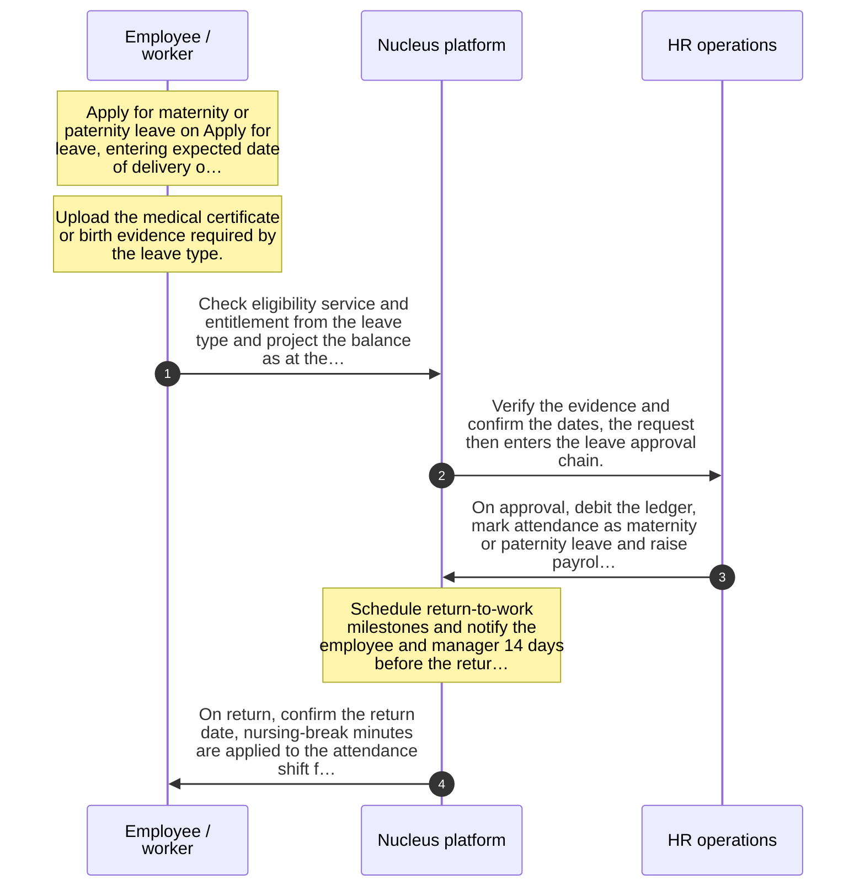

**Alternate flows**

| ID | At step | Condition | Steps | Rejoins |
| :--- | ---: | :--- | :--- | :--- |
| A1 | 1 | The delivery occurs before the planned start date. | HR operations updates the start date to the actual date; the platform re-projects the span and adjusts attendance and payroll inputs. | Returns to step 5 |
| A2 | 7 | The employee requests an extension using EL or unpaid leave. | A separate leave request is raised and validated under LVE-03; it is contiguous with the maternity span. | Use case ends |

**Exception flows**

| ID | At step | Condition | Handling | Rule |
| :--- | ---: | :--- | :--- | :--- |
| E1 | 3 | The employee does not meet the eligibility service condition. | The request is held for HR operations with the condition named; HR may record a policy exception with reason. | RL-191 |
| E2 | 4 | Evidence is missing or illegible. | HR operations returns the request to the employee with the reason; the approval chain does not start. | RL-190 |
| E3 | 5 | A paid day falls inside a locked payroll period. | The payroll effect is raised as arrears in the next open run. | RL-203 |

**Postconditions — success**

- The leave is APPROVED with evidence attached, ledger debits posted and a payroll input raised for paid days.
- Nursing-break allowance and return-to-work milestones are scheduled on the employee's calendar.

**Postconditions — failure**

- The request remains pending with the missing evidence or eligibility condition named.

**Quality requirements**

- Medical evidence is stored encrypted and visible only to the employee and HR operations within scope.
- Return-to-work reminders are delivered at least 14 days before the return date.

### LVE-UC-010

**Grant and close a leave of absence** — Approve a long unpaid leave or sabbatical with its effects on service continuity, benefits eligibility and payroll defined in advance, and manage the return.

| Attribute | Value |
| :--- | :--- |
| Realises | LVE-CG-002 |
| Source | Authored |
| Level | User goal |
| Primary actor | Employee / worker |
| Secondary actors | Manager / supervisor, HR operations, Payroll manager, Director / approver, Nucleus platform |
| Trigger | An employee requests an unpaid leave of absence or sabbatical longer than the leave type's minimum duration. |
| Frequency | Occasional |
| Criticality | High |
| Phase | P2 |
| Client requirements | — |
| Business rules | RL-010, RL-014, RL-203 |
| Screens | SCR-030, SCR-040 |
| Data objects (CRUD) | leave_request (C), approval_instance (C), payroll_input (C), employment (U) |
| Events | leave.request.created, platform.approval.started, leave.request.approved, payroll.input.raised |
| Acceptance tests | LVE-TC-007, LVE-TC-008, LVE-TC-009, LVE-TC-010 |
| System requirements | SYS-022, SYS-037, SYS-038, SYS-041, SYS-053 |

**Stakeholders and interests**

| Stakeholder | Interest |
| :--- | :--- |
| Employee / worker | Knows before leaving how the absence affects service, benefits and pay. |
| Payroll manager | Stops and restarts pay on the right dates without manual holds. |
| HR operations | Keeps service-continuity records correct for gratuity and seniority. |

**Preconditions**

- Leave-of-absence types are configured with service-continuity, benefits and payroll treatment.

**Main success scenario**

| # | Actor | Action | Ref |
| ---: | :--- | :--- | :--- |
| 1 | Employee / worker | Request a leave of absence, selecting type (unpaid or sabbatical), dates and reason. |  |
| 2 | Nucleus platform | Show the configured effect on service continuity, benefits eligibility and pay before submission. |  |
| 3 | Nucleus platform | Route the request through the chain definition resolved for the leave-of-absence type and duration. |  |
| 4 | Approvers (Supervisor, HOD, HR Head) | Approve or reject the request in sequence with comments. |  |
| 5 | Nucleus platform | On approval, raise payroll inputs suspending pay for the span and set service and benefit flags as configured. |  |
| 6 | Nucleus platform | Create a return-from-leave task for HR operations due 7 days before the planned return date. |  |
| 7 | HR operations | Confirm the actual return date; the platform restores pay and benefits from that date. |  |

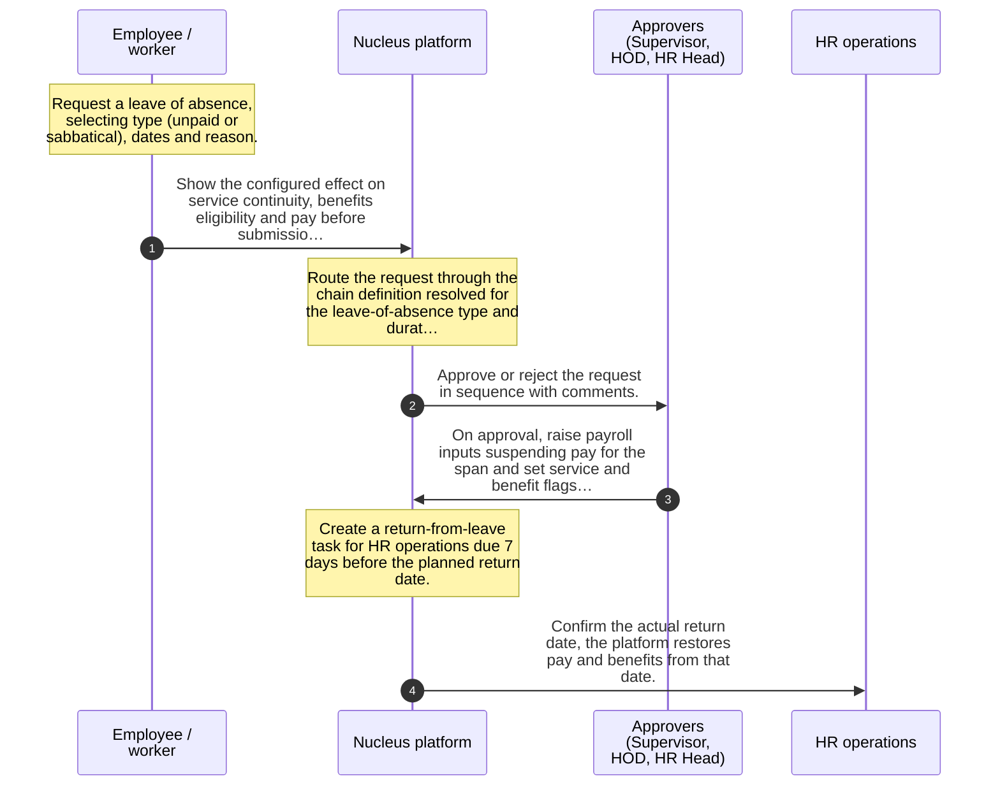

**Alternate flows**

| ID | At step | Condition | Steps | Rejoins |
| :--- | ---: | :--- | :--- | :--- |
| A1 | 7 | The employee returns earlier than planned. | HR operations records the actual return date; unused absence days are released and pay resumes from that date. | Use case ends |
| A2 | 7 | The employee does not return and resigns. | HR operations closes the absence on the resignation date and starts the exit process. | Use case ends |

**Exception flows**

| ID | At step | Condition | Handling | Rule |
| :--- | ---: | :--- | :--- | :--- |
| E1 | 4 | The duration exceeds the limit the chain allows at HR Head level. | The chain definition adds the Director / approver step before approval completes. | RL-010 |
| E2 | 5 | The span overlaps a locked payroll period. | The pay suspension for locked dates is raised as arrears (recovery) in the next open run. | RL-203 |

**Postconditions — success**

- The absence is approved, payroll inputs suspend pay for the span, and service and benefit flags reflect the configured treatment.
- A return task is scheduled for the planned return date.

**Postconditions — failure**

- The request is rejected or withdrawn; no payroll or service change is made.

**Quality requirements**

- The pay-suspension input is created within 1 minute of final approval.

### LVE-UC-011

**Donate earned leave to a colleague or shared bank** — Allow an employee to transfer earned leave to a named colleague or to a pooled leave bank within policy limits and with HR approval.

| Attribute | Value |
| :--- | :--- |
| Realises | LVE-CG-003 |
| Source | Authored |
| Level | User goal |
| Primary actor | Employee / worker |
| Secondary actors | HR operations, Nucleus platform |
| Trigger | An employee chooses Donate leave from the balance screen. |
| Frequency | Occasional |
| Criticality | Low |
| Phase | P3 |
| Client requirements | — |
| Business rules | RL-191, RL-195, RL-230 |
| Screens | SCR-031 |
| Data objects (CRUD) | leave_ledger (C), leave_request (C) |
| Events | leave.credit.posted |
| Acceptance tests | LVE-TC-011, LVE-TC-012, LVE-TC-013, LVE-TC-014 |
| System requirements | SYS-037, SYS-049, SYS-059, SYS-070 |

**Stakeholders and interests**

| Stakeholder | Interest |
| :--- | :--- |
| Employee / worker | Can support a colleague facing a long illness or emergency. |
| HR operations | Keeps donations within policy and auditable. |
| Payroll manager | Donated days do not distort encashment liability. |

**Preconditions**

- The leave scheme enables donation with per-donor annual limit and minimum retained balance.

**Main success scenario**

| # | Actor | Action | Ref |
| ---: | :--- | :--- | :--- |
| 1 | Employee / worker | Choose Donate leave, select a named colleague or the shared bank, and enter the number of EL days. |  |
| 2 | Nucleus platform | Check the donor's projected EL balance, the annual donation limit and the minimum balance the donor must keep. |  |
| 3 | Nucleus platform | Create a donation request and route it to HR operations for approval. |  |
| 4 | HR operations | Approve or reject the donation with a comment. |  |
| 5 | Nucleus platform | On approval, write the donor debit and recipient credit in one transaction, each referencing the other. |  |
| 6 | Nucleus platform | Notify donor and recipient; the recipient's projected balance shows the credit as donated leave. |  |

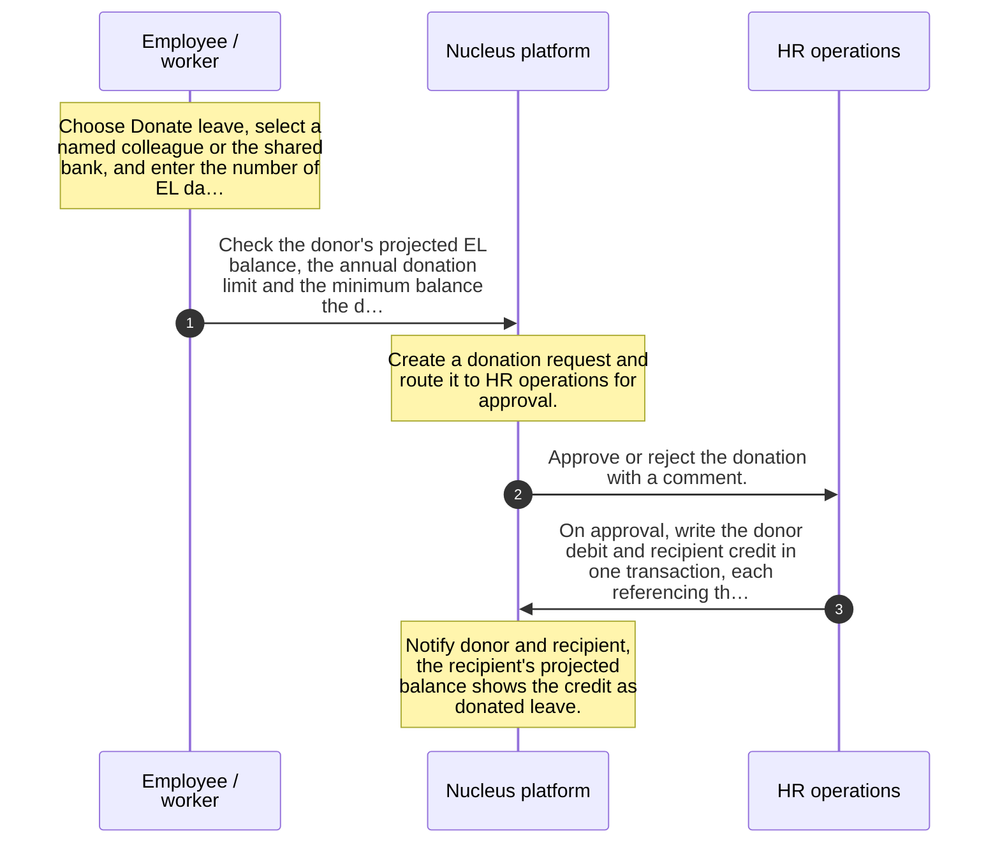

**Alternate flows**

| ID | At step | Condition | Steps | Rejoins |
| :--- | ---: | :--- | :--- | :--- |
| A1 | 1 | The donor gives to the shared bank. | The credit goes to the bank; HR operations later allocates bank days to an approved recipient with a reason. | Returns to step 2 |

**Exception flows**

| ID | At step | Condition | Handling | Rule |
| :--- | ---: | :--- | :--- | :--- |
| E1 | 2 | The donation would breach the annual limit or the minimum retained balance. | The request is blocked with the limit and the maximum permitted days shown. | RL-191 |
| E2 | 5 | Either ledger write fails. | Both writes roll back and the donation stays approved but unposted, with a retry offered. | RL-195 |

**Postconditions — success**

- A donor debit and recipient (or bank) credit are written in one transaction, each referencing the other.

**Postconditions — failure**

- No ledger row is written for either party.

**Quality requirements**

- The donor's identity is shown to the recipient only if the donor opts in.

### LVE-UC-012

**Publish approved leave to the corporate calendar** — Show approved leave as out-of-office entries on the employee's and team's corporate calendars and keep them in step with later changes.

| Attribute | Value |
| :--- | :--- |
| Realises | LVE-CG-004 |
| Source | Authored |
| Level | Subfunction |
| Primary actor | Nucleus platform |
| Secondary actors | Corporate calendar, Employee / worker, Manager / supervisor |
| Trigger | leave.request.approved, a cancellation, an HR edit or leave.early_return.recorded. |
| Frequency | Continuous |
| Criticality | Medium |
| Phase | P2 |
| Client requirements | — |
| Business rules | RL-195 |
| Screens | SCR-030 |
| Data objects (CRUD) | leave_request (U) |
| Events | leave.request.approved, leave.early_return.recorded |
| Acceptance tests | LVE-TC-015, LVE-TC-016, LVE-TC-017, LVE-TC-018 |
| System requirements | SYS-053, SYS-055, SYS-056, SYS-088 |

**Stakeholders and interests**

| Stakeholder | Interest |
| :--- | :--- |
| Employee / worker | Does not have to create out-of-office entries by hand. |
| Manager / supervisor | Sees team absence where meetings are planned. |
| Tenant admin | Controls whether and how leave details leave the platform. |

**Preconditions**

- The tenant has connected a corporate calendar and enabled leave publishing.
- The employee's calendar identity is linked through the enterprise directory.

**Main success scenario**

| # | Actor | Action | Ref |
| ---: | :--- | :--- | :--- |
| 1 | Nucleus platform | Receive leave.request.approved for an employee whose calendar is linked. |  |
| 2 | Nucleus platform | Build an out-of-office entry with dates and half-day flags only, without leave type or reason. |  |
| 3 | Corporate calendar | Create the entry on the employee's calendar and return its reference. |  |
| 4 | Nucleus platform | Store the reference on the leave request and add the entry to the team calendar view. |  |
| 5 | Nucleus platform | On cancellation, HR edit or early return, update or delete the entry using the stored reference. |  |

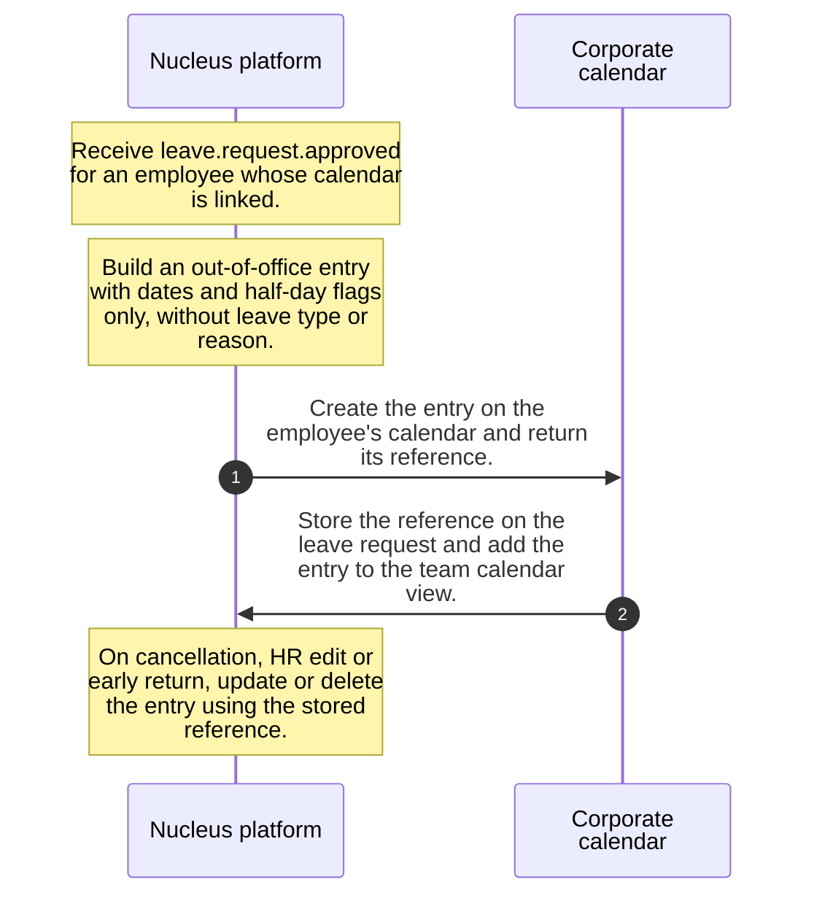

**Alternate flows**

| ID | At step | Condition | Steps | Rejoins |
| :--- | ---: | :--- | :--- | :--- |
| A1 | 5 | The employee returns early. | The entry's end date is shortened to the day before the actual return date. | Use case ends |

**Exception flows**

| ID | At step | Condition | Handling | Rule |
| :--- | ---: | :--- | :--- | :--- |
| E1 | 3 | The corporate calendar is unavailable. | The publish is retried with backoff for 24 hours; the employee is then notified to add the entry manually. |  |
| E2 | 1 | The employee has no linked calendar identity. | No publish is attempted; the leave record shows 'Calendar not linked'. |  |

**Postconditions — success**

- The calendar entry matches the approved span; it carries no leave type or reason.

**Postconditions — failure**

- The leave stays approved; the failed publish is retried and shown on the employee's leave record.

**Quality requirements**

- Calendar entry appears within 2 minutes of approval at p95.
- No leave type, reason or medical detail is sent to the corporate calendar.

### LVE-UC-013

**Choose optional and restricted holidays** — Let employees pick optional or restricted holidays from a location-specific, religion-neutral list within the configured quota.

| Attribute | Value |
| :--- | :--- |
| Realises | LVE-CG-005 |
| Source | Authored |
| Level | User goal |
| Primary actor | Employee / worker |
| Secondary actors | Implementation consultant, Plant HR / time office, Nucleus platform |
| Trigger | The optional-holiday window opens for the year, or an employee selects an optional holiday later in the year. |
| Frequency | Annual window; occasional changes |
| Criticality | High |
| Phase | P1 |
| Client requirements | — |
| Business rules | RL-191, RL-194 |
| Screens | SCR-030, SCR-032 |
| Data objects (CRUD) | work_calendar (U), attendance_day (U) |
| Events | — |
| Acceptance tests | LVE-TC-019, LVE-TC-020, LVE-TC-021, LVE-TC-022 |
| System requirements | SYS-026, SYS-059, SYS-068 |

**Stakeholders and interests**

| Stakeholder | Interest |
| :--- | :--- |
| Employee / worker | Chooses holidays that matter to them without disclosing reasons. |
| Plant HR / time office | Knows in advance who will be absent on each optional holiday. |
| Implementation consultant | Configures the list and quota per location and year. |

**Preconditions**

- The optional holiday list and quota (for example 2 per year) are configured per location for the year.

**Main success scenario**

| # | Actor | Action | Ref |
| ---: | :--- | :--- | :--- |
| 1 | Implementation consultant | Publish the optional holiday list and annual quota for each location. |  |
| 2 | Nucleus platform | Show each employee the list for their work location with the remaining quota. |  |
| 3 | Employee / worker | Select one or more optional holidays from the list. |  |
| 4 | Nucleus platform | Check the remaining quota and conflicts with rest days and approved leave. |  |
| 5 | Nucleus platform | Record the selection and mark the date as optional holiday on the work calendar for the employee. |  |
| 6 | Plant HR / time office | View expected absence per optional holiday at the site. |  |

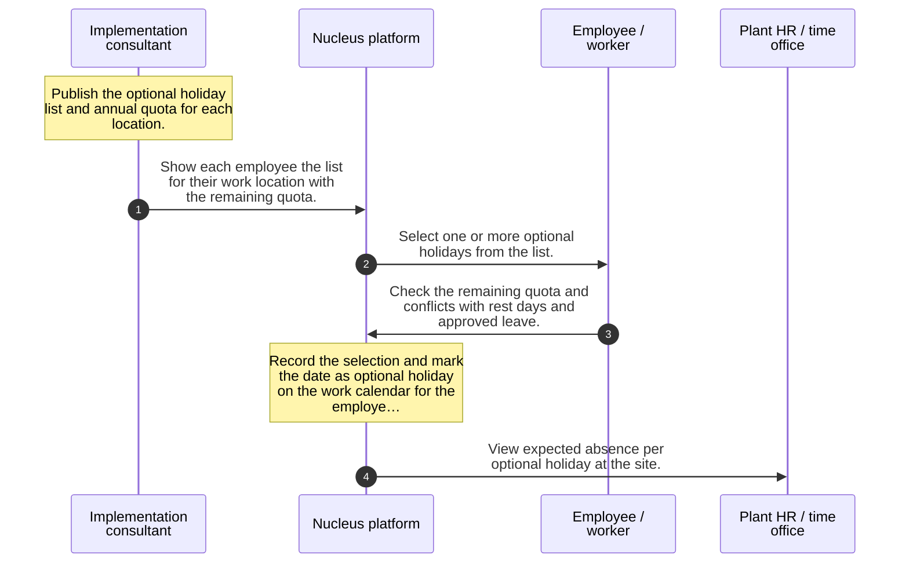

**Alternate flows**

| ID | At step | Condition | Steps | Rejoins |
| :--- | ---: | :--- | :--- | :--- |
| A1 | 3 | The employee withdraws a selection before the date. | The selection is removed and the quota is restored. | Use case ends |
| A2 | 2 | The employee transfers location mid-year. | The new location's list applies from the transfer date; holidays already taken count against the annual quota. | Returns to step 3 |

**Exception flows**

| ID | At step | Condition | Handling | Rule |
| :--- | ---: | :--- | :--- | :--- |
| E1 | 4 | The quota is already used. | The selection is refused with the quota and the holidays already chosen shown. | RL-191 |
| E2 | 4 | The date is already a rest day or covered by approved leave. | The selection is refused with the conflicting record named. | RL-194 |

**Postconditions — success**

- The chosen holidays are recorded, the quota is reduced and attendance shows the day as optional holiday.

**Postconditions — failure**

- No selection is recorded; quota is unchanged.

**Quality requirements**

- The list labels holidays by name and date only; no religion field is captured or shown.

### LVE-UC-014

**Simulate a leave policy change before publishing** — Let HR simulate a proposed leave policy change against historical balances and requests and see the effect on balances, liability and coverage before publishing it.

| Attribute | Value |
| :--- | :--- |
| Realises | LVE-CG-006 |
| Source | Authored |
| Level | User goal |
| Primary actor | HR operations |
| Secondary actors | Nucleus platform, Finance, Director / approver, Implementation consultant |
| Trigger | HR drafts a change to a leave policy, for example raising earned-leave carry-forward from 30 to 45 days for band LS-STD. |
| Frequency | Several times a year |
| Criticality | High |
| Phase | P2 |
| Client requirements | — |
| Business rules | RL-170, RL-172, RL-191, RL-230, RL-231, RL-010 |
| Screens | SCR-032, SCR-031 |
| Data objects (CRUD) | leave_policy (R), leave_policy_draft (C/U), sandbox_ledger (C), simulation_report (C) |
| Events | leave.policy.simulated |
| Acceptance tests | LVE-TC-023, LVE-TC-024, LVE-TC-025, LVE-TC-026, LVE-TC-027, LVE-TC-028 |
| System requirements | SYS-026, SYS-028, SYS-037, SYS-048, SYS-049 |

**Stakeholders and interests**

| Stakeholder | Interest |
| :--- | :--- |
| Finance | Knows the change in leave encashment liability before the policy goes live. |
| Employee / worker | No balance is changed until the policy is approved and published. |
| Manager / supervisor | Understands whether the change will reduce shop-floor coverage. |

**Preconditions**

- The leave ledger holds credits, debits, lapses and encashments for at least the previous leave year (RL-230).
- Accrual policies are bound to leave bands (RL-170).
- A sandbox copy of the policy can be edited without affecting the live version.

**Main success scenario**

| # | Actor | Action | Ref |
| ---: | :--- | :--- | :--- |
| 1 | HR operations | Copies the live accrual and carry-forward policy for LS-STD into a draft and edits the carry-forward cap to 45 days. |  |
| 2 | HR operations | Chooses the replay window, leave year 2026, and the population: all LE-01 and LE-02 employees in band LS-STD. |  |
| 3 | Nucleus platform | Replays credits, requests and year-end lapse for the population under both live and draft policy in an isolated sandbox ledger. |  |
| 4 | Nucleus platform | Computes balance change per employee, band and site, and lapse days avoided. |  |
| 5 | Nucleus platform | Values the change in encashment liability at each employee's current daily rate, held as integer paise. |  |
| 6 | Nucleus platform | Estimates coverage impact from projected additional leave days per line and month. |  |
| 7 | HR operations | Reviews the report and drills into sample employees to see their before and after ledger trail. |  |
| 8 | HR operations | Attaches the simulation to the policy change and submits it for approval. |  |
| 9 | Director / approver | Approves publication with the simulation as evidence. |  |

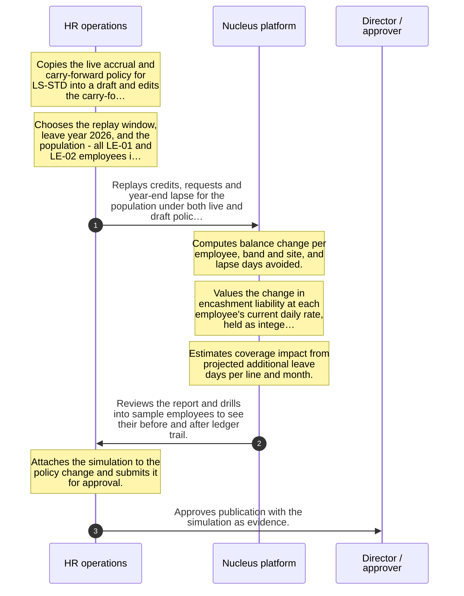

**Alternate flows**

| ID | At step | Condition | Steps | Rejoins |
| :--- | ---: | :--- | :--- | :--- |
| A1 | 7 | HR wants to try another value. | HR edits the draft to 40 days and reruns; both scenarios are kept side by side. | Returns to step 3 |
| A2 | 9 | The approver rejects the change. | The reason is recorded and the draft stays unpublished. | Ends |

**Exception flows**

| ID | At step | Condition | Handling | Rule |
| :--- | ---: | :--- | :--- | :--- |
| E1 | 3 | Ledger history is incomplete for some employees, for example mid-year joiners from migration. | Those employees are simulated from their opening balance and listed as partial-history in the report. | RL-230 |
| E2 | 5 | A user without compensation scope runs the simulation. | Liability values are withheld and only day counts are shown. |  |

**Postconditions — success**

- A simulation report shows per-band and per-site balance change, liability change and coverage impact, and is attached to the policy change for approval.

**Postconditions — failure**

- The simulation is discarded or fails; live balances and the live policy are untouched.

**Quality requirements**

- Simulating one leave year for 5,000 employees completes in under 3 minutes.
- No simulation step writes to the live leave ledger.

### LVE-UC-015

**Flag leave requests that breach team coverage** — Let managers define minimum staffing per team or line and flag leave requests that would breach it at application time.

| Attribute | Value |
| :--- | :--- |
| Realises | LVE-CG-007 |
| Source | Authored |
| Level | User goal |
| Primary actor | Manager / supervisor |
| Secondary actors | Employee / worker, Nucleus platform, Plant HR / time office, HR operations |
| Trigger | A manager defines a coverage rule, or an employee applies for leave on a line governed by one. |
| Frequency | Daily |
| Criticality | High |
| Phase | P2 |
| Client requirements | — |
| Business rules | RL-190, RL-194, RL-010, RL-013, RL-014 |
| Screens | SCR-030, SCR-040 |
| Data objects (CRUD) | coverage_rule (C/U), leave_request (C/U), roster (R), coverage_verdict (C) |
| Events | leave.coverage.breach_flagged |
| Acceptance tests | LVE-TC-029, LVE-TC-030, LVE-TC-031, LVE-TC-032, LVE-TC-033, LVE-TC-034 |
| System requirements | SYS-026, SYS-036, SYS-037, SYS-040, SYS-070 |

**Stakeholders and interests**

| Stakeholder | Interest |
| :--- | :--- |
| Manager / supervisor | Lines keep enough qualified people on every shift. |
| Employee / worker | Knows at the time of applying whether a date is constrained and can choose another. |
| Plant HR / time office | Fewer last-minute shortfalls that force overtime. |

**Preconditions**

- Line or team membership and rostered shifts are recorded for the period.
- Approved and pending leave for the team is visible to the coverage check.

**Main success scenario**

| # | Actor | Action | Ref |
| ---: | :--- | :--- | :--- |
| 1 | Manager / supervisor | Defines minimum staffing for Peenya Machining shift A as 8 operators, with an effective date. |  |
| 2 | Employee / worker | Applies for earned leave on 2026-11-20 and 2026-11-21. |  |
| 3 | Nucleus platform | Runs leave rule validation, then counts rostered workers net of approved and pending leave for each requested date and shift. |  |
| 4 | Nucleus platform | Shows the employee that 2026-11-21 would leave 7 operators against a minimum of 8 and suggests nearby dates with headroom. |  |
| 5 | Employee / worker | Submits the request anyway with a reason. |  |
| 6 | Nucleus platform | Starts the approval chain with the coverage verdict attached to the request. |  |
| 7 | Manager / supervisor | Approves with a recorded coverage override reason or rejects with a reason. |  |
| 8 | Nucleus platform | Updates coverage for the dates and notifies Plant HR of any approved breach. |  |

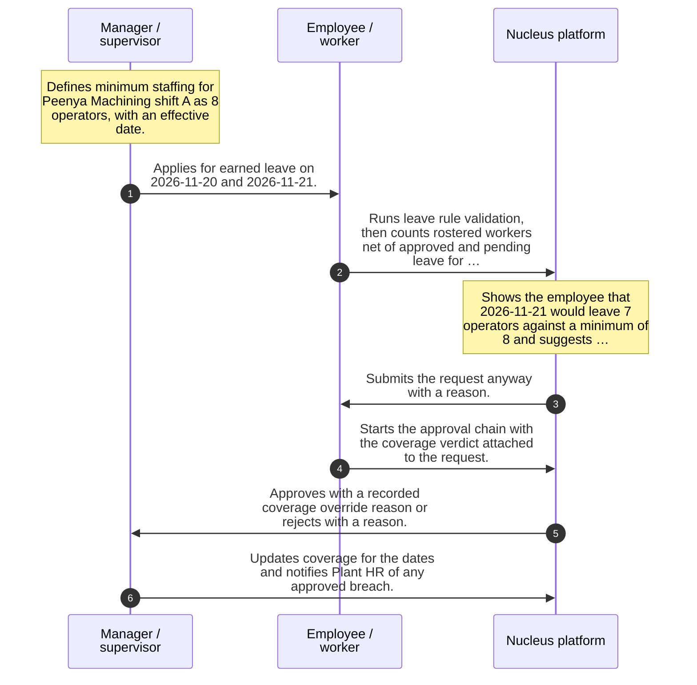

**Alternate flows**

| ID | At step | Condition | Steps | Rejoins |
| :--- | ---: | :--- | :--- | :--- |
| A1 | 4 | The employee changes dates to ones with headroom. | The platform re-evaluates coverage and shows no breach. | Returns to step 6 |
| A2 | 3 | Several requests are pending for the same date. | Pending requests are counted in submission order and each is told its position. | Returns to step 4 |

**Exception flows**

| ID | At step | Condition | Handling | Rule |
| :--- | ---: | :--- | :--- | :--- |
| E1 | 3 | The roster for the requested period is not yet published. | The verdict is 'coverage not evaluable' and the approver is told so. | RL-194 |
| E2 | 7 | The approver tries to approve a breach without a reason. | Approval is refused until a reason is entered. | RL-013 |

**Postconditions — success**

- Each leave request carries a coverage verdict; approvers see it, and breaching requests are approved only with a recorded reason.

**Postconditions — failure**

- If the coverage rule cannot be evaluated, the request proceeds with a stated warning and no silent approval.

**Quality requirements**

- The coverage verdict is returned to the applicant in under 1 s at p95.
- Coverage counts reflect leave approved up to the second before the check.

## Approval & Sign-off

| Role | Name | Date | Decision | Conditions / comments |
| :--- | :--- | :--- | :--- | :--- |
| Author | Dhanraj Dadhich | 2026-11-05 | Submitted | |
| Peer review moderator | *pending* | | | PR-xxxx |
| PQA (process compliance) | *pending* | | | |
| Approval authority (DOC-01 §7) | *pending* | | | |

## Measurement Data Captured

| Measure | Value | Unit | Notes |
| :--- | :--- | :--- | :--- |
| Size | 448 | specified items (table rows) | Counted automatically at generation |
| Authoring effort | *to be recorded* | person-hours | |
| Review effort (preparation + meeting) | *pending review* | person-hours | From PR-xxxx |
| Rework effort | *pending review* | person-hours | |
| Review rate | *pending review* | items / hour | Compare with PPB control limits |
| Requirement volatility (changes since baseline) | 0 | CRs touching this artefact | Not yet baselined (CM-03) |

**Defects found, by detection phase and severity**

| Detection phase | Major | Minor | Editorial | Injected in phase (major) |
| :--- | :--- | :--- | :--- | :--- |
| Author self-check | 0 | 0 | 0 | — |
| Peer review | *pending* | | | |
| Design / build | | | | |
| System / integration test | | | | |
| UAT | | | | |
| Production (escaped) | | | | each escaped major opens a CAR record (CAR-01) |

Within control limits of the review-rate PPB? *To be assessed at peer review.*

## Revision History

| Version | Date | Author | Change summary | CR ref | Approved by |
| :--- | :--- | :--- | :--- | :--- | :--- |
| 1.0.0 | 2026-11-05 | Dhanraj Dadhich | Consolidated release | CR-0001 | *pending* |
