

<picture>
  <source media="(prefers-color-scheme: dark)" srcset="../../assets/MultipliersKraftLogoDark.png">
  
</picture>

# FRS-PAY-01 — Payroll — Process Specifications

| Attribute | Value |
| :--- | :--- |
| Document ID | FRS-PAY-01 |
| Title | Payroll — Process Specifications |
| Product | Nucleus Suite (Nucleus HRMS Suite) |
| Version | 1.0.0 |
| Status | Issued for approval |
| Owner (role) | Domain Product Owner — Payroll |
| Author | Dhanraj Dadhich |
| Reviewed by | *pending* |
| Approved by | Product Council — *pending* |
| Date | 2026-11-05 |
| Classification | Internal |
| CMMI practice areas | RDM, TS |
| Related documents | FRS-PAY-00, FRS-PAY-01, FRS-PAY-02, FRS-PAY-03, FRS-PAY-04, FRS-PAY-05, FRS-PAY-06, FRS-PAY-07, FRS-PAY-08, FRS-PAY-09, FRS-PAY-10, FRS-PAY-11, FRS-PAY-12, FRS-PAY-13, BRS-01, SRS-01, REQ-01, REQ-02 |
| Quality & process-performance objectives | QPPO-05 (effective requirements reviews), QPPO-01 (escaped defects) — MPM-01 |
| Process performance baseline used | PPB-01 (review defect density), PPB-02 (review rate) — MPM-01 |
| Peer review record | *pending* (PR-xxxx, QA-02) |
| Tailoring record | none |
| Traceability anchor | BG-04 · processes PAY-01–PAY-14 |
| Source of record | Nucleus — Process Flows & Process Maps v1.0 — sheet(s) 03_Process_Inventory, 04_Process_Steps, 05_Swimlane_Maps Nucleus HR Demo Points Build Sheet v1.0 — sheet(s) 07_Approval_Workflows Nucleus HRMS Demo Dataset v1.1 — sheet(s) 64_Approval_Workflows |

> **Source of record.** Requirements in this document are taken from the source workbook(s) named above and keep their workbook IDs, which are never renumbered. Changes are made through a change request (CM-02) against the source workbook. Sections marked **Authored** are original additions that are not present in the source workbooks.

Step types: TASK (human) · SYS (system, unattended) · DEC (decision) · APPR (approval gate) · INT (integration call) · WAIT (timer or external event) · AGENT (agent-executed, governed). CRUD: C create · R read · U update · D delete-by-end-dating (temporal facts are never hard-deleted). In the flow diagrams decisions are diamonds, approvals are double-bordered boxes and integration, wait and agent steps are rounded.

## 1. Process inventory

| Process ID | Process | Trigger | Primary actor | Frequency | Criticality | Blueprint module | Phase | Reuses | Demo pts | Note |
| :--- | :--- | :--- | :--- | :--- | :--- | :--- | :--- | :--- | :--- | :--- |
| PAY-01 | Period setup and run creation | Cycle start or off-cycle need | Payroll manager | Monthly+ | Critical | Module 3 | P1 | CMP-10 | 10 | run_type is set here. A period carries several runs. |
| PAY-02 | Input lock and immutable snapshot | Cut-off reached | Payroll manager | Per run | Critical | Module 3 | P1 | CMP-05, CMP-10 |  | Hashed snapshot of inputs, rule pack versions and config. Reproducibility depends on it. |
| PAY-03 | Pre-payroll audit | Snapshot taken | Payroll manager + agent | Per run | Critical | Module 3 | P1 | CMP-05 | 15 | Rule checks first, statistical second. CRITICAL flags block approval. |
| PAY-04 | Gross-to-net DAG execution | Audit cleared | System | Per run | Critical | Module 3 | P1 | CMP-03 |  | Topological, once per employee, every intermediate stored. Integer money. |
| PAY-05 | Wage base and 50% floor add-back | Inside the DAG | System | Per run | Critical | Modules 3, 6 | P1 | CMP-03 |  | One node, versioned, testable in isolation, simulatable. |
| PAY-06 | Daily-wage earnings computation | Inside the DAG for daily classes | System | Per run | Critical | Module 3 | P1 | CMP-03 | 2 | A separate node, not a proration parameter. Visible as such on the payslip. |
| PAY-07 | Statutory computation (PF, ESI, PT, LWF, TDS) | Inside the DAG | System | Per run | Critical | Modules 3, 6 | P1 | CMP-03, CMP-09 | 17 | Central pack + state pack. PT differs by state on one run. |
| PAY-08 | Loan, advance and EWA recovery | Inside the DAG | System | Per run | High | Modules 3, 12 | P1 | CMP-03 | 9 | Respect the net-pay floor; stop on closure; report balance back to CMB. |
| PAY-09 | Review, approval and disbursement | Calculation complete | Payroll manager, Finance | Per run | Critical | Module 3 | P1 | CMP-01, CMP-05 | 15 | Dual control, out-of-band verification of bank totals. |
| PAY-10 | Off-cycle overtime run | OT approved for the period | Payroll manager | Monthly | High | Module 3 | P1 | CMP-03 | 10 | Own approval path, own bank file, own journal. Screens need a run selector. |
| PAY-11 | Arrears and retro processing | Retro change on a closed period | System | Monthly | Critical | Module 3 | P2 | CMP-03, CMP-10 |  | Recompute as-at the old rule version, difference posted as arrears. |
| PAY-12 | Full-and-final run | Clearance complete | Payroll manager | Per exit | Critical | Modules 3, 5 | P1 | CMP-03, CMP-05 | 16 | Blocked while any blocking clearance item is open — same lock as PAY-02. |
| PAY-13 | Payslip publication and retrieval | Run disbursed | Employee | Monthly | High | Modules 3, 4 | P1 | CMP-08 | 10 | Run selector everywhere. Offline view on mobile. |
| PAY-14 | Rollback and reversal | Defect found pre-disbursement | Payroll manager | Rare | Critical | Module 3 | P1 | CMP-05 |  | Permitted up to DISBURSEMENT_PREPARED. Beyond that, arrears only. |

## 2. Step-level specifications

### PAY-01 — Period setup and run creation

**Trigger:** Cycle start or off-cycle need · **Primary actor:** Payroll manager · **Frequency:** Monthly+ · **Criticality:** Critical · **Phase:** P1 · **Reuses:** CMP-10

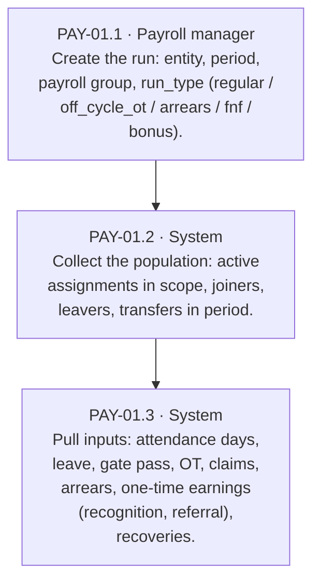

| Step | Step ID | Lane / actor | Type | Action or decision | Rule ID(s) | Objects touched (CRUD) | Key fields | Screen | Event emitted | Exception / note | Reuses | Demo pts | Phase |
| :--- | :--- | :--- | :--- | :--- | :--- | :--- | :--- | :--- | :--- | :--- | :--- | :--- | :--- |
| 1 | PAY-01.1 | Payroll manager | TASK | Create the run: entity, period, payroll group, run_type (regular \| off_cycle_ot \| arrears \| fnf \| bonus). | RL-240 | payroll_run C | run_id, legal_entity_id, period, payroll_group, run_type, pay_date | SCR-050 | payroll.run.created | A period carries several runs. Any screen assuming one run per period is wrong. |  | 10 | P1 |
| 2 | PAY-01.2 | System | SYS | Collect the population: active assignments in scope, joiners, leavers, transfers in period. | RL-241 | assignment R | population list, mid_cycle_flags | SCR-050 |  |  |  | 10 | P1 |
| 3 | PAY-01.3 | System | SYS | Pull inputs: attendance days, leave, gate pass, OT, claims, arrears, one-time earnings (recognition, referral), recoveries. | RL-242 | attendance_day R; leave_ledger R; overtime_record R; payroll_input R | input set | SCR-050 |  |  |  | 10 | P1 |

### PAY-02 — Input lock and immutable snapshot

**Trigger:** Cut-off reached · **Primary actor:** Payroll manager · **Frequency:** Per run · **Criticality:** Critical · **Phase:** P1 · **Reuses:** CMP-05, CMP-10

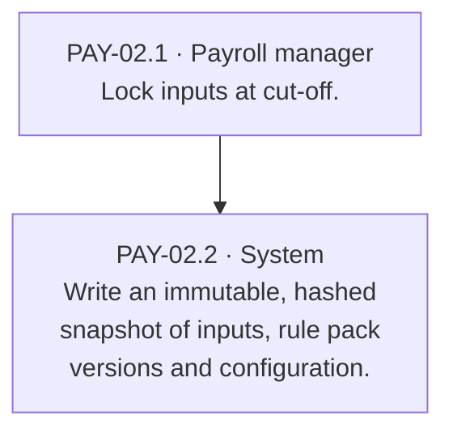

| Step | Step ID | Lane / actor | Type | Action or decision | Rule ID(s) | Objects touched (CRUD) | Key fields | Screen | Event emitted | Exception / note | Reuses | Demo pts | Phase |
| :--- | :--- | :--- | :--- | :--- | :--- | :--- | :--- | :--- | :--- | :--- | :--- | :--- | :--- |
| 1 | PAY-02.1 | Payroll manager | TASK | Lock inputs at cut-off. | RL-250 | payroll_run U | run_state(INPUTS_LOCKED), locked_at, locked_by | SCR-050 | payroll.inputs.locked | Late punches after this point raise exceptions rather than changing the run. | CMP-05 |  | P1 |
| 2 | PAY-02.2 | System | SYS | Write an immutable, hashed snapshot of inputs, rule pack versions and configuration. | RL-251 | payroll_snapshot C | snapshot_id, input_hash, rule_pack_versions[], config_version, snapshot_ts | — | payroll.snapshot.taken | A run from eleven months ago must recompute today and match to the paisa. | CMP-05 |  | P1 |

### PAY-03 — Pre-payroll audit

**Trigger:** Snapshot taken · **Primary actor:** Payroll manager + agent · **Frequency:** Per run · **Criticality:** Critical · **Phase:** P1 · **Reuses:** CMP-05

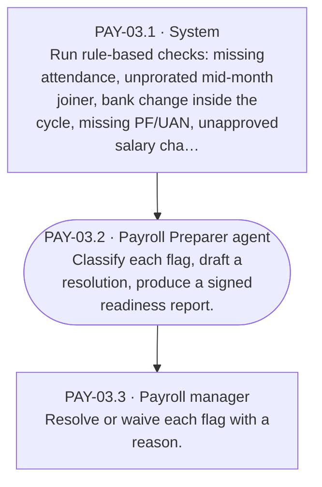

| Step | Step ID | Lane / actor | Type | Action or decision | Rule ID(s) | Objects touched (CRUD) | Key fields | Screen | Event emitted | Exception / note | Reuses | Demo pts | Phase |
| :--- | :--- | :--- | :--- | :--- | :--- | :--- | :--- | :--- | :--- | :--- | :--- | :--- | :--- |
| 1 | PAY-03.1 | System | SYS | Run rule-based checks: missing attendance, unprorated mid-month joiner, bank change inside the cycle, missing PF/UAN, unapproved salary change, negative net, active employee with no assignment, duplicate bank account, loan deduction exceeding net, gate-pass minutes not reconciling, days not recomputed since the last rule change. | RL-260 | payroll_audit_flag C | flag_id, check_code, severity, person_id, detail, owner, state | SCR-051 | payroll.audit.completed | Rule checks first because they are explainable; statistical checks second. | CMP-05 | 15 | P1 |
| 2 | PAY-03.2 | Payroll Preparer agent | AGENT | Classify each flag, draft a resolution, produce a signed readiness report. | RL-261 | action_ledger C | classification, proposed_resolution, confidence | SCR-051 | agent.action.proposed | Propose only. Always. No autonomous payroll change. | CMP-11 | 15 | P1 |
| 3 | PAY-03.3 | Payroll manager | TASK | Resolve or waive each flag with a reason. | RL-262 | payroll_audit_flag U | state, resolved_by, resolution_note | SCR-051 |  | A CRITICAL flag blocks approval and cannot be waived below its role threshold. | CMP-05 | 15 | P1 |

### PAY-04 — Gross-to-net DAG execution

**Trigger:** Audit cleared · **Primary actor:** System · **Frequency:** Per run · **Criticality:** Critical · **Phase:** P1 · **Reuses:** CMP-03

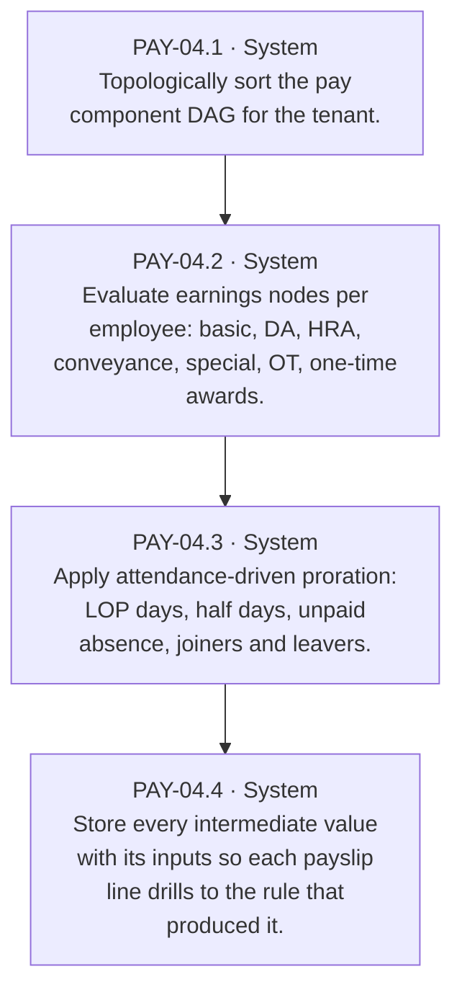

| Step | Step ID | Lane / actor | Type | Action or decision | Rule ID(s) | Objects touched (CRUD) | Key fields | Screen | Event emitted | Exception / note | Reuses | Demo pts | Phase |
| :--- | :--- | :--- | :--- | :--- | :--- | :--- | :--- | :--- | :--- | :--- | :--- | :--- | :--- |
| 1 | PAY-04.1 | System | SYS | Topologically sort the pay component DAG for the tenant. | RL-270 | pay_component R | component_code, depends_on[], formula, sequence | — |  |  |  |  | P1 |
| 2 | PAY-04.2 | System | SYS | Evaluate earnings nodes per employee: basic, DA, HRA, conveyance, special, OT, one-time awards. | RL-271 | payslip_line C | component_code, amount_paise, basis, rule_ref | — |  | Integer money in the smallest currency unit. No floating point. | CMP-03 |  | P1 |
| 3 | PAY-04.3 | System | SYS | Apply attendance-driven proration: LOP days, half days, unpaid absence, joiners and leavers. | RL-272 | payslip_line U | payable_days, lop_days, proration_basis | — |  | Proration across any month boundary must sum to the full-month value (property test). | CMP-03 |  | P1 |
| 4 | PAY-04.4 | System | SYS | Store every intermediate value with its inputs so each payslip line drills to the rule that produced it. | RL-273 | payslip_line_trace C | node, inputs, output, rule_pack_version | SCR-053 |  | Explainability is a non-negotiable property, not a report. | CMP-06 |  | P1 |

### PAY-05 — Wage base and 50% floor add-back

**Trigger:** Inside the DAG · **Primary actor:** System · **Frequency:** Per run · **Criticality:** Critical · **Phase:** P1 · **Reuses:** CMP-03

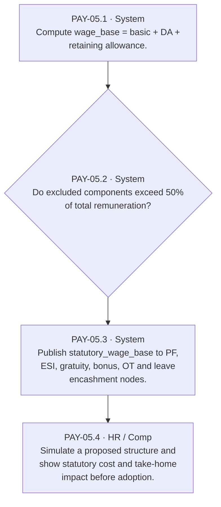

| Step | Step ID | Lane / actor | Type | Action or decision | Rule ID(s) | Objects touched (CRUD) | Key fields | Screen | Event emitted | Exception / note | Reuses | Demo pts | Phase |
| :--- | :--- | :--- | :--- | :--- | :--- | :--- | :--- | :--- | :--- | :--- | :--- | :--- | :--- |
| 1 | PAY-05.1 | System | SYS | Compute wage_base = basic + DA + retaining allowance. | RL-280 | payslip_line C | wage_base | — |  |  |  |  | P1 |
| 2 | PAY-05.2 | System | DEC | Do excluded components exceed 50% of total remuneration? | RL-281 | — | excluded_total, gross, excess | — |  | Yes → add the excess back to the wage base (Code on Wages). | CMP-03 |  | P1 |
| 3 | PAY-05.3 | System | SYS | Publish statutory_wage_base to PF, ESI, gratuity, bonus, OT and leave encashment nodes. | RL-282 | payslip_line U | statutory_wage_base | — |  | ONE node, computed once, versioned, testable in isolation. | CMP-03 |  | P1 |
| 4 | PAY-05.4 | HR / Comp | TASK | Simulate a proposed structure and show statutory cost and take-home impact before adoption. | RL-283 | simulation_run C | proposed_structure, per_employee_delta, aggregate_delta | SCR-052 | payroll.simulation.run | Sell the simulator; it opens doors. | CMP-03 |  | P1 |

### PAY-06 — Daily-wage earnings computation

**Trigger:** Inside the DAG for daily classes · **Primary actor:** System · **Frequency:** Per run · **Criticality:** Critical · **Phase:** P1 · **Reuses:** CMP-03

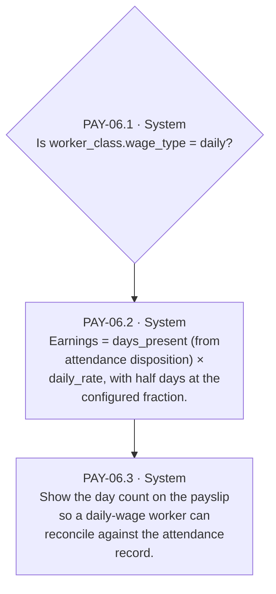

| Step | Step ID | Lane / actor | Type | Action or decision | Rule ID(s) | Objects touched (CRUD) | Key fields | Screen | Event emitted | Exception / note | Reuses | Demo pts | Phase |
| :--- | :--- | :--- | :--- | :--- | :--- | :--- | :--- | :--- | :--- | :--- | :--- | :--- | :--- |
| 1 | PAY-06.1 | System | DEC | Is worker_class.wage_type = daily? | RL-290 | assignment R | wage_type | — |  | Yes → evaluate the daily-wage earnings node, not the monthly node with a proration parameter. | CMP-03 | 2 | P1 |
| 2 | PAY-06.2 | System | SYS | Earnings = days_present (from attendance disposition) × daily_rate, with half days at the configured fraction. | RL-291 | payslip_line C | days_present, half_days, daily_rate, amount | — |  |  |  | 2 | P1 |
| 3 | PAY-06.3 | System | SYS | Show the day count on the payslip so a daily-wage worker can reconcile against the attendance record. | RL-292 | payslip_line U | display_basis | SCR-053 |  |  |  | 2 | P1 |

### PAY-07 — Statutory computation (PF, ESI, PT, LWF, TDS)

**Trigger:** Inside the DAG · **Primary actor:** System · **Frequency:** Per run · **Criticality:** Critical · **Phase:** P1 · **Reuses:** CMP-03, CMP-09

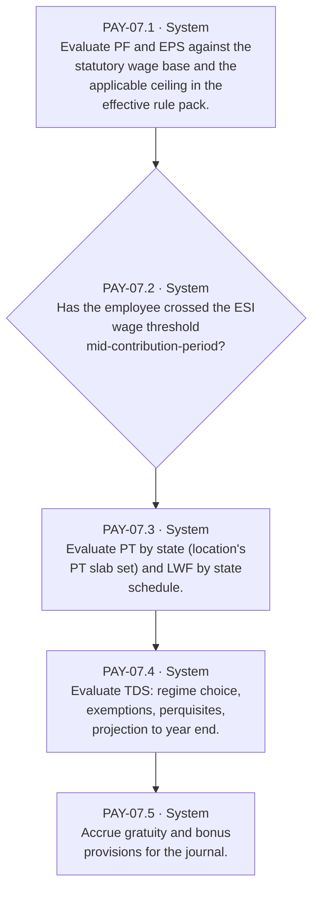

| Step | Step ID | Lane / actor | Type | Action or decision | Rule ID(s) | Objects touched (CRUD) | Key fields | Screen | Event emitted | Exception / note | Reuses | Demo pts | Phase |
| :--- | :--- | :--- | :--- | :--- | :--- | :--- | :--- | :--- | :--- | :--- | :--- | :--- | :--- |
| 1 | PAY-07.1 | System | SYS | Evaluate PF and EPS against the statutory wage base and the applicable ceiling in the effective rule pack. | RL-300 | payslip_line C | pf_employee, pf_employer, eps, wage_base_used, rule_pack_version | — |  |  | CMP-09 | 17 | P1 |
| 2 | PAY-07.2 | System | DEC | Has the employee crossed the ESI wage threshold mid-contribution-period? | RL-301 | — | esi_wage, contribution_period | — |  | They continue to the end of the period. Getting this wrong is noticed immediately. | CMP-09 | 17 | P1 |
| 3 | PAY-07.3 | System | SYS | Evaluate PT by state (location's PT slab set) and LWF by state schedule. | RL-302 | payslip_line C | pt_state, pt_amount, lwf_amount | — |  | PT differs by state on the same run, and does not apply in every state. | CMP-09 | 17 | P1 |
| 4 | PAY-07.4 | System | SYS | Evaluate TDS: regime choice, exemptions, perquisites, projection to year end. | RL-303 | payslip_line C | regime, projected_income, tds_amount | SCR-054 |  | Mid-year regime switch is an expected case, not an exception. | CMP-09 | 17 | P1 |
| 5 | PAY-07.5 | System | SYS | Accrue gratuity and bonus provisions for the journal. | RL-304 | provision_line C | gratuity_provision, bonus_provision | — |  | Bonus under the Code on Wages uses the same wage base node. | CMP-03 | 17 | P1 |

### PAY-08 — Loan, advance and EWA recovery

**Trigger:** Inside the DAG · **Primary actor:** System · **Frequency:** Per run · **Criticality:** High · **Phase:** P1 · **Reuses:** CMP-03

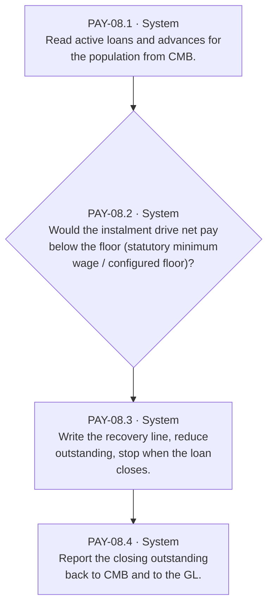

| Step | Step ID | Lane / actor | Type | Action or decision | Rule ID(s) | Objects touched (CRUD) | Key fields | Screen | Event emitted | Exception / note | Reuses | Demo pts | Phase |
| :--- | :--- | :--- | :--- | :--- | :--- | :--- | :--- | :--- | :--- | :--- | :--- | :--- | :--- |
| 1 | PAY-08.1 | System | SYS | Read active loans and advances for the population from CMB. | RL-310 | loan R | loan_id, instalment, outstanding, status | — |  | Payroll recovers; it does not originate, judge eligibility or hold the balance. | CMP-02 | 9 | P1 |
| 2 | PAY-08.2 | System | DEC | Would the instalment drive net pay below the floor (statutory minimum wage / configured floor)? | RL-311 | — | net_before_recovery, floor | — | payroll.recovery.reduced | Yes → reduce or skip the instalment, flag it, and carry the shortfall forward. |  | 9 | P1 |
| 3 | PAY-08.3 | System | SYS | Write the recovery line, reduce outstanding, stop when the loan closes. | RL-312 | payslip_line C; loan_repayment C; loan U | amount, run_id, outstanding_after | — | loan.repayment.posted |  | CMP-02 | 9 | P1 |
| 4 | PAY-08.4 | System | SYS | Report the closing outstanding back to CMB and to the GL. | RL-313 | loan U | outstanding, status | — | loan.closed | Closure is what triggers guarantor release (CMB-04). |  | 9 | P1 |

### PAY-09 — Review, approval and disbursement

**Trigger:** Calculation complete · **Primary actor:** Payroll manager, Finance · **Frequency:** Per run · **Criticality:** Critical · **Phase:** P1 · **Reuses:** CMP-01, CMP-05

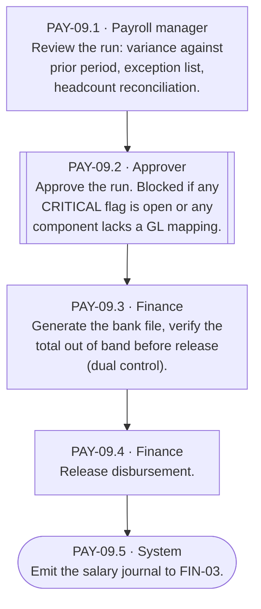

| Step | Step ID | Lane / actor | Type | Action or decision | Rule ID(s) | Objects touched (CRUD) | Key fields | Screen | Event emitted | Exception / note | Reuses | Demo pts | Phase |
| :--- | :--- | :--- | :--- | :--- | :--- | :--- | :--- | :--- | :--- | :--- | :--- | :--- | :--- |
| 1 | PAY-09.1 | Payroll manager | TASK | Review the run: variance against prior period, exception list, headcount reconciliation. | RL-320 | payroll_run U | run_state(REVIEW), variance_report | SCR-050 |  |  |  | 15 | P1 |
| 2 | PAY-09.2 | Approver | APPR | Approve the run. Blocked if any CRITICAL flag is open or any component lacks a GL mapping. | RL-321 | payroll_run U | run_state(APPROVED), approved_by | SCR-040 | payroll.run.approved | Unmapped component blocks APPROVED (demo point 15). | CMP-01 | 15 | P1 |
| 3 | PAY-09.3 | Finance | TASK | Generate the bank file; verify the total out of band before release (dual control). | RL-322 | bank_file C | file_ref, total_amount, account_count, checksum | SCR-055 | payroll.bank_file.prepared | Alert on any bank-detail change inside the payroll window. | CMP-05 | 15 | P1 |
| 4 | PAY-09.4 | Finance | TASK | Release disbursement. | RL-323 | payroll_run U | run_state(DISBURSED), disbursed_at | SCR-055 | payroll.run.disbursed | Beyond DISBURSEMENT_PREPARED, corrections are arrears only. |  | 15 | P1 |
| 5 | PAY-09.5 | System | INT | Emit the salary journal to FIN-03. | RL-324 | gl_journal C | journal_id, run_id, lines[] | — | payroll.journal.ready |  |  | 15 | P1 |

### PAY-10 — Off-cycle overtime run

**Trigger:** OT approved for the period · **Primary actor:** Payroll manager · **Frequency:** Monthly · **Criticality:** High · **Phase:** P1 · **Reuses:** CMP-03

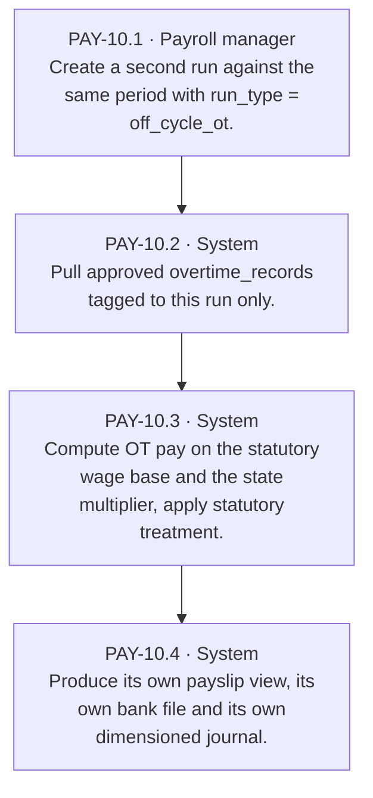

| Step | Step ID | Lane / actor | Type | Action or decision | Rule ID(s) | Objects touched (CRUD) | Key fields | Screen | Event emitted | Exception / note | Reuses | Demo pts | Phase |
| :--- | :--- | :--- | :--- | :--- | :--- | :--- | :--- | :--- | :--- | :--- | :--- | :--- | :--- |
| 1 | PAY-10.1 | Payroll manager | TASK | Create a second run against the same period with run_type = off_cycle_ot. | RL-330 | payroll_run C | run_type, period, pay_date | SCR-050 | payroll.run.created | Demo: PR-2026-09-01 regular pays 30 Sep; PR-2026-09-02 OT pays 07 Oct. |  | 10 | P1 |
| 2 | PAY-10.2 | System | SYS | Pull approved overtime_records tagged to this run only. | RL-331 | overtime_record R | pay_in_run_id, ot_minutes, rate_multiplier | — |  |  |  | 10 | P1 |
| 3 | PAY-10.3 | System | SYS | Compute OT pay on the statutory wage base and the state multiplier; apply statutory treatment. | RL-332 | payslip_line C | ot_amount, multiplier, wage_base_used | — |  |  | CMP-03 | 10 | P1 |
| 4 | PAY-10.4 | System | SYS | Produce its own payslip view, its own bank file and its own dimensioned journal. | RL-333 | bank_file C; gl_journal C | run_type dimension | SCR-053 | payroll.journal.ready | Finance sees overtime cost as its own line, not a restated salary figure. |  | 10 | P1 |

### PAY-11 — Arrears and retro processing

**Trigger:** Retro change on a closed period · **Primary actor:** System · **Frequency:** Monthly · **Criticality:** Critical · **Phase:** P2 · **Reuses:** CMP-03, CMP-10

The source workbook specifies this process at inventory level only. Its complete flow is specified in use case PAY-UC-011 (FRS-PAY-12).

### PAY-12 — Full-and-final run

**Trigger:** Clearance complete · **Primary actor:** Payroll manager · **Frequency:** Per exit · **Criticality:** Critical · **Phase:** P1 · **Reuses:** CMP-03, CMP-05

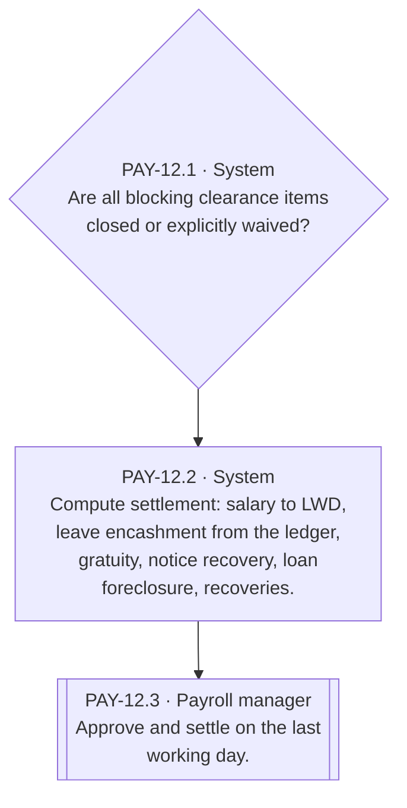

| Step | Step ID | Lane / actor | Type | Action or decision | Rule ID(s) | Objects touched (CRUD) | Key fields | Screen | Event emitted | Exception / note | Reuses | Demo pts | Phase |
| :--- | :--- | :--- | :--- | :--- | :--- | :--- | :--- | :--- | :--- | :--- | :--- | :--- | :--- |
| 1 | PAY-12.1 | System | DEC | Are all blocking clearance items closed or explicitly waived? | RL-340 | clearance_item R | blocking, status | SCR-061 |  | No → F&F run is held. Same lock semantics as the payroll input lock — reuse, do not reimplement. | CMP-05 | 16 | P1 |
| 2 | PAY-12.2 | System | SYS | Compute settlement: salary to LWD, leave encashment from the ledger, gratuity, notice recovery, loan foreclosure, recoveries. | RL-341 | payslip_line C | components[], notice_recovery, gratuity, encashment | SCR-056 |  | Negative net is a legitimate outcome and must be handled, not blocked. | CMP-03 | 16 | P1 |
| 3 | PAY-12.3 | Payroll manager | APPR | Approve and settle on the last working day. | RL-342 | payroll_run U | run_type(fnf), run_state | SCR-040 | payroll.fnf.settled | Only achievable because clearance ran in parallel with notice (demo point 16). | CMP-01 | 16 | P1 |

### PAY-13 — Payslip publication and retrieval

**Trigger:** Run disbursed · **Primary actor:** Employee · **Frequency:** Monthly · **Criticality:** High · **Phase:** P1 · **Reuses:** CMP-08

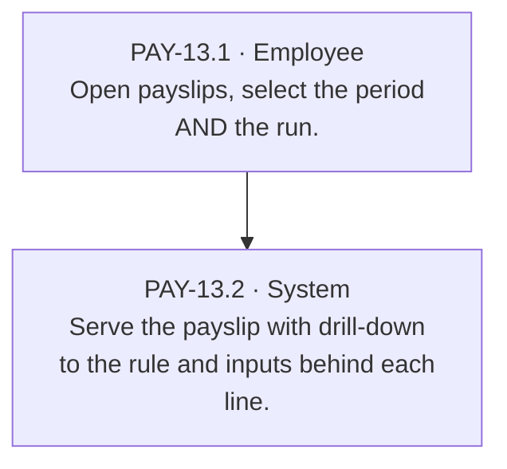

| Step | Step ID | Lane / actor | Type | Action or decision | Rule ID(s) | Objects touched (CRUD) | Key fields | Screen | Event emitted | Exception / note | Reuses | Demo pts | Phase |
| :--- | :--- | :--- | :--- | :--- | :--- | :--- | :--- | :--- | :--- | :--- | :--- | :--- | :--- |
| 1 | PAY-13.1 | Employee | TASK | Open payslips; select the period AND the run. | RL-350 | payslip R | period, run_id, run_type | SCR-053 |  | Run selector everywhere — a period has several runs. | CMP-08 | 10 | P1 |
| 2 | PAY-13.2 | System | SYS | Serve the payslip with drill-down to the rule and inputs behind each line. | RL-351 | payslip_line_trace R | line, rule_ref, inputs | SCR-053 | payslip.viewed | Offline-capable on mobile. | CMP-08 | 10 | P1 |

### PAY-14 — Rollback and reversal

**Trigger:** Defect found pre-disbursement · **Primary actor:** Payroll manager · **Frequency:** Rare · **Criticality:** Critical · **Phase:** P1 · **Reuses:** CMP-05

The source workbook specifies this process at inventory level only. Its complete flow is specified in use case PAY-UC-014 (FRS-PAY-12).

## 3. Swimlane maps

### SM-5 — PAYROLL CYCLE INCLUDING THE OFF-CYCLE OT RUN (demo points 10, 15)

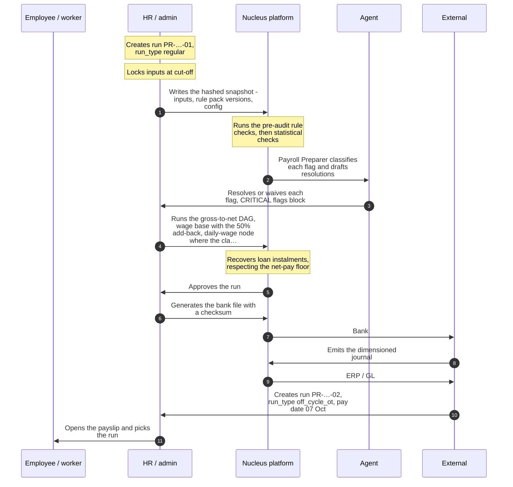

| Step | Employee / worker | Manager | HR / admin | System (Nucleus) | Agent | External | Note |
| :--- | :--- | :--- | :--- | :--- | :--- | :--- | :--- |
| 1 |  |  | Creates run PR-…-01, run_type regular |  |  |  |  |
| 2 |  |  | Locks inputs at cut-off |  |  |  | Late punches now raise exceptions, not changes |
| 3 |  |  |  | Writes the hashed snapshot: inputs, rule pack versions, config |  |  |  |
| 4 |  |  |  | Runs the pre-audit rule checks, then statistical checks |  |  |  |
| 5 |  |  |  |  | Payroll Preparer classifies each flag and drafts resolutions |  | Propose only. Always. |
| 6 |  |  | Resolves or waives each flag; CRITICAL flags block |  |  |  |  |
| 7 |  |  |  | Runs the gross-to-net DAG; wage base with the 50% add-back; daily-wage node where the class says so |  |  |  |
| 8 |  |  |  | Recovers loan instalments, respecting the net-pay floor |  |  |  |
| 9 |  |  | Approves the run |  |  |  | Blocked if any component lacks a GL mapping |
| 10 |  |  |  | Generates the bank file with a checksum |  | Bank | Total verified out of band, dual control |
| 11 |  |  |  | Emits the dimensioned journal |  | ERP / GL | Split at employee level before aggregation |
| 12 |  |  | Creates run PR-…-02, run_type off_cycle_ot, pay date 07 Oct |  |  |  | Its own approval, bank file and journal |
| 13 | Opens the payslip and picks the run |  |  |  |  |  | Run selector everywhere |

## 4. Approval workflows

_No entries in source for this scope._

### Workflow behaviour

_No entries in source for this scope._

## Approval & Sign-off

| Role | Name | Date | Decision | Conditions / comments |
| :--- | :--- | :--- | :--- | :--- |
| Author | Dhanraj Dadhich | 2026-11-05 | Submitted | |
| Peer review moderator | *pending* | | | PR-xxxx |
| PQA (process compliance) | *pending* | | | |
| Approval authority (DOC-01 §7) | *pending* | | | |

## Measurement Data Captured

| Measure | Value | Unit | Notes |
| :--- | :--- | :--- | :--- |
| Size | 69 | specified items (table rows) | Counted automatically at generation |
| Authoring effort | *to be recorded* | person-hours | |
| Review effort (preparation + meeting) | *pending review* | person-hours | From PR-xxxx |
| Rework effort | *pending review* | person-hours | |
| Review rate | *pending review* | items / hour | Compare with PPB control limits |
| Requirement volatility (changes since baseline) | 0 | CRs touching this artefact | Not yet baselined (CM-03) |

**Defects found, by detection phase and severity**

| Detection phase | Major | Minor | Editorial | Injected in phase (major) |
| :--- | :--- | :--- | :--- | :--- |
| Author self-check | 0 | 0 | 0 | — |
| Peer review | *pending* | | | |
| Design / build | | | | |
| System / integration test | | | | |
| UAT | | | | |
| Production (escaped) | | | | each escaped major opens a CAR record (CAR-01) |

Within control limits of the review-rate PPB? *To be assessed at peer review.*

## Revision History

| Version | Date | Author | Change summary | CR ref | Approved by |
| :--- | :--- | :--- | :--- | :--- | :--- |
| 1.0.0 | 2026-11-05 | Dhanraj Dadhich | Consolidated release | CR-0001 | *pending* |
