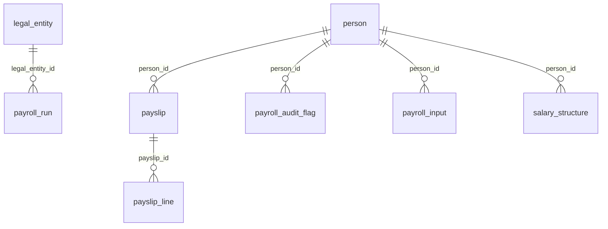

<picture>
  <source media="(prefers-color-scheme: dark)" srcset="../../assets/MultipliersKraftLogoDark.png">
  
</picture>

# FRS-PAY-05 — Payroll — Data Model

| Attribute | Value |
| :--- | :--- |
| Document ID | FRS-PAY-05 |
| Title | Payroll — Data Model |
| Product | Nucleus Suite (Nucleus HRMS Suite) |
| Version | 1.0.0 |
| Status | Issued for approval |
| Owner (role) | Domain Product Owner — Payroll |
| Author | Dhanraj Dadhich |
| Reviewed by | *pending* |
| Approved by | Product Council — *pending* |
| Date | 2026-11-05 |
| Classification | Internal |
| CMMI practice areas | TS, RDM |
| Related documents | FRS-PAY-00, FRS-PAY-01, FRS-PAY-02, FRS-PAY-03, FRS-PAY-04, FRS-PAY-05, FRS-PAY-06, FRS-PAY-07, FRS-PAY-08, FRS-PAY-09, FRS-PAY-10, FRS-PAY-11, FRS-PAY-12, FRS-PAY-13, BRS-01, SRS-01, REQ-01, REQ-02 |
| Quality & process-performance objectives | QPPO-05 (effective requirements reviews), QPPO-01 (escaped defects) — MPM-01 |
| Process performance baseline used | PPB-01 (review defect density), PPB-02 (review rate) — MPM-01 |
| Peer review record | *pending* (PR-xxxx, QA-02) |
| Tailoring record | none |
| Traceability anchor | BG-04 · processes PAY-01–PAY-14 |
| Source of record | Nucleus — Process Flows & Process Maps v1.0 — sheet(s) 06_Data_Dictionary Nucleus HR Demo Points Build Sheet v1.0 — sheet(s) 06_Enum_Values Nucleus HRMS Demo Dataset v1.1 — sheet(s) 65_Enum_Seed_Values |

> **Source of record.** Requirements in this document are taken from the source workbook(s) named above and keep their workbook IDs, which are never renumbered. Changes are made through a change request (CM-02) against the source workbook. Sections marked **Authored** are original additions that are not present in the source workbooks.

Every object carries the platform envelope (`tenant_id`, `entity_id`), effective dating (`effective_from`, `effective_to`) where temporal, and audit columns. Sensitivity classes follow GOV-10.

## 1. Entity relationships

Relationships are derived from the identifier fields in the data dictionary; the tenant envelope is omitted for legibility.

## 2. Data objects

| Object | Fields | Type | Required | Owner / source | Temporal | Sensitivity | Notes | Dataset ref |
| :--- | :--- | :--- | :--- | :--- | :--- | :--- | :--- | :--- |
| payroll_run | run_id, legal_entity_id, period, payroll_group, run_type(regular\|off_cycle_ot\|arrears\|fnf\|bonus), run_state, employee_count, gross, net, statutory, pay_date, gl_posted_on, external_doc_no | mixed | Y | Payroll | No | Confidential | A period carries several runs. Every screen needs a run selector. | 26_Payroll_Runs |
| payroll_snapshot | snapshot_id, run_id, input_hash, rule_pack_versions[], config_version, snapshot_ts | mixed | Y | System | No | — | Reproducibility to the paisa eleven months later depends on this row. |  |
| pay_component | component_code, name, type(earning\|deduction\|employer_cost\|provision), depends_on[], formula, sequence, taxable, pf_applicable, esi_applicable, display_on_payslip | mixed | Y | Config | Yes | — | Nodes in the gross-to-net DAG. | 35_GL_Mapping |
| salary_structure | person_id, effective_from, basic, da, hra, conveyance, special_allowance, daily_rate, monthly_retainer, gross, wage_base, excluded_components, excluded_pct, floor_addback, statutory_wage_base | money | Y | HR/Comp | Yes | Restricted | Columns after gross are DERIVED by the wage-base node, not entered. | 13_Salary_Structure |
| payslip | payslip_id, run_id, person_id, payable_days, lop_days, gross, deductions, net, published_at | money | Y | System | No | Restricted |  |  |
| payslip_line | line_id, payslip_id, component_code, amount_paise, basis, rule_ref, rule_pack_version | mixed | Y | System | No | Restricted | Integer money in the smallest currency unit. No floating point, ever. |  |
| payslip_line_trace | trace_id, line_id, node, inputs, output, rule_pack_version | json | Y | System | No | Restricted | Every line drills to the rule that produced it and the inputs it consumed. |  |
| payroll_audit_flag | flag_id, run_id, check_code, severity(CRITICAL\|HIGH\|INFO), person_id, detail, owner, state, resolution_note | mixed | N | System | No | — | A CRITICAL flag blocks approval. |  |
| payroll_input | input_id, run_id, person_id, component_code, amount, source(leave_encashment\|recognition\|referral\|claim\|arrears\|manual), source_ref, created_by | mixed | N | Various | No | — | Awards and referral payouts enter payroll HERE, never as side payments. | 30_Recognition_Referral |
| bank_file | file_ref, run_id, total_amount, account_count, checksum, generated_at, released_by, verified_by | mixed | Y | Finance | No | Restricted | Dual control; out-of-band total verification. |  |
| statutory_output | output_id, run_id, type(PF_ECR\|ESI\|PT\|LWF\|24Q\|Form16), state, period, file_ref, filed_on, ack_ref | mixed | N | Compliance | No | Confidential |  | 28_Statutory_Calendar |

### Additional objects and attributes (Authored)

| Object | Fields | Type | Required | Owner / source | Temporal | Sensitivity | Notes | Defined in |
| :--- | :--- | :--- | :--- | :--- | :--- | :--- | :--- | :--- |
| payroll_run | migrated | flag | N | System | No | Confidential | Year-to-date history loads as closed historic runs flagged migrated and is never recomputed. | MIG-01 §8.3 |
| bank_file | legal_entity_code, value_date, mechanism(host_to_host\|file), file_kind(run\|re_payment), original_file_ref, status(generated\|released\|verified\|transmitted\|cancelled) | mixed | Y | Finance | No | Restricted | One file per run and entity unless the first is formally cancelled with the bank; returned lines are re-paid in a separate file. | ICD-01 §9 |
| statutory_output | obligation_id, layout_version, revision_no, revision_reason | mixed | N | Compliance | No | Confidential | A repeat generation for a filed period creates revision n+1 with a reason; the layout in force for the period is selected from the rule pack. | ICD-01 §12.1, §12.4 |
| tax_declaration | person_id, financial_year, regime(OLD\|NEW), declaration_status, proof_status | mixed | N | Employee | Yes | Confidential | Regime is carried on the TDS statement deductee record; migrated with year-to-date tax. | ICD-01 §12.2 (CMP-INT-004); MIG-01 §8.3 |
| previous_employer_income | person_id, financial_year, previous_employer_name, taxable_income, tds_deducted, proof_ref | mixed | N | Employee | No | Confidential | Joiners in the year; needed for the TDS projection and annual tax statement (PLT-MIG-034). | MIG-01 §8.3 |

## 3. Enumerations

_No entries in source for this scope._

### Enumeration seed values and tenant defaults

_No entries in source for this scope._

## Approval & Sign-off

| Role | Name | Date | Decision | Conditions / comments |
| :--- | :--- | :--- | :--- | :--- |
| Author | Dhanraj Dadhich | 2026-11-05 | Submitted | |
| Peer review moderator | *pending* | | | PR-xxxx |
| PQA (process compliance) | *pending* | | | |
| Approval authority (DOC-01 §7) | *pending* | | | |

## Measurement Data Captured

| Measure | Value | Unit | Notes |
| :--- | :--- | :--- | :--- |
| Size | 16 | specified items (table rows) | Counted automatically at generation |
| Authoring effort | *to be recorded* | person-hours | |
| Review effort (preparation + meeting) | *pending review* | person-hours | From PR-xxxx |
| Rework effort | *pending review* | person-hours | |
| Review rate | *pending review* | items / hour | Compare with PPB control limits |
| Requirement volatility (changes since baseline) | 0 | CRs touching this artefact | Not yet baselined (CM-03) |

**Defects found, by detection phase and severity**

| Detection phase | Major | Minor | Editorial | Injected in phase (major) |
| :--- | :--- | :--- | :--- | :--- |
| Author self-check | 0 | 0 | 0 | — |
| Peer review | *pending* | | | |
| Design / build | | | | |
| System / integration test | | | | |
| UAT | | | | |
| Production (escaped) | | | | each escaped major opens a CAR record (CAR-01) |

Within control limits of the review-rate PPB? *To be assessed at peer review.*

## Revision History

| Version | Date | Author | Change summary | CR ref | Approved by |
| :--- | :--- | :--- | :--- | :--- | :--- |
| 1.0.0 | 2026-11-05 | Dhanraj Dadhich | Consolidated release | CR-0001 | *pending* |
