<picture>
  <source media="(prefers-color-scheme: dark)" srcset="../../assets/MultipliersKraftLogoDark.png">
  
</picture>

# FRS-PAY-06 — Payroll — State Machines and Events

| Attribute | Value |
| :--- | :--- |
| Document ID | FRS-PAY-06 |
| Title | Payroll — State Machines and Events |
| Product | Nucleus Suite (Nucleus HRMS Suite) |
| Version | 1.0.0 |
| Status | Issued for approval |
| Owner (role) | Domain Product Owner — Payroll |
| Author | Dhanraj Dadhich |
| Reviewed by | *pending* |
| Approved by | Product Council — *pending* |
| Date | 2026-11-05 |
| Classification | Internal |
| CMMI practice areas | TS, VV |
| Related documents | FRS-PAY-00, FRS-PAY-01, FRS-PAY-02, FRS-PAY-03, FRS-PAY-04, FRS-PAY-05, FRS-PAY-06, FRS-PAY-07, FRS-PAY-08, FRS-PAY-09, FRS-PAY-10, FRS-PAY-11, FRS-PAY-12, FRS-PAY-13, BRS-01, SRS-01, REQ-01, REQ-02 |
| Quality & process-performance objectives | QPPO-05 (effective requirements reviews), QPPO-01 (escaped defects) — MPM-01 |
| Process performance baseline used | PPB-01 (review defect density), PPB-02 (review rate) — MPM-01 |
| Peer review record | *pending* (PR-xxxx, QA-02) |
| Tailoring record | none |
| Traceability anchor | BG-04 · processes PAY-01–PAY-14 |
| Source of record | Nucleus — Process Flows & Process Maps v1.0 — sheet(s) 11_State_Machines, 12_Events |

> **Source of record.** Requirements in this document are taken from the source workbook(s) named above and keep their workbook IDs, which are never renumbered. Changes are made through a change request (CM-02) against the source workbook. Sections marked **Authored** are original additions that are not present in the source workbooks.

## 1. State machines

### `payroll_run`

```mermaid
stateDiagram-v2
    direction LR
    [*] --> DRAFT
    DRAFT --> INPUTS_LOCKED
    INPUTS_LOCKED --> PRE_AUDIT
    INPUTS_LOCKED --> DRAFT
    PRE_AUDIT --> CALCULATED
    PRE_AUDIT --> INPUTS_LOCKED
    CALCULATED --> REVIEW
    CALCULATED --> PRE_AUDIT
    REVIEW --> APPROVED
    REVIEW --> CALCULATED
    APPROVED --> DISBURSEMENT_PREPARED
    APPROVED --> REVIEW
    DISBURSEMENT_PREPARED --> DISBURSED
    DISBURSEMENT_PREPARED --> APPROVED
    DISBURSED --> POSTED_TO_GL
    POSTED_TO_GL --> CLOSED
    CLOSED --> [*]
```

| State | Meaning | Entered by | Allowed next states | Guard | Reversible | Event |
| :--- | :--- | :--- | :--- | :--- | :--- | :--- |
| DRAFT | Created, population resolved, inputs still moving | PAY-01 | INPUTS_LOCKED | — | Yes | payroll.run.created |
| INPUTS_LOCKED | Cut-off reached; snapshot written | PAY-02 | PRE_AUDIT, DRAFT | Snapshot hash written | Yes | payroll.inputs.locked |
| PRE_AUDIT | Rule and statistical checks run | PAY-03 | CALCULATED, INPUTS_LOCKED | No unresolved CRITICAL flag to proceed | Yes | payroll.audit.completed |
| CALCULATED | Gross-to-net DAG evaluated | PAY-04 | REVIEW, PRE_AUDIT | — | Yes | payroll.run.calculated |
| REVIEW | Variance and headcount reconciliation | PAY-09 | APPROVED, CALCULATED | — | Yes | — |
| APPROVED | Signed off | PAY-09 | DISBURSEMENT_PREPARED, REVIEW | No CRITICAL flag AND every component GL-mapped | Yes | payroll.run.approved |
| DISBURSEMENT_PREPARED | Bank file generated and verified | PAY-09 | DISBURSED, APPROVED | Dual control on the file total | LAST reversible state | payroll.bank_file.prepared |
| DISBURSED | Money has moved | PAY-09 | POSTED_TO_GL | — | NO — corrections are arrears only | payroll.run.disbursed |
| POSTED_TO_GL | Journal accepted by the finance system | FIN-03 | CLOSED | External document number received | No | payroll.run.posted |
| CLOSED | Period handshake complete | PAY | — | Reconciliation assertions all pass | No | payroll.run.closed |

## 2. Domain events

Event names follow `domain.object.verb` in the past tense. Every event carries the envelope defined in IA-02.

| Event | Emitted by | Payload (beyond envelope) | Consumers | Idempotency key | Retention |
| :--- | :--- | :--- | :--- | :--- | :--- |
| payroll.inputs.locked | PAY-02 | run_id, period, locked_at | Time module (lock guard), integrations | run_id + state | Long |
| payroll.snapshot.taken | PAY-02 | snapshot_id, input_hash, pack_versions | Audit, reproducibility | snapshot_id | Long |
| payroll.run.approved | PAY-09 | run_id, totals | Bank file, journal, notifications | run_id + state | Long |
| payroll.run.disbursed | PAY-09 | run_id, pay_date, net_total | Payslip publication, analytics, GL | run_id + state | Long |
| payroll.journal.ready | FIN-03 | journal_id, run_id, line_count, totals | Integration dispatcher | journal_id | Long |
| payroll.run.posted | FIN-03 | run_id, external_doc_no, posted_at | Reconciliation, finance | run_id + doc_no | Long |
| payroll.arrears.requested | TIM-09/LVE-05/PPL-02 | person_id, period, reason, amount_basis | Next open run | person + period + reason | Long |
| payroll.input.raised | EXP/TAL/LVE | input_id, run_id, component, amount, source_ref | Payroll run assembly | input_id | Long |
| payroll.fnf.settled | PAY-12 | person_id, run_id, net | Alumni record, access revocation, analytics | person_id + run_id | Long |

## Approval & Sign-off

| Role | Name | Date | Decision | Conditions / comments |
| :--- | :--- | :--- | :--- | :--- |
| Author | Dhanraj Dadhich | 2026-11-05 | Submitted | |
| Peer review moderator | *pending* | | | PR-xxxx |
| PQA (process compliance) | *pending* | | | |
| Approval authority (DOC-01 §7) | *pending* | | | |

## Measurement Data Captured

| Measure | Value | Unit | Notes |
| :--- | :--- | :--- | :--- |
| Size | 19 | specified items (table rows) | Counted automatically at generation |
| Authoring effort | *to be recorded* | person-hours | |
| Review effort (preparation + meeting) | *pending review* | person-hours | From PR-xxxx |
| Rework effort | *pending review* | person-hours | |
| Review rate | *pending review* | items / hour | Compare with PPB control limits |
| Requirement volatility (changes since baseline) | 0 | CRs touching this artefact | Not yet baselined (CM-03) |

**Defects found, by detection phase and severity**

| Detection phase | Major | Minor | Editorial | Injected in phase (major) |
| :--- | :--- | :--- | :--- | :--- |
| Author self-check | 0 | 0 | 0 | — |
| Peer review | *pending* | | | |
| Design / build | | | | |
| System / integration test | | | | |
| UAT | | | | |
| Production (escaped) | | | | each escaped major opens a CAR record (CAR-01) |

Within control limits of the review-rate PPB? *To be assessed at peer review.*

## Revision History

| Version | Date | Author | Change summary | CR ref | Approved by |
| :--- | :--- | :--- | :--- | :--- | :--- |
| 1.0.0 | 2026-11-05 | Dhanraj Dadhich | Consolidated release | CR-0001 | *pending* |
