<p align="right">
<picture>
  <source media="(prefers-color-scheme: dark)" srcset="../../assets/MultipliersKraftLogoDark.png">
  
</picture>
</p>

# FRS-PAY-12 — Payroll — Use Case Specifications

| Attribute | Value |
| :--- | :--- |
| Document ID | FRS-PAY-12 |
| Title | Payroll — Use Case Specifications |
| Product | Nucleus Suite (Nucleus HRMS Suite) |
| Version | 1.0.0 |
| Status | Issued for approval |
| Owner (role) | Domain Product Owner — Payroll |
| Author | Dhanraj Dadhich |
| Reviewed by | *pending* |
| Approved by | Product Council — *pending* |
| Date | 2026-11-05 |
| Classification | Internal |
| CMMI practice areas | RDM, VV |
| Related documents | FRS-PAY-00, FRS-PAY-01, FRS-PAY-02, FRS-PAY-03, FRS-PAY-04, FRS-PAY-05, FRS-PAY-06, FRS-PAY-07, FRS-PAY-08, FRS-PAY-09, FRS-PAY-10, FRS-PAY-11, FRS-PAY-12, FRS-PAY-13, BRS-01, SRS-01, REQ-01, REQ-02 |
| Quality & process-performance objectives | QPPO-05 (effective requirements reviews), QPPO-01 (escaped defects) — MPM-01 |
| Process performance baseline used | PPB-01 (review defect density), PPB-02 (review rate) — MPM-01 |
| Peer review record | *pending* (PR-xxxx, QA-02) |
| Tailoring record | none |
| Traceability anchor | BG-04 · processes PAY-01–PAY-14 |
| Source of record | Nucleus — Process Flows & Process Maps v1.0 — sheet(s) 03_Process_Inventory, 04_Process_Steps, 07_Screens, 09_Business_Rules<br>Authored use cases (marked per use case) |

> **Source of record.** Requirements in this document are taken from the source workbook(s) named above and keep their workbook IDs, which are never renumbered. Changes are made through a change request (CM-02) against the source workbook. Sections marked **Authored** are original additions that are not present in the source workbooks.

This document specifies 25 use cases for Payroll: 12 follow the step-level flows of the source workbook and 13 are authored (processes without step-level detail in the source, and capability gaps). User stories derived from each use case are in FRS-PAY-13.

## 1. Use case index

| ID | Use case | Primary actor | Realises | Source | Phase | Criticality |
| :--- | :--- | :--- | :--- | :--- | :--- | :--- |
| [PAY-UC-001](#pay-uc-001) | Create a payroll run for a period | Payroll manager | PAY-01 | Source workbook | P1 | Critical |
| [PAY-UC-002](#pay-uc-002) | Lock payroll inputs and take an immutable snapshot | Payroll manager | PAY-02 | Source workbook | P1 | Critical |
| [PAY-UC-003](#pay-uc-003) | Run the pre-payroll audit | Payroll manager | PAY-03 | Source workbook | P1 | Critical |
| [PAY-UC-004](#pay-uc-004) | Execute gross-to-net calculation | Nucleus platform | PAY-04 | Source workbook | P1 | Critical |
| [PAY-UC-005](#pay-uc-005) | Compute the statutory wage base with the 50% floor | Nucleus platform | PAY-05 | Source workbook | P1 | Critical |
| [PAY-UC-006](#pay-uc-006) | Compute daily-wage earnings | Nucleus platform | PAY-06 | Source workbook | P1 | Critical |
| [PAY-UC-007](#pay-uc-007) | Compute statutory deductions and provisions | Nucleus platform | PAY-07 | Source workbook | P1 | Critical |
| [PAY-UC-008](#pay-uc-008) | Recover loans, advances and earned wage access | Nucleus platform | PAY-08 | Source workbook | P1 | High |
| [PAY-UC-009](#pay-uc-009) | Review, approve and disburse a payroll run | Payroll manager | PAY-09 | Source workbook | P1 | Critical |
| [PAY-UC-010](#pay-uc-010) | Run off-cycle overtime payroll | Payroll manager | PAY-10 | Source workbook | P1 | High |
| [PAY-UC-011](#pay-uc-011) | Process retro changes as arrears | Nucleus platform | PAY-11 | Authored | P2 | Critical |
| [PAY-UC-012](#pay-uc-012) | Settle full and final on the last working day | Payroll manager | PAY-12 | Source workbook | P1 | Critical |
| [PAY-UC-013](#pay-uc-013) | View and download payslips | Employee / worker | PAY-13 | Source workbook | P1 | High |
| [PAY-UC-014](#pay-uc-014) | Roll back a payroll run before disbursement | Payroll manager | PAY-14 | Authored | P1 | Critical |
| [PAY-UC-015](#pay-uc-015) | Run payroll for another country on a country pack | Implementation consultant | PAY-CG-001 | Authored | P4 | Medium |
| [PAY-UC-016](#pay-uc-016) | Compute and pay retro differences with an arrears statement | Payroll manager | PAY-CG-002 | Authored | P1 | High |
| [PAY-UC-017](#pay-uc-017) | Declare tax regime and investments with proof verification | Employee / worker | PAY-CG-003 | Authored | P1 | High |
| [PAY-UC-018](#pay-uc-018) | Claim reimbursements and flexible benefits | Employee / worker | PAY-CG-004 | Authored | P2 | High |
| [PAY-UC-019](#pay-uc-019) | Apply court-ordered deductions | Payroll manager | PAY-CG-005 | Authored | P3 | Medium |
| [PAY-UC-020](#pay-uc-020) | Send change extracts to an external payroll provider | Payroll manager | PAY-CG-006 | Authored | P4 | Medium |
| [PAY-UC-021](#pay-uc-021) | Close the payroll financial year | Compliance owner | PAY-CG-007 | Authored | P2 | High |
| [PAY-UC-022](#pay-uc-022) | Run payrolls of different frequencies side by side | Payroll manager | PAY-CG-008 | Authored | P2 | High |
| [PAY-UC-023](#pay-uc-023) | Model take-home pay before submitting a choice | Employee / worker | PAY-CG-009 | Authored | P3 | Medium |
| [PAY-UC-024](#pay-uc-024) | Trace a payslip line to its inputs, rules and approvals | Auditor | PAY-CG-010 | Authored | P2 | High |
| [PAY-UC-025](#pay-uc-025) | Hold and release an individual's net pay | Payroll manager | PAY-CG-011 | Authored | P1 | High |

## 2. Use case diagrams

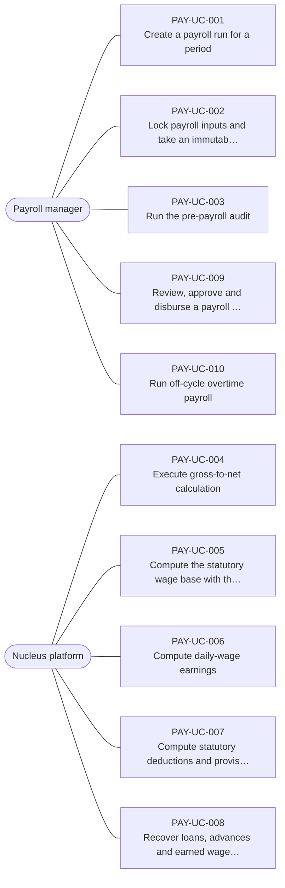

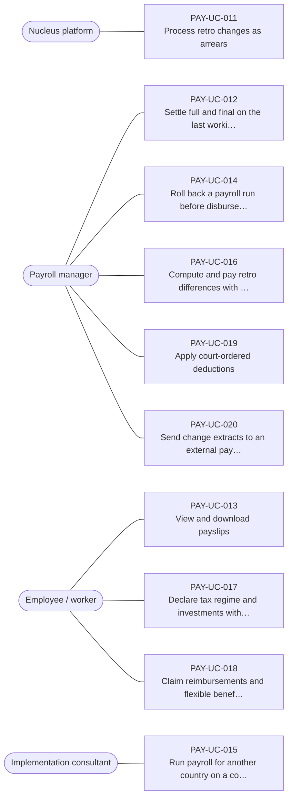

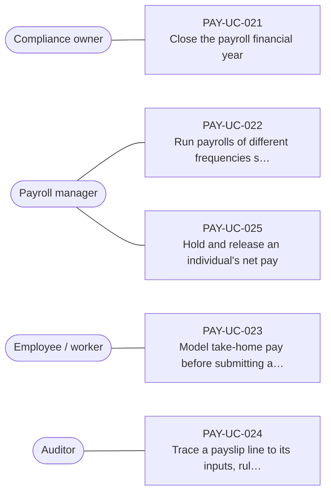

## 3. Use case specifications

### PAY-UC-001

**Create a payroll run for a period** — Create a typed payroll run for an entity, period and payroll group, with its population and inputs assembled from every source.

| Attribute | Value |
| :--- | :--- |
| Realises | PAY-01 |
| Source | Source workbook |
| Level | User goal |
| Primary actor | Payroll manager |
| Secondary actors | Nucleus platform, HR operations, Plant HR / time office |
| Trigger | Start of the monthly cycle, or an off-cycle need (overtime, arrears, F&F, bonus). |
| Frequency | Monthly, plus off-cycle |
| Criticality | Critical |
| Phase | P1 |
| Client requirements | — |
| Business rules | RL-240, RL-241, RL-242, RL-134 |
| Screens | SCR-050 |
| Data objects (CRUD) | payroll_run (C), assignment (R), attendance_day (R), leave_ledger (R), overtime_record (R), payroll_input (R) |
| Events | payroll.run.created |
| Acceptance tests | TC-Y240, TC-Y241, TC-Y242, TC-Y134 |
| System requirements | SYS-006, SYS-007, SYS-016, SYS-024 |

**Stakeholders and interests**

| Stakeholder | Interest |
| :--- | :--- |
| Payroll manager | Starts each cycle from a complete, explainable population and input set. |
| Finance | Can distinguish regular, overtime, arrears, F&F and bonus runs in the journal. |
| Employee / worker | Joiners, leavers and transfers are paid in the right run. |

**Preconditions**

- The entity, payroll group and pay period are configured.
- Attendance, leave, overtime and claims data for the period are available through their modules.

**Main success scenario**

| # | Actor | Action | Ref |
| ---: | :--- | :--- | :--- |
| 1 | Payroll manager | Create the run on the run cockpit: entity, period, payroll group and run_type (regular, off_cycle_ot, arrears, fnf, bonus). | PAY-01.1 |
| 2 | Nucleus platform | Resolve the population: active assignments in scope plus joiners, leavers and transfers within the period. | PAY-01.2 |
| 3 | Nucleus platform | Pull inputs: attendance days, leave, gate pass, OT, claims, arrears, one-time earnings and recoveries. | PAY-01.3 |

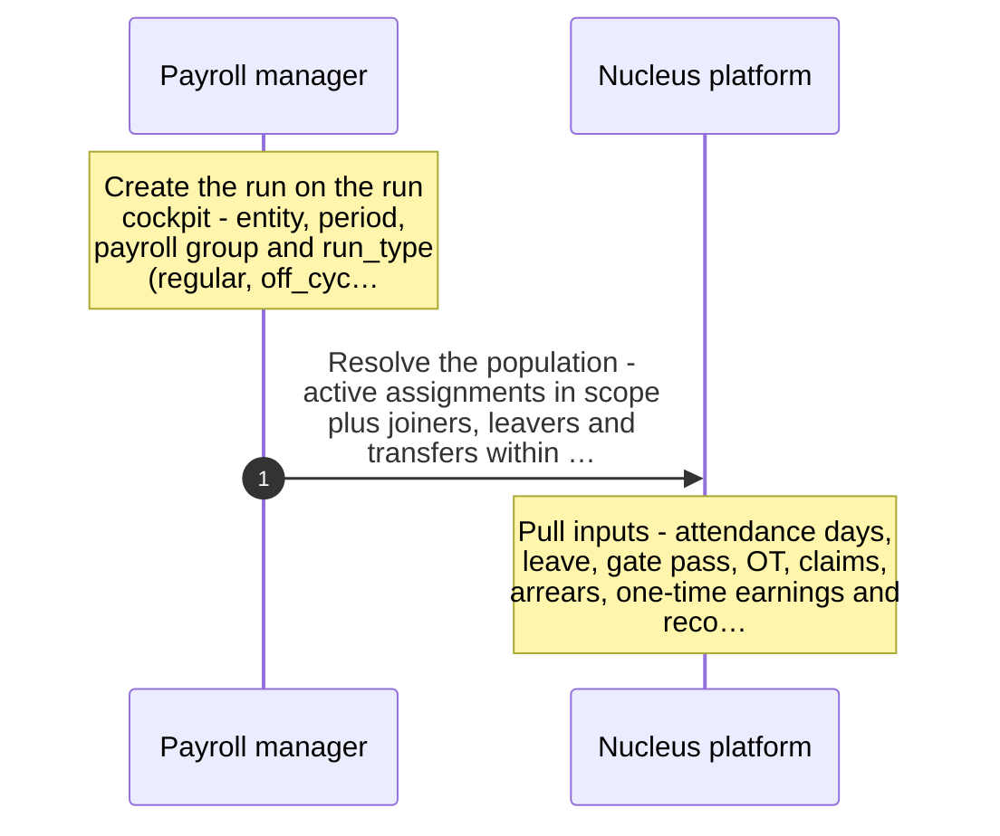

**Alternate flows**

| ID | At step | Condition | Steps | Rejoins |
| :--- | ---: | :--- | :--- | :--- |
| A1 | 1 | A regular run already exists for the period and an off-cycle run is needed. | The payroll manager creates a second run with the off-cycle run_type against the same period. → The cockpit shows both runs under the period with a run selector. | Returns to step 2 |
| A2 | 2 | An employee transferred between payroll groups mid-period. | The platform includes the employee in each group's run for the days assigned to that group. | Returns to step 3 |

**Exception flows**

| ID | At step | Condition | Handling | Rule |
| :--- | ---: | :--- | :--- | :--- |
| E1 | 3 | An input source has not published its period data. | The run remains DRAFT and the cockpit names the missing source; inputs cannot be locked until it is present or explicitly marked nil. | RL-242 |
| E2 | 2 | An active employee has no assignment in any payroll group. | The person is excluded from the population and listed as an exception for the pre-payroll audit. | RL-241 |

**Postconditions — success**

- A payroll_run exists in DRAFT with its run_type and payroll.run.created emitted.
- The population and pulled inputs are listed on the run cockpit with source counts.

**Postconditions — failure**

- No run is created, or the run stays DRAFT with the missing input source named.

**Quality requirements**

- Population and input pull for 10,000 employees completes within 5 minutes.
- Every screen that lists runs accepts a period and a run selector.

### PAY-UC-002

**Lock payroll inputs and take an immutable snapshot** — Freeze a run's inputs at cut-off and store a hashed snapshot of inputs, rule pack versions and configuration so the run can be recomputed exactly at any later date.

| Attribute | Value |
| :--- | :--- |
| Realises | PAY-02 |
| Source | Source workbook |
| Level | User goal |
| Primary actor | Payroll manager |
| Secondary actors | Nucleus platform, Auditor |
| Trigger | The cut-off date and time for the run is reached. |
| Frequency | Per run |
| Criticality | Critical |
| Phase | P1 |
| Client requirements | — |
| Business rules | RL-250, RL-251 |
| Screens | SCR-050 |
| Data objects (CRUD) | payroll_run (U), payroll_snapshot (C) |
| Events | payroll.inputs.locked, payroll.snapshot.taken |
| Acceptance tests | TC-Y250, TC-Y251, TC-PR03 |
| System requirements | SYS-024, SYS-031, SYS-051, SYS-052, SYS-053 |

**Stakeholders and interests**

| Stakeholder | Interest |
| :--- | :--- |
| Payroll manager | Late changes cannot alter a run under review. |
| Auditor | Any past run can be recomputed and matched to the paisa. |
| Plant HR / time office | Late punches are handled as exceptions, not silent changes. |

**Preconditions**

- The run is in DRAFT with all input sources present or marked nil.

**Main success scenario**

| # | Actor | Action | Ref |
| ---: | :--- | :--- | :--- |
| 1 | Payroll manager | Lock the run's inputs at cut-off on the run cockpit. | PAY-02.1 |
| 2 | Nucleus platform | Write an immutable, hashed snapshot of inputs, rule pack versions and configuration; emit payroll.snapshot.taken. | PAY-02.2 |

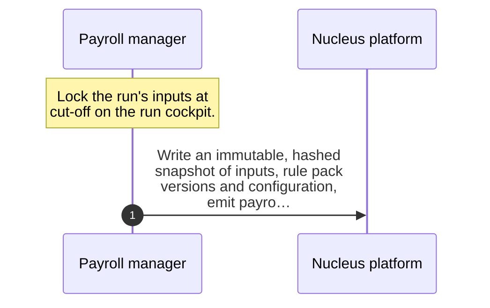

**Alternate flows**

| ID | At step | Condition | Steps | Rejoins |
| :--- | ---: | :--- | :--- | :--- |
| A1 | 1 | A material input error is found before the pre-payroll audit starts. | The payroll manager returns the run to DRAFT with a reason; the snapshot is superseded, not deleted. → After correction the inputs are locked again and a new snapshot is written. | Returns to step 1 |

**Exception flows**

| ID | At step | Condition | Handling | Rule |
| :--- | ---: | :--- | :--- | :--- |
| E1 | 1 | A punch, leave approval or claim arrives after the lock. | The run is not changed; the item is raised as an exception and flows to the next open run or arrears. | RL-250 |
| E2 | 2 | Recomputing a closed run from its snapshot gives a different result. | A CRITICAL integrity alert is raised to the payroll manager and auditor with the differing lines. | RL-251 |

**Postconditions — success**

- The run is INPUTS_LOCKED; payroll.inputs.locked and payroll.snapshot.taken are emitted.
- The snapshot stores the input hash and rule pack versions.

**Postconditions — failure**

- The run remains DRAFT and no snapshot is stored.

**Quality requirements**

- Snapshots are write-once; no role, including tenant admin, can alter one.
- Recomputation of any run up to 8 years old reproduces every payslip line exactly.

### PAY-UC-003

**Run the pre-payroll audit** — Detect and resolve every input defect before calculation, using explainable rule checks first, with an agent proposing but never applying resolutions.

| Attribute | Value |
| :--- | :--- |
| Realises | PAY-03 |
| Source | Source workbook |
| Level | User goal |
| Primary actor | Payroll manager |
| Secondary actors | Nucleus platform, Agent (governed), HR operations |
| Trigger | payroll.snapshot.taken for the run. |
| Frequency | Per run |
| Criticality | Critical |
| Phase | P1 |
| Client requirements | — |
| Business rules | RL-033, RL-154, RL-260, RL-261, RL-262 |
| Screens | SCR-051 |
| Data objects (CRUD) | payroll_audit_flag (C/U), action_ledger (C) |
| Events | payroll.audit.completed, agent.action.proposed |
| Acceptance tests | TC-H33, TC-Y154, TC-Y260, TC-A261, TC-Y262 |
| System requirements | SYS-035, SYS-036, SYS-051, SYS-072, SYS-074 |

**Stakeholders and interests**

| Stakeholder | Interest |
| :--- | :--- |
| Payroll manager | Sees a ranked, explained list of defects with draft fixes. |
| Employee / worker | Is not paid wrongly because of a missing UAN or a duplicate bank account. |
| Auditor | Every waiver has a reason and a role at or above the threshold. |

**Preconditions**

- The run is INPUTS_LOCKED with a stored snapshot.

**Main success scenario**

| # | Actor | Action | Ref |
| ---: | :--- | :--- | :--- |
| 1 | Nucleus platform | Run the rule checks (missing attendance, unprorated joiner, bank change in cycle, missing PF/UAN, negative net and others); emit payroll.audit.completed. | PAY-03.1 |
| 2 | Agent (governed) | Classify each flag, draft a resolution and produce a signed readiness report; record each proposal in the action ledger. | PAY-03.2 |
| 3 | Payroll manager | Resolve or waive each flag with a reason on the pre-payroll audit screen. | PAY-03.3 |

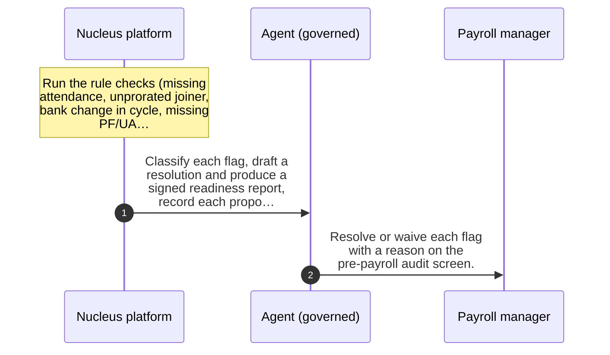

**Alternate flows**

| ID | At step | Condition | Steps | Rejoins |
| :--- | ---: | :--- | :--- | :--- |
| A1 | 1 | No flags are raised. | The readiness report states zero flags and the run proceeds to calculation. | Use case ends |
| A2 | 2 | The agent is unavailable. | The payroll manager works the flags without proposals; the readiness report is signed by the payroll manager. | Returns to step 3 |
| A3 | 1 | Statistical checks run after the rule checks. | Per-employee net and component variance outside configured bounds raises WARNING flags. | Returns to step 2 |

**Exception flows**

| ID | At step | Condition | Handling | Rule |
| :--- | ---: | :--- | :--- | :--- |
| E1 | 3 | A user below the role threshold tries to waive a CRITICAL flag. | The waiver is refused; the flag stays open and approval remains blocked. | RL-262 |
| E2 | 2 | The agent attempts to change a payroll figure. | The write is rejected at the tool boundary and the attempt is recorded in the action ledger. | RL-261 |
| E3 | 1 | An employee's Aadhaar or PAN does not match. | A payroll-blocking flag is raised for that employee only; joining is not reversed. | RL-033 |

**Postconditions — success**

- Every flag is resolved or waived with reason; no CRITICAL flag is open; the run moves to PRE_AUDIT complete and payroll.audit.completed is emitted.
- A signed readiness report is attached to the run.

**Postconditions — failure**

- Open CRITICAL flags keep the run from calculation and approval.

**Quality requirements**

- The eleven rule checks complete within 3 minutes for 10,000 employees.
- Each flag shows the rule that raised it and the input values that triggered it.

### PAY-UC-004

**Execute gross-to-net calculation** — Evaluate the tenant's pay component graph once per employee in topological order, in integer money, storing every intermediate value for drill-down.

| Attribute | Value |
| :--- | :--- |
| Realises | PAY-04 |
| Source | Source workbook |
| Level | Subfunction |
| Primary actor | Nucleus platform |
| Secondary actors | Payroll manager |
| Trigger | Pre-payroll audit cleared for the run. |
| Frequency | Per run |
| Criticality | Critical |
| Phase | P1 |
| Client requirements | — |
| Business rules | RL-270, RL-271, RL-272, RL-273 |
| Screens | SCR-053 |
| Data objects (CRUD) | pay_component (R), payslip_line (C/U), payslip_line_trace (C) |
| Events | payroll.run.calculated |
| Acceptance tests | TC-Y270, TC-Y271, TC-Y272, TC-Y273, TC-PR04 |
| System requirements | SYS-024, SYS-028, SYS-029, SYS-030, SYS-045, SYS-047 |

**Stakeholders and interests**

| Stakeholder | Interest |
| :--- | :--- |
| Payroll manager | Gets deterministic, explainable results. |
| Employee / worker | Can see how each payslip line was produced. |
| Auditor | Can trace each value to its rule pack version. |

**Preconditions**

- The run has no open CRITICAL flag.
- The pay component graph for the tenant is acyclic and published.

**Main success scenario**

| # | Actor | Action | Ref |
| ---: | :--- | :--- | :--- |
| 1 | Nucleus platform | Topologically sort the tenant's pay component graph. | PAY-04.1 |
| 2 | Nucleus platform | Evaluate earnings nodes per employee (basic, DA, HRA, conveyance, special, OT, one-time awards) in integer paise. | PAY-04.2 |
| 3 | Nucleus platform | Apply attendance-driven proration for LOP days, half days, unpaid absence, joiners and leavers. | PAY-04.3 |
| 4 | Nucleus platform | Store every intermediate value with its inputs and rule pack version so each line drills to its rule. | PAY-04.4 |

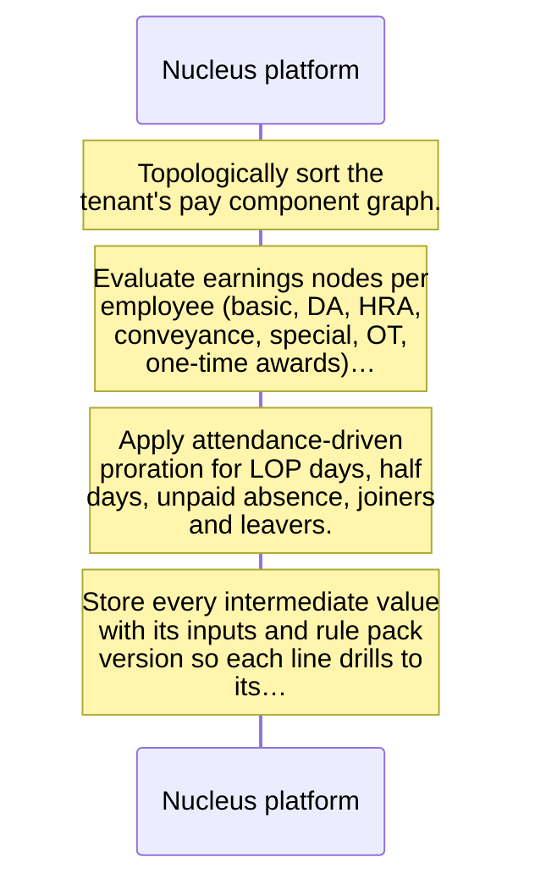

**Alternate flows**

| ID | At step | Condition | Steps | Rejoins |
| :--- | ---: | :--- | :--- | :--- |
| A1 | 3 | The employee joined or left mid-month. | Proration uses calendar days in the employment span per the component's proration basis. | Returns to step 4 |

**Exception flows**

| ID | At step | Condition | Handling | Rule |
| :--- | ---: | :--- | :--- | :--- |
| E1 | 1 | The component graph contains a cycle. | Calculation stops before any employee is evaluated; the cycle's nodes are named to the payroll manager. | RL-270 |
| E2 | 2 | A configured formula would produce a fractional paisa. | The node applies the configured rounding rule and stores the rounding difference as a separate trace value. | RL-271 |
| E3 | 3 | Proration of a component across a month boundary does not sum to the full-month value. | The property check fails the run and names the component and employee. | RL-272 |

**Postconditions — success**

- Payslip lines and their traces exist for every employee; the run is CALCULATED and payroll.run.calculated is emitted.

**Postconditions — failure**

- No partial result is visible; the run stays in PRE_AUDIT with the failing node named.

**Quality requirements**

- Gross-to-net for 10,000 employees completes within 10 minutes.
- No floating-point type is used anywhere in the engine (verified by static analysis).

### PAY-UC-005

**Compute the statutory wage base with the 50% floor** — Compute one statutory wage base per employee, adding back excluded components above 50% of total remuneration, and publish it to every statutory consumer.

| Attribute | Value |
| :--- | :--- |
| Realises | PAY-05 |
| Source | Source workbook |
| Level | Subfunction |
| Primary actor | Nucleus platform |
| Secondary actors | HR operations, Payroll manager, Compliance owner |
| Trigger | Calculation of a run reaches the wage base node; or HR runs a structure simulation. |
| Frequency | Per run; simulations on demand |
| Criticality | Critical |
| Phase | P1 |
| Client requirements | — |
| Business rules | RL-280, RL-281, RL-282, RL-283 |
| Screens | SCR-052 |
| Data objects (CRUD) | payslip_line (C/U), simulation_run (C) |
| Events | payroll.simulation.run |
| Acceptance tests | TC-Y280, TC-Y281, TC-Y282, TC-Y283 |
| System requirements | SYS-028, SYS-045, SYS-047, SYS-048 |

**Stakeholders and interests**

| Stakeholder | Interest |
| :--- | :--- |
| Compliance owner | PF, ESI, gratuity, bonus and overtime use a wage base consistent with the Code on Wages (to be validated by Legal). |
| HR operations | Can see statutory cost and take-home impact before changing a structure. |
| Employee / worker | Contributions are computed on the correct base. |

**Preconditions**

- Each pay component is classified as wage-base or excluded in the effective rule pack.

**Main success scenario**

| # | Actor | Action | Ref |
| ---: | :--- | :--- | :--- |
| 1 | Nucleus platform | Compute wage_base = basic + DA + retaining allowance. | PAY-05.1 |
| 2 | Nucleus platform | Test whether excluded components exceed 50% of total remuneration. | PAY-05.2 |
| 3 | Nucleus platform | Publish statutory_wage_base to the PF, ESI, gratuity, bonus, OT and leave encashment nodes. | PAY-05.3 |
| 4 | HR operations | Simulate a proposed structure on the salary structure simulator to see statutory cost and take-home impact. | PAY-05.4 |

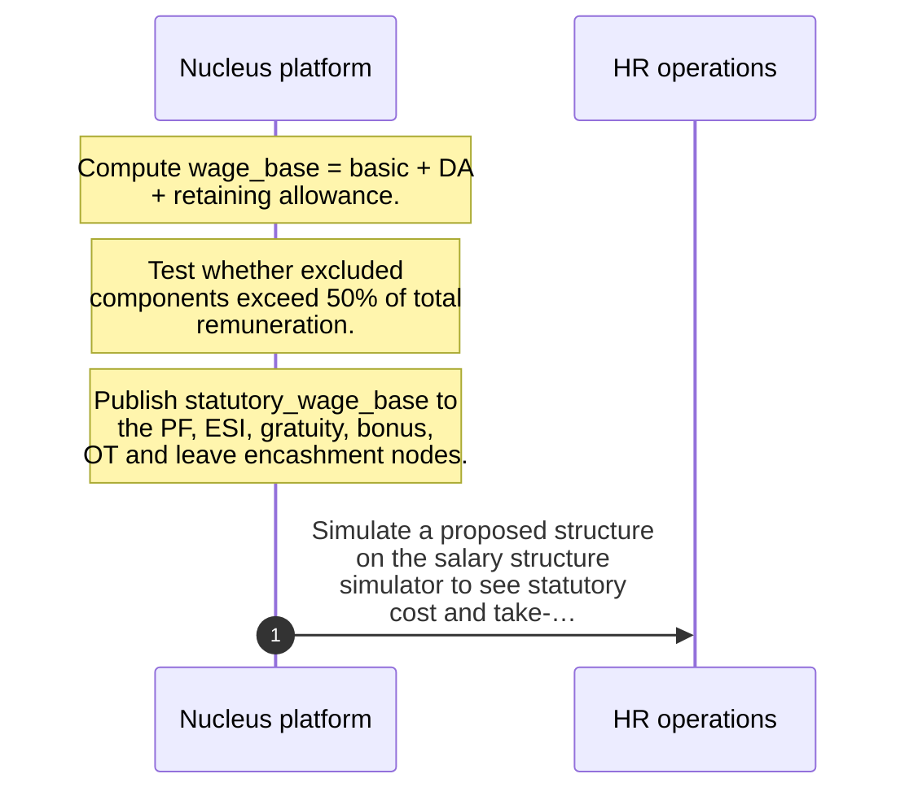

**Alternate flows**

| ID | At step | Condition | Steps | Rejoins |
| :--- | ---: | :--- | :--- | :--- |
| A1 | 2 | Excluded components exceed 50% of total remuneration. | The excess over 50% is added back to the wage base; for 60,000 rupees remuneration with 24,000 in basic and DA, 6,000 is added back to give 30,000. → The add-back is stored as its own trace value. | Returns to step 3 |
| A2 | 4 | HR simulates for a population rather than one employee. | The simulator reports aggregate employer statutory cost and the distribution of take-home change; emits payroll.simulation.run. | Use case ends |

**Exception flows**

| ID | At step | Condition | Handling | Rule |
| :--- | ---: | :--- | :--- | :--- |
| E1 | 1 | A component has no wage-base classification in the rule pack. | Calculation stops for affected employees and a CRITICAL flag names the component. | RL-280 |
| E2 | 3 | A statutory node attempts to compute its own wage base. | The configuration is rejected; only the single wage base node may be referenced. | RL-282 |

**Postconditions — success**

- statutory_wage_base is stored once per employee and consumed by PF, ESI, gratuity, bonus, OT and encashment nodes.

**Postconditions — failure**

- Calculation stops for the employee with the unclassified component named.

**Quality requirements**

- A single-employee simulation returns within 2 s; a 5,000-employee simulation within 2 minutes.
- The wage base node is unit-testable in isolation against the rule pack version.

### PAY-UC-006

**Compute daily-wage earnings** — Pay daily-wage classes on days present times the daily rate through a dedicated earnings node, with the day count shown on the payslip.

| Attribute | Value |
| :--- | :--- |
| Realises | PAY-06 |
| Source | Source workbook |
| Level | Subfunction |
| Primary actor | Nucleus platform |
| Secondary actors | Payroll manager, Plant HR / time office, Employee / worker |
| Trigger | Calculation reaches earnings for an employee whose worker class has wage_type daily. |
| Frequency | Per run |
| Criticality | Critical |
| Phase | P1 |
| Client requirements | — |
| Business rules | RL-290, RL-291, RL-292, RL-101 |
| Screens | SCR-053 |
| Data objects (CRUD) | assignment (R), attendance_day (R), payslip_line (C/U) |
| Events | — |
| Acceptance tests | TC-Y290, TC-Y291, TC-Y292, TC-T101 |
| System requirements | SYS-024, SYS-028, SYS-047, SYS-059 |

**Stakeholders and interests**

| Stakeholder | Interest |
| :--- | :--- |
| Employee / worker | Can reconcile pay against attendance day by day. |
| Plant HR / time office | Attendance dispositions drive pay without manual conversion. |

**Preconditions**

- The worker class carries wage_type daily and the assignment a daily rate.

**Main success scenario**

| # | Actor | Action | Ref |
| ---: | :--- | :--- | :--- |
| 1 | Nucleus platform | Check whether the worker class has wage_type daily. | PAY-06.1 |
| 2 | Nucleus platform | Compute earnings = days present (from attendance disposition) × daily rate, with half days at the configured fraction. | PAY-06.2 |
| 3 | Nucleus platform | Show the day count on the payslip so the worker can reconcile it with the attendance record. | PAY-06.3 |

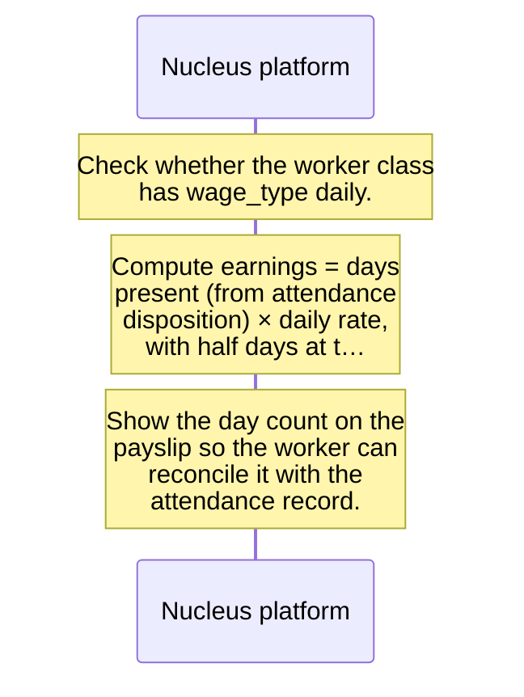

**Alternate flows**

| ID | At step | Condition | Steps | Rejoins |
| :--- | ---: | :--- | :--- | :--- |
| A1 | 1 | The worker class is monthly. | The monthly earnings node with attendance proration applies (PAY-04). | Use case ends |

**Exception flows**

| ID | At step | Condition | Handling | Rule |
| :--- | ---: | :--- | :--- | :--- |
| E1 | 2 | No daily rate is recorded on the assignment. | No earnings are computed; a CRITICAL flag blocks approval until the rate is entered. | RL-291 |
| E2 | 1 | A daily-wage class is configured to use the monthly node with a proration parameter. | Configuration validation rejects it; daily classes must use the daily node. | RL-290 |

**Postconditions — success**

- Earnings equal days present × daily rate, and the payslip shows the day count.

**Postconditions — failure**

- The employee's calculation stops with a CRITICAL flag naming the missing rate.

**Quality requirements**

- The payslip day count equals the attendance record's present-day count for 100% of daily-wage workers in reconciliation tests.

### PAY-UC-007

**Compute statutory deductions and provisions** — Compute PF, EPS, ESI, PT, LWF and TDS from the central and state rule packs effective for the period, and accrue gratuity and bonus provisions (statutory specifics to be validated by Legal).

| Attribute | Value |
| :--- | :--- |
| Realises | PAY-07 |
| Source | Source workbook |
| Level | Subfunction |
| Primary actor | Nucleus platform |
| Secondary actors | Payroll manager, Compliance owner, Employee / worker |
| Trigger | Calculation reaches the statutory nodes after the wage base is published. |
| Frequency | Per run |
| Criticality | Critical |
| Phase | P1 |
| Client requirements | — |
| Business rules | RL-300, RL-301, RL-302, RL-303, RL-304, RL-282 |
| Screens | SCR-054 |
| Data objects (CRUD) | payslip_line (C), provision_line (C) |
| Events | — |
| Acceptance tests | TC-Y300, TC-Y301, TC-Y302, TC-Y303, TC-Y304, TC-C380, TC-C382 |
| System requirements | SYS-028, SYS-030, SYS-045, SYS-046, SYS-047 |

**Stakeholders and interests**

| Stakeholder | Interest |
| :--- | :--- |
| Compliance owner | Deductions follow the effective central and state packs so returns reconcile. |
| Employee / worker | Deductions and tax projection are correct and explained. |
| Finance | Gratuity and bonus provisions reach the journal monthly. |

**Preconditions**

- Central and state rule packs effective for the period are published.
- Each employee's location maps to a state, and the regime choice is recorded or defaulted by the pack.

**Main success scenario**

| # | Actor | Action | Ref |
| ---: | :--- | :--- | :--- |
| 1 | Nucleus platform | Evaluate PF and EPS on the statutory wage base against the ceiling in the effective rule pack. | PAY-07.1 |
| 2 | Nucleus platform | Check whether the employee crossed the ESI wage threshold within the current contribution period. | PAY-07.2 |
| 3 | Nucleus platform | Evaluate PT from the location's state slab set and LWF from the state schedule. | PAY-07.3 |
| 4 | Nucleus platform | Evaluate TDS: regime choice, exemptions, perquisites and projection to year end. | PAY-07.4 |
| 5 | Nucleus platform | Accrue gratuity and bonus provisions on the statutory wage base for the journal. | PAY-07.5 |

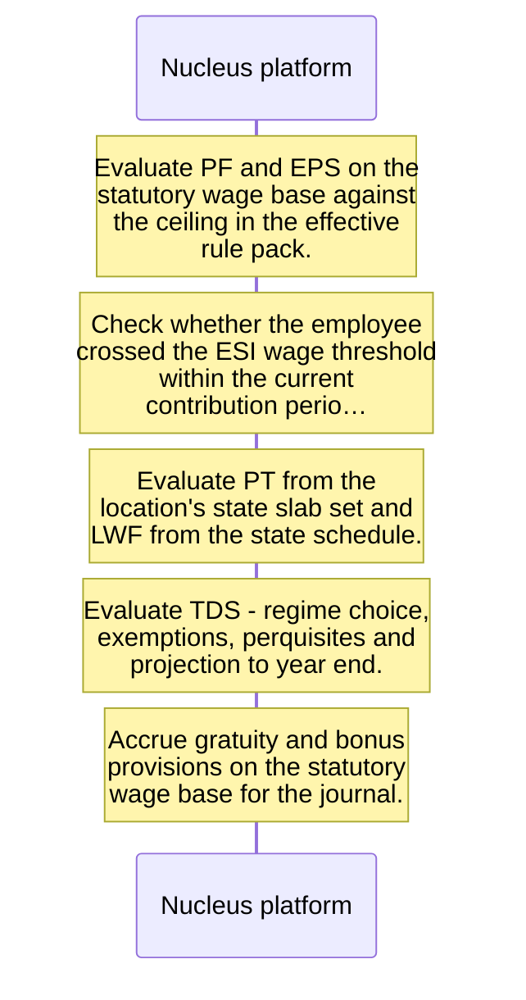

**Alternate flows**

| ID | At step | Condition | Steps | Rejoins |
| :--- | ---: | :--- | :--- | :--- |
| A1 | 2 | Gross wages crossed the ESI threshold mid-period. | ESI continues to be deducted until the end of the contribution period. | Returns to step 3 |
| A2 | 3 | The employee's state does not levy PT. | No PT line is written and the trace records 'not applicable in state'. | Returns to step 4 |
| A3 | 4 | The employee switched tax regime mid-year where the pack permits it. | TDS is reprojected for the remaining months under the new regime, offsetting tax already deducted. | Returns to step 5 |

**Exception flows**

| ID | At step | Condition | Handling | Rule |
| :--- | ---: | :--- | :--- | :--- |
| E1 | 1 | No rule pack version is effective for the period. | Calculation stops for the run and a CRITICAL flag names the missing pack. | RL-300 |
| E2 | 4 | No regime choice is recorded. | The default regime defined in the effective pack is applied and the employee is notified (to be validated by Legal). | RL-303 |
| E3 | 3 | The location has no state mapping. | PT and LWF are not computed for the employee and a CRITICAL flag names the location. | RL-302 |

**Postconditions — success**

- Statutory deduction lines and provision lines exist for every employee, each traced to its pack version.

**Postconditions — failure**

- Calculation stops for affected employees with the missing pack or input named.

**Quality requirements**

- A rule pack change takes effect from its effective date without a code release.
- Each statutory line records the pack name and version used.

### PAY-UC-008

**Recover loans, advances and earned wage access** — Deduct due instalments for loans, advances and earned wage access without breaching the net-pay floor, and report closing outstanding back to the loans module and the GL.

| Attribute | Value |
| :--- | :--- |
| Realises | PAY-08 |
| Source | Source workbook |
| Level | Subfunction |
| Primary actor | Nucleus platform |
| Secondary actors | Payroll manager, Finance, Employee / worker |
| Trigger | Calculation reaches the recovery nodes. |
| Frequency | Per run |
| Criticality | High |
| Phase | P1 |
| Client requirements | — |
| Business rules | RL-310, RL-311, RL-312, RL-313, RL-430, RL-450 |
| Screens | SCR-080 |
| Data objects (CRUD) | loan (R/U), loan_repayment (C), payslip_line (C) |
| Events | payroll.recovery.reduced, loan.repayment.posted, loan.closed |
| Acceptance tests | TC-Y310, TC-Y311, TC-Y312, TC-Y313, TC-PR02, TC-M430, TC-M452 |
| System requirements | SYS-028, SYS-045, SYS-049, SYS-053, SYS-055 |

**Stakeholders and interests**

| Stakeholder | Interest |
| :--- | :--- |
| Employee / worker | Never receives net pay below the protected floor. |
| Finance | Loan outstanding in the GL equals the loans module. |
| Payroll manager | Sees every reduced or skipped recovery as a flag. |

**Preconditions**

- Active loans and advances with instalment schedules exist in the loans module; the net-pay floor is configured.

**Main success scenario**

| # | Actor | Action | Ref |
| ---: | :--- | :--- | :--- |
| 1 | Nucleus platform | Read active loans and advances for the population from the loans module. | PAY-08.1 |
| 2 | Nucleus platform | Test whether the instalment would drive net pay below the statutory minimum wage or configured floor. | PAY-08.2 |
| 3 | Nucleus platform | Write the recovery line, reduce outstanding and stop recovery when the loan closes; emit loan.repayment.posted. | PAY-08.3 |
| 4 | Nucleus platform | Report closing outstanding to the loans module and the GL; emit loan.closed on closure. | PAY-08.4 |

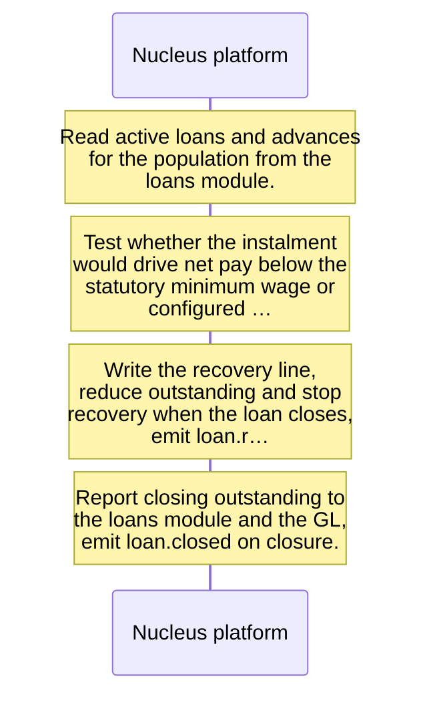

**Alternate flows**

| ID | At step | Condition | Steps | Rejoins |
| :--- | ---: | :--- | :--- | :--- |
| A1 | 2 | The instalment would breach the floor. | The instalment is reduced (or skipped) to keep net at the floor; payroll.recovery.reduced is emitted. → The shortfall is carried forward and flagged to the payroll manager. | Returns to step 3 |
| A2 | 3 | Outstanding is less than the scheduled instalment. | Only the outstanding amount is recovered and the loan closes; guarantor release follows in the loans module. | Returns to step 4 |

**Exception flows**

| ID | At step | Condition | Handling | Rule |
| :--- | ---: | :--- | :--- | :--- |
| E1 | 1 | Payroll is asked to create or approve a loan. | The request is refused; origination and eligibility belong to the loans module. | RL-310 |
| E2 | 3 | A recovery would produce negative net without a flag. | The invariant check fails the employee's calculation. | RL-311 |

**Postconditions — success**

- Recovery lines are written, outstanding reduced, loan.repayment.posted emitted; closed loans emit loan.closed.

**Postconditions — failure**

- No recovery is posted for the employee and the instalment remains due.

**Quality requirements**

- Closing outstanding reported to the loans module equals the GL balance for 100% of loans at period close.

### PAY-UC-009

**Review, approve and disburse a payroll run** — Take a calculated run through variance review, approval, dual-controlled bank file generation and release, then emit its journal.

| Attribute | Value |
| :--- | :--- |
| Realises | PAY-09 |
| Source | Source workbook |
| Level | User goal |
| Primary actor | Payroll manager |
| Secondary actors | Director / approver, Finance, Nucleus platform, Bank, ERP system |
| Trigger | The run reaches CALCULATED. |
| Frequency | Per run |
| Criticality | Critical |
| Phase | P1 |
| Client requirements | — |
| Business rules | RL-320, RL-321, RL-322, RL-323, RL-324 |
| Screens | SCR-050, SCR-040, SCR-055 |
| Data objects (CRUD) | payroll_run (U), bank_file (C), gl_journal (C) |
| Events | payroll.run.approved, payroll.bank_file.prepared, payroll.run.disbursed, payroll.journal.ready |
| Acceptance tests | TC-Y320, TC-Y321, TC-Y322, TC-Y323, TC-F324 |
| System requirements | SYS-020, SYS-037, SYS-051, SYS-053, SYS-084, SYS-085 |

**Stakeholders and interests**

| Stakeholder | Interest |
| :--- | :--- |
| Finance | Bank file totals are verified out of band before money moves. |
| Director / approver | Approves only runs with no open CRITICAL flag and full GL mapping. |
| Employee / worker | Is paid on the pay date. |

**Preconditions**

- No CRITICAL flag is open; bank details are verified for the population.

**Main success scenario**

| # | Actor | Action | Ref |
| ---: | :--- | :--- | :--- |
| 1 | Payroll manager | Review variance against the prior period, the exception list and headcount reconciliation on the run cockpit. | PAY-09.1 |
| 2 | Director / approver | Approve the run; approval is blocked if any CRITICAL flag is open or any component lacks a GL mapping. | PAY-09.2 |
| 3 | Finance | Generate the bank file and verify its total out of band under dual control before release. | PAY-09.3 |
| 4 | Finance | Release the disbursement; emit payroll.run.disbursed. | PAY-09.4 |
| 5 | Nucleus platform | Emit the run's salary journal to the finance handshake (FIN-03); emit payroll.journal.ready. | PAY-09.5 |

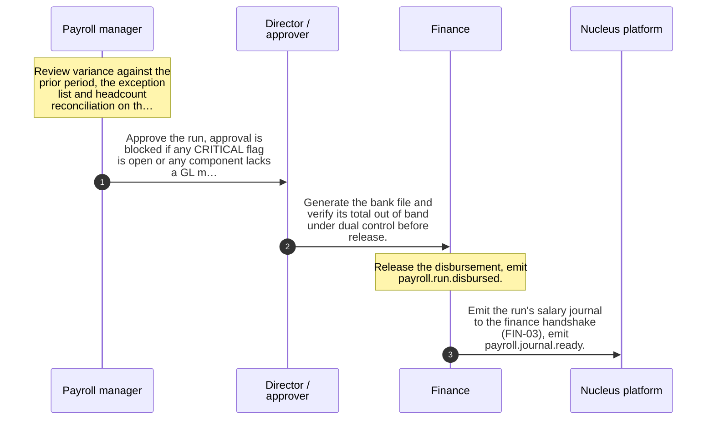

**Alternate flows**

| ID | At step | Condition | Steps | Rejoins |
| :--- | ---: | :--- | :--- | :--- |
| A1 | 2 | The approver rejects the run. | The run returns to REVIEW or CALCULATED with the approver's comment. | Returns to step 1 |
| A2 | 3 | The out-of-band total does not match the file total. | The file is voided, the run returns to APPROVED and Finance investigates before regenerating. | Returns to step 3 |

**Exception flows**

| ID | At step | Condition | Handling | Rule |
| :--- | ---: | :--- | :--- | :--- |
| E1 | 2 | A pay component has no GL mapping. | Approval is refused with the unmapped component named. | RL-321 |
| E2 | 3 | An employee's bank details changed inside the payroll window. | An alert is raised to Finance and the payroll manager before the file is released. | RL-322 |
| E3 | 4 | A correction is requested after DISBURSEMENT_PREPARED. | The run is not reopened; the correction is raised as arrears in the next open run. | RL-323 |

**Postconditions — success**

- The run is DISBURSED, payroll.run.disbursed emitted, and payroll.journal.ready sent for FIN-03.

**Postconditions — failure**

- The run remains at REVIEW or APPROVED with the blocking reason shown; no bank file is released.

**Quality requirements**

- The user who generates the bank file cannot be the user who verifies its total.
- Bank files are encrypted at rest and their hash is recorded on the run.

### PAY-UC-010

**Run off-cycle overtime payroll** — Pay approved overtime in a separate run against the same period, with its own payslip view, bank file and journal.

| Attribute | Value |
| :--- | :--- |
| Realises | PAY-10 |
| Source | Source workbook |
| Level | User goal |
| Primary actor | Payroll manager |
| Secondary actors | Nucleus platform, Finance, Plant HR / time office |
| Trigger | Overtime for the period is approved and tagged to the off-cycle run. |
| Frequency | Monthly |
| Criticality | High |
| Phase | P1 |
| Client requirements | — |
| Business rules | RL-330, RL-331, RL-332, RL-333, RL-240, RL-134 |
| Screens | SCR-050, SCR-053 |
| Data objects (CRUD) | payroll_run (C), overtime_record (R), payslip_line (C), bank_file (C), gl_journal (C) |
| Events | payroll.run.created, payroll.journal.ready |
| Acceptance tests | TC-Y330, TC-Y331, TC-Y332, TC-F333, TC-Y134 |
| System requirements | SYS-028, SYS-045, SYS-047, SYS-084, SYS-085 |

**Stakeholders and interests**

| Stakeholder | Interest |
| :--- | :--- |
| Finance | Sees overtime cost as its own line, not restated salary. |
| Employee / worker | Receives overtime pay on its own date with its own payslip. |
| Plant HR / time office | Only approved, tagged overtime is paid. |

**Preconditions**

- The regular run for the period exists; overtime records are approved and tagged.

**Main success scenario**

| # | Actor | Action | Ref |
| ---: | :--- | :--- | :--- |
| 1 | Payroll manager | Create a second run for the same period with run_type off_cycle_ot; emit payroll.run.created. | PAY-10.1 |
| 2 | Nucleus platform | Pull only the approved overtime records tagged to this run. | PAY-10.2 |
| 3 | Nucleus platform | Compute OT pay on the statutory wage base and the state multiplier, and apply statutory treatment. | PAY-10.3 |
| 4 | Nucleus platform | Produce the run's own payslip view, bank file and journal with run type as a dimension; emit payroll.journal.ready. | PAY-10.4 |

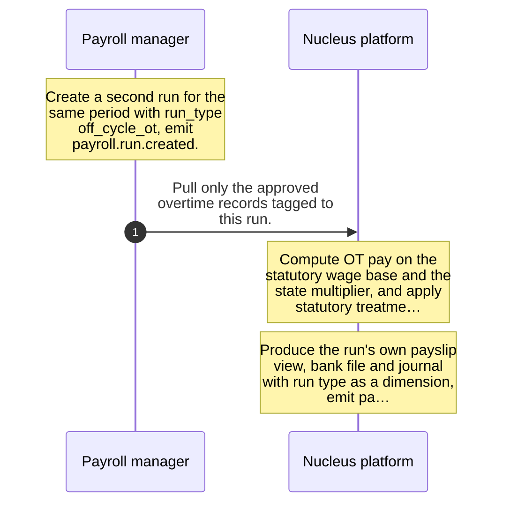

**Alternate flows**

| ID | At step | Condition | Steps | Rejoins |
| :--- | ---: | :--- | :--- | :--- |
| A1 | 2 | An overtime record is approved after the off-cycle run locks inputs. | The record stays untagged and is picked up by the next off-cycle run. | Returns to step 3 |

**Exception flows**

| ID | At step | Condition | Handling | Rule |
| :--- | ---: | :--- | :--- | :--- |
| E1 | 2 | An overtime record is tagged to both the regular and off-cycle runs. | The record is excluded from both and flagged until it carries a single tag. | RL-331 |
| E2 | 3 | No state multiplier is defined for the employee's location. | OT is not computed for that employee and a CRITICAL flag names the location. | RL-332 |

**Postconditions — success**

- An off_cycle_ot run with its own payslip view, bank file and dimensioned journal exists; payroll.journal.ready emitted.

**Postconditions — failure**

- The off-cycle run stays in its current state and the regular run is unaffected.

**Quality requirements**

- An off-cycle run for 2,000 employees completes calculation within 3 minutes.

### PAY-UC-011

**Process retro changes as arrears** — Recompute pay for closed periods affected by a back-dated change, as at the rule version used then, and pay the difference as arrears in the next open run without rewriting closed runs.

| Attribute | Value |
| :--- | :--- |
| Realises | PAY-11 |
| Source | Authored |
| Level | Subfunction |
| Primary actor | Nucleus platform |
| Secondary actors | Payroll manager, HR operations, Employee / worker |
| Trigger | payroll.arrears.requested, or a back-dated salary, attendance or leave change effective inside a closed period. |
| Frequency | Monthly |
| Criticality | Critical |
| Phase | P2 |
| Client requirements | — |
| Business rules | RL-041, RL-251, RL-273, RL-323 |
| Screens | SCR-050, SCR-053 |
| Data objects (CRUD) | payroll_snapshot (R), payslip_line (C), payroll_input (C) |
| Events | payroll.arrears.requested |
| Acceptance tests | TC-Y41, TC-PR03 |
| System requirements | SYS-024, SYS-025, SYS-028, SYS-031, SYS-047 |

**Stakeholders and interests**

| Stakeholder | Interest |
| :--- | :--- |
| Employee / worker | Receives back pay for a back-dated revision with each period itemised. |
| Payroll manager | Closed runs stay intact and the arrears are explainable. |
| Compliance owner | Statutory differences (PF, ESI) are captured for the affected periods. |

**Preconditions**

- The affected periods' runs are closed with stored snapshots.
- A next open run of type regular or arrears exists.

**Main success scenario**

| # | Actor | Action | Ref |
| ---: | :--- | :--- | :--- |
| 1 | Nucleus platform | Receive the back-dated change or payroll.arrears.requested with person, effective date and reason. |  |
| 2 | Nucleus platform | Identify every closed run for the person whose period falls on or after the effective date. |  |
| 3 | Nucleus platform | Recompute each affected period from its snapshot with the corrected input, using the rule pack version of that period. |  |
| 4 | Nucleus platform | Compute the difference per payslip line, including statutory deduction and provision lines. |  |
| 5 | Nucleus platform | Post the differences as arrears lines in the next open run, each referencing its original period and run. |  |
| 6 | Payroll manager | Review the arrears lines in the pre-payroll audit of the next open run. |  |
| 7 | Nucleus platform | Pay the arrears with the run and show them on the payslip as a separate section by period. |  |

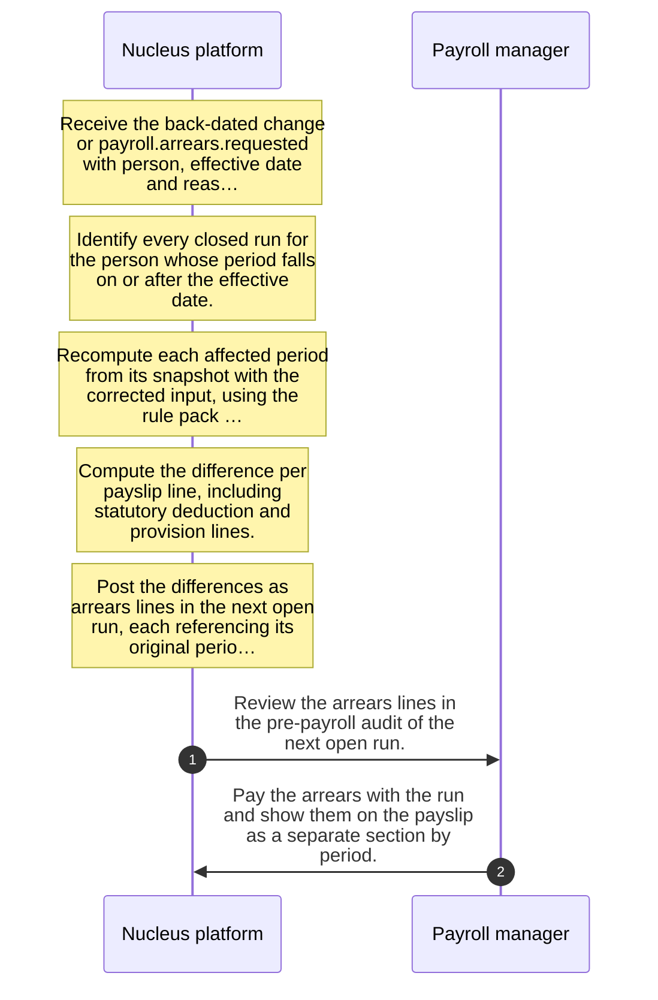

**Alternate flows**

| ID | At step | Condition | Steps | Rejoins |
| :--- | ---: | :--- | :--- | :--- |
| A1 | 4 | The difference is negative (an over-payment). | A recovery line is posted instead, subject to the net-pay floor in PAY-08. | Returns to step 5 |

**Exception flows**

| ID | At step | Condition | Handling | Rule |
| :--- | ---: | :--- | :--- | :--- |
| E1 | 2 | A user tries to edit a closed run directly. | The edit is refused; the change must enter as arrears. | RL-041 |
| E2 | 3 | The snapshot for an affected period cannot be read. | The arrears request is held and a CRITICAL flag is raised to the payroll manager. | RL-251 |

**Postconditions — success**

- Arrears lines exist in the next open run, each traced to its originating period; closed runs are unchanged.

**Postconditions — failure**

- No arrears line is posted; the request remains queued with the reason shown.

**Quality requirements**

- Arrears for 12 affected periods per employee compute within 10 s.

### PAY-UC-012

**Settle full and final on the last working day** — Compute and settle an exiting employee's full and final dues on the last working day once all blocking clearance items are closed or waived.

| Attribute | Value |
| :--- | :--- |
| Realises | PAY-12 |
| Source | Source workbook |
| Level | User goal |
| Primary actor | Payroll manager |
| Secondary actors | Nucleus platform, HR operations, Finance, Employee / worker |
| Trigger | All clearance items for the exit are closed or waived (LCY processes). |
| Frequency | Per exit |
| Criticality | Critical |
| Phase | P1 |
| Client requirements | — |
| Business rules | RL-340, RL-341, RL-342, RL-400, RL-403 |
| Screens | SCR-056, SCR-061, SCR-040 |
| Data objects (CRUD) | clearance_item (R), leave_ledger (R), loan (U), payslip_line (C), payroll_run (U) |
| Events | payroll.fnf.settled |
| Acceptance tests | TC-X340, TC-X341, TC-X342, TC-X400, TC-X402 |
| System requirements | SYS-028, SYS-045, SYS-047, SYS-049, SYS-051 |

**Stakeholders and interests**

| Stakeholder | Interest |
| :--- | :--- |
| Employee / worker | Receives the settlement on the last working day with a clear statement. |
| HR operations | Clearance runs in parallel with notice and gates the settlement. |
| Finance | Negative settlements are recovered, not ignored. |

**Preconditions**

- The exit has a confirmed last working day; an fnf run type exists for the period.

**Main success scenario**

| # | Actor | Action | Ref |
| ---: | :--- | :--- | :--- |
| 1 | Nucleus platform | Check that all blocking clearance items are closed or explicitly waived. | PAY-12.1 |
| 2 | Nucleus platform | Compute settlement: salary to LWD, leave encashment from the ledger, gratuity, notice recovery, loan foreclosure and recoveries. | PAY-12.2 |
| 3 | Payroll manager | Approve and settle on the last working day; emit payroll.fnf.settled. | PAY-12.3 |

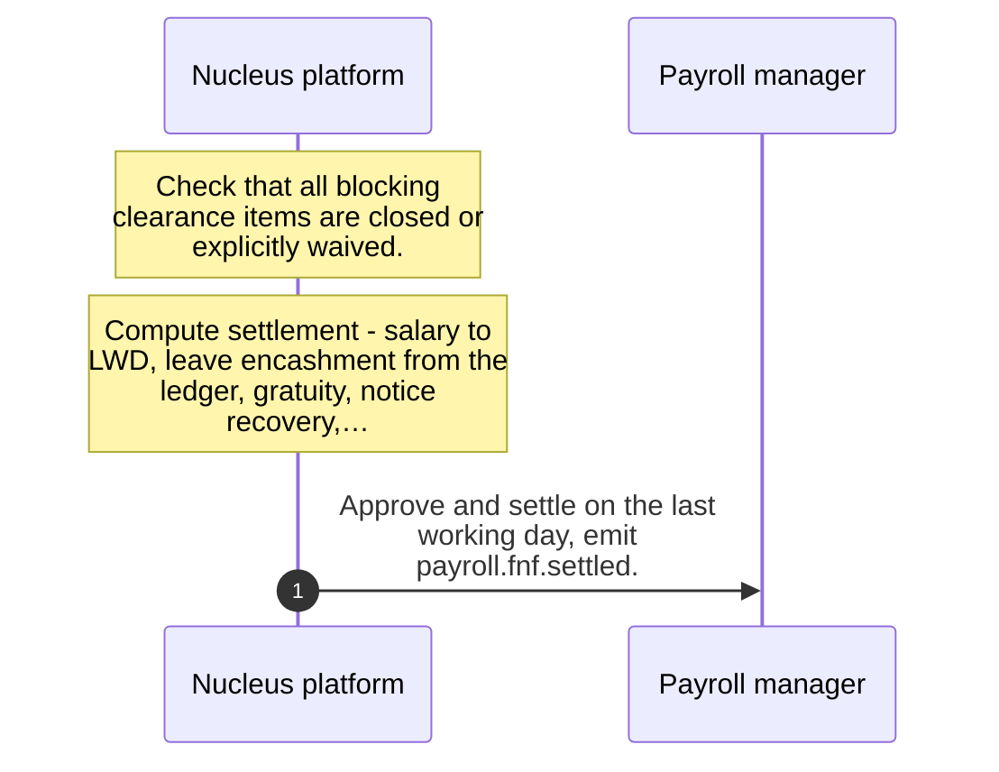

**Alternate flows**

| ID | At step | Condition | Steps | Rejoins |
| :--- | ---: | :--- | :--- | :--- |
| A1 | 2 | The settlement net is negative. | The statement shows the amount due from the employee and a recovery task is raised to Finance; the run is not blocked. | Returns to step 3 |
| A2 | 2 | The employee has not met the gratuity service condition. | No gratuity line is computed and the statement states the reason (to be validated by Legal). | Returns to step 3 |

**Exception flows**

| ID | At step | Condition | Handling | Rule |
| :--- | ---: | :--- | :--- | :--- |
| E1 | 1 | A blocking clearance item is open and not waived. | The F&F run is held with the same lock semantics as the payroll input lock; the open items are listed. | RL-340 |
| E2 | 2 | The leave ledger projection is unavailable. | Encashment is not computed and the run is held with a CRITICAL flag. | RL-341 |

**Postconditions — success**

- The F&F is approved and settled; payroll.fnf.settled is emitted with the net amount.

**Postconditions — failure**

- The F&F run is held with the open clearance items listed.

**Quality requirements**

- The F&F statement is available to the employee on the settlement date in mobile and web.

### PAY-UC-013

**View and download payslips** — Let employees retrieve the payslip for any period and run, and drill into how each line was computed.

| Attribute | Value |
| :--- | :--- |
| Realises | PAY-13 |
| Source | Source workbook |
| Level | User goal |
| Primary actor | Employee / worker |
| Secondary actors | Nucleus platform |
| Trigger | The run is disbursed and payslips are published. |
| Frequency | Monthly |
| Criticality | High |
| Phase | P1 |
| Client requirements | — |
| Business rules | RL-350, RL-351 |
| Screens | SCR-053 |
| Data objects (CRUD) | payslip (R), payslip_line_trace (R) |
| Events | payslip.viewed |
| Acceptance tests | TC-Y350, TC-Y351 |
| System requirements | SYS-017, SYS-030, SYS-033, SYS-067, SYS-069 |

**Stakeholders and interests**

| Stakeholder | Interest |
| :--- | :--- |
| Employee / worker | Can explain their own pay without raising a query. |
| HR operations | Fewer payslip queries reach the helpdesk. |

**Preconditions**

- The employee is authenticated; the run is DISBURSED.

**Main success scenario**

| # | Actor | Action | Ref |
| ---: | :--- | :--- | :--- |
| 1 | Employee / worker | Open payslips and select the period and the run. | PAY-13.1 |
| 2 | Nucleus platform | Serve the payslip with drill-down from each line to its rule and inputs; emit payslip.viewed. | PAY-13.2 |

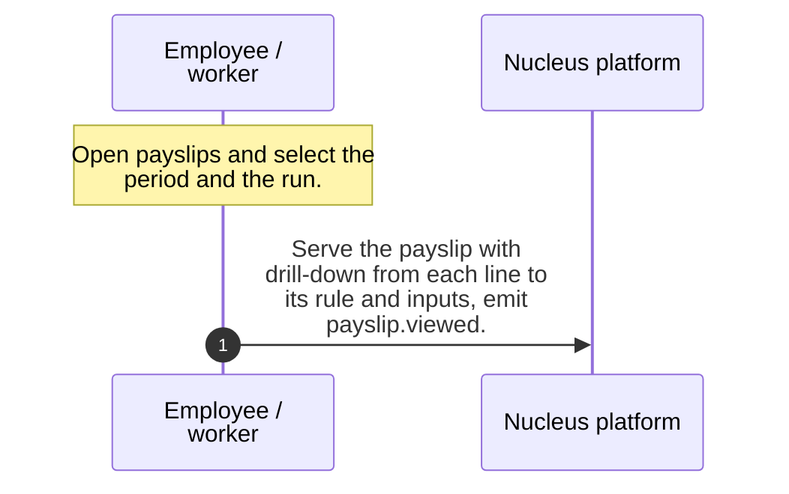

**Alternate flows**

| ID | At step | Condition | Steps | Rejoins |
| :--- | ---: | :--- | :--- | :--- |
| A1 | 1 | The period has more than one run. | The run selector lists each run with type and pay date, defaulting to the regular run. | Returns to step 2 |
| A2 | 2 | The mobile app is offline. | Previously opened payslips are shown from encrypted local storage, marked with the sync time. | Use case ends |

**Exception flows**

| ID | At step | Condition | Handling | Rule |
| :--- | ---: | :--- | :--- | :--- |
| E1 | 1 | The selected run is not yet disbursed. | The payslip is not shown and the expected pay date is displayed. | RL-350 |
| E2 | 2 | A user requests another employee's payslip without scope. | The request is refused and an access event is recorded. | RL-351 |

**Postconditions — success**

- The payslip is displayed or downloaded and payslip.viewed is emitted.

**Postconditions — failure**

- Nothing is displayed and the reason (not yet published, out of scope) is shown.

**Quality requirements**

- A payslip renders within 2 s at p95 on a mid-range mobile device.
- Each payslip view is logged with actor and time.

### PAY-UC-014

**Roll back a payroll run before disbursement** — Return a run to an earlier state to correct a defect found before disbursement, with full audit, and refuse rollback once money has moved.

| Attribute | Value |
| :--- | :--- |
| Realises | PAY-14 |
| Source | Authored |
| Level | User goal |
| Primary actor | Payroll manager |
| Secondary actors | Finance, Director / approver, Nucleus platform, Auditor |
| Trigger | A defect is found in a run between CALCULATED and DISBURSEMENT_PREPARED. |
| Frequency | Rare |
| Criticality | Critical |
| Phase | P1 |
| Client requirements | — |
| Business rules | RL-323, RL-250, RL-251, RL-321, RL-322 |
| Screens | SCR-050, SCR-055 |
| Data objects (CRUD) | payroll_run (U), bank_file (U), audit_entry (C) |
| Events | — |
| Acceptance tests | TC-Y323, TC-Y321 |
| System requirements | SYS-032, SYS-036, SYS-051, SYS-085 |

**Stakeholders and interests**

| Stakeholder | Interest |
| :--- | :--- |
| Payroll manager | Can fix a defect without creating arrears when money has not moved. |
| Finance | A voided bank file can never be released. |
| Auditor | Every rollback has an actor, reason and from/to state. |

**Preconditions**

- The run is in CALCULATED, REVIEW, APPROVED or DISBURSEMENT_PREPARED.

**Main success scenario**

| # | Actor | Action | Ref |
| ---: | :--- | :--- | :--- |
| 1 | Payroll manager | Select Roll back on the run cockpit and choose the target state the defect requires. |  |
| 2 | Nucleus platform | Check the current state is DISBURSEMENT_PREPARED or earlier and the target is an allowed previous state. |  |
| 3 | Payroll manager | Enter the defect description and reason. |  |
| 4 | Nucleus platform | Void artefacts produced after the target state (bank file, approval record), keeping them read-only for audit. |  |
| 5 | Nucleus platform | Move the run to the target state and record actor, reason and from/to states. |  |
| 6 | Payroll manager | Correct the defect and take the run forward again through audit, calculation and approval. |  |

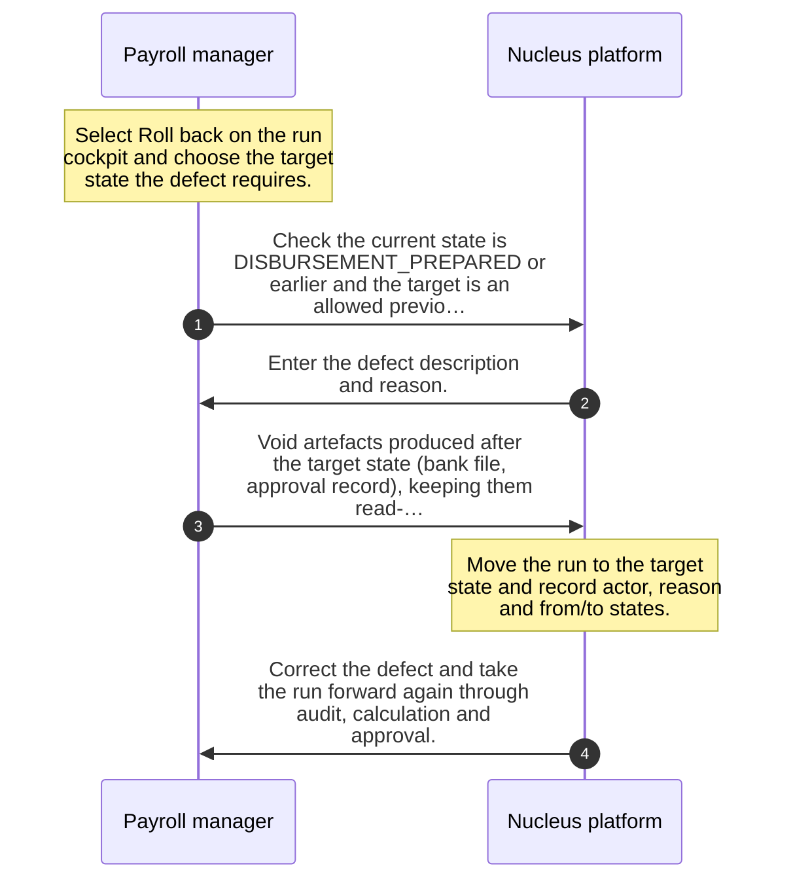

**Alternate flows**

| ID | At step | Condition | Steps | Rejoins |
| :--- | ---: | :--- | :--- | :--- |
| A1 | 1 | The run is in DISBURSEMENT_PREPARED. | Finance is notified that the bank file is voided; any copy held outside the platform must not be released. | Returns to step 2 |
| A2 | 1 | The defect concerns inputs. | The target state is DRAFT; the inputs are unlocked and a new snapshot is taken on re-lock. | Returns to step 2 |

**Exception flows**

| ID | At step | Condition | Handling | Rule |
| :--- | ---: | :--- | :--- | :--- |
| E1 | 2 | The run is DISBURSED or later. | Rollback is refused; the correction must be raised as arrears in the next open run. | RL-323 |
| E2 | 6 | The re-approved run has an open CRITICAL flag. | Approval is blocked as for any run. | RL-321 |

**Postconditions — success**

- The run is in the chosen earlier state, artefacts from later states are voided, and an audit entry records the rollback.

**Postconditions — failure**

- The run state is unchanged.

**Quality requirements**

- Rollback completes within 30 s and voided bank files can no longer be downloaded.

### PAY-UC-015

**Run payroll for another country on a country pack** — Run payroll for an entity outside India using a versioned country pack of earnings, deductions, taxes, filings and payslip format on the same calculation engine.

| Attribute | Value |
| :--- | :--- |
| Realises | PAY-CG-001 |
| Source | Authored |
| Level | User goal |
| Primary actor | Implementation consultant |
| Secondary actors | Payroll manager, Compliance owner, Nucleus platform |
| Trigger | A legal entity in a new country is onboarded to the tenant. |
| Frequency | Per run |
| Criticality | Medium |
| Phase | P4 |
| Client requirements | — |
| Business rules | RL-270, RL-271, RL-273, RL-251 |
| Screens | SCR-050, SCR-053 |
| Data objects (CRUD) | pay_component (R), payslip_line (C) |
| Events | payroll.run.created |
| Acceptance tests | TC-Y270, TC-PR03, PAY-TC-001, PAY-TC-002, PAY-TC-003, PAY-TC-004 |
| System requirements | SYS-006, SYS-028, SYS-045, SYS-047, SYS-066 |

**Stakeholders and interests**

| Stakeholder | Interest |
| :--- | :--- |
| Payroll manager | Runs non-India entities with the same cockpit, audit and approval controls. |
| Compliance owner | Country statutory rules are versioned and effective-dated. |

**Preconditions**

- A country pack for the country is published with an effective date.

**Main success scenario**

| # | Actor | Action | Ref |
| ---: | :--- | :--- | :--- |
| 1 | Implementation consultant | Bind the entity to the country pack version effective from its first pay period. |  |
| 2 | Implementation consultant | Map the entity's pay components to the pack's earnings and deduction nodes. |  |
| 3 | Nucleus platform | Validate the combined component graph is acyclic and every component has a GL mapping. |  |
| 4 | Payroll manager | Create, lock and audit a run for the entity as for any run. |  |
| 5 | Nucleus platform | Calculate using the country pack nodes in integer minor currency units with traces. |  |
| 6 | Nucleus platform | Produce payslips in the pack's format and language and the pack's statutory outputs. |  |

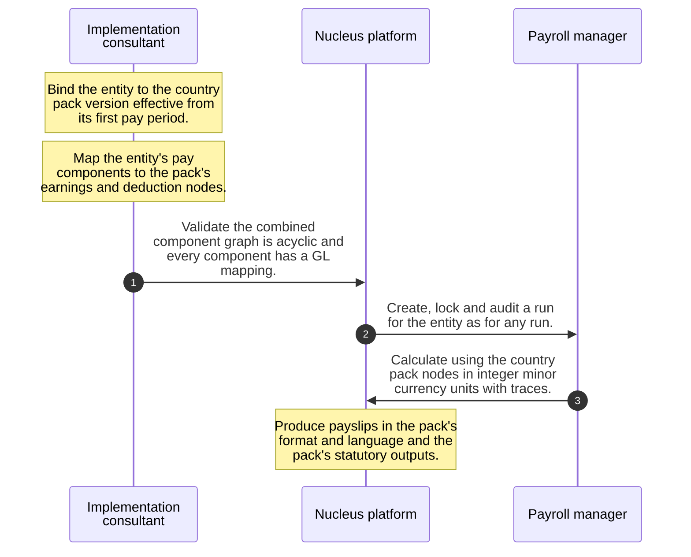

**Alternate flows**

| ID | At step | Condition | Steps | Rejoins |
| :--- | ---: | :--- | :--- | :--- |
| A1 | 1 | A new pack version is published mid-year. | Runs for periods on or after its effective date use the new version; earlier periods keep the old one. | Returns to step 4 |

**Exception flows**

| ID | At step | Condition | Handling | Rule |
| :--- | ---: | :--- | :--- | :--- |
| E1 | 3 | A component is unmapped or the graph has a cycle. | Binding is refused with the offending components named. | RL-270 |

**Postconditions — success**

- The entity's runs calculate with the country pack and produce payslips in the country format.

**Postconditions — failure**

- The entity cannot create runs until a pack is bound.

**Quality requirements**

- Adding a country pack requires no change to the calculation engine code.

### PAY-UC-016

**Compute and pay retro differences with an arrears statement** — Pay back-dated salary, attendance or leave changes spanning several closed periods as arrears in the next open run, with an itemised statement per period and component.

| Attribute | Value |
| :--- | :--- |
| Realises | PAY-CG-002 |
| Source | Authored |
| Level | User goal |
| Primary actor | Payroll manager |
| Secondary actors | HR operations, Nucleus platform, Employee / worker |
| Trigger | HR approves a back-dated change effective in a closed period. |
| Frequency | Monthly |
| Criticality | High |
| Phase | P1 |
| Client requirements | — |
| Business rules | RL-041, RL-240, RL-251, RL-273 |
| Screens | SCR-050, SCR-053 |
| Data objects (CRUD) | payroll_snapshot (R), payslip_line (C) |
| Events | payroll.arrears.requested |
| Acceptance tests | TC-Y41, TC-Y240, PAY-TC-005, PAY-TC-006, PAY-TC-007, PAY-TC-008 |
| System requirements | SYS-024, SYS-025, SYS-031, SYS-037, SYS-047 |

**Stakeholders and interests**

| Stakeholder | Interest |
| :--- | :--- |
| Employee / worker | Receives an itemised arrears statement. |
| Compliance owner | PF and ESI differences are reported against the right periods. |

**Preconditions**

- Snapshots exist for the affected periods; the next open run exists.

**Main success scenario**

| # | Actor | Action | Ref |
| ---: | :--- | :--- | :--- |
| 1 | HR operations | Approve a back-dated salary revision, attendance correction or leave change with its effective date. |  |
| 2 | Nucleus platform | Raise payroll.arrears.requested for each affected employee and period. |  |
| 3 | Nucleus platform | Recompute each closed period from its snapshot with the corrected input and the then-effective rule pack. |  |
| 4 | Nucleus platform | Compute differences per component, including PF, ESI and TDS effects. |  |
| 5 | Payroll manager | Review the arrears batch, totals by period and component, in the next open run's audit. |  |
| 6 | Nucleus platform | Post arrears lines to the next open run, each referencing its original period and run. |  |
| 7 | Nucleus platform | Produce the itemised arrears statement on the employee's payslip for that run. |  |

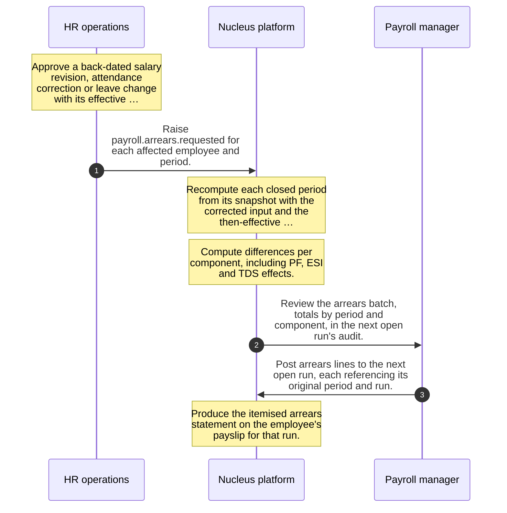

**Alternate flows**

| ID | At step | Condition | Steps | Rejoins |
| :--- | ---: | :--- | :--- | :--- |
| A1 | 5 | The payroll manager prefers a separate arrears run. | An arrears run_type is created for the period and the lines are posted there instead. | Returns to step 6 |

**Exception flows**

| ID | At step | Condition | Handling | Rule |
| :--- | ---: | :--- | :--- | :--- |
| E1 | 3 | The rule pack version for an affected period is no longer available. | The batch is held and a CRITICAL flag names the period and pack. | RL-251 |
| E2 | 6 | A user attempts to post arrears into a closed run. | The posting is refused; arrears go only to an open run. | RL-041 |

**Postconditions — success**

- An arrears statement per employee lists each period and component difference and its payment run.

**Postconditions — failure**

- No arrears are posted and the reason is listed for the payroll manager.

**Quality requirements**

- Arrears for 1,000 employees across 6 periods compute within 5 minutes.

### PAY-UC-017

**Declare tax regime and investments with proof verification** — Let employees choose the income-tax regime, declare investments and upload proofs, with payroll verification driving the TDS projection.

| Attribute | Value |
| :--- | :--- |
| Realises | PAY-CG-003 |
| Source | Authored |
| Level | User goal |
| Primary actor | Employee / worker |
| Secondary actors | Payroll manager, Nucleus platform |
| Trigger | The declaration window opens for the financial year, or the proof submission window opens. |
| Frequency | Annual windows; occasional changes |
| Criticality | High |
| Phase | P1 |
| Client requirements | — |
| Business rules | RL-303 |
| Screens | SCR-054 |
| Data objects (CRUD) | tax_declaration (C/U), document (C), payslip_line (U) |
| Events | — |
| Acceptance tests | TC-Y303, PAY-TC-009, PAY-TC-010, PAY-TC-011, PAY-TC-012 |
| System requirements | SYS-028, SYS-033, SYS-040, SYS-045, SYS-048 |

**Stakeholders and interests**

| Stakeholder | Interest |
| :--- | :--- |
| Employee / worker | TDS reflects the regime and investments actually declared and proven. |
| Payroll manager | Proof verification is tracked and drives year-end reconciliation. |
| Compliance owner | Declarations and verified proofs support the annual returns. |

**Preconditions**

- The effective income-tax rule pack defines regimes, declarable heads and limits (to be validated by Legal).

**Main success scenario**

| # | Actor | Action | Ref |
| ---: | :--- | :--- | :--- |
| 1 | Employee / worker | Open tax declaration and projection and choose the tax regime for the year. |  |
| 2 | Nucleus platform | Show the TDS projection under both regimes using current salary and declarations. |  |
| 3 | Employee / worker | Declare investments and exemptions by head, within the limits from the rule pack. |  |
| 4 | Nucleus platform | Reproject TDS for the remaining months using declared amounts. |  |
| 5 | Employee / worker | Upload proofs for each declared item during the proof window. |  |
| 6 | Payroll manager | Verify each proof, accepting, partly accepting or rejecting it with a reason. |  |
| 7 | Nucleus platform | Reproject TDS from verified amounts and show the change to the employee. |  |

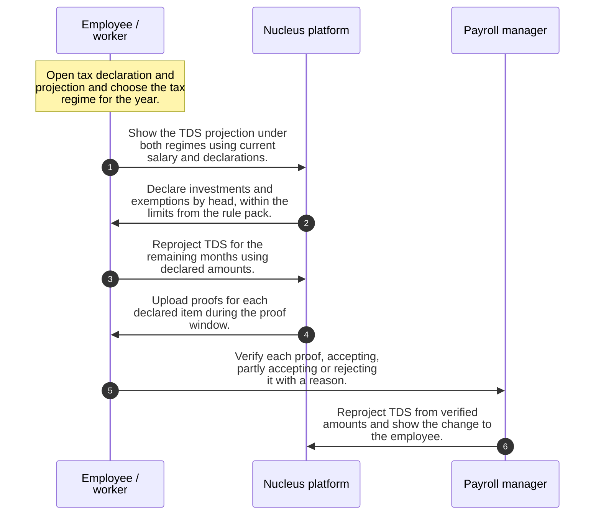

**Alternate flows**

| ID | At step | Condition | Steps | Rejoins |
| :--- | ---: | :--- | :--- | :--- |
| A1 | 1 | The employee changes regime during the year where the pack permits. | The new regime applies from the next run and TDS is reprojected net of tax already deducted. | Returns to step 4 |

**Exception flows**

| ID | At step | Condition | Handling | Rule |
| :--- | ---: | :--- | :--- | :--- |
| E1 | 3 | A declared amount exceeds the head's limit. | The excess is not accepted and the limit is shown. | RL-303 |
| E2 | 6 | A proof is rejected or not submitted by the window close. | The declared amount is replaced by the verified amount (possibly zero) and TDS increases for the remaining months. | RL-303 |

**Postconditions — success**

- Regime, declarations and verified proof amounts are recorded and TDS is reprojected.

**Postconditions — failure**

- The previous declaration stands and TDS is unchanged.

**Quality requirements**

- Proof files are restricted to PDF and image types up to 5 MB each and encrypted at rest.

### PAY-UC-018

**Claim reimbursements and flexible benefits** — Let employees claim fuel, telephone, LTA and meal reimbursements against limits with bills, approved claims flowing to payroll with the right tax treatment.

| Attribute | Value |
| :--- | :--- |
| Realises | PAY-CG-004 |
| Source | Authored |
| Level | User goal |
| Primary actor | Employee / worker |
| Secondary actors | Manager / supervisor, Payroll manager, Nucleus platform |
| Trigger | An employee submits a reimbursement claim. |
| Frequency | Continuous |
| Criticality | High |
| Phase | P2 |
| Client requirements | — |
| Business rules | RL-242, RL-250, RL-273 |
| Screens | SCR-053 |
| Data objects (CRUD) | claim (C/U), document (C), payroll_input (C) |
| Events | payroll.input.raised |
| Acceptance tests | TC-Y242, PAY-TC-013, PAY-TC-014, PAY-TC-015, PAY-TC-016 |
| System requirements | SYS-028, SYS-037, SYS-045, SYS-053 |

**Stakeholders and interests**

| Stakeholder | Interest |
| :--- | :--- |
| Employee / worker | Claims are paid in the next run with correct tax treatment. |
| Payroll manager | Only approved, within-limit claims reach payroll. |
| Finance | Reimbursement cost posts to the right GL accounts. |

**Preconditions**

- Reimbursement heads, annual limits and tax treatment are configured in the employee's salary structure.

**Main success scenario**

| # | Actor | Action | Ref |
| ---: | :--- | :--- | :--- |
| 1 | Employee / worker | Select a reimbursement head, enter the amount and bill date and upload the bill. |  |
| 2 | Nucleus platform | Check the claim against the remaining annual limit and the bill date's financial year. |  |
| 3 | Manager / supervisor | Approve or reject the claim. |  |
| 4 | Payroll manager | Verify the bill and confirm the exempt and taxable portions per the head's tax treatment. |  |
| 5 | Nucleus platform | Raise the approved claim as a payroll input for the next open run; emit payroll.input.raised. |  |
| 6 | Nucleus platform | Pay the claim in the run with reimbursement lines shown separately on the payslip. |  |

```mermaid
sequenceDiagram
    autonumber
    participant P0 as Employee /<br/>worker
    participant P1 as Nucleus platform
    participant P2 as Manager /<br/>supervisor
    participant P3 as Payroll manager
    Note over P0: Select a reimbursement head,<br/>enter the amount and bill date<br/>and upload the bill.
    P0->>P1: Check the claim against the<br/>remaining annual limit and the<br/>bill date's financial year.
    P1->>P2: Approve or reject the claim.
    P2->>P3: Verify the bill and confirm<br/>the exempt and taxable<br/>portions per the head's tax<br/>treatment.
    P3->>P1: Raise the approved claim as a<br/>payroll input for the next<br/>open run, emit<br/>payroll.input.raised.
    Note over P1: Pay the claim in the run with<br/>reimbursement lines shown<br/>separately on the payslip.
```

**Alternate flows**

| ID | At step | Condition | Steps | Rejoins |
| :--- | ---: | :--- | :--- | :--- |
| A1 | 4 | The bill does not support the full amount. | The payroll manager approves a reduced amount with a reason; the employee is notified. | Returns to step 5 |

**Exception flows**

| ID | At step | Condition | Handling | Rule |
| :--- | ---: | :--- | :--- | :--- |
| E1 | 2 | The claim exceeds the remaining limit. | The claim is limited to the remaining amount and the employee is told the excess. | RL-242 |
| E2 | 5 | The next run has locked inputs. | The input is raised for the following open run. | RL-250 |

**Postconditions — success**

- Approved claims are raised as payroll inputs with taxable and exempt portions.

**Postconditions — failure**

- The claim is rejected or returned; no payroll input is raised.

**Quality requirements**

- Claim submission with a 5 MB bill completes within 5 s on mobile.

### PAY-UC-019

**Apply court-ordered deductions** — Deduct court-ordered amounts in their legal priority order while protecting the employee's minimum net pay (specific statutory limits to be validated by Legal).

| Attribute | Value |
| :--- | :--- |
| Realises | PAY-CG-005 |
| Source | Authored |
| Level | User goal |
| Primary actor | Payroll manager |
| Secondary actors | HR operations, Compliance owner, Nucleus platform |
| Trigger | HR operations receives a court order or attachment against an employee's wages. |
| Frequency | Occasional |
| Criticality | Medium |
| Phase | P3 |
| Client requirements | — |
| Business rules | RL-311, RL-310 |
| Screens | SCR-050 |
| Data objects (CRUD) | court_order (C/U), payslip_line (C), document (C) |
| Events | — |
| Acceptance tests | TC-PR02, TC-Y311, PAY-TC-017, PAY-TC-018, PAY-TC-019, PAY-TC-020 |
| System requirements | SYS-019, SYS-028, SYS-047, SYS-049, SYS-070 |

**Stakeholders and interests**

| Stakeholder | Interest |
| :--- | :--- |
| Employee / worker | Net pay never falls below the protected minimum. |
| Compliance owner | Orders are honoured in the right priority and evidenced. |

**Preconditions**

- Deduction priority order and the protected net-pay floor are configured (to be validated by Legal).

**Main success scenario**

| # | Actor | Action | Ref |
| ---: | :--- | :--- | :--- |
| 1 | HR operations | Record the order: issuing authority, reference, amount or rate, start date and payee, with the order document. |  |
| 2 | Compliance owner | Confirm the order's priority relative to statutory deductions, loans and other orders. |  |
| 3 | Nucleus platform | In each run, compute available net after statutory deductions and apply orders in priority order. |  |
| 4 | Nucleus platform | Reduce any deduction that would breach the protected net-pay floor and carry the shortfall forward. |  |
| 5 | Nucleus platform | Write deduction lines, update the order's balance and raise a payee remittance record. |  |
| 6 | Nucleus platform | Close the order when the amount is satisfied and notify HR operations. |  |

```mermaid
sequenceDiagram
    autonumber
    participant P0 as HR operations
    participant P1 as Compliance owner
    participant P2 as Nucleus platform
    Note over P0: Record the order - issuing<br/>authority, reference, amount<br/>or rate, start date and payee,<br/>with the …
    P0->>P1: Confirm the order's priority<br/>relative to statutory<br/>deductions, loans and other<br/>orders.
    P1->>P2: In each run, compute available<br/>net after statutory deductions<br/>and apply orders in priority<br/>orde…
    Note over P2: Reduce any deduction that<br/>would breach the protected<br/>net-pay floor and carry the<br/>shortfall forw…
    Note over P2: Write deduction lines, update<br/>the order's balance and raise<br/>a payee remittance record.
    Note over P2: Close the order when the<br/>amount is satisfied and notify<br/>HR operations.
```

**Alternate flows**

| ID | At step | Condition | Steps | Rejoins |
| :--- | ---: | :--- | :--- | :--- |
| A1 | 3 | Two orders apply to the same employee. | The higher-priority order is satisfied first; the second takes only what remains above the floor. | Returns to step 4 |

**Exception flows**

| ID | At step | Condition | Handling | Rule |
| :--- | ---: | :--- | :--- | :--- |
| E1 | 4 | No amount is available above the floor. | No deduction is made, the shortfall is carried forward and the payroll manager is flagged. | RL-311 |
| E2 | 1 | The order document is missing. | The order cannot be activated. |  |

**Postconditions — success**

- The order deducts each run in priority order until satisfied, with remittance records.

**Postconditions — failure**

- The order is recorded but not active; no deduction occurs.

**Quality requirements**

- Order documents are visible only to HR operations, the compliance owner and the payroll manager in scope.

### PAY-UC-020

**Send change extracts to an external payroll provider** — For countries without a native pack, send effective-dated employee and pay changes to an external payroll provider and reconcile its acknowledgement and results.

| Attribute | Value |
| :--- | :--- |
| Realises | PAY-CG-006 |
| Source | Authored |
| Level | User goal |
| Primary actor | Payroll manager |
| Secondary actors | External payroll provider, Nucleus platform, Finance |
| Trigger | The extract schedule for the entity's pay period fires. |
| Frequency | Per pay period |
| Criticality | Medium |
| Phase | P4 |
| Client requirements | — |
| Business rules | RL-251 |
| Screens | SCR-050 |
| Data objects (CRUD) | payroll_extract (C/U) |
| Events | — |
| Acceptance tests | PAY-TC-021, PAY-TC-022, PAY-TC-023, PAY-TC-024 |
| System requirements | SYS-022, SYS-050, SYS-084, SYS-088 |

**Stakeholders and interests**

| Stakeholder | Interest |
| :--- | :--- |
| Payroll manager | Knows every change reached the provider and was applied. |
| Finance | Provider results reconcile with the platform's records. |

**Preconditions**

- The entity is configured for external payroll with a provider endpoint and extract format.

**Main success scenario**

| # | Actor | Action | Ref |
| ---: | :--- | :--- | :--- |
| 1 | Nucleus platform | Collect effective-dated changes since the last acknowledged extract: hires, exits, pay and bank changes. |  |
| 2 | Nucleus platform | Produce the extract with a sequence number and content hash. |  |
| 3 | Nucleus platform | Deliver the extract to the provider over the configured secure channel. |  |
| 4 | External payroll provider | Return an acknowledgement with the sequence number and record counts. |  |
| 5 | Nucleus platform | Match acknowledgement counts to the extract and mark it acknowledged. |  |
| 6 | External payroll provider | Return period results (gross, deductions, net per employee). |  |
| 7 | Payroll manager | Reconcile results against platform records and resolve differences. |  |

```mermaid
sequenceDiagram
    autonumber
    participant P0 as Nucleus platform
    participant P1 as External payroll<br/>provider
    participant P2 as Payroll manager
    Note over P0: Collect effective-dated<br/>changes since the last<br/>acknowledged extract - hires,<br/>exits, pay and bank…
    Note over P0: Produce the extract with a<br/>sequence number and content<br/>hash.
    Note over P0: Deliver the extract to the<br/>provider over the configured<br/>secure channel.
    P0->>P1: Return an acknowledgement with<br/>the sequence number and record<br/>counts.
    P1->>P0: Match acknowledgement counts<br/>to the extract and mark it<br/>acknowledged.
    P0->>P1: Return period results (gross,<br/>deductions, net per employee).
    P1->>P2: Reconcile results against<br/>platform records and resolve<br/>differences.
```

**Alternate flows**

| ID | At step | Condition | Steps | Rejoins |
| :--- | ---: | :--- | :--- | :--- |
| A1 | 1 | A change is back-dated before the last extract. | The change is included with its original effective date and marked as a correction. | Returns to step 2 |

**Exception flows**

| ID | At step | Condition | Handling | Rule |
| :--- | ---: | :--- | :--- | :--- |
| E1 | 4 | No acknowledgement within 24 hours. | The extract is re-sent once with the same sequence number, then escalated to the payroll manager. |  |
| E2 | 5 | Acknowledged counts differ from the extract. | The extract is marked rejected and the differing records listed. | RL-251 |

**Postconditions — success**

- The extract is acknowledged and provider results are reconciled with no open differences.

**Postconditions — failure**

- The extract remains unacknowledged and is escalated.

**Quality requirements**

- Extracts are encrypted in transit and at rest; sequence numbers have no gaps.

### PAY-UC-021

**Close the payroll financial year** — Produce annual employee tax certificates and perquisite statements, reconcile investments, prepare quarterly TDS returns, and lock the financial year with controlled re-open (forms and obligations to be validated by Legal).

| Attribute | Value |
| :--- | :--- |
| Realises | PAY-CG-007 |
| Source | Authored |
| Level | Summary |
| Primary actor | Compliance owner |
| Secondary actors | Payroll manager, Nucleus platform, Statutory portal, Employee / worker |
| Trigger | Quarter end for 24Q; financial year end for certificates and lock. |
| Frequency | Quarterly and annual |
| Criticality | High |
| Phase | P2 |
| Client requirements | — |
| Business rules | RL-303, RL-250 |
| Screens | SCR-054, SCR-070 |
| Data objects (CRUD) | payslip_line (R), tax_declaration (R), statutory_return (C) |
| Events | — |
| Acceptance tests | TC-Y303, PAY-TC-025, PAY-TC-026, PAY-TC-027, PAY-TC-028, PAY-TC-029, PAY-TC-030 |
| System requirements | SYS-020, SYS-032, SYS-045, SYS-051, SYS-086 |

**Stakeholders and interests**

| Stakeholder | Interest |
| :--- | :--- |
| Employee / worker | Receives Form 16 and Form 12BA on time and correct. |
| Compliance owner | Quarterly 24Q returns reconcile to payroll deductions. |
| Auditor | A locked year cannot be changed without a recorded re-open. |

**Preconditions**

- All runs in the quarter or year are CLOSED; verified proofs are recorded.

**Main success scenario**

| # | Actor | Action | Ref |
| ---: | :--- | :--- | :--- |
| 1 | Nucleus platform | At quarter end, aggregate TDS deducted per employee and challan details for the quarter. |  |
| 2 | Compliance owner | Review the 24Q return data, resolve mismatches and file it on the statutory portal. |  |
| 3 | Nucleus platform | At year end, reconcile declared versus verified investments and TDS deducted per employee. |  |
| 4 | Nucleus platform | Generate Form 16 and Form 12BA per employee from the reconciled data. |  |
| 5 | Compliance owner | Approve publication; certificates appear in employee self-service. |  |
| 6 | Payroll manager | Lock the financial year; further changes are refused. |  |
| 7 | Nucleus platform | Record the lock with actor and time and block new runs dated in the year. |  |

```mermaid
sequenceDiagram
    autonumber
    participant P0 as Nucleus platform
    participant P1 as Compliance owner
    participant P2 as Payroll manager
    Note over P0: At quarter end, aggregate TDS<br/>deducted per employee and<br/>challan details for the<br/>quarter.
    P0->>P1: Review the 24Q return data,<br/>resolve mismatches and file it<br/>on the statutory portal.
    P1->>P0: At year end, reconcile<br/>declared versus verified<br/>investments and TDS deducted<br/>per employee.
    Note over P0: Generate Form 16 and Form 12BA<br/>per employee from the<br/>reconciled data.
    P0->>P1: Approve publication,<br/>certificates appear in<br/>employee self-service.
    P1->>P2: Lock the financial year,<br/>further changes are refused.
    P2->>P0: Record the lock with actor and<br/>time and block new runs dated<br/>in the year.
```

**Alternate flows**

| ID | At step | Condition | Steps | Rejoins |
| :--- | ---: | :--- | :--- | :--- |
| A1 | 6 | A correction is needed after the lock. | The Director / approver authorises a re-open with reason; the change is made and the year re-locked, with revised certificates where affected. | Returns to step 6 |

**Exception flows**

| ID | At step | Condition | Handling | Rule |
| :--- | ---: | :--- | :--- | :--- |
| E1 | 2 | Return data has an invalid PAN or challan mismatch. | Filing is blocked and the affected records listed for correction. | RL-303 |
| E2 | 3 | TDS deducted differs from the computed annual liability. | The employee is listed for reconciliation before certificates are generated. | RL-303 |

**Postconditions — success**

- Returns are filed, certificates published to employees and the year locked.

**Postconditions — failure**

- The year stays open with the blocking reconciliation item named.

**Quality requirements**

- Certificates for 10,000 employees generate within 30 minutes.
- Re-open of a locked year requires two distinct users.

### PAY-UC-022

**Run payrolls of different frequencies side by side** — Run monthly, semi-monthly, weekly and daily-wage payrolls for different pay groups in parallel, each with its own calendar, cut-offs and locks.

| Attribute | Value |
| :--- | :--- |
| Realises | PAY-CG-008 |
| Source | Authored |
| Level | User goal |
| Primary actor | Payroll manager |
| Secondary actors | Nucleus platform, Plant HR / time office, Finance, Bank |
| Trigger | A pay calendar reaches the cut-off date for a pay group, for example the weekly cycle for daily-wage workers at Peenya Works. |
| Frequency | Weekly, semi-monthly and monthly |
| Criticality | High |
| Phase | P2 |
| Client requirements | — |
| Business rules | RL-240, RL-241, RL-250, RL-262, RL-290, RL-301, RL-324 |
| Screens | SCR-050, SCR-053 |
| Data objects (CRUD) | pay_calendar (R), payroll_run (C/U), payroll_result (C), journal (C), bank_file (C) |
| Events | payroll.run.created, payroll.run.approved |
| Acceptance tests | PAY-TC-031, PAY-TC-032, PAY-TC-033, PAY-TC-034, PAY-TC-035, PAY-TC-036 |
| System requirements | SYS-007, SYS-026, SYS-045, SYS-047, SYS-051, SYS-085 |

**Stakeholders and interests**

| Stakeholder | Interest |
| :--- | :--- |
| Employee / worker | Daily-wage and contract workers are paid on their own cycle without waiting for the monthly run. |
| Finance | Every run posts its own journal into the correct accounting period. |
| Compliance owner | Monthly statutory contributions aggregate correctly across weekly runs. |

**Preconditions**

- Each pay group has a calendar defining frequency, period dates, cut-off, lock and pay dates.
- Daily-wage workers (WC-CONT) are assigned to a weekly pay group with wage type daily (RL-290).

**Main success scenario**

| # | Actor | Action | Ref |
| ---: | :--- | :--- | :--- |
| 1 | Nucleus platform | Opens the weekly run for pay group PLANT-BLR-DW for 2026-11-02 to 2026-11-08 per its calendar. |  |
| 2 | Nucleus platform | Resolves the population from assignments active in the week, including E1032 and E1033. |  |
| 3 | Plant HR / time office | Confirms attendance for the week is final for the pay group. |  |
| 4 | Payroll manager | Locks inputs for the weekly run only; the monthly PLANT-BLR run stays open. |  |
| 5 | Nucleus platform | Computes daily-wage earnings from paid days and the daily rate, and deductions for the week. |  |
| 6 | Nucleus platform | Accumulates statutory wage bases across the month's weekly runs so contributions are reconciled monthly. |  |
| 7 | Payroll manager | Reviews variance and approves the run. |  |
| 8 | Nucleus platform | Prepares the bank file and the run's own journal for the week. |  |
| 9 | Bank | Credits wages on the weekly pay date. |  |

```mermaid
sequenceDiagram
    autonumber
    participant P0 as Nucleus platform
    participant P1 as Plant HR / time<br/>office
    participant P2 as Payroll manager
    participant P3 as Bank
    Note over P0: Opens the weekly run for pay<br/>group PLANT-BLR-DW for<br/>2026-11-02 to 2026-11-08 per<br/>its calendar.
    Note over P0: Resolves the population from<br/>assignments active in the<br/>week, including E1032 and<br/>E1033.
    P0->>P1: Confirms attendance for the<br/>week is final for the pay<br/>group.
    P1->>P2: Locks inputs for the weekly<br/>run only, the monthly<br/>PLANT-BLR run stays open.
    P2->>P0: Computes daily-wage earnings<br/>from paid days and the daily<br/>rate, and deductions for the<br/>week.
    Note over P0: Accumulates statutory wage<br/>bases across the month's<br/>weekly runs so contributions<br/>are reconciled…
    P0->>P2: Reviews variance and approves<br/>the run.
    P2->>P0: Prepares the bank file and the<br/>run's own journal for the<br/>week.
    P0->>P3: Credits wages on the weekly<br/>pay date.
```

**Alternate flows**

| ID | At step | Condition | Steps | Rejoins |
| :--- | ---: | :--- | :--- | :--- |
| A1 | 1 | A semi-monthly group reaches its 15th-of-month cut-off. | The platform opens a semi-monthly run for the first half and processes it the same way. | Returns to step 2 |
| A2 | 2 | A worker moved from the weekly to the monthly group mid-period. | Each run includes only the days covered by the assignment in its group. | Returns to step 3 |

**Exception flows**

| ID | At step | Condition | Handling | Rule |
| :--- | ---: | :--- | :--- | :--- |
| E1 | 7 | A critical audit flag is open on the weekly run. | Approval is blocked until the flag is resolved or waived by an authorised role. | RL-262 |
| E2 | 5 | A weekly run's cumulative earnings cross the ESI threshold within the contribution period. | Contribution continues to the end of the period and the case is flagged. | RL-301 |

**Postconditions — success**

- The run for the pay group is computed, approved and disbursed on its own calendar; locks on one group do not block another.

**Postconditions — failure**

- The run stays open with blocking flags listed; other pay groups' runs are unaffected.

**Quality requirements**

- A weekly run of 2,000 daily-wage workers computes in under 2 minutes.
- Locks are scoped per run; locking one pay group never blocks input to another.

### PAY-UC-023

**Model take-home pay before submitting a choice** — Let an employee model the take-home effect of choices such as tax regime, voluntary provident fund, flexible-benefit allocation or a loan before submitting them.

| Attribute | Value |
| :--- | :--- |
| Realises | PAY-CG-009 |
| Source | Authored |
| Level | User goal |
| Primary actor | Employee / worker |
| Secondary actors | Nucleus platform, Payroll manager |
| Trigger | An employee opens the net-pay what-if from the tax declaration, benefits or loan screen. |
| Frequency | Seasonal, peaking at declaration windows |
| Criticality | Medium |
| Phase | P3 |
| Client requirements | — |
| Business rules | RL-270, RL-271, RL-273, RL-303, RL-430 |
| Screens | SCR-053, SCR-054 |
| Data objects (CRUD) | salary_structure (R), payroll_result (R), whatif_scenario (C), tax_declaration (C) |
| Events | payroll.whatif.computed |
| Acceptance tests | PAY-TC-037, PAY-TC-038, PAY-TC-039, PAY-TC-040, PAY-TC-041, PAY-TC-042 |
| System requirements | SYS-028, SYS-030, SYS-045, SYS-047, SYS-048 |

**Stakeholders and interests**

| Stakeholder | Interest |
| :--- | :--- |
| Employee / worker | Understands the real monthly and annual effect of a choice before committing. |
| Payroll manager | Fewer mid-year reversals and queries after declarations are submitted. |

**Preconditions**

- The employee has a salary structure and year-to-date payroll results.
- Current rule pack versions for income tax and statutory deductions are published.

**Main success scenario**

| # | Actor | Action | Ref |
| ---: | :--- | :--- | :--- |
| 1 | Employee / worker | Opens the what-if tool and sees the current projection: regime, VPF, flexible-benefit split and any loan recovery. |  |
| 2 | Employee / worker | Creates a scenario switching to the other tax regime and adding 5% VPF. |  |
| 3 | Nucleus platform | Runs the gross-to-net graph in simulation mode using the current rule pack versions and year-to-date results. |  |
| 4 | Nucleus platform | Projects tax to year end under the scenario and shows monthly and annual take-home against the current choice. |  |
| 5 | Employee / worker | Adds a second scenario with a company loan EMI and compares all three. |  |
| 6 | Nucleus platform | Explains each difference line by line, naming the component and rule that changed it. |  |
| 7 | Employee / worker | Chooses a scenario and submits it through the declaration or loan application flow. |  |

```mermaid
sequenceDiagram
    autonumber
    participant P0 as Employee /<br/>worker
    participant P1 as Nucleus platform
    Note over P0: Opens the what-if tool and<br/>sees the current projection -<br/>regime, VPF, flexible-benefit<br/>split and…
    Note over P0: Creates a scenario switching<br/>to the other tax regime and<br/>adding 5% VPF.
    P0->>P1: Runs the gross-to-net graph in<br/>simulation mode using the<br/>current rule pack versions and<br/>year-to…
    Note over P1: Projects tax to year end under<br/>the scenario and shows monthly<br/>and annual take-home against<br/>the …
    P1->>P0: Adds a second scenario with a<br/>company loan EMI and compares<br/>all three.
    P0->>P1: Explains each difference line<br/>by line, naming the component<br/>and rule that changed it.
    P1->>P0: Chooses a scenario and submits<br/>it through the declaration or<br/>loan application flow.
```

**Alternate flows**

| ID | At step | Condition | Steps | Rejoins |
| :--- | ---: | :--- | :--- | :--- |
| A1 | 7 | The employee decides not to change anything. | The scenarios are kept privately for 30 days and then deleted. | Ends |

**Exception flows**

| ID | At step | Condition | Handling | Rule |
| :--- | ---: | :--- | :--- | :--- |
| E1 | 3 | The loan scenario exceeds eligibility. | The scenario shows the eligibility limit and the maximum EMI allowed. | RL-430 |
| E2 | 4 | A regime switch is not permitted at this point in the year. | The scenario is shown for information and the submit option is disabled with the reason. | RL-303 |

**Postconditions — success**

- The employee sees projected monthly and annual take-home for each scenario and may submit the chosen option through the normal request flow.

**Postconditions — failure**

- No scenario is saved as a submission and live payroll inputs are unchanged.

**Quality requirements**

- A scenario result is returned in under 2 s.
- Simulation never writes to payroll inputs or results.

### PAY-UC-024

**Trace a payslip line to its inputs, rules and approvals** — Allow payroll and auditors to trace any payslip line back to its inputs, rules, rule versions and the run's approval history.

| Attribute | Value |
| :--- | :--- |
| Realises | PAY-CG-010 |
| Source | Authored |
| Level | User goal |
| Primary actor | Auditor |
| Secondary actors | Payroll manager, Nucleus platform |
| Trigger | An auditor or payroll manager selects a payslip line to investigate. |
| Frequency | Daily during audits |
| Criticality | High |
| Phase | P2 |
| Client requirements | — |
| Business rules | RL-251, RL-271, RL-273, RL-321, RL-351 |
| Screens | SCR-053, SCR-050 |
| Data objects (CRUD) | payslip_line (R), run_snapshot (R), rule_pack_version (R), approval_record (R), audit_event (C) |
| Events | payroll.trace.viewed |
| Acceptance tests | PAY-TC-043, PAY-TC-044, PAY-TC-045, PAY-TC-046, PAY-TC-047, PAY-TC-048 |
| System requirements | SYS-023, SYS-024, SYS-030, SYS-031, SYS-032 |

**Stakeholders and interests**

| Stakeholder | Interest |
| :--- | :--- |
| Auditor | Can verify any figure without asking the payroll team to reconstruct it. |
| Payroll manager | Answers employee and audit queries quickly from evidence. |
| Employee / worker | Disputed amounts are explained precisely. |

**Preconditions**

- Every payslip line stores the node, inputs, output and rule pack version that produced it (RL-273).
- The run snapshot hashes inputs, rule pack versions and configuration (RL-251).

**Main success scenario**

| # | Actor | Action | Ref |
| ---: | :--- | :--- | :--- |
| 1 | Auditor | Opens the September 2026 PLANT-PUN payslip of E1044 Rahul Gaikwad and selects the loan recovery line. |  |
| 2 | Nucleus platform | Shows the DAG node, its inputs, output in paise and the rule pack version that produced it. |  |
| 3 | Auditor | Drills from each input to its source record, such as the loan schedule and the attendance days. |  |
| 4 | Nucleus platform | Shows the source record versions as at the run's snapshot timestamp. |  |
| 5 | Auditor | Opens the run's approval history: who locked, reviewed, approved and prepared disbursement, with times. |  |
| 6 | Auditor | Requests recomputation of the line from the snapshot. |  |
| 7 | Nucleus platform | Recomputes and confirms the result matches to the paisa, recording the trace in the audit ledger. |  |

```mermaid
sequenceDiagram
    autonumber
    participant P0 as Auditor
    participant P1 as Nucleus platform
    Note over P0: Opens the September 2026<br/>PLANT-PUN payslip of E1044<br/>Rahul Gaikwad and selects the<br/>loan recovery…
    P0->>P1: Shows the DAG node, its<br/>inputs, output in paise and<br/>the rule pack version that<br/>produced it.
    P1->>P0: Drills from each input to its<br/>source record, such as the<br/>loan schedule and the<br/>attendance days.
    P0->>P1: Shows the source record<br/>versions as at the run's<br/>snapshot timestamp.
    P1->>P0: Opens the run's approval<br/>history - who locked,<br/>reviewed, approved and<br/>prepared disbursement, wit…
    Note over P0: Requests recomputation of the<br/>line from the snapshot.
    P0->>P1: Recomputes and confirms the<br/>result matches to the paisa,<br/>recording the trace in the<br/>audit ledge…
```

**Alternate flows**

| ID | At step | Condition | Steps | Rejoins |
| :--- | ---: | :--- | :--- | :--- |
| A1 | 1 | The investigator starts from a payroll register total rather than a payslip. | The platform lists contributing payslip lines, from which one is selected. | Returns to step 2 |

**Exception flows**

| ID | At step | Condition | Handling | Rule |
| :--- | ---: | :--- | :--- | :--- |
| E1 | 7 | Recomputation differs from the stored result. | A critical discrepancy is raised to the payroll manager and the line is marked under investigation. | RL-251 |
| E2 | 1 | The auditor's scope excludes the payroll group. | Amounts return null and the trace shows only structure. |  |

**Postconditions — success**

- The investigator sees the full lineage of the line and can recompute it to the paisa; the trace is logged.

**Postconditions — failure**

- If recomputation does not match, a critical discrepancy is raised for the payroll manager.

**Quality requirements**

- A line trace opens in under 2 s.
- Recomputation of one employee's payslip from the snapshot completes in under 5 s.

### PAY-UC-025

**Hold and release an individual's net pay** — Allow payroll to hold an individual's net pay with a reason and release it in the same or a later run with full audit.

| Attribute | Value |
| :--- | :--- |
| Realises | PAY-CG-011 |
| Source | Authored |
| Level | User goal |
| Primary actor | Payroll manager |
| Secondary actors | HR operations, Nucleus platform, Director / approver, Finance |
| Trigger | HR or payroll identifies a reason to withhold pay, for example unauthorised absence, pending bank verification or unreturned assets. |
| Frequency | Several times a month |
| Criticality | High |
| Phase | P1 |
| Client requirements | — |
| Business rules | RL-250, RL-322, RL-323, RL-324, RL-341 |
| Screens | SCR-050, SCR-055, SCR-040 |
| Data objects (CRUD) | salary_hold (C/U), payroll_result (R), bank_file (U), journal (C) |
| Events | payroll.hold.applied, payroll.hold.released |
| Acceptance tests | PAY-TC-049, PAY-TC-050, PAY-TC-051, PAY-TC-052, PAY-TC-053, PAY-TC-054 |
| System requirements | SYS-028, SYS-032, SYS-037, SYS-070, SYS-085 |

**Stakeholders and interests**

| Stakeholder | Interest |
| :--- | :--- |
| Employee / worker | Is told a hold has been placed and paid promptly once it is released. |
| Finance | Held amounts sit in a liability account and are not lost. |
| Auditor | Every hold and release has a reason and an authorised approver. |

**Preconditions**

- The employee's payroll result for the run is computed.
- Hold reasons and the approver for holds are configured.

**Main success scenario**

| # | Actor | Action | Ref |
| ---: | :--- | :--- | :--- |
| 1 | HR operations | Requests a salary hold for E1022 Mohan Joseph citing unverified bank details after a change inside the payroll window. |  |
| 2 | Payroll manager | Places the hold on the October run with reason code and expected review date. |  |
| 3 | Nucleus platform | Routes the hold through its approval chain. |  |
| 4 | Director / approver | Approves the hold. |  |
| 5 | Nucleus platform | Keeps the payslip computed but excludes net pay from the bank file and posts it to a held-salary liability. |  |
| 6 | Notification service | Tells the employee a hold has been placed, with the reason category and HR contact. |  |
| 7 | Payroll manager | Releases the hold once the bank details are verified, choosing the November run or an off-cycle run. |  |
| 8 | Nucleus platform | Adds the held amount to the chosen run as a release line referencing the original period and clears the liability. |  |

```mermaid
sequenceDiagram
    autonumber
    participant P0 as HR operations
    participant P1 as Payroll manager
    participant P2 as Nucleus platform
    participant P3 as Director /<br/>approver
    participant P4 as Notification<br/>service
    Note over P0: Requests a salary hold for<br/>E1022 Mohan Joseph citing<br/>unverified bank details after<br/>a change ins…
    P0->>P1: Places the hold on the October<br/>run with reason code and<br/>expected review date.
    P1->>P2: Routes the hold through its<br/>approval chain.
    P2->>P3: Approves the hold.
    P3->>P2: Keeps the payslip computed but<br/>excludes net pay from the bank<br/>file and posts it to a<br/>held-salar…
    P2->>P4: Tells the employee a hold has<br/>been placed, with the reason<br/>category and HR contact.
    P4->>P1: Releases the hold once the<br/>bank details are verified,<br/>choosing the November run or<br/>an off-cycle…
    P1->>P2: Adds the held amount to the<br/>chosen run as a release line<br/>referencing the original<br/>period and cl…
```

**Alternate flows**

| ID | At step | Condition | Steps | Rejoins |
| :--- | ---: | :--- | :--- | :--- |
| A1 | 7 | The issue is resolved before October disbursement is prepared. | The hold is released in the same run and the net pay returns to the October bank file. | Returns to step 8 |
| A2 | 7 | The hold ends in separation. | The held amount is carried into full-and-final settlement. | Ends |

**Exception flows**

| ID | At step | Condition | Handling | Rule |
| :--- | ---: | :--- | :--- | :--- |
| E1 | 2 | Disbursement for the run is already prepared. | The hold cannot be applied to this run; payroll is told to recall the payment or hold the next run. | RL-323 |
| E2 | 4 | The approver rejects the hold. | The hold is removed and net pay remains in the bank file. |  |

**Postconditions — success**

- Net pay is excluded from the bank file and recorded as held; on release, it is paid in the chosen run with its original period and reason recorded.

**Postconditions — failure**

- No hold is applied and net pay flows to disbursement as normal.

**Quality requirements**

- A hold applied before disbursement preparation is reflected in the bank file within 1 minute.
- Every hold and release is retrievable by employee, run and reason for 8 years.

## Approval & Sign-off

| Role | Name | Date | Decision | Conditions / comments |
| :--- | :--- | :--- | :--- | :--- |
| Author | Dhanraj Dadhich | 2026-11-05 | Submitted | |
| Peer review moderator | *pending* | | | PR-xxxx |
| PQA (process compliance) | *pending* | | | |
| Approval authority (DOC-01 §7) | *pending* | | | |

## Measurement Data Captured

| Measure | Value | Unit | Notes |
| :--- | :--- | :--- | :--- |
| Size | 716 | specified items (table rows) | Counted automatically at generation |
| Authoring effort | *to be recorded* | person-hours | |
| Review effort (preparation + meeting) | *pending review* | person-hours | From PR-xxxx |
| Rework effort | *pending review* | person-hours | |
| Review rate | *pending review* | items / hour | Compare with PPB control limits |
| Requirement volatility (changes since baseline) | 0 | CRs touching this artefact | Not yet baselined (CM-03) |

**Defects found, by detection phase and severity**

| Detection phase | Major | Minor | Editorial | Injected in phase (major) |
| :--- | :--- | :--- | :--- | :--- |
| Author self-check | 0 | 0 | 0 | — |
| Peer review | *pending* | | | |
| Design / build | | | | |
| System / integration test | | | | |
| UAT | | | | |
| Production (escaped) | | | | each escaped major opens a CAR record (CAR-01) |

Within control limits of the review-rate PPB? *To be assessed at peer review.*

## Revision History

| Version | Date | Author | Change summary | CR ref | Approved by |
| :--- | :--- | :--- | :--- | :--- | :--- |
| 1.0.0 | 2026-11-05 | Dhanraj Dadhich | Consolidated release | CR-0001 | *pending* |
