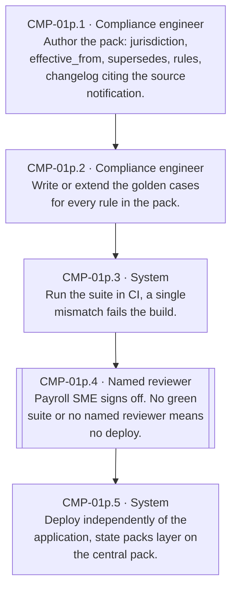
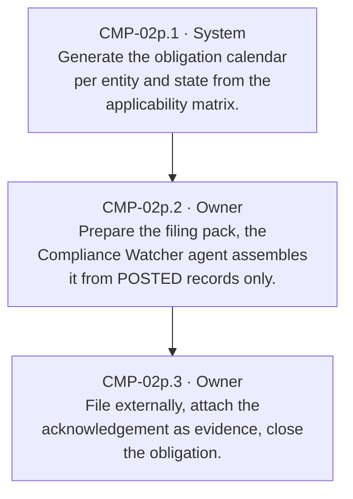
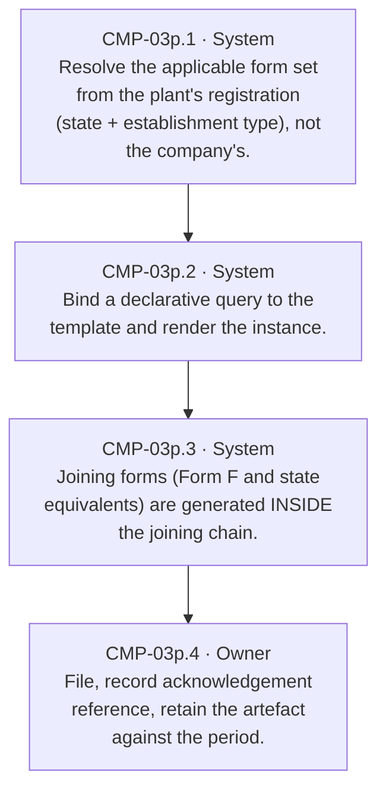

<picture>
  <source media="(prefers-color-scheme: dark)" srcset="../../assets/MultipliersKraftLogoDark.png">
  
</picture>

# FRS-CMP-01 — Compliance — Process Specifications

| Attribute | Value |
| :--- | :--- |
| Document ID | FRS-CMP-01 |
| Title | Compliance — Process Specifications |
| Product | Nucleus Suite (Nucleus HRMS Suite) |
| Version | 1.0.0 |
| Status | Issued for approval |
| Owner (role) | Domain Product Owner — Compliance |
| Author | Dhanraj Dadhich |
| Reviewed by | *pending* |
| Approved by | Product Council — *pending* |
| Date | 2026-11-05 |
| Classification | Internal |
| CMMI practice areas | RDM, TS |
| Related documents | FRS-CMP-00, FRS-CMP-01, FRS-CMP-02, FRS-CMP-03, FRS-CMP-04, FRS-CMP-05, FRS-CMP-06, FRS-CMP-07, FRS-CMP-08, FRS-CMP-09, FRS-CMP-10, FRS-CMP-11, FRS-CMP-12, FRS-CMP-13, BRS-01, SRS-01, REQ-01, REQ-02 |
| Quality & process-performance objectives | QPPO-05 (effective requirements reviews), QPPO-01 (escaped defects) — MPM-01 |
| Process performance baseline used | PPB-01 (review defect density), PPB-02 (review rate) — MPM-01 |
| Peer review record | *pending* (PR-xxxx, QA-02) |
| Tailoring record | none |
| Traceability anchor | BG-04, BG-06 · R-18, R-27 · processes CMP-01p–CMP-06p |
| Source of record | Nucleus — Process Flows & Process Maps v1.0 — sheet(s) 03_Process_Inventory, 04_Process_Steps, 05_Swimlane_Maps Nucleus HR Demo Points Build Sheet v1.0 — sheet(s) 07_Approval_Workflows Nucleus HRMS Demo Dataset v1.1 — sheet(s) 64_Approval_Workflows |

> **Source of record.** Requirements in this document are taken from the source workbook(s) named above and keep their workbook IDs, which are never renumbered. Changes are made through a change request (CM-02) against the source workbook. Sections marked **Authored** are original additions that are not present in the source workbooks.

Step types: TASK (human) · SYS (system, unattended) · DEC (decision) · APPR (approval gate) · INT (integration call) · WAIT (timer or external event) · AGENT (agent-executed, governed). CRUD: C create · R read · U update · D delete-by-end-dating (temporal facts are never hard-deleted). In the flow diagrams decisions are diamonds, approvals are double-bordered boxes and integration, wait and agent steps are rounded.

## 1. Process inventory

| Process ID | Process | Trigger | Primary actor | Frequency | Criticality | Blueprint module | Phase | Reuses | Demo pts | Note |
| :--- | :--- | :--- | :--- | :--- | :--- | :--- | :--- | :--- | :--- | :--- |
| CMP-01p | Rule pack authoring, test and deployment | Statutory notification | Payroll & compliance engineer | Per notification | Critical | Module 6 | P1 | CMP-09 | 17 | Green suite + named reviewer or it does not deploy. |
| CMP-02p | Obligation calendar and filing | Calendar due date | HR / Finance owner | Monthly | Critical | Module 6 | P1 | CMP-01 | 17 | The screen the HR head opens every morning. |
| CMP-03p | Statutory form and register generation | Joining, period end, or filing demand | System | Per event | Critical | Module 6 | P1 | CMP-03r, CMP-09 | 17,26 | Declarative query bound to a template, state-scoped to the plant's registration. |
| CMP-04p | Labour Codes wage-base simulation | Structure change proposal | HR / Comp | Occasional | High | Modules 6, 12 | P2 | CMP-03 |  | Sell the simulator; it opens doors (blueprint Module 3). |
| CMP-05p | AI governance logging and disclosure | Any inference | System | Continuous | High | Module 6 | P2 | CMP-06 |  | Disclosure, labelling, inference log, no AI-only adverse decision. |
| CMP-06p | DPDP consent, retention and erasure | Consent event or erasure request | System / DPO | Continuous | High | Module 6 | P3 | CMP-06 |  | 48-hour pre-erasure intimation; processor obligations flowed down. |

## 2. Step-level specifications

### CMP-01p — Rule pack authoring, test and deployment

**Trigger:** Statutory notification · **Primary actor:** Payroll & compliance engineer · **Frequency:** Per notification · **Criticality:** Critical · **Phase:** P1 · **Reuses:** CMP-09

| Step | Step ID | Lane / actor | Type | Action or decision | Rule ID(s) | Objects touched (CRUD) | Key fields | Screen | Event emitted | Exception / note | Reuses | Demo pts | Phase |
| :--- | :--- | :--- | :--- | :--- | :--- | :--- | :--- | :--- | :--- | :--- | :--- | :--- | :--- |
| 1 | CMP-01p.1 | Compliance engineer | TASK | Author the pack: jurisdiction, effective_from, supersedes, rules, changelog citing the source notification. | RL-360 | rule_pack C | pack_id, jurisdiction, effective_from, supersedes, rules[], changelog | SCR-070 | compliance.pack.drafted | Packs are declarative JSON evaluated by a sandboxed interpreter in v1. Keep the interface stable. | CMP-09 | 17 | P1 |
| 2 | CMP-01p.2 | Compliance engineer | TASK | Write or extend the golden cases for every rule in the pack. | RL-361 | golden_case C | case_id, inputs, expected_output, statute_ref | SCR-071 |  |  |  | 17 | P1 |
| 3 | CMP-01p.3 | System | SYS | Run the suite in CI; a single mismatch fails the build. | RL-362 | test_run C | pass_count, fail_count | — | compliance.pack.tested |  |  | 17 | P1 |
| 4 | CMP-01p.4 | Named reviewer | APPR | Payroll SME signs off. No green suite or no named reviewer means no deploy. | RL-363 | rule_pack U | reviewed_by, approved_at | SCR-070 | compliance.pack.published | Non-negotiable risk control (blueprint §15). | CMP-01 | 17 | P1 |
| 5 | CMP-01p.5 | System | SYS | Deploy independently of the application; state packs layer on the central pack. | RL-364 | rule_pack U | state, layer_order, effective_from | — | compliance.pack.deployed |  | CMP-09 | 17 | P1 |

### CMP-02p — Obligation calendar and filing

**Trigger:** Calendar due date · **Primary actor:** HR / Finance owner · **Frequency:** Monthly · **Criticality:** Critical · **Phase:** P1 · **Reuses:** CMP-01

| Step | Step ID | Lane / actor | Type | Action or decision | Rule ID(s) | Objects touched (CRUD) | Key fields | Screen | Event emitted | Exception / note | Reuses | Demo pts | Phase |
| :--- | :--- | :--- | :--- | :--- | :--- | :--- | :--- | :--- | :--- | :--- | :--- | :--- | :--- |
| 1 | CMP-02p.1 | System | SYS | Generate the obligation calendar per entity and state from the applicability matrix. | RL-370 | obligation C | obligation_id, obligation, authority, entity, state, period, due_date, owner | SCR-072 | compliance.obligation.created |  |  | 17 | P1 |
| 2 | CMP-02p.2 | Owner | TASK | Prepare the filing pack; the Compliance Watcher agent assembles it from POSTED records only. | RL-371 | filing_pack C; action_ledger C | records[], generated_at | SCR-072 | agent.action.proposed | Never from typed figures. | CMP-11 | 17 | P1 |
| 3 | CMP-02p.3 | Owner | TASK | File externally, attach the acknowledgement as evidence, close the obligation. | RL-372 | obligation U | status, evidence_ref, filed_on, ack_ref | SCR-072 | compliance.obligation.filed | Human files. Always. |  | 17 | P1 |

### CMP-03p — Statutory form and register generation

**Trigger:** Joining, period end, or filing demand · **Primary actor:** System · **Frequency:** Per event · **Criticality:** Critical · **Phase:** P1 · **Reuses:** CMP-03r, CMP-09

| Step | Step ID | Lane / actor | Type | Action or decision | Rule ID(s) | Objects touched (CRUD) | Key fields | Screen | Event emitted | Exception / note | Reuses | Demo pts | Phase |
| :--- | :--- | :--- | :--- | :--- | :--- | :--- | :--- | :--- | :--- | :--- | :--- | :--- | :--- |
| 1 | CMP-03p.1 | System | SYS | Resolve the applicable form set from the plant's registration (state + establishment type), not the company's. | RL-380 | statutory_form R | form_code, act, state, applicability_rule, frequency, due_rule, template_ref | SCR-073 |  | Three plants in three states file three different sets. | CMP-09 | 17,26 | P1 |
| 2 | CMP-03p.2 | System | SYS | Bind a declarative query to the template and render the instance. | RL-381 | statutory_form_instance C | instance_id, period, generated_at, file_ref | SCR-073 | compliance.form.generated | A code change per state amendment is not sustainable at 100 clients. | CMP-03r | 17,26 | P1 |
| 3 | CMP-03p.3 | System | SYS | Joining forms (Form F and state equivalents) are generated INSIDE the joining chain. | RL-382 | statutory_form_instance C | trigger(joining_chain), person_id | SCR-060 | compliance.form.generated | Not chased in an audit week (demo point 26). |  | 17,26 | P1 |
| 4 | CMP-03p.4 | Owner | TASK | File, record acknowledgement reference, retain the artefact against the period. | RL-383 | statutory_form_instance U | filed_on, ack_ref | SCR-073 | compliance.form.filed |  |  | 17,26 | P1 |

### CMP-04p — Labour Codes wage-base simulation

**Trigger:** Structure change proposal · **Primary actor:** HR / Comp · **Frequency:** Occasional · **Criticality:** High · **Phase:** P2 · **Reuses:** CMP-03

The source workbook specifies this process at inventory level only. Its complete flow is specified in use case CMP-UC-004 (FRS-CMP-12).

### CMP-05p — AI governance logging and disclosure

**Trigger:** Any inference · **Primary actor:** System · **Frequency:** Continuous · **Criticality:** High · **Phase:** P2 · **Reuses:** CMP-06

The source workbook specifies this process at inventory level only. Its complete flow is specified in use case CMP-UC-005 (FRS-CMP-12).

### CMP-06p — DPDP consent, retention and erasure

**Trigger:** Consent event or erasure request · **Primary actor:** System / DPO · **Frequency:** Continuous · **Criticality:** High · **Phase:** P3 · **Reuses:** CMP-06

The source workbook specifies this process at inventory level only. Its complete flow is specified in use case CMP-UC-006 (FRS-CMP-12).

## 4. Approval workflows

_No entries in source for this scope._

### Workflow behaviour

_No entries in source for this scope._

## Approval & Sign-off

| Role | Name | Date | Decision | Conditions / comments |
| :--- | :--- | :--- | :--- | :--- |
| Author | Dhanraj Dadhich | 2026-11-05 | Submitted | |
| Peer review moderator | *pending* | | | PR-xxxx |
| PQA (process compliance) | *pending* | | | |
| Approval authority (DOC-01 §7) | *pending* | | | |

## Measurement Data Captured

| Measure | Value | Unit | Notes |
| :--- | :--- | :--- | :--- |
| Size | 18 | specified items (table rows) | Counted automatically at generation |
| Authoring effort | *to be recorded* | person-hours | |
| Review effort (preparation + meeting) | *pending review* | person-hours | From PR-xxxx |
| Rework effort | *pending review* | person-hours | |
| Review rate | *pending review* | items / hour | Compare with PPB control limits |
| Requirement volatility (changes since baseline) | 0 | CRs touching this artefact | Not yet baselined (CM-03) |

**Defects found, by detection phase and severity**

| Detection phase | Major | Minor | Editorial | Injected in phase (major) |
| :--- | :--- | :--- | :--- | :--- |
| Author self-check | 0 | 0 | 0 | — |
| Peer review | *pending* | | | |
| Design / build | | | | |
| System / integration test | | | | |
| UAT | | | | |
| Production (escaped) | | | | each escaped major opens a CAR record (CAR-01) |

Within control limits of the review-rate PPB? *To be assessed at peer review.*

## Revision History

| Version | Date | Author | Change summary | CR ref | Approved by |
| :--- | :--- | :--- | :--- | :--- | :--- |
| 1.0.0 | 2026-11-05 | Dhanraj Dadhich | Consolidated release | CR-0001 | *pending* |
