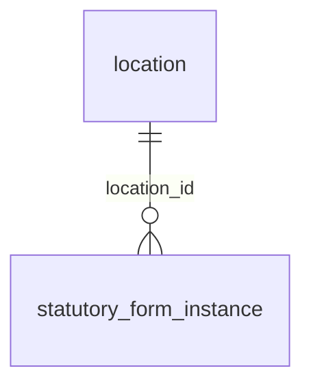

<picture>
  <source media="(prefers-color-scheme: dark)" srcset="../../assets/MultipliersKraftLogoDark.png">
  
</picture>

# FRS-CMP-05 — Compliance — Data Model

| Attribute | Value |
| :--- | :--- |
| Document ID | FRS-CMP-05 |
| Title | Compliance — Data Model |
| Product | Nucleus Suite (Nucleus HRMS Suite) |
| Version | 1.0.0 |
| Status | Issued for approval |
| Owner (role) | Domain Product Owner — Compliance |
| Author | Dhanraj Dadhich |
| Reviewed by | *pending* |
| Approved by | Product Council — *pending* |
| Date | 2026-11-05 |
| Classification | Internal |
| CMMI practice areas | TS, RDM |
| Related documents | FRS-CMP-00, FRS-CMP-01, FRS-CMP-02, FRS-CMP-03, FRS-CMP-04, FRS-CMP-05, FRS-CMP-06, FRS-CMP-07, FRS-CMP-08, FRS-CMP-09, FRS-CMP-10, FRS-CMP-11, FRS-CMP-12, FRS-CMP-13, BRS-01, SRS-01, REQ-01, REQ-02 |
| Quality & process-performance objectives | QPPO-05 (effective requirements reviews), QPPO-01 (escaped defects) — MPM-01 |
| Process performance baseline used | PPB-01 (review defect density), PPB-02 (review rate) — MPM-01 |
| Peer review record | *pending* (PR-xxxx, QA-02) |
| Tailoring record | none |
| Traceability anchor | BG-04, BG-06 · R-18, R-27 · processes CMP-01p–CMP-06p |
| Source of record | Nucleus — Process Flows & Process Maps v1.0 — sheet(s) 06_Data_Dictionary Nucleus HR Demo Points Build Sheet v1.0 — sheet(s) 06_Enum_Values Nucleus HRMS Demo Dataset v1.1 — sheet(s) 65_Enum_Seed_Values |

> **Source of record.** Requirements in this document are taken from the source workbook(s) named above and keep their workbook IDs, which are never renumbered. Changes are made through a change request (CM-02) against the source workbook. Sections marked **Authored** are original additions that are not present in the source workbooks.

Every object carries the platform envelope (`tenant_id`, `entity_id`), effective dating (`effective_from`, `effective_to`) where temporal, and audit columns. Sensitivity classes follow GOV-10.

## 1. Entity relationships

Relationships are derived from the identifier fields in the data dictionary; the tenant envelope is omitted for legibility.

## 2. Data objects

| Object | Fields | Type | Required | Owner / source | Temporal | Sensitivity | Notes | Dataset ref |
| :--- | :--- | :--- | :--- | :--- | :--- | :--- | :--- | :--- |
| rule_pack | pack_id, jurisdiction, state, effective_from, supersedes, rules[], test_count, changelog, reviewed_by, deployed_at | mixed | Y | Compliance | Yes | — | Declarative JSON evaluated by a sandboxed interpreter in v1. Keep the interface stable for compiled packs later. |  |
| obligation | obligation_id, obligation, authority, entity, state, period, due_date, owner, status, evidence_ref, filed_on, ack_ref | mixed | Y | Compliance | Yes | — | The screen the HR head opens every morning. | 28_Statutory_Calendar |
| statutory_form | form_code, name, act, state, applicability_rule, frequency, due_rule, template_ref | mixed | Y | Config | Yes | — | The library is the deliverable, not any particular form. | 29_Statutory_Forms |
| statutory_form_instance | instance_id, form_code, entity, location_id, period, generated_at, filed_on, ack_ref, file_ref, trigger | mixed | N | System | No | Confidential | Form F is generated inside the joining chain. | 29_Statutory_Forms |
| consent_record | consent_id, data_principal_id, purpose, granted_at, withdrawn_at, notice_version | mixed | N | System | Yes | Restricted | DPDP: itemised notice, purpose-bound processing, erasure with 48-hour pre-intimation. |  |
| inference_log | inference_id, model, model_version, inputs_ref, output, human_decision, decided_by, occurred_at | mixed | Y | System | No | Restricted | EU AI Act Annex III: log every inference with the human decision attached. |  |

### Additional objects and attributes (Authored)

| Object | Fields | Type | Required | Owner / source | Temporal | Sensitivity | Notes | Defined in |
| :--- | :--- | :--- | :--- | :--- | :--- | :--- | :--- | :--- |
| statutory_register_serial | form_code, location_id, last_serial_no, as_of_date, source(migrated\|generated) | mixed | Y | Compliance | No | — | Keeps gapless registers such as Form F continuous across cut-over (PLT-MIG-009). | MIG-01 §4 |

## 3. Enumerations

| Enum code | Enum name | Module | System or Config | Complete value set | Requirement |
| :--- | :--- | :--- | :--- | :--- | :--- |
| EN_STATE_VARIANT | Statutory state variant | STA | Config | Per state rules under the Factory Act — the value set is a jurisdiction pack, not a fixed list | R-18, R-27 |

### Enumeration seed values and tenant defaults

| Enum code | Enum name | Module | System or Config | Complete value set | Default in this tenant | Requirement |
| :--- | :--- | :--- | :--- | :--- | :--- | :--- |
| EN_STATE_VARIANT | Statutory state variant | STA | Config | A jurisdiction pack per state, not a fixed list. Karnataka and Tamil Nadu are both seeded in this tenant. |  | R-18, R-27 |

## Approval & Sign-off

| Role | Name | Date | Decision | Conditions / comments |
| :--- | :--- | :--- | :--- | :--- |
| Author | Dhanraj Dadhich | 2026-11-05 | Submitted | |
| Peer review moderator | *pending* | | | PR-xxxx |
| PQA (process compliance) | *pending* | | | |
| Approval authority (DOC-01 §7) | *pending* | | | |

## Measurement Data Captured

| Measure | Value | Unit | Notes |
| :--- | :--- | :--- | :--- |
| Size | 9 | specified items (table rows) | Counted automatically at generation |
| Authoring effort | *to be recorded* | person-hours | |
| Review effort (preparation + meeting) | *pending review* | person-hours | From PR-xxxx |
| Rework effort | *pending review* | person-hours | |
| Review rate | *pending review* | items / hour | Compare with PPB control limits |
| Requirement volatility (changes since baseline) | 0 | CRs touching this artefact | Not yet baselined (CM-03) |

**Defects found, by detection phase and severity**

| Detection phase | Major | Minor | Editorial | Injected in phase (major) |
| :--- | :--- | :--- | :--- | :--- |
| Author self-check | 0 | 0 | 0 | — |
| Peer review | *pending* | | | |
| Design / build | | | | |
| System / integration test | | | | |
| UAT | | | | |
| Production (escaped) | | | | each escaped major opens a CAR record (CAR-01) |

Within control limits of the review-rate PPB? *To be assessed at peer review.*

## Revision History

| Version | Date | Author | Change summary | CR ref | Approved by |
| :--- | :--- | :--- | :--- | :--- | :--- |
| 1.0.0 | 2026-11-05 | Dhanraj Dadhich | Consolidated release | CR-0001 | *pending* |
