

<picture>
  <source media="(prefers-color-scheme: dark)" srcset="../../assets/MultipliersKraftLogoDark.png">
  
</picture>

# FRS-CMP-12 — Compliance — Use Case Specifications

| Attribute | Value |
| :--- | :--- |
| Document ID | FRS-CMP-12 |
| Title | Compliance — Use Case Specifications |
| Product | Nucleus Suite (Nucleus HRMS Suite) |
| Version | 1.0.0 |
| Status | Issued for approval |
| Owner (role) | Domain Product Owner — Compliance |
| Author | Dhanraj Dadhich |
| Reviewed by | *pending* |
| Approved by | Product Council — *pending* |
| Date | 2026-11-05 |
| Classification | Internal |
| CMMI practice areas | RDM, VV |
| Related documents | FRS-CMP-00, FRS-CMP-01, FRS-CMP-02, FRS-CMP-03, FRS-CMP-04, FRS-CMP-05, FRS-CMP-06, FRS-CMP-07, FRS-CMP-08, FRS-CMP-09, FRS-CMP-10, FRS-CMP-11, FRS-CMP-12, FRS-CMP-13, BRS-01, SRS-01, REQ-01, REQ-02 |
| Quality & process-performance objectives | QPPO-05 (effective requirements reviews), QPPO-01 (escaped defects) — MPM-01 |
| Process performance baseline used | PPB-01 (review defect density), PPB-02 (review rate) — MPM-01 |
| Peer review record | *pending* (PR-xxxx, QA-02) |
| Tailoring record | none |
| Traceability anchor | BG-04, BG-06 · R-18, R-27 · processes CMP-01p–CMP-06p |
| Source of record | Nucleus — Process Flows & Process Maps v1.0 — sheet(s) 03_Process_Inventory, 04_Process_Steps, 07_Screens, 09_Business_Rules Authored use cases (marked per use case) |

> **Source of record.** Requirements in this document are taken from the source workbook(s) named above and keep their workbook IDs, which are never renumbered. Changes are made through a change request (CM-02) against the source workbook. Sections marked **Authored** are original additions that are not present in the source workbooks.

This document specifies 15 use cases for Compliance: 3 follow the step-level flows of the source workbook and 12 are authored (processes without step-level detail in the source, and capability gaps). User stories derived from each use case are in FRS-CMP-13.

## 1. Use case index

| ID | Use case | Primary actor | Realises | Source | Phase | Criticality |
| :--- | :--- | :--- | :--- | :--- | :--- | :--- |
| [CMP-UC-001](#cmp-uc-001) | Author, test and deploy a statutory rule pack | Compliance engineer | CMP-01p | Source workbook | P1 | Critical |
| [CMP-UC-002](#cmp-uc-002) | Prepare, file and close a statutory obligation | Compliance owner | CMP-02p | Source workbook | P1 | Critical |
| [CMP-UC-003](#cmp-uc-003) | Generate statutory forms and registers for a location | Nucleus platform | CMP-03p | Source workbook | P1 | Critical |
| [CMP-UC-004](#cmp-uc-004) | Simulate a salary structure against the Labour Codes wage base | HR operations | CMP-04p | Authored | P2 | High |
| [CMP-UC-005](#cmp-uc-005) | Log, label and disclose AI inferences | Nucleus platform | CMP-05p | Authored | P2 | High |
| [CMP-UC-006](#cmp-uc-006) | Manage DPDP consent, retention and erasure requests | Data protection officer | CMP-06p | Authored | P3 | High |
| [CMP-UC-007](#cmp-uc-007) | Switch payroll to labour code rule packs by effective date | Compliance engineer | CMP-CG-001 | Authored | P2 | High |
| [CMP-UC-008](#cmp-uc-008) | Run a confidential workplace harassment case | Employee / worker | CMP-CG-002 | Authored | P2 | High |
| [CMP-UC-009](#cmp-uc-009) | Maintain contract labour registers and returns | Compliance owner | CMP-CG-003 | Authored | P2 | High |
| [CMP-UC-010](#cmp-uc-010) | Produce workforce disclosures for sustainability reporting | Compliance owner | CMP-CG-004 | Authored | P3 | Medium |
| [CMP-UC-011](#cmp-uc-011) | Assign and enforce mandatory compliance training | Nucleus platform | CMP-CG-005 | Authored | P2 | High |
| [CMP-UC-012](#cmp-uc-012) | Report, investigate and close a safety incident | Plant HR / time office | CMP-CG-006 | Authored | P2 | High |
| [CMP-UC-013](#cmp-uc-013) | Raise and handle a grievance or protected disclosure | Employee / worker | CMP-CG-007 | Authored | P2 | High |
| [CMP-UC-014](#cmp-uc-014) | Track and renew licences and registrations | Compliance owner | CMP-CG-008 | Authored | P2 | High |
| [CMP-UC-015](#cmp-uc-015) | Record inspection visits and close resulting orders | Plant HR / time office | CMP-CG-009 | Authored | P2 | High |

## 2. Use case diagrams

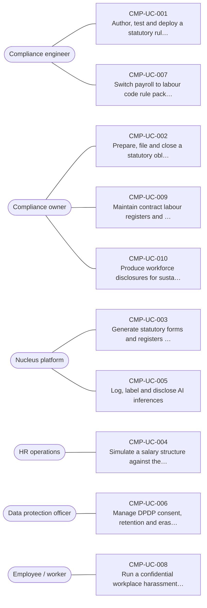

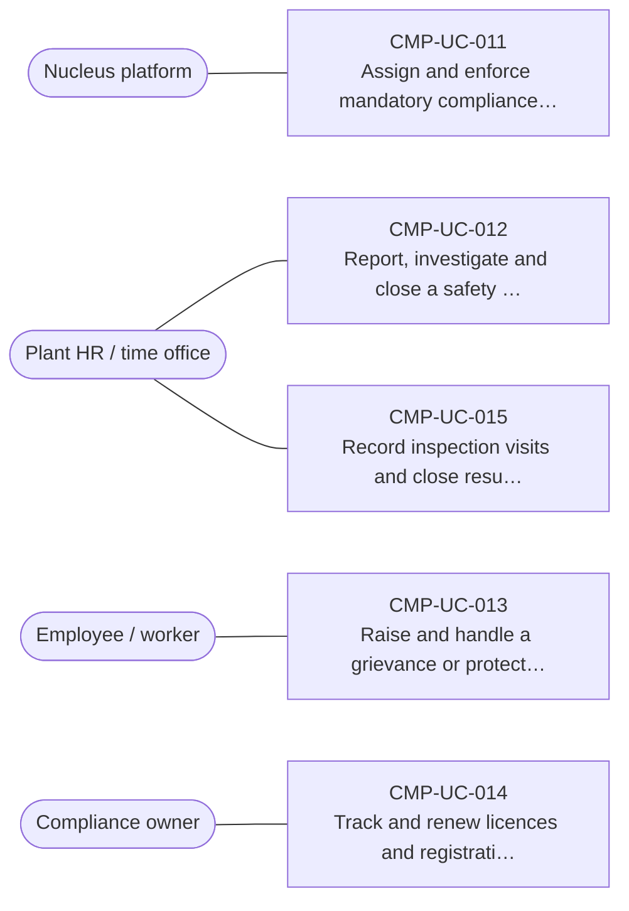

## 3. Use case specifications

### CMP-UC-001

**Author, test and deploy a statutory rule pack** — Turn a statutory notification into a versioned, effective-dated rule pack that reaches production only after a green golden suite and a named reviewer's sign-off.

| Attribute | Value |
| :--- | :--- |
| Realises | CMP-01p |
| Source | Source workbook |
| Level | User goal |
| Primary actor | Compliance engineer |
| Secondary actors | Nucleus platform, Payroll SME (named reviewer), Payroll manager |
| Trigger | A statutory notification changes a rate, slab, threshold or form for a jurisdiction (for example a revised professional tax slab for Maharashtra). |
| Frequency | Per notification |
| Criticality | Critical |
| Phase | P1 |
| Client requirements | R-18 |
| Business rules | RL-360, RL-361, RL-362, RL-363, RL-364 |
| Screens | SCR-070, SCR-071 |
| Data objects (CRUD) | rule_pack (C/U), golden_case (C), test_run (C) |
| Events | compliance.pack.drafted, compliance.pack.tested, compliance.pack.published, compliance.pack.deployed |
| Acceptance tests | TC-C360, TC-C361, TC-C362, TC-C363, TC-C364 |
| System requirements | SYS-022, SYS-026, SYS-032, SYS-045, SYS-046 |

**Stakeholders and interests**

| Stakeholder | Interest |
| :--- | :--- |
| Payroll manager | Deductions change on the notified effective date, not on the next application release. |
| Compliance owner | Every computed figure traces to the notification that introduced it. |
| Auditor | Superseded packs remain available so any past period can be recomputed as it stood. |

**Preconditions**

- The notification text and its effective date are available to the compliance engineer.
- The central pack currently in force is in EFFECTIVE state.
- The golden case library (SCR-071) is reachable and the CI pipeline is healthy.

**Main success scenario**

| # | Actor | Action | Ref |
| ---: | :--- | :--- | :--- |
| 1 | Compliance engineer | Drafts the pack on SCR-070 with jurisdiction, effective_from, supersedes, rules and a changelog citing the source notification; pack enters DRAFT. | CMP-01p.1 |
| 2 | Compliance engineer | Adds or extends golden cases on SCR-071 for every rule, each with inputs, expected output and the statute reference. | CMP-01p.2 |
| 3 | Nucleus platform | Runs the full golden suite in CI, records pass and fail counts, and moves the pack to TESTED only when there are zero mismatches. | CMP-01p.3 |
| 4 | Payroll SME (named reviewer) | Reviews the changelog and the green test run, then signs off; reviewer name and approval time are stored and the pack is PUBLISHED. | CMP-01p.4 |
| 5 | Nucleus platform | Deploys the pack independently of any application release, layering the state pack over the central pack, and emits compliance.pack.deployed. | CMP-01p.5 |

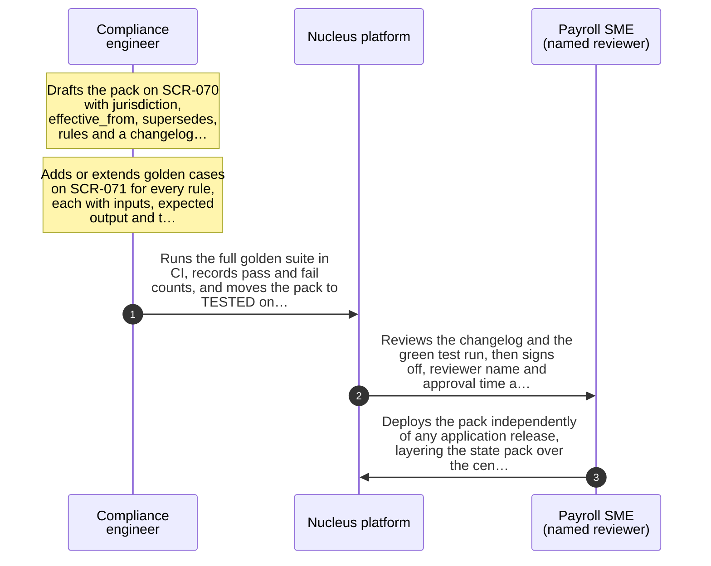

**Alternate flows**

| ID | At step | Condition | Steps | Rejoins |
| :--- | ---: | :--- | :--- | :--- |
| A1 | 1 | The notification amends an existing pack rather than creating a new jurisdiction. | Compliance engineer creates a new version with supersedes pointing at the current version; the current version is never edited in place. → On the new effective date the prior version moves to SUPERSEDED and is retained. | Returns to step 2 |
| A2 | 5 | effective_from lies in the future. | Platform holds the pack in PUBLISHED and schedules activation. → At 00:00 on effective_from the pack becomes EFFECTIVE and compliance.pack.deployed is emitted. | Use case ends |
| A3 | 4 | The reviewer requests changes. | Reviewer records the requested change against the pack. → Pack returns to DRAFT for the engineer to amend. | Returns to step 1 |

**Exception flows**

| ID | At step | Condition | Handling | Rule |
| :--- | ---: | :--- | :--- | :--- |
| E1 | 3 | Any golden case returns an output different from its expected output. | Build fails, pack returns to DRAFT, and the failing case IDs with expected and actual values are listed on SCR-070. | RL-362 |
| E2 | 2 | A rule in the pack has no golden case. | Platform refuses to start the test run and names the uncovered rule. | RL-361 |
| E3 | 4 | Deployment is attempted with a non-green suite or without a recorded reviewer. | Deployment is refused with the reason shown; no consumer receives the pack. | RL-363 |
| E4 | 5 | The state pack references a central pack version that is not EFFECTIVE. | Deployment is refused because the layer order cannot be resolved; the engineer is shown the missing central version. | RL-364 |
| E5 | 1 | The changelog does not cite a source notification. | Save is allowed as DRAFT but submission for testing is blocked until the citation is added. | RL-360 |

**Postconditions — success**

- A new pack version is PUBLISHED or EFFECTIVE with jurisdiction, effective_from, supersedes and a changelog citing the notification.
- The prior version is marked SUPERSEDED from the new effective date and retained for as-at recomputation.
- compliance.pack.deployed has been emitted once for pack_id + version and payroll, time and recompute consumers have been triggered.

**Postconditions — failure**

- The pack remains in DRAFT or TESTED and is not consumed by any computation.
- The currently EFFECTIVE pack continues to apply unchanged.

**Quality requirements**

- A golden suite of 340 cases completes in CI within 10 minutes.
- Pack deployment requires no application downtime and no code release.
- Superseded packs are retained and resolvable by as-at date for at least the statutory record retention period of the payroll data they computed.

### CMP-UC-002

**Prepare, file and close a statutory obligation** — Ensure every statutory obligation for each entity and state is prepared from posted records, filed by a human and closed with evidence before its due date.

| Attribute | Value |
| :--- | :--- |
| Realises | CMP-02p |
| Source | Source workbook |
| Level | User goal |
| Primary actor | Compliance owner |
| Secondary actors | Nucleus platform, Agent (governed), Statutory portal, Payroll manager |
| Trigger | An obligation's due date approaches on the calendar (for example the PF ECR and challan for August 2026 due 2026-09-15). |
| Frequency | Monthly |
| Criticality | Critical |
| Phase | P1 |
| Client requirements | R-18 |
| Business rules | RL-370, RL-371, RL-372 |
| Screens | SCR-072 |
| Data objects (CRUD) | obligation (C/U), filing_pack (C), action_ledger (C) |
| Events | compliance.obligation.created, agent.action.proposed, compliance.obligation.filed |
| Acceptance tests | TC-C370, TC-C371, TC-C372 |
| System requirements | SYS-035, SYS-072, SYS-073, SYS-074, SYS-086 |

**Stakeholders and interests**

| Stakeholder | Interest |
| :--- | :--- |
| HR head | One screen each morning shows what is due, by whom and with what evidence. |
| Finance | Challan amounts match the statutory heads in the salary journal. |
| Auditor | Each closed obligation carries an acknowledgement reference and the records it was built from. |

**Preconditions**

- The applicability matrix is configured for each entity and state.
- An owner is assigned for each obligation type.
- The payroll run for the period is in POSTED state before a pack can be prepared.

**Main success scenario**

| # | Actor | Action | Ref |
| ---: | :--- | :--- | :--- |
| 1 | Nucleus platform | Generates the obligation calendar per entity and state from the applicability matrix, with authority, period, due date and owner. | CMP-02p.1 |
| 2 | Compliance owner | Requests the filing pack; the Compliance Watcher agent assembles it from POSTED records only and logs the proposal in the action ledger. | CMP-02p.2 |
| 3 | Compliance owner | Files on the statutory portal, attaches the acknowledgement as evidence, records the reference and closes the obligation. | CMP-02p.3 |

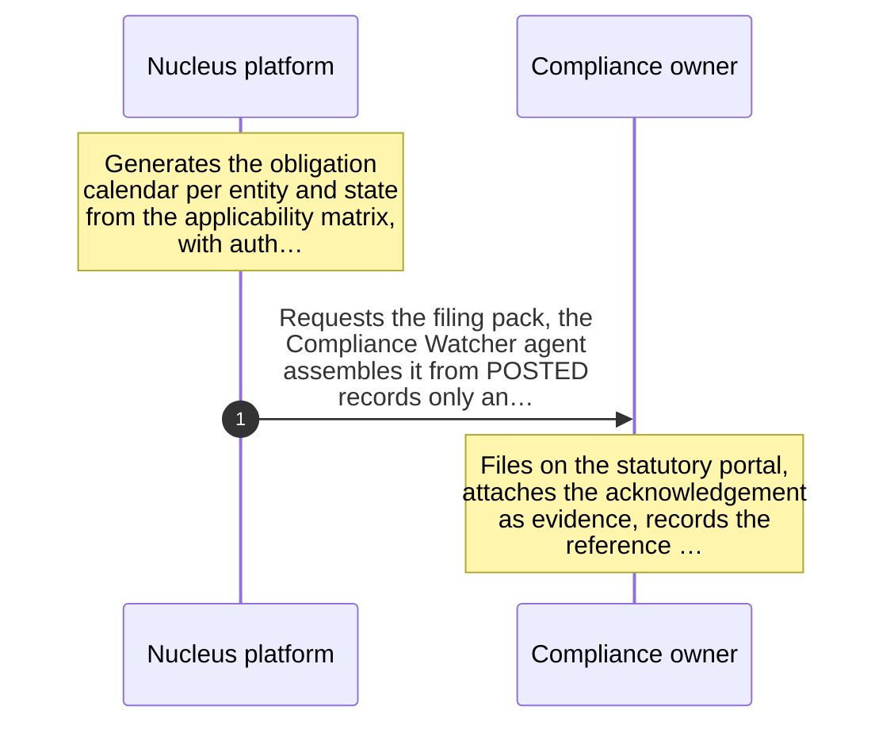

**Alternate flows**

| ID | At step | Condition | Steps | Rejoins |
| :--- | ---: | :--- | :--- | :--- |
| A1 | 1 | The obligation does not apply to a state for the period (for example Tamil Nadu professional tax is half-yearly). | Platform records the obligation as Not applicable with the reason and the next due date. → No filing pack is requested. | Use case ends |
| A2 | 2 | The owner finds a wrong value in a source record while reviewing the pack. | Owner raises the correction through the owning process (for example a payroll correction run), never by editing the pack. → Once the corrected record is POSTED, the agent regenerates the pack. | Returns to step 2 |

**Exception flows**

| ID | At step | Condition | Handling | Rule |
| :--- | ---: | :--- | :--- | :--- |
| E1 | 2 | A record needed for the pack is not yet POSTED (for example run PR-2026-09-01 is in PRE_AUDIT). | Pack generation is refused and the blocking run or record is named on SCR-072. | RL-371 |
| E2 | 2 | A user attempts to type or overwrite a figure in the pack. | The figure is read-only; only regenerating from posted records changes it. | RL-371 |
| E3 | 3 | The owner tries to close the obligation without an acknowledgement reference. | Closure is refused until ack_ref and the evidence file are supplied. | RL-372 |
| E4 | 2 | The agent proposes to submit the filing itself. | The proposal is rejected by policy; the agent may only prepare and the filing step stays with the human owner. | RL-372 |

**Postconditions — success**

- The obligation is in Filed status with filed_on, ack_ref and evidence_ref recorded.
- compliance.obligation.filed has been emitted with obligation_id + period as idempotency key.
- The filing pack and the action ledger entry are retained against the obligation.

**Postconditions — failure**

- The obligation stays Due or Overdue on SCR-072 and remains visible on the compliance dashboard.
- No filing pack built from unposted or typed figures exists.

**Quality requirements**

- The obligation calendar for two entities and five locations loads within 2 seconds at p95.
- SCR-072 is readable offline on mobile with the last synchronised state labelled with its timestamp.
- Filing packs and acknowledgements are retained for the statutory retention period (to be validated by Legal).

### CMP-UC-003

**Generate statutory forms and registers for a location** — Produce each applicable statutory form or register from live data in the state variant that matches the plant's registration, and retain it with its filing acknowledgement.

| Attribute | Value |
| :--- | :--- |
| Realises | CMP-03p |
| Source | Source workbook |
| Level | User goal |
| Primary actor | Nucleus platform |
| Secondary actors | Compliance owner, HR operations, Statutory portal |
| Trigger | An employee joins at a factory location, a register period ends, or a filing or inspection demand is received. |
| Frequency | Per event |
| Criticality | Critical |
| Phase | P1 |
| Client requirements | R-18, R-27 |
| Business rules | RL-380, RL-381, RL-382, RL-383 |
| Screens | SCR-073, SCR-060 |
| Data objects (CRUD) | statutory_form (R), statutory_form_instance (C/U) |
| Events | compliance.form.generated, compliance.form.filed |
| Acceptance tests | TC-C380, TC-C381, TC-C382, TC-C383, T-31, T-32 |
| System requirements | SYS-022, SYS-026, SYS-045, SYS-086 |

**Stakeholders and interests**

| Stakeholder | Interest |
| :--- | :--- |
| Plant HR / time office | Registers for an inspection are ready without manual compilation. |
| Compliance owner | A state amendment is absorbed by configuration, not a code release. |
| Factory inspector (external) | Forms follow the prescribed state layout and contain no typed figures. |

**Preconditions**

- The location's registration (state, establishment type, factory licence) is recorded.
- Form definitions with applicability rule, frequency, due rule and template are configured per state.
- Source records for the period (attendance, approved overtime, leave) exist.

**Main success scenario**

| # | Actor | Action | Ref |
| ---: | :--- | :--- | :--- |
| 1 | Nucleus platform | Resolves the applicable form set from the plant's registration (state and establishment type), not the company's registered office. | CMP-03p.1 |
| 2 | Nucleus platform | Binds the declarative query to the state template, renders the instance for the period and emits compliance.form.generated. | CMP-03p.2 |
| 3 | Nucleus platform | For a new joiner at a factory location, generates the joining forms including Form F as a step inside the joining chain. | CMP-03p.3 |
| 4 | Compliance owner | Files the form, records the acknowledgement reference and retains the artefact against the period on SCR-073. | CMP-03p.4 |

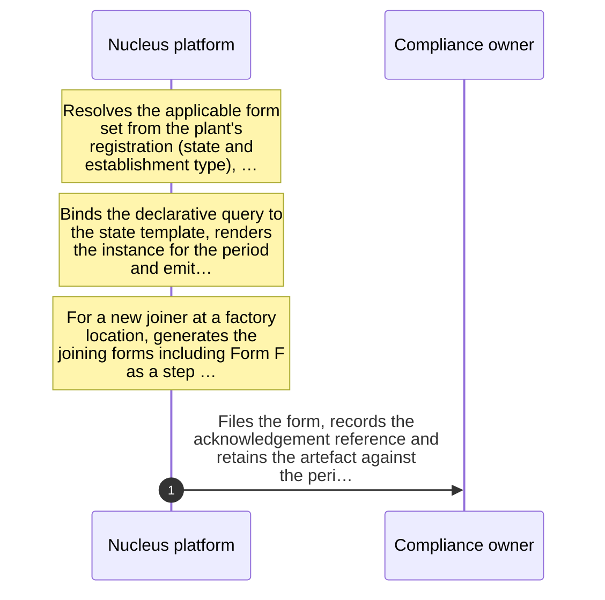

**Alternate flows**

| ID | At step | Condition | Steps | Rejoins |
| :--- | ---: | :--- | :--- | :--- |
| A1 | 3 | The trigger is a period end or a filing demand, not a joining. | Platform skips joining-form generation for this occurrence. | Returns to step 4 |
| A2 | 2 | A state notifies a revised layout for a register. | Compliance owner activates the new effective-dated template version for that state. → Instances for periods from the effective date render on the new layout; earlier periods keep the old layout. | Returns to step 2 |
| A3 | 4 | The form is a register maintained on site rather than filed. | Owner marks the instance as retained for inspection with no external filing. | Use case ends |

**Exception flows**

| ID | At step | Condition | Handling | Rule |
| :--- | ---: | :--- | :--- | :--- |
| E1 | 1 | The location has no registration or establishment type recorded. | Form set resolution fails and the location is flagged to the compliance owner; no company-level fallback is used. | RL-380 |
| E2 | 2 | Source data for the period is incomplete (for example overtime not yet approved). | The instance is not generated; the missing records are listed and nothing may be typed in their place. | RL-381 |
| E3 | 3 | A field required by Form F is missing from the employee record. | The joining-chain step stays open with the missing field named, and appears as a blocker on SCR-060. | RL-382 |
| E4 | 4 | The owner marks the form filed without an acknowledgement reference. | The status change is refused until ack_ref is recorded. | RL-383 |

**Postconditions — success**

- A statutory_form_instance exists for the period with file_ref and a gapless serial where the register requires one.
- compliance.form.generated has been emitted for the obligation calendar and document vault.
- Filed instances carry filed_on and ack_ref against the period.

**Postconditions — failure**

- No instance is created from incomplete or typed data; the gap is listed for the compliance owner.

**Quality requirements**

- A monthly register for 500 workers renders within 30 seconds.
- Generated forms are immutable once filed; corrections create a new instance linked to the original.
- Forms reproduce the state's prescribed layout and field order (to be validated by Legal).

### CMP-UC-004

**Simulate a salary structure against the Labour Codes wage base** — Let HR test a proposed salary structure for wage-base compliance, statutory cost and take-home impact before any live structure is changed.

| Attribute | Value |
| :--- | :--- |
| Realises | CMP-04p |
| Source | Authored |
| Level | User goal |
| Primary actor | HR operations |
| Secondary actors | Nucleus platform, Finance, Payroll manager, Director / approver |
| Trigger | HR or compensation proposes a change to a salary structure (for example rebalancing allowances for grade band B). |
| Frequency | Occasional |
| Criticality | High |
| Phase | P2 |
| Client requirements | — |
| Business rules | RL-360 |
| Screens | SCR-052 |
| Data objects (CRUD) | salary_structure (R), rule_pack (R), simulation_scenario (C/U) |
| Events | — |
| Acceptance tests | — |
| System requirements | SYS-028, SYS-030, SYS-045, SYS-047, SYS-048 |

**Stakeholders and interests**

| Stakeholder | Interest |
| :--- | :--- |
| Finance | Employer statutory cost impact is known per cost centre before adoption. |
| Employee / worker | Take-home changes are deliberate and explainable. |
| Director / approver | Only a compliant, costed scenario is put up for sanction. |

**Preconditions**

- The user holds the compensation role required for SCR-052.
- A rule pack covering the wage-base definition is EFFECTIVE or PUBLISHED for the simulation date.
- Current salary structures for the selected population are available.

**Main success scenario**

| # | Actor | Action | Ref |
| ---: | :--- | :--- | :--- |
| 1 | HR operations | Opens SCR-052 and selects the population by entity, grade band and worker class, with the current structure as baseline. |  |
| 2 | HR operations | Enters the proposed component split, such as Basic plus DA share and each allowance, for the population. |  |
| 3 | Nucleus platform | Computes the wage base under the applicable rule pack and runs the 50% floor test, showing any excess allowance treated as wages. |  |
| 4 | Nucleus platform | Computes employer PF, ESI and gratuity cost and employee take-home per employee and in aggregate for baseline and proposal. |  |
| 5 | Nucleus platform | Shows baseline and proposal side by side with deltas per component, per cost centre and per employee. |  |
| 6 | HR operations | Saves the scenario with a name and shares it with Finance for review. |  |
| 7 | Finance | Reviews the cost impact and records comments against the scenario. |  |
| 8 | Director / approver | Adopts the scenario; the platform raises a draft structure-change proposal and leaves live structures unchanged. |  |

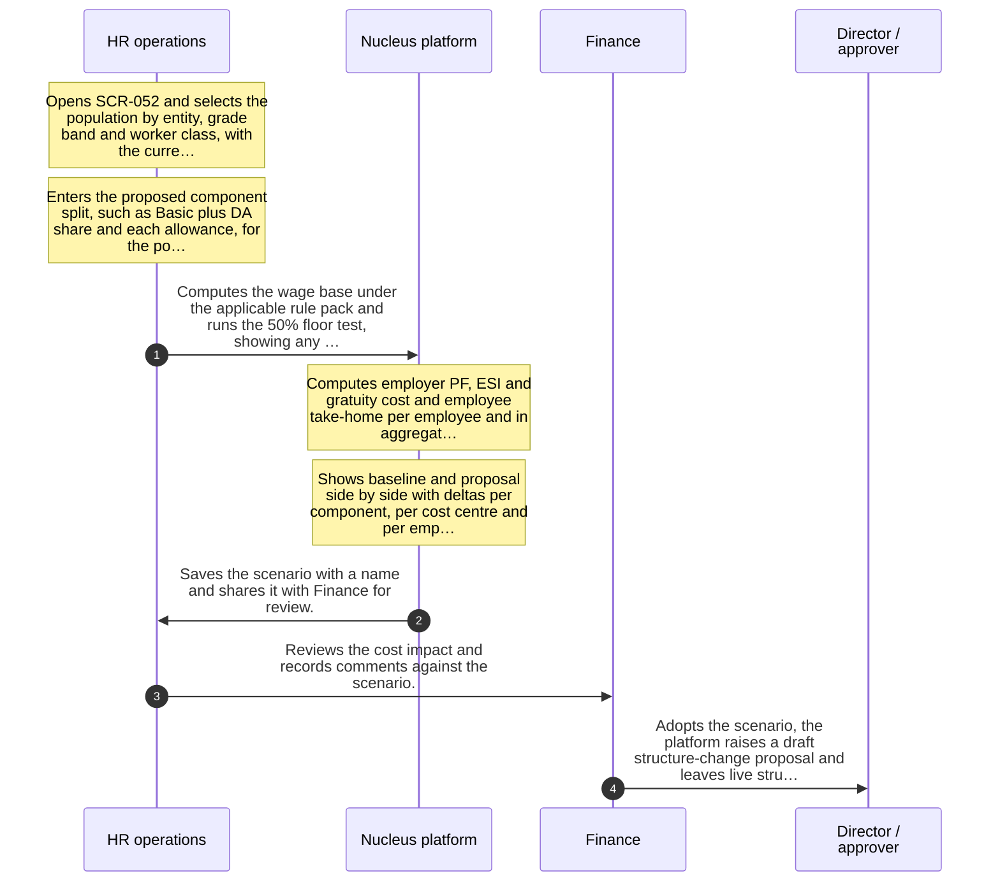

**Alternate flows**

| ID | At step | Condition | Steps | Rejoins |
| :--- | ---: | :--- | :--- | :--- |
| A1 | 2 | HR wants to compare alternatives. | HR operations enters up to three proposals for the same population. → Platform shows all proposals against the baseline in one comparison. | Returns to step 6 |
| A2 | 8 | The approver rejects the scenario. | Approver records a reason. → Platform archives the scenario as Rejected and retains it for reference. | Use case ends |

**Exception flows**

| ID | At step | Condition | Handling | Rule |
| :--- | ---: | :--- | :--- | :--- |
| E1 | 3 | No rule pack covering the wage-base definition is effective or published for the simulation date. | Simulation is refused and the missing jurisdiction and date are named. | RL-360 |
| E2 | 2 | The proposed components do not sum to the stated CTC for an employee. | Platform highlights the employees affected and blocks simulation until the split balances. |  |
| E3 | 1 | The user lacks the compensation role. | SCR-052 is not offered and the attempt is recorded in the audit trail. |  |

**Postconditions — success**

- A named, versioned simulation scenario is saved with inputs, results and the rule pack version used.
- An adopted scenario creates a draft structure-change proposal; live structures are unchanged until that proposal is approved.

**Postconditions — failure**

- No scenario is saved, or the scenario is archived with a rejection reason; live structures are untouched.

**Quality requirements**

- Simulation of 1,000 employees returns results within 5 seconds at p95.
- Simulation never writes to live salary structures or payroll runs.
- Results are reproducible from the stored scenario inputs and rule pack version.

### CMP-UC-005

**Log, label and disclose AI inferences** — Ensure every AI inference is logged, labelled and disclosed, and that no adverse decision about a person is taken by AI alone.

| Attribute | Value |
| :--- | :--- |
| Realises | CMP-05p |
| Source | Authored |
| Level | Subfunction |
| Primary actor | Nucleus platform |
| Secondary actors | Agent (governed), Employee / worker, Manager / supervisor, Auditor, Tenant admin |
| Trigger | Any agent or AI feature produces an inference (an answer, recommendation, score or proposed action). |
| Frequency | Continuous |
| Criticality | High |
| Phase | P2 |
| Client requirements | — |
| Business rules | — |
| Screens | SCR-110 |
| Data objects (CRUD) | inference_log (C), action_ledger (C), human_decision (C) |
| Events | — |
| Acceptance tests | — |
| System requirements | SYS-034, SYS-035, SYS-072, SYS-074, SYS-076, SYS-087 |

**Stakeholders and interests**

| Stakeholder | Interest |
| :--- | :--- |
| Employee / worker | Knows when AI was involved and can ask for a human review. |
| Auditor | Can reconstruct what an agent saw, proposed and did. |
| Tenant admin | Agent behaviour stays within the declared policy. |

**Preconditions**

- The agent principal is registered with a scoped role and declared tools.
- Disclosure text and AI labelling policy are configured for the tenant.

**Main success scenario**

| # | Actor | Action | Ref |
| ---: | :--- | :--- | :--- |
| 1 | Nucleus platform | Intercepts the inference request and records the principal, purpose, model version identifier and the tool scope applied. |  |
| 2 | Agent (governed) | Produces the output using only declared tools and data within its scoped role. |  |
| 3 | Nucleus platform | Writes the inference log entry with input hash, sources, output, confidence and timestamp before releasing the output. |  |
| 4 | Nucleus platform | Labels the output as AI-generated on every surface and shows the disclosure on first use and in context. |  |
| 5 | Nucleus platform | Where the output informs a decision about a person, requires a named human decision and stores it beside the AI recommendation. |  |
| 6 | Nucleus platform | Blocks any adverse outcome (rejection, warning, deduction) that has no recorded human decision. |  |
| 7 | Auditor | Queries the inference log by person, agent and period on SCR-110 and exports the result. |  |

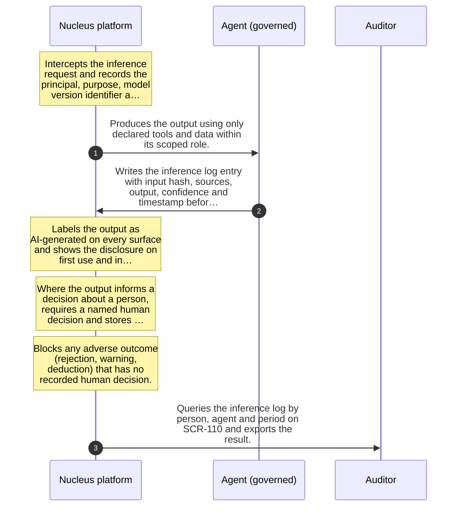

**Alternate flows**

| ID | At step | Condition | Steps | Rejoins |
| :--- | ---: | :--- | :--- | :--- |
| A1 | 4 | The employee asks for a human review of an AI-assisted outcome. | Platform creates a review task for HR operations with the inference log entry attached. → The outcome is held until a human records a decision. | Returns to step 5 |
| A2 | 7 | The tenant admin changes the inference log retention period. | The change is recorded with the admin's identity and applies to new entries only. | Use case ends |

**Exception flows**

| ID | At step | Condition | Handling | Rule |
| :--- | ---: | :--- | :--- | :--- |
| E1 | 3 | The inference log cannot be written. | The output is withheld (fail closed) and the user is told the assistant is unavailable. |  |
| E2 | 2 | The agent attempts to call a tool that is not declared for its principal. | The call is denied, the attempt is logged and the tenant admin is alerted. |  |
| E3 | 6 | An adverse decision is submitted with only an AI recommendation. | Submission is refused until a named human records the decision and reason. |  |

**Postconditions — success**

- An inference log entry exists linking principal, purpose, model version identifier, input references, sources, output and any action ledger record.
- The output was displayed with an AI label and disclosure.
- Any decision about a person that used the inference names the accountable human.

**Postconditions — failure**

- The output is withheld from the user and the failure is recorded; no unlogged inference is shown or acted upon.

**Quality requirements**

- Logging adds no more than 50 ms at p95 to an inference.
- Inference log entries are append-only and tamper-evident.
- Auditor access to the log is read-only and itself logged.

### CMP-UC-006

**Manage DPDP consent, retention and erasure requests** — Honour a data principal's consent choices and erasure requests while retaining what law requires, with a pre-erasure intimation and processor flow-down.

| Attribute | Value |
| :--- | :--- |
| Realises | CMP-06p |
| Source | Authored |
| Level | User goal |
| Primary actor | Data protection officer |
| Secondary actors | Nucleus platform, Employee / worker, Auditor, Processor (external service provider) |
| Trigger | A data principal withdraws consent or submits an erasure request, or a retention period expires. |
| Frequency | Continuous |
| Criticality | High |
| Phase | P3 |
| Client requirements | — |
| Business rules | — |
| Screens | — |
| Data objects (CRUD) | consent_record (C/U), erasure_request (C/U), erasure_certificate (C), audit_event (C) |
| Events | — |
| Acceptance tests | — |
| System requirements | SYS-005, SYS-027, SYS-032, SYS-037, SYS-070 |

**Stakeholders and interests**

| Stakeholder | Interest |
| :--- | :--- |
| Employee / worker | Personal data is used only for consented purposes and erased when no longer needed. |
| Payroll manager | Statutory payroll, PF and tax records survive erasure in the form the law requires. |
| Auditor | Each erasure is evidenced, including confirmations from processors. |

**Preconditions**

- Purposes, lawful bases and retention periods are configured per data category (to be validated by Legal).
- Processors handling personal data are registered with contact and flow-down terms.
- The requester's identity can be verified.

**Main success scenario**

| # | Actor | Action | Ref |
| ---: | :--- | :--- | :--- |
| 1 | Employee / worker | Submits an erasure request or consent withdrawal from self-service after identity verification. |  |
| 2 | Nucleus platform | Registers the request with timestamp, requester and the purposes and data categories affected. |  |
| 3 | Nucleus platform | Classifies each data category as erasable, retained under statute, or retained under legal hold, and drafts an erasure plan. |  |
| 4 | Data protection officer | Reviews and approves the erasure plan, recording the basis for every retained category. |  |
| 5 | Nucleus platform | Sends the pre-erasure intimation to the data principal 48 hours before erasure (to be validated by Legal). |  |
| 6 | Nucleus platform | Erases or anonymises eligible data and instructs each processor to do the same, tracking confirmations. |  |
| 7 | Nucleus platform | Writes the erasure certificate to the audit trail with categories erased, categories retained and processor confirmations. |  |
| 8 | Data protection officer | Closes the request and the platform informs the data principal of the outcome. |  |

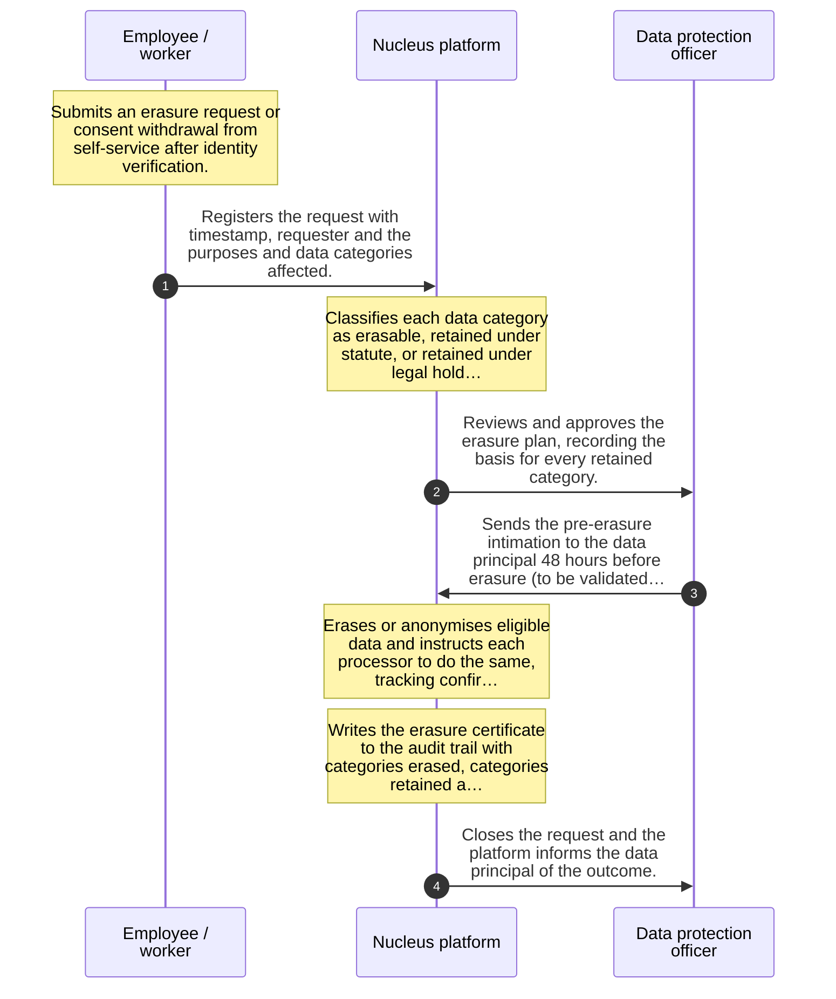

**Alternate flows**

| ID | At step | Condition | Steps | Rejoins |
| :--- | ---: | :--- | :--- | :--- |
| A1 | 1 | The principal withdraws consent for one purpose only (for example alumni contact). | Platform stops processing for that purpose and records the withdrawal. → No erasure plan is created for other purposes. | Use case ends |
| A2 | 3 | The requester is a current employee. | Platform limits erasure to optional data not needed for the employment relationship and explains what is retained. | Returns to step 4 |

**Exception flows**

| ID | At step | Condition | Handling | Rule |
| :--- | ---: | :--- | :--- | :--- |
| E1 | 1 | Identity cannot be verified. | The request is held as Unverified and the requester is asked for verification; no data is changed. |  |
| E2 | 3 | A legal hold exists (for example a pending inspection or dispute). | Affected categories are retained, the hold reference is recorded and the requester is informed. |  |
| E3 | 6 | A processor does not confirm erasure within the configured SLA. | The request is escalated to the data protection officer and stays open until confirmation is received. |  |

**Postconditions — success**

- Eligible personal data is erased or anonymised across modules and processors.
- Records under statutory retention are kept, minimised where possible.
- An erasure certificate with timestamps and processor confirmations is in the audit trail and the requester has been informed.

**Postconditions — failure**

- No data is erased; the request remains open with its reason (for example legal hold) and the requester is informed.

**Quality requirements**

- Erasure completes across all modules within 72 hours of the intimation window ending.
- Anonymised statutory records cannot be re-linked to the person from data held in Nucleus.
- All personal data is stored and processed in a cloud region in India.

### CMP-UC-007

**Switch payroll to labour code rule packs by effective date** — Hold ready-to-activate rule packs for the consolidated labour codes and switch computations to them on the notified effective date without a release.

| Attribute | Value |
| :--- | :--- |
| Realises | CMP-CG-001 |
| Source | Authored |
| Level | User goal |
| Primary actor | Compliance engineer |
| Secondary actors | Nucleus platform, Payroll SME (named reviewer), Payroll manager, HR operations |
| Trigger | Rules under a consolidated labour code are notified, or a state notifies its rules under a code. |
| Frequency | Per notification |
| Criticality | High |
| Phase | P2 |
| Client requirements | — |
| Business rules | RL-360, RL-361, RL-362, RL-363, RL-364 |
| Screens | SCR-070, SCR-071, SCR-052 |
| Data objects (CRUD) | rule_pack (C/U), golden_case (C), shadow_run (C) |
| Events | compliance.pack.deployed |
| Acceptance tests | TC-C362, TC-C363, TC-C364, CMP-TC-001, CMP-TC-002, CMP-TC-003, CMP-TC-004 |
| System requirements | SYS-026, SYS-045, SYS-046, SYS-048, SYS-057 |

**Stakeholders and interests**

| Stakeholder | Interest |
| :--- | :--- |
| Payroll manager | The first payroll after the codes take effect computes correctly with no emergency fix. |
| HR operations | Structures that breach the new wage definition are known in advance. |
| Compliance owner | Registers and returns switch to the code formats on the same date. |

**Preconditions**

- Current statute packs are EFFECTIVE.
- Draft labour code packs exist for wages, social security, industrial relations and occupational safety (to be validated by Legal).

**Main success scenario**

| # | Actor | Action | Ref |
| ---: | :--- | :--- | :--- |
| 1 | Compliance engineer | Maintains draft packs per code and jurisdiction on SCR-070, with changelogs citing the draft or final rules. |  |
| 2 | Compliance engineer | Builds golden cases on SCR-071 for each code rule, including wage definition and contribution base cases. |  |
| 3 | Nucleus platform | Runs the golden suite; packs move to TESTED only when every case passes. |  |
| 4 | Nucleus platform | Runs a shadow computation of the latest closed payroll period under the code packs without affecting live results. |  |
| 5 | Payroll manager | Reviews per-employee differences between live and shadow results on SCR-052 and records findings. |  |
| 6 | Payroll SME (named reviewer) | Signs off the packs once the notification and effective date are confirmed. |  |
| 7 | Nucleus platform | Sets effective_from to the notified date and activates the packs at that date, superseding replaced packs. |  |
| 8 | Nucleus platform | Triggers recomputation for any open period on or after the effective date and notifies payroll and compliance owners. |  |

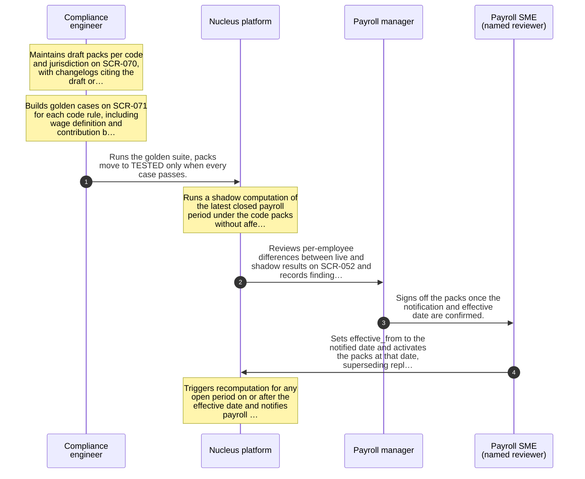

**Alternate flows**

| ID | At step | Condition | Steps | Rejoins |
| :--- | ---: | :--- | :--- | :--- |
| A1 | 7 | A state notifies its rules later than the central code. | The central code pack activates on its date. → The state pack activates on its own date, layered over the central pack. | Returns to step 8 |

**Exception flows**

| ID | At step | Condition | Handling | Rule |
| :--- | ---: | :--- | :--- | :--- |
| E1 | 3 | A golden case fails. | The pack returns to DRAFT and cannot be scheduled. | RL-362 |
| E2 | 6 | The effective date has not been notified. | Activation is not possible; packs stay PUBLISHED and inactive. | RL-363 |
| E3 | 7 | The state pack layer order conflicts with the central pack. | Activation is refused and the conflict is named. | RL-364 |

**Postconditions — success**

- Labour code packs are EFFECTIVE from the notified date and the packs they replace are SUPERSEDED but retained.
- A shadow comparison for at least one period has been reviewed and signed off.

**Postconditions — failure**

- Current packs stay EFFECTIVE and the code packs remain PUBLISHED but inactive.

**Quality requirements**

- Shadow computation of a 600-employee period completes within 15 minutes.
- Activation requires no application downtime.

### CMP-UC-008

**Run a confidential workplace harassment case** — Receive, investigate and close a workplace harassment complaint confidentially within configured timelines and produce the annual report.

| Attribute | Value |
| :--- | :--- |
| Realises | CMP-CG-002 |
| Source | Authored |
| Level | User goal |
| Primary actor | Employee / worker |
| Secondary actors | Internal Committee member, Nucleus platform, Compliance owner, Director / approver |
| Trigger | An employee lodges a complaint through the confidential channel. |
| Frequency | Per complaint |
| Criticality | High |
| Phase | P2 |
| Client requirements | — |
| Business rules | — |
| Screens | — |
| Data objects (CRUD) | harassment_case (C/U), case_evidence (C), annual_report (C) |
| Events | — |
| Acceptance tests | CMP-TC-005, CMP-TC-006, CMP-TC-007, CMP-TC-008, CMP-TC-009, CMP-TC-010 |
| System requirements | SYS-016, SYS-019, SYS-032, SYS-033, SYS-070 |

**Stakeholders and interests**

| Stakeholder | Interest |
| :--- | :--- |
| Complainant | Confidentiality and protection from retaliation. |
| Respondent | A fair hearing with timely notice. |
| Compliance owner | Timelines are met and the annual report is accurate (to be validated by Legal). |

**Preconditions**

- An Internal Committee is constituted and its members are registered with the restricted case role.
- Statutory timelines are configured in the rule pack (to be validated by Legal).

**Main success scenario**

| # | Actor | Action | Ref |
| ---: | :--- | :--- | :--- |
| 1 | Employee / worker | Lodges a complaint through the confidential channel, describing incidents, dates and witnesses, with optional attachments. |  |
| 2 | Nucleus platform | Creates a restricted case visible only to Internal Committee members and acknowledges receipt to the complainant. |  |
| 3 | Internal Committee member | Reviews the complaint, records admissibility and starts the inquiry timeline. |  |
| 4 | Nucleus platform | Sends notice and a copy of the complaint to the respondent within the configured period and tracks the reply deadline. |  |
| 5 | Internal Committee member | Records hearings, statements and evidence against the case, each entry timestamped and immutable. |  |
| 6 | Internal Committee member | Records findings and recommendations and submits the inquiry report. |  |
| 7 | Director / approver | Records the action taken on the recommendations within the configured period. |  |
| 8 | Nucleus platform | Closes the case, informs both parties and includes anonymised counts in the annual report. |  |

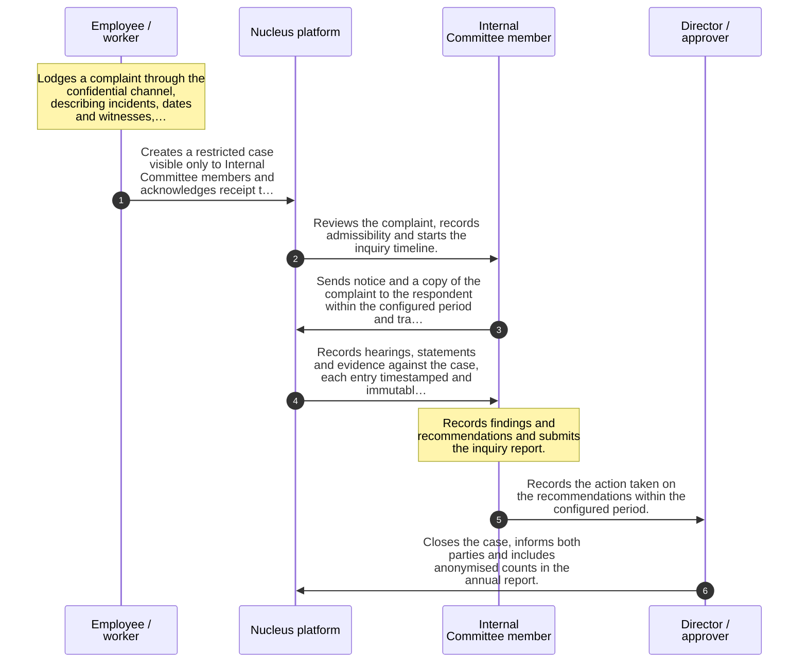

**Alternate flows**

| ID | At step | Condition | Steps | Rejoins |
| :--- | ---: | :--- | :--- | :--- |
| A1 | 3 | The complainant asks for conciliation before inquiry. | Committee records the request and the settlement terms if reached. → Case closes as settled through conciliation. | Returns to step 8 |

**Exception flows**

| ID | At step | Condition | Handling | Rule |
| :--- | ---: | :--- | :--- | :--- |
| E1 | 2 | A member of the committee is named in the complaint. | That member is excluded from the case and cannot see it. |  |
| E2 | 5 | An inquiry milestone passes its configured deadline. | The case is flagged overdue and escalated to the presiding officer and compliance owner. |  |
| E3 | 2 | A user without the restricted case role attempts to open the case. | Access is denied and the attempt is logged. |  |

**Postconditions — success**

- The case is closed with findings, recommendations and the action taken, visible only to authorised roles.
- The case is counted in the annual report without identifying parties.

**Postconditions — failure**

- The case remains open with its overdue timeline escalated to the presiding officer and compliance owner.

**Quality requirements**

- Case data is encrypted with a key separate from general HR data.
- Every access to a case is logged and reviewable by the presiding officer.

### CMP-UC-009

**Maintain contract labour registers and returns** — Keep the principal employer's contractor licences, registers and returns current from live deployment data.

| Attribute | Value |
| :--- | :--- |
| Realises | CMP-CG-003 |
| Source | Authored |
| Level | User goal |
| Primary actor | Compliance owner |
| Secondary actors | Nucleus platform, Plant HR / time office, Contractor (external), Statutory portal |
| Trigger | A contractor is engaged or renewed, a register period ends, or a return falls due. |
| Frequency | Monthly |
| Criticality | High |
| Phase | P2 |
| Client requirements | R-18 |
| Business rules | RL-380, RL-381 |
| Screens | SCR-073, SCR-072 |
| Data objects (CRUD) | contractor (C/U), contract_licence (C/U), statutory_form_instance (C), obligation (U) |
| Events | compliance.form.generated |
| Acceptance tests | TC-C380, TC-C381, CMP-TC-011, CMP-TC-012, CMP-TC-013, CMP-TC-014 |
| System requirements | SYS-022, SYS-045, SYS-070, SYS-086 |

**Stakeholders and interests**

| Stakeholder | Interest |
| :--- | :--- |
| Plant HR / time office | Only workers of licensed, compliant contractors are deployed. |
| Finance | Contractor invoices are not paid while statutory proof is outstanding. |
| Auditor | Registers reconcile to deployment and attendance. |

**Preconditions**

- The principal employer registration is recorded per location.
- Contractors are registered with licence number, validity, PF and ESI codes (to be validated by Legal).

**Main success scenario**

| # | Actor | Action | Ref |
| ---: | :--- | :--- | :--- |
| 1 | Compliance owner | Records each contractor's licence, validity dates, sites served, workforce ceiling and PF and ESI codes. |  |
| 2 | Nucleus platform | Tracks licence expiry and alerts the compliance owner 30 days before expiry. |  |
| 3 | Plant HR / time office | Deploys contract workers to a site against an active contractor licence. |  |
| 4 | Contractor (external) | Uploads monthly PF and ESI challans for deployed workers. |  |
| 5 | Nucleus platform | Verifies challans against deployed headcount and flags shortfalls. |  |
| 6 | Nucleus platform | Generates the register of contractors and the register of workmen per location from deployment and attendance. |  |
| 7 | Compliance owner | Generates the periodic return, files it on the statutory portal and records the acknowledgement. |  |

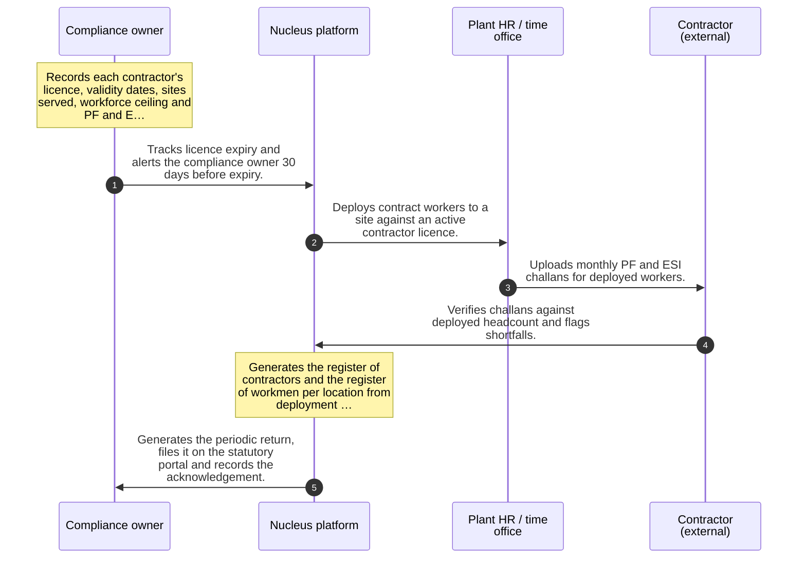

**Alternate flows**

| ID | At step | Condition | Steps | Rejoins |
| :--- | ---: | :--- | :--- | :--- |
| A1 | 2 | The contractor renews its licence. | Compliance owner records the new licence and validity. → Platform clears the expiry alert. | Returns to step 3 |

**Exception flows**

| ID | At step | Condition | Handling | Rule |
| :--- | ---: | :--- | :--- | :--- |
| E1 | 3 | The contractor licence has expired or the workforce ceiling would be exceeded. | Deployment is blocked and the reason is shown. |  |
| E2 | 5 | A monthly challan is missing or short. | The contractor is flagged and the related invoice is held for Finance review. |  |
| E3 | 6 | A location has no principal employer registration. | Register generation fails and the location is flagged. | RL-380 |

**Postconditions — success**

- Registers for the period are generated from deployment and attendance data.
- The half-yearly or annual return is filed and its acknowledgement recorded.

**Postconditions — failure**

- A deployment is blocked or flagged; the register lists the missing data.

**Quality requirements**

- Registers for 200 contract workers render within 20 seconds.
- Licence and challan documents are retained for the statutory period (to be validated by Legal).

### CMP-UC-010

**Produce workforce disclosures for sustainability reporting** — Generate workforce metrics for sustainability reporting from posted records with lineage to the source data.

| Attribute | Value |
| :--- | :--- |
| Realises | CMP-CG-004 |
| Source | Authored |
| Level | User goal |
| Primary actor | Compliance owner |
| Secondary actors | Nucleus platform, Finance, Auditor |
| Trigger | The financial year closes or a disclosure is requested. |
| Frequency | Annual |
| Criticality | Medium |
| Phase | P3 |
| Client requirements | — |
| Business rules | RL-371 |
| Screens | — |
| Data objects (CRUD) | disclosure_set (C/U), metric_lineage (C) |
| Events | — |
| Acceptance tests | CMP-TC-015, CMP-TC-016, CMP-TC-017, CMP-TC-018 |
| System requirements | SYS-017, SYS-023, SYS-024, SYS-051 |

**Stakeholders and interests**

| Stakeholder | Interest |
| :--- | :--- |
| Finance | Wage and headcount figures agree with the books. |
| Auditor | Every disclosed figure can be traced to its records. |

**Preconditions**

- Payroll for the year is POSTED.
- Metric definitions (headcount, diversity, wages, turnover, safety incidents, training hours) are configured with their source queries.

**Main success scenario**

| # | Actor | Action | Ref |
| ---: | :--- | :--- | :--- |
| 1 | Compliance owner | Selects the financial year and entities for the disclosure. |  |
| 2 | Nucleus platform | Computes each configured metric from posted and approved records only. |  |
| 3 | Nucleus platform | Stores lineage for each metric: definition, query version, record count and as-at timestamp. |  |
| 4 | Compliance owner | Reviews metrics and drills any figure to its underlying records within scope. |  |
| 5 | Finance | Confirms wage totals against the posted salary journals. |  |
| 6 | Compliance owner | Locks the disclosure set and exports it in the reporting format. |  |

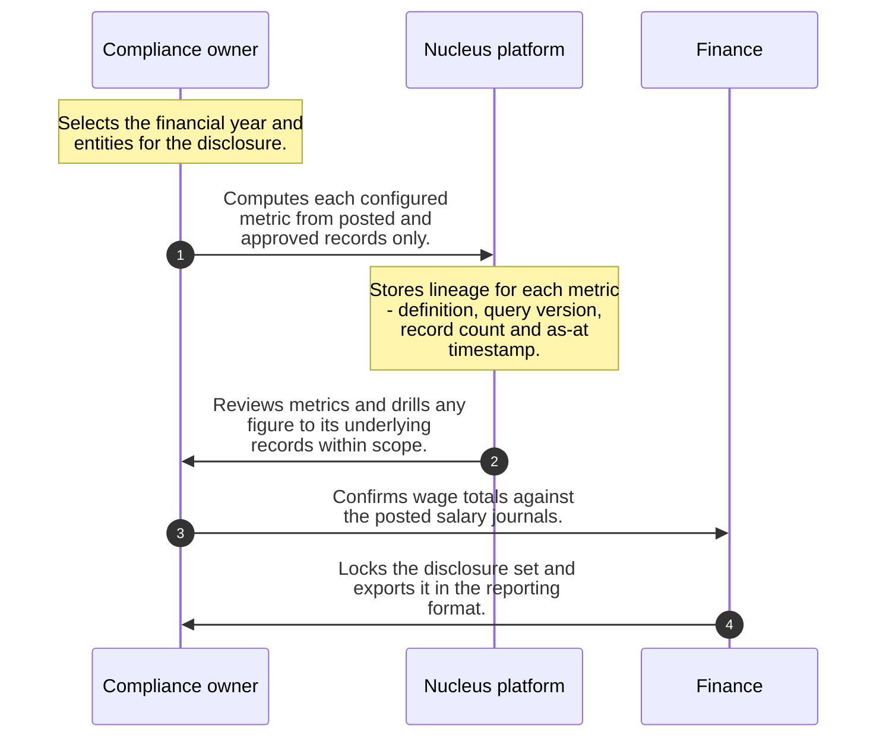

**Alternate flows**

| ID | At step | Condition | Steps | Rejoins |
| :--- | ---: | :--- | :--- | :--- |
| A1 | 4 | The owner disputes a figure. | Owner corrects the source record through its owning process. → Platform recomputes the affected metric with new lineage. | Returns to step 4 |

**Exception flows**

| ID | At step | Condition | Handling | Rule |
| :--- | ---: | :--- | :--- | :--- |
| E1 | 2 | A period's payroll is not POSTED. | The wage metric is not computed and the period is named. | RL-371 |
| E2 | 6 | A user tries to edit a locked figure. | The edit is refused; changes require a new version with reason. |  |

**Postconditions — success**

- A locked disclosure set exists for the year with each metric linked to its query and source records.

**Postconditions — failure**

- The disclosure stays in draft with the failing metrics listed.

**Quality requirements**

- Small cohorts (fewer than 5 people) are suppressed in diversity breakdowns.
- Recomputing a full year for 600 employees completes within 10 minutes.

### CMP-UC-011

**Assign and enforce mandatory compliance training** — Assign mandatory compliance training by rule, track it to completion and escalate overdue items.

| Attribute | Value |
| :--- | :--- |
| Realises | CMP-CG-005 |
| Source | Authored |
| Level | User goal |
| Primary actor | Nucleus platform |
| Secondary actors | Employee / worker, Manager / supervisor, HR operations, Compliance owner |
| Trigger | A person joins, changes role or location, or a refresher period lapses. |
| Frequency | Per event |
| Criticality | High |
| Phase | P2 |
| Client requirements | — |
| Business rules | RL-395 |
| Screens | SCR-063 |
| Data objects (CRUD) | learning_assignment (C/U), completion_record (C) |
| Events | learning.path.assigned |
| Acceptance tests | CMP-TC-019, CMP-TC-020, CMP-TC-021, CMP-TC-022 |
| System requirements | SYS-053, SYS-056, SYS-059, SYS-070 |

**Stakeholders and interests**

| Stakeholder | Interest |
| :--- | :--- |
| Compliance owner | Evidence that every in-scope person completed required training. |
| Manager / supervisor | Knows which team members are overdue. |

**Preconditions**

- Assignment rules exist for each mandatory course (for example harassment-prevention awareness within 14 days of joining; factory safety within 2 days for plant roles).

**Main success scenario**

| # | Actor | Action | Ref |
| ---: | :--- | :--- | :--- |
| 1 | Nucleus platform | Evaluates assignment rules when a joining, role, location or refresher trigger fires. |  |
| 2 | Nucleus platform | Creates the assignment through the standard learning assignment mechanism with a due date. | RL-395 |
| 3 | Employee / worker | Completes the course on SCR-063; completion evidence is stored. |  |
| 4 | Nucleus platform | Sends reminders 3 days before and on the due date. |  |
| 5 | Nucleus platform | Escalates overdue items to the manager, then to HR operations after 7 further days. |  |
| 6 | Compliance owner | Reviews completion rates by course, location and entity and exports evidence. |  |

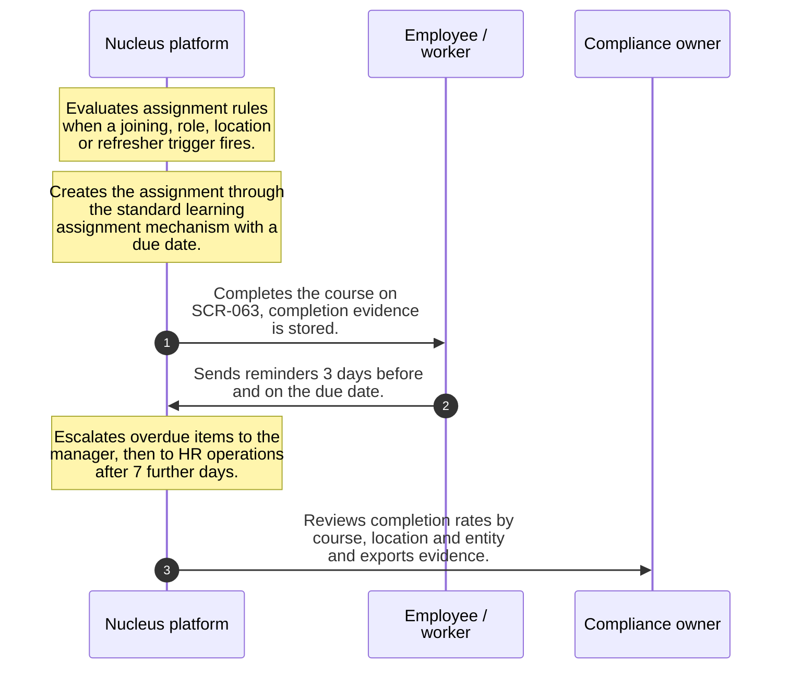

**Alternate flows**

| ID | At step | Condition | Steps | Rejoins |
| :--- | ---: | :--- | :--- | :--- |
| A1 | 3 | The employee already holds a valid completion from a previous assignment. | Platform links the existing completion and closes the assignment. | Returns to step 6 |

**Exception flows**

| ID | At step | Condition | Handling | Rule |
| :--- | ---: | :--- | :--- | :--- |
| E1 | 5 | A mandatory item is still open at the confirmation due date. | Confirmation is blocked until completion. |  |
| E2 | 2 | No rule matches a person's role and location. | The person is listed as uncovered for HR operations to resolve. |  |

**Postconditions — success**

- Each in-scope person has an assignment with due date and completion evidence.
- Overdue items have been escalated and are visible on the compliance dashboard.

**Postconditions — failure**

- Unassigned or overdue items are listed for HR operations to resolve.

**Quality requirements**

- Rule evaluation for a 600-person tenant completes within 2 minutes.
- Completion evidence is retained for the employment period plus the configured retention.

### CMP-UC-012

**Report, investigate and close a safety incident** — Record incidents and near-misses at a site, investigate root cause, track corrective actions and prepare statutory accident notices within the required time (to be validated by Legal).

| Attribute | Value |
| :--- | :--- |
| Realises | CMP-CG-006 |
| Source | Authored |
| Level | User goal |
| Primary actor | Plant HR / time office |
| Secondary actors | Employee / worker, Manager / supervisor, Compliance owner, Nucleus platform, Statutory portal |
| Trigger | An employee or supervisor reports an injury, dangerous occurrence or near-miss. |
| Frequency | Weekly |
| Criticality | High |
| Phase | P2 |
| Client requirements | — |
| Business rules | RL-360, RL-364, RL-370, RL-371, RL-372, RL-383 |
| Screens | SCR-072, SCR-073 |
| Data objects (CRUD) | incident (C/U), investigation (C), corrective_action (C/U), statutory_obligation (C/U), filing_acknowledgement (C) |
| Events | compliance.incident.reported, compliance.incident.closed |
| Acceptance tests | CMP-TC-023, CMP-TC-024, CMP-TC-025, CMP-TC-026, CMP-TC-027, CMP-TC-028 |
| System requirements | SYS-045, SYS-053, SYS-070, SYS-086 |

**Stakeholders and interests**

| Stakeholder | Interest |
| :--- | :--- |
| Employee / worker | Can report hazards and injuries easily and without fear of blame. |
| Compliance owner | Notifiable accidents are notified within the statutory window with evidence retained. |
| Director / approver | Sees incident trends and closure of corrective actions per site. |

**Preconditions**

- Incident categories, severity levels and the notifiability criteria per state rule pack are configured.
- The EHS sub-function (OU-180) is set up with an investigator role per site.

**Main success scenario**

| # | Actor | Action | Ref |
| ---: | :--- | :--- | :--- |
| 1 | Employee / worker | Reports an incident from the mobile app: hand injury at the Medchal Works press line on 2026-11-03 at 14:20, with photos. |  |
| 2 | Manager / supervisor | Confirms the report, records first aid given and classifies severity as lost-time injury. |  |
| 3 | Nucleus platform | Evaluates notifiability against the state rule pack and, if notifiable, creates an obligation with its due time. |  |
| 4 | Plant HR / time office | Links the injured person's absence days to the incident so the lost-time count is derived. |  |
| 5 | Compliance owner | Reviews the prepared accident notice, assembled from the incident record. |  |
| 6 | Compliance owner | Files the notice on the statutory portal and records the acknowledgement reference. |  |
| 7 | Manager / supervisor | Leads the root-cause investigation and records causes and corrective actions with owners and due dates. |  |
| 8 | Nucleus platform | Tracks corrective actions, sends reminders and escalates overdue items. |  |
| 9 | Compliance owner | Verifies the actions are effective and closes the incident. |  |

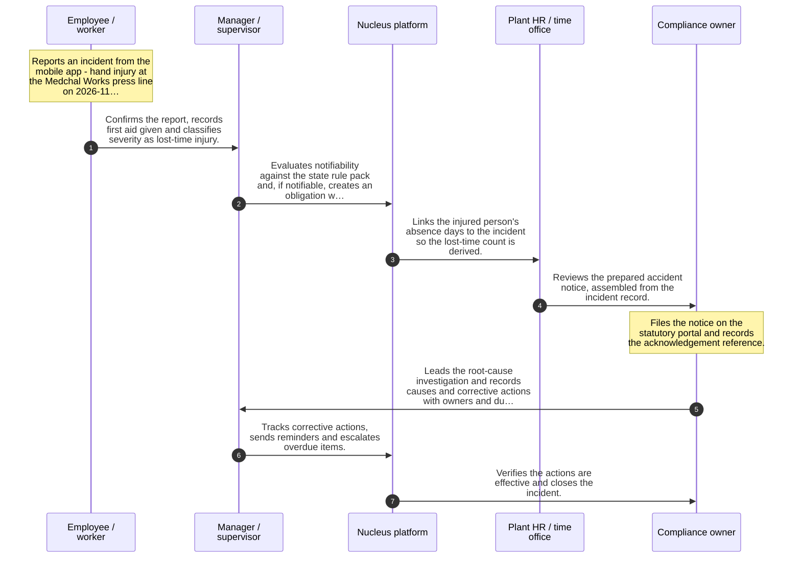

**Alternate flows**

| ID | At step | Condition | Steps | Rejoins |
| :--- | ---: | :--- | :--- | :--- |
| A1 | 2 | The event is a near-miss with no injury. | The near-miss is recorded with hazard category; no notifiability check is needed. | Returns to step 7 |
| A2 | 1 | The reporter chooses to remain anonymous for a hazard report. | The report is stored without reporter identity and routed to the site EHS lead. | Returns to step 2 |

**Exception flows**

| ID | At step | Condition | Handling | Rule |
| :--- | ---: | :--- | :--- | :--- |
| E1 | 6 | The statutory notice is not filed before its due time. | The obligation is escalated to the compliance owner and site head as overdue, with the delay recorded. | RL-372 |
| E2 | 3 | No state rule pack version covers the site's state on the incident date. | The incident is flagged for manual notifiability assessment by the compliance owner. | RL-364 |

**Postconditions — success**

- The incident is recorded with severity, root cause and corrective actions closed; any statutory notice is prepared, filed by a human and its acknowledgement retained.

**Postconditions — failure**

- An overdue notice or open corrective action is escalated to the compliance owner and site head.

**Quality requirements**

- An incident report can be submitted from a mobile device on a 3G connection in under 60 s.
- Incident records and filed notices are retained for the statutory retention period (to be validated by Legal).

### CMP-UC-013

**Raise and handle a grievance or protected disclosure** — Let employees raise grievances and protected disclosures, anonymously if they choose, with confidential case handling, escalation timelines and outcome reporting.

| Attribute | Value |
| :--- | :--- |
| Realises | CMP-CG-007 |
| Source | Authored |
| Level | User goal |
| Primary actor | Employee / worker |
| Secondary actors | Compliance owner, HR operations, Director / approver, Nucleus platform |
| Trigger | An employee submits a grievance or a protected disclosure through the confidential channel. |
| Frequency | Weekly |
| Criticality | High |
| Phase | P2 |
| Client requirements | — |
| Business rules | — |
| Screens | — |
| Data objects (CRUD) | case (C/U), case_message (C), case_access_list (C/U), outcome_report (C) |
| Events | compliance.case.raised, compliance.case.closed |
| Acceptance tests | CMP-TC-029, CMP-TC-030, CMP-TC-031, CMP-TC-032, CMP-TC-033, CMP-TC-034 |
| System requirements | SYS-019, SYS-020, SYS-032, SYS-033 |

**Stakeholders and interests**

| Stakeholder | Interest |
| :--- | :--- |
| Employee / worker | Can raise a concern safely and follow its progress without revealing identity. |
| Director / approver | Serious disclosures reach the right committee without being filtered by line management. |
| Auditor | Cases are handled within timelines and outcomes are reported. |

**Preconditions**

- Case categories, handling committees and escalation timelines are configured per entity.
- Case data is restricted to the assigned handlers; managers named in a case are excluded from its access.

**Main success scenario**

| # | Actor | Action | Ref |
| ---: | :--- | :--- | :--- |
| 1 | Employee / worker | Opens the confidential channel, chooses 'protected disclosure', selects anonymous and describes the concern. |  |
| 2 | Nucleus platform | Creates the case, issues a case key for the reporter and strips identifying metadata from the submission. |  |
| 3 | Nucleus platform | Routes the case to the handling committee for the category and excludes any person named in it from access. |  |
| 4 | Compliance owner | Acknowledges the case and records an initial assessment within the configured timeline. |  |
| 5 | Compliance owner | Investigates, exchanging messages with the reporter through the case key without learning their identity. |  |
| 6 | Director / approver | Reviews findings and decides the outcome and any action. |  |
| 7 | Nucleus platform | Closes the case, informs the reporter of the outcome category and adds it to aggregated outcome reports. |  |

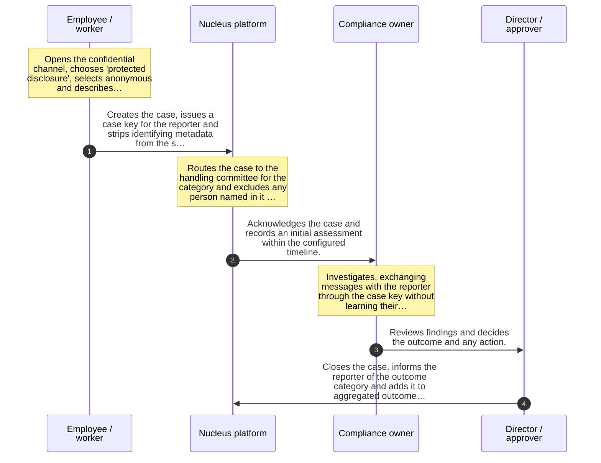

**Alternate flows**

| ID | At step | Condition | Steps | Rejoins |
| :--- | ---: | :--- | :--- | :--- |
| A1 | 1 | The employee raises a named grievance about working conditions. | The case is routed to HR operations under the grievance timeline and the employee is kept informed by name. | Returns to step 4 |
| A2 | 6 | The finding requires disciplinary action. | A separate disciplinary case is opened with restricted access, linked to this case. | Returns to step 7 |

**Exception flows**

| ID | At step | Condition | Handling | Rule |
| :--- | ---: | :--- | :--- | :--- |
| E1 | 4 | The case is not acknowledged within the timeline. | It escalates automatically to the next committee level and the delay is recorded. |  |
| E2 | 3 | A handler is named in the case. | That handler is removed from access and the case is reassigned. |  |

**Postconditions — success**

- The case is investigated and closed with an outcome; the reporter is informed through the case channel and aggregated outcomes appear in periodic reports.

**Postconditions — failure**

- An overdue case escalates to the next level; no case is closed without a recorded outcome.

**Quality requirements**

- Anonymous submissions store no IP address, device identifier or account link.
- Every access to a case record is logged and visible to the committee chair.

### CMP-UC-014

**Track and renew licences and registrations** — Track factory licences, establishment registrations and contractor licences with expiry alerts and a renewal workflow.

| Attribute | Value |
| :--- | :--- |
| Realises | CMP-CG-008 |
| Source | Authored |
| Level | User goal |
| Primary actor | Compliance owner |
| Secondary actors | Plant HR / time office, Director / approver, Nucleus platform, Statutory portal |
| Trigger | A licence or registration approaches its expiry date, or a new one is issued. |
| Frequency | Monthly |
| Criticality | High |
| Phase | P2 |
| Client requirements | — |
| Business rules | RL-370, RL-371, RL-372, RL-380, RL-383 |
| Screens | SCR-072 |
| Data objects (CRUD) | licence (C/U), statutory_obligation (C/U), renewal_case (C/U), filing_acknowledgement (C) |
| Events | compliance.licence.expiring, compliance.licence.renewed |
| Acceptance tests | CMP-TC-035, CMP-TC-036, CMP-TC-037, CMP-TC-038, CMP-TC-039, CMP-TC-040 |
| System requirements | SYS-022, SYS-037, SYS-070, SYS-086 |

**Stakeholders and interests**

| Stakeholder | Interest |
| :--- | :--- |
| Director / approver | No site operates on an expired licence. |
| Plant HR / time office | Knows well in advance which documents are needed for renewal. |
| Finance | Renewal fees are planned and paid on time. |

**Preconditions**

- Licences are recorded per location and entity with number, issuing authority, validity dates and owner, for example factory licence KA/FAC/2013/00891 for Peenya Works.
- Contractor licences are linked to the vendor and the principal-employer location.

**Main success scenario**

| # | Actor | Action | Ref |
| ---: | :--- | :--- | :--- |
| 1 | Nucleus platform | Detects that the Peenya Works factory licence expires within 90 days and opens a renewal obligation. |  |
| 2 | Notification service | Alerts the compliance owner and Peenya plant HR with the checklist of required documents. |  |
| 3 | Plant HR / time office | Uploads the required documents, such as the updated manpower statement, to the renewal case. |  |
| 4 | Nucleus platform | Prepares the renewal pack from posted records, including headcount by worker class at the site. |  |
| 5 | Director / approver | Approves the renewal application and fee. |  |
| 6 | Compliance owner | Files the application on the statutory portal and records the acknowledgement. |  |
| 7 | Compliance owner | Records the renewed licence with its new validity when issued. |  |
| 8 | Nucleus platform | Writes the new licence version, end-dates the old one and closes the obligation. |  |

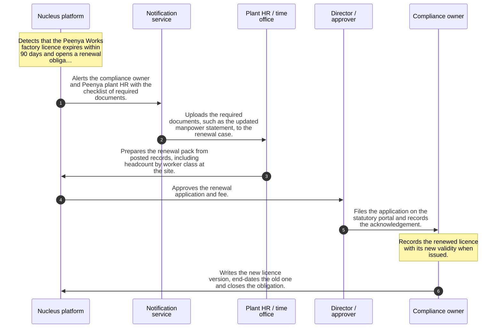

**Alternate flows**

| ID | At step | Condition | Steps | Rejoins |
| :--- | ---: | :--- | :--- | :--- |
| A1 | 1 | The licence is a contractor licence held by vendor VN-01. | The vendor is asked to upload the renewed licence; the compliance owner verifies it. | Returns to step 7 |

**Exception flows**

| ID | At step | Condition | Handling | Rule |
| :--- | ---: | :--- | :--- | :--- |
| E1 | 7 | The licence expires before renewal is recorded. | The licence is shown as expired, escalated to the director and, for a contractor licence, new deployments of that contractor's workers are blocked. |  |
| E2 | 4 | Headcount in the renewal pack exceeds the licensed capacity. | The pack is flagged and the compliance owner must address the variance before filing. | RL-371 |

**Postconditions — success**

- The renewed licence is recorded with its new validity and acknowledgement, and the old version is end-dated.

**Postconditions — failure**

- An unrenewed licence is escalated, and dependent activities such as onboarding a contractor's workers are flagged.

**Quality requirements**

- Expiry alerts are sent at 90, 60, 30 and 7 days before expiry.
- The licence register for all five sites loads in under 2 s.

### CMP-UC-015

**Record inspection visits and close resulting orders** — Record statutory inspection visits, remarks and orders at a site and track the resulting compliance actions to closure.

| Attribute | Value |
| :--- | :--- |
| Realises | CMP-CG-009 |
| Source | Authored |
| Level | User goal |
| Primary actor | Plant HR / time office |
| Secondary actors | Compliance owner, Manager / supervisor, Director / approver, Nucleus platform |
| Trigger | An inspector visits a site, for example a factory inspection at Oragadam Works. |
| Frequency | Several times a year per site |
| Criticality | High |
| Phase | P2 |
| Client requirements | — |
| Business rules | RL-380, RL-381, RL-372, RL-383 |
| Screens | SCR-073, SCR-072 |
| Data objects (CRUD) | inspection_visit (C/U), inspection_order (C), compliance_action (C/U), filing_acknowledgement (C) |
| Events | compliance.inspection.recorded, compliance.inspection.closed |
| Acceptance tests | CMP-TC-041, CMP-TC-042, CMP-TC-043, CMP-TC-044, CMP-TC-045, CMP-TC-046 |
| System requirements | SYS-016, SYS-023, SYS-032, SYS-086 |

**Stakeholders and interests**

| Stakeholder | Interest |
| :--- | :--- |
| Compliance owner | Every inspector's remark and order is answered within its deadline. |
| Director / approver | Sees open inspection actions across sites. |
| Auditor | Has a complete inspection history per site. |

**Preconditions**

- The site's statutory registers and forms are generated from posted records (RL-380).
- Inspection types and response deadlines are configured.

**Main success scenario**

| # | Actor | Action | Ref |
| ---: | :--- | :--- | :--- |
| 1 | Plant HR / time office | Records the visit: date, inspector designation, authority, scope and registers inspected. |  |
| 2 | Nucleus platform | Shows the registers and forms generated for the site and period so they can be produced at once. |  |
| 3 | Plant HR / time office | Records the inspector's remarks and any written orders, attaching a scan of the inspection-book entry. |  |
| 4 | Compliance owner | Converts each order into actions with owners and deadlines. |  |
| 5 | Manager / supervisor | Completes assigned actions and uploads evidence, such as a corrected muster roll. |  |
| 6 | Compliance owner | Prepares and files the compliance report and records the acknowledgement. |  |
| 7 | Nucleus platform | Closes the visit when all actions are verified and the report acknowledgement is recorded. |  |

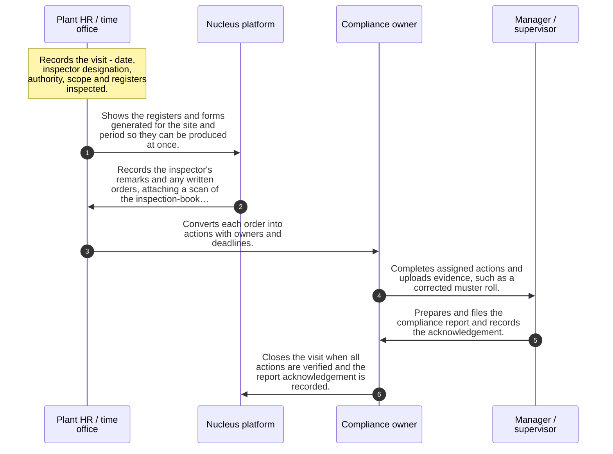

**Alternate flows**

| ID | At step | Condition | Steps | Rejoins |
| :--- | ---: | :--- | :--- | :--- |
| A1 | 3 | The inspection results in no remarks. | The visit is recorded as 'no remarks' and closed. | Ends |

**Exception flows**

| ID | At step | Condition | Handling | Rule |
| :--- | ---: | :--- | :--- | :--- |
| E1 | 5 | An action passes its deadline. | It is escalated to the compliance owner and site head. |  |
| E2 | 2 | A register required by the inspector cannot be generated because source records are missing. | The gap is listed and an action is created to correct it. | RL-381 |

**Postconditions — success**

- The visit, remarks and orders are recorded; each order's actions are closed with evidence and the compliance report is filed.

**Postconditions — failure**

- Open actions past their deadline are escalated to the compliance owner and director.

**Quality requirements**

- Any statutory register for a site and month is produced in under 30 s during a visit.
- Inspection history is retained per site for at least the statutory retention period (to be validated by Legal).

## Approval & Sign-off

| Role | Name | Date | Decision | Conditions / comments |
| :--- | :--- | :--- | :--- | :--- |
| Author | Dhanraj Dadhich | 2026-11-05 | Submitted | |
| Peer review moderator | *pending* | | | PR-xxxx |
| PQA (process compliance) | *pending* | | | |
| Approval authority (DOC-01 §7) | *pending* | | | |

## Measurement Data Captured

| Measure | Value | Unit | Notes |
| :--- | :--- | :--- | :--- |
| Size | 467 | specified items (table rows) | Counted automatically at generation |
| Authoring effort | *to be recorded* | person-hours | |
| Review effort (preparation + meeting) | *pending review* | person-hours | From PR-xxxx |
| Rework effort | *pending review* | person-hours | |
| Review rate | *pending review* | items / hour | Compare with PPB control limits |
| Requirement volatility (changes since baseline) | 0 | CRs touching this artefact | Not yet baselined (CM-03) |

**Defects found, by detection phase and severity**

| Detection phase | Major | Minor | Editorial | Injected in phase (major) |
| :--- | :--- | :--- | :--- | :--- |
| Author self-check | 0 | 0 | 0 | — |
| Peer review | *pending* | | | |
| Design / build | | | | |
| System / integration test | | | | |
| UAT | | | | |
| Production (escaped) | | | | each escaped major opens a CAR record (CAR-01) |

Within control limits of the review-rate PPB? *To be assessed at peer review.*

## Revision History

| Version | Date | Author | Change summary | CR ref | Approved by |
| :--- | :--- | :--- | :--- | :--- | :--- |
| 1.0.0 | 2026-11-05 | Dhanraj Dadhich | Consolidated release | CR-0001 | *pending* |
